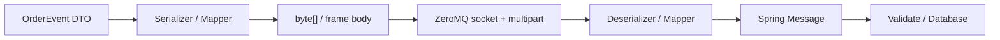
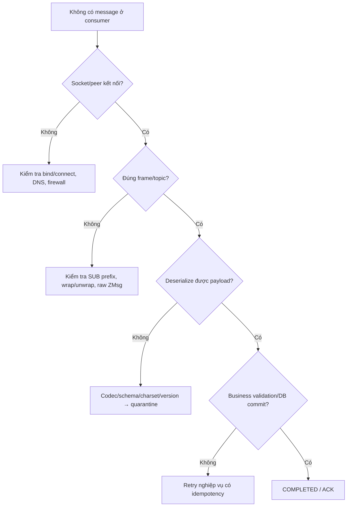
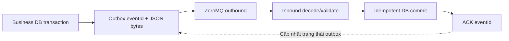

# Serialization payload trong ZeroMQ và Spring Integration

## 1. Bài toán: gửi được byte nhưng người nhận không hiểu dữ liệu

Một dịch vụ đặt hàng Spring Boot gửi sự kiện `order.created` cho hệ thống xử lý kho thông qua ZeroMQ. Ở phía gửi, ứng dụng dùng một Java record `OrderEvent`; phía nhận là dịch vụ Python chỉ hiểu JSON. Trong thử nghiệm, chương trình gửi không báo lỗi nhưng dịch vụ nhận xuất hiện một trong những hiện tượng sau:

- Nội dung nhận được là tên lớp hoặc chuỗi `OrderEvent[...]` thay vì JSON.
- Dịch vụ nhận giải mã sai tiếng Việt vì hai bên dùng charset khác nhau.
- SUB nhận được frame topic nhưng body rỗng vì một bên dùng `[topic][body]`, bên kia kỳ vọng `[topic][empty][body]`.
- Một Spring header `eventId` có ở bên gửi nhưng bên nhận JeroMQ thuần không thấy.
- Handler nhận `ZMsg`, trong khi code cố ép payload trực tiếp về `OrderEvent`.
- Một phiên bản mới thêm field bắt buộc làm consumer cũ không còn parse được.

Những vấn đề này thuộc về **serialization payload**: biến dữ liệu nghiệp vụ thành một dạng byte thống nhất để truyền, rồi chuyển các byte đó trở lại dữ liệu có ý nghĩa. **ZeroMQ bảo toàn frame nhị phân; nó không tự cung cấp một hợp đồng JSON, Protobuf, schema version hay Spring Message headers cho mọi peer.**

Bài **“Serialization payload”** thuộc chương **Adapter ZeroMQ**, module **SPRING_INTEGRATION_ADAPTERS**. Module kết nối hệ thống ngoài bằng inbound/outbound adapter, gateway, poller và `MessageChannel`, thực hành qua file, SFTP, HTTP, JMS, AMQP, Kafka và cơ sở dữ liệu, đồng thời kiểm soát hợp đồng message, lỗi và vòng đời kết nối. Bài này tập trung vào **codec, mapper, converter, payload type, framing và khả năng tương thích giữa các hệ thống**.

### Mục tiêu học tập

Sau bài học, bạn có thể:

1. Phân biệt serialization, deserialization, encoding, framing và message conversion.
2. Nêu rõ vai trò của `OutboundMessageMapper<byte[]>`, `InboundMessageMapper<byte[]>` và `MessageConverter` trong Spring Integration ZeroMQ.
3. Phân biệt `receiveRaw(true)` nhận `ZMsg` với `receiveRaw(false)` nhận Spring message đã qua mapper.
4. Viết Java DSL gửi Java DTO dưới dạng JSON UTF-8 và giải mã JSON ở consumer.
5. Cấu hình topic/frame cho PUB/SUB mà không làm hỏng payload.
6. Lựa chọn JSON, `byte[]`, Protobuf hoặc định dạng nhị phân khác theo yêu cầu.
7. Quản lý schema version, content type, event ID, byte limit, dữ liệu không tin cậy và lỗi chuyển đổi.
8. Kiểm thử round-trip và interoperability, tránh nhầm gửi thành công với xử lý nghiệp vụ thành công.

## 2. Năm lớp trên đường đi của payload

Trong một luồng ZeroMQ, nên quan sát riêng năm lớp:



| Lớp | Ví dụ | Trách nhiệm |
| --- | --- | --- |
| **Domain object** | `OrderEvent(eventId, orderId, schemaVersion)` | Ý nghĩa nghiệp vụ và validation |
| **Serialization** | Jackson `writeValueAsBytes` | Chuyển DTO thành một `byte[]` theo định dạng xác định |
| **Framing** | `[topic][empty][body]` | Định nghĩa số frame và vị trí từng phần |
| **Transport** | ZeroMQ `PUSH/PULL` hoặc `PUB/SUB` | Di chuyển các frame theo socket pattern |
| **Deserialization** | Jackson `readValue` | Chuyển body bytes thành DTO theo schema |

**Serialization không phải framing.** Một JSON object có thể được serialize thành **một frame**; topic được thêm vào **frame khác**. Ngược lại, có thể có ba frame trong một message nhưng body vẫn là binary Protobuf chưa giải mã.

**Serialization cũng không đồng nghĩa encryption.** JSON, Protobuf và CBOR nhằm biểu diễn dữ liệu, không tự bảo vệ tính bí mật. Nếu truyền qua `tcp://` và cần bảo mật, phải áp dụng xác thực/mã hóa phù hợp với ZeroMQ/JeroMQ hoặc hạ tầng mạng.

### 2.1. Hợp đồng mà hai phía phải thống nhất

Trước khi viết Java DSL, nên trả lời:

| Câu hỏi | Một câu trả lời minh họa |
| --- | --- |
| Định dạng body? | JSON UTF-8 |
| Mỗi message có bao nhiêu frame? | PUSH/PULL: 1 body; PUB/SUB: 2 frame `[topic][body]` |
| Schema version nằm ở đâu? | Field JSON `schemaVersion` là số nguyên |
| Event ID nằm ở đâu? | Field JSON `eventId`, không chỉ trong Spring header |
| Topic là gì? | Frame đầu, prefix `orders.` |
| Byte order / charset? | UTF-8 cho JSON; không dùng platform default |
| Field mới được xử lý ra sao? | Consumer chấp nhận field tùy chọn, theo hợp đồng tương thích |
| Giới hạn message? | Ví dụ tối đa 1 MiB cho body (con số cần điều chỉnh) |
| Lỗi schema? | Đưa vào error flow/quarantine, không retry vô hạn |
| Mốc ACK? | Sau khi consumer commit DB, nếu nghiệp vụ yêu cầu |

Không có những thỏa thuận này, việc các socket có thể kết nối TCP chưa chứng minh ứng dụng giao tiếp được.

## 3. Chọn định dạng payload

| Định dạng | Ưu điểm | Hạn chế | Dùng khi |
| --- | --- | --- | --- |
| **`byte[]` nguyên dạng** | Ít biến đổi, kiểm soát rõ bytes | Bên nhận phải biết cấu trúc | Đã có protocol riêng, file nhị phân |
| **UTF-8 String** | Đơn giản, dễ debug | Không có schema mạnh, không phù hợp binary | Thử nghiệm, lệnh text nhỏ |
| **JSON UTF-8** | Dễ liên thông Java/Python/Node/Go; dễ đọc | Payload lớn hơn một số dạng nhị phân, cần schema/validation | Event nghiệp vụ, tích hợp nhiều ngôn ngữ |
| **Protobuf** | Schema rõ, binary compact, hỗ trợ tiến hóa field | Cần file `.proto` và generated classes đồng bộ | Traffic cao, schema ổn định và nhiều consumer |
| **CBOR/MessagePack/Avro** | Binary linh hoạt hoặc schema-driven | Cần codec và version chung; khó đọc thô | Hệ thống có yêu cầu cụ thể |
| **Java native serialization** | Thuận tiện cho một số đối tượng Java | Rủi ro bảo mật, phụ thuộc class/version, kém liên thông | **Không chọn mặc định** cho mạng không tin cậy |

**Khuyến nghị học tập:** bắt đầu bằng JSON UTF-8 với schema version và event ID rõ ràng. Khi xác định được nhu cầu bandwidth/latency, có thể chuyển sang Protobuf hoặc định dạng khác và bổ sung kiểm thử tương thích. Đừng chỉ chọn một format vì “nhẹ nhất” mà bỏ qua khả năng vận hành và nâng cấp.

### 3.1. Charset phải được chỉ định

```java
import java.nio.charset.StandardCharsets;

byte[] bytes = "Đơn hàng đã tạo"
        .getBytes(StandardCharsets.UTF_8);
String recovered = new String(bytes, StandardCharsets.UTF_8);
```

Không dựa vào `String.getBytes()` không tham số hoặc charset mặc định của hệ điều hành. Nếu gửi JSON từ Jackson qua `writeValueAsBytes`, dữ liệu JSON trên wire là UTF-8 theo API này; bên nhận phải giải mã đúng codec đã thỏa thuận.

Không được chuyển file binary sang `String` để “dễ vận chuyển”: byte không phải văn bản có thể bị thay đổi khi decode/re-encode.

## 4. Các điểm chuyển đổi của Spring Integration ZeroMQ

### 4.1. Inbound và outbound không dùng chung một loại mapper

| Thành phần | API chuyển đổi | Nhiệm vụ |
| --- | --- | --- |
| `ZeroMqMessageHandler` (outbound) | `OutboundMessageMapper<byte[]>` | Chuyển Spring `Message<?>` thành **body bytes** để gửi |
| `ZeroMqMessageProducer` (inbound) | `InboundMessageMapper<byte[]>` | Chuyển body bytes + headers do adapter cung cấp thành Spring `Message<?>` |
| Cả hai qua DSL | `messageConverter(MessageConverter)` | Cách cấu hình thay thế cho `messageMapper` |
| Inbound raw | `receiveRaw(true)` | **Bỏ qua mapper/converter**; phát `Message<ZMsg>` |
| Outbound raw | Payload đã là `ZMsg` | **Bỏ qua mapper/converter và topic injection**, gửi nguyên các frame |

Các tên API tương ứng:

```java
// Outbound:
ZeroMq.outboundChannelAdapter(context, url, SocketType.PUSH)
        .messageMapper(outboundMapper);

// Inbound:
ZeroMq.inboundChannelAdapter(context, SocketType.PULL)
        .bindPort(7777)
        .messageMapper(inboundMapper)
        .receiveRaw(false);
```

Đây là **đoạn DSL minh họa**: biến `outboundMapper` phải có kiểu `OutboundMessageMapper<byte[]>`, `inboundMapper` có kiểu `InboundMessageMapper<byte[]>` và endpoint phải nằm trong một `IntegrationFlow` thích hợp.

### 4.2. Mapper mặc định không tự serialize mọi DTO thành JSON

`ZeroMqMessageHandler` dùng `ConvertingBytesMessageMapper` với `ConfigurableCompositeMessageConverter` theo mặc định. Mapper chuyển một Spring message hoặc payload sang `byte[]` nếu converter hỗ trợ; đây **không phải lời hứa** rằng bất kỳ POJO nào cũng tự được Jackson serialize đúng schema yêu cầu.

`ZeroMqMessageProducer` khi `receiveRaw(false)` cũng dùng cơ chế chuyển đổi byte thành Spring message. Kiểu payload cuối cùng tùy thuộc mapper/converter. Không viết handler `Message<OrderEvent>` rồi giả định cấu hình mặc định sẽ tự nhận một record từ JSON của bên thứ ba.

**Quan trọng:** `ConvertingBytesMessageMapper` có logic dùng UTF-8 khi converter trả ra `String`, nhưng khi thiết kế giao thức cross-language, bạn vẫn phải xác định encoding và cách serialize một cách **tường minh** để không bị lệ thuộc vào thay đổi converter mặc định.

### 4.3. `ZeroMqChannel` có mapper khác với adapter

`ZeroMqChannel` là một implementation của Spring `SubscribableChannel` dùng ZeroMQ. Theo reference, nó mặc định dùng `EmbeddedHeadersJsonMessageMapper` để serialize **cả Spring message và một phần headers** thành bytes bằng Jackson. Có thể thay bằng `setMessageMapper(BytesMessageMapper)`.

**Không nhầm lẫn:** mặc định mang Spring headers của `ZeroMqChannel` **không** đồng nghĩa một `ZeroMqMessageHandler` outbound sẽ tự nhúng toàn bộ headers vào frame gửi cho JeroMQ peer thuần. Nếu một consumer Python chỉ cần `{"eventId":...}`, hãy dùng JSON event envelope được thống nhất thay vì một wire format private chứa Spring headers.

### 4.4. `messageMapper` và `messageConverter` là hai phương án

```text
Phương án A:
Spring Message<?> ── OutboundMessageMapper<byte[]> ── byte[]
byte[] + headers ── InboundMessageMapper<byte[]> ── Spring Message<?>

Phương án B:
Spring Message<?> ── MessageConverter ── byte[]
byte[] ── MessageConverter ── Spring Message<?>
```

Không cần gọi cả `messageMapper(...)` và `messageConverter(...)` trên cùng endpoint để “chạy cả hai lần”. Chọn **một hướng cấu hình phù hợp**; nếu mapper bên gửi và bên nhận không tương thích, phải kiểm tra wire bytes trước khi đổ lỗi cho transport.

## 5. `receiveRaw(true)`: khi cần tự xử lý frame

`ZeroMqMessageProducer` với `receiveRaw(true)` phát một Spring message mà payload là **`org.zeromq.ZMsg`**. Tất cả frame ở dạng gốc; Spring không tự đưa topic vào `ZeroMqHeaders.TOPIC` thông qua mapper trong chế độ raw.

```text
ZeroMQ wire: [topic][empty][body]
                   |
                   v
receiveRaw(true)
                   |
                   v
Spring Message<ZMsg>
   frame 0 = topic
   frame 1 = empty
   frame 2 = body
```

Một handler raw cần:

1. Kiểm tra **số frame** và giới hạn byte, không truy cập frame theo chỉ số trước khi validate.
2. Đọc topic, version, metadata theo đúng framing contract.
3. Deserialize body bằng codec phù hợp với `contentType`/schema version của giao thức.
4. Sao chép bytes/DTO nếu chuyển xử lý sang một thread hoặc queue bất đồng bộ.
5. Giải phóng `ZMsg` đúng ownership bằng `destroy()` khi đã dùng xong.

Khi `receiveRaw(true)`, phương thức `messageMapper(...)`/`messageConverter(...)` **không tác động đến raw payload**; muốn chuyển đổi, bạn phải làm ở transformer hoặc handler downstream.

### 5.1. Đọc raw multipart an toàn

```java
import java.nio.charset.StandardCharsets;
import org.springframework.integration.annotation.ServiceActivator;
import org.springframework.messaging.Message;
import org.springframework.stereotype.Component;
import org.zeromq.ZFrame;
import org.zeromq.ZMsg;

@Component
public class RawOrderFramesHandler {

    @ServiceActivator(inputChannel = "rawZeroMqOrders")
    public void accept(Message<ZMsg> message) {
        ZMsg raw = message.getPayload();
        try {
            // Protocol thỏa thuận: [topic][empty][jsonBody].
            if (raw.size() != 3) {
                throw new IllegalArgumentException("Sai số frame");
            }
            ZFrame[] frames = raw.toArray(new ZFrame[0]);
            if (frames[1].getData().length != 0) {
                throw new IllegalArgumentException(
                        "Thiếu empty delimiter frame");
            }
            String topic = new String(
                    frames[0].getData(), StandardCharsets.UTF_8);
            byte[] body = frames[2].getData();
            if (!topic.startsWith("orders.")) {
                throw new IllegalArgumentException("Topic không hợp lệ");
            }
            if (body.length < 1 || body.length > 1_048_576) {
                throw new IllegalArgumentException(
                        "JSON body rỗng hoặc quá lớn");
            }
            // Production: copy body, deserialize, validate, persist.
            // Không đưa raw ZMsg đã destroy sang async handler.
        } finally {
            raw.destroy();
        }
    }
}
```

Đoạn code chỉ kiểm tra frame/topic và byte limit; chưa deserialize JSON. Khi sản xuất, cần có cơ chế bắt lỗi, quarantine và idempotency. **Kiểm tra sau khi nhận** không hoàn toàn ngăn bộ nhớ đã tiêu tốn trên socket để nhận một frame quá lớn.

## 6. Xây dựng wire contract cho sự kiện đơn hàng

Ví dụ lựa chọn một JSON event envelope với **body là một frame**:

```json
{
  "schemaVersion": 1,
  "eventId": "evt-20261123-0042",
  "eventType": "orders.created",
  "orderId": "42"
}
```

Trên PUSH/PULL, ZeroMQ message thường là:

```text
Frame 0: JSON body bytes (UTF-8)
```

Trên PUB/SUB theo format hai frame:

```text
Frame 0: "orders.created" (topic bytes)
Frame 1: JSON body bytes (UTF-8)
```

Nếu dùng format ba frame của Spring PUB/SUB mặc định:

```text
Frame 0: "orders.created"
Frame 1: []  (empty, 0 byte)
Frame 2: JSON body bytes
```

**Không phải** cùng một JSON payload sẽ buộc mọi socket pattern phải có cùng số frame. Mỗi message có framing tùy pattern/hợp đồng, còn byte JSON body có thể được giữ giống nhau để các consumer liên thông.

### 6.1. Java DTO sử dụng record

Ví dụ dùng Java 17+:

```java
// OrderEvent.java
public record OrderEvent(
        int schemaVersion,
        String eventId,
        String eventType,
        String orderId) {
}
```

Record chỉ là biểu diễn Java. Bên ngoài hệ thống chỉ nhìn thấy **byte JSON theo schema**, không biết tới tên package/class Java. Cần giữ field ổn định, tránh serializing đối tượng domain rất lớn gồm lazy-loaded JPA associations, password hoặc fields nội bộ không được công khai.

### 6.2. Tách topic và eventType

`eventType` là field JSON dành cho nghiệp vụ; topic frame là dữ liệu routing ZeroMQ. Hai giá trị có thể trùng nhau, nhưng cần định nghĩa rõ:

- Cho phép topic và `eventType` khác nhau hay không?
- Khi hai giá trị bất đồng, bên nhận có từ chối message không?
- Topic có tính bảo mật hay chỉ là cơ chế lọc sự kiện?

Với ví dụ này, bên nhận nên đối chiếu `topic == eventType` trước khi commit, nếu business contract yêu cầu như vậy. Topic subscription **không phải authorization**: peer có thể gửi frame topic giả mạo nếu mạng và socket cho phép.

## 7. Dependencies và cấu hình môi trường

Ví dụ Maven trong ứng dụng Spring Boot sử dụng BOM để chọn phiên bản Spring Integration và Jackson tương thích:

```xml
<dependencies>
    <dependency>
        <groupId>org.springframework.boot</groupId>
        <artifactId>spring-boot-starter-integration</artifactId>
    </dependency>
    <dependency>
        <groupId>org.springframework.integration</groupId>
        <artifactId>spring-integration-zeromq</artifactId>
    </dependency>
    <dependency>
        <groupId>com.fasterxml.jackson.core</groupId>
        <artifactId>jackson-databind</artifactId>
    </dependency>
</dependencies>
```

`spring-integration-zeromq` dựa trên **JeroMQ**. Jackson được dùng ở bài này để tạo JSON UTF-8; có thể thay bằng JSON library đã thống nhất trong ứng dụng. Không dùng Java native serialization trên network chỉ để tránh khai báo schema.

```yaml
# application.yml
partner:
  zeromq:
    push-target: ${ZMQ_PUSH_TARGET:tcp://127.0.0.1:7777}
    pull-port: ${ZMQ_PULL_PORT:7777}
    pub-target: ${ZMQ_PUB_TARGET:tcp://subscriber.internal:7788}
    sub-source: ${ZMQ_SUB_SOURCE:tcp://publisher.internal:7788}
    topic-prefix: orders.
```

Đây là **hai topology độc lập**: PUSH kết nối tới một PULL bind cổng 7777; PUB kết nối tới một SUB đã bind cổng 7788 **hoặc** SUB kết nối tới một PUB khác đã bind cổng 7788. Đừng chạy hai socket chỉ `connect` với nhau mà không có endpoint bind. Trong Kubernetes, `127.0.0.1` trỏ về network namespace của pod hiện tại.

## 8. Custom JSON mapper: serialize DTO thành byte[] ở outbound

`OutboundMessageMapper<byte[]>` cho phép kiểm soát rõ **Java payload nào được chấp nhận**, serializer nào được dùng và kết quả byte trên wire là gì.

```java
import com.fasterxml.jackson.core.JsonProcessingException;
import com.fasterxml.jackson.databind.ObjectMapper;
import org.springframework.context.annotation.Bean;
import org.springframework.context.annotation.Configuration;
import org.springframework.integration.mapping.OutboundMessageMapper;

@Configuration
public class OrderJsonOutboundCodec {

    @Bean("orderJsonOutboundMapper")
    public OutboundMessageMapper<byte[]> orderJsonOutboundMapper(
            ObjectMapper objectMapper) {

        return message -> {
            Object value = message.getPayload();
            if (!(value instanceof OrderEvent event)) {
                throw new IllegalArgumentException(
                        "Payload phải là OrderEvent");
            }
            if (event.schemaVersion() != 1 ||
                    event.eventId() == null ||
                    event.eventId().isBlank()) {
                throw new IllegalArgumentException(
                        "Event schema/version/ID không hợp lệ");
            }
            try {
                return objectMapper.writeValueAsBytes(event);
            } catch (JsonProcessingException ex) {
                throw new IllegalArgumentException(
                        "Không serialize được OrderEvent", ex);
            }
        };
    }
}
```

Mã giả định `ObjectMapper` đã được Spring Boot/Jackson autoconfiguration cung cấp phù hợp. Nếu dự án không có bean, tạo và cấu hình một `ObjectMapper` duy nhất cho protocol (module, naming strategy, null policy, giới hạn parsing) rồi dùng lại cho encode/decode.

**Không serialize `message.toString()`.** Chuỗi `GenericMessage [payload=..., headers=...]` chỉ phục vụ debug, không phải JSON schema liên thông. Nếu bên nhận cần `eventId`, hãy giữ nó trong JSON body hoặc quy định frame riêng; một Spring header không tự đi qua ZeroMQ adapter mặc định.

### 8.1. Outbound PUSH flow

```java
import org.springframework.beans.factory.annotation.Qualifier;
import org.springframework.beans.factory.annotation.Value;
import org.springframework.context.annotation.Bean;
import org.springframework.context.annotation.Configuration;
import org.springframework.integration.channel.DirectChannel;
import org.springframework.integration.dsl.IntegrationFlow;
import org.springframework.integration.mapping.OutboundMessageMapper;
import org.springframework.integration.zeromq.dsl.ZeroMq;
import org.springframework.messaging.MessageChannel;
import org.zeromq.SocketType;
import org.zeromq.ZContext;

@Configuration
public class OrderPushOutboundFlow {

    @Bean(destroyMethod = "close")
    public ZContext zeroMqContext() {
        return new ZContext();
    }

    @Bean("ordersToPush")
    public MessageChannel ordersToPush() {
        return new DirectChannel();
    }

    @Bean
    public IntegrationFlow pushOrdersAsJson(
            ZContext context,
            @Qualifier("orderJsonOutboundMapper")
            OutboundMessageMapper<byte[]> jsonMapper,
            @Value("${partner.zeromq.push-target}") String target) {

        return IntegrationFlow.from("ordersToPush")
                .handle(ZeroMq.outboundChannelAdapter(
                        context, target, SocketType.PUSH)
                        .messageMapper(jsonMapper))
                .get();
    }
}
```

Trong ví dụ này, `OutboundMessageMapper<byte[]>` nhận `OrderEvent` rồi trả JSON bytes cho `PUSH`. **Không** gắn `topicFunction` cho `PUSH`; chức năng topic injection chỉ dùng với `PUB`.

### 8.2. Gửi một Spring Message<OrderEvent>

```java
import org.springframework.beans.factory.annotation.Qualifier;
import org.springframework.messaging.MessageChannel;
import org.springframework.messaging.support.MessageBuilder;
import org.springframework.stereotype.Service;

@Service
public class OrdersPublisher {

    private final MessageChannel channel;

    public OrdersPublisher(
            @Qualifier("ordersToPush") MessageChannel channel) {
        this.channel = channel;
    }

    public void publishCreated(String eventId, String orderId) {
        OrderEvent event = new OrderEvent(
                1, eventId, "orders.created", orderId);

        boolean accepted = channel.send(
                MessageBuilder.withPayload(event).build());
        if (!accepted) {
            throw new IllegalStateException(
                    "Channel không tiếp nhận OrderEvent");
        }
    }
}
```

`channel.send(...) == true` chỉ phản ánh việc Spring channel nhận/dispatch message theo contract của nó, **không chứng minh peer ZeroMQ đã lưu DB**. Outbound handler có reactive semantics; timeout/exception có thể được báo trên đường xử lý khác, tùy channel/endpoint. Với dữ liệu quan trọng, lưu sự kiện vào outbox trước khi phát.

## 9. Custom JSON mapper: deserialize byte[] thành DTO ở inbound

Phía nhận dùng một `InboundMessageMapper<byte[]>`, có thể nhận `headers` do ZeroMQ inbound adapter cung cấp (chẳng hạn topic khi SUB).

```java
import com.fasterxml.jackson.databind.ObjectMapper;
import java.io.IOException;
import org.springframework.context.annotation.Bean;
import org.springframework.context.annotation.Configuration;
import org.springframework.integration.mapping.InboundMessageMapper;
import org.springframework.integration.zeromq.ZeroMqHeaders;
import org.springframework.messaging.support.MessageBuilder;

@Configuration
public class OrderJsonInboundCodec {

    @Bean("orderJsonInboundMapper")
    public InboundMessageMapper<byte[]> orderJsonInboundMapper(
            ObjectMapper objectMapper) {

        return (bytes, headers) -> {
            if (bytes == null || bytes.length == 0 ||
                    bytes.length > 1_048_576) {
                throw new IllegalArgumentException(
                        "JSON bytes rỗng hoặc quá giới hạn");
            }

            try {
                OrderEvent event =
                        objectMapper.readValue(bytes, OrderEvent.class);
                if (event.schemaVersion() != 1 ||
                        event.eventId() == null ||
                        event.eventId().isBlank()) {
                    throw new IllegalArgumentException(
                            "Event/version/ID không hợp lệ");
                }

                var builder = MessageBuilder.withPayload(event);
                // Chỉ copy header đã được ứng dụng cho phép.
                Object topic = headers == null
                        ? null : headers.get(ZeroMqHeaders.TOPIC);
                if (topic != null) {
                    builder.setHeader(ZeroMqHeaders.TOPIC, topic);
                }
                return builder.build();
            } catch (IOException ex) {
                throw new IllegalArgumentException(
                        "JSON không thể deserialize", ex);
            }
        };
    }
}
```

Ví dụ chỉ mang qua topic header. Nếu muốn chuyển thêm metadata, cần **whitelist** header phù hợp và xác thực giá trị. Không copy tùy ý mọi header từ message không tin cậy để tránh ghi đè các header điều khiển/định tuyến trong Spring.

Đây là kiểm tra schema cơ bản; production còn phải validate `eventType`, `orderId`, ký tự/độ dài, giá trị số và quy tắc business. `ObjectMapper.readValue` không tự đảm bảo object hợp lệ về nghiệp vụ.

### 9.1. Inbound PULL flow đã giải mã

```java
import java.time.Duration;
import org.springframework.beans.factory.annotation.Qualifier;
import org.springframework.beans.factory.annotation.Value;
import org.springframework.context.annotation.Bean;
import org.springframework.context.annotation.Configuration;
import org.springframework.integration.dsl.IntegrationFlow;
import org.springframework.integration.mapping.InboundMessageMapper;
import org.springframework.integration.zeromq.dsl.ZeroMq;
import org.zeromq.SocketType;
import org.zeromq.ZContext;

@Configuration
public class OrderPullInboundFlow {

    @Bean
    public IntegrationFlow receiveOrdersAsJson(
            ZContext context,
            @Qualifier("orderJsonInboundMapper")
            InboundMessageMapper<byte[]> jsonMapper,
            @Value("${partner.zeromq.pull-port}") int port) {

        return IntegrationFlow.from(
                ZeroMq.inboundChannelAdapter(context, SocketType.PULL)
                        .bindPort(port)
                        .messageMapper(jsonMapper)
                        .receiveRaw(false)
                        .consumeDelay(Duration.ofMillis(100)))
                .channel("ordersDecoded")
                .get();
    }
}
```

Đây là mô hình **PUSH connect → PULL bind**. Không chạy thêm một PULL bên ngoài cùng bind cổng 7777 trong cùng host/network namespace. Đường vào của outbound adapter gửi một body frame JSON; inbound mapper nhận body bytes và tạo `Message<OrderEvent>`.

### 9.2. Service activator xử lý DTO

```java
import org.springframework.integration.annotation.ServiceActivator;
import org.springframework.messaging.Message;
import org.springframework.stereotype.Component;

@Component
public class DecodedOrdersHandler {

    @ServiceActivator(inputChannel = "ordersDecoded")
    public void accept(Message<OrderEvent> message) {
        OrderEvent event = message.getPayload();

        if (!"orders.created".equals(event.eventType())) {
            throw new IllegalArgumentException(
                    "Không hỗ trợ eventType=" + event.eventType());
        }
        if (event.orderId() == null ||
                !event.orderId().matches("[A-Za-z0-9_-]{1,64}")) {
            throw new IllegalArgumentException("orderId không hợp lệ");
        }

        // Production: idempotent DB transaction theo eventId.
        // Không coi việc vào handler là đã commit thành công.
        System.out.println("Received orderId=" + event.orderId());
    }
}
```

Mục tiêu của mapper là **tách transport ra khỏi nghiệp vụ**: handler không cần thao tác JeroMQ `ZMsg` hay JSON byte parser. Những ràng buộc business vẫn phải được kiểm tra trước DB commit.

## 10. Cấu hình PUB/SUB: topic là frame, body là serialized bytes

Khi dùng `PUB/SUB`, ngoài JSON body còn có topic phục vụ subscription. Cần phân biệt **routing topic** của ZeroMQ và **field eventType** nằm trong JSON.

### 10.1. PUB gửi hai frame [topic][jsonBody]

```java
import org.springframework.beans.factory.annotation.Qualifier;
import org.springframework.beans.factory.annotation.Value;
import org.springframework.context.annotation.Bean;
import org.springframework.context.annotation.Configuration;
import org.springframework.integration.dsl.IntegrationFlow;
import org.springframework.integration.mapping.OutboundMessageMapper;
import org.springframework.integration.zeromq.dsl.ZeroMq;
import org.zeromq.SocketType;
import org.zeromq.ZContext;

@Configuration
public class OrderPubJsonFlow {

    @Bean
    public IntegrationFlow publishOrderTopics(
            ZContext context,
            @Qualifier("orderJsonOutboundMapper")
            OutboundMessageMapper<byte[]> mapper,
            @Value("${partner.zeromq.pub-target}") String target) {

        return IntegrationFlow.from("topicEventsToSend")
                .handle(ZeroMq.outboundChannelAdapter(
                        context, target, SocketType.PUB)
                        .messageMapper(mapper)
                        .topicFunction(message -> {
                            OrderEvent event =
                                    (OrderEvent) message.getPayload();
                            return event.eventType();
                        })
                        .wrapTopic(false))
                .get();
    }
}
```

Flow này giả định đã có channel `topicEventsToSend` và peer `SUB` đang **bind** tại `pub-target`. `topicFunction` xác định topic frame từ DTO; `wrapTopic(false)` chọn wire format **hai frame**. Nếu payload là raw `ZMsg`, handler **không** áp dụng mapper hay tự chèn topic; cần tự định nghĩa các frame.

### 10.2. SUB nhận topic và JSON body

```java
import java.time.Duration;
import org.springframework.beans.factory.annotation.Qualifier;
import org.springframework.beans.factory.annotation.Value;
import org.springframework.context.annotation.Bean;
import org.springframework.context.annotation.Configuration;
import org.springframework.integration.dsl.IntegrationFlow;
import org.springframework.integration.mapping.InboundMessageMapper;
import org.springframework.integration.zeromq.dsl.ZeroMq;
import org.zeromq.SocketType;
import org.zeromq.ZContext;

@Configuration
public class OrderSubJsonFlow {

    @Bean
    public IntegrationFlow subscribeOrderTopics(
            ZContext context,
            @Qualifier("orderJsonInboundMapper")
            InboundMessageMapper<byte[]> mapper,
            @Value("${partner.zeromq.sub-source}") String source) {

        return IntegrationFlow.from(
                ZeroMq.inboundChannelAdapter(context, SocketType.SUB)
                        .connectUrl(source)
                        .topics("orders.")
                        .unwrapTopic(false)
                        .messageMapper(mapper)
                        .receiveRaw(false)
                        .consumeDelay(Duration.ofMillis(100)))
                .channel("orderTopicsDecoded")
                .get();
    }
}
```

Đây là cấu hình **SUB connect tới remote PUB đã bind** tại `sub-source`. Hai flow PUB connect và SUB connect ở trên là **hai ví dụ cho hai topology độc lập**, không phải một cặp tự kết nối với nhau khi cùng chạy mà không có bên bind. Nếu muốn chạy nội bộ một ứng dụng, cần PUB bind (overload hỗ trợ từ Spring Integration 6.4+) và SUB connect, hoặc SUB bind và PUB connect.

### 10.3. Frame layout phải khớp

| Outbound PUB | Wire frames | Inbound SUB mapped |
| --- | --- | --- |
| `wrapTopic(false)` | `[topic][body]` | `unwrapTopic(false)` |
| `wrapTopic(true)` (mặc định) | `[topic][empty][body]` | `unwrapTopic(true)` (mặc định) |
| Payload raw `ZMsg` | Các frame gốc, không tự thêm topic | Custom parser hoặc mapper tương thích |

`wrapTopic`/`unwrapTopic` có trong API từ **Spring Integration 6.2.6**; với BOM cũ, hãy kiểm tra phiên bản trước khi dùng.

Trong SUB, `topics("orders.")` so khớp **prefix bytes của topic frame đầu**, không parse field JSON `eventType`. Topic header được framework ánh xạ qua `ZeroMqHeaders.TOPIC` ở chế độ mapped; consumer có thể xác minh topic này nhất quán với `event.eventType()`.

### 10.4. Không chờ PUB/SUB tự lưu lại event cũ

SUB chưa kết nối hoặc chưa hoàn tất subscription có thể bỏ lỡ những event phát sớm (*slow joiner*). Framing/serialization đúng **không** chữa mất message do subscriber offline. Nếu cần replay, phải có tầng lưu bền vững hoặc hợp đồng snapshot/ACK riêng.

## 11. `MessageConverter` thay cho mapper: khi nào nên dùng?

DSL cho phép:

```java
// Outbound: chuyển Spring Message<?> sang bytes.
.messageConverter(suitableMessageConverter)

// Inbound: chuyển bytes/headers sang Spring Message<?>.
.messageConverter(suitableMessageConverter)
```

`MessageConverter` phù hợp khi ứng dụng đã có hệ thống converter nhất quán giữa các adapter. `messageMapper` phù hợp khi muốn viết rõ ánh xạ **một JSON event body ↔ một Spring message** và kiểm tra schema ngay tại boundary.

**Không nên** kỳ vọng mọi `MessageConverter` của Spring Messaging đều tự xử lý một Java record, JSON, header và content type như nhau. Hãy:

1. Kiểm tra các kiểu nguồn/đích converter thực sự hỗ trợ.
2. Kiểm tra encoding, null behavior và exception.
3. Test byte-for-byte trên wire.
4. Chỉ chọn **một** trong `messageMapper` hoặc `messageConverter` cho endpoint.

### 11.1. Converter trả null hoặc kiểu ngoài dự kiến

`ConvertingBytesMessageMapper` yêu cầu converter tạo được kết quả hợp lệ; nếu `MessageConverter.fromMessage(...)` hoặc `toMessage(...)` trả `null`, không được xem đó là “message rỗng bình thường”. Cần phân loại đó là lỗi mapping, ghi metric và đưa message vào luồng lỗi phù hợp.

Khi converter trả `String`, `ConvertingBytesMessageMapper` có thể chuyển nó sang `byte[]` theo UTF-8; tuy nhiên consumer bên ngoài vẫn chỉ thấy bytes. Không thể dựa vào Java type của một bên để suy ra Java type của bên còn lại.

## 12. Binary serialization và Protobuf

JSON là lựa chọn dễ quan sát, nhưng ZeroMQ hoàn toàn có thể truyền **binary body**. Với Protobuf, mỗi phía dùng generated class từ cùng `.proto` và truyền `toByteArray()` qua ZeroMQ.

Ví dụ schema minh họa:

```proto
syntax = "proto3";
package learning.events.v1;

message OrderCreated {
  string event_id = 1;
  string order_id = 2;
  int32 schema_version = 3;
}
```

Sau khi dùng protoc để sinh lớp Java tương ứng:

```java
// Ví dụ giả định đã sinh lớp OrderCreatedProto bằng protoc.
byte[] body = OrderCreatedProto.OrderCreated.newBuilder()
        .setEventId("evt-42")
        .setOrderId("42")
        .setSchemaVersion(1)
        .build()
        .toByteArray();

OrderCreatedProto.OrderCreated decoded =
        OrderCreatedProto.OrderCreated.parseFrom(body);
```

Đây là **minh họa codec**, không phải mã có thể chạy nếu chưa sinh `OrderCreatedProto` từ file `.proto` và thêm Protobuf runtime. Spring Integration ZeroMQ không tự sinh lớp schema. Mapper hoặc transformer chỉ cần đưa `byte[]` của Protobuf làm body frame.

### 12.1. Quy tắc tiến hóa schema

- Trong Protobuf, **không dùng lại field number** đã bị xóa cho ý nghĩa khác.
- Field mới nên có default/optional semantics đã thống nhất; consumer cũ có thể bỏ qua trường chưa biết tùy codec.
- Với JSON, phải thống nhất cách xử lý unknown fields, null, required fields và enum mới; các mặc định Jackson có thể khác cấu hình production.
- Nếu cần thay đổi không tương thích, tăng `schemaVersion` và chạy đồng thời producer/consumer đủ lâu để migration.
- Đừng thay JSON bằng Protobuf trên cùng topic mà không có cơ chế nhận biết version/content type; consumer cũ sẽ cố parse binary như JSON.

### 12.2. Có nên nén payload?

Nén phù hợp khi body lớn và lặp nhiều, nhưng thêm CPU, độ trễ và rủi ro decompression bomb. Nếu bật gzip:

1. Serialize DTO thành bytes.
2. Nén bytes.
3. Ghi `encoding=gzip` trong envelope/frame được thỏa thuận (không chỉ Spring header nội bộ).
4. Receiver xác nhận quyền/trust, giới hạn **kích thước sau giải nén**, rồi mới decompress.
5. Deserialize body bằng JSON/Protobuf theo content type.

Không để receiver đoán một body có nén hay không dựa vào vài byte đầu khi giao thức yêu cầu rõ ràng hơn.

## 13. Header Spring, topic ZeroMQ và event envelope

Một nguồn nhầm lẫn lớn là sự tồn tại của ba nhóm metadata:

| Metadata | Nằm ở đâu? | Có tự đi qua ZeroMQ không? |
| --- | --- | --- |
| Spring `MessageHeaders` | Trong JVM Spring | **Không tự động** khi dùng adapter mặc định với peer khác công nghệ |
| `ZeroMqHeaders.TOPIC` | Spring header phía inbound sau mapping | Sinh từ topic frame khi có framing phù hợp |
| Event envelope `eventId`, `schemaVersion` | Trong JSON/Protobuf body | **Có**, vì là một phần bytes đã serialize |
| Topic frame | Frame ZeroMQ đầu tiên theo PUB/SUB protocol | **Có**, nếu handler đã thêm hoặc raw ZMsg chứa |

Vì thế:

- Nếu Python consumer cần `eventId`, đặt nó trong JSON/Protobuf body hoặc custom frame.
- Nếu cần phân loại PUB/SUB, gửi topic frame và bảo đảm subscription prefix thống nhất.
- Nếu hai ứng dụng Spring cùng dùng `ZeroMqChannel`, có thể sử dụng mapper có embedded headers như framework, **nhưng** đó là hợp đồng wire riêng, phải kiểm chứng nếu peer bên ngoài là JeroMQ thuần.

### 13.1. Metadata không nên tin tuyệt đối

Không dùng một topic frame không xác thực để quyết định quyền ghi dữ liệu vào một tenant bất kỳ. Topic là cơ chế lọc/định tuyến; authorization phải được thực thi qua trust boundary, chứng thực peer, và kiểm tra data ownership. Tương tự, một header được lấy từ remote message không được tùy tiện ghi đè reply channel, error channel hoặc header điều khiển nhạy cảm.

## 14. Lỗi serialization/deserialization và xử lý đúng tầng

| Triệu chứng | Nguyên nhân có thể | Hướng khắc phục |
| --- | --- | --- |
| `ClassCastException` từ `ZMsg` sang `OrderEvent` | Inbound bật `receiveRaw(true)` nhưng handler mong DTO | Đổi sang mapped mode hoặc tự parse raw |
| `ClassCastException` từ `byte[]` sang `String` | Converter trả bytes nhưng handler ép type | Decode UTF-8 theo schema hoặc cung cấp mapper |
| JSON nhận `OrderEvent[...]` | Sender serialize bằng `toString()` | Dùng Jackson `writeValueAsBytes` |
| Chữ tiếng Việt bị lỗi | Sai charset/dùng platform default | Chỉ định UTF-8 ở cả hai phía |
| PUB/SUB body rỗng | `wrapTopic`/`unwrapTopic` không khớp 2/3 frame | Kiểm tra frame count và empty delimiter |
| SUB không nhận event theo topic | Topic không ở frame đầu, sai prefix hoặc slow joiner | Kiểm tra topic bytes, subscription readiness |
| Sender thêm Java header nhưng receiver không thấy | Header không được mapper encode | Đưa metadata vào envelope hoặc mapper chung |
| DTO mới không parse được | Thêm required field, đổi kiểu hoặc version không tương thích | Schema evolution và migration |
| Converter trả `null` | Không hỗ trợ source/target type | Chọn codec đúng, không nuốt lỗi |
| Payload là compressed bytes nhưng consumer parse JSON thẳng | Thiếu encoding flag hoặc giải nén | Thiết kế envelope + decompress có giới hạn |
| Protobuf parse thất bại | Hai phía khác schema hoặc body bị dùng nhầm codec | Kiểm tra contentType, version và generated code |
| Outbound raw ZMsg không thêm topic | Raw bypass topicFunction và mapper | Chèn đúng frame từ producer của raw |
| Message quá lớn gây OOM | HWM/byte limit không phù hợp | Giới hạn socket/queue và kích thước schema |
| JSON có field không đáng tin | Thiếu validation/authorization | Validate nghiệp vụ và trust boundary |

### 14.1. Phân biệt transport error và mapping error



Nếu input sai schema, **retry cùng bytes vô hạn** không làm JSON tự hợp lệ. Các lỗi parse/validation nên được phân loại là không tự hồi phục, lưu vào quarantine với correlation ID hoặc thực hiện quy trình sửa dữ liệu được phê duyệt.

## 15. Error channel và reactive boundary

`ZeroMqMessageProducer` là inbound endpoint có reactive semantics; `ZeroMqMessageHandler` là `ReactiveMessageHandler`. Do đó, lỗi xảy ra trong quá trình deserialize hoặc gửi mạng **không luôn xuất hiện đồng bộ tại caller `MessageChannel.send()`**.

Ví dụ khi đã có error flow:

```java
// Một phần DSL inbound; phải khai báo error channel và subscriber phù hợp.
ZeroMq.inboundChannelAdapter(context, SocketType.SUB)
        .connectUrl("tcp://publisher.internal:7788")
        .topics("orders.")
        .receiveRaw(false)
        .errorChannel("zeroMqErrors");
```

Một handler lỗi nhận `ErrorMessage`, ghi event ID nếu trích xuất an toàn, exception class, source peer, schema version và số lần thử. Tuy nhiên, **không giả định mọi exception tầng socket hoặc async handler đều tự được gửi vào channel này**; điều đó phụ thuộc endpoint và async boundary của flow. Hãy xác minh bằng integration test.

Với parse failure:

1. Không phát DTO sai schema vào business channel.
2. Ghi metric `deserialize_failed` và log có cấu trúc, tránh dump raw payload nhạy cảm.
3. Nếu cần replay, lưu bytes gốc vào kho quarantine bền vững có giới hạn.
4. Phân loại lỗi tạm thời (DB/network) khác lỗi dữ liệu (schema/format).
5. Khi replay, sử dụng cùng `eventId` và kiểm tra idempotency.

## 16. Byte limit, memory và bảo mật

### 16.1. Giới hạn kích thước body

Trong JSON inbound mapper ở mục 9, ví dụ từ chối body lớn hơn `1_048_576` byte. Đây là giới hạn **sau khi socket đã nhận frame**, chưa bảo vệ hoàn toàn hệ thống khỏi việc cấp phát frame quá lớn ở JeroMQ.

Nên phối hợp:

- HWM ở socket để giới hạn số message chờ.
- Hạn mức bytes/frame và frame count trong protocol.
- Giới hạn số phần tử, độ sâu JSON và kích thước string trong parser.
- Giới hạn concurrency, thread queue và thời gian xử lý.
- Giám sát heap, GC, throughput, rejected messages và backlog.

### 16.2. Raw ZMsg và vòng đời dữ liệu

Với inbound `receiveRaw(true)`, handler có thể sở hữu `ZMsg` và cần `destroy()` khi không dùng nữa. Nếu chuyển sang thread khác, phải copy bytes hoặc chuyển ownership với một cơ chế rõ ràng; không destroy rồi vẫn tham chiếu frame.

Với outbound payload raw `ZMsg`, Spring Integration **không tự destroy**, để có thể tái sử dụng; vì gửi reactive/async, không được destroy ngay khi chưa xác nhận handler đã dùng xong. Nếu không thể quản lý completion boundary, **ưu tiên DTO/byte[] với mapper** thay vì đưa raw `ZMsg` qua nhiều tầng.

### 16.3. Không dùng deserialization không tin cậy

Không dùng `ObjectInputStream` đọc đối tượng Java từ peer không tin cậy. Native Java serialization phụ thuộc classpath và có rủi ro bảo mật khi deserialize các object không đáng tin. Với JSON cũng cần:

- Chỉ deserialize vào DTO có schema/field được phép.
- Tránh bật polymorphic default typing tự do cho type do peer chọn.
- Validate nội dung, ngăn payload vượt giới hạn.
- Kiểm tra authorization độc lập với topic.
- Không log toàn bộ JSON nếu chứa dữ liệu người dùng.

ZeroMQ `tcp://` không có TLS mặc định. Dùng mạng được kiểm soát, cơ chế ZeroMQ CURVE khi được phiên bản hỗ trợ, hoặc lớp bảo vệ tương đương được kiểm chứng.

## 17. Schema evolution và khả năng tương thích giữa các hệ thống

### 17.1. Thay đổi tương thích

Ví dụ `OrderEvent v1` gồm `schemaVersion`, `eventId` và `orderId`. Bản v1.1 thêm field `warehouseId` không bắt buộc. Consumer cũ có thể vẫn đọc được **nếu** parser được cấu hình chấp nhận field chưa biết; với Jackson, hãy xác minh chính sách `FAIL_ON_UNKNOWN_PROPERTIES` thay vì đoán.

### 17.2. Thay đổi phá vỡ hợp đồng

Các thay đổi dưới đây thường cần version mới và migration:

- Đổi `orderId` từ string sang object hoặc int.
- Đổi charset hoặc chuyển JSON sang Protobuf không có content type.
- Đổi wire format từ `[topic][body]` sang `[topic][empty][body]` mà không cập nhật consumer.
- Thay topic namespace mà chưa chuyển subscription.
- Đổi ý nghĩa một trường hiện có trong khi vẫn giữ cùng version.

### 17.3. Kế hoạch triển khai tránh downtime

1. Công bố schema và frame contract của version mới.
2. Nâng consumer để chấp nhận đồng thời version cũ/mới khi cần.
3. Nâng producer, gửi event đã đánh dấu version.
4. Quan sát tỷ lệ lỗi decode, lag và unknown version.
5. Chỉ tắt hỗ trợ version cũ sau khi không còn message cũ cần replay.

Nếu dùng Protobuf, giữ ổn định **field numbers**; nếu dùng JSON, quy định rõ behavior với null/unknown fields và enum. Tài liệu giao thức phải được version hóa cùng code, không chỉ nằm trong bình luận của một Java class.

## 18. Kiểm thử serialization và interop

Nên có **ba tầng kiểm thử**: codec unit test, wire integration test và business end-to-end.

### 18.1. Unit test round-trip JSON

```java
import static org.junit.jupiter.api.Assertions.assertEquals;
import com.fasterxml.jackson.databind.ObjectMapper;
import org.junit.jupiter.api.Test;

class OrderEventCodecTest {

    private final ObjectMapper mapper = new ObjectMapper();

    @Test
    void jsonRoundTrip() throws Exception {
        OrderEvent original = new OrderEvent(
                1, "evt-42", "orders.created", "42");
        byte[] bytes = mapper.writeValueAsBytes(original);
        OrderEvent restored =
                mapper.readValue(bytes, OrderEvent.class);
        assertEquals(original, restored);
    }
}
```

Đây là **ví dụ mã kiểm thử để người học chạy**, không phải khẳng định bài đã thực thi trong repository. Test round-trip chứng minh encode/decode cùng codec, **chưa chứng minh** peer Python sẽ hiểu nếu framing/topic không khớp.

### 18.2. Golden bytes và cross-language test

| Test | Kỳ vọng |
| --- | --- |
| Java DTO → JSON bytes → Java DTO | Round-trip giữ đúng field |
| Java JSON → Python parser | Python đọc được event ID, order ID và version |
| Python JSON → Spring inbound mapper | Java nhận đúng DTO |
| UTF-8 có dấu tiếng Việt | Không bị mojibake |
| Body null/rỗng | Reject theo schema |
| JSON lạ hoặc sai kiểu field | Ghi lỗi parse, không tự commit DB |
| Unknown field tùy chọn | Behavior đúng như compatibility policy |
| Unknown schema version | Từ chối/quarantine rõ ràng |
| Body lớn hơn byte limit | Reject và metric, không OOM |
| Spring header `eventId` nhưng body không có | Peer ngoài không tự nhìn thấy header |
| PUB hai frame → SUB hai frame | Topic và JSON body đúng |
| PUB ba frame → SUB ba frame | Topic, empty delimiter và body đúng |
| PUB/SUB lệch wrap/unwrap | Test phát hiện body sai hoặc thiếu |
| Outbound raw `ZMsg` | Handler không tự thêm topic hoặc serialize DTO |
| Inbound raw `ZMsg` | Payload thực sự là raw ZMsg, không mapped DTO |
| Payload Protobuf → generated parser | Decode đúng field numbers và schema |
| Nén body rồi giải nén | Khôi phục bytes, kiểm tra giới hạn sau giải nén |
| Schema migration v1 → v2 | Consumer chấp nhận/loại rõ theo kế hoạch |

### 18.3. Integration test mạng thật

Khi test ZeroMQ, cần có bên **bind** và bên **connect** đúng địa chỉ, socket type tương thích và subscriber sẵn sàng. Với PUB/SUB, message đầu có thể mất vì *slow joiner*, nên dùng handshake/readiness hoặc gửi sau khi subscription đã có hiệu lực. Đừng chỉ dùng `Thread.sleep(100)` và coi đó là cam kết giao nhận.

Ở end-to-end, assert cả **byte trên wire, event ID, topic, DTO đã giải mã và kết quả DB**. Nếu data quan trọng, thêm thử nghiệm sender/receiver crash và ACK timeout để xác minh outbox/idempotency.

## 19. Chẩn đoán theo từng lớp

```text
Không connect được ZeroMQ:
    → DNS, bind/connect, TCP port, firewall, socket type

Connect được nhưng SUB không nhận:
    → topic prefix, frame 0, subscription readiness, PUB/SUB HWM

Nhận đủ frame nhưng JSON sai:
    → wrap/unwrap, charset, compression, mapper/converter, schema version

Deserialize đúng nhưng nghiệp vụ thất bại:
    → validate domain, transaction DB, downstream retry, idempotency

Đã xử lý nhưng sender không biết:
    → cần ACK ứng dụng, correlation ID và outbox/reconcile
```

**Tách lỗi tầng transport với lỗi tầng serialization.** Một body bị malformed JSON không thể tự sửa bằng tăng connect timeout; một SUB chưa subscribe không thể được sửa bằng thay JSON serializer. Mỗi lớp cần metric và phép kiểm tra độc lập.

## 20. Độ tin cậy: serialization đúng vẫn chưa đủ

Một ZeroMQ message có thể chứa nhiều frame và được nhận nguyên vẹn ở tầng transport, nhưng ứng dụng vẫn có thể mất event:

1. Sender crash khi message còn trong queue RAM.
2. SUB kết nối chậm nên bỏ lỡ các event đầu.
3. Receiver nhận đủ JSON nhưng bị kill trước DB commit.
4. DB commit thành công nhưng ACK bị mất; sender retry gây duplicate.



Với dữ liệu quan trọng, một mẫu thiết kế là **transactional outbox → gửi bytes có eventId → nhận/validate → DB idempotency → ACK sau commit → retry có backoff khi cần**. Không tự gọi đó là exactly-once của ZeroMQ. Nếu yêu cầu durable replay rộng hơn, cân nhắc chuyển qua hệ thống có log/queue bền vững phù hợp như Kafka, AMQP hoặc JMS.

## 21. Bài tập tình huống

**Bối cảnh:** Một nhà bán lẻ triển khai ứng dụng Java dùng Spring Integration để gửi event `orders.created` qua ZeroMQ PUB. Service phân tích dữ liệu là Python, subscriber nhận topic `orders.` và lưu vào PostgreSQL. Nhóm Java muốn gửi nguyên `OrderEvent` trong Spring `Message` và cho rằng Spring sẽ tự chuyển thành JSON cùng mọi header. Đối tác Python yêu cầu format hai frame `[topic][jsonBody]` và có thể chạy offline trong vài phút.

Hãy trả lời:

1. Serialization và framing khác nhau thế nào?
2. Tại sao không nên gửi `OrderEvent.toString()` làm wire contract?
3. API mapper nào dùng cho ZeroMQ outbound? Inbound?
4. Nếu dùng `receiveRaw(true)`, payload ở phía Spring thuộc kiểu gì?
5. Khi receiveRaw là true, `messageConverter` có tự chuyển ZMsg thành DTO không?
6. Nếu bên Python muốn hai frame, `wrapTopic` và `unwrapTopic` phải đặt thế nào?
7. Topic của SUB được lấy từ field JSON hay frame đầu?
8. Nếu Spring header có `eventId` nhưng JSON không có, Python có mặc định nhận được ID không?
9. Làm sao để event ID xuất hiện chắc chắn ở peer không dùng Spring?
10. Khi nào `EmbeddedHeadersJsonMessageMapper` của `ZeroMqChannel` có thể hữu ích? Nó có phải wire contract mặc định của outbound adapter không?
11. Vì sao phải chỉ định UTF-8?
12. Thay đổi `orderId` từ string sang int có thể gây lỗi gì?
13. Nếu muốn chuyển sang Protobuf, cần bổ sung gì ngoài thay tên content type?
14. Làm sao phân biệt lỗi JSON sai với lỗi peer không kết nối?
15. PUB/SUB có tự gửi lại event trong lúc Python offline không?
16. Gọi Spring `channel.send()` thành công có nghĩa PostgreSQL đã commit chưa?
17. Những biện pháp nào cần thiết nếu một event không được phép mất hoặc tạo đơn hàng trùng?

**Gợi ý đáp án:** (1) Serialization tạo body bytes; framing quy định các frame được gửi. (2) `toString` không phải JSON/schema có thể liên thông. (3) `OutboundMessageMapper<byte[]>` và `InboundMessageMapper<byte[]>` hoặc `MessageConverter` phù hợp. (4) `ZMsg`. (5) Không, raw bỏ qua mapper/converter. (6) `wrapTopic(false)` và `unwrapTopic(false)`. (7) Prefix bytes của frame đầu. (8) Không. (9) Đặt trong JSON/Protobuf envelope hoặc custom frame thống nhất. (10) Khi muốn serialize Spring message/headers giữa các channel Spring; không phải mặc định của ZeroMqMessageHandler. (11) Tránh phụ thuộc charset hệ thống. (12) Consumer cũ có thể parse sai hoặc từ chối. (13) `.proto`, generated classes, runtime, schema/version/interop test. (14) Quan sát socket readiness và frame bytes riêng với lỗi mapper. (15) Không có replay tự động. (16) Không. (17) Durable outbox, event ID, ACK sau DB commit, retry và idempotent consumer.

## Ghi nhớ

- **ZeroMQ vận chuyển frame byte**, không tự có JSON schema, serializer POJO hay Spring headers.
- Dùng **`OutboundMessageMapper<byte[]>`** để mã hóa Spring message thành body bytes và **`InboundMessageMapper<byte[]>`** để giải mã bytes thành Spring message; `MessageConverter` là phương án thay thế.
- `receiveRaw(true)` phát **`ZMsg` nguyên dạng**, bỏ qua mapper/converter. Outbound payload raw `ZMsg` cũng bypass mapping/topic injection.
- Với PUB/SUB phải khớp **`wrapTopic`/`unwrapTopic`**: hai frame `[topic][body]` hoặc ba frame `[topic][empty][body]`.
- **`ZeroMqChannel` mặc định có `EmbeddedHeadersJsonMessageMapper`**, khác hợp đồng mặc định của inbound/outbound adapter với JeroMQ peer bên ngoài.
- Ưu tiên schema version, event ID, UTF-8/binary codec rõ ràng, giới hạn bytes, error handling và test cross-language.
- Serialization đúng **không** bảo đảm durable delivery; dữ liệu quan trọng cần **outbox, ACK/replay và idempotency**.

## Tài liệu tham khảo

- [Spring Integration Reference — ZeroMQ Support](https://docs.spring.io/spring-integration/reference/zeromq.html)
- [Spring Integration API — ZeroMqMessageProducerSpec](https://docs.spring.io/spring-integration/api/org/springframework/integration/zeromq/dsl/ZeroMqMessageProducerSpec.html)
- [Spring Integration API — ZeroMqMessageHandlerSpec](https://docs.spring.io/spring-integration/api/org/springframework/integration/zeromq/dsl/ZeroMqMessageHandlerSpec.html)
- [Spring Integration API — ConvertingBytesMessageMapper](https://docs.spring.io/spring-integration/api/org/springframework/integration/mapping/ConvertingBytesMessageMapper.html)
- [Spring Integration API — EmbeddedHeadersJsonMessageMapper](https://docs.spring.io/spring-integration/api/org/springframework/integration/mapping/EmbeddedHeadersJsonMessageMapper.html)
- [Spring Integration API — ZeroMqMessageProducer](https://docs.spring.io/spring-integration/api/org/springframework/integration/zeromq/inbound/ZeroMqMessageProducer.html)
- [Spring Integration API — ZeroMqMessageHandler](https://docs.spring.io/spring-integration/api/org/springframework/integration/zeromq/outbound/ZeroMqMessageHandler.html)
- [ZeroMQ Guide](https://zguide.zeromq.org/)
- [Protocol Buffers — Proto3 Language Guide](https://protobuf.dev/programming-guides/proto3/)
