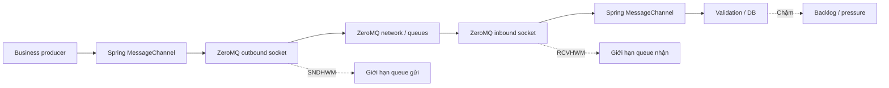
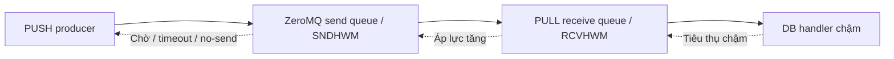
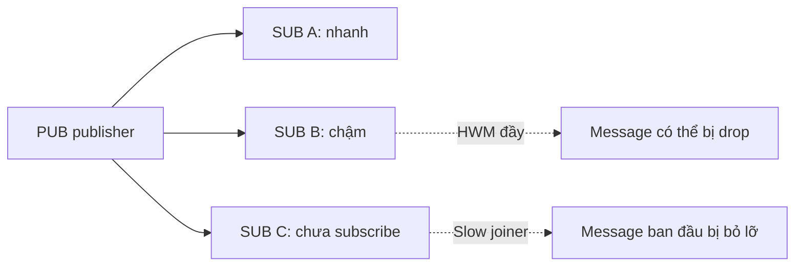
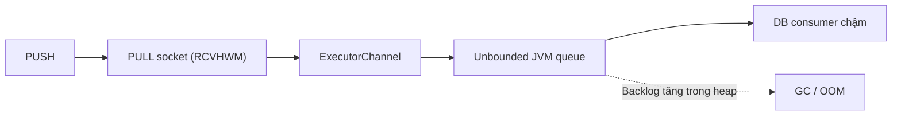
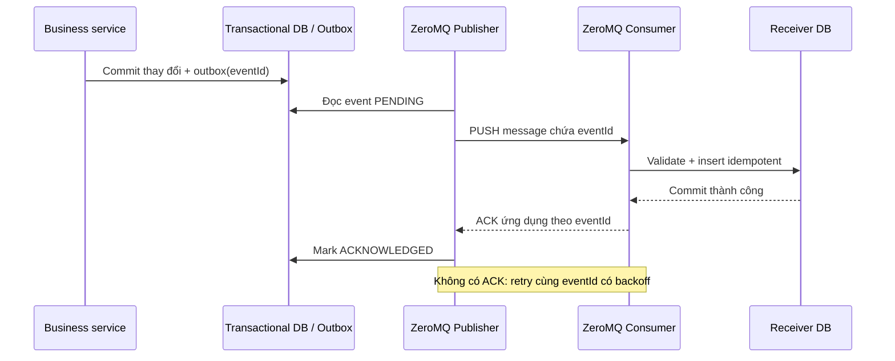

# High-water mark và backpressure trong ZeroMQ

## 1. Bài toán: hệ thống gửi nhanh hơn khả năng xử lý

Một hệ thống thu thập sự kiện từ thiết bị dùng Spring Integration ZeroMQ. Producer phát trung bình 2.000 sự kiện/giây qua socket `PUSH`, trong khi dịch vụ Spring Boot dùng `PULL` chỉ phân tích và ghi được 1.200 sự kiện/giây. Sau vài phút, độ trễ tăng, bộ nhớ bị sử dụng nhiều hơn và một số lần gửi bắt đầu chậm hoặc không thành công. Khi nhóm vận hành đổi sang `PUB/SUB` để truyền cho nhiều dashboard, sender có vẻ vẫn chạy nhanh nhưng một số dashboard lại thiếu sự kiện.

Hai biểu hiện này có cùng gốc: **tốc độ sản xuất dữ liệu không cân bằng với khả năng tiêu thụ**. ZeroMQ có cơ chế **high-water mark (HWM)** để giới hạn số message đang chờ trên socket, nhưng cách xử lý lúc đầy **phụ thuộc socket pattern**. HWM không phải một message broker bền vững và cũng không tự biến một luồng Spring Integration thành giao dịch end-to-end.

Bài **“High-water mark và backpressure”** thuộc chương **Adapter ZeroMQ** của module **SPRING_INTEGRATION_ADAPTERS**. Module học cách kết nối hệ thống ngoài bằng inbound/outbound adapter, gateway, poller và `MessageChannel`; thực hành trao đổi qua file, SFTP, HTTP, JMS, AMQP, Kafka và cơ sở dữ liệu, đồng thời kiểm soát hợp đồng message, lỗi và vòng đời kết nối. Bài này tập trung vào **queue trong ZeroMQ**, tác động của **Spring MessageChannel/handler**, xử lý **overload** và khả năng phục hồi khi ứng dụng quá tải.

### Mục tiêu học tập

Sau bài học, bạn có thể:

1. Giải thích `ZMQ_SNDHWM`, `ZMQ_RCVHWM`, `setSndHWM`, `setRcvHWM` và phạm vi **per-peer queue**.
2. Phân biệt **backpressure**, **buffering**, **blocking**, **dropping** và **durable replay**.
3. Dự đoán khác biệt khi hàng đợi đầy ở `PUSH/PULL` và `PUB/SUB`.
4. Cấu hình socket option từ `ZeroMqMessageProducer` / `ZeroMqMessageHandler` bằng `socketConfigurer(...)`.
5. Thiết kế luồng Spring Integration với bộ xử lý chậm và queue downstream **có giới hạn**.
6. Ước tính tốc độ tích lũy backlog, tác động của kích thước payload, burst và latency.
7. Tạo bài kiểm thử quá tải, quan sát message gap, reconnect, shutdown và xử lý lỗi.
8. Lựa chọn **rate limit, scale-out, load shedding, outbox, ACK và idempotency** khi ứng dụng không được phép mất message.

## 2. Backpressure là gì? HWM giải quyết phần nào?

**Backpressure** là cơ chế để thành phần phía sau báo rằng nó **không thể nhận dữ liệu nhanh như phía trước đang gửi**, qua đó làm giảm, trì hoãn hoặc từ chối lưu lượng mới. Trong kiến trúc messaging, phản ứng quá tải có thể là:

- **Buffering:** xếp hàng tạm thời, chấp nhận những burst ngắn.
- **Blocking / waiting:** tạm dừng bên gửi cho đến khi có chỗ trống.
- **Reject / fail fast:** trả lỗi hoặc kết quả `false` để upstream quyết định xử lý.
- **Dropping / load shedding:** bỏ một số message, phù hợp khi dữ liệu có thể được tính lại/snapshot.
- **Durable buffering:** ghi sự kiện vào kho bền vững để phát lại sau đó.

**High-water mark** là **ngưỡng hàng đợi socket ZeroMQ**, không phải toàn bộ cơ chế backpressure của ứng dụng. Khi hàng đợi đạt ngưỡng, ZeroMQ áp dụng hành vi theo socket type: có pattern khiến sender chờ, có pattern có thể **bỏ message**.



Một ứng dụng có **nhiều buffer ở các lớp khác nhau**: queue trong executor của Spring, queue ZeroMQ gửi/nhận, buffer kernel TCP và bộ nhớ của handler. Bật HWM ở socket **không** tự giới hạn một `ExecutorChannel` có queue không giới hạn hoặc một outbox database chưa có retention.

### 2.1. Phân biệt những thuật ngữ dễ nhầm

| Thuật ngữ | Ý nghĩa chính xác | Không phải là |
| --- | --- | --- |
| **HWM** | Giới hạn số message được xếp hàng theo logic socket/peer | Ngưỡng byte chính xác hoặc dung lượng trên disk |
| **Backpressure** | Cơ chế giảm/ngừng nguồn khi downstream không theo kịp | Chỉ một giá trị HWM |
| **Blocking send** | Lệnh gửi có thể chờ đến khi socket có khả năng nhận thêm | ACK consumer đã commit DB |
| **Non-blocking send** | Lệnh gửi có thể trả ngay khi chưa gửi được, tùy socket | Bằng chứng message được receiver xử lý |
| **Drop** | Message bị loại thay vì được tiêu thụ | Retry tự động |
| **Durable replay** | Có bản ghi bền vững và cách phát lại message | Khả năng reconnect của TCP |
| **Reactive demand** | Downstream yêu cầu bao nhiêu phần tử trong một reactive pipeline | Tự động tương đương HWM của ZeroMQ |

## 3. `ZMQ_SNDHWM` và `ZMQ_RCVHWM`

Trong ZeroMQ/JeroMQ có hai socket option quan trọng:

| Option ZeroMQ | Java JeroMQ | Phạm vi tác dụng |
| --- | --- | --- |
| `ZMQ_SNDHWM` | `socket.setSndHWM(int)` | Ngưỡng hàng đợi **gửi** dành cho các peer kết nối |
| `ZMQ_RCVHWM` | `socket.setRcvHWM(int)` | Ngưỡng hàng đợi **nhận** dành cho các peer kết nối |

HWM được diễn giải theo **số message**, thường trên **mỗi peer**, chứ không trực tiếp theo tổng số byte trong heap. Giá trị mặc định của libzmq/JeroMQ thông thường là **1.000 message** cho mỗi hướng, nhưng phải xác nhận giá trị thực tế của **version và socket option** đang chạy. Giá trị `0` biểu thị **không áp đặt giới hạn HWM** theo semantics ZeroMQ; điều đó **không có nghĩa có bộ nhớ vô hạn hoặc bảo đảm delivery**.

**Không giả định ngưỡng HWM là một phép đếm chính xác.** ZeroMQ dùng các queue và transport nội bộ; số message thực tế được chấp nhận trước khi sender bị chặn hoặc drop có thể khác giá trị HWM, tùy pattern, phiên bản và topology. Vì vậy thiết kế phải kiểm thử dưới tải, không viết assertion “set HWM = 100, message thứ 101 chắc chắn thất bại”.

### 3.1. HWM phải được thiết lập khi nào?

Các socket option ảnh hưởng đến queue/kết nối thường nên được cấu hình **trước khi socket bind/connect**, để chúng có hiệu lực với các pipe/peer mới. Spring Integration cung cấp `socketConfigurer(...)` để điều chỉnh `ZMQ.Socket` do adapter quản lý khi socket được tạo.

```java
// Trong DSL của ZeroMQ outbound adapter:
.socketConfigurer(socket -> {
    socket.setSndHWM(500);
    socket.setSendTimeOut(1_000);
})

// Trong DSL của inbound adapter:
.socketConfigurer(socket -> {
    socket.setRcvHWM(500);
})
```

Không tự lấy socket nội bộ của adapter rồi thay HWM liên tục ở thread business. Một số thay đổi option khi socket đã kết nối có thể chỉ áp dụng cho **kết nối mới**, không hồi tố cho mọi peer hiện hữu.

### 3.2. HWM là số message, không phải bytes

Hai queue cùng HWM = 1.000 có nhu cầu RAM khác nhau:

| Kịch bản giả định | Payload trung bình | 1.000 message chiếm tối thiểu khoảng |
| --- | --- | --- |
| Event nhỏ | 200 byte | 200 KB dữ liệu thô |
| Event trung bình | 4 KiB | 4 MiB dữ liệu thô |
| Event lớn | 1 MiB | 1 GiB dữ liệu thô |

Đây chỉ là **ước lượng bytes của payload**, chưa tính đối tượng Java, `ZMsg`/frame metadata, queue node, kernel/network buffer, serialization và nhiều peer. Với payload nhiều frame, một ZeroMQ **multipart message** vẫn được xem là một message trong cách điều phối, nhưng nó có thể chiếm nhiều bộ nhớ.

**Hệ quả:** Không nên dùng HWM lớn để “chữa” consumer chậm khi payload có thể rất lớn. Cần đồng thời quy định **byte limit**, giới hạn frame count, queue downstream và memory budget.

### 3.3. Tính chất per-peer

Khi một socket giao tiếp với nhiều peer, ZeroMQ thường có queue theo từng peer. Vì vậy `SNDHWM=500` **không phải** “toàn bộ process chỉ được dùng tối đa 500 message”. Một `PUB` có nhiều `SUB` có thể có nhiều queue gửi; một `PUSH` phân phối tới nhiều `PULL` theo topology. Mức RAM thực tế phụ thuộc số kết nối và tốc độ từng peer.

Tránh dùng công thức `HWM × số peer` như một giới hạn bộ nhớ chính xác; nó chỉ là yếu tố để **ước lượng sức chứa tối đa về message** cùng với kích thước payload và overhead.

## 4. Hành vi khi HWM đầy phụ thuộc socket pattern

Chọn HWM chỉ có ý nghĩa khi hiểu pattern của socket.

| Pattern | Bên gửi | Bên nhận | Khi queue/bên nhận quá tải | Đặc điểm cần ghi nhớ |
| --- | --- | --- | --- | --- |
| **PUSH/PULL** | `PUSH` | `PULL` | PUSH có thể **block** nếu không còn peer/queue sẵn sàng, hoặc trả lỗi với non-blocking/timeout | Phù hợp phân phối công việc; không tự có ACK/requeue durable |
| **PUB/SUB** | `PUB` | `SUB` | PUB có thể **drop** message cho subscriber/pipe bị chậm hoặc chưa sẵn sàng | Sender không thể suy ra mọi subscriber nhận thành công |
| **PAIR/PAIR** | `PAIR` | `PAIR` | Có thể bị chặn/không gửi được khi peer/queue không sẵn sàng, tùy option | Giao tiếp một–một; không thay thế queue nhiều client |
| **REQ/REP** | `REQ`/`REP` | Peer đối ứng | Ngoài HWM còn chịu state machine send/recv | Không phải socket type trực tiếp của adapter ZeroMQ Spring Integration |
| **DEALER/ROUTER** | Tùy thiết kế routing | Tùy peer | Phụ thuộc routing identity, peer queue và option | Cần đo/thiết kế riêng, không suy từ PUB hay PUSH |

**Giới hạn của adapter Spring Integration:** `ZeroMqMessageProducer` inbound hỗ trợ `PAIR/PULL/SUB`; `ZeroMqMessageHandler` outbound hỗ trợ `PAIR/PUSH/PUB`. `ZeroMqProxy` và JeroMQ API có thể tham gia các topology khác, nhưng đừng truyền `SocketType.ROUTER` vào inbound adapter rồi nghĩ Spring tự hỗ trợ.

### 4.1. PUSH/PULL: áp lực có thể quay về sender

Trong pipeline, `PUSH` chọn những peer `PULL` có khả năng nhận. Nếu toàn bộ peer/queue liên quan đều đầy hoặc không sẵn sàng, một lệnh gửi **blocking** có thể phải chờ cho tới khi có chỗ; lệnh gửi **non-blocking** hoặc gửi có timeout có thể không thành công.



Lệnh `send()` bị chặn hoặc trả false **không** có nghĩa framework tự lưu công việc vào disk để retry sau crash. Nếu gọi `send` từ request HTTP, một send blocking kéo dài có thể làm cạn thread request. Thiết kế timeout và đường retry phải phù hợp với **SLA** của caller.

### 4.2. PUB/SUB: có thể bỏ message thay vì chặn

Với PUB/SUB, một subscriber nhận chậm không nên mặc định kéo chậm tất cả subscriber khác. Khi queue dành cho subscriber đạt HWM, message có thể bị **drop** ở đường phân phối tới subscriber đó. Một lệnh `PUB.send(...)` có thể vẫn báo chấp nhận gửi trong khi một subscriber **không nhận được** message.



Vì vậy **PUB/SUB không phải mô hình phù hợp nếu mọi consumer bắt buộc phải xử lý mọi event mà không có replay**. Nó thích hợp hơn cho dashboard, telemetry có thể lấy snapshot hoặc trạng thái được đồng bộ lại từ nguồn bền vững.

### 4.3. HWM không tự công bằng giữa các consumer

Một `PUSH` có nhiều `PULL` không bảo đảm mỗi worker nhận chính xác cùng số công việc. Một `PUB` có nhiều `SUB` không bảo đảm subscriber mới nhận các sự kiện trước khi đăng ký. Việc phân phối phụ thuộc số peer đã kết nối, tốc độ tiêu thụ, topology và queue state.

Đừng đặt mục tiêu cân bằng tuyệt đối bằng cách chỉ đổi HWM. Nếu cần **phân vùng công việc**, **ưu tiên**, **per-tenant fairness** hoặc **đảm bảo retry**, phải có tầng điều phối ở ứng dụng hoặc một broker phù hợp.

## 5. Backpressure qua nhiều lớp của Spring Integration

Một luồng điển hình:

```text
HTTP / Scheduler / Business event
  ↓
Spring MessageChannel
  ↓
ZeroMqMessageHandler (outbound PUSH/PUB)
  ↓
JeroMQ SNDHWM → TCP → JeroMQ RCVHWM
  ↓
ZeroMqMessageProducer (inbound PULL/SUB)
  ↓
Spring MessageChannel
  ↓
Transformer / ServiceActivator / DB
```

Áp lực có thể bị “ngắt mạch” ở bất cứ boundary nào. Ví dụ một `ExecutorChannel` nhận message từ inbound nhưng đẩy vào queue không giới hạn. Khi DB chậm, inbound có thể tiếp tục nhận từ socket rất nhanh, dẫn đến:

- RCVHWM không đạt ngưỡng vì adapter **rút dữ liệu khỏi ZeroMQ socket**.
- Executor queue của Spring ngày càng lớn.
- Heap tăng tới khi GC chậm hoặc OOM.
- Sender nhìn thấy đường mạng “vẫn bình thường” dù việc xử lý nghiệp vụ đang tụt lại.

**Bài học:** Cần kiểm soát **mọi queue** trên đường xử lý, không chỉ HWM của ZeroMQ.

### 5.1. Sự khác nhau giữa HWM và Reactive Streams demand

`ZeroMqMessageProducer` đọc ZeroMQ socket và đưa message vào Spring flow với **reactive semantics**. `ZeroMqMessageHandler` là `ReactiveMessageHandler`. Tuy nhiên, một chuỗi reactive trong JVM **không tự biến HWM của ZeroMQ thành một tín hiệu yêu cầu dữ liệu end-to-end** qua network.

Hãy phân biệt:

- **Reactive demand** (`request(n)`) điều tiết số phần tử trên một `Publisher/Subscriber` tuân theo Reactive Streams.
- **ZeroMQ HWM** điều tiết queue message của một socket/peer theo socket pattern.
- **Application ACK** xác nhận hành động nghiệp vụ như commit DB.

Một trong ba cơ chế này **không tự thay thế** hai cơ chế còn lại. Đặc biệt, `PUB` có thể drop message dù phần Spring pipeline sử dụng reactive channel.

### 5.2. `DirectChannel`, `ExecutorChannel` và `QueueChannel`

| Channel Spring | Đặc tính cần quan sát | Rủi ro khi quá tải |
| --- | --- | --- |
| `DirectChannel` | Dispatch đồng bộ ở tầng channel; handler có thể làm chậm đường xử lý | Slow handler kéo dài đường dispatch, nhưng handler ZeroMQ có xử lý reactive riêng |
| `ExecutorChannel` | Đưa xử lý vào task executor, có thể có queue | Queue executor quá lớn/không giới hạn làm heap tăng |
| `QueueChannel` | Giữ message trong queue của Spring, consumer poll nhận | Nếu không giới hạn capacity, có thể là điểm tích backlog |
| `FluxMessageChannel` | Dành cho reactive flow | Vẫn cần kiểm soát buffer/demand và các boundary không reactive |

Không giả định lựa chọn `ExecutorChannel` sẽ giải quyết overload chỉ vì HTTP thread không còn bị chặn. Nếu executor có queue vô hạn, áp lực được **chuyển từ ZeroMQ sang JVM**, chứ không biến mất.

## 6. Tính backlog, thời gian đầy queue và memory budget

Giả sử:

- Tốc độ producer `λ = 1.500 message/giây`.
- Tốc độ consumer ổn định `μ = 1.000 message/giây`.
- Ban đầu hàng đợi rỗng.
- Một đường queue có HWM cấu hình `H = 2.000 message`.

Khi `λ > μ` và không có cơ chế giảm tốc, backlog lý thuyết tăng:

```text
Backlog tăng / giây ≈ λ - μ
                    = 1500 - 1000
                    = 500 message/giây

Thời gian ước tính để tăng 2.000 message:
    t ≈ H / (λ - μ)
      = 2000 / 500
      = 4 giây
```

**Đây là ví dụ trực giác**, không phải cam kết ZeroMQ sẽ chặn/drop chính xác ở giây thứ tư. Thực tế có nhiều queue, HWM per-peer, batch/multipart, burst, network buffer, consumer scheduling và giới hạn thực tế không nhất thiết trùng HWM.

### 6.1. Nếu kích thước message thay đổi

Giả sử 2.000 message chứa:

- 1 KiB payload mỗi message: khoảng **2 MiB payload thô**.
- 100 KiB payload mỗi message: khoảng **200 MiB payload thô**.
- 1 MiB payload mỗi message: khoảng **2 GiB payload thô**.

Đây là phép nhân dung lượng ở mức payload, **chưa tính overhead và bản sao memory**. Với nhiều peer/subscriber và nhiều queue, bộ nhớ cần dùng có thể tăng cao hơn.

### 6.2. Burst ngắn và quá tải kéo dài

HWM hữu ích khi phải hấp thụ một **burst ngắn** mà consumer có thể xử lý bù sau đó. Nếu producer luôn nhanh hơn consumer, HWM chỉ **lùi thời điểm** bị chặn/drop/OOM; nó không sửa chênh lệch năng lực xử lý.

| Tình huống | Giải pháp hợp lý |
| --- | --- |
| Burst 2 giây, sau đó producer giảm mạnh | Bounded buffer + đo latency |
| Producer luôn nhanh gấp đôi consumer | Scale consumer, tối ưu xử lý hoặc giảm tốc producer |
| Dashboard chỉ cần trạng thái mới nhất | Snapshot/coalescing/drop có chủ đích |
| Mọi lệnh thanh toán phải được xử lý | Durable outbox/queue, ACK và idempotency |
| Một subscriber liên tục chậm | Cô lập subscriber, áp dụng quota hoặc cho resync từ snapshot |

### 6.3. Little's law khi hệ thống ổn định

Trong **hệ thống ổn định** với số lượng công việc dài hạn không tiếp tục tăng, có thể sử dụng quan hệ gần đúng `L = λ × W` (số việc trung bình trong hệ thống bằng tốc độ thông lượng trung bình nhân thời gian lưu lại trung bình). Quan hệ này giúp liên hệ **queue depth** và **latency**.

Không dùng trực tiếp công thức đó để dự báo latency hữu hạn khi producer liên tục nhanh hơn consumer; trong tình huống không ổn định, backlog có xu hướng tăng cho tới khi có block, drop hoặc giới hạn tài nguyên.

## 7. Java DSL: cấu hình HWM cho inbound PULL

### 7.1. Dependency và cấu hình

Ví dụ Maven trong Spring Boot dùng BOM tương thích:

```xml
<dependencies>
    <dependency>
        <groupId>org.springframework.boot</groupId>
        <artifactId>spring-boot-starter-integration</artifactId>
    </dependency>
    <dependency>
        <groupId>org.springframework.integration</groupId>
        <artifactId>spring-integration-zeromq</artifactId>
    </dependency>
</dependencies>
```

Ứng dụng dùng các property:

```yaml
# application.yml
app:
  zeromq:
    pull-port: ${ZMQ_PULL_PORT:7777}
    push-url: ${ZMQ_PUSH_URL:tcp://127.0.0.1:7777}
    inbound-hwm: ${ZMQ_RCV_HWM:500}
    outbound-hwm: ${ZMQ_SND_HWM:500}
    consume-delay-ms: ${ZMQ_CONSUME_DELAY_MS:50}
```

`127.0.0.1` chỉ thích hợp khi peer chạy **trong cùng network namespace**. Với các pod/container khác nhau, phải dùng DNS Service/địa chỉ có route được và cho phép TCP ở NetworkPolicy/firewall.

### 7.2. ZContext và inbound flow

```java
import java.time.Duration;
import org.springframework.beans.factory.annotation.Value;
import org.springframework.context.annotation.Bean;
import org.springframework.context.annotation.Configuration;
import org.springframework.integration.dsl.IntegrationFlow;
import org.springframework.integration.zeromq.dsl.ZeroMq;
import org.zeromq.SocketType;
import org.zeromq.ZContext;

@Configuration
public class ZeroMqPullBackpressureConfiguration {

    @Bean(destroyMethod = "close")
    public ZContext zeroMqContext() {
        return new ZContext();
    }

    @Bean
    public IntegrationFlow incomingOrdersFlow(
            ZContext context,
            @Value("${app.zeromq.pull-port}") int port,
            @Value("${app.zeromq.inbound-hwm}") int hwm,
            @Value("${app.zeromq.consume-delay-ms}") long delayMs) {

        if (hwm < 0 || delayMs < 1) {
            throw new IllegalArgumentException(
                    "HWM phải >= 0 và consumeDelay phải > 0");
        }

        return IntegrationFlow.from(
                ZeroMq.inboundChannelAdapter(context, SocketType.PULL)
                        .bindPort(port)
                        .receiveRaw(true)
                        .consumeDelay(Duration.ofMillis(delayMs))
                        .socketConfigurer(socket -> socket.setRcvHWM(hwm)))
                .channel("ordersRawReceived")
                .get();
    }
}
```

**Giải thích:**

- `ZContext` do Spring quản lý lifecycle, không tạo một context cho từng message.
- `SocketType.PULL` nhận từ peer `PUSH`.
- `bindPort` tạo TCP endpoint, peer khác phải `connect` tới địa chỉ đúng.
- `setRcvHWM(hwm)` đặt receive HWM ở mức socket.
- `receiveRaw(true)` làm Spring payload là `ZMsg`; consumer quản lý frame và resource.
- `consumeDelay` là độ trễ khi vòng đọc ZeroMQ chưa nhận được dữ liệu, **không phải Spring Integration poller** như trong FTP/file adapter.

**Lưu ý:** `consumeDelay(50ms)` không có nghĩa adapter chỉ nhận tối đa 20 message/giây. Đây là khoảng đợi khi socket rỗng trong cơ chế đọc non-blocking; nó không phải **rate limiter** và không thay thế `RCVHWM`.

### 7.3. Consumer raw có tác vụ chậm

```java
import java.nio.charset.StandardCharsets;
import org.springframework.integration.annotation.ServiceActivator;
import org.springframework.messaging.Message;
import org.springframework.stereotype.Component;
import org.zeromq.ZFrame;
import org.zeromq.ZMsg;

@Component
public class ZeroMqOrderConsumer {

    @ServiceActivator(inputChannel = "ordersRawReceived")
    public void handle(Message<ZMsg> message) {
        ZMsg raw = message.getPayload();
        try {
            if (raw.size() != 1) {
                throw new IllegalArgumentException(
                        "Luồng demo cần đúng một frame");
            }
            ZFrame frame = raw.getFirst();
            byte[] bytes = frame.getData();
            if (bytes.length == 0 || bytes.length > 65_536) {
                throw new IllegalArgumentException(
                        "Body rỗng hoặc vượt giới hạn");
            }

            String value = new String(
                    bytes, StandardCharsets.UTF_8);
            // Production: validate, parse schema, DB idempotency.
            System.out.println("Received: " + value);
        } finally {
            raw.destroy();
        }
    }
}
```

Đoạn handler này **không cố tình sleep** vì không nên đưa một tác vụ chặn lâu vào flow chỉ để biểu diễn backpressure. Khi benchmark, có thể dùng consumer test chuyên biệt mô phỏng latency 10–100 ms và đo tác động lên queue/thông lượng. Với ứng dụng thật, nếu phải làm I/O chậm, đưa sang execution model phù hợp và giới hạn số công việc đang chạy.

**Cảnh báo resource:** Trong chế độ `receiveRaw(true)`, consumer phải giải phóng `ZMsg` theo ownership. Nếu chuyển raw object sang thread khác, cần sao chép bytes/DTO trước khi `destroy()`, không cho async worker đọc frame đã bị giải phóng.

## 8. Java DSL: outbound PUSH với send HWM và timeout

`ZeroMqMessageHandler` là outbound channel adapter. HWM gửi được thiết lập ngay khi socket được tạo; timeout giúp ứng dụng không chờ vô hạn ở tầng gửi **nếu** phiên bản/socket operation thực sự sử dụng chế độ blocking tương ứng.

```java
import org.springframework.beans.factory.annotation.Value;
import org.springframework.context.annotation.Bean;
import org.springframework.context.annotation.Configuration;
import org.springframework.integration.channel.DirectChannel;
import org.springframework.integration.dsl.IntegrationFlow;
import org.springframework.integration.zeromq.dsl.ZeroMq;
import org.springframework.messaging.MessageChannel;
import org.zeromq.SocketType;
import org.zeromq.ZContext;

@Configuration
public class ZeroMqPushBackpressureConfiguration {

    @Bean("ordersToPush")
    public MessageChannel ordersToPush() {
        return new DirectChannel();
    }

    @Bean
    public IntegrationFlow outgoingOrdersFlow(
            ZContext context,
            @Value("${app.zeromq.push-url}") String target,
            @Value("${app.zeromq.outbound-hwm}") int hwm) {

        if (hwm < 0) {
            throw new IllegalArgumentException("HWM không hợp lệ");
        }

        return IntegrationFlow.from("ordersToPush")
                .handle(ZeroMq.outboundChannelAdapter(
                        context, target, SocketType.PUSH)
                        .socketConfigurer(socket -> {
                            socket.setSndHWM(hwm);
                            socket.setSendTimeOut(1_000);
                            socket.setLinger(2_000);
                        }))
                .get();
    }
}
```

| Option | Mục đích | Giới hạn |
| --- | --- | --- |
| `setSndHWM(500)` | Giới hạn queue gửi theo ZeroMQ | Không phải “chính xác 500 message” hoặc durable storage |
| `setSendTimeOut(1_000)` | Ví dụ giới hạn đợi lệnh gửi theo semantics JeroMQ | Không phải 1 giây chờ DB commit của receiver |
| `setLinger(2_000)` | Giới hạn thời gian giữ queue khi đóng socket | Không bảo đảm mọi event nhận ACK |

**Không nhầm timeout với retry:** Khi lệnh gửi thất bại hoặc timeout, caller có thể không biết liệu một phần đường truyền đã chấp nhận message hay chưa. Không retry dữ liệu có tác dụng phụ mà thiếu **event ID/idempotency**.

### 8.1. Publisher tạo Spring message đơn giản

```java
import java.nio.charset.StandardCharsets;
import org.springframework.beans.factory.annotation.Qualifier;
import org.springframework.messaging.MessageChannel;
import org.springframework.messaging.support.MessageBuilder;
import org.springframework.stereotype.Service;

@Service
public class OrderCommandPublisher {

    private final MessageChannel channel;

    public OrderCommandPublisher(
            @Qualifier("ordersToPush") MessageChannel channel) {
        this.channel = channel;
    }

    public void publish(String eventId, String orderId) {
        if (eventId == null || orderId == null ||
                !eventId.matches("[A-Za-z0-9_-]{1,128}") ||
                !orderId.matches("[A-Za-z0-9_-]{1,64}")) {
            throw new IllegalArgumentException("ID không hợp lệ");
        }

        byte[] payload = ("created:" + eventId + ":" + orderId)
                .getBytes(StandardCharsets.UTF_8);
        boolean accepted = channel.send(
                MessageBuilder.withPayload(payload).build());

        if (!accepted) {
            throw new IllegalStateException(
                    "MessageChannel chưa tiếp nhận dữ liệu");
        }
    }
}
```

Đây chỉ là hợp đồng text demo. Production nên định nghĩa JSON/Protobuf schema, tách event ID rõ ràng và kiểm tra byte limit. Đừng để consumer phụ thuộc việc `String.split(":")` nếu payload có thể chứa dấu phân cách.

**Quan trọng:** `channel.send(...) == true` chỉ thể hiện việc message được tiếp nhận/dispatch theo hợp đồng của Spring channel. `ZeroMqMessageHandler` có xử lý reactive; kết quả này **không đồng nghĩa socket đã truyền, peer nhận hoặc DB commit**. Cần xác minh error boundary bằng integration test và dùng ACK ứng dụng nếu muốn cam kết nghiệp vụ.

## 9. Vì sao queue downstream có thể làm HWM trở nên vô dụng?

Giả sử inbound `PULL` nhận 5.000 message/giây, adapter nhanh chóng đưa vào `ExecutorChannel` có queue không giới hạn. Service activator ghi DB chỉ 1.000 message/giây.



Vì socket đã được rút dữ liệu nhanh, queue ZeroMQ có thể **chưa đầy**, nhưng JVM queue đã phình to. HWM ở inbound không bảo vệ được tầng Spring phía sau nếu tầng đó tiếp tục nhận vô hạn.

### 9.1. Mẫu executor queue có giới hạn

```java
import java.util.concurrent.ThreadPoolExecutor;
import org.springframework.beans.factory.annotation.Qualifier;
import org.springframework.context.annotation.Bean;
import org.springframework.context.annotation.Configuration;
import org.springframework.integration.channel.ExecutorChannel;
import org.springframework.messaging.MessageChannel;
import org.springframework.scheduling.concurrent.ThreadPoolTaskExecutor;

@Configuration
public class BoundedOrdersProcessingConfiguration {

    @Bean("ordersWorkerExecutor")
    public ThreadPoolTaskExecutor ordersWorkerExecutor() {
        ThreadPoolTaskExecutor executor = new ThreadPoolTaskExecutor();
        executor.setCorePoolSize(4);
        executor.setMaxPoolSize(4);
        executor.setQueueCapacity(200);
        executor.setThreadNamePrefix("orders-worker-");
        executor.setRejectedExecutionHandler(
                new ThreadPoolExecutor.AbortPolicy());
        executor.initialize();
        return executor;
    }

    @Bean("ordersBoundedChannel")
    public MessageChannel ordersBoundedChannel(
            @Qualifier("ordersWorkerExecutor")
            ThreadPoolTaskExecutor executor) {
        return new ExecutorChannel(executor);
    }
}
```

Với cấu hình này, queue executor có giới hạn `200` công việc, tổng mức đồng thời được kiểm soát bởi số worker. Khi đầy, `AbortPolicy` có thể tạo lỗi **rejection** ở đường dispatch thay vì giữ message vô hạn trong heap.

**Nhưng đây chưa phải lời giải trọn vẹn:** tùy reactive boundary và đường lỗi, rejection có thể làm message đang đi qua ZeroMQ bị mất nếu không có lưu trữ/ACK riêng. Một executor bounded chỉ giải quyết **giới hạn tài nguyên**, không cung cấp replay.

### 9.2. Chọn hành vi khi executor đầy

| Chính sách | Tác động | Khi phù hợp |
| --- | --- | --- |
| Abort/reject | Dừng nhận công việc mới hoặc phát lỗi | Upstream có cơ chế retry bền vững |
| Caller-runs | Chạy công việc trong thread caller khi queue đầy | Cần kiểm tra thread/reactive boundary; có thể làm block transport |
| Discard | Bỏ công việc | Chỉ với telemetry có thể bỏ và được phép bởi nghiệp vụ |
| Queue không giới hạn | Che lỗi quá tải trong một thời gian | **Không khuyến nghị** khi traffic có thể tăng liên tục |
| Durable handoff | Ghi vào DB/broker, sau đó xử lý | Khi không được phép mất dữ liệu |

Không bật `DiscardPolicy` cho lệnh thanh toán. Không bật `CallerRunsPolicy` một cách máy móc trên thread mà adapter cần để đọc socket nếu thao tác I/O có thể kẹt lâu. Trước khi chọn, hãy mô phỏng tải và đo độ trễ, lỗi, heap, số event xử lý hoàn tất.

### 9.3. Bounded queue không tự truyền pressure ngược về PUB

Nếu downstream Spring channel reject, sự kiện ZeroMQ có thể **đã được nhận từ socket**. Khi socket PUB/SUB không có transaction/ACK, source không thể biết chắc sẽ phải replay dữ liệu. Vì vậy với dữ liệu quan trọng, điểm chuyển giao đầu tiên nên là **durable landing/queue** hoặc một handshake nghiệp vụ có khả năng phục hồi.

## 10. PUB/SUB: kiểm soát subscriber chậm và mất dữ liệu

PUB/SUB dùng một mô hình **fan-out theo subscription**. Mỗi subscriber có thể có tốc độ xử lý khác nhau.

```text
PUB 1000 event/s
  ├─ SUB A 1000 event/s → theo kịp
  ├─ SUB B  600 event/s → queue tăng, có thể drop khi HWM đầy
  └─ SUB C       offline → không nhận lịch sử lúc chưa subscribe
```

Nếu tất cả dashboard chỉ hiển thị **trạng thái mới nhất**, có thể chấp nhận một số event bị drop và cho dashboard **refetch snapshot** từ API/DB. Nếu mỗi event là một chứng từ bắt buộc xử lý, PUB/SUB thuần không phù hợp để hứa hẹn zero loss.

### 10.1. Java DSL PUB với HWM

Trong ví dụ sau, **Spring Integration 6.4+** dùng overload outbound **bind TCP port 7788**, còn SUB peer sẽ connect tới địa chỉ service:

```java
import org.springframework.context.annotation.Bean;
import org.springframework.context.annotation.Configuration;
import org.springframework.integration.channel.DirectChannel;
import org.springframework.integration.dsl.IntegrationFlow;
import org.springframework.integration.zeromq.dsl.ZeroMq;
import org.springframework.messaging.MessageChannel;
import org.zeromq.SocketType;
import org.zeromq.ZContext;

@Configuration
public class ZeroMqPubHwmConfiguration {

    @Bean("eventsToPublish")
    public MessageChannel eventsToPublish() {
        return new DirectChannel();
    }

    @Bean
    public IntegrationFlow publishEvents(ZContext context) {
        return IntegrationFlow.from("eventsToPublish")
                .handle(ZeroMq.outboundChannelAdapter(
                        context, 7788, SocketType.PUB)
                        .topic("orders.")
                        .wrapTopic(false)
                        .socketConfigurer(socket -> socket.setSndHWM(250)))
                .get();
    }
}
```

`wrapTopic(false)` gửi `[topic][body]`. PUB sử dụng `SNDHWM=250` làm giới hạn queue gửi cho các peer theo ZeroMQ semantics, nhưng **không** bảo đảm từng subscriber nhận đủ 250 message và cũng không cung cấp callback tin cậy báo subscriber nào đã bỏ message.

Trong Spring Integration trước 6.4, không sao chép overload bind port `(ZContext, int, SocketType)` nếu không tồn tại. Có thể dùng phiên bản thích hợp hoặc thiết kế PUB connect tới SUB/proxy đã bind.

### 10.2. Java DSL SUB và framing

```java
import java.time.Duration;
import org.springframework.beans.factory.annotation.Value;
import org.springframework.context.annotation.Bean;
import org.springframework.context.annotation.Configuration;
import org.springframework.integration.dsl.IntegrationFlow;
import org.springframework.integration.zeromq.dsl.ZeroMq;
import org.zeromq.SocketType;
import org.zeromq.ZContext;

@Configuration
public class ZeroMqSubHwmConfiguration {

    @Bean
    public IntegrationFlow incomingEvents(
            ZContext context,
            @Value("${app.zeromq.pub-url:tcp://127.0.0.1:7788}")
            String publisherUrl) {

        return IntegrationFlow.from(
                ZeroMq.inboundChannelAdapter(context, SocketType.SUB)
                        .connectUrl(publisherUrl)
                        .topics("orders.")
                        .unwrapTopic(false)
                        .receiveRaw(false)
                        .consumeDelay(Duration.ofMillis(50))
                        .socketConfigurer(socket -> socket.setRcvHWM(250)))
                .channel("ordersEventsReceived")
                .get();
    }
}
```

Ví dụ này giả định **PUB đã bind tại endpoint tương ứng**. Nếu hai ứng dụng chạy ở các pod khác nhau, thay loopback bằng DNS Service. Nếu PUB dùng `wrapTopic(true)` (mặc định của phiên bản hỗ trợ), SUB cần thống nhất `unwrapTopic(true)` cho format ba frame `[topic][empty][body]`.

**Slow joiner:** SUB connect và subscribe cần thời gian; những sự kiện PUB gửi **trước khi subscription có hiệu lực** có thể mất, dù HWM còn rất nhiều. Đừng sửa vấn đề này bằng cách tăng HWM rồi tuyên bố có bảo đảm giao nhận.

### 10.3. Message loss cần được quan sát tại subscriber

Một hệ thống PUB/SUB có thể kèm:

- `eventId` hoặc `sequenceNumber` trong payload.
- Timestamp của producer và thời điểm nhận.
- Metric **gap** giữa sequence của từng stream.
- Snapshot API để đồng bộ lại trạng thái mới nhất.
- Rate metric `publish/s` và `receive/s` theo topic/subscriber.

Nếu thứ tự/sequence là một thuộc tính quan trọng, phải định nghĩa **phạm vi sequence** (ví dụ mỗi producer/partition/topic) và cách xử lý khi restart/partition. Một gap không luôn là HWM drop: cũng có thể do filter, mất kết nối, slow joiner, trùng sequence hoặc nhiều producer.

## 11. Rate limiting, coalescing và load shedding

Khi tốc độ nguồn vượt capacity, tăng HWM chỉ làm hệ thống có thêm **thời gian đệm**. Về lâu dài, phải giảm lưu lượng, tăng năng lực xử lý hoặc thay đổi yêu cầu delivery.

### 11.1. Điều tiết tốc độ producer

Một producer có thể giới hạn tốc độ bằng token bucket hoặc scheduler/rate limiter phía ứng dụng. Ví dụ giới hạn **100 event/giây** thay vì cố gửi 500 event/giây khi consumer chỉ xử lý được 100.

Trong Spring Integration, rate limit không phải là setter HWM của ZeroMQ. Đó là quyết định của **luồng nghiệp vụ**: có thể dùng một endpoint có kiểm soát concurrency/rate ở phía source, hoặc một dịch vụ publisher đọc từ outbox và gửi theo tốc độ đã hiệu chỉnh.

**Tránh dùng `Thread.sleep` trong service activator dùng chung thread transport** để điều tiết tải. Giải pháp đó có thể làm chậm toàn bộ luồng, khiến queue và timeout ở những lớp khác tăng không dự đoán được.

### 11.2. Coalescing

Nếu chỉ cần **giá trị mới nhất** của mỗi thiết bị, có thể giữ:

```text
device-42 temp=22.0
device-42 temp=22.1
device-42 temp=22.2

→ snapshot mới nhất: device-42 temp=22.2
```

Coalescing giảm tải rõ rệt nhưng **làm mất chuỗi sự kiện lịch sử**; không áp dụng cho thanh toán, audit log hoặc thao tác có tác dụng phụ. Chỉ dùng khi hợp đồng nghiệp vụ cho phép bỏ các bản cập nhật trung gian.

### 11.3. Load shedding

Khi overload, hệ thống có thể bỏ sự kiện ít ưu tiên để bảo toàn tài nguyên:

| Loại dữ liệu | Có thể drop? | Chiến lược |
| --- | --- | --- |
| Hiển thị dashboard thời gian thực | Có thể, nếu có snapshot/recovery | Drop/coalesce + metric |
| Metric telemetry có thể tính lại | Tùy yêu cầu sampling | Sampling + hạn mức |
| Cảnh báo an toàn cần được ghi nhận | Thường không nên | Durable queue + ACK, cảnh báo overload |
| Thanh toán/đơn hàng quan trọng | **Không drop chủ đích** | Outbox bền vững + retry + idempotency |

Hãy ghi rõ chính sách ưu tiên thay vì âm thầm bỏ message để có chỉ số throughput đẹp.

## 12. Durable buffering: khi HWM không đủ

Nếu yêu cầu là “không mất message ngay cả khi receiver restart hoặc mạng bị gián đoạn”, queue memory của ZeroMQ không đáp ứng cam kết đó một mình.

**Mẫu kiến trúc:**



Các bước chính:

1. Ghi **outbox trong cùng transaction DB** với hành động nghiệp vụ.
2. Publisher worker gửi các bản ghi chưa ACK.
3. Payload/frame chứa `eventId` thực sự trên wire; không chỉ ở một Spring header chưa serialize.
4. Receiver xử lý **idempotent** theo `eventId` và commit DB.
5. Receiver trả **ACK ứng dụng** qua kênh được thiết kế riêng.
6. Nếu sender timeout, retry cùng ID. Nếu ACK bị mất sau DB commit, receiver nhận lại nhưng không tạo tác dụng phụ trùng.

Đây **không phải tính năng ZeroMQ outbound adapter tự cung cấp**. `PUSH/PULL` là một chiều; nếu cần ACK, phải xây thêm kênh phản hồi/protocol. Với `PUB/SUB`, tập subscriber có thể thay đổi theo thời gian nên “đã nhận đủ ACK của mọi subscriber” là yêu cầu cần định nghĩa kỹ; broker log durable thường phù hợp hơn nếu mọi consumer phải replay và giữ offset riêng.

### 12.1. Vì sao không retry mù?

Nếu send timeout, trạng thái có thể **không rõ**:

- Message chưa được peer nhận.
- Message đã tới queue peer nhưng chưa được handler xử lý.
- Consumer đã commit nhưng ACK bị mất.

Gửi lại không có event ID/idempotency có thể khiến đơn hàng hoặc thanh toán được xử lý trùng. **Retry chỉ an toàn khi hệ thống kiểm soát được trạng thái và deduplication.**

## 13. Timeout, non-blocking send, linger và shutdown

### 13.1. Blocking và non-blocking

JeroMQ cho phép thao tác send có cờ non-blocking, ví dụ `ZMQ.DONTWAIT`. Trong một kiểm thử được thiết kế phù hợp, nếu một `PUSH` không thể queue thêm vì các peer đều không có khả năng nhận, lời gọi không chờ có thể trả `false`; lệnh gửi blocking có thể đợi tới khi queue được rút bớt, hoặc timeout theo `setSendTimeOut`.

```java
import org.zeromq.ZMQ;

// push là ZMQ.Socket loại PUSH đã được cấu hình.
byte[] payload = "event-42".getBytes(
        java.nio.charset.StandardCharsets.UTF_8);

boolean acceptedNow = push.send(payload, ZMQ.DONTWAIT);
if (!acceptedNow) {
    // Chưa thể gửi/queue theo semantics socket.
    // Không tự động bỏ công việc quan trọng: cần nguồn replay bền vững.
}
```

**Không áp dụng kết luận này cho PUB:** PUB có thể chấp nhận send nhưng **drop message cho một số subscriber**, nên `true` không chứng minh đủ fan-out.

### 13.2. Linger

`linger` kiểm soát hành vi đóng socket khi còn message trong queue:

| Linger | Hiểu đúng | Rủi ro |
| --- | --- | --- |
| `0` | Đóng nhanh, có thể bỏ dữ liệu còn pending | Mất message khi shutdown |
| Giá trị dương hữu hạn | Chờ giới hạn cho dữ liệu pending theo socket semantics | Không có ACK nghiệp vụ, có thể vẫn mất dữ liệu |
| Vô hạn, tùy mặc định/phiên bản | Có thể cố chờ dữ liệu pending lâu | Shutdown có thể bị kéo dài |

Đừng đặt `linger=0` cho mọi socket chỉ để test pass nhanh nếu yêu cầu delivery là nghiêm ngặt. Nhưng cũng không chờ vô hạn khi dừng một pod production. Giải pháp bền vững là **ghi outbox trước khi gửi**, cho worker drain có giới hạn, và retry sau restart từ kho còn trạng thái PENDING.

### 13.3. Reconnect không tự replay

Khi peer hoặc mạng gián đoạn, ZeroMQ có các cơ chế reconnect, nhưng các event đã drop (đặc biệt PUB/SUB) **không tự xuất hiện lại** khi SUB kết nối trở lại. HWM chỉ giới hạn queue có thể đang tồn tại trong memory; nó không ghi một commit log như Kafka.

## 14. Giám sát: đo gì khi không thể đếm chính xác HWM?

Một hạn chế vận hành quan trọng: **HWM là cấu hình ngưỡng, không đồng nghĩa bạn luôn có API trả về số message đã drop chính xác**. Khả năng quan sát queue/per-peer và socket monitor tùy JeroMQ/ZeroMQ version.

Nên kết hợp đo nhiều lớp:

| Metric | Ý nghĩa | Cách thu thập gợi ý |
| --- | --- | --- |
| `events_produced_total` | Tổng event được tạo từ business source | Bộ đếm ở producer trước enqueue |
| `events_dispatch_attempt_total` | Tổng lần thử gửi qua Spring/ZeroMQ | Instrument outbound |
| `events_received_total` | Tổng message tới inbound adapter/consumer | Instrument inbound |
| `events_committed_total` | Số event đã DB commit | Tăng sau commit thực tế |
| `events_rejected_total` | Lỗi serialize, reject queue, schema không hợp lệ | Error flow và executor rejection |
| `event_sequence_gap_total` | Khoảng trống sequence tại mỗi subscriber | Kiểm tra `sequenceNumber` theo stream |
| `outbox_pending` | Số event chưa ACK nằm trong kho durable | DB metric |
| `event_lag_ms` | Độ trễ từ event timestamp đến commit | Correlation/timestamp đáng tin |
| `executor_active_threads` | Mức sử dụng worker JVM | ThreadPoolTaskExecutor/metrics |
| `executor_queue_depth` | Backlog ở executor queue | Monitoring queue được phép |
| `process_memory / GC` | Rủi ro OOM do queue/payload | JVM metrics |

**Đặt nhãn đủ phân biệt**: socket pattern, topic, endpoint, instance và loại consumer. Không đưa raw payload, password, token hoặc dữ liệu cá nhân làm metric label.

### 14.1. Socket monitor và hạn chế

ZeroMQ/JeroMQ có khả năng giám sát một số **sự kiện socket** như kết nối, ngắt kết nối hoặc lỗi bắt tay, tùy phiên bản và transport. Monitor events hữu ích để phát hiện peer offline, nhưng **không mặc nhiên cung cấp bằng chứng về số message đã được business consumer commit** hoặc số event PUB drop.

Nếu cần đếm mất message, dùng `eventId`/`sequenceNumber` trong payload và đo tại subscriber. Cần kiểm soát sequence theo producer/topic/partition để không báo gap giả do event từ nhiều nguồn khác nhau.

### 14.2. Một dashboard cảnh báo tối thiểu

```text
ZeroMQ PUSH/PULL:
  publish_rate
  receive_rate
  business_commit_rate
  pending_outbox
  executor_queue_depth
  p95/p99 processing_latency
  send_failures / timeouts

ZeroMQ PUB/SUB:
  publish_rate per topic
  receive_rate per subscriber
  last_received_time
  sequence_gaps
  reconnect_count
  snapshot_resync_count
```

Đừng gộp “đã gọi outbound handler” và “đã commit ở receiver” thành một chỉ số `messages_sent_successfully` không có định nghĩa rõ.

## 15. Một kịch bản đo tải có kiểm soát

Để hiểu HWM thật sự, nên chạy một hệ thống test với **socket thật**, không chỉ mock `MessageHandler`.

### 15.1. PULL chậm có chủ đích

Thiết kế test:

1. Tạo một `PULL` đã bind `tcp://127.0.0.1:7777`, đặt `RCVHWM` đủ nhỏ, ví dụ 50.
2. Tạo một `PUSH` connect, đặt `SNDHWM` khoảng 50 và send timeout hữu hạn.
3. Producer phát nhiều message có `sequenceNumber` với tốc độ cao.
4. Consumer đọc chậm có kiểm soát.
5. Quan sát số send thành công/thất bại, thời gian blocking, số message nhận và memory.
6. Thay đổi HWM 50 → 200 và lặp lại, giữ cùng payload/throughput.

**Kỳ vọng định tính:** HWM lớn hơn có thể hấp thụ burst dài hơn nhưng tăng memory và latency; nếu tốc độ nguồn vẫn cao hơn khả năng xử lý dài hạn, cuối cùng vẫn có áp lực.

Không viết một test cứng khẳng định “message thứ 51 chắc chắn bị reject”, vì ZeroMQ không bảo đảm mapping một–một giữa HWM và số lần send nhìn thấy ở cấp ứng dụng.

### 15.2. PUB và hai subscriber có tốc độ khác nhau

1. Chạy một `PUB` với `SNDHWM=20`.
2. SUB A nhận ngay, SUB B xử lý rất chậm, cả hai đăng ký cùng topic.
3. Gửi chuỗi `sequenceNumber=1..N`, đồng thời ghi số đã phát.
4. Đếm các giá trị sequence nhận tại mỗi SUB.
5. Kiểm tra khả năng mất event của SUB B và sự khác biệt với SUB A.
6. Khởi động SUB C sau khi PUB đã gửi 100 event; kiểm tra không có replay lịch sử tự động.

Kết quả phụ thuộc phiên bản, mạng và tốc độ; test cần nhiều lần chạy/metric. Đây là **kịch bản đề xuất**, không phải kết quả đã thực thi trong repository.

### 15.3. Test shutdown và restart

Gửi một số message khi receiver đang offline; restart sender và receiver. Kiểm tra:

- HWM memory có giữ được message qua process restart không? **Không nên kỳ vọng.**
- Nếu dùng outbox DB, event chưa ACK vẫn nằm ở trạng thái `PENDING` để publisher gửi lại.
- Receiver có bỏ qua event trùng theo `eventId` sau khi DB đã commit không?
- Nếu ACK bị mất sau commit, sender có tránh tạo tác dụng phụ lặp không?

Test này giúp phân biệt rõ **socket HWM** với **durability của một workflow**.

## 16. Sự cố phổ biến và hướng khắc phục

| Triệu chứng | Nguyên nhân thường gặp | Hướng chẩn đoán/khắc phục |
| --- | --- | --- |
| PUSH send chậm khi receiver bận | Queue/peer không còn khả năng nhận | Đo latency, HWM, timeout, consumer throughput |
| Gọi send non-blocking trả false | Không còn chỗ phù hợp để queue, hoặc chưa có peer sẵn sàng | Lưu nguồn để retry, không drop công việc quan trọng |
| PUB vẫn gửi nhanh nhưng dashboard thiếu event | PUB drop vì subscriber chậm hoặc chưa subscribe | Sequence gap, resync snapshot, xem HWM và topology |
| Heap tăng dù RCVHWM nhỏ | ExecutorChannel/QueueChannel hoặc buffer khác không giới hạn | Kiểm tra toàn bộ queue trong JVM |
| Tăng HWM thì tạm hết lỗi nhưng độ trễ tăng | Buffer trì hoãn quá tải thay vì tăng consumer capacity | Tối ưu/scale consumer, rate limit producer |
| HWM=100 nhưng không block đúng message #101 | Queue và transport nội bộ/per-peer | Không coi HWM là bộ đếm chính xác |
| HWM=0 rồi bị OOM | 0 không áp HWM, memory vẫn có giới hạn vật lý | Đặt ngưỡng hữu hạn, byte budget, rate limiting |
| Consumer async bị reject | Queue executor bounded đã đầy | Thiết kế error flow + retry durable |
| HWM nhỏ nhưng consumer vẫn bị OOM | Message lớn, nhiều frame/bản sao dữ liệu | Limit bytes/frame count, đo heap |
| Một SUB thiếu event nhưng SUB khác đủ | Per-peer queue và năng lực xử lý khác nhau | Đo từng subscriber, tránh suy từ PUB send count |
| App gửi xong nhưng DB không có dữ liệu | Socket acceptance ≠ business commit | Cần ACK/idempotency/outbox |
| Restart làm mất event đang chờ | Queue ZeroMQ là in-memory | Durable store trước khi gửi |
| Tắt app nhanh làm mất message | Linger=0 hoặc chưa drain queue | Đặt shutdown policy và replay từ outbox |
| Network đã phục hồi nhưng event cũ không xuất hiện | Reconnect không tự replay PUB/SUB | Snapshot hoặc durable replay |
| Không biết có drop hay không | Chỉ có metric publisher, không có sequence receiver | Thêm event ID/sequence và giám sát subscriber |

### 16.1. Quy trình điều tra một đợt quá tải

```text
1. Xác định socket pattern: PUSH/PULL hay PUB/SUB?
2. Kiểm tra HWM send/receive thực tế và thời điểm set option.
3. Đo publish_rate, receive_rate và commit_rate.
4. Tìm tất cả queue ở Spring, JeroMQ, executor và DB worker.
5. Kiểm tra payload size, multipart frame count và số peer.
6. Tách lỗi timeout/rejection với loss/gap ở subscriber.
7. Kiểm tra reconnect, linger, restart và lỗi mạng.
8. Xem nguồn replay/outbox, ACK và trạng thái idempotency.
9. Điều chỉnh rate/consumer capacity/queue bounded rồi test lại.
```

Không khắc phục mọi sự cố bằng cách tăng HWM hoặc `Thread.sleep` trong handler; đó có thể chỉ di chuyển áp lực sang một tầng khác.

## 17. Các nguyên tắc triển khai và bảo mật

- **Quy định ngưỡng hữu hạn:** lựa chọn HWM theo payload, số peer, burst tối đa và memory budget. Không dựa vào một con số “chuẩn” cho mọi topic.
- **Kiểm soát buffer tại JVM:** Executor/QueueChannel và reactive buffer phải có quota, monitoring, exception policy.
- **Tách dữ liệu có thể mất và không thể mất:** dashboard snapshot khác với giao dịch thanh toán.
- **Cấu hình socket trước connect/bind:** dùng `socketConfigurer(...)`; tránh thay option động rồi kỳ vọng toàn bộ kết nối cũ đổi theo.
- **Đảm bảo schema/event ID:** sender và receiver phải hiểu cùng frame/encoding; event ID nằm trên wire nếu cần ACK/idempotency.
- **Giám sát theo peer:** slow subscriber và per-peer queue có thể khiến mỗi receiver thấy kết quả khác nhau.
- **Quản lý lifecycle:** `ZContext` do Spring đóng; socket có linger, timeout, restart policy phù hợp.
- **Bảo mật giao vận:** `tcp://` không tự mã hóa/xác thực; cần network isolation và cơ chế ZeroMQ security phù hợp phiên bản.
- **Không log raw data nhạy cảm:** metric/trace nên dùng correlation ID, type, size và latency.

### 17.1. Khi dùng Kubernetes nhiều replica

Một Kubernetes Service TCP cân bằng **kết nối**, không tự tạo broadcast ZeroMQ. Với `PUSH/PULL`, topology peer ảnh hưởng đến cách phân phối công việc. Với `PUB/SUB`, một TCP load balancer không thay thế `ZeroMqProxy` hay broker; từng subscriber phải có đường nhận topic theo thiết kế.

Nếu nhiều replica cùng ghi DB, bắt buộc có **idempotency theo eventId**, không dựa vào giả định “PUSH chỉ gửi một lần thì nghiệp vụ chỉ commit một lần”.

## 18. Bài tập tình huống

**Bối cảnh:** Một nền tảng xử lý đơn hàng có:

- Một producer `PUSH` phát **1.800 event/s**.
- Hai worker `PULL`, mỗi worker xử lý tối đa **500 event/s**.
- HWM send và receive đang đặt **1.000**.
- Mỗi message trung bình **50 KiB**, một số message có thể đạt **1 MiB**.
- Khi hết tải, ứng dụng còn một `ExecutorChannel` có queue mặc định rất lớn.
- Một luồng PUB khác phát trạng thái đơn hàng cho dashboard, và dashboard có thể gọi snapshot API để đồng bộ lại.

Nhóm vận hành đề xuất đặt HWM = 0 ở mọi socket, tăng queue executor không giới hạn và coi `channel.send() == true` là “xử lý thành công”.

Hãy trả lời:

1. Tổng tốc độ hai worker tối đa là bao nhiêu event/s? Chênh lệch với producer là bao nhiêu?
2. Nếu không tăng consumer capacity, backlog sẽ có xu hướng gì?
3. HWM = 1.000 có nghĩa queue chắc chắn chứa đúng 1.000 message trước khi block không?
4. Với message trung bình 50 KiB, 1.000 message có bao nhiêu MiB payload thô?
5. HWM = 0 có bảo đảm không mất message không? Có nguy cơ nào?
6. Với `PUSH/PULL`, gửi khi queue đầy có thể biểu hiện thế nào?
7. Với `PUB/SUB`, subscriber chậm có thể mất event dù publisher thấy gửi thành công không?
8. Tăng HWM có giúp một producer luôn nhanh hơn consumer trở thành ổn định lâu dài không?
9. Vì sao ExecutorChannel queue không giới hạn có thể làm RCVHWM khó phát huy tác dụng?
10. `consumeDelay(50ms)` có nghĩa inbound chỉ nhận 20 message/s không?
11. `setSendTimeOut(1000)` có phải timeout DB commit của worker không?
12. Nếu dashboard bỏ lỡ event nhưng có snapshot API, giải pháp recovery phù hợp là gì?
13. Nếu lệnh thanh toán không được phép mất, bạn sẽ thêm các thành phần nào?
14. Nếu ACK bị mất sau khi worker đã commit, làm sao sender retry mà không tạo bản ghi trùng?
15. Những metric nào giúp phân biệt overload socket, queue JVM và DB?
16. Làm sao kiểm thử PUB drop và PUSH block mà không dựa vào số message cố định tại ngưỡng HWM?

**Gợi ý đáp án:** (1) 1.000 event/s, chênh 800 event/s. (2) Backlog tăng nếu không block/drop/giảm tốc. (3) Không, HWM không là bộ đếm chính xác và có tính per-peer. (4) Khoảng **48,8 MiB** payload thô, chưa kể overhead. (5) Không; có thể làm memory tăng và OOM. (6) Blocking, timeout hoặc non-blocking send không thành công khi không còn peer/queue nhận được. (7) Có. (8) Không; chỉ trì hoãn điểm quá tải. (9) Adapter rút dữ liệu khỏi ZeroMQ rồi xếp vào queue JVM, áp lực chuyển chỗ. (10) Không, đây là delay khi không có dữ liệu. (11) Không. (12) Gap detection + snapshot/resync. (13) Durable outbox hoặc broker, ACK, retry có backoff và idempotent consumer. (14) Dedup theo `eventId` với unique key/transaction. (15) Publish/receive/commit rate, timeout/rejection, executor queue depth, memory, lag, sequence gaps và pending outbox. (16) Dùng socket thật, consumer cố ý chậm, tăng lưu lượng có kiểm soát, so sánh throughput/latency/gap qua nhiều lần chạy.

## Ghi nhớ

- **HWM giới hạn queue message ở tầng ZeroMQ**, gồm `SNDHWM` và `RCVHWM`, thường trên **mỗi peer**. Nó không phải quota bytes chính xác hoặc durable storage.
- **PUSH/PULL** có thể làm sender chờ/timeout khi không còn khả năng queue; **PUB/SUB** có thể drop message cho subscriber chậm hoặc chưa sẵn sàng.
- Giá trị HWM hữu hạn giúp hấp thụ burst ngắn, **không chữa** tình trạng producer luôn nhanh hơn consumer.
- **Backpressure phải xét cả Spring MessageChannel, executor queue, reactive boundary, ZeroMQ socket và DB**. Queue JVM không giới hạn có thể làm HWM socket mất tác dụng bảo vệ memory.
- Cấu hình socket bằng **`socketConfigurer(...)`** khi tạo adapter; `consumeDelay` không phải rate limiter, `send()` thành công không phải ACK nghiệp vụ.
- Khi dữ liệu quan trọng cần **outbox/queue bền vững, event ID, ACK/replay và idempotency**. Với dashboard có thể mất event, dùng sequence gap và snapshot resync.
- Dùng **stress/integration test có kiểm soát** và giám sát publish/receive/commit rate, latency, queue depth, drop/gap, memory thay vì dựa vào con số HWM một cách tuyệt đối.

## Tài liệu tham khảo

- [Spring Integration Reference — ZeroMQ Support](https://docs.spring.io/spring-integration/reference/zeromq.html)
- [Spring Integration API — ZeroMqMessageProducerSpec](https://docs.spring.io/spring-integration/api/org/springframework/integration/zeromq/dsl/ZeroMqMessageProducerSpec.html)
- [Spring Integration API — ZeroMqMessageHandlerSpec](https://docs.spring.io/spring-integration/api/org/springframework/integration/zeromq/dsl/ZeroMqMessageHandlerSpec.html)
- [Spring Integration API — ZeroMqMessageProducer](https://docs.spring.io/spring-integration/api/org/springframework/integration/zeromq/inbound/ZeroMqMessageProducer.html)
- [Spring Integration API — ZeroMqMessageHandler](https://docs.spring.io/spring-integration/api/org/springframework/integration/zeromq/outbound/ZeroMqMessageHandler.html)
- [ZeroMQ Socket Options — ZMQ_SNDHWM / ZMQ_RCVHWM](https://libzmq.readthedocs.io/en/latest/zmq_setsockopt.html)
- [ZeroMQ — Socket Types](https://zeromq.org/socket-api/)
- [ZeroMQ Guide](https://zguide.zeromq.org/)
- [JeroMQ API — ZMQ.Socket](https://javadoc.io/doc/org.zeromq/jeromq/latest/org/zeromq/ZMQ.Socket.html)
