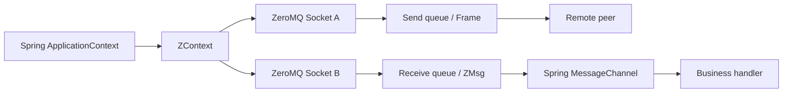
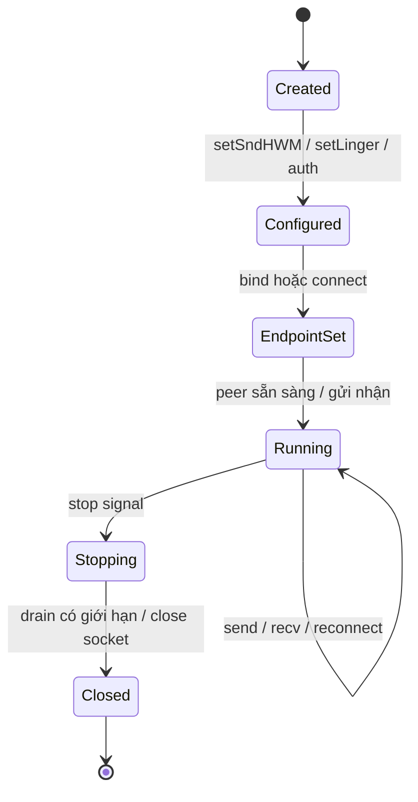
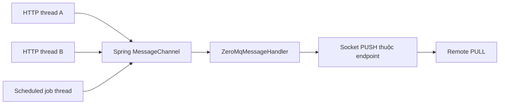
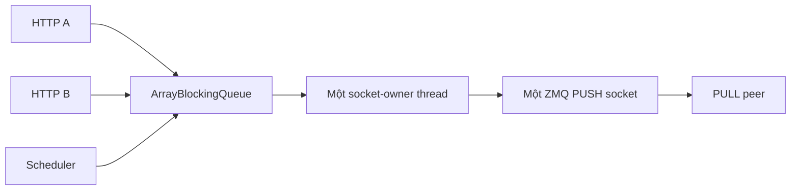
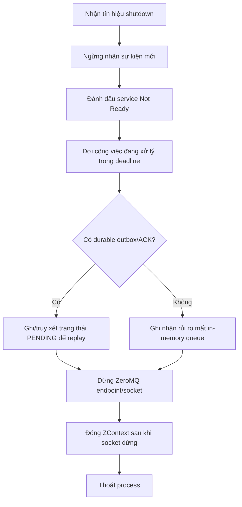
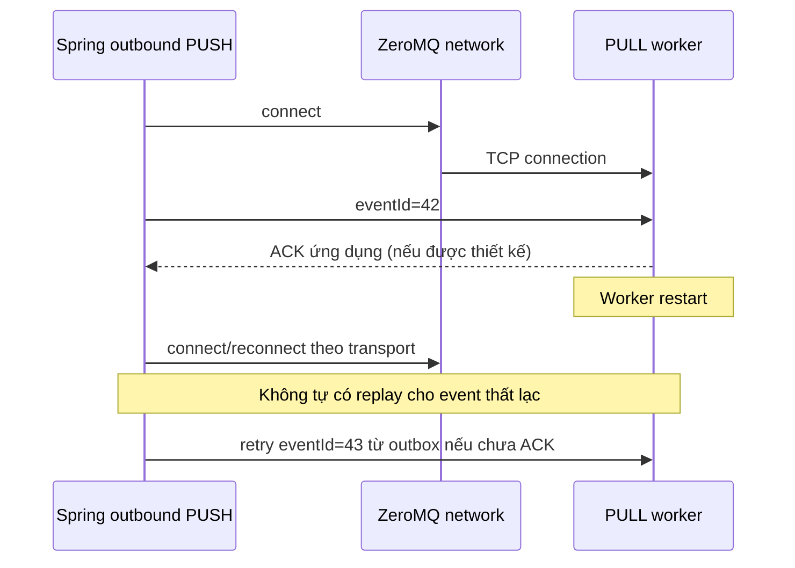

# Socket lifecycle và thread safety trong ZeroMQ

## 1. Bối cảnh: cùng một socket chạy tốt ở local nhưng lỗi khi tăng concurrency

Một dịch vụ Spring Boot nhận request HTTP, tạo sự kiện đơn hàng rồi gửi qua ZeroMQ `PUSH`. Lúc thử thủ công, mỗi giây chỉ có một request nên mọi thứ đều bình thường. Khi thử tải 100 request đồng thời, nhóm phát triển thấy message không đến đúng thứ tự mong đợi, có lần thao tác socket thất bại hoặc ứng dụng không tắt được trong thời gian quy định.

Một cách triển khai dễ mắc lỗi:

```java
// PHẢN VÍ DỤ - không chia sẻ một ZMQ.Socket để các HTTP thread tự gọi send.
@Service
class UnsafePublisher {
    private final ZMQ.Socket sharedPush;

    UnsafePublisher(ZContext context) {
        this.sharedPush = context.createSocket(SocketType.PUSH);
        this.sharedPush.connect("tcp://worker:7777");
    }

    void sendFromHttpThread(byte[] payload) {
        // Nhiều HTTP thread có thể gọi đồng thời.
        sharedPush.send(payload);
    }
}
```

Điểm nguy hiểm không nằm ở `PUSH` hay địa chỉ TCP, mà ở **quyền sở hữu thread của socket**. ZeroMQ socket **không được thiết kế để nhiều thread ứng dụng gọi đồng thời tùy tiện**. Đồng thời, nếu một bean đóng `ZContext` khi một endpoint khác còn hoạt động, mọi socket dùng context đó có thể gặp lỗi trong lúc gửi/nhận.

Bài **“Socket lifecycle và thread safety”** thuộc chương **Adapter ZeroMQ** của module **SPRING_INTEGRATION_ADAPTERS**. Module kết nối các hệ thống bên ngoài bằng inbound/outbound adapter, gateway, poller và `MessageChannel`; thực hành qua file, SFTP, HTTP, JMS, AMQP, Kafka và cơ sở dữ liệu, đồng thời kiểm soát hợp đồng message, lỗi và vòng đời kết nối. Ở đây, trọng tâm là **khởi tạo, kết nối, sử dụng, dừng và giải phóng socket**, cùng cách đảm bảo an toàn khi có nhiều thread.

Sau bài học, bạn có thể:

1. Phân biệt vòng đời `ZContext`, `ZMQ.Socket`, ZeroMQ adapter, message/frame và business transaction.
2. Giải thích quy tắc **một socket thuộc một thread tại một thời điểm**, và lý do `ZContext` có thể được chia sẻ giữa các endpoint.
3. Viết Spring Integration Java DSL dùng `ZeroMqMessageProducer` và `ZeroMqMessageHandler` để tránh thao tác socket trực tiếp từ nhiều thread business.
4. Tổ chức một worker thread sở hữu socket JeroMQ và nhận việc qua queue có giới hạn.
5. Kiểm soát `bind/connect`, startup/readiness, reconnect và `getBoundPort()`.
6. Thiết kế shutdown có giới hạn, hiểu `linger`, queue chưa flush, lifecycle của Spring và hậu quả đóng context quá sớm.
7. Xử lý `ZMsg`/`ZFrame` raw đúng ownership khi chuyển qua thread bất đồng bộ.
8. Kiểm thử concurrency, restart, tắt ứng dụng và tính tin cậy thực tế mà không nhầm socket send với ACK nghiệp vụ.

## 2. Năm đối tượng có vòng đời khác nhau



| Thành phần | Ai thường sở hữu? | Khi nào tạo? | Khi nào giải phóng? |
| --- | --- | --- | --- |
| **Spring `ApplicationContext`** | Spring Boot runtime | Application startup | Application shutdown |
| **JeroMQ `ZContext`** | Một bean/application component | Khi Spring tạo bean | Sau khi các endpoint/socket đã dừng |
| **`ZMQ.Socket`** | Adapter hoặc một worker thread xác định | Khi endpoint/worker khởi tạo | Từ lifecycle/owner của socket |
| **`ZMsg` / `ZFrame`** | Code nhận hoặc code tạo raw payload | Khi receive/construct message | Khi đã hoàn tất dùng dữ liệu, đúng owner |
| **Spring `Message<?>`** | Integration Flow | Khi adapter tạo/handler nhận | Do quản lý object của JVM; payload raw vẫn có quy tắc riêng |
| **Business transaction** | Service/DB | Khi xử lý nghiệp vụ | Khi commit/rollback; độc lập với socket close |

**Phân biệt quyền sở hữu:** Dùng chung `ZContext` để tạo nhiều socket là một kiến trúc thông thường. Dùng chung **cùng một `ZMQ.Socket`** để các request/thread gọi `send()` đồng thời là phản ví dụ. Khung `Message<?>` của Spring có thể được chuyển qua nhiều channel, nhưng payload có thể **mutable** (như `byte[]`, `ZMsg`); sự bất biến của metadata message **không tự bảo vệ dữ liệu bên trong payload**.

### 2.1. Vòng đời của một socket



Đây là **mô hình diễn giải**, không phải danh sách state public do `ZMQ.Socket` cung cấp. Lời gọi `connect(...)` có thể hoàn tất trước khi kết nối mạng thực sự sẵn sàng. Một socket ở trạng thái ứng dụng “Running” cũng không bảo đảm remote consumer đã subscribe, nhận message hoặc commit DB.

### 2.2. Lifecycle của context bao trùm socket

`ZContext` quản lý resource của các socket được tạo từ nó. Khi context kết thúc, các socket và I/O liên quan bị ảnh hưởng; thread đang sử dụng socket có thể nhận lỗi hoặc phải kết thúc. Vì vậy:

- Không gọi `context.close()` mỗi khi đã gửi xong **một message**.
- Không để một endpoint đóng context **đang được endpoint khác dùng chung**.
- Không dùng context đã đóng để tạo socket mới.
- Dừng hoạt động gửi/nhận và giải phóng các socket trước khi kết thúc context, theo ownership.

Trong ứng dụng Spring Boot, một bean `ZContext` dùng chung thường phù hợp hơn việc mỗi service tự tạo và đóng một context riêng.

## 3. Quy tắc thread safety quan trọng nhất

**Một `ZMQ.Socket` không được chia sẻ tùy tiện giữa nhiều thread để gọi API cùng lúc.** Với JeroMQ, hãy thiết kế **socket affinity/ownership**: mọi thao tác `bind`, `connect`, `send`, `recv`, `close` được điều phối theo thread hoặc lifecycle owner thích hợp; các thread business chỉ gửi lệnh qua một cơ chế giao tiếp an toàn.

| Đối tượng | Có thể chia sẻ giữa các thread? | Cách sử dụng an toàn |
| --- | --- | --- |
| `ZContext` | **Có thể** dùng chung làm context tạo socket cho nhiều component/thread | Đóng một lần sau khi các socket kết thúc |
| Một `ZMQ.Socket` | **Không** gọi đồng thời tùy tiện từ nhiều thread | Có một owner thread hoặc để Spring adapter quản lý |
| `MessageChannel` của Spring | Có thể là điểm tích hợp cho nhiều publisher thread theo contract từng implementation | Hiểu queue/dispatch/rejection và thread boundary |
| `byte[]` | Mutable, có thể bị sửa sau khi đã gửi vào queue | Copy trước khi handoff nếu caller còn có thể sửa |
| `ZMsg` / `ZFrame` | Có ownership/resource; không an toàn để dùng/hủy tùy tiện giữa các luồng | Truyền bản sao bytes hoặc chuyển ownership có kiểm soát |
| DTO immutable | Dễ chia sẻ hơn | Vẫn phải xử lý vòng đời của payload tham chiếu nếu có field mutable |

### 3.1. Vì sao khóa `synchronized` không phải lời giải ưu tiên?

Một số tài liệu ZeroMQ đề cập ngoại lệ rất hạn chế về di chuyển socket giữa thread khi có đồng bộ phù hợp. Tuy nhiên, điều đó **không có nghĩa** một socket JeroMQ trở thành đối tượng thread-safe chỉ bằng cách thêm `synchronized` quanh vài lệnh `send`.

Những rủi ro vẫn còn:

- Một thread đang `recv` blocking trong khi thread khác muốn `close`.
- Một thread thay đổi socket option khi thread khác đã gửi/nhận.
- Callback lifecycle dừng context trong lúc request thread vẫn đang dùng socket.
- Message multipart bị code ứng dụng xen kẽ các lệnh gửi nếu không bảo vệ toàn bộ ranh giới.

**Khuyến nghị:** một socket được sở hữu bởi **một thread** hoặc được Spring Integration adapter quản lý; các thread khác gửi message qua `MessageChannel` hoặc một **bounded queue** tới owner.

### 3.2. Socket type quyết định semantics, không quyết định thread safety

| Pattern | Cặp socket | Lỗi concurrency dễ gặp |
| --- | --- | --- |
| `PUSH/PULL` | Sender PUSH, receiver PULL | Nhiều HTTP threads gọi chung `PUSH.send` |
| `PUB/SUB` | Publisher PUB, subscriber SUB | Nhiều thread thay đổi `subscribe/unsubscribe` và `recv` trên cùng SUB |
| `PAIR/PAIR` | Hai endpoint một–một | Hai service thread cùng điều khiển một PAIR socket |
| `REQ/REP` | Request–reply tuần tự | Thread A send request #1, thread B send request #2 trước reply #1; vi phạm state machine |
| `ROUTER/DEALER` | Định tuyến theo envelope | Nhiều thread sửa identity/routing frame trên cùng socket |

Spring Integration ZeroMQ inbound trực tiếp hỗ trợ `PAIR/PULL/SUB`, outbound trực tiếp hỗ trợ `PAIR/PUSH/PUB`. `REQ/REP`, `ROUTER/DEALER` có thể dùng qua JeroMQ hoặc kiến trúc/proxy riêng; **không** tự biến thành gateway chỉ vì socket hỗ trợ bidirectional traffic.

## 4. Hai kiến trúc an toàn khi có nhiều producer thread

### 4.1. Kiến trúc A: Spring MessageChannel + ZeroMQ outbound adapter



Các thread business **không nhận tham chiếu tới `ZMQ.Socket`**. Chúng tạo Spring `Message<?>` và gửi vào `MessageChannel`. `ZeroMqMessageHandler` quản lý socket/lifecycle theo implementation của framework.

Điều này giảm rủi ro dùng socket sai thread, **nhưng không tự bảo đảm** mọi message được giao. `MessageChannel.send() == true` là kết quả tại boundary Spring, không phải ACK remote đã nhận hoặc xử lý.

### 4.2. Kiến trúc B: owner thread riêng và bounded queue

Khi dùng JeroMQ thuần, có thể tạo **một worker thread** sở hữu socket. Các HTTP/request thread chỉ đưa immutable payload bytes vào queue:



Đây là mô hình **tách concurrency khỏi socket access**. Bounded queue giúp hạn chế memory nhưng **không tự mang tính bền vững**: nếu process bị kill, các phần tử còn trong queue RAM sẽ mất. Nếu yêu cầu không mất dữ liệu, phải đưa dữ liệu vào outbox/queue bền vững **trước khi** gửi.

## 5. Ví dụ JeroMQ: một owner thread cho socket PUSH

Ví dụ này trình bày rõ **thread affinity** và sự khác nhau giữa queue trong JVM với socket. Nó phù hợp để học ownership, **không phải** publisher production có durability.

### 5.1. Dedicated worker nhận bytes qua queue có giới hạn

```java
import java.util.concurrent.ArrayBlockingQueue;
import java.util.concurrent.BlockingQueue;
import java.util.concurrent.TimeUnit;
import java.util.concurrent.atomic.AtomicBoolean;
import org.zeromq.SocketType;
import org.zeromq.ZContext;
import org.zeromq.ZMQ;

public final class SingleOwnerPushPublisher {

    private final ZContext context;
    private final String endpoint;
    private final BlockingQueue<byte[]> pending =
            new ArrayBlockingQueue<>(500);
    private final AtomicBoolean running = new AtomicBoolean(false);
    private Thread socketThread;

    public SingleOwnerPushPublisher(
            ZContext context, String endpoint) {
        this.context = context;
        this.endpoint = endpoint;
    }

    public synchronized void start() {
        if (!running.compareAndSet(false, true)) {
            throw new IllegalStateException("Worker đã chạy");
        }
        socketThread = new Thread(this::runSocket, "zmq-push-owner");
        socketThread.start();
    }

    public boolean offer(byte[] payload) {
        if (!running.get()) {
            return false;
        }
        // Copy vì byte[] của caller là mutable.
        return pending.offer(payload.clone());
    }

    private void runSocket() {
        // Socket được tạo, cấu hình, gửi và đóng bởi một owner thread.
        ZMQ.Socket push = context.createSocket(SocketType.PUSH);
        try {
            push.setSndHWM(500);
            push.setSendTimeOut(1_000);
            push.setLinger(1_000);
            push.connect(endpoint);

            while (running.get() || !pending.isEmpty()) {
                byte[] body = pending.poll(100, TimeUnit.MILLISECONDS);
                if (body != null && !push.send(body, 0)) {
                    // Demo: có thể mất message; production phải lưu/replay.
                    System.err.println("Send failed; needs durable retry");
                }
            }
        } catch (InterruptedException ex) {
            Thread.currentThread().interrupt();
        } finally {
            push.close();
        }
    }

    public synchronized void stopAndJoin()
            throws InterruptedException {
        running.set(false);
        if (socketThread != null) {
            socketThread.join(5_000);
            if (socketThread.isAlive()) {
                // Không đóng ZContext khi worker vẫn sở hữu socket.
                throw new IllegalStateException(
                        "Sender chưa dừng trong thời hạn");
            }
        }
    }
}
```

**Giới hạn cố ý của ví dụ:**

- `offer() == true` chỉ nghĩa queue JVM **đã nhận dữ liệu**, không nghĩa ZeroMQ gửi được.
- Nếu `send` thất bại, demo chỉ in lỗi; production phải đưa message về nguồn replay bền vững, không dùng `System.err` như một phương án delivery.
- Khi shutdown, vòng lặp cố **drain queue có giới hạn** trước khi close; nhưng nếu tổng thời gian vượt deadline, `stopAndJoin` phát hiện worker còn sống. Thiết kế production phải có chính sách xử lý deadline (alert, outbox, retry sau restart), không tự coi `join` timeout là thành công.
- Nếu thread bị interrupt giữa lúc queue còn phần tử, message trong bộ nhớ có thể mất. Cần theo dõi cả lỗi và trạng thái cuối.
- `ZContext` được quản lý **bên ngoài** class này. Owner của context chỉ được đóng nó sau khi mọi socket thread kết thúc.

### 5.2. Nhiều thread gọi `offer` mà không gọi socket

```java
import java.nio.charset.StandardCharsets;

// context do application quản lý, đã được khởi tạo trước.
var publisher = new SingleOwnerPushPublisher(
        context, "tcp://worker-service:7777");
publisher.start();

// Có thể được gọi từ nhiều request thread:
boolean acceptedIntoMemoryQueue = publisher.offer(
        "order-created:42".getBytes(StandardCharsets.UTF_8));

if (!acceptedIntoMemoryQueue) {
    // Không silently drop lệnh quan trọng.
    // HTTP 429/503 hoặc lưu vào nguồn durable tùy hợp đồng.
}

// Khi ứng dụng dừng, ngừng nhận request mới rồi:
publisher.stopAndJoin();
// Chỉ owner ứng dụng mới đóng shared context khi mọi endpoint đã dừng.
```

Trong Java thực tế, tránh dùng đoạn này cùng ví dụ Spring adapter tạo một socket khác cho **cùng endpoint** khi chưa thiết kế topology. Đây là một pattern **JeroMQ thuần**, còn giải pháp ưu tiên trong Spring Integration là `MessageChannel → ZeroMqMessageHandler`.

## 6. `ZContext`: tài nguyên dùng chung và thứ tự cleanup

Trong Spring Boot có thể khai báo:

```java
import org.springframework.context.annotation.Bean;
import org.springframework.context.annotation.Configuration;
import org.zeromq.ZContext;

@Configuration
public class ZeroMqContextConfiguration {

    @Bean(destroyMethod = "close")
    public ZContext zeroMqContext() {
        return new ZContext();
    }
}
```

`ZContext` được inject vào các adapter. Spring quản lý một instance theo scope bean mặc định và gọi `close()` khi bean bị destroy. **Không** đồng thời thêm `@PreDestroy` khác cũng gọi `close()` mà không biết ai sở hữu context; không đóng context từ một service khi các flow khác vẫn sử dụng.

### 6.1. Lựa chọn scope của context

| Cách tạo | Tác động | Nhận xét |
| --- | --- | --- |
| Một `ZContext` singleton cho các endpoint của ứng dụng | Các socket chia sẻ I/O context, lifecycle chung | Phù hợp để học và nhiều ứng dụng Spring |
| Một context riêng cho từng subsystem độc lập | Cô lập một phần lifecycle/resource | Cần ngân sách tài nguyên và quản lý thứ tự dừng |
| Tạo context mới cho **mỗi message** | Nhiều thread/socket, GC và port churn | **Không nên** |
| Static global socket/context ngoài Spring | Khó kiểm soát ownership và shutdown | Tránh trừ khi có thiết kế rõ ràng |

Sử dụng chung context **không** làm socket trở nên thread-safe. Mỗi socket vẫn phải có ownership/thread-boundary phù hợp.

### 6.2. `inproc://` cần context dùng chung

ZeroMQ `inproc://` kết nối các socket thuộc **cùng ZeroMQ context**, thường trong một process. Hai `ZContext` khác nhau không tự thông nhau chỉ vì cùng tên endpoint.

```text
Context A:
  Thread A / PAIR(bind inproc://control)
            ↔
  Thread B / PAIR(connect inproc://control)

Context B:
  Thread C / PAIR(connect inproc://control)
  → KHÔNG tự giao tiếp với Context A.
```

Nếu cần trao đổi giữa hai JVM/pod, dùng `tcp://` hoặc transport liên process được hỗ trợ; `inproc://` không phải TCP localhost. Khi thử nghiệm inproc, nên đảm bảo bên bind đã tạo endpoint và hai socket dùng đúng context; các ràng buộc thứ tự có thể thay đổi theo version thư viện.

### 6.3. Tách context vì cô lập lỗi?

Có thể dùng nhiều context để tách các module độc lập nhưng phải xác định chi phí thread/I/O, shutdown ownership và transport. Không dùng nhiều context chỉ để “mỗi HTTP request có một session”: ZeroMQ socket/context không tương đương HTTP request scope.

## 7. Socket lifecycle do Spring Integration quản lý

Trong Spring Integration:

| Component | Nhiệm vụ | Socket pattern được hỗ trợ trực tiếp |
| --- | --- | --- |
| `ZeroMqMessageProducer` | Inbound adapter đọc ZeroMQ và đưa Spring message vào flow | `PAIR/PULL/SUB` |
| `ZeroMqMessageHandler` | Outbound adapter nhận Spring message và gửi ZeroMQ | `PAIR/PUSH/PUB` |
| `ZeroMqChannel` | Một `SubscribableChannel` sử dụng ZeroMQ | Có topology và mapper riêng |
| `ZeroMqProxy` | Định tuyến qua frontend/backend | `SUB_PUB`, `PULL_PUSH`, `ROUTER_DEALER` |

Các thành phần inbound/outbound này phối hợp với **Spring endpoint lifecycle** và quản lý socket/thread nội bộ theo implementation. Consumer nghiệp vụ không nên lấy tham chiếu `ZMQ.Socket` rồi `send` từ một pool thread bất kỳ.

**Điểm cần phân biệt:** `ZeroMqMessageProducer` có lifecycle của inbound endpoint; `ZeroMqMessageHandler` hoạt động như `ReactiveMessageHandler` trong outbound flow, còn việc start/stop endpoint liên quan tới Spring Integration runtime. Không tự khẳng định tất cả implementation đều có cùng interface `SmartLifecycle` hay cùng thread model; khi debug hãy kiểm tra **đúng class/version đang dùng**.

### 7.1. Java DSL inbound PULL và outbound PUSH

```xml
<!-- Maven: phụ thuộc Spring Boot BOM để chọn version tương thích. -->
<dependencies>
    <dependency>
        <groupId>org.springframework.boot</groupId>
        <artifactId>spring-boot-starter-integration</artifactId>
    </dependency>
    <dependency>
        <groupId>org.springframework.integration</groupId>
        <artifactId>spring-integration-zeromq</artifactId>
    </dependency>
</dependencies>
```

```yaml
# application.yml
app:
  zeromq:
    worker-bind-port: ${ZEROMQ_BIND_PORT:7777}
    worker-connect-url: ${ZEROMQ_CONNECT_URL:tcp://127.0.0.1:7777}
    receive-hwm: ${ZEROMQ_RCV_HWM:500}
    send-hwm: ${ZEROMQ_SND_HWM:500}
```

Trong ví dụ một ứng dụng local có thể chạy hai đầu để học, nhưng production thường tách sender và receiver thành **hai process/pod**. Nếu ở hai pod, không dùng `127.0.0.1` làm URL từ pod sender sang receiver.

```java
import java.time.Duration;
import org.springframework.beans.factory.annotation.Value;
import org.springframework.context.annotation.Bean;
import org.springframework.context.annotation.Configuration;
import org.springframework.integration.channel.DirectChannel;
import org.springframework.integration.dsl.IntegrationFlow;
import org.springframework.integration.zeromq.dsl.ZeroMq;
import org.springframework.messaging.MessageChannel;
import org.zeromq.SocketType;
import org.zeromq.ZContext;

@Configuration
public class ZeroMqLifecycleFlows {

    @Bean("jobsToPush")
    public MessageChannel jobsToPush() {
        return new DirectChannel();
    }

    @Bean
    public IntegrationFlow pullInboundFlow(
            ZContext context,
            @Value("${app.zeromq.worker-bind-port}") int port,
            @Value("${app.zeromq.receive-hwm}") int receiveHwm) {

        return IntegrationFlow.from(
                ZeroMq.inboundChannelAdapter(context, SocketType.PULL)
                        .bindPort(port)
                        .receiveRaw(true)
                        .consumeDelay(Duration.ofMillis(100))
                        .socketConfigurer(socket -> {
                            socket.setRcvHWM(receiveHwm);
                        }))
                .channel("jobsReceived")
                .get();
    }

    @Bean
    public IntegrationFlow pushOutboundFlow(
            ZContext context,
            @Value("${app.zeromq.worker-connect-url}") String url,
            @Value("${app.zeromq.send-hwm}") int sendHwm) {

        return IntegrationFlow.from("jobsToPush")
                .handle(ZeroMq.outboundChannelAdapter(
                        context, url, SocketType.PUSH)
                        .socketConfigurer(socket -> {
                            socket.setSndHWM(sendHwm);
                            socket.setSendTimeOut(1_000);
                            socket.setLinger(1_000);
                        }))
                .get();
    }
}
```

Với kiến trúc này:

1. `ZContext` được tạo dưới quyền Spring, dùng chung bởi hai endpoint.
2. Inbound PULL **bind** TCP cổng đã cấu hình.
3. Outbound PUSH **connect** tới PULL phù hợp.
4. `socketConfigurer` thiết lập option khi socket được khởi tạo, trước khi hoạt động với peer.
5. Business service gửi `Message<?>` vào `jobsToPush`, không gọi `ZMQ.Socket.send` trực tiếp.
6. Khi dừng, endpoint và context được đóng theo vòng đời Spring; ứng dụng vẫn cần thiết kế xử lý **message đang pending** ở cấp nghiệp vụ.

**HWM và linger không bảo đảm delivery:** nếu socket queue còn message trong RAM rồi JVM crash, dữ liệu có thể mất. `setSendTimeOut` không phải timeout DB commit.

### 7.2. Business publisher không giữ socket

```java
import java.nio.charset.StandardCharsets;
import org.springframework.beans.factory.annotation.Qualifier;
import org.springframework.messaging.MessageChannel;
import org.springframework.messaging.support.MessageBuilder;
import org.springframework.stereotype.Service;

@Service
public class ZeroMqOrderPublisher {

    private final MessageChannel channel;

    public ZeroMqOrderPublisher(
            @Qualifier("jobsToPush") MessageChannel channel) {
        this.channel = channel;
    }

    public void publish(String eventId, String orderId) {
        if (eventId == null || orderId == null) {
            throw new IllegalArgumentException("Thiếu eventId/orderId");
        }

        byte[] payload = ("order:" + eventId + ":" + orderId)
                .getBytes(StandardCharsets.UTF_8);
        boolean accepted = channel.send(
                MessageBuilder.withPayload(payload).build());

        if (!accepted) {
            throw new IllegalStateException(
                    "Spring MessageChannel không tiếp nhận event");
        }
    }
}
```

Service này có thể được gọi từ nhiều request thread mà không tự chia sẻ `ZMQ.Socket`. Dù vậy, khi gọi `channel.send(...) == true`, business **không được** đánh dấu “worker đã ghi DB” vì kết quả đó không phải ACK của remote peer.

### 7.3. Inbound consumer đọc raw và giải phóng `ZMsg`

```java
import java.nio.charset.StandardCharsets;
import org.springframework.integration.annotation.ServiceActivator;
import org.springframework.messaging.Message;
import org.springframework.stereotype.Component;
import org.zeromq.ZFrame;
import org.zeromq.ZMsg;

@Component
public class ZeroMqOrderConsumer {

    @ServiceActivator(inputChannel = "jobsReceived")
    public void accept(Message<ZMsg> message) {
        ZMsg raw = message.getPayload();
        try {
            if (raw.size() != 1) {
                throw new IllegalArgumentException(
                        "Demo yêu cầu đúng một body frame");
            }
            ZFrame frame = raw.getFirst();
            byte[] data = frame.getData();
            if (data.length == 0 || data.length > 1_048_576) {
                throw new IllegalArgumentException(
                        "Body rỗng hoặc vượt giới hạn");
            }

            String text = new String(
                    data, StandardCharsets.UTF_8);
            System.out.println("Received " + text);
            // Production: parse schema, idempotent DB transaction,
            // và ACK theo giao thức ứng dụng nếu cần.
        } finally {
            raw.destroy();
        }
    }
}
```

Nếu downstream xử lý **bất đồng bộ**, hãy sao chép byte/DTO **trước khi** hủy raw `ZMsg`. Không giữ tham chiếu tới `ZFrame` sau khi parent `ZMsg` bị destroy.

## 8. Khởi động: bind/connect và readiness không giống nhau

Một trình tự khởi động điển hình:

```text
Spring tạo ApplicationContext.
  → tạo ZContext
  → tạo IntegrationFlow / adapter
  → cấu hình socket options
  → endpoint bind/connect khi start
  → peer TCP kết nối (có thể bất đồng bộ)
  → SUB subscription lan đến PUB (nếu PUB/SUB)
  → business consumer sẵn sàng nhận message
```

`bind` đăng ký endpoint local; `connect` chỉ yêu cầu kết nối tới endpoint. Trong ZeroMQ, việc gọi `connect()` thành công **không** chứng minh peer đang online hoặc đã nhận subscription. Điều này đặc biệt quan trọng khi cả publisher và subscriber start cùng lúc.

### 8.1. Phân biệt startup states

| Dấu hiệu | Có thể suy ra | Chưa thể suy ra |
| --- | --- | --- |
| Spring context refresh thành công | Các bean cơ bản đã tạo | Peer remote đang online |
| Endpoint đã bind TCP | Cổng đã được mở bởi socket thích hợp | Consumer đã commit hoặc subscribe |
| `connect()` không báo lỗi | Lệnh thiết lập endpoint được chấp nhận | Kết nối mạng đã hoàn tất |
| Socket monitor báo kết nối | Có hoạt động kết nối tại transport | Topic đúng hoặc business handler sẵn sàng |
| SUB nhận một frame thử hợp lệ | Subscriber đã nhận dữ liệu từ publisher | Mọi message tương lai sẽ được giao bền vững |
| Business ACK sau commit | Peer đã xác nhận một event theo protocol | Các event khác đã được xử lý |

### 8.2. Sử dụng `getBoundPort()` đúng thời điểm

Với endpoint bind TCP có hỗ trợ `getBoundPort()`, cổng thực tế chỉ có ý nghĩa **sau khi endpoint start và bind thành công**. Trước đó, hoặc ở connect-only mode, giá trị có thể là `0`.

Trong test có random port, client phải lấy port **sau startup** rồi mới connect. Trong Kubernetes, một Service TCP với `targetPort` cố định không tự tìm ra port ngẫu nhiên của socket; dùng port ổn định hoặc có service discovery được thiết kế rõ ràng.

### 8.3. `@DependsOn` không phải remote readiness

`@DependsOn` có thể điều khiển thứ tự **tạo bean** trong cùng Spring context, nhưng không chứng minh TCP peer ở process khác đã subscribe. Nếu cần thứ tự start chính xác giữa hai thành phần local, dùng cơ chế lifecycle/phase phù hợp và kiểm thử. Nếu peer ở service khác, dùng **health/readiness protocol** hoặc kết nối có khả năng retry.

Không chỉ thêm `Thread.sleep(100)` khi start rồi tuyên bố PUB/SUB không thể mất event đầu. *Slow joiner* có thể xảy ra khi subscription chưa được thiết lập.

## 9. Socket options và thời điểm áp dụng

Các option quan trọng khi thiết lập socket:

| Option/cơ chế | Dùng để làm gì? | Không bảo đảm gì? |
| --- | --- | --- |
| `setSndHWM(int)` | Giới hạn queue gửi theo ZeroMQ | Message được lưu trên disk |
| `setRcvHWM(int)` | Giới hạn queue nhận theo ZeroMQ | Queue downstream Spring bounded |
| `setSendTimeOut(int)` | Thời gian chờ thao tác gửi theo socket semantics | Remote DB commit trong thời hạn đó |
| `setReceiveTimeOut(int)` | Thời gian chờ thao tác nhận blocking | Khác với `consumeDelay` inbound |
| `setLinger(int)` | Hành vi khi đóng socket còn message chưa gửi | ACK nghiệp vụ hoặc exactly-once |
| `connect`/`bind` | Thiết lập endpoint | Message chắc chắn đến người nhận |
| `disconnect`/`unbind` | Thay đổi các endpoint khi API hỗ trợ | Bảo toàn các message đang pending |

Với JeroMQ, nhiều option liên quan pipe/kết nối nên đặt **trước bind/connect**. Sửa option khi socket đã có peer có thể không áp dụng hồi tố cho kết nối hiện tại. Trong Spring Integration, dùng `socketConfigurer(...)` để cấu hình đúng thời điểm.

### 9.1. HWM bảo vệ queue, không bảo vệ toàn bộ heap

Giả sử `SNDHWM=1_000` nhưng ứng dụng đặt phía trước adapter một `ExecutorChannel` không giới hạn. Khi remote PULL chậm, hàng đợi trong JVM có thể tăng **trước khi** HWM socket có tác dụng với upstream. Do đó phải kiểm soát cả buffer Spring, concurrency và kích thước payload.

### 9.2. PUB/SUB: hành vi của subscriber chậm

Với `PUB/SUB`, publisher có thể bỏ message cho một subscriber chậm hoặc chưa hoàn tất subscription. Một lệnh `PUB.send` thành công **không** chứng minh từng subscriber đã nhận. Chuyển sang một socket khác hoặc tăng linger không tự tạo lịch sử để phát lại cho subscriber mới.

Đây là lý do lifecycle/readiness và delivery guarantee phải được bàn cùng nhau, không chỉ tập trung vào việc socket đã mở.

## 10. Dừng ứng dụng: graceful shutdown có nghĩa gì?

Một shutdown “tốt” phải được **định nghĩa bằng trạng thái nghiệp vụ**. Đóng socket gọn gàng chỉ có nghĩa resource được giải phóng; không có nghĩa mọi message đã được downstream commit.



### 10.1. Thứ tự khuyến nghị

1. **Ngừng tiếp nhận công việc mới** từ HTTP/scheduler/nguồn phát.
2. Đặt readiness không sẵn sàng để load balancer điều hướng traffic mới sang instance khác (nếu hạ tầng hỗ trợ).
3. Chờ các công việc đã nhận kết thúc trong **deadline hữu hạn**; quan sát số event chưa ACK.
4. Với dữ liệu quan trọng, bảo đảm message chưa ACK vẫn có trong **outbox/broker bền vững**.
5. Dừng Integration Flow/ZeroMQ endpoint theo lifecycle được Spring quản lý.
6. Đóng các socket tự tạo trong owner thread, rồi mới đóng `ZContext`.
7. Đối soát số event đã commit/ACK và nguồn replay sau khi ứng dụng chạy lại.

Thứ tự chi tiết của từng Spring bean có thể phụ thuộc lifecycle phase, dependency và implementation. Không tự suy ra chỉ vì `@Bean(destroyMethod="close")` tồn tại thì mọi tác vụ business sẽ được tự drain.

### 10.2. `linger` không phải cam kết giao nhận

`linger` điều khiển xử lý queue gửi khi đóng socket:

| Cấu hình | Ý nghĩa thực tế | Rủi ro |
| --- | --- | --- |
| `linger = 0` | Không đợi dữ liệu còn pending | Có thể mất message khi shutdown |
| Linger dương hữu hạn | Cho phép đợi có giới hạn theo socket semantics | Vẫn có thể chưa giao hết/không có ACK |
| Linger vô hạn hoặc quá dài | Có thể chờ rất lâu khi peer không sẵn sàng | Shutdown chậm hoặc bị kẹt |

Một số khác biệt khi đóng socket/context có thể phụ thuộc version JeroMQ và cách đóng trong thread hiện hữu. **Đừng thiết kế SLA shutdown chỉ dựa vào một con số linger**; đo thời gian thật, có timeout và nguồn replay nếu dữ liệu không được mất.

### 10.3. Context bị đóng quá sớm

Một lỗi điển hình:

```text
Thread A: nhận sự kiện, chuẩn bị socket.send(...)
Thread B: @PreDestroy của một service gọi sharedContext.close()
Thread A: send/recv thất bại, socket không còn hợp lệ
```

Giải pháp không phải nuốt mọi exception rồi tiếp tục dùng socket cũ. Hãy chỉ định **một owner** đóng context, cho endpoint dừng trước và thiết kế retry/replay ở tầng phù hợp.

### 10.4. Kubernetes SIGTERM và termination grace period

Khi pod bị terminate, ứng dụng thường nhận tín hiệu dừng và có một khoảng thời gian trước khi bị buộc kết thúc. Grace period nên đủ cho một shutdown **có giới hạn**, nhưng **không có grace period nào thay thế outbox/durable queue** nếu node gặp sự cố hoặc process bị kill đột ngột.

Nếu nhiều replica dùng cùng message source, cần định nghĩa idempotency và cơ chế tránh xử lý trùng khi một instance bị dừng trong lúc instance khác nhận lại công việc.

## 11. Reconnect và vòng đời peer từ xa

ZeroMQ có cơ chế kết nối lại tại transport với một số socket và cấu hình phù hợp. Nhưng **reconnect không phải replay**: message bị drop trước đó (nhất là PUB/SUB) không tự xuất hiện sau khi peer online lại.

### 11.1. Tình huống peer restart



Để phân biệt mất kết nối và mất dữ liệu:

- **Connectivity:** kiểm tra peer/monitor/heartbeat theo implementation.
- **Delivery:** xác minh consumer nhận bytes/frame đúng.
- **Processing:** ACK sau khi DB commit.
- **Recovery:** event ID, outbox, retry và consumer idempotency.

### 11.2. Socket monitor là tín hiệu transport

JeroMQ/ZeroMQ có các API monitor sự kiện socket như kết nối/ngắt kết nối trong những phiên bản và transport phù hợp. Monitor giúp chẩn đoán network, nhưng **không** là cơ chế xác nhận nghiệp vụ. Mỗi metric phải có định nghĩa rõ để không báo “delivered” khi chỉ có “connected”.

## 12. `ZMsg` và `ZFrame` khi chuyển qua thread

ZeroMQ message có thể gồm nhiều frame. Trong Spring Integration inbound, `receiveRaw(true)` phát payload là **`ZMsg`**. Khi một handler `Message<ZMsg>` nhận dữ liệu, nó phải hiểu ownership của payload và thời điểm giải phóng frame.

### 12.1. Phản ví dụ: raw payload bị destroy trước khi worker dùng

```java
// PHẢN VÍ DỤ:
public void onRaw(ZMsg raw) {
    workerExecutor.submit(() -> process(raw.getFirst().getData()));
    raw.destroy(); // Worker có thể chưa đọc; nguy hiểm.
}
```

Đây là một dạng **use-after-release ở tầng ứng dụng**: worker async giữ tham chiếu tới raw frame sau khi chủ sở hữu đã giải phóng. Không giải quyết bằng cách bỏ `destroy()` mãi mãi, vì sẽ dẫn đến rò rỉ.

### 12.2. Mẫu an toàn: copy thành bytes trước khi handoff

```java
import java.util.Arrays;
import java.util.concurrent.Executor;
import org.zeromq.ZMsg;

public final class SafeRawHandoff {

    private final Executor workerExecutor;

    public SafeRawHandoff(Executor workerExecutor) {
        this.workerExecutor = workerExecutor;
    }

    public void onRaw(ZMsg raw) {
        try {
            if (raw.size() != 1) {
                throw new IllegalArgumentException(
                        "Expected one body frame");
            }

            byte[] source = raw.getFirst().getData();
            if (source.length > 1_048_576) {
                throw new IllegalArgumentException("Payload too large");
            }

            // Handoff không chia sẻ ZMsg/ZFrame mutable.
            byte[] copy = Arrays.copyOf(source, source.length);
            workerExecutor.execute(() -> process(copy));
        } finally {
            raw.destroy();
        }
    }

    private void process(byte[] bytes) {
        // Parse + validate + idempotent DB handling.
    }
}
```

Nếu executor reject vì queue đầy, `execute(...)` có thể ném `RejectedExecutionException`; `finally` vẫn destroy raw message. Với tác vụ quan trọng, **phải có durable source trước handoff** hoặc một cơ chế ACK/retry an toàn, nếu không dữ liệu sẽ mất khi executor từ chối.

### 12.3. Outbound raw `ZMsg` cũng cần ownership

Theo hợp đồng Spring Integration, khi `ZeroMqMessageHandler` nhận payload `ZMsg` raw, handler **không tự destroy** đối tượng này, vì caller có thể muốn dùng lại. Cũng không tự áp dụng message converter/topic injection.

Vì có reactive/async boundary, **không destroy raw `ZMsg` ngay sau `MessageChannel.send()` nếu handler chưa chắc đã dùng xong**. Nên ưu tiên DTO/`byte[]` và mapper khi không thật sự cần multipart custom, hoặc quản lý completion/ownership rõ ràng.

### 12.4. `byte[]` cũng không tự bất biến

Ngay cả khi dùng `MessageBuilder.withPayload(bytes)`, caller vẫn có thể giữ tham chiếu tới `bytes` và sửa nội dung. Trong một flow bất đồng bộ, handler có thể nhìn thấy giá trị đã bị thay đổi. Hãy copy `byte[]` khi chuyển quyền sở hữu, hoặc dùng kiểu dữ liệu bất biến và codec chỉ tạo bytes ở boundary gửi.

## 13. PUB/SUB và lifecycle của subscription

Thread safety của socket chỉ là một khía cạnh. Với `PUB/SUB`, **subscription readiness** ảnh hưởng trực tiếp đến khả năng nhận event.

### 13.1. Ví dụ outbound PUB và inbound SUB

Với Spring Integration 6.4+ có overload outbound bind TCP port:

```java
// Publisher Spring (Spring Integration 6.4+):
IntegrationFlow.from("eventsToPublish")
        .handle(ZeroMq.outboundChannelAdapter(
                context, 7788, SocketType.PUB)
                .topic("orders.")
                .wrapTopic(false))
        .get();

// Subscriber Spring (peer khác hoặc flow độc lập):
IntegrationFlow.from(
        ZeroMq.inboundChannelAdapter(context, SocketType.SUB)
                .connectUrl("tcp://publisher-service:7788")
                .topics("orders.")
                .unwrapTopic(false)
                .receiveRaw(false))
        .channel("ordersEventsReceived")
        .get();
```

Hai đoạn minh họa cấu trúc API, giả định đã có `context`, các channel và bean tương ứng. Cần kiểm tra phiên bản nếu không có overload bind cổng hoặc `wrapTopic/unwrapTopic` (các method latter được bổ sung ở những phiên bản mới hơn).

### 13.2. Thứ tự start không thay thế handshake

PUB có thể bind trước SUB connect, nhưng SUB còn phải thiết lập subscription prefix. Những sự kiện phát ngay lúc start có thể bị mất (*slow joiner*). Hành vi đó **không phải thread-safety bug**; nó thuộc thiết kế PUB/SUB.

Nếu message quan trọng:

- Có tín hiệu subscriber-ready theo một kênh điều khiển riêng.
- Lưu lịch sử/outbox hoặc snapshot để SUB đồng bộ lại.
- Dùng sequence number để phát hiện gap.
- Xem xét broker bền vững nếu mọi subscriber phải replay độc lập.

Không dùng một `Thread.sleep(100)` làm “bằng chứng chắc chắn” subscription đã hoàn tất.

## 14. ZeroMqProxy và ZeroMqChannel: nhiều socket nhưng ownership vẫn rõ

`ZeroMqProxy` bọc proxy transport của JeroMQ, quản lý frontend/backend theo mode:

| Proxy mode | Frontend / backend | Mục tiêu |
| --- | --- | --- |
| `SUB_PUB` | `SUB / PUB` | Định tuyến pub/sub |
| `PULL_PUSH` | `PULL / PUSH` | Pipeline giữa nguồn và worker |
| `ROUTER_DEALER` | `ROUTER / DEALER` | Routing request/reply linh hoạt |

Proxy tạo các socket thuộc lifecycle riêng và có hai cổng frontend/backend. **Không dùng trực tiếp socket bên trong proxy từ HTTP/business threads**; cấu hình các peer connect đúng cổng.

```java
import org.springframework.context.annotation.Bean;
import org.springframework.context.annotation.Configuration;
import org.springframework.integration.zeromq.ZeroMqProxy;
import org.zeromq.ZContext;

@Configuration
public class ExampleZeroMqProxyConfiguration {

    @Bean
    public ZeroMqProxy proxy(ZContext context) {
        ZeroMqProxy proxy =
                new ZeroMqProxy(context, ZeroMqProxy.Type.SUB_PUB);
        proxy.setFrontendPort(6001);
        proxy.setBackendPort(6002);
        return proxy;
    }
}
```

`ZeroMqChannel` là một `SubscribableChannel` có implementation dựa trên ZeroMQ, **khác** inbound/outbound adapter trực tiếp. Nó có thể làm việc với một `ZeroMqProxy` hoặc topology local tùy cấu hình. Spring quản lý lifecycle/socket của channel; không xem việc dùng `ZeroMqChannel` là quyền chia sẻ một raw `ZMQ.Socket` giữa nhiều caller.

Với `inproc://`, phải dùng các socket trong **cùng context**. Với proxy giữa nhiều process, thường dùng TCP và địa chỉ DNS/port thực tế. Không đồng nhất URL hai cổng dành riêng cho `ZeroMqChannel` với URL chuẩn một socket raw `tcp://host:port`.

## 15. Error handling theo đúng lifecycle boundary

| Dấu hiệu | Nguyên nhân có thể | Hướng xử lý |
| --- | --- | --- |
| `Address already in use` | Hai socket/bean bind cùng port | Kiểm tra ownership, config, port và replica |
| `ETERM` hoặc lỗi context terminated | Context bị đóng khi socket còn hoạt động | Xem shutdown order; không retry trên context đã đóng |
| `EAGAIN` hoặc send non-blocking trả false | Queue/peer không sẵn sàng, HWM/timeout tùy socket | Ghi metric và retry từ nguồn bền vững |
| `EFSM` ở `REQ/REP` | Vi phạm chu kỳ send/recv của socket pattern | Sửa state machine, không chia sẻ REQ qua thread |
| `send()` thành công nhưng receiver không có dữ liệu | Peer chưa ready, sai pattern/address, mất event | Kiểm tra transport/topic/frame/receiver |
| Đã shutdown nhưng còn thread JVM | Worker thread/socket bị block hoặc chưa dừng | Dùng deadline, thread ownership, dọn lifecycle đúng |
| App stop chậm | Linger/queue pending hoặc task downstream lâu | Drain có giới hạn, monitor, outbox |
| Một bean đóng context, bean khác lỗi | Shared context bị đóng sớm | Một owner đóng cuối cùng |
| `ZMsg` raw lỗi khi xử lý async | Destroy/mutate quá sớm | Copy bytes, chuyển ownership rõ |
| Executor quá tải | Queue bounded reject công việc | Durable handoff, backpressure, quota |
| Restart xong vẫn thiếu event cũ | Reconnect không có replay | Outbox, snapshot, broker lưu bền vững |
| Spring channel `send` trả true nhưng DB chưa commit | Không phải ACK nghiệp vụ | Thiết kế xác nhận sau commit |

Tên mã lỗi/hành vi cụ thể có thể khác theo version JeroMQ và loại socket. Khi xử lý sự cố, ghi **loại socket, endpoint, trạng thái lifecycle và exception class**; đừng log toàn bộ payload chứa dữ liệu nhạy cảm.

### 15.1. Không nuốt mọi exception khi dừng

Nếu thread socket bị interrupt hoặc context shutdown, cần phân biệt **shutdown được yêu cầu** với **một lỗi bất thường khi đang Running**. Nuốt exception rồi mở socket mới không kiểm soát có thể gây vòng reconnect vô hạn, rò rỉ socket hoặc xử lý trùng message.

### 15.2. Error channel không phải nơi tự phát lại mọi message

Spring Integration có thể dùng error channel/error handler phù hợp với endpoint và asynchronous boundary. Nhưng một `ErrorMessage` không tự ghi message vào disk. Với outbound `ReactiveMessageHandler`, lỗi có thể đi theo đường reactive hoặc boundary khác với thread gọi `MessageChannel.send()`. Cần integration test để biết lỗi xuất hiện ở đâu, và có **nguồn replay bền vững** nếu bắt buộc xử lý thành công.

## 16. Bảo mật và quản lý tài nguyên trong thực tế

### 16.1. Socket lifetime là một phần của security boundary

- Không mở `tcp://*:port` ra toàn bộ Internet nếu chỉ phục vụ nội bộ; dùng firewall/NetworkPolicy.
- `tcp://` không tự mã hóa/xác thực như HTTPS; áp dụng ZeroMQ CURVE khi version hỗ trợ hoặc một lớp mạng bảo vệ đã được kiểm chứng.
- Dùng endpoint hostname/port có thể route giữa các pod, không coi `127.0.0.1` của pod A là địa chỉ pod B.
- Không cho input từ người dùng cuối điều khiển một `connectUrl` tùy ý đến host nội bộ.
- Khi restart, xác minh socket cũ đã được đóng và port không còn bị chiếm bởi process cũ.

### 16.2. Resource budget

| Resource | Nguyên nhân tăng | Biện pháp |
| --- | --- | --- |
| Socket count | Tạo socket per-request/per-message | Dùng endpoint lâu dài và owner thread |
| Thread count | Tạo thread cho mỗi event hoặc reconnect | Thread pool/worker bounded |
| Heap/RAM | HWM lớn, queue Spring vô hạn, payload lớn | Byte limit, bounded queue, monitoring |
| TCP connections | Replica/peer thay đổi liên tục | Topology rõ, graceful stop, retry có backoff |
| Raw frame memory | `ZMsg` không được destroy | Ownership/cleanup đúng thời điểm |
| Shutdown latency | Linger, socket blocked, downstream transaction lâu | Deadline, durable replay và giám sát |

Tạo socket mới cho mỗi HTTP request vừa tốn tài nguyên vừa làm tăng chi phí kết nối, khó xử lý reconnect và shutdown. ZeroMQ socket thường nên sống theo **endpoint/service lifetime**, không theo **message lifetime**.

## 17. Kiểm thử lifecycle và concurrency

Một unit test chỉ mock `MessageHandler` **không** chứng minh socket thread-safe hoặc đóng đúng tài nguyên. Nên bổ sung test bằng JeroMQ socket thật trong môi trường cô lập.

| Kịch bản | Cách thực hiện | Điều cần xác minh |
| --- | --- | --- |
| Một thread owner gửi 1.000 message | 10 producer thread gọi `offer`, một worker thread sở hữu PUSH | Không có code business dùng chung socket trực tiếp |
| Hàng đợi owner đầy | Dùng `ArrayBlockingQueue` nhỏ và consumer chậm | `offer` trả false; hệ thống không tăng memory vô hạn |
| Payload mutable | Caller sửa `byte[]` sau khi `offer` | Worker nhìn thấy bản copy ban đầu |
| Raw `ZMsg` + async handler | Copy bytes trước khi destroy raw | Worker không dùng dữ liệu đã giải phóng |
| Raw `ZMsg` bị destroy sớm | Phản ví dụ được phát hiện | Không biến thành pattern production |
| Tạo context một lần | Nhiều endpoint dùng cùng `ZContext` bean | Không tạo/đóng context per-message |
| Shutdown đúng thứ tự | Dừng source, drain, stop endpoint, close context | Không có thread/socket còn sống ngoài dự kiến |
| Đóng context khi socket còn hoạt động | Test kiểm soát lỗi shutdown | Biết cách phát hiện và không tiếp tục dùng context đã đóng |
| Linger 0 so với linger hữu hạn | Gửi message rồi stop giữa tải | Đối chiếu message pending; không suy ra ACK |
| Peer PULL restart | Sender reconnect | Có thể nhận event mới; event cũ cần replay riêng |
| PUB trước SUB ready | Phát ngay khi start | Quan sát slow joiner/missing event |
| SUB theo đúng framing | `[topic][body]` và `unwrapTopic(false)` | Topic/body được decode đúng |
| `inproc` cùng context | Hai socket ở hai owner threads | Giao tiếp local đúng |
| `inproc` khác context | Hai context không chia sẻ transport | Không nhầm với TCP local |
| Ngẫu nhiên bind port | Đọc `getBoundPort()` sau start | Port thực > 0 và peer connect đúng |
| Hai endpoint bind một port | Start đồng thời | Phát hiện port conflict |
| Nhiều HTTP thread gọi Spring channel | Không expose raw socket | Endpoint xử lý đúng concurrency theo contract |
| Database commit rồi ACK mất | Retry cùng `eventId` | Idempotent consumer không tạo tác dụng phụ trùng |

### 17.1. Test concurrency không đồng nghĩa stress phá hệ thống

Khi thử tải, sử dụng host/port riêng, lượng message hữu hạn, payload giả lập và deadline. Không tạo hàng triệu raw `ZMsg` chỉ để xem bộ nhớ bao giờ hết. Cần log/metric có thể đối soát:

```text
event_produced_total
channel_accepted_total
socket_send_attempt_total
event_received_total
event_committed_total
outbox_pending
executor_queue_depth
worker_threads_active
socket_connect_disconnect_total
shutdown_duration_ms
```

**Không cộng các bộ đếm khác boundary rồi gọi tất cả là “message gửi thành công”.** Một event có thể đã đi vào channel nhưng chưa được socket gửi; có thể đã tới receiver nhưng chưa commit DB.

### 17.2. Khi nào cần kiểm thử bằng process độc lập?

Hai socket trong cùng JVM và cùng context giúp minh họa nhanh, nhưng chưa kiểm chứng đầy đủ:

- DNS, NAT, firewall và Kubernetes NetworkPolicy.
- Một process bị kill khi peer còn chạy.
- Thay đổi IP/endpoint khi pod được reschedule.
- Thực tế shutdown với SIGTERM và buộc terminate.
- Giới hạn reconnect, linger và event loss khi mạng gián đoạn.

Những yêu cầu đó nên có integration test chạy **hai process/container độc lập** với socket thật, không chỉ gọi API trong cùng một unit test.

## 18. Bài tập tình huống

**Bối cảnh:** Một hệ thống thương mại điện tử có 20 thread HTTP đồng thời, một luồng outbound `PUSH` và một inbound `PULL` nhận kết quả xử lý. Các developer tạo một `ZContext` trong mỗi request, dùng một `ZMQ.Socket` static để nhiều thread gọi `send()`, và tại `@PreDestroy` của một service gọi `context.close()` ngay cả khi các endpoint khác còn hoạt động. Khi triển khai lên Kubernetes, đội vận hành còn đặt `linger=0` để shutdown nhanh và dùng `MessageChannel.send()==true` để đánh dấu đơn hàng đã xử lý.

Hãy trả lời:

1. Việc tạo `ZContext` cho mỗi request có hợp lý không? Vì sao?
2. Có thể cho 20 HTTP thread đồng thời gọi chung `ZMQ.Socket.send()` không?
3. Nên dùng kiến trúc nào nếu đã có Spring Integration?
4. Nếu dùng JeroMQ thuần, cách tổ chức thread/queue an toàn là gì?
5. `ZContext` có thể dùng chung cho nhiều socket được tạo từ các thread khác nhau không?
6. Tại sao `synchronized` trên một lệnh send chưa chắc giải quyết mọi vấn đề?
7. `MessageChannel.send()==true` có nghĩa peer đã commit DB chưa?
8. Vì sao không nên đóng shared context trong destructor của một service bất kỳ?
9. Thứ tự shutdown phù hợp là gì?
10. Linger bằng `0` giúp gì và có nguy cơ gì?
11. Nếu một worker thread không kết thúc trong deadline, nên làm gì trước khi đóng context?
12. `connect()` trả về thành công có nghĩa socket và consumer đã sẵn sàng chưa?
13. Với PUB/SUB, vì sao message đầu có thể mất khi subscriber vừa start?
14. Nếu inbound trả `Message<ZMsg>` và cần xử lý async, phải làm gì với raw frame?
15. Nếu outbound raw `ZMsg` chưa được handler dùng xong, có an toàn để `destroy()` ngay sau `channel.send()` không?
16. Socket HWM có thay thế outbox/ACK để bảo đảm không mất lệnh thanh toán không?
17. Cần thêm những test và metric gì để xác minh ứng dụng không rò rỉ socket/thread khi restart?

**Đáp án gợi ý:** (1) Không, context/socket nên có vòng đời theo endpoint/application, không per-request. (2) Không, socket không thread-safe cho cách gọi đồng thời tùy tiện. (3) Dùng `MessageChannel → ZeroMqMessageHandler` với socket do adapter quản lý. (4) Một owner thread sở hữu socket, nhiều producer dùng bounded queue hoặc một thiết kế gửi có quyền sở hữu tương đương. (5) Có, nhưng chia sẻ context không làm socket thread-safe. (6) Vì còn `recv`, `close`, lifecycle và multipart/state machine. (7) Không. (8) Có thể kết thúc socket/worker đang hoạt động ở component khác. (9) Ngừng nguồn, drain có deadline, bảo toàn outbox, dừng endpoint, đóng socket rồi context. (10) Đóng nhanh nhưng có thể bỏ dữ liệu pending. (11) Báo/ghi trạng thái chưa hoàn tất và dùng cơ chế recovery; không khẳng định shutdown đã drain. (12) Không, kết nối có thể bất đồng bộ. (13) Slow joiner/subscription chưa hiệu lực. (14) Copy bytes/DTO hoặc chuyển ownership an toàn trước khi destroy raw. (15) Không. (16) Không, HWM là queue memory. (17) Kiểm thử stop/start, port reuse, thread count, shutdown duration, sequence/ACK/outbox và memory.

## Ghi nhớ

- **`ZContext` và `ZMQ.Socket` có ownership khác nhau:** chia sẻ context cho nhiều endpoint là hợp lý; một socket **không** được các thread business dùng đồng thời tùy tiện.
- Ưu tiên **Spring Integration `MessageChannel → ZeroMqMessageHandler`** hoặc **một owner thread + bounded queue** khi phải dùng JeroMQ trực tiếp.
- **Cấu hình socket trước bind/connect**, không tạo socket/context cho mỗi message, không đóng context khi endpoint còn sử dụng.
- `connect()`, Spring startup hay `send()` thành công **không bảo đảm peer đã sẵn sàng hoặc DB đã commit**. Với PUB/SUB còn phải kiểm soát subscription readiness và slow joiner.
- **Graceful shutdown** đòi dừng nguồn, drain theo deadline, dừng adapter/socket, sau đó mới đóng context. `linger` không thay thế ACK/durability.
- Với **raw `ZMsg`/`ZFrame`**, phải quản lý ownership và lifetime; nếu chuyển sang worker async, copy dữ liệu trước khi destroy.
- Khi cần bảo đảm dữ liệu, dùng **outbox/queue bền vững, event ID, ACK và idempotency**; kiểm thử concurrency, restart và resource leak bằng socket thật.

## Tài liệu tham khảo

- [Spring Integration Reference — ZeroMQ Support](https://docs.spring.io/spring-integration/reference/zeromq.html)
- [Spring Integration API — ZeroMqMessageProducer](https://docs.spring.io/spring-integration/api/org/springframework/integration/zeromq/inbound/ZeroMqMessageProducer.html)
- [Spring Integration API — ZeroMqMessageHandler](https://docs.spring.io/spring-integration/api/org/springframework/integration/zeromq/outbound/ZeroMqMessageHandler.html)
- [Spring Integration API — ZeroMqMessageProducerSpec](https://docs.spring.io/spring-integration/api/org/springframework/integration/zeromq/dsl/ZeroMqMessageProducerSpec.html)
- [Spring Integration API — ZeroMqMessageHandlerSpec](https://docs.spring.io/spring-integration/api/org/springframework/integration/zeromq/dsl/ZeroMqMessageHandlerSpec.html)
- [Spring Integration API — ZeroMqProxy](https://docs.spring.io/spring-integration/api/org/springframework/integration/zeromq/ZeroMqProxy.html)
- [ZeroMQ Guide — Basics, threads và sockets](https://zguide.zeromq.org/docs/chapter2/)
- [ZeroMQ Guide — Advanced Request–Reply Patterns](https://zguide.zeromq.org/docs/chapter3/)
- [JeroMQ API — ZContext](https://javadoc.io/doc/org.zeromq/jeromq/latest/org/zeromq/ZContext.html)
- [JeroMQ API — ZMQ.Socket](https://javadoc.io/doc/org.zeromq/jeromq/latest/org/zeromq/ZMQ.Socket.html)
- [JeroMQ API — ZMsg](https://javadoc.io/doc/org.zeromq/jeromq/latest/org/zeromq/ZMsg.html)
