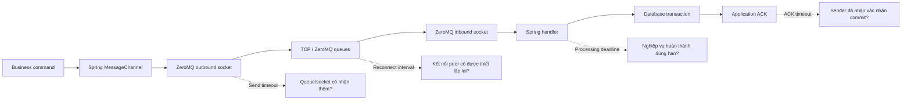
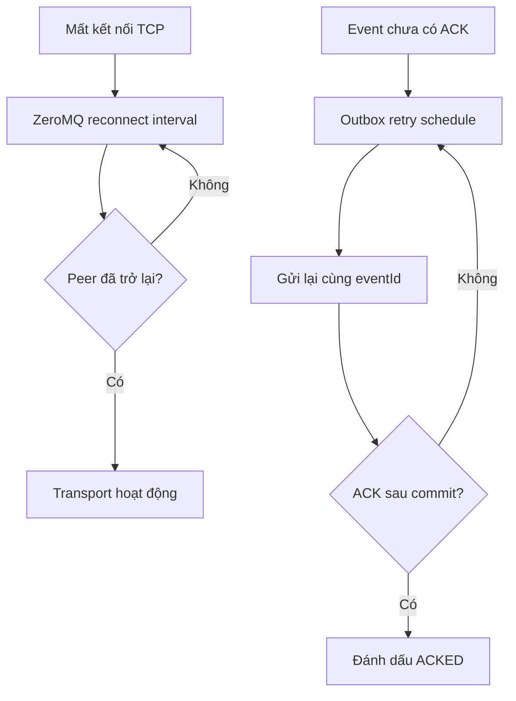
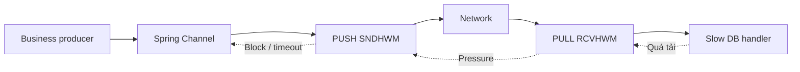
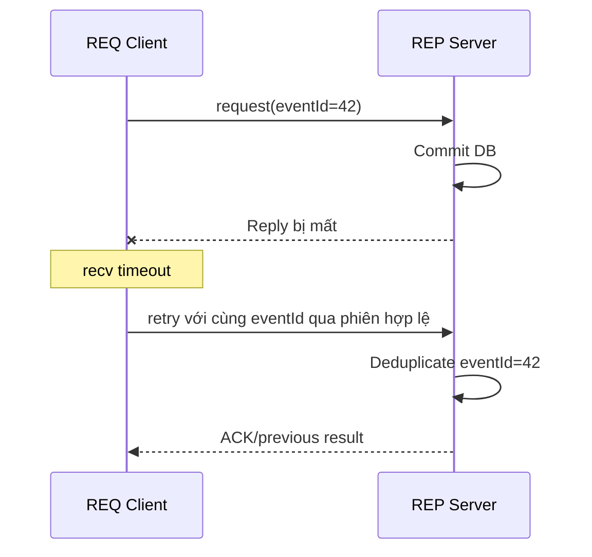
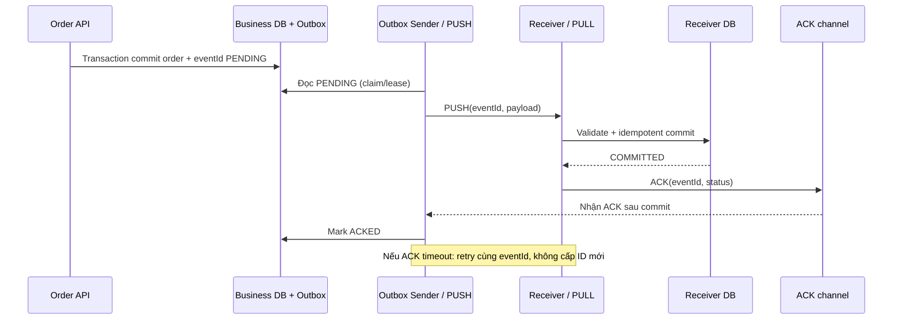
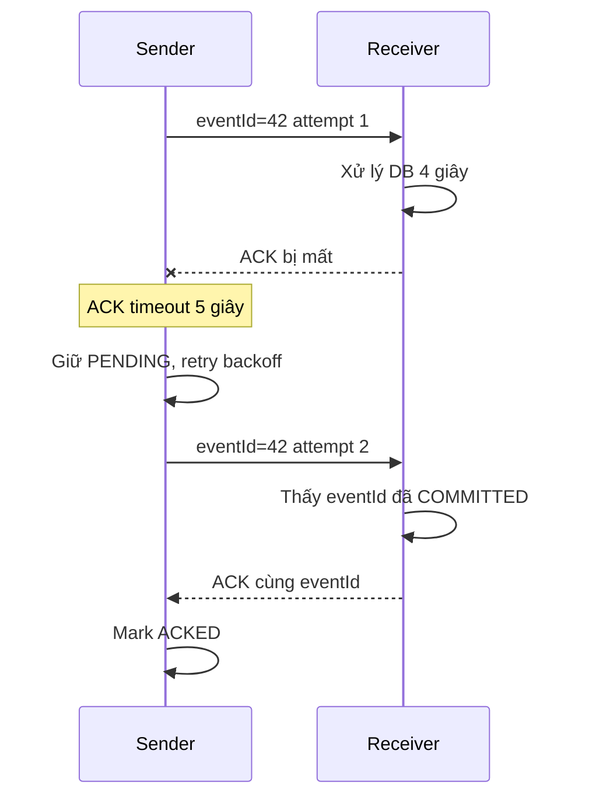
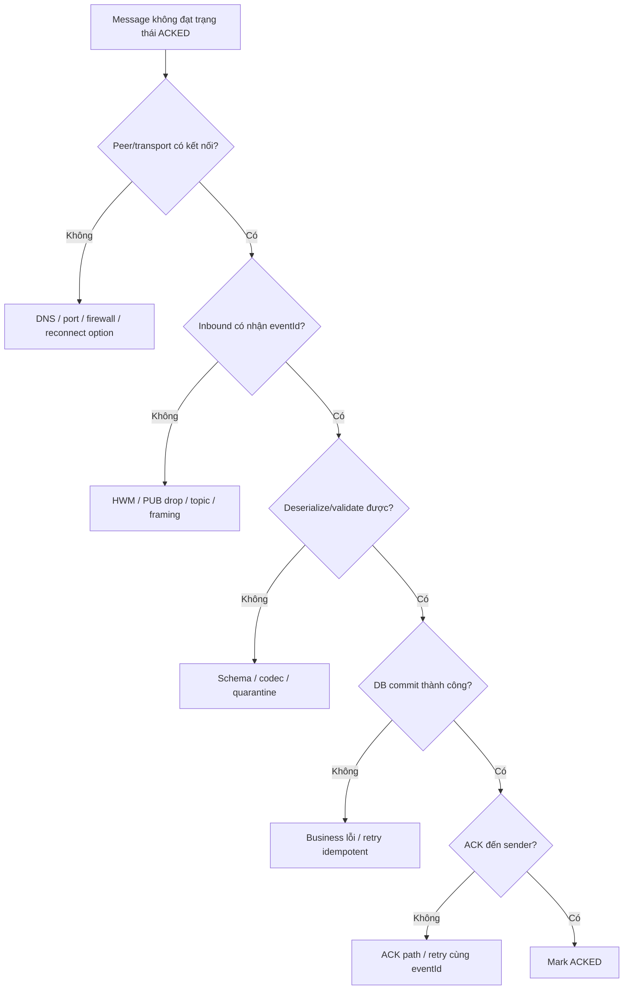

# Timeout, retry và reconnect trong ZeroMQ

## 1. Bối cảnh: kết nối tự phục hồi nhưng công việc vẫn bị mất

Một hệ thống Spring Boot gửi lệnh xử lý đơn hàng qua ZeroMQ `PUSH/PULL`. Khi worker dừng khoảng 20 giây rồi khởi động lại, kết nối TCP có thể được thiết lập lại mà không cần restart sender. Nhóm phát triển vì thế cho rằng các lệnh được gửi trong thời gian worker offline sẽ tự xuất hiện ở phía nhận. Nhưng khi đối soát database, có lệnh không được xử lý; ở một thử nghiệm khác, một lệnh lại được xử lý **hai lần** sau khi sender retry.

Ba khái niệm thường bị trộn lẫn:

1. **Timeout:** một thao tác không thể chờ vô hạn. Ví dụ sender chỉ chờ khả năng queue message trong một thời hạn nhất định.
2. **Reconnect:** socket cố thiết lập lại đường kết nối khi peer hoặc mạng trở lại.
3. **Retry:** ứng dụng chủ động thực hiện lại một lần gửi hoặc một công việc, thường dùng lại `eventId` và dựa trên trạng thái đã lưu.

**Reconnect không phải retry nghiệp vụ; timeout không phải xác nhận message thất bại hoàn toàn; retry không phải bằng chứng không tạo bản trùng.**

Bài **“Timeout retry và reconnect”** thuộc chương **Adapter ZeroMQ** của module **SPRING_INTEGRATION_ADAPTERS**. Module hướng dẫn kết nối hệ thống bên ngoài thông qua inbound/outbound adapter, gateway, poller và `MessageChannel`, thực hành với file, SFTP, HTTP, JMS, AMQP, Kafka và cơ sở dữ liệu, đồng thời kiểm soát hợp đồng message, lỗi và vòng đời kết nối. Trong ZeroMQ, các ranh giới **transport, message delivery và business commit** cần được hiểu riêng để đặt chính sách phục hồi chính xác.

### Mục tiêu học tập

Sau bài học, bạn có thể:

1. Phân biệt `send timeout`, `receive timeout`, connect/reconnect interval, deadline xử lý và timeout đợi ACK.
2. Giải thích hành vi kết nối bất đồng bộ, `ZMQ_RECONNECT_IVL` và `ZMQ_RECONNECT_IVL_MAX` theo JeroMQ.
3. Hiểu vì sao `PUSH/PULL`, `PUB/SUB`, `REQ/REP` phản ứng khác nhau khi peer mất kết nối.
4. Cấu hình `socketConfigurer(...)`, `setSendTimeOut`, `setRcvHWM`, `setSndHWM`, `setLinger`, reconnect interval trong Spring Integration ZeroMQ.
5. Phân biệt retry socket, retry tại Spring flow và retry nghiệp vụ có lưu trạng thái bền vững.
6. Thiết kế cơ chế `eventId`, transactional outbox, ACK sau commit, idempotency, backoff và dead-letter/quarantine.
7. Chẩn đoán các trường hợp `send()==true` nhưng dữ liệu chưa tới DB, timeout dù receiver đã xử lý, slow joiner và mất event khi restart.
8. Viết kiểm thử tích hợp với peer offline/restart, lỗi giả lập, thời hạn gửi và replay có kiểm soát.

## 2. Bản đồ các mốc timeout và xác nhận

Một message đi qua nhiều lớp:



| Cơ chế | Bắt đầu đếm khi nào? | Kết quả thường quan sát được | **Không** thể kết luận |
| --- | --- | --- | --- |
| **Send timeout** | Khi socket thực hiện một thao tác gửi có thể chờ | `send` trả kết quả hoặc hết thời hạn chờ theo socket semantics | Remote đã/ chưa commit DB |
| **Receive timeout** | Khi ứng dụng thực hiện nhận blocking | Nhận dữ liệu hoặc không nhận trong thời gian chờ | Sender không còn message |
| **Reconnect interval** | Khi kết nối cần được thử lại | Socket thử kết nối theo chu kỳ/backoff | Event bị mất được tự replay |
| **Application deadline** | Khi bắt đầu xử lý một command | Task có thể hoàn thành/hết SLA | Không cần idempotency khi retry |
| **ACK timeout** | Sau khi sender gửi và chờ xác nhận riêng | Có ACK hoặc hết thời hạn chờ | Receiver chắc chắn chưa xử lý |
| **Circuit breaker cooldown** | Sau khi lỗi vượt ngưỡng | Hạn chế thử lại trong một khoảng | Thay thế lưu trữ bền vững |

Một **deadline đầu cuối** có thể ngắn hơn tổng các timeout ở từng tầng. Nếu request HTTP có SLA 2 giây nhưng sender lại chờ socket 10 giây cộng ba lần retry, ứng dụng sẽ vượt SLA ngay cả khi socket cuối cùng nhận được message.

### 2.1. Bốn trạng thái tối thiểu để tránh nhầm lẫn

```text
CREATED   : Nghiệp vụ đã tạo event.
QUEUED    : Event đã vào một queue/socket hoặc outbox.
RECEIVED  : Receiver nhận được frame/message.
COMMITTED : Receiver đã ghi trạng thái nghiệp vụ thành công.
ACKED     : Sender đã nhận được xác nhận COMMITTED của receiver.
```

Từ `QUEUED` không được nhảy thẳng sang `COMMITTED` chỉ vì `MessageChannel.send()` hoặc `ZMQ.Socket.send()` không ném exception. Trạng thái `ACKED` cũng khác `COMMITTED`: receiver có thể commit rồi crash trước khi ACK đến sender.

## 3. ZeroMQ `connect()` không phải “kết nối đã sẵn sàng”

Với ZeroMQ, `bind` đăng ký endpoint local, còn `connect` yêu cầu socket kết nối tới endpoint đã chỉ định. Trong nhiều trường hợp, `connect()` **không chờ TCP handshake hoàn tất**; socket có thể bắt đầu queue dữ liệu hoặc thử kết nối ở background.

```text
Spring PUSH:
  connect("tcp://worker-service:7777")  → yêu cầu kết nối
  send(eventId=42)                     → có thể queue hoặc chờ

Remote PULL:
  chưa start / mất mạng / firewall chặn

Sau khi PULL start:
  ZeroMQ có thể thử kết nối lại.
  Nhưng KHÔNG tự bảo đảm mọi event trước đó còn tồn tại để gửi.
```

| Hiện tượng | Diễn giải đúng |
| --- | --- |
| `connect(url)` không báo lỗi | ZeroMQ chấp nhận cấu hình endpoint, chưa chứng minh peer online |
| TCP port hiện mở | Có đường mạng, chưa chứng minh socket type/frame đúng |
| Socket monitor thấy connected | Có kết nối transport, chưa chứng minh downstream business ready |
| SUB mới connect tới PUB | Subscription còn cần có hiệu lực, event sớm có thể mất |
| `send()` trả true | Message được socket chấp nhận theo semantics của socket |
| ACK ứng dụng sau DB commit | Bằng chứng ở cấp ứng dụng cho event cụ thể, theo protocol ACK |

**Địa chỉ cần chính xác:** `tcp://127.0.0.1:7777` chỉ trỏ tới network namespace hiện tại. Hai pod Kubernetes khác nhau không thể dùng loopback của mình để tìm peer. Dùng tên Service/IP có route được và đúng cổng, cùng NetworkPolicy/firewall phù hợp.

### 3.1. Kết nối lại không đồng nghĩa khởi tạo socket mới mỗi lần

JeroMQ/ZeroMQ quản lý các cố gắng reconnect cho những socket/transport hỗ trợ. Thông thường, **không cần** tự `close()` rồi `createSocket()` liên tục mỗi khi peer mất kết nối ngắn. Điều đó dễ gây:

- Tạo nhiều thread/socket không được dọn.
- Mất dữ liệu trong queue RAM của socket vừa đóng.
- TCP churn và tăng chi phí handshake.
- Race condition giữa sender thread với thread quản lý reconnect.
- Thao tác trên `ZContext` đã đóng.

Nên để socket được quản lý theo **vòng đời endpoint** và dùng transport reconnect trong phạm vi phù hợp; tầng nghiệp vụ lo **những event chưa có ACK**.

## 4. `ZMQ_RECONNECT_IVL` và `ZMQ_RECONNECT_IVL_MAX`

Các tùy chọn quan trọng của ZeroMQ/JeroMQ:

| ZeroMQ option | API JeroMQ thường dùng | Ý nghĩa |
| --- | --- | --- |
| `ZMQ_RECONNECT_IVL` | `socket.setReconnectIVL(int)` | Khoảng thời gian cơ bản giữa các lần thử reconnect, tính bằng mili giây |
| `ZMQ_RECONNECT_IVL_MAX` | `socket.setReconnectIVLMax(int)` | Khoảng reconnect tối đa khi dùng cơ chế tăng khoảng chờ |
| `ZMQ_SNDHWM` | `socket.setSndHWM(int)` | Ngưỡng queue gửi theo số message/peer |
| `ZMQ_RCVHWM` | `socket.setRcvHWM(int)` | Ngưỡng queue nhận |
| `ZMQ_LINGER` | `socket.setLinger(int)` | Hành vi đóng socket khi còn message pending |

Theo semantics của ZeroMQ, `RECONNECT_IVL=-1` có thể dùng để tắt tự reconnect ở transport hỗ trợ; cấu hình này cần được dùng có chủ đích, không chọn vì nghĩ rằng nó “giảm tải mạng”. Nếu `RECONNECT_IVL_MAX` lớn hơn khoảng cơ bản, khoảng thử lại có thể tăng theo cơ chế backoff đến giới hạn; hành vi cụ thể và ngưỡng mặc định phụ thuộc phiên bản.

### 4.1. Ví dụ cấu hình reconnect

```java
// Trong socketConfigurer hoặc trước socket.connect():
socket.setReconnectIVL(500);       // khoảng cơ bản 500 ms
socket.setReconnectIVLMax(10_000); // mức trần 10 s
socket.setSndHWM(1_000);
socket.setSendTimeOut(2_000);
socket.setLinger(1_000);
```

**Cách đọc đúng:** các tùy chọn này cấu hình **transport socket**. Chúng **không** điều khiển một job outbox sẽ retry lần thứ mấy, không có event ID, không ACK, không có max attempts cho nghiệp vụ. Nhiều socket vẫn có thể tự reconnect mãi trong khi outbox chưa xử lý được; do đó cần metric, alert và một chính sách failover riêng.

### 4.2. Backoff ở reconnect khác backoff ở retry nghiệp vụ



Hai vòng lặp chạy ở **hai tầng khác nhau**. Reconnect để dựng lại đường truyền; outbox retry để tiếp tục một **nghĩa vụ nghiệp vụ chưa được xác nhận**. Không suy rằng một trong hai vòng sẽ tự thực hiện phần việc của vòng còn lại.

### 4.3. Jitter và thundering herd

Khi một service đích restart, hàng trăm sender có thể thử reconnect cùng lúc. Cơ chế reconnect của thư viện có thể có độ lệch nhất định theo phiên bản, nhưng vẫn nên xem xét:

- Trần kết nối và năng lực nhận của peer.
- Backoff/jitter ở **retry application/outbox** khi nhiều worker cạnh tranh.
- Rate limiting cho publisher sau khi peer trở lại.
- Graceful rollout/readiness để giảm thác lũ kết nối mới.

Không tự implement vòng `while(true) connect()` không có delay trên mỗi request thread: có thể gây CPU cao, làm quá tải peer và tăng sự cố.

## 5. Send timeout: ZeroMQ chờ điều gì?

`setSendTimeOut(int millis)` ảnh hưởng thời gian một lời gọi gửi **có thể chờ để socket chấp nhận dữ liệu**, tùy socket type, flags và queue state. Nó không phải timeout của database hoặc transaction từ xa.

### 5.1. JeroMQ PUSH với timeout hữu hạn

```java
import java.nio.charset.StandardCharsets;
import org.zeromq.SocketType;
import org.zeromq.ZContext;
import org.zeromq.ZMQ;

public class PushSendTimeoutDemo {
    public static void main(String[] args) {
        try (ZContext context = new ZContext()) {
            ZMQ.Socket push = context.createSocket(SocketType.PUSH);
            try {
                push.setSndHWM(100);
                push.setSendTimeOut(1_500);
                push.setReconnectIVL(500);
                push.setReconnectIVLMax(5_000);
                push.connect("tcp://127.0.0.1:7777");

                byte[] payload = "eventId=e-42"
                        .getBytes(StandardCharsets.UTF_8);
                boolean accepted = push.send(payload, 0);
                if (!accepted) {
                    System.err.println("Socket chưa nhận được message");
                    // Không tự kết luận receiver chưa commit eventId=e-42.
                }
            } finally {
                push.close();
            }
        }
    }
}
```

**Lưu ý vận hành:** nếu `push.send(...)` trả true, message có thể chỉ nằm trong queue của ZeroMQ. Đóng socket ngay sau lệnh gửi, đặc biệt với linger bằng 0, có thể làm dữ liệu pending không đến peer. Với những công việc quan trọng, lưu outbox trước khi gửi và chỉ xem đã hoàn tất khi nhận ACK ứng dụng.

### 5.2. `ZMQ.DONTWAIT` và non-blocking send

```java
import org.zeromq.ZMQ;

byte[] payload = "eventId=e-43"
        .getBytes(java.nio.charset.StandardCharsets.UTF_8);
boolean acceptedNow = push.send(payload, ZMQ.DONTWAIT);

if (!acceptedNow) {
    // Trong pattern phù hợp như PUSH, socket chưa thể queue thêm ngay.
    // Nên giữ event ở durable outbox để retry theo lịch.
}
```

Với một socket blocking phù hợp, gửi khi tất cả peer/queue đều đầy có thể **chờ**; gửi không chờ có thể **trả false** (hoặc lỗi tương ứng như `EAGAIN` theo API/version). Nhưng đừng áp kết luận đó cho tất cả socket type: `PUB` có thể **drop** message cho subscriber chậm dù sender thấy thao tác gửi được chấp nhận.

### 5.3. Nếu gửi timeout thì nên làm gì?

Không thử gửi lại vô điều kiện ngay trong vòng lặp vô hạn:

```text
Sai:
while (!push.send(body)) {
    // không backoff, không deadline, không durable state
}

Hướng tốt hơn:
1. Event đã được lưu bền vững với eventId duy nhất.
2. Lần gửi được ghi nhận thành một attempt.
3. Nếu chưa có ACK, lên lịch retry có backoff và jitter.
4. Sau ngưỡng nỗ lực/thời gian, cảnh báo và chuyển xử lý thủ công.
5. Receiver deduplicate theo eventId trong transaction.
```

**Không coi `send()==false` là bằng chứng chắc chắn request chưa từng tác động tới receiver**, đặc biệt nếu retry xảy ra sau khi đã có các lần gửi trước hoặc tình huống ACK bị mất. Chính sách đúng là dựa trên **trạng thái ACK/commit**, không chỉ dựa vào kết quả gửi socket của lần thử hiện tại.

## 6. Receive timeout: không có dữ liệu không đồng nghĩa peer chết

`setReceiveTimeOut(int millis)` giới hạn việc chờ ở thao tác **nhận blocking** của JeroMQ. Nó có thể hữu ích cho vòng đọc tự quản lý, nhưng timeout chỉ nói rằng **không có frame/message được nhận trong thời hạn**.

```java
import org.zeromq.SocketType;
import org.zeromq.ZContext;
import org.zeromq.ZMQ;

public class PullReceiveTimeoutDemo {
    public static void main(String[] args) {
        try (ZContext context = new ZContext()) {
            ZMQ.Socket pull = context.createSocket(SocketType.PULL);
            try {
                pull.setRcvHWM(500);
                pull.setReceiveTimeOut(2_000);
                pull.bind("tcp://*:7777");

                byte[] received = pull.recv(0);
                if (received == null) {
                    System.out.println("Không có message trong 2 giây");
                    // Có thể nguồn đang idle; không kết luận peer đã chết.
                } else {
                    System.out.println("Nhận " + received.length + " byte");
                }
            } finally {
                pull.close();
            }
        }
    }
}
```

### 6.1. `consumeDelay` của inbound Spring Integration khác receive timeout

Trong `ZeroMqMessageProducer`, DSL cung cấp `consumeDelay(Duration)` để điều chỉnh độ trễ khi vòng nhận thử đọc nhưng chưa có dữ liệu. Nó **không phải** `setReceiveTimeOut` của thao tác blocking JeroMQ, cũng không phải `Pollers.fixedDelay` thường thấy ở file/FTP inbound adapter.

```java
// Inbound PULL của Spring Integration:
ZeroMq.inboundChannelAdapter(context, SocketType.PULL)
        .bindPort(7777)
        .consumeDelay(java.time.Duration.ofMillis(100))
        .socketConfigurer(socket -> socket.setRcvHWM(500));
```

**Không tính rằng `consumeDelay(100ms)` giới hạn throughput tối đa 10 message/giây.** Khoảng này liên quan lần thử nhận khi rỗng, không phải rate limiter để làm chậm mọi message.

### 6.2. Khi nào cần heartbeat?

Một receiver có thể không nhận event vì:

- Publisher đang không có event.
- Mạng bị ngắt.
- Peer restart.
- SUB chưa subscribe đúng topic.
- Socket type hoặc framing không khớp.

Chỉ dựa vào việc `recv` timeout không phân biệt được các khả năng này. Một **heartbeat/health protocol** riêng có thể xác nhận sự hiện diện của peer; socket monitor có thể cung cấp trạng thái transport trong phạm vi thư viện hỗ trợ. Với một số phiên bản ZeroMQ/JeroMQ, heartbeat socket options có thể có sẵn, nhưng cần kiểm tra API/version thực tế trước khi sử dụng.

**Heartbeat không phải ACK nghiệp vụ.** Một peer có thể phản hồi heartbeat nhưng DB của nó không thể commit đơn hàng.

## 7. Mỗi socket pattern có cách phục hồi khác nhau

| Pattern | Khi peer offline | Khi kết nối trở lại | Có replay tự động? |
| --- | --- | --- | --- |
| **PUSH/PULL** | PUSH có thể queue/chờ/timeout tùy HWM và option | Đường truyền có thể hoạt động lại và gửi phần còn đang trong queue phù hợp | **Không có durable replay**, đặc biệt qua process crash |
| **PUB/SUB** | PUB có thể bỏ message không có subscriber hoặc subscriber chậm | SUB tiếp tục nhận event mới khi subscription có hiệu lực | **Không** phát lại event đã bỏ lỡ |
| **PAIR/PAIR** | Không có peer thì không thể giao như mong đợi, tùy queue/timeout | Có thể nối lại theo topology | Không có replay nghiệp vụ |
| **REQ/REP** | Caller có thể không nhận reply và socket bị ràng buộc state machine | Cần chính sách khôi phục socket/request | Không tự bảo đảm idempotent RPC |
| **DEALER/ROUTER** | Routing phụ thuộc identity, peer availability/queue | Định tuyến lại theo protocol và peer identity | Không có transaction/durable replay tự động |

Trong Spring Integration, inbound adapter trực tiếp hỗ trợ `PAIR/PULL/SUB`, outbound hỗ trợ `PAIR/PUSH/PUB`. `REQ/REP` và `DEALER/ROUTER` không tự trở thành một outbound gateway tích hợp sẵn chỉ vì ZeroMQ có các socket type đó. `ZeroMqProxy` có thể hỗ trợ các proxy mode nhất định, nhưng proxy không phải kho lưu sự kiện bền vững.

### 7.1. PUSH/PULL: độ trễ và tài nguyên

Một sender PUSH có thể chịu áp lực từ receiver PULL:



Nếu tất cả worker PULL đều chậm, `SNDHWM` có thể bị chạm. Khi tăng HWM, bạn chỉ **tăng buffer memory** và trì hoãn thời điểm quá tải; không làm worker xử lý nhanh hơn. Một `ExecutorChannel` downstream có queue không giới hạn có thể khiến inbound adapter vẫn rút socket rất nhanh, chuyển backlog từ ZeroMQ sang heap Java.

### 7.2. PUB/SUB: slow joiner và gap

SUB kết nối muộn **không được gửi lịch sử** từ PUB. Nếu PUB phát 100 event trước khi SUB đăng ký, SUB không thể yêu cầu ZeroMQ PUB “gửi lại 100 event” như một consumer group có offset của Kafka.

Khi cần khôi phục:

- Đặt `eventId` và `sequenceNumber` trong payload/frame có quy ước.
- Subscriber đo gap theo một phạm vi sequence xác định.
- Dùng snapshot API để lấy trạng thái mới nhất, hoặc event store/broker bền vững để replay.
- Nếu cần mọi subscriber xử lý mọi event, cân nhắc kiến trúc khác thay vì chỉ tăng `SNDHWM`.

### 7.3. REQ/REP: timeout có thể làm state machine bị kẹt

REQ thường theo chu kỳ `send → recv → send → recv`. Nếu đợi reply timeout, không được tiếp tục gửi request khác trên cùng REQ socket và giả định state machine đã reset.



Trong những trường hợp request–reply tin cậy, cần xử lý **socket state**, deadline và khả năng tạo lại socket từ đúng owner thread theo một thuật toán cụ thể (ví dụ Lazy Pirate pattern trong ZeroMQ Guide), kết hợp **idempotency key** để tránh thực hiện lại command đã commit. Đừng lấy một `REQ` socket chung cho nhiều HTTP thread.

## 8. HWM, linger và timeout tương tác thế nào?

| Cấu hình | Ý nghĩa | Giới hạn |
| --- | --- | --- |
| `setSndHWM(1_000)` | Ngưỡng message chờ gửi theo peer/socket | Không phải quota bytes chính xác, không bền vững |
| `setRcvHWM(1_000)` | Ngưỡng message chờ nhận | Không giới hạn queue downstream Spring |
| `setSendTimeOut(2_000)` | Giới hạn chờ khi send bị block theo semantics socket | Không phải thời gian nhận ACK |
| `setReceiveTimeOut(2_000)` | Giới hạn chờ ở recv blocking | Không phải kết luận peer chết |
| `setReconnectIVL(500)` | Chu kỳ cơ bản để thử reconnect | Không phải lịch replay event |
| `setReconnectIVLMax(10_000)` | Trần chu kỳ reconnect | Không phải giới hạn số lần thử của business |
| `setLinger(1_000)` | Hành vi giữ pending data khi đóng socket | Không bảo đảm DB commit |

### 8.1. Cảnh báo về giá trị đặc biệt

- `HWM = 0` thường là không áp giới hạn HWM của ZeroMQ; **không có nghĩa RAM vô hạn**.
- `linger = 0` có thể bỏ dữ liệu queue khi đóng socket; chọn vì cần shutdown nhanh phải đánh đổi rõ.
- Một số socket option dùng giá trị âm/đặc biệt theo ZeroMQ version; **không dùng chung ý nghĩa “-1” cho mọi option**.
- Đặt option **trước bind/connect** khi tạo socket để chắc chắn nó có hiệu lực với các pipe/peer mới; thay đổi nóng có thể không áp dụng hồi tố.

### 8.2. Kích thước payload cũng quyết định memory budget

Nếu một queue chứa 1.000 message:

```text
Payload trung bình 1 KiB:   khoảng 1 MiB dữ liệu thô.
Payload trung bình 100 KiB: khoảng 100 MiB dữ liệu thô.
Payload trung bình 1 MiB:   khoảng 1 GiB dữ liệu thô.
```

Đây chỉ là **payload bytes**, chưa tính frame, queue, socket, Java object và bản sao trên nhiều peer. Với retry quá nhanh hoặc `HWM=0`, bộ nhớ có thể tăng mạnh. Cần giới hạn **số message, byte size và tốc độ retry**.

## 9. Spring Integration: Java DSL outbound PUSH có timeout/reconnect

### 9.1. Dependency và property

Trong ứng dụng Spring Boot dùng BOM quản lý Spring Integration/JeroMQ tương thích:

```xml
<dependencies>
    <dependency>
        <groupId>org.springframework.boot</groupId>
        <artifactId>spring-boot-starter-integration</artifactId>
    </dependency>
    <dependency>
        <groupId>org.springframework.integration</groupId>
        <artifactId>spring-integration-zeromq</artifactId>
    </dependency>
</dependencies>
```

```yaml
# application.yml
app:
  zeromq:
    orders-push-url: ${ZMQ_ORDERS_PUSH_URL:tcp://127.0.0.1:7777}
    orders-pull-port: ${ZMQ_ORDERS_PULL_PORT:7777}
    send-hwm: ${ZMQ_SEND_HWM:500}
    receive-hwm: ${ZMQ_RECEIVE_HWM:500}
    send-timeout-ms: ${ZMQ_SEND_TIMEOUT_MS:1500}
    reconnect-ms: ${ZMQ_RECONNECT_MS:500}
    reconnect-max-ms: ${ZMQ_RECONNECT_MAX_MS:10000}
```

Các giá trị trên **là ví dụ** cần điều chỉnh sau khi đo thực tế. `127.0.0.1` chỉ hợp lệ khi socket peer ở cùng network namespace; nếu receiver ở pod khác, dùng DNS Service/địa chỉ được định tuyến và mở cổng tương ứng.

### 9.2. Một bean `ZContext` và outbound flow

```java
import org.springframework.beans.factory.annotation.Value;
import org.springframework.context.annotation.Bean;
import org.springframework.context.annotation.Configuration;
import org.springframework.integration.channel.DirectChannel;
import org.springframework.integration.dsl.IntegrationFlow;
import org.springframework.integration.zeromq.dsl.ZeroMq;
import org.springframework.messaging.MessageChannel;
import org.zeromq.SocketType;
import org.zeromq.ZContext;

@Configuration
public class OrdersZeroMqOutboundConfiguration {

    @Bean(destroyMethod = "close")
    public ZContext zeroMqContext() {
        return new ZContext();
    }

    @Bean("ordersToSend")
    public MessageChannel ordersToSend() {
        return new DirectChannel();
    }

    @Bean
    public IntegrationFlow ordersPushFlow(
            ZContext context,
            @Value("${app.zeromq.orders-push-url}") String url,
            @Value("${app.zeromq.send-hwm}") int sendHwm,
            @Value("${app.zeromq.send-timeout-ms}") int sendTimeout,
            @Value("${app.zeromq.reconnect-ms}") int reconnectMs,
            @Value("${app.zeromq.reconnect-max-ms}") int reconnectMaxMs) {

        if (sendHwm < 0 || sendTimeout < 0 ||
                reconnectMs < 0 || reconnectMaxMs < reconnectMs) {
            throw new IllegalArgumentException("Socket config không hợp lệ");
        }

        return IntegrationFlow.from("ordersToSend")
                .handle(ZeroMq.outboundChannelAdapter(
                        context, url, SocketType.PUSH)
                        .socketConfigurer(socket -> {
                            socket.setSndHWM(sendHwm);
                            socket.setSendTimeOut(sendTimeout);
                            socket.setReconnectIVL(reconnectMs);
                            socket.setReconnectIVLMax(reconnectMaxMs);
                            socket.setLinger(1_000);
                        }))
                .get();
    }
}
```

**Điểm quan trọng của flow:**

1. `ZContext` do Spring quản lý và chỉ đóng khi các endpoint đã dừng.
2. `ZeroMqMessageHandler` outbound **PUSH connect** tới peer PULL.
3. `socketConfigurer(...)` thiết lập tùy chọn socket theo lifecycle adapter.
4. `setSendTimeOut` chỉ giới hạn một thao tác gửi theo semantics socket.
5. `setReconnectIVL`/`Max` hỗ trợ vòng reconnect, không có bảng outbox hay ACK.
6. `MessageChannel` là boundary trong Spring, **không** là xác nhận của receiver.

Trong Spring Integration, outbound ZeroMQ handler có **reactive semantics**, nên không được giả định mọi lỗi mạng hoặc send timeout sẽ ném ngay vào thread gọi `ordersToSend.send(...)`. Đường báo lỗi, completion và retry phải được **kiểm thử theo phiên bản và cách cấu hình flow thực tế**.

### 9.3. Service phát command có event ID

```java
import java.nio.charset.StandardCharsets;
import org.springframework.beans.factory.annotation.Qualifier;
import org.springframework.messaging.MessageChannel;
import org.springframework.messaging.support.MessageBuilder;
import org.springframework.stereotype.Service;

@Service
public class OrderCommandSender {
    private final MessageChannel orders;

    public OrderCommandSender(
            @Qualifier("ordersToSend") MessageChannel orders) {
        this.orders = orders;
    }

    public boolean dispatch(String eventId, String orderId) {
        if (eventId == null || orderId == null ||
                !eventId.matches("[A-Za-z0-9_-]{1,128}") ||
                !orderId.matches("[A-Za-z0-9_-]{1,64}")) {
            throw new IllegalArgumentException("ID không hợp lệ");
        }
        byte[] body = ("create:" + eventId + ":" + orderId)
                .getBytes(StandardCharsets.UTF_8);
        return orders.send(
                MessageBuilder.withPayload(body).build());
    }
}
```

Đây là wire format text đơn giản cho bài học; production nên dùng JSON/Protobuf với schemaVersion, field validation, byte limit và event ID trên wire. Giá trị trả về `true` của `dispatch` **không được dùng** để chuyển trạng thái DB thành `COMPLETED`. Chỉ ACK ứng dụng sau commit hoặc quy trình đối soát mới xác nhận kết quả nghiệp vụ.

### 9.4. Những điều không nên làm

Không viết:

```java
// PHẢN VÍ DỤ: retry tại HTTP request không có nguồn durable.
for (int i = 0; i < 100; i++) {
    if (orders.send(message)) {
        markOrderAsCompleted(); // SAI: đây không phải ACK receiver.
        break;
    }
}
```

Đoạn này có thể spam message trùng, vượt SLA request, làm tăng queue và ghi sai trạng thái. Retry phải gắn với **outbox/eventId/ACK** và phải có giới hạn.

## 10. Spring Integration inbound PULL: nhận, validate và xử lý

Để minh họa peer đối ứng với `PUSH`, một Spring `PULL` có thể bind ở 7777:

```java
import java.time.Duration;
import org.springframework.beans.factory.annotation.Value;
import org.springframework.context.annotation.Bean;
import org.springframework.context.annotation.Configuration;
import org.springframework.integration.dsl.IntegrationFlow;
import org.springframework.integration.zeromq.dsl.ZeroMq;
import org.zeromq.SocketType;
import org.zeromq.ZContext;

@Configuration
public class OrdersZeroMqInboundConfiguration {

    @Bean
    public IntegrationFlow ordersPullFlow(
            ZContext context,
            @Value("${app.zeromq.orders-pull-port}") int port,
            @Value("${app.zeromq.receive-hwm}") int receiveHwm) {

        return IntegrationFlow.from(
                ZeroMq.inboundChannelAdapter(context, SocketType.PULL)
                        .bindPort(port)
                        .receiveRaw(true)
                        .consumeDelay(Duration.ofMillis(100))
                        .socketConfigurer(socket ->
                                socket.setRcvHWM(receiveHwm)))
                .channel("ordersReceivedRaw")
                .get();
    }
}
```

`consumeDelay` chỉ liên quan đến khoảng chờ của vòng nhận ZeroMQ khi chưa có dữ liệu, **không phải timeout của transaction xử lý lệnh**, không phải retry interval và không giới hạn tổng throughput theo công thức `1/delay`.

### 10.1. Handler raw message

```java
import java.nio.charset.StandardCharsets;
import org.springframework.integration.annotation.ServiceActivator;
import org.springframework.messaging.Message;
import org.springframework.stereotype.Component;
import org.zeromq.ZFrame;
import org.zeromq.ZMsg;

@Component
public class OrdersReceiver {

    @ServiceActivator(inputChannel = "ordersReceivedRaw")
    public void onRaw(Message<ZMsg> message) {
        ZMsg raw = message.getPayload();
        try {
            if (raw.size() != 1) {
                throw new IllegalArgumentException("Cần một body frame");
            }
            ZFrame frame = raw.getFirst();
            byte[] body = frame.getData();
            if (body.length == 0 || body.length > 1_048_576) {
                throw new IllegalArgumentException(
                        "Body rỗng hoặc vượt giới hạn");
            }
            String text = new String(
                    body, StandardCharsets.UTF_8);
            System.out.println("Received command: " + text);
            // Production: parse schema, ghi DB idempotent.
            // Chỉ gửi ACK ứng dụng sau khi transaction commit.
        } finally {
            raw.destroy();
        }
    }
}
```

Khi `receiveRaw(true)`, payload là `ZMsg` và caller cần quản lý vòng đời raw frames. Nếu cần đưa sang worker bất đồng bộ, **copy `byte[]` hoặc DTO trước khi `destroy()`**, không giữ raw frame sau khi giải phóng. Nếu nhận `receiveRaw(false)`, mapper/converter được sử dụng; kiểu payload phụ thuộc cấu hình.

### 10.2. Không nhầm vòng xử lý của PULL với poller

`ZeroMqMessageProducer` chủ động lấy ZeroMQ message theo cơ chế nhận của adapter; `consumeDelay` không tương đương `Pollers.fixedDelay(...)` của FTP/file/JDBC. Không dùng poller của Spring để sửa một lỗi **connect/reconnect** nếu vấn đề nằm ở socket option hoặc peer offline.

## 11. Retry trong Spring Integration: boundary nào thực sự được retry?

Nhiều developer quen dùng `RequestHandlerRetryAdvice` hoặc `RetryTemplate` với outbound adapter khác. Tuy nhiên, trong ZeroMQ cần thận trọng:

- `ZeroMqMessageHandler` có **reactive processing semantics**. Một advice vốn bắt exception **đồng bộ** quanh handler có thể không bắt được lỗi xuất hiện **sau khi lời gọi đồng bộ kết thúc**.
- Spring `MessageChannel.send()` thành công không nghĩa remote xử lý thành công; retry dựa duy nhất trên kết quả send có thể tạo duplicate.
- Retry advice đặt ở phía receiver chỉ retry **business handler đang có message trong tay**; nó không phát lại những event đã rơi ở PUB hoặc mất khi process crash.
- Một nguồn **durable outbox** là nơi thích hợp để giữ trạng thái các command chưa được ACK.

### 11.1. Ba loại retry khác nhau

| Loại | Kích hoạt | Có đảm bảo replay qua restart? | Rủi ro |
| --- | --- | --- | --- |
| **Socket reconnect** | Transport mất kết nối | Không | Tưởng rằng reconnect tự replay |
| **In-memory retry** | Exception trong một handler/flow | Không, nếu không lưu bền vững | Mất khi JVM restart, retry storm |
| **Durable application retry** | Event chưa ACK trong outbox | Có thể, nếu outbox/transaction thiết kế đúng | Duplicate nếu receiver thiếu idempotency |

Không áp dụng cùng một retry policy cho mọi lỗi. Lỗi JSON sai schema sẽ không tự hết bằng retry 100 lần; network outage có thể là lỗi tạm thời; một command đã commit nhưng ACK bị mất phải được xử lý bằng **idempotent retry**.

### 11.2. Ví dụ phân loại lỗi

| Lỗi | Tạm thời hay vĩnh viễn? | Chính sách đề xuất |
| --- | --- | --- |
| Peer chưa online | Thường tạm thời | Reconnect transport + outbox retry có backoff |
| Network partition | Tạm thời hoặc kéo dài | Retry có trần, metric, alert, không flood |
| HWM đầy / send timeout | Thường do overload | Bounded wait, giảm tốc, outbox retry |
| Body JSON sai schema | Thường không tự hồi phục | Quarantine/DLQ và sửa dữ liệu |
| Không được phép truy cập tenant | Lỗi business/security | Reject, audit, **không retry** tự động |
| DB timeout trước khi biết kết quả | Trạng thái chưa rõ | Tra cứu theo idempotency key, retry an toàn |
| Receiver commit rồi ACK mất | Trạng thái sender chưa rõ | Gửi lại cùng eventId, receiver trả kết quả cũ |
| Context/socket đã đóng | Lỗi lifecycle | Không retry trên socket cũ; khôi phục đúng owner |

### 11.3. Không dùng error channel như một durable queue

Một `ErrorMessage` hoặc error channel trong Spring Integration giúp quan sát/xử lý exception tại boundary được cấu hình. Nhưng bản thân error channel không nhất thiết lưu dữ liệu bền vững hoặc cung cấp offset/replay. Tương tự, reactive error handling phải được xác minh đúng phiên bản; không được hứa mọi lỗi socket đều đến cùng một channel.

Nếu một event quan trọng đã tồn tại trong DB outbox, một worker có thể quyết định retry trên cơ sở **trạng thái bền vững** mà không cần giữ nguyên exception object từ lần gửi trước.

## 12. Thiết kế outbox, ACK và idempotency

### 12.1. Quy tắc gửi an toàn

Đối với command tạo đơn hàng hoặc thanh toán, một cơ chế hợp lý:



**Ở đây `PUSH/PULL` vẫn là một chiều.** ACK phải có **một luồng riêng**, ví dụ receiver dùng một outbound `PUSH` kết nối tới ACK `PULL` của sender, hoặc một kênh HTTP/JMS/AMQP được thiết kế rõ. Không gọi đó là reply được ZeroMQ PUSH/PULL tự sinh.

### 12.2. Bảng trạng thái outbox

| Trường | Ví dụ | Ý nghĩa |
| --- | --- | --- |
| `event_id` | `evt-42` | Khóa idempotency ổn định qua mọi retry |
| `payload_bytes` | JSON/Protobuf có version | Dữ liệu được lưu bền vững trước khi gửi |
| `status` | `PENDING`, `ACKED`, `DEAD` | Trạng thái xử lý theo hợp đồng |
| `attempt_count` | 3 | Số lần thử publish của ứng dụng |
| `next_attempt_at` | Timestamp | Lịch thử tiếp theo có backoff |
| `locked_until` hoặc lease | Timestamp | Tránh nhiều publisher cùng claim một event |
| `last_error_category` | NETWORK_TIMEOUT | Phân loại lỗi để vận hành |
| `created_at`/`updated_at` | Timestamp | Audit, SLA và cảnh báo |

**Không chuyển `PENDING` sang `ACKED` chỉ sau khi `MessageChannel.send()` trả true.** Đây là điểm mấu chốt: trạng thái `ACKED` yêu cầu ACK theo ứng dụng hoặc một cơ chế xác nhận tương đương đã được định nghĩa.

### 12.3. Tính khoảng retry với exponential backoff và jitter

Một công thức phổ biến:

```text
baseDelay = 1 giây
maxDelay  = 60 giây

delay(n) = min(maxDelay, baseDelay × 2^(n-1))

attempt 1:  1 giây
attempt 2:  2 giây
attempt 3:  4 giây
attempt 4:  8 giây
attempt 5: 16 giây
attempt 6: 32 giây
attempt 7+: 60 giây (trần)
```

Đây là **ví dụ lịch backoff**, không phải lịch thực tế mà JeroMQ tự áp dụng. Bổ sung jitter giúp các worker không đồng loạt retry khi peer vừa online lại; đồng thời phải có `maxAttempts`/`maxAge` hoặc cảnh báo chuyển xử lý thủ công. Retry trong outbox thường nên **có khả năng bị hủy** khi ACK đến trong lúc một attempt đã được lên lịch.

### 12.4. Ví dụ hàm backoff thuần Java

```java
import java.time.Duration;
import java.util.concurrent.ThreadLocalRandom;

public final class RetryBackoff {
    private RetryBackoff() {
    }

    public static Duration nextDelay(int attempt) {
        if (attempt < 1) {
            throw new IllegalArgumentException("attempt >= 1");
        }
        int shift = Math.min(attempt - 1, 6);
        long cappedMs = Math.min(60_000L, 1_000L << shift);
        // Full jitter: tránh retry đồng loạt.
        long jitteredMs =
                ThreadLocalRandom.current().nextLong(cappedMs + 1);
        return Duration.ofMillis(jitteredMs);
    }
}
```

**Full jitter có thể cho ra 0 ms.** Với hệ thống cần bảo đảm độ trễ tối thiểu, dùng bounded/equal jitter và đặt floor phù hợp. Hàm trên là ví dụ thuật toán; production cần quản lý **attempt count, deadline, maximum age và thời điểm ACK đến** tại database, không tính lại tất cả chỉ từ biến cục bộ trong process.

## 13. Ví dụ dispatcher đọc outbox: send không phải completion

Đây là **mẫu phối hợp**, không thay thế implementation repository/transaction cụ thể. Các interface chỉ mô tả hợp đồng để người học tự cài DB repository:

```java
import java.time.Instant;
import java.util.List;

// Các kiểu minh họa package-private có thể đặt trong cùng một source file.
record OutboxEvent(
        String eventId,
        byte[] payload,
        int attempts,
        Instant nextAttemptAt) {
}

interface OutboxRepository {
    // Claim có lease để nhiều instance không cùng xử lý một row.
    List<OutboxEvent> claimReady(int limit, Instant now);

    // Chỉ schedule lại khi chưa ACK, cập nhật có điều kiện.
    void scheduleRetry(String eventId, Instant nextAt);

    // Gọi khi ACK ứng dụng đã được xác minh sau receiver commit.
    void markAcked(String eventId);
}
```

### 13.1. Dispatcher dùng Spring MessageChannel

```java
import java.time.Instant;
import org.springframework.beans.factory.annotation.Qualifier;
import org.springframework.messaging.MessageChannel;
import org.springframework.messaging.support.MessageBuilder;
import org.springframework.scheduling.annotation.Scheduled;
import org.springframework.stereotype.Component;

@Component
public class OutboxPushDispatcher {

    private final OutboxRepository repository;
    private final MessageChannel ordersToSend;

    public OutboxPushDispatcher(
            OutboxRepository repository,
            @Qualifier("ordersToSend")
            MessageChannel ordersToSend) {
        this.repository = repository;
        this.ordersToSend = ordersToSend;
    }

    @Scheduled(fixedDelayString = "${outbox.dispatch-delay-ms:1000}")
    public void dispatchBatch() {
        for (OutboxEvent event : repository.claimReady(
                100, Instant.now())) {
            if (event.payload() == null) {
                // Production: phân loại dữ liệu lỗi và quarantine.
                continue;
            }
            try {
                boolean accepted = ordersToSend.send(
                        MessageBuilder
                                .withPayload(event.payload().clone())
                                .setHeader("eventId", event.eventId())
                                .build());

                // Dù accepted=true, VẪN chờ ACK nghiệp vụ.
                // Không markAcked() tại đây.
                if (!accepted) {
                    System.err.println("Dispatch not accepted");
                }
            } catch (RuntimeException ex) {
                // Thống kê lỗi; không coi bắt exception là trạng thái
                // cuối cùng của remote business operation.
                System.err.println(ex.getClass().getSimpleName());
            } finally {
                var delay = RetryBackoff.nextDelay(
                        Math.max(1, event.attempts() + 1));
                repository.scheduleRetry(
                        event.eventId(), Instant.now().plus(delay));
            }
        }
    }
}
```

**Để dùng được ví dụ trên trong Spring Boot:**

- Cần bật scheduling nếu dự án chưa có `@EnableScheduling`.
- Cần triển khai `OutboxRepository` bằng DB thật, với transaction/lease và cập nhật trạng thái **có điều kiện**.
- Phải đảm bảo `eventId` nằm trong **payload/frame đã serialize**, không chỉ Spring header.
- `scheduleRetry` phải **không ghi đè `ACKED`** khi ACK đến đồng thời với dispatcher; cần compare-and-set/trạng thái có phiên bản.
- Nếu số lần thử/tuổi event vượt ngưỡng, chuyển `DEAD` hoặc cảnh báo thay vì retry vô hạn.
- Nếu `MessageChannel` dùng reactive handler, `accepted=true` vẫn không phản ánh kết quả gửi cuối cùng; việc giữ outbox pending tới ACK chính là cách tránh nhầm lẫn.

Đoạn code có chủ đích **không mark ACK theo kết quả send**. Đây là ví dụ để hiểu orchestration, **chưa** phải một triển khai production hoàn chỉnh của distributed lock, retry worker hay ACK transport.

### 13.2. ACK receiver cần commit trước

Một receiver có thể xử lý:

```text
1. Nhận eventId và payload qua PULL.
2. Kiểm tra schema/authorization/byte limit.
3. Bắt đầu transaction DB.
4. INSERT/UPSERT idempotent theo unique eventId.
5. Commit transaction.
6. Gửi ACK(eventId, committed=true) qua kênh riêng.

Nếu eventId đã có trong DB:
    - Không thực hiện side effect lần thứ hai.
    - Trả ACK (hoặc kết quả đã lưu) cho cùng eventId.
```

Lưu ý việc receiver ghi DB rồi **không kịp gửi ACK** không có nghĩa DB rollback. Retry của sender có thể khiến receiver nhận event lần thứ hai, nên **idempotency phải nằm trong transaction**. Không chỉ dùng bộ nhớ `HashSet` để deduplicate: process restart sẽ làm mất trạng thái.

## 14. Cách đặt ACK timeout và deadline nghiệp vụ

Giả sử hệ thống cho phép một command hoàn tất trong tối đa 30 giây, nhưng từng attempt chỉ chờ nhận ACK trong 5 giây. Có thể xảy ra:



### 14.1. Trạng thái “unknown outcome”

Hết thời gian chờ ACK phải được xem là **kết quả chưa rõ**, không mặc định là “nghiệp vụ thất bại và chưa có tác dụng phụ”. Điều này đặc biệt quan trọng với thanh toán, cấp quyền, ghi tồn kho và các hoạt động không thể đảo ngược dễ dàng.

Các hướng giải quyết:

- Tra cứu trạng thái receiver theo idempotency key.
- Retry cùng `eventId` và cho receiver trả kết quả đã commit.
- Dùng ACK với correlation ID và version/schema rõ.
- Đặt deadline toàn cục cho nghĩa vụ nghiệp vụ; sau deadline cần reconciliation/manual review theo hợp đồng.

### 14.2. ACK không được xác nhận bằng một Spring header tự phát

Với ZeroMQ outbound adapter, Spring headers không mặc định xuất hiện ở peer JeroMQ thuần theo đúng tên Java của chúng. Nếu ACK cần `eventId`, phải serialize nó trong **wire payload** hoặc một frame riêng được thỏa thuận. Nếu receiver nhận theo `receiveRaw(true)`, cần đọc đúng số frame; nếu mapped, phải đồng bộ framing/mapper.

## 15. Lựa chọn timeout theo SLA và tải

Không có một giá trị đúng cho mọi hệ thống. Những yếu tố cần cân nhắc:

| Yếu tố | Câu hỏi |
| --- | --- |
| Latency mạng | P95/P99 giữa các pod/host thường là bao nhiêu? |
| Thời gian xử lý DB | Transaction có thể kéo dài bao lâu khi quá tải? |
| Kích thước message | Message lớn có thể chiếm nhiều queue/memory hơn không? |
| Số peer | Có một PULL worker hay nhiều worker? |
| HWM và backpressure | Sender có thể chờ lâu khi queue đầy không? |
| Request SLA | Thread HTTP có được phép chờ ZeroMQ send không? |
| Graceful shutdown | Có đủ thời gian drain với linger hữu hạn không? |
| Failover | Sau bao lâu mới coi một instance tạm thời không dùng được? |
| Retry budget | Tối đa số lần thử/tuổi event trước cảnh báo? |
| Delivery contract | Có được mất event hoặc nhận trùng không? |

### 15.1. Phân bổ một deadline đầu cuối

Ví dụ minh họa:

```text
Request SLA người dùng       2.0 giây
  validation + auth          0.2 giây
  ghi business DB + outbox   0.6 giây
  response overhead          0.2 giây
  dự phòng latency           1.0 giây

ZeroMQ send/ACK sau request:
  chạy bất đồng bộ từ outbox, không giữ HTTP thread tới khi ACK.
```

Trong mô hình này, HTTP response có thể xác nhận **đã nhận lệnh để xử lý** (ví dụ trạng thái `PENDING`), **không** được nói “đơn hàng đã hoàn tất” nếu worker chưa xử lý. Đây là mẫu phù hợp hơn khi remote service có thể restart và latency lớn không dự đoán được.

### 15.2. Hàng đợi bền vững giảm áp lực lên timeout đồng bộ

Khi event đã được lưu outbox, ứng dụng không cần block HTTP thread theo thời gian reconnect của ZeroMQ. Publisher đọc outbox độc lập, có rate limiting và retry có backoff. Outbox chính là **nguồn sự thật** khi socket queue RAM mất đi vì process crash.

## 16. Reconnect, lifecycle và shutdown

### 16.1. Một socket có owner rõ ràng

`ZContext` có thể được dùng chung bởi nhiều socket/endpoint theo thiết kế. `ZMQ.Socket` **không thread-safe để nhiều thread business đồng thời thao tác tùy ý**. Khi dùng Spring Integration, để adapter quản lý socket; các request thread gửi qua `MessageChannel`, không giữ một `ZMQ.Socket` static rồi gọi `send` cùng lúc.

Nếu dùng JeroMQ trực tiếp, nên có **một owner thread** quản lý socket, đọc lệnh qua bounded queue và đóng socket đúng lifecycle. Không để một thread business gọi `close` trong lúc owner vẫn đang `recv` hoặc `send`.

### 16.2. Shutdown theo trình tự

```text
1. Ngừng nhận việc mới, đặt readiness = false.
2. Lưu/đối soát công việc còn PENDING trong nguồn bền vững.
3. Cho xử lý đang chạy hoàn thành trong deadline hữu hạn.
4. Dừng Spring Integration endpoints và socket owners.
5. Đóng từng socket theo đúng owner/lifecycle.
6. Đóng ZContext sau khi các socket đã dừng.
7. Khi restart, đọc outbox PENDING để tiếp tục.
```

**`linger=0`** có thể giúp shutdown nhanh nhưng làm mất message pending trong queue. **`linger` hữu hạn** không cung cấp ACK; nếu peer offline quá lâu, message vẫn có thể chưa được giao khi JVM dừng. Vì vậy graceful shutdown không thay thế durable outbox.

### 16.3. Khi context/socket đã đóng

Không tiếp tục retry `send` trên một socket có context đã terminated. Lỗi kiểu `ETERM` hoặc exception lifecycle phải được xử lý bằng việc khởi động lại **endpoint/context đúng owner**, không phải retry mãi trên cùng reference đã đóng. Đừng dùng ngoại lệ này như bằng chứng một event chưa từng được receiver xử lý.

## 17. Giám sát reconnect và retry

Nên tách metric theo **transport, dispatch, receive, business commit và ACK**:

| Metric | Ghi nhận khi nào | Vì sao cần |
| --- | --- | --- |
| `zeromq_connection_events_total` | Socket monitor báo connect/disconnect | Hiểu peer flapping/mạng |
| `zeromq_send_attempts_total` | Một attempt gửi ở sender | Đo retry/overload |
| `zeromq_send_timeouts_total` | Socket operation timeout/không queue được | Phát hiện backpressure và lỗi socket |
| `zeromq_receive_total` | Inbound nhận message/frame hợp lệ | Phân biệt receive với dispatch |
| `business_commit_total` | DB commit | Đo kết quả nghiệp vụ thật |
| `ack_received_total` | ACK hợp lệ được sender ghi nhận | Đối soát completion |
| `outbox_pending` | Số event chưa ACK | Phát hiện tồn đọng |
| `outbox_oldest_age_seconds` | Tuổi event pending lâu nhất | Cảnh báo vượt SLA |
| `outbox_attempts_histogram` | Số lần retry mỗi event | Xem hệ thống retry storm |
| `sequence_gap_total` | Subscriber phát hiện thiếu event | Quan trọng với PUB/SUB |
| `executor_queue_depth` | Backlog trong Spring downstream | Phát hiện áp lực bị chuyển sang JVM |
| `shutdown_duration_ms` | Khi dừng ứng dụng | Phát hiện linger/worker bị kẹt |

Một socket monitor có thể cho biết transport đã kết nối, nhưng **không xác nhận DB commit**, cũng không bảo đảm có bộ đếm chuẩn cho mọi message PUB bị drop. Với PUB/SUB, nên dùng `eventId`/`sequenceNumber` để phát hiện gap tại subscriber theo từng stream/partition được định nghĩa rõ.

### 17.1. Cảnh báo cần thiết

Ví dụ điều kiện cảnh báo vận hành:

- `outbox_oldest_age_seconds` vượt thời hạn xử lý được cam kết.
- `outbox_pending` tăng liên tục nhiều chu kỳ.
- Số lần reconnect tăng đột biến hoặc kết nối không ổn định.
- Tỷ lệ `send_timeout`/`send_fail` tăng.
- `receive_rate` cao nhưng `business_commit_rate` giảm.
- Subscriber có `sequence_gap` và snapshot resync thất bại.
- Số event `DEAD` hoặc quarantine tăng vì lỗi schema.

Không log payload nhạy cảm trong metric label hoặc exception message; ưu tiên correlation ID, topic whitelist, mã lỗi và thời gian.

## 18. Chẩn đoán sự cố timeout, retry và reconnect

| Triệu chứng | Nguyên nhân có thể | Cách kiểm tra/xử lý |
| --- | --- | --- |
| `connect()` trả về nhưng không có message | Connect bất đồng bộ, peer chưa bind hoặc sai địa chỉ | Xác minh DNS, route, port, socket type và readiness |
| `127.0.0.1` hoạt động local nhưng không trong hai pod | Loopback thuộc network namespace riêng | Dùng Kubernetes Service/DNS và NetworkPolicy |
| `PUSH.send` bị block/timeout | Peer offline, queue đầy, HWM/backpressure | Đo HWM, consumer rate, send latency, outbox retry |
| `PUB.send` có vẻ thành công nhưng SUB thiếu event | Slow joiner, HWM drop, subscription không khớp | Sequence gap, topic prefix, snapshot/replay |
| Đã reconnect nhưng event cũ không thấy | Event không còn ở queue RAM, không có durable replay | Outbox hoặc broker lưu bền vững |
| `receive timeout` ở PULL | Chưa có message, có thể chỉ idle | Không kết luận peer chết; dùng heartbeat/monitor |
| REQ timeout rồi send tiếp bị lỗi `EFSM` | State machine send/recv chưa hoàn tất | Khôi phục socket/request đúng pattern, thêm idempotency |
| DB có bản ghi nhưng sender báo ACK timeout | ACK mất sau commit | Retry cùng ID, receiver trả kết quả cũ |
| Đơn hàng tạo trùng sau retry | Receiver thiếu idempotency key/unique constraint | Deduplicate trong transaction |
| CPU tăng vọt khi peer offline | Retry vòng lặp không delay/jitter | Bounded retries, backoff, circuit breaker phù hợp |
| Outbox pending tăng dù socket connected | DB handler chậm, schema lỗi, ACK path hỏng | Tách transport/deserialize/business/ACK metrics |
| Spring channel send true nhưng worker không commit | Chỉ là boundary Spring/reactive handler | Đừng mark success trước ACK |
| Shutdown chậm | Linger/queue pending/worker block | Deadline, dừng source trước, outbox replay |
| Exception context terminated | Đóng `ZContext` quá sớm | Sửa lifecycle ownership, không gửi trên socket cũ |
| Random bind port đổi sau restart | Peer vẫn connect port cũ | Service discovery hoặc port ổn định |
| Lỗi schema bị retry mãi | Lỗi không tự hồi phục | Quarantine/DLQ, sửa dữ liệu và replay có kiểm soát |

### 18.1. Cây chẩn đoán



Điều tra luôn bằng **event ID cụ thể**. Không suy kết quả nghiệp vụ chỉ từ socket connected hoặc số lần publisher gọi send.

## 19. Kiểm thử tích hợp có kiểm soát

Mock `MessageHandler` không chứng minh hành vi reconnect TCP, HWM hoặc slow joiner. Nên chạy socket JeroMQ thật và Spring Integration flow với port riêng, tải hữu hạn và timeout của test rõ ràng.

| Test | Cách thực hiện | Kỳ vọng |
| --- | --- | --- |
| PUSH gửi khi PULL online | Peer PULL bind, PUSH connect | Receiver nhận bytes đúng, không nhầm với DB commit |
| PUSH connect trước PULL | Sender start trước peer | Connect không là health proof; socket có thể thử reconnect |
| PULL stop rồi restart | Ngắt peer giữa tải | Peer mới có thể nhận message mới/phần còn queue; không hứa replay durable |
| SNDHWM nhỏ, PULL chậm | Tạo tải vượt capacity | PUSH có thể block/timeout/non-blocking fail theo tình huống |
| PUB, SUB chưa subscribe | PUB gửi ngay khi start | Có thể mất event đầu (*slow joiner*) |
| PUB, SUB chậm | SUB xử lý chậm, so sequence | Có thể thấy gap; send success không đảm bảo fan-out |
| Receive timeout | Để PULL idle | `recv` timeout không đồng nghĩa TCP connection chết |
| Reconnect IVL/Max | Restart peer nhiều lần | Quan sát các lần thử kết nối theo cấu hình/version |
| Send timeout | Làm queue đầy và giới hạn chờ | Caller có kết quả trong boundary dự kiến |
| Context đóng khi đang chạy | Shutdown có kiểm soát | Không dùng socket đã bị terminated |
| Linger 0 và hữu hạn | Gửi rồi stop trong khi pending | Đối chiếu data loss/latency, không giả định ACK |
| Outbox retry sau sender restart | Kill process với event PENDING | Event vẫn được phát lại từ DB |
| ACK mất sau DB commit | Chặn đường ACK sau commit | Sender retry cùng ID; receiver không commit trùng |
| Hai dispatcher cùng claim | Có lease/conditional update | Một event không bị claim không kiểm soát |
| ACK đến cùng lúc schedule retry | Tạo race condition | `ACKED` không bị ghi đè thành PENDING |
| Lỗi JSON vĩnh viễn | Gửi body malformed | Quarantine, không retry vô hạn |
| Thử thách deadline | HTTP SLA nhỏ hơn thời gian worker offline | HTTP không bị giữ chờ reconnect nếu đã dùng outbox |
| Spring reactive error | Tiêm lỗi ở outbound/inbound | Xác định boundary báo exception thực tế |

### 19.1. Không assert HWM bằng một con số send tuyệt đối

`SNDHWM=100` **không** cam kết message thứ 101 chắc chắn timeout. ZeroMQ có queue per-peer và internal buffering, kết quả phụ thuộc topology/version/tải. Nên kiểm tra **xu hướng throughput, blocking time, memory và loss/gap** thay vì giả định giới hạn tuyệt đối.

### 19.2. Chạy fault injection an toàn

Một kịch bản:

```text
1. Start PULL receiver test, DB test, sender có outbox test.
2. Tạo eventId=evt-42.
3. Gửi event tới receiver, cho receiver commit.
4. Chặn ACK của evt-42 trước khi sender nhận.
5. Đợi ACK timeout; sender giữ PENDING.
6. Scheduler retry cùng eventId=evt-42.
7. Receiver phát hiện idempotency key đã commit.
8. Receiver trả ACK cho evt-42, không commit tác dụng phụ lần hai.
9. Sender mark ACKED và dừng retry.
```

Khi test với container/kết nối thật, có thể ngắt receiver hoặc đường ACK trong môi trường cô lập. Không làm fault injection lên production có giao dịch thật nếu chưa có quy trình kiểm soát.

## 20. Bảo mật và an toàn khi retry

### 20.1. Không biến retry thành DoS nội bộ

Một ứng dụng retry không giới hạn với delay gần 0 có thể:

- Tạo thác lũ TCP connections khi peer hồi phục.
- Lấp đầy queue và thread pool.
- Làm tăng số transaction duplicate.
- Tốn CPU để serialize liên tục cùng một payload lỗi.

Nên dùng **backoff, jitter, rate limit, retry budget và circuit breaker** khi phù hợp. Tách lỗi retryable (network, overload) khỏi lỗi không retryable (schema sai, không được phép truy cập, ID bị từ chối).

### 20.2. Không tin ACK từ peer không xác thực

Nếu ACK được dùng để xóa một nghĩa vụ thanh toán khỏi outbox, ACK phải:

- Gắn đúng `eventId` và loại command.
- Có nguồn đáng tin cậy theo cơ chế xác thực/authorization phù hợp.
- Chỉ được phát sau khi receiver commit.
- Không được ghi log payload/credential nhạy cảm.
- Được xử lý idempotent: nhận ACK lặp không gây hại.

ZeroMQ `tcp://` không tự có TLS. Kiểm soát firewall/NetworkPolicy, dùng ZeroMQ CURVE khi được JeroMQ version hỗ trợ hoặc lớp bảo vệ mạng đã được kiểm chứng. Topic subscription không thay thế authorization.

## 21. Bài tập tình huống

**Bối cảnh:** Một dịch vụ đặt hàng phát 1.500 command/giây qua ZeroMQ `PUSH`. Worker `PULL` xử lý tối đa 900 command/giây. Người dùng chấp nhận trạng thái `PENDING` trong vài giây, nhưng **không được mất hoặc thực hiện trùng đơn hàng**. Hệ thống có Kubernetes rolling restart, đôi khi mất kết nối 10–30 giây. Nhóm phát triển đề xuất `setSendTimeOut(1000)`, `setReconnectIVL(100)`, gọi `send` lại năm lần trong request HTTP rồi đánh dấu `COMPLETED` khi lời gọi trả true. Họ cũng muốn đổi sang `PUB/SUB` vì PUB gửi có vẻ không bị block.

Hãy trả lời:

1. `setSendTimeOut(1000)` giới hạn thời gian của thao tác nào? Nó có chờ DB commit không?
2. `setReconnectIVL(100)` giải quyết vấn đề kết nối hay phát lại nghiệp vụ?
3. Nếu `connect()` trả về thành công, có thể kết luận PULL online không?
4. Với tốc độ 1.500 và 900 command/giây, backlog có xu hướng thay đổi thế nào?
5. Tăng HWM có giúp hệ thống ổn định mãi khi tốc độ producer luôn cao hơn worker không?
6. `send()==true` có đồng nghĩa có ACK hoặc DB commit không?
7. Nếu worker commit rồi ACK bị mất, có an toàn khi gửi lại cùng command ID không?
8. Vì sao retry phải dùng **cùng** `eventId` thay vì cấp ID mới?
9. Khi receiver bị kill sau khi nhận message nhưng trước DB commit, transport reconnect có tự requeue message đó không?
10. Nếu chuyển sang PUB/SUB, liệu có bảo đảm mọi worker nhận mỗi command không?
11. Khác nhau giữa `setReceiveTimeOut` và inbound `consumeDelay` là gì?
12. `RequestHandlerRetryAdvice` có mặc nhiên bắt mọi lỗi outbound reactive ZeroMQ sau khi `MessageChannel.send()` trả về không?
13. Một outbox cần những trường tối thiểu nào để retry qua process restart?
14. Khi ACK và scheduleRetry cập nhật cùng event, cần tránh race condition nào?
15. Tại sao cần jitter khi nhiều pod cùng chờ service đích trở lại?
16. Khi nào nên đưa event vào quarantine thay vì tiếp tục retry?
17. Phân biệt socket monitor connected với ACK receiver sau DB commit.
18. Nêu một kế hoạch kiểm thử cho tình huống receiver commit thành công nhưng ACK bị mất.

**Đáp án gợi ý:**

1. Giới hạn đợi ở thao tác gửi socket tùy semantics; không chờ commit.
2. Reconnect transport; không tự cung cấp durable replay.
3. Không; kết nối có thể thiết lập bất đồng bộ.
4. Backlog tăng trung bình khoảng 600 command/giây nếu không block/drop/giảm tải.
5. Không, HWM chỉ tăng buffer trong bộ nhớ và trì hoãn quá tải.
6. Không; chỉ là kết quả chấp nhận gửi ở boundary đó.
7. Có thể, **nếu** receiver xử lý idempotent và trả kết quả cũ thay vì commit trùng.
8. Vì một ID ổn định cho phép dedup/ACK/correlation qua mọi retry.
9. Không có durable requeue tự động; cần outbox/queue bền vững.
10. Không; PUB/SUB có thể drop và không phù hợp làm durable work queue.
11. Receive timeout dành cho recv blocking; consumeDelay là khoảng chờ vòng inbound khi socket rỗng.
12. Không nên giả định; cần kiểm tra reactive error boundary của đúng flow/version.
13. `eventId`, payload, status, attempts, nextAttemptAt, timestamps và cơ chế claim/lease.
14. ACKED không được bị ghi đè trở lại PENDING bởi lần schedule retry.
15. Tránh thundering herd/retry storm.
16. Dữ liệu sai schema/authorization hoặc lỗi không tự hồi phục.
17. Connected là transport; ACK sau commit là trạng thái nghiệp vụ theo giao thức riêng.
18. Gửi cùng ID, chặn ACK sau commit, kích hoạt retry, assert DB chỉ commit một lần và cuối cùng ACKED.

## Ghi nhớ

- **Timeout, reconnect và retry là ba cơ chế khác nhau.** Timeout giới hạn chờ; reconnect dựng lại transport; retry ứng dụng xử lý **event chưa được xác nhận**.
- `connect()` hoặc `send()` thành công **không chứng minh** remote consumer đã nhận/commit; hết ACK timeout cũng **không chứng minh** receiver chưa xử lý.
- Các socket option `setSendTimeOut`, `setReceiveTimeOut`, `setReconnectIVL`, `setReconnectIVLMax`, `setSndHWM` và `setLinger` cần được cấu hình theo pattern, version và SLA.
- **PUSH/PULL** có thể block/timeout khi queue đầy; **PUB/SUB** có thể drop message cho subscriber chậm/chưa subscribe. Reconnect không có durable replay.
- Trong Spring Integration ZeroMQ, dùng `socketConfigurer(...)` và phân biệt `consumeDelay` với receive timeout; outbound handler có reactive semantics nên phải xác minh error/retry boundary.
- Với dữ liệu quan trọng, dùng **transactional outbox → gửi có eventId → receiver commit idempotent → ACK riêng → mark ACKED**, kết hợp retry có backoff/jitter, deadline và cảnh báo.
- **Graceful shutdown và HWM không thay thế database outbox**: socket queue RAM có thể mất khi process crash.
- Kiểm thử bằng **peer ZeroMQ thật, fault injection và đối soát eventId/ACK/DB commit**, không chỉ mock handler hoặc assert send thành công.

## Tài liệu tham khảo

- [Spring Integration Reference — ZeroMQ Support](https://docs.spring.io/spring-integration/reference/zeromq.html)
- [Spring Integration API — ZeroMqMessageProducerSpec](https://docs.spring.io/spring-integration/api/org/springframework/integration/zeromq/dsl/ZeroMqMessageProducerSpec.html)
- [Spring Integration API — ZeroMqMessageHandlerSpec](https://docs.spring.io/spring-integration/api/org/springframework/integration/zeromq/dsl/ZeroMqMessageHandlerSpec.html)
- [Spring Integration API — ZeroMqMessageProducer](https://docs.spring.io/spring-integration/api/org/springframework/integration/zeromq/inbound/ZeroMqMessageProducer.html)
- [Spring Integration API — ZeroMqMessageHandler](https://docs.spring.io/spring-integration/api/org/springframework/integration/zeromq/outbound/ZeroMqMessageHandler.html)
- [ZeroMQ — Socket API](https://zeromq.org/socket-api/)
- [ZeroMQ — Socket Options (RECONNECT_IVL, HWM, LINGER)](https://libzmq.readthedocs.io/en/latest/zmq_setsockopt.html)
- [ZeroMQ Guide — Reliability Patterns](https://zguide.zeromq.org/docs/chapter4/)
- [ZeroMQ Guide — Advanced Request-Reply Patterns](https://zguide.zeromq.org/docs/chapter3/)
- [JeroMQ API — ZMQ.Socket](https://javadoc.io/doc/org.zeromq/jeromq/latest/org/zeromq/ZMQ.Socket.html)
