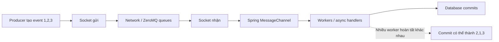
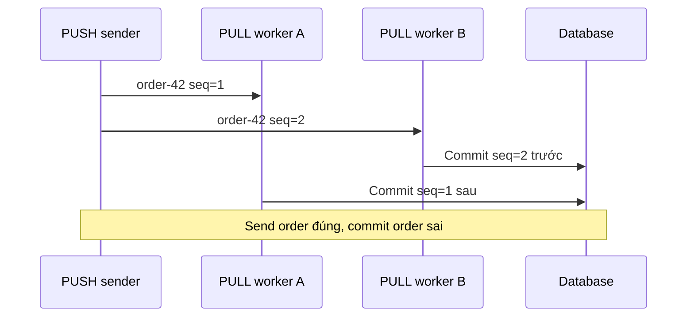
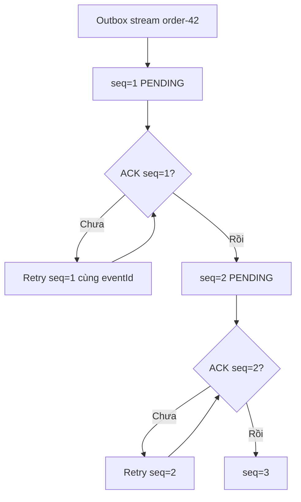
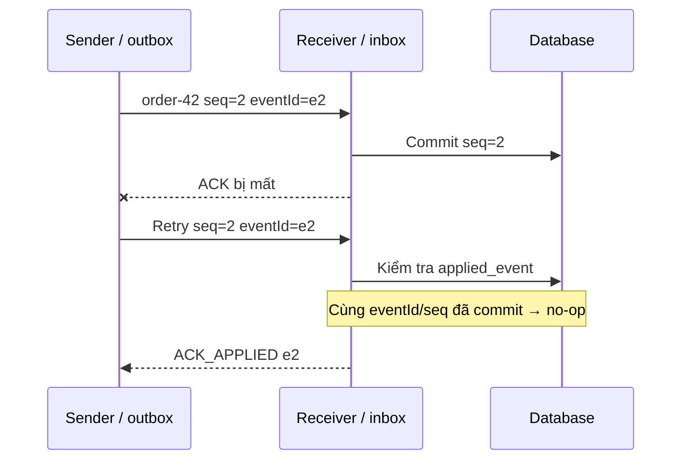
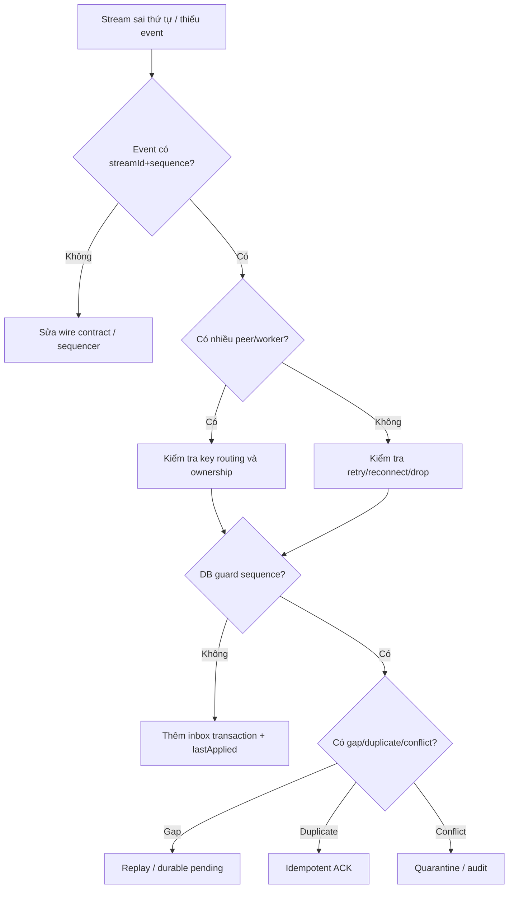

# Đảm bảo thứ tự trong message stream với ZeroMQ

## 1. Bối cảnh: message đã gửi đúng thứ tự nhưng đơn hàng vẫn sai trạng thái

Một hệ thống đơn hàng phát ba sự kiện:

```text
1. order.created   (order-42)
2. order.paid      (order-42)
3. order.cancelled (order-42)
```

Producer gửi chúng qua ZeroMQ `PUSH` với thứ tự mong đợi là `created → paid → cancelled`. Nhưng sau khi tăng số worker `PULL`, hệ thống ghi nhận `cancelled` được xử lý trước `paid`, khiến trạng thái database bị sai. Nhóm phát triển nghĩ rằng vì TCP truyền byte theo thứ tự và ZeroMQ hỗ trợ FIFO, toàn bộ hệ thống đương nhiên phải xử lý tuần tự.

**Điểm mấu chốt:** phải phân biệt **thứ tự gửi**, **thứ tự trên kết nối tới một peer**, **thứ tự nhận**, **thứ tự hoàn tất business handler** và **thứ tự commit database**. Một đảm bảo ở tầng transport **không tự lan truyền** qua các thread, queue, nhiều worker, retry và transaction.

Bài **“Đảm bảo thứ tự trong message stream”** nằm trong chương **Adapter ZeroMQ**, module **SPRING_INTEGRATION_ADAPTERS**. Module nghiên cứu cách kết nối hệ thống ngoài bằng inbound/outbound adapter, gateway, poller và `MessageChannel`, thực hành với file, SFTP, HTTP, JMS, AMQP, Kafka và cơ sở dữ liệu, đồng thời xử lý hợp đồng message, lỗi và vòng đời kết nối. Bài này tập trung vào **ordering contract**, chọn topology và cách bảo toàn thứ tự nghiệp vụ với Spring Integration ZeroMQ.

### Mục tiêu học tập

Sau bài học, bạn có thể:

1. Phân biệt **per-peer FIFO**, **per-stream ordering** và **global total order**.
2. Giải thích những gì ZeroMQ thường bảo toàn trên một đường kết nối và những gì **không** được bảo đảm khi có nhiều producer/consumer.
3. Phân tích thứ tự trong `PUSH/PULL`, `PUB/SUB`, `PAIR`, proxy và request–reply.
4. Nhận biết các trường hợp mất thứ tự do thread scheduling, xử lý bất đồng bộ, reconnect, retry, HWM và dropped messages.
5. Thiết kế event envelope có `streamId`, `sequence`, `eventId` và `schemaVersion`.
6. Cấu hình Spring Integration Java DSL với `MessageChannel`, inbound `PULL`, outbound `PUSH` và serialize payload có sequence.
7. Đảm bảo trình tự **commit nghiệp vụ** bằng sequencing trong transaction, durable outbox, inbox và idempotency.
8. Tổ chức partition theo `streamId`, buffer/resequence có giới hạn và xử lý event bị thiếu.
9. Viết kiểm thử chứng minh thứ tự theo từng stream dưới tải, khi reconnect và khi có nhiều worker.

## 2. Phải định nghĩa “thứ tự” trước khi lựa chọn công nghệ



| Loại thứ tự | Ví dụ yêu cầu | Ranh giới cần kiểm soát |
| --- | --- | --- |
| **Send order** | Caller gọi gửi event 1 trước event 2 | Một nguồn phát có sequencing và thread ownership rõ |
| **Per-peer receive order** | Một peer nhận các message sống sót theo thứ tự gửi trên một đường queue | ZeroMQ socket/pipe và topology |
| **Per-stream order** | Mọi thay đổi của `order-42` được áp dụng theo `sequence=1,2,3` | Stream key, sequencer, worker routing, DB |
| **Processing start order** | Handler bắt đầu event 1 trước event 2 | Dispatcher và execution model |
| **Commit order** | Transaction của event 1 commit trước event 2 | Lock/conditional update và DB transaction |
| **Global total order** | Mọi event của tất cả đơn hàng trên nhiều nguồn có một thứ tự duy nhất | Một nguồn đánh số toàn cục/ordered log hoặc bộ điều phối đặc biệt |

**Per-stream ordering** thường phù hợp nhất cho domain business: event của **cùng một đơn hàng** phải theo thứ tự, nhưng event của **hai đơn hàng độc lập** có thể xử lý song song. Bắt mọi event đi qua một global lock sẽ làm giảm throughput và tăng độ trễ mà không mang thêm giá trị nghiệp vụ nếu các stream không phụ thuộc nhau.

### 2.1. Ví dụ hai stream không cần global order

```text
order-42: seq 1 → seq 2 → seq 3
order-99: seq 1 → seq 2

Hợp lệ khi xử lý:
  order-42/1, order-99/1, order-99/2, order-42/2, order-42/3

Không hợp lệ với ordering contract của order-42:
  order-42/2 commit trước order-42/1
```

Đối với event sourcing, workflow có điều kiện hoặc state machine, cần định nghĩa rõ **commit theo thứ tự** có phải yêu cầu cứng, cách ứng xử với **sequence gap**, và liệu có được skip một event lỗi sau một khoảng chờ không.

### 2.2. Một số cam kết thường bị hiểu nhầm

| Phát biểu | Đánh giá |
| --- | --- |
| “TCP truyền byte theo thứ tự, vậy DB commit theo thứ tự.” | **Sai**: xử lý phía sau TCP có thể song song |
| “PUSH có ba PULL nên tất cả nhận cùng một chuỗi.” | **Sai**: PUSH/PULL phân phối công việc, không broadcast |
| “PUB gửi 1,2,3 thì subscriber mới sẽ nhận lại đủ 1,2,3.” | **Sai**: không có durable replay mặc định |
| “Tất cả event còn sống từ một publisher tới một subscriber sẽ giữ thứ tự trên đường truyền được thiết lập phù hợp.” | **Thường đúng theo FIFO từng peer/pipe**, nhưng không giải quyết drop/reconnect/application reorder |
| “Có sequence number nghĩa là ZeroMQ tự đợi đủ rồi sắp xếp.” | **Sai**: ứng dụng cần kiểm tra/gom lại sequence |
| “ACK sau commit và idempotency giúp retry cùng event ID an toàn.” | **Đúng khi được triển khai nhất quán**, nhưng thứ tự vẫn cần kiểm soát riêng |

## 3. ZeroMQ thường bảo toàn gì trên một peer/connection?

ZeroMQ đưa các **message** qua socket theo pattern và queue/pipe của nó. Trong một luồng ổn định, **các message gửi tuần tự từ một socket đến một peer qua cùng một đường truyền** thường có thứ tự FIFO trên đường đó. Nhưng kết luận đó có các ranh giới:

- Nếu **một socket gửi cho nhiều peer**, message có thể đi qua các queue khác nhau.
- Nếu **nhiều socket/producer** cùng gửi vào một consumer, hệ thống không có một nguồn thứ tự toàn cục tự động.
- Nếu **nhiều worker** nhận/phân phối, thứ tự hoàn tất xử lý có thể khác thứ tự nhận.
- Nếu message **bị drop**, các message còn lại có thể vẫn theo thứ tự tương đối nhưng **thiếu số trong chuỗi**.
- Nếu ứng dụng **retry** message cũ sau message mới, luồng nghiệp vụ có thể nhận `1,3,2` hoặc `1,2,2`.
- Nếu có **reconnect/restart**, message bị mất trên queue RAM không được tự phục hồi từ một log bền vững.

### 3.1. Đừng dùng một đảm bảo quá rộng

Thay vì tuyên bố “ZeroMQ bảo đảm thứ tự tuyệt đối”, hãy ghi rõ:

> “Trong topology có một sender socket gửi tuần tự và một receiver socket cho cùng một peer, các message được giao thành công thường được nhận theo FIFO của đường đó. Hệ thống vẫn phải tự xử lý mất message, duplicate, retry, đa peer và thứ tự commit.”

Đây là một **phát biểu có phạm vi**, phù hợp để kiểm chứng bằng test. Khi yêu cầu ordering ở cấp domain, đừng coi phạm vi FIFO của socket là điều kiện đủ.

### 3.2. Multipart message là một đơn vị, không phải nhiều event độc lập

Một message ZeroMQ có thể chứa nhiều frame:

```text
Message 1:
  [ streamId="order-42" ][ sequence=1 ][ jsonBody ]

Message 2:
  [ streamId="order-42" ][ sequence=2 ][ jsonBody ]
```

Các frame trong một multipart message được nhận **cùng nhau hoặc không được nhận ở tầng ZeroMQ**; thứ tự frame trong message được bảo toàn. Nhưng **frame 0, 1, 2 không tự đại diện cho ba message có thứ tự**. Hợp đồng phải phân biệt **frame index** và **event sequence**.

Với Spring Integration, outbound payload raw `ZMsg` bypass mapper/topic injection; inbound `receiveRaw(true)` đưa raw `ZMsg` vào Spring payload. Nếu dùng custom framing, consumer phải parse đúng các frame và quản lý `ZMsg.destroy()` sau khi hoàn tất sử dụng.

## 4. So sánh ordering theo socket pattern

| Pattern | Đặc tính routing | Order thực tế cần chú ý | Rủi ro |
| --- | --- | --- | --- |
| **PUSH/PULL** | PUSH phân phối message đến PULL peers | Một peer có thể nhận FIFO cho phần việc gửi tới nó; nhiều peer không có một commit order chung | Worker nhanh/chậm khác nhau; cùng stream bị rải sang nhiều worker |
| **PUB/SUB** | PUB phát đến subscribers đã subscribe | Mỗi subscriber có thể thấy một chuỗi theo nguồn phát nhưng có gaps | Slow joiner, HWM drop, nhiều publishers |
| **PAIR/PAIR** | Kết nối một–một | FIFO trong topology đơn giản dễ kiểm soát hơn | Không dành cho nhiều client |
| **REQ/REP** | Request–reply theo state machine | Chu kỳ send/recv giúp tuần tự từng request trên REQ thường | Reply timeout, retry gây duplicate; chia sẻ socket giữa threads là sai |
| **DEALER/ROUTER** | Multiplex/routing theo identity | Nhiều request in-flight, reply có thể theo thứ tự hoàn tất | Reply từ nhiều worker đến khác thứ tự request |
| **ZeroMqProxy** | Chuyển tiếp giữa frontend/backend | Không tự tạo global sequence hay transaction commit order | Nhiều nguồn, hàng đợi, gap và routing |

**Phạm vi Spring Integration:** `ZeroMqMessageProducer` inbound trực tiếp hỗ trợ `PAIR/PULL/SUB`; `ZeroMqMessageHandler` outbound hỗ trợ `PAIR/PUSH/PUB`. Nếu dùng `REQ/REP` hoặc `DEALER/ROUTER` qua JeroMQ trực tiếp/proxy, cần hợp đồng tương ứng; không cho rằng các loại socket đó tự là một Spring Integration gateway có ordering bền vững.

### 4.1. PUSH/PULL với hai worker



ZeroMQ `PUSH` có thể phân phối tới các peer có khả năng nhận. Ngay cả khi `seq=1` tới worker A trước `seq=2` tới worker B, worker B có thể hoàn tất nhanh hơn. Vì thế **một producer PUSH + nhiều consumer PULL không phải là cơ chế bảo đảm commit order cho một stream**.

### 4.2. PUB/SUB với nhiều publisher

```text
PUB A gửi: order-42 seq=1, seq=3
PUB B gửi: order-42 seq=2

SUB nhận có thể quan sát:
  seq=2, seq=1, seq=3

Ngay cả khi mỗi đường PUB→SUB giữ thứ tự riêng,
không có một thứ tự toàn cục do hai PUB tự thương lượng.
```

Nếu hai nguồn cùng sở hữu một stream, phải có **bộ cấp sequence có thẩm quyền**, hoặc phân công **single-writer/ownership** theo stream. Chỉ thêm trường timestamp từ đồng hồ từng máy không đủ để tạo global total order đáng tin cậy.

### 4.3. Khi reconnect, những gì thay đổi?

Reconnect khôi phục đường kết nối, **không bắt buộc khôi phục** những message đã rơi khỏi queue. Với `PUB/SUB`, subscriber mới hoặc subscriber bị ngắt kết nối có thể bỏ qua event trong khoảng mất mạng. Với `PUSH/PULL`, message có thể chờ trong queue memory trong một số tình huống, nhưng nếu process crash hoặc quá tải, không thể coi đó là durable replay.

Nếu sender gửi lại `seq=2` sau khi đã gửi `seq=3`, consumer có thể nhận sequence cũ muộn hơn. Hệ thống cần **sequence check/idempotency**, không chỉ dựa vào hành vi reconnect.

## 5. Thứ tự do nhiều thread tạo ra không nhất thiết là thứ tự domain

Một lỗi điển hình:

```java
// PHẢN VÍ DỤ: nhiều request thread tự gọi chung một ZMQ.Socket.
void publish(byte[] body) {
    sharedPushSocket.send(body);
}
```

`ZMQ.Socket` không phải đối tượng thread-safe để nhiều thread ứng dụng gọi đồng thời tùy tiện. Dùng chung socket từ nhiều HTTP threads có thể gây lỗi và không tạo được một thứ tự domain có ý nghĩa.

**Thay thế:** dùng `MessageChannel` và `ZeroMqMessageHandler` do Spring quản lý, hoặc một **socket-owner thread** nhận công việc từ queue có giới hạn. Nhưng vẫn phải giải quyết bài toán: nếu hai request độc lập đồng thời cùng sửa `order-42`, sự kiện nào là `seq=1`, sự kiện nào là `seq=2`?

**Thứ tự nghiệp vụ phải được xác định tại nơi ra quyết định/transaction**, không được suy từ thread nào chạy nhanh hoặc lời gọi `channel.send()` nào tới trước.

### 5.1. Các điểm có thể làm reorder trong Spring Integration

| Điểm | Khi nào reorder xuất hiện? | Hướng kiểm soát |
| --- | --- | --- |
| Nhiều HTTP threads tạo event | Thời điểm schedule khác với thứ tự domain | Serialize state transition theo `streamId` trong DB |
| `ExecutorChannel` | Handler chạy trên nhiều worker threads | Route theo key sang một lane hoặc kiểm soát commit trong DB |
| `QueueChannel` với nhiều poller | Nhiều consumer xử lý song song | Một in-flight cho stream; guard sequence tại DB |
| `FluxMessageChannel` / reactive operator | Một số operator xử lý bất đồng bộ/concurrent | Dùng operator có thứ tự khi cần, nhưng vẫn giữ DB guard |
| Service activator async | Event 2 hoàn tất trước event 1 | Chỉ apply khi `sequence==lastApplied+1` |
| Retry advice | Event cũ được retry sau event mới | Durable inbox/resequencer và idempotency |
| Router / scatter-gather | Nhánh chậm/nhanh khác nhau | Correlation, resequencing và release strategy |
| Multiple application replicas | Các pod claim event cùng stream | Distributed ownership/lease + transaction |

Trong Spring Integration, có các cơ chế **resequencer/aggregator/message group store** cho một số kiểu flow. Nhưng chúng **không tự đọc `sequence` trong JSON tùy ý rồi biến thành persistent per-stream commit ordering**. Bạn phải cấu hình correlation/sequence metadata, group timeout/release và storage, đồng thời bảo vệ DB transaction cuối cùng.

## 6. Quyết định kiến trúc: ordering theo stream hay toàn hệ thống?

| Yêu cầu | Thiết kế phù hợp | Giá phải trả |
| --- | --- | --- |
| Chỉ một sender và một receiver, xử lý đơn giản | Một socket path và xử lý tuần tự | Hạn chế concurrency; không bền vững qua crash |
| Nhiều đơn hàng độc lập, mỗi đơn hàng cần đúng thứ tự | Partition theo `orderId` và sequence mỗi stream | Routing và quản lý ownership |
| Nhiều worker, cần chịu được restart và retry | Outbox/inbox bền vững + khóa sequence theo stream | DB/storage và vận hành |
| Dashboard cần trạng thái mới nhất | PUB/SUB + snapshot/resync | Có thể không có mọi event lịch sử |
| Tất cả event từ mọi publisher phải có một total order | Central sequencer/ordered log hoặc một writer duy nhất | Điểm nghẽn và chi phí điều phối |

**Gợi ý thực tế:** trước hết xác định business invariant, ví dụ “một đơn hàng không thể chuyển sang PAID trước khi CREATED được commit”. Từ đó gán `streamId=orderId` và xử lý các event của mỗi đơn hàng theo số thứ tự. Các đơn hàng khác nhau vẫn có thể xử lý song song.

### 6.1. Không dùng wall-clock timestamp thay sequence

Ví dụ:

```text
service A: 2026-11-23T09:00:00.020
service B: 2026-11-23T09:00:00.010
```

Timestamp giữa hai máy có thể khác đồng hồ hoặc được tạo trước/sau thời điểm transaction commit. Ngay cả khi đồng hồ đồng bộ tốt, timestamp có thể trùng hoặc không thể biểu thị thứ tự state transition của **cùng aggregate**.

Do đó:

- Dùng `sequence` được cấp **trong một transaction/nguồn điều phối có thẩm quyền**.
- Dùng `occurredAt` như metadata phục vụ audit, không phải bằng chứng tuyệt đối về ordering.
- Dùng `eventId` để chống xử lý trùng, không nhầm nó với sequence.

## 7. Định nghĩa hợp đồng message có thứ tự

Một event envelope:

```json
{
  "schemaVersion": 1,
  "streamId": "order-42",
  "sequence": 3,
  "eventId": "evt-20261123-order42-3",
  "eventType": "orders.cancelled",
  "orderId": "42"
}
```

| Field | Vai trò | Ràng buộc đề xuất |
| --- | --- | --- |
| `schemaVersion` | Chọn schema/codec | Version hợp lệ, thay đổi có migration |
| `streamId` | Định danh miền ordering | Ổn định qua retry và các replica |
| `sequence` | Thứ tự trong một stream | Số nguyên dương, do sequencer thẩm quyền cấp |
| `eventId` | Idempotency key | Duy nhất cho một logical event, **không đổi khi retry** |
| `eventType` | Loại state transition | Whitelist và kiểm tra domain |
| `orderId` | Khóa nghiệp vụ | Phù hợp với `streamId` nếu contract quy định |
| `occurredAt` (tùy chọn) | Audit/thời điểm phát sinh | Không dùng thay sequence |

**Quan trọng:** `sequence` và `eventId` giải quyết **hai vấn đề khác nhau**. Event có thể bị gửi lại với cùng `eventId` và cùng `sequence`. Nếu nhận cùng `streamId` + `sequence` nhưng **khác `eventId`**, đó là **ordering conflict** hoặc dữ liệu bị hỏng, không được âm thầm coi là một bản duplicate hợp lệ.

### 7.1. Ví dụ Java record

```java
// Java 17+; file OrderStreamEvent.java
public record OrderStreamEvent(
        int schemaVersion,
        String streamId,
        long sequence,
        String eventId,
        String eventType,
        String orderId) {
}
```

### 7.2. Kiểm tra hợp đồng

```java
public final class OrderEventValidation {

    private OrderEventValidation() {
    }

    public static void validate(OrderStreamEvent event) {
        if (event == null ||
                event.schemaVersion() != 1 ||
                event.sequence() < 1 ||
                event.streamId() == null ||
                !event.streamId().matches("[A-Za-z0-9_-]{1,128}") ||
                event.eventId() == null ||
                !event.eventId().matches("[A-Za-z0-9_-]{1,180}") ||
                event.eventType() == null ||
                event.orderId() == null ||
                !event.orderId().matches("[A-Za-z0-9_-]{1,64}")) {
            throw new IllegalArgumentException(
                    "Ordered event không hợp lệ");
        }
        if (!event.streamId().equals("order-" + event.orderId())) {
            throw new IllegalArgumentException("streamId/orderId không khớp");
        }
    }
}
```

Trong production cần thêm authorization, tenant boundary, schema validation, size limit và danh sách state transition hợp lệ. Kiểm tra regex/field **chưa** chứng minh command được phép áp dụng.

## 8. Wire framing: giữ sequence ở nơi peer thực sự đọc được

Trên một luồng `PUSH/PULL` đơn giản, có thể serialize toàn bộ event JSON thành **một frame**:

```text
ZeroMQ message:
  [ JSON UTF-8 của OrderStreamEvent ]
```

Với `PUB/SUB`, có thể dùng hai frame:

```text
ZeroMQ message:
  [ "orders." topic prefix ][ JSON UTF-8 của OrderStreamEvent ]
```

Hoặc format ba frame theo mapper Spring Integration mặc định khi có topic:

```text
ZeroMQ message:
  [ topic ][ empty frame ][ JSON body ]
```

Chỉ có `streamId`/`sequence` nằm trong **payload hoặc frame đã serialize** mới được peer JeroMQ thuần nhìn thấy. Spring `MessageHeaders` không tự động đi qua outbound adapter trong mọi cấu hình. Nếu dùng `receiveRaw(true)`, payload inbound là `ZMsg`; parser phải đọc đúng frame contract và giải phóng raw resource sau khi dùng.

**Không dùng chỉ số frame làm số sequence.** Frame 0 của message A và frame 0 của message B không có quan hệ “A trước B” nếu protocol không mang số thứ tự.

## 9. Ví dụ Java DSL: producer PUSH gửi event có sequence

Ví dụ dùng Spring Boot, Spring Integration ZeroMQ và Jackson. Để đơn giản, sender tạo một `byte[]` JSON **trước khi** vào ZeroMQ adapter; business layer không trực tiếp dùng `ZMQ.Socket`.

### 9.1. Maven và application.yml

```xml
<dependencies>
    <dependency>
        <groupId>org.springframework.boot</groupId>
        <artifactId>spring-boot-starter-integration</artifactId>
    </dependency>
    <dependency>
        <groupId>org.springframework.integration</groupId>
        <artifactId>spring-integration-zeromq</artifactId>
    </dependency>
    <dependency>
        <groupId>com.fasterxml.jackson.core</groupId>
        <artifactId>jackson-databind</artifactId>
    </dependency>
</dependencies>
```

```yaml
app:
  zeromq:
    pull-port: ${ZMQ_PULL_PORT:7777}
    push-url: ${ZMQ_PUSH_URL:tcp://127.0.0.1:7777}
    send-hwm: ${ZMQ_SND_HWM:500}
    receive-hwm: ${ZMQ_RCV_HWM:500}
```

`127.0.0.1` chỉ phù hợp khi hai socket ở **cùng host/network namespace**. Trong Kubernetes, producer ở pod khác phải connect tới DNS/IP của Service receiver (ví dụ `tcp://orders-worker:7777`) và chính sách mạng phải cho phép TCP. Không dùng `tcp://*:7777` làm URL connect; wildcard thuộc bên bind.

### 9.2. ZContext, channel và outbound flow

```java
import org.springframework.beans.factory.annotation.Value;
import org.springframework.context.annotation.Bean;
import org.springframework.context.annotation.Configuration;
import org.springframework.integration.channel.DirectChannel;
import org.springframework.integration.dsl.IntegrationFlow;
import org.springframework.integration.zeromq.dsl.ZeroMq;
import org.springframework.messaging.MessageChannel;
import org.zeromq.SocketType;
import org.zeromq.ZContext;

@Configuration
public class OrderedPushConfiguration {

    @Bean(destroyMethod = "close")
    public ZContext zeroMqContext() {
        return new ZContext();
    }

    @Bean("ordersToPush")
    public MessageChannel ordersToPush() {
        return new DirectChannel();
    }

    @Bean
    public IntegrationFlow orderedPushOutbound(
            ZContext context,
            @Value("${app.zeromq.push-url}") String target,
            @Value("${app.zeromq.send-hwm}") int hwm) {

        return IntegrationFlow.from("ordersToPush")
                .handle(ZeroMq.outboundChannelAdapter(
                        context, target, SocketType.PUSH)
                        .socketConfigurer(socket -> {
                            socket.setSndHWM(hwm);
                            socket.setSendTimeOut(1_500);
                            socket.setReconnectIVL(500);
                            socket.setReconnectIVLMax(10_000);
                        }))
                .get();
    }
}
```

Trong ví dụ này, Spring Integration handler quản lý socket thay vì cho nhiều request threads dùng chung một raw `ZMQ.Socket`. `DirectChannel` dispatch đồng bộ ở tầng channel nhưng **không tự đảm bảo** thứ tự domain của các thread gửi đồng thời, thứ tự giao qua nhiều peer hoặc thứ tự commit. `ZeroMqMessageHandler` có reactive semantics; `MessageChannel.send() == true` không phải ACK remote.

### 9.3. Publisher serialize DTO

```java
import com.fasterxml.jackson.core.JsonProcessingException;
import com.fasterxml.jackson.databind.ObjectMapper;
import org.springframework.beans.factory.annotation.Qualifier;
import org.springframework.messaging.MessageChannel;
import org.springframework.messaging.support.MessageBuilder;
import org.springframework.stereotype.Service;

@Service
public class OrderedEventPublisher {

    private final ObjectMapper mapper;
    private final MessageChannel out;

    public OrderedEventPublisher(
            ObjectMapper mapper,
            @Qualifier("ordersToPush") MessageChannel out) {
        this.mapper = mapper;
        this.out = out;
    }

    public void dispatch(OrderStreamEvent event) {
        OrderEventValidation.validate(event);
        try {
            byte[] bytes = mapper.writeValueAsBytes(event);
            if (bytes.length > 1_048_576) {
                throw new IllegalArgumentException("Event quá lớn");
            }
            if (!out.send(MessageBuilder.withPayload(bytes).build())) {
                throw new IllegalStateException(
                        "Spring channel từ chối dispatch");
            }
        } catch (JsonProcessingException ex) {
            throw new IllegalArgumentException(
                    "Không serialize được ordered event", ex);
        }
    }
}
```

**Ràng buộc quan trọng:** service này giả định event đã được cấp `sequence` hợp lệ. **Không** tự dùng một biến `AtomicLong` global để đánh số trong nhiều pod, vì mỗi pod có state riêng và sequence có thể trùng/sai thứ tự. Sequence nên được cấp từ **transactional stream state**, rồi ghi cùng outbox trước khi dispatcher gửi.

Không gọi `dispatch(event)` song song cho nhiều event cùng `streamId` và kỳ vọng thứ tự do `sequence` tự ép socket gửi đúng. **Quyền dispatch một stream** và thứ tự các event outbox phải được kiểm soát.

## 10. Ví dụ Java DSL: inbound PULL giữ raw và kiểm tra sequence

### 10.1. Flow nhận message

```java
import java.time.Duration;
import org.springframework.beans.factory.annotation.Value;
import org.springframework.context.annotation.Bean;
import org.springframework.context.annotation.Configuration;
import org.springframework.integration.dsl.IntegrationFlow;
import org.springframework.integration.zeromq.dsl.ZeroMq;
import org.zeromq.SocketType;
import org.zeromq.ZContext;

@Configuration
public class OrderedPullConfiguration {

    @Bean
    public IntegrationFlow orderedPullInbound(
            ZContext context,
            @Value("${app.zeromq.pull-port}") int port,
            @Value("${app.zeromq.receive-hwm}") int hwm) {

        return IntegrationFlow.from(
                ZeroMq.inboundChannelAdapter(context, SocketType.PULL)
                        .bindPort(port)
                        .receiveRaw(true)
                        .consumeDelay(Duration.ofMillis(100))
                        .socketConfigurer(socket -> socket.setRcvHWM(hwm)))
                .channel("orderedEventsRaw")
                .get();
    }
}
```

`consumeDelay` điều chỉnh khoảng chờ trong vòng nhận của ZeroMQ producer khi chưa có dữ liệu, **không phải** Spring `Pollers.fixedDelay` như ở file/FTP adapter, cũng không phải giới hạn tốc độ nhận theo `1/delay`.

### 10.2. Handler deserialize và chuyển tới inbox

```java
import com.fasterxml.jackson.databind.ObjectMapper;
import java.io.IOException;
import java.util.Arrays;
import org.springframework.integration.annotation.ServiceActivator;
import org.springframework.messaging.Message;
import org.springframework.stereotype.Component;
import org.zeromq.ZMsg;

@Component
public class OrderedEventIngress {

    private final ObjectMapper mapper;
    private final OrderedInboxService inbox;

    public OrderedEventIngress(
            ObjectMapper mapper, OrderedInboxService inbox) {
        this.mapper = mapper;
        this.inbox = inbox;
    }

    @ServiceActivator(inputChannel = "orderedEventsRaw")
    public void receive(Message<ZMsg> message) {
        ZMsg raw = message.getPayload();
        try {
            if (raw.size() != 1) {
                throw new IllegalArgumentException(
                        "Protocol cần một JSON frame");
            }

            byte[] source = raw.getFirst().getData();
            if (source.length == 0 || source.length > 1_048_576) {
                throw new IllegalArgumentException("Body rỗng/quá lớn");
            }

            // Copy vì raw ZMsg phải được giải phóng cuối handler.
            byte[] bytes = Arrays.copyOf(source, source.length);
            OrderStreamEvent event =
                    mapper.readValue(bytes, OrderStreamEvent.class);
            OrderEventValidation.validate(event);

            // Inbox service phải transactionally validate sequence,
            // dedup và commit; xem mục 12–13.
            inbox.accept(event, bytes);
        } catch (IOException ex) {
            throw new IllegalArgumentException(
                    "Không deserialize được JSON event", ex);
        } finally {
            raw.destroy();
        }
    }
}
```

Ví dụ giả định có `OrderedInboxService` được cài theo hợp đồng ở mục tiếp theo. Handler **không tự** bảo đảm thứ tự commit khi nhiều handler instance/threads cùng gọi `inbox.accept`; đây là lý do cần transaction tại database. Việc copy bytes ngăn async tầng sau giữ tham chiếu tới `ZFrame` sau khi `ZMsg` bị destroy.

**Chú ý về lỗi:** Nếu `inbox.accept(...)` ném exception và inbound không có nguồn replay bền vững, ZeroMQ không tự hoàn trả message cho sender như một durable broker. Production phải thiết kế ACK/retry/outbox hoặc lưu raw bytes bền vững trước khi xác nhận tiếp nhận.

## 11. Sequence phải được cấp tại nguồn dữ liệu có thẩm quyền

Giả sử hai HTTP request đồng thời cùng thay đổi đơn hàng `order-42`:

```text
Request A: cập nhật PAID
Request B: cập nhật CANCELLED

Thread A bắt đầu trước, thread B có thể commit trước.
Vì vậy thứ tự thật cần do một transaction/state machine quyết định,
không phải do thời điểm Thread.start() hoặc System.currentTimeMillis().
```

### 11.1. Transactional stream state + outbox

Một mô hình SQL minh họa:

```sql
CREATE TABLE stream_position (
    stream_id      VARCHAR(128) PRIMARY KEY,
    last_issued    BIGINT NOT NULL
);

CREATE TABLE event_outbox (
    event_id       VARCHAR(180) PRIMARY KEY,
    stream_id      VARCHAR(128) NOT NULL,
    sequence_no    BIGINT NOT NULL,
    payload_bytes  BLOB NOT NULL,
    status         VARCHAR(24) NOT NULL,
    created_at     TIMESTAMP NOT NULL,
    UNIQUE (stream_id, sequence_no)
);
```

`BLOB` là kiểu minh họa; production cần dùng kiểu binary phù hợp PostgreSQL/MySQL/DB đang chạy (ví dụ PostgreSQL `BYTEA`) và thêm index/lease/retry metadata. Không coi đây là migration có thể chạy nguyên xi trên mọi database.

Trong một transaction:

```sql
-- PSEUDO-SQL: thực hiện trong CÙNG một DB transaction
SELECT last_issued
FROM stream_position
WHERE stream_id = :streamId
FOR UPDATE;

-- Application tính next = last_issued + 1;
-- validate business transition trước khi commit.

UPDATE stream_position
SET last_issued = :next
WHERE stream_id = :streamId;

INSERT INTO event_outbox (
    event_id, stream_id, sequence_no,
    payload_bytes, status, created_at
) VALUES (
    :eventId, :streamId, :next,
    :serializedBytes, 'PENDING', CURRENT_TIMESTAMP
);

-- Cập nhật business aggregate cũng nằm trong transaction này.
COMMIT;
```

**Cần tạo `stream_position` cho stream mới một cách atomic** (ví dụ insert có unique key và xử lý conflict), không chỉ `SELECT ... FOR UPDATE` trên row chưa tồn tại rồi mặc định có lock. Không cấp sequence bằng DB sequence toàn cục nếu bạn đòi hỏi **liền mạch không có gap do rollback**: nhiều cơ sở dữ liệu vẫn tăng giá trị sequence dù transaction rollback. Nếu cần liền mạch theo stream, dùng row-lock/counter cùng transaction như trên.

### 11.2. Tại sao sequence và outbox phải cùng transaction?

Nếu business transaction commit nhưng event chưa được lưu bền vững, producer crash có thể làm thiếu sự kiện. Nếu outbox được ghi trước khi business commit nhưng transaction sau thất bại, có thể phát event về trạng thái chưa từng tồn tại.

Mẫu transactional outbox giữ **cập nhật business + cấp sequence + ghi event** trong một transaction. Tuy nhiên, nó **chưa** bảo đảm dispatcher gửi ra theo đúng sequence nếu nhiều dispatcher đọc outbox đồng thời. Đây là một vấn đề riêng ở mục sau.

### 11.3. Một stream một nguồn cấp sequence

Nếu nhiều microservice cùng tạo event cho `order-42`, cần một chủ thể có quyền quyết định thứ tự:

- Một order service/aggregate owner.
- Một DB transaction/counter chung.
- Một ordered event log/partition theo key.
- Một sequencer service có cơ chế bền vững và failover rõ.

Không để mỗi service tự tạo `sequence = localCounter++` rồi ghép stream lại. Kết quả dễ trùng sequence, lệch thứ tự hoặc khó xử lý retry.

## 12. Durable outbox vẫn cần **dispatch theo thứ tự**

Giả sử outbox lưu:

```text
order-42 seq=1 status=PENDING
order-42 seq=2 status=PENDING
order-42 seq=3 status=PENDING
```

Hai dispatcher cùng `SELECT ... FOR UPDATE SKIP LOCKED` có thể claim `seq=1` và `seq=2` đồng thời. Nếu dispatcher 2 gửi trước hoặc 1 retry do timeout, receiver có thể quan sát `2,1`. **Outbox bảo đảm nguồn replay bền vững, nhưng không mặc định bảo đảm dispatch ordering.**

### 12.1. Chính sách một in-flight theo stream

Thiết kế đề xuất:

1. Chỉ có **một worker/lease đang sở hữu `streamId`** ở một thời điểm.
2. Chọn event có `sequence` thấp nhất **chưa được ACK** trong stream.
3. Gửi và đợi ACK hoặc deadline; không vượt qua event này khi contract yêu cầu strict order.
4. Nếu ACK timeout, retry **cùng `eventId` và sequence**, không cấp sequence mới.
5. Khi ACK đã được xác thực, chuyển event sang `ACKED` bằng cập nhật có điều kiện.
6. Cho phép event kế tiếp trong cùng stream được dispatch.



Mô hình này đơn giản nhưng có **head-of-line blocking**: nếu seq=1 bị lỗi vĩnh viễn, seq=2 trở lên bị giữ lại. Đó là đánh đổi có chủ đích để bảo toàn strict order. Nếu nghiệp vụ cho phép skip, phải có quyết định domain rõ và cơ chế audit, không tự bỏ qua event vì timeout.

### 12.2. Nếu cho nhiều event in-flight thì sao?

Có thể tối ưu throughput bằng cách gửi trước `seq=1..N`, nhưng receiver cần **durable resequencing** và policy retry/gap. Nếu ACK mất, sender cần biết chính xác event nào đã commit. Mức phức tạp tăng rõ rệt.

**Khuyến nghị cho người học:** bắt đầu bằng **một in-flight trên một stream**, song song giữa nhiều stream. Sau khi chứng minh được ordering, idempotency và replay, mới cân nhắc pipelining với bounded window.

### 12.3. Lease, fencing và nhiều replica

Trong cluster có nhiều dispatcher:

- Lease/lock cần ràng buộc theo `streamId`.
- Lease phải có thời hạn và cơ chế thu hồi khi pod chết.
- **Fencing token/phiên sở hữu** giúp ngăn owner cũ tiếp tục phát sau khi lease đã chuyển.
- Event/ACK cập nhật có điều kiện để không ghi đè trạng thái `ACKED` thành `PENDING`.
- Bên nhận vẫn bắt buộc idempotency, vì lease không thể loại bỏ mọi duplicate khi network partition xảy ra.

Hash partition `streamId` vào N lane giúp chạy song song, nhưng đổi số lane/replica cần **drain/rebalance có kiểm soát**, tránh để cùng stream chạy ở lane cũ và lane mới đồng thời.

## 13. Receiver: kiểm tra sequence trong **transaction DB**

Đây là ranh giới bảo đảm thứ tự **nghiệp vụ**, kể cả khi socket hoặc executor nhận event không đúng thứ tự.

### 13.1. Trạng thái inbox tối thiểu

```sql
CREATE TABLE stream_apply_position (
    stream_id       VARCHAR(128) PRIMARY KEY,
    last_applied    BIGINT NOT NULL
);

CREATE TABLE applied_event (
    event_id        VARCHAR(180) PRIMARY KEY,
    stream_id       VARCHAR(128) NOT NULL,
    sequence_no     BIGINT NOT NULL,
    applied_at      TIMESTAMP NOT NULL,
    UNIQUE (stream_id, sequence_no)
);

CREATE TABLE pending_ordered_event (
    stream_id       VARCHAR(128) NOT NULL,
    sequence_no     BIGINT NOT NULL,
    event_id        VARCHAR(180) NOT NULL,
    payload_bytes   BLOB NOT NULL,
    received_at     TIMESTAMP NOT NULL,
    PRIMARY KEY (stream_id, sequence_no),
    UNIQUE (event_id)
);
```

Đây là schema minh họa cho **inbox bền vững**. Tùy yêu cầu, có thể dùng một table inbox với status và index thay vì ba bảng; quan trọng là **unique key** và **transactional state update**.

### 13.2. Thuật toán accept(event)

```text
BEGIN TRANSACTION
  SELECT last_applied FROM stream_apply_position
  WHERE stream_id = event.streamId FOR UPDATE

  IF event.sequence == last_applied + 1:
      Kiểm tra eventId và uniqueness (không conflict)
      Validate domain state transition
      Ghi side effects nghiệp vụ
      INSERT applied_event(eventId, streamId, sequence)
      UPDATE stream_apply_position.last_applied = sequence
      COMMIT
      ACK_APPLIED(eventId, sequence)

  ELSE IF event.sequence <= last_applied:
      Kiểm tra applied_event đã có CÙNG eventId/sequence
      Nếu đúng: ACK_DUPLICATE_ALREADY_APPLIED
      Nếu khác: CONFLICT/QUARANTINE
      COMMIT hoặc ROLLBACK theo policy

  ELSE (event.sequence > last_applied + 1):
      INSERT pending_ordered_event có UNIQUE(streamId, sequence)
      COMMIT
      ACK_RECEIVED_DURABLY (nếu protocol định nghĩa)
      KHÔNG ACK_APPLIED
      Trigger gap recovery / replay request
```

Một event gap **không được** ghi tác dụng phụ ngay nếu các state transition cần tuân theo order. Bản ghi pending phải **bền vững**; giữ gap trong `TreeMap` RAM chỉ là demo không đủ để chịu crash.

### 13.3. Tách ACK_RECEIVED khỏi ACK_APPLIED

Nếu receiver nhận `seq=3` khi `lastApplied=1`:

- Có thể lưu `seq=3` vào inbox pending và ACK **đã nhận bền vững**.
- Nhưng **chưa được** ACK rằng trạng thái nghiệp vụ đã áp dụng seq=3.
- Sau khi seq=2 tới và commit, một worker sẽ drain các event liền kề từ inbox trong đúng thứ tự.
- Protocol cần định nghĩa sender có được xóa outbox khi chỉ nhận `RECEIVED_DURABLY` hay phải đợi `APPLIED`. Điều này ảnh hưởng recovery và trách nhiệm lưu trữ của hai phía.

**Nếu chỉ dùng một kiểu ACK**, hãy quy định rõ nó có nghĩa gì. Không đặt tên chung `success` cho cả “socket nhận frame” và “DB đã áp dụng state transition”.

### 13.4. Interface minh họa ở tầng service

```java
public interface OrderedInboxService {

    // Triển khai bằng @Transactional + row lock/unique constraint.
    // bytes dùng để lưu durable pending nếu sequence có gap.
    AcceptResult accept(OrderStreamEvent event, byte[] bytes);
}

enum AcceptResult {
    APPLIED,
    DUPLICATE_ALREADY_APPLIED,
    RECEIVED_PENDING_GAP,
    CONFLICT
}
```

Đây là hợp đồng minh họa, **không phải một implementation DB có thể chạy ngay** nếu chưa viết repository, SQL và transaction. Đừng thực hiện `SELECT last_applied` ở transaction này rồi `UPDATE` ở transaction khác: hai handler có thể đọc cùng một vị trí và cùng commit sai.

### 13.5. Drain những event đã liền mạch

Sau khi commit `seq=2`, kiểm tra pending:

```text
lastApplied=1
pending: seq=3, seq=4

Receive seq=2
  → commit seq=2
  → trong transaction kế tiếp hoặc worker có lock stream:
       commit seq=3
       commit seq=4
  → lastApplied=4
```

Nếu một event pending lỗi schema hoặc vi phạm state machine, dừng drain stream đó, ghi trạng thái `BLOCKED` và cảnh báo. Không âm thầm skip để “giải phóng queue” khi business yêu cầu strict order.

## 14. Resequencing: khi nào dùng và giới hạn ở Spring Integration

Spring Integration cung cấp các pattern như **aggregator/resequencer** để gom nhóm, correlate và phát theo sequence trong những luồng phù hợp. Tuy nhiên, phải kiểm soát:

| Điều kiện | Nếu bỏ qua sẽ xảy ra |
| --- | --- |
| Có correlation key | Event của nhiều order bị trộn chung group |
| Có sequence number đúng | Không biết phần nào phải ra trước |
| Biết kích thước group hoặc điều kiện release | Group có thể chờ vô hạn |
| Có timeout/expiry policy | Gap làm giữ memory vô hạn |
| Có persistent `MessageGroupStore` khi cần | Restart làm mất các message đang chờ |
| Có duplicate/conflict policy | Event retry làm xuất trùng hoặc kẹt group |
| Có giới hạn group count/bytes | Slow stream làm tăng heap/storage |
| Có DB guard sau resequencer | Concurrency ở downstream vẫn có thể commit sai |

**Không gán mặc định `sequenceSize=3` cho một stream kéo dài vô hạn** rồi mong resequencer tự biết event tiếp theo là gì. Một **unbounded event stream** khác với một message group có kích thước hữu hạn. Với event stream liên tục, **inbox position + pending events** thường minh bạch hơn.

### 14.1. Khi resequencer trong RAM có thể đủ

Nếu một batch được chia thành `N` phần, mỗi phần có `sequenceNumber` và `sequenceSize=N`, tất cả được xử lý trong cùng vòng đời ứng dụng, resequencer/aggregator có thể hợp lý. Khi đó:

```text
Batch id=b-42, size=3
  part 2 đến trước
  part 1 đến sau
  part 3 đến cuối

Resequencer có thể phát: 1,2,3
```

Với đơn hàng sống nhiều tháng và liên tục xuất hiện event mới, **không có sequenceSize hữu hạn của cả stream**, nên cần state machine/offset theo stream thay vì giữ tất cả event chờ một group “đủ”.

### 14.2. Bounded reorder buffer

Nếu dùng buffer tạm, phải đặt:

- Số event tối đa **trên một stream**.
- Tổng bytes của buffer trên cả process.
- Tuổi event chờ lâu nhất.
- Chính sách khi thiếu seq quá thời hạn.
- Nguồn replay hoặc cách yêu cầu sender phát lại seq còn thiếu.
- Cách tránh nhiều instance buffer cùng một stream không đồng bộ.

Nếu gap không thể khôi phục, phải báo **BLOCKED/NEEDS_RECONCILIATION** hoặc thực hiện quy trình nghiệp vụ được phê duyệt; không giả lập sequence bị thiếu chỉ để tăng throughput.

## 15. Partition theo streamId để mở rộng quy mô

Một kỹ thuật là phân phối các event cùng `streamId` tới **cùng processing lane**.

```text
lane = stableHash(streamId) mod N

order-42 → lane 2
order-99 → lane 0
order-15 → lane 2
```

Các lane có thể xử lý song song, nhưng **một lane xử lý tuần tự**. Cách này giảm reorder do thread scheduling; tuy nhiên, nếu có nhiều process, cần partition ownership/lease và đảm bảo không có **hai active owners** của cùng stream khi rebalance.

### 15.1. Vì sao một PUSH socket với nhiều PULL không đủ để partition theo key?

PUSH/PULL có cơ chế phân phối message theo khả năng nhận của peer, **không cam kết route mọi message có cùng `streamId` tới đúng một PULL worker**. Nếu cần key affinity, bạn phải thiết kế router ở application level hoặc dùng một broker có partition/key routing phù hợp.

Không trông chờ ZeroMQ `PUSH` tự hash nội dung JSON và gửi theo `orderId`. Nó không biết `streamId` nào là ordering key nếu bạn không thiết kế điều đó.

### 15.2. Hai mô hình scale-out

| Mô hình | Điểm mạnh | Điểm cần kiểm soát |
| --- | --- | --- |
| Một socket/worker per lane trong một JVM | Dễ kiểm tra owner thread và thứ tự | Số lane cố định, queue bounded |
| Nhiều pod, mỗi pod sở hữu tập stream | Chịu tải lớn và cô lập lỗi | Lease, fencing, rebalance, retry và mapping route |
| Broker có partition key | Partition ordering và durable replay thường rõ hơn | Vận hành broker, retention, partition count |

Nếu yêu cầu **strict ordering và durable replay ở quy mô lớn**, việc dùng Kafka partition theo key hoặc một hệ thống log có khả năng tương đương thường đơn giản hơn tự xây ordering protocol đầy đủ trên ZeroMQ. ZeroMQ vẫn phù hợp cho streaming/transport khi bạn chủ động chấp nhận và triển khai các trách nhiệm còn thiếu.

## 16. Mất message, duplicate và late arrival

### 16.1. Các tình huống phải xử lý tường minh

| Quan sát tại receiver | Nghĩa khả dĩ | Chính sách |
| --- | --- | --- |
| `seq=lastApplied+1` | Event kế tiếp hợp lệ | Validate, commit, cập nhật position |
| `seq=lastApplied` cùng `eventId` | Retry/duplicate đã commit | Không lặp side effect, trả ACK cũ |
| `seq<lastApplied` cùng event đã lưu | Duplicate cũ | Idempotent no-op hoặc trả result |
| `seq<=lastApplied` nhưng eventId khác | Conflict dữ liệu/sequence | Quarantine, alert |
| `seq>lastApplied+1` | Có gap hoặc event đến sai thứ tự | Durable buffer và yêu cầu replay |
| Không có event mới quá lâu | Có thể idle hoặc mất peer | Heartbeat/monitor/lag metrics; không tự kết luận |
| Cùng `eventId` nhưng payload khác | Retry không giữ nội dung bất biến | Conflict, không ghi đè tùy tiện |

### 16.2. ACK bị mất sau commit



Không cần event mới chỉ vì retry: sender phải giữ **cùng `eventId`, `streamId` và `sequence`**. Nếu mỗi lần retry tự sinh sequence mới, receiver có thể hiểu một logical action thành nhiều state transition khác nhau.

### 16.3. Gap kéo dài và chính sách dead letter

Giả sử seq=4 không bao giờ đến, nhưng seq=5,6,7 đã vào inbox:

- Không tự áp dụng 5,6,7 nếu domain yêu cầu strict order.
- Giám sát `gap_oldest_age` và số event pending.
- Tìm nguồn outbox/replay của seq=4.
- Nếu seq=4 lỗi schema vĩnh viễn, cần **quyết định nghiệp vụ**: sửa/replay, hủy stream hoặc cho phép skip với audit rõ.
- Một lần skip có thể là state transition riêng, không phải thao tác xóa record thầm lặng.

## 17. HWM và backpressure ảnh hưởng tới ordering

HWM giới hạn queue message ở tầng ZeroMQ; nó **không phải một đảm bảo order mới**.

- `PUSH` có thể block/timeout khi không còn peer hoặc queue có khả năng nhận.
- `PUB` có thể drop message cho subscriber chậm; chuỗi nhận có gap dù các message còn sống vẫn tương đối đúng thứ tự.
- Khi app retry message cũ **sau** các message mới, tổng luồng có thể reorder.
- Khi worker bị overload, queue trong `ExecutorChannel` có thể xử lý lệch thứ tự theo completion.
- HWM càng lớn có thể che giấu backlog lâu hơn, tăng latency và RAM, không chữa chênh lệch producer/consumer.

### 17.1. Không biến seq gap thành yêu cầu tăng HWM vô hạn

Một subscriber bỏ lỡ `seq=7` có thể do slow joiner, disconnect, HWM drop hoặc producer chưa phát event. Tăng HWM chỉ giúp một số loại burst, **không cung cấp replay sau process crash**. Cần có nguồn bền vững và cơ chế kiểm tra missing sequence.

### 17.2. Event-time ordering khác processing-time ordering

Trong xử lý stream analytics, có thể cần sắp xếp theo **event time** và chờ watermark/allowed lateness. Đây là bài toán khác với **sequence theo state machine**:

- Event-time có thể out-of-order do network, clock skew và batch.
- Sequence được cấp từ nguồn có thẩm quyền thể hiện order logical của một aggregate.
- Watermark/late-event policy phù hợp analytics có thể **không** phù hợp workflow thanh toán vốn đòi xử lý seq chính xác.

Không áp dụng một chính sách “cho phép trễ 5 giây rồi skip” cho mọi stream nếu trạng thái nghiệp vụ không cho phép bỏ một transition.

## 18. Observability: đo reorder, gap và tiến độ stream

Nên đo theo **stream key** ở mức hệ thống phân tích, tránh đưa `streamId` có cardinality rất cao vào tất cả metric labels.

| Metric | Ý nghĩa | Điểm đo |
| --- | --- | --- |
| `events_produced_total` | Tổng event business được tạo | Nguồn trước outbox |
| `outbox_pending` | Event chưa ACK | Sender DB |
| `stream_sequence_issued` | Sequence cuối cùng đã cấp | Sequencer/outbox |
| `inbox_received_total` | Event đã vào receiver | Inbound boundary |
| `inbox_applied_total` | Event commit đúng thứ tự | Sau transaction |
| `inbox_duplicate_total` | Event lặp đã nhận | Dedup path |
| `inbox_conflict_total` | Một sequence/eventId có mâu thuẫn | Validation |
| `inbox_gap_detected_total` | Event đến khi thiếu sequence trước | Sequence validator |
| `inbox_pending_size` | Số event chờ gap | Receiver DB |
| `oldest_gap_age_seconds` | Độ tuổi gap lâu nhất | Receiver inbox |
| `stream_apply_lag` | Chênh lệch issued vs applied nếu có dữ liệu đối soát đáng tin | Pipeline monitoring |
| `outbox_retry_attempts_total` | Lần thử gửi bổ sung | Retry worker |
| `event_commit_latency_ms` | Event tạo đến khi commit | Correlation timestamps |

### 18.1. Structured log theo một event

```text
eventId=evt-order42-3
streamId=order-42
sequence=3
senderInstance=orders-api-2
receiverInstance=orders-worker-1
stage=INBOX_PENDING_GAP
lastApplied=1
expectedSequence=2
```

Thông tin này cho phép tìm seq=2 và trạng thái retry. Không log toàn bộ JSON body chứa dữ liệu nhạy cảm. Với metric tổng hợp, ưu tiên nhãn `eventType`/`status`/`service` thay vì mỗi `streamId` tạo một time series.

### 18.2. Đừng gộp các mốc “thành công”

```text
Spring MessageChannel accepted   != ZeroMQ send completed
ZeroMQ send completed             != receiver got event
Receiver got event                != sequence applied
Sequence applied (DB commit)      != sender got ACK
Sender got ACK                    != every other stream complete
```

Tên metric và trạng thái phải phản ánh mốc thật. Nếu ACK được cấp khi **inbox pending durable**, đừng đặt tên nó là `BUSINESS_APPLIED`.

## 19. Kiểm thử thứ tự bằng socket thật

Một unit test chỉ mock `MessageHandler` sẽ không chứng minh được hành vi queue/peer của ZeroMQ. Hãy kiểm thử cả **wire receive order** và **DB commit order** với TCP/JeroMQ thật, sau đó cố ý đưa concurrency và lỗi vào.

| Kịch bản | Thiết lập | Điều phải assert |
| --- | --- | --- |
| Một PUSH → một PULL | Gửi seq 1..100 tuần tự | Các message nhận được theo thứ tự dự kiến ở topology đơn giản |
| Một PUSH → hai PULL | Hai worker tốc độ khác nhau | Phần việc phân phối, completion có thể lệch global order |
| Hai producer cùng stream | Mỗi producer gửi event riêng | Không có thứ tự đáng tin khi không có sequencer chung |
| Hai stream khác nhau | order-42 và order-99 xen kẽ | Per-stream order đúng, cho phép song song cross-stream |
| ExecutorChannel nhiều worker | Handler seq=1 ngủ lâu hơn seq=2 | DB guard ngăn seq=2 commit sớm |
| Missing seq=2 | Gửi 1,3 | Seq=3 vào pending, không apply |
| Gap được lấp | Sau 1,3 gửi 2 | Apply 2 rồi drain 3 |
| Duplicate hợp lệ | Gửi lại seq=2 cùng eventId | Không tạo side effect lặp |
| Sequence conflict | Cùng stream+seq, khác eventId | Reject/quarantine |
| Retry sau seq mới | Gửi 1,3, retry 2 | Inbox sửa thứ tự áp dụng nếu gap recovery |
| PUB/SUB slow joiner | SUB đăng ký muộn | Có thể thiếu event đầu; phát hiện gap |
| PUB HWM đầy | Một SUB chậm, gửi nhiều event | Có thể phát hiện sequence gap; không coi send true là all-subscribers ACK |
| Sender restart | Outbox có PENDING | Retry cùng eventId/seq |
| ACK mất sau commit | Block ACK seq=2 | Receiver no-op khi retry; sender cuối cùng ACKED |
| Dispatcher hai replica | Cạnh tranh claim một stream | Có ownership/lease; không phát sai thứ tự |
| Rebalance lane | Thay owner/scale pods | Không có hai worker áp dụng cùng stream đồng thời |
| Crash receiver có pending | Pending lưu DB trước crash | Sau restart gap state vẫn tồn tại |
| Poison event | Event seq=2 sai schema | Stream BLOCKED/quarantine; không auto skip 2 |
| Oversized body | JSON lớn hơn limit | Reject, không làm OOM |

### 19.1. Mã assertion minh họa

```java
import static org.junit.jupiter.api.Assertions.assertEquals;
import java.util.List;
import org.junit.jupiter.api.Test;

class StreamOrderContractTest {

    @Test
    void committedSequenceMustBeContiguous() {
        // Giả sử dữ liệu được đọc từ DB applied_event
        // theo thứ tự applied_at/commit order đã được xác minh.
        List<Long> committed = List.of(1L, 2L, 3L);
        assertEquals(List.of(1L, 2L, 3L), committed);
    }
}
```

**Đây chỉ là minh họa assertion**, chưa phải test integration thực sự: danh sách hardcode không kiểm chứng ZeroMQ/DB. Một test thực tế phải:

1. Khởi chạy sender/receiver và database test với port riêng.
2. Tạo event IDs và sequence có thể đối soát.
3. Gửi qua socket thật, đo nhận/commit.
4. Lấy kết quả commit từ DB (thêm trường/transaction log đáng tin cậy khi cần).
5. Gây reorder/retry/disconnect có chủ đích.
6. Assert không có state transition sai, không chỉ đếm tổng số event.

### 19.2. Test một stream không được tự giả định per-message ACK

ZeroMQ `PUSH/PULL` là hướng gửi không tự sinh ACK. Nếu cần test retry sau DB commit, phải tự thiết kế **đường ACK riêng** (ví dụ reply PUSH/PULL, HTTP endpoint hoặc broker). Đừng chờ một message reply ngay trên `PUSH` rồi cho rằng ZeroMQ sẽ tự trả lời.

## 20. Xử lý sự cố ordering

| Triệu chứng | Nguyên nhân thường gặp | Hướng chẩn đoán |
| --- | --- | --- |
| Cùng stream commit `2` trước `1` | Nhiều PULL worker/async handlers | Kiểm tra routing key, transaction guard |
| Một PULL nhận ít message hơn PULL khác | PUSH load balancing theo khả năng nhận | Đừng suy số lượng đều tuyệt đối |
| PUB/SUB thiếu `seq=7` | HWM drop, reconnect, slow joiner hoặc filter | Sequence gap, snapshot/replay |
| Sau retry xuất hiện `1,3,2` | Retry message cũ đến muộn | Persist inbox pending và apply contiguous |
| Cùng `seq` có hai event ID khác nhau | Sequencer cấp trùng hoặc nguồn không có owner | Quarantine, kiểm tra stream state/outbox transaction |
| Cùng event ID bị commit hai lần | Idempotency không transaction-safe | Unique constraint và dedup trong DB |
| “Socket FIFO” nhưng DB khác order | Handler async hoặc transaction kết thúc lệch | Tách receive vs commit metrics |
| Restart làm mất các event đang chờ | Queue RAM/volatile resequencer | Durable outbox/inbox |
| Stream bị kẹt vì thiếu seq=4 | Không có recovery source | Replay từ outbox, cảnh báo oldest gap |
| Tăng HWM không hết reorder | HWM giới hạn queue, không tạo sequencer | Partition/DB guard |
| Rebalance pods tạo duplicate | Hai owner cùng active hoặc lease hết hạn | Fencing, conditional update, idempotency |
| Event timestamp không theo sequence | Clock skew hoặc thời điểm tạo khác commit | Dùng authoritative sequence |
| Aggregator/resequencer chờ vô hạn | Group không có release condition/timeout | Bounded group và explicit expiry policy |
| MessageChannel.send true nhưng seq chưa apply | Spring channel acceptance ≠ DB commit | ACK after commit |
| Frame topic đúng nhưng JSON thiếu sequence | Không serialize Spring header vào wire | Đưa sequence vào body/schema |
| Một event độc hại khiến stream đứng | Poison pill và strict order | Quarantine, manual resolution, không silently skip |

### 20.1. Cây chẩn đoán ngắn



## 21. Bảo mật và vận hành

- **Validation:** kiểm tra `streamId`/`eventId`/`sequence`, schema version, kích thước body, topic và quyền thao tác domain.
- **Không tin mọi sequence từ client:** nếu client không có quyền cấp sequence, server phải kiểm tra bằng state có thẩm quyền.
- **Tenant isolation:** `streamId` cần có tenant scope nếu nhiều tenant cùng dùng giá trị business ID; không để một tenant phát seq phá stream của tenant khác.
- **Durability:** inbox pending/outbox cần retention, backup và chính sách dọn dữ liệu sau ACK; không xóa history dedup trước khi hết cửa sổ retry.
- **Replay permission:** endpoint phát lại event phải có xác thực/authorization và audit, không cho người dùng tùy ý chèn event cũ vào stream.
- **Network:** ZeroMQ `tcp://` không tự là TLS; cần NetworkPolicy/firewall và ZeroMQ security hoặc lớp bảo vệ mạng phù hợp.
- **Memory:** bounded queues, HWM, payload byte limit và metric cho pending gap; không chứa vô hạn `TreeMap` trong heap.
- **Shutdown:** dừng nguồn phát, drain có deadline, giữ outbox/inbox bền vững, dừng adapter trước khi đóng `ZContext`.

### 21.1. Khi strict ordering gây head-of-line blocking

Đây là **đánh đổi có chủ ý**, không phải lúc nào cũng là một bug. Nếu seq=5 chưa đến, không cho seq=6 commit khi domain cần seq 5. Hãy dùng:

1. Alert với tuổi gap.
2. Replay theo `streamId + sequence` từ outbox.
3. Dead-letter/quarantine cho poison event.
4. Quy trình domain cho phép sửa hoặc chính thức bỏ transition nếu cần.
5. Bounded pending storage và quota per-stream.

Đừng biến “mở khóa nhanh bằng skip vô điều kiện” thành mặc định cho các stream có tính toàn vẹn nghiệp vụ cao.

## 22. Bài tập tình huống

**Bối cảnh:** Một hệ thống điều phối kho dùng Spring Integration `PUSH/PULL`. Các event của cùng sản phẩm `sku-42` có thứ tự:

```text
sku-42 seq=1: stock.created
sku-42 seq=2: stock.reserved
sku-42 seq=3: stock.shipped
```

Producer triển khai hai replica, receiver có bốn PULL worker. Mỗi worker có thời gian xử lý khác nhau. Dịch vụ lưu outbox, nhưng hai dispatcher song song claim các event pending và gửi độc lập. Sau một lần rolling restart, receiver quan sát `seq=2` trước `seq=1` và sau đó nhận lại `seq=2` do ACK timeout. Một dashboard SUB còn bị thiếu event vì bắt đầu subscribe muộn.

Hãy trả lời:

1. FIFO trên một đường ZeroMQ có đủ để đảm bảo DB commit theo thứ tự giữa bốn worker không? Vì sao?
2. `PUSH/PULL` có bảo đảm mọi message cùng `streamId` tới cùng một PULL không?
3. Nếu các producer đều dùng local counter, có thể tạo sequence chung đáng tin không?
4. Vì sao `eventId` không thay thế được `sequence`?
5. Vì sao cần `streamId` thay vì chỉ dùng global `AtomicLong`?
6. Nên cấp sequence ở đâu để không trùng khi có hai replica?
7. Vì sao sequence và outbox nên được ghi trong cùng transaction business?
8. Lưu outbox có mặc định đảm bảo hai dispatcher gửi cùng stream theo thứ tự không?
9. Một chính sách đơn giản để dispatcher giữ order là gì?
10. Nếu receiver có `lastApplied=1` mà nhận `seq=3`, có nên commit ngay không?
11. Khi seq=2 đến sau seq=3, receiver nên làm gì?
12. Nếu receiver đã commit seq=2 nhưng ACK bị mất, retry sẽ được nhận dạng thế nào?
13. Nếu nhận cùng `streamId+sequence` nhưng khác `eventId`, đó là duplicate an toàn hay conflict?
14. Vì sao `TreeMap` trong RAM chưa đủ cho resequencing production?
15. Spring Integration resequencer có tự biết `sequence` nằm trong JSON của bạn không?
16. Với một stream kéo dài vô hạn, vì sao `sequenceSize=3` không phù hợp?
17. Nếu đổi số lượng processing lanes khi scale, cần quản lý vấn đề gì?
18. Tại sao timestamp của hai service không phải total order đáng tin cậy?
19. Khi PUB/SUB mất event đầu vì slow joiner, có thể dùng cơ chế gì để đồng bộ dashboard?
20. Hãy đề xuất ba metric để phát hiện mất thứ tự và gap.
21. Nếu strict order bắt buộc nhưng seq=4 sai schema, có được âm thầm bỏ seq=4 không?
22. Một test end-to-end nào chứng minh **commit order** chứ không chỉ thứ tự nhận socket?

**Gợi ý đáp án:** (1) Không; xử lý và commit của worker có thể hoàn tất khác thứ tự. (2) Không, PUSH phân phối theo khả năng peer. (3) Không, counter mỗi replica không có thẩm quyền chung. (4) Event ID dùng dedup; sequence biểu thị vị trí logical. (5) Ordering thường theo aggregate, cho phép các stream song song. (6) Transactional sequencer/state per stream. (7) Tránh business commit mà thiếu event hoặc event không tương ứng business state. (8) Không, concurrent claim/dispatch có thể reorder. (9) Một owner/in-flight theo stream, chỉ chuyển seq tiếp khi event trước được ACK. (10) Không, lưu durable pending và gap recovery. (11) Commit seq=2 rồi drain seq=3 dưới stream lock/transaction. (12) Cùng event ID và sequence → idempotent no-op + ACK. (13) Conflict cần quarantine. (14) Mất khi restart và dễ tăng memory vô hạn. (15) Không, phải cấu hình correlation/sequence mapping. (16) Stream không có group size hữu hạn. (17) Lease/fencing và drain/rebalance tránh hai owner cùng hoạt động. (18) Clock skew, timestamp không phải thứ tự commit. (19) Snapshot/resync hoặc replay từ event log bền vững. (20) `inbox_gap_detected_total`, `inbox_pending_size`, `oldest_gap_age_seconds`. (21) Không, cần xử lý/domain decision có audit. (22) Gửi event gây reorder, truy vấn DB state/applied-event log và xác minh sequence commit liền kề.

## Ghi nhớ

- **ZeroMQ FIFO theo đường peer/socket phù hợp không phải global ordering hay business commit ordering**. Một stream đi qua nhiều worker, thread, retry hoặc reconnect vẫn có thể bị lệch thứ tự.
- **PUSH/PULL phân phối**, không tự partition theo `streamId`. **PUB/SUB có thể drop**, không có replay cho subscriber đến muộn.
- Xác định trước phạm vi ordering, thường là **theo aggregate/stream**, không phải toàn bộ hệ thống.
- Event cần mang **`streamId + sequence + eventId + schemaVersion` trên wire**. Sequence được cấp tại nguồn có thẩm quyền, giữ nguyên khi retry.
- **Transactional outbox** giữ nguồn replay và sequence, nhưng dispatcher vẫn phải giữ **per-stream dispatch order** hoặc receiver phải resequence.
- **Receiver bảo vệ commit order bằng transaction DB**: chỉ apply `sequence == lastApplied + 1`, dedup những event cũ, lưu durable pending khi có gap, quarantine conflict.
- **ACK_RECEIVED khác ACK_APPLIED**; chỉ xác nhận business completion sau commit.
- Spring Integration `MessageChannel`/resequencer hỗ trợ tổ chức flow, nhưng **không tự bảo đảm persistent ordering** nếu thiếu correlation, release/storage policy và DB state.
- Kiểm thử với **socket thật, nhiều worker, retry/ACK loss, gap/restart**, và assert thứ tự **commit** thay vì chỉ nhìn log nhận frame.

## Tài liệu tham khảo

- [Spring Integration Reference — ZeroMQ Support](https://docs.spring.io/spring-integration/reference/zeromq.html)
- [Spring Integration API — ZeroMqMessageProducer](https://docs.spring.io/spring-integration/api/org/springframework/integration/zeromq/inbound/ZeroMqMessageProducer.html)
- [Spring Integration API — ZeroMqMessageHandler](https://docs.spring.io/spring-integration/api/org/springframework/integration/zeromq/outbound/ZeroMqMessageHandler.html)
- [Spring Integration API — ZeroMqMessageProducerSpec](https://docs.spring.io/spring-integration/api/org/springframework/integration/zeromq/dsl/ZeroMqMessageProducerSpec.html)
- [Spring Integration API — ZeroMqMessageHandlerSpec](https://docs.spring.io/spring-integration/api/org/springframework/integration/zeromq/dsl/ZeroMqMessageHandlerSpec.html)
- [Spring Integration Reference — Message Ordering](https://docs.spring.io/spring-integration/reference/message-order.html)
- [Spring Integration Reference — Aggregator and Resequencer](https://docs.spring.io/spring-integration/reference/aggregator.html)
- [ZeroMQ Guide — The Socket API and Messaging Patterns](https://zguide.zeromq.org/docs/chapter2/)
- [ZeroMQ Guide — Reliability Patterns](https://zguide.zeromq.org/docs/chapter4/)
- [ZeroMQ — Socket Types](https://zeromq.org/socket-api/)
- [JeroMQ API — ZMQ.Socket](https://javadoc.io/doc/org.zeromq/jeromq/latest/org/zeromq/ZMQ.Socket.html)
