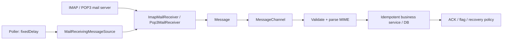
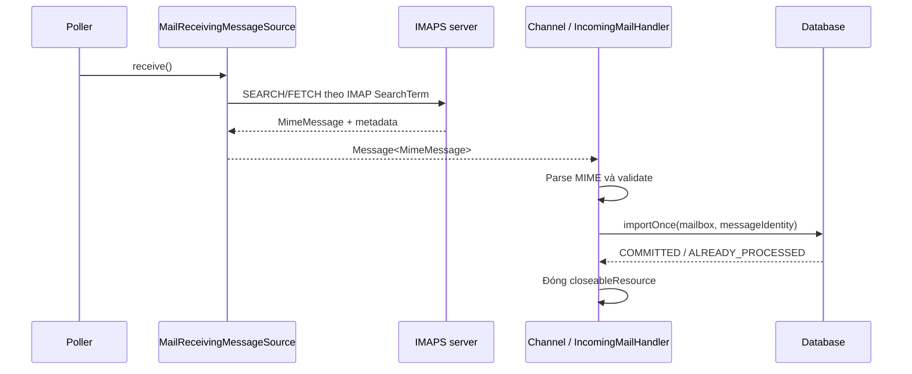
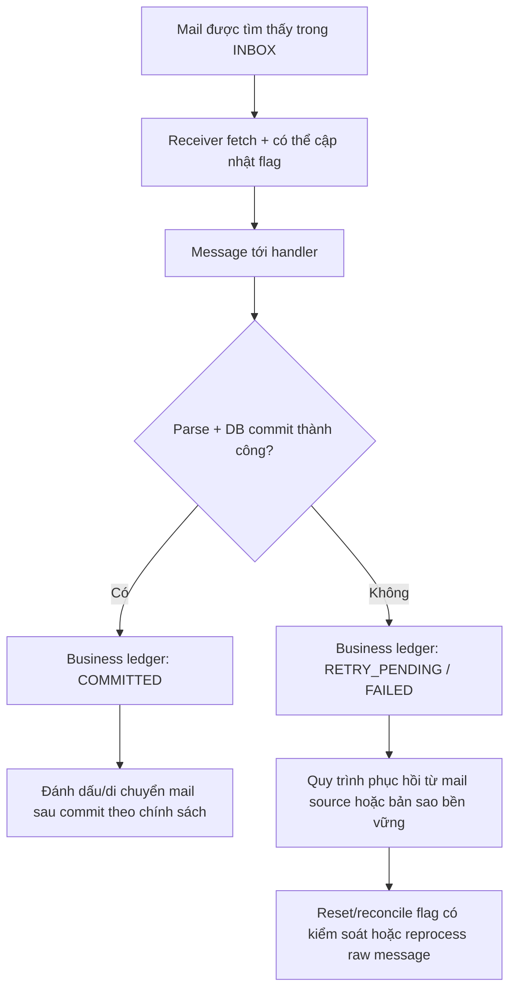

# Mail receiving channel adapter

## 1. Bài toán: biến email đến thành `Message` để xử lý tự động

Một công ty nhận hóa đơn và yêu cầu hỗ trợ tại hộp thư `intake@example.test`. Thay vì nhân viên đăng nhập mailbox để tải từng thư, hệ thống Spring Boot cần kiểm tra thư mới, lấy tiêu đề/người gửi/nội dung/attachment, phân loại và chuyển dữ liệu tới một service nghiệp vụ. Khi xử lý xong, ứng dụng cần có bằng chứng để không nhập lại cùng một hóa đơn sau restart hoặc khi có nhiều instance chạy đồng thời.

**Mail receiving channel adapter** của **Spring Integration** kết nối tới hộp thư bằng **IMAP/IMAPS** hoặc **POP3/POP3S**, lấy email từ mail server rồi phát thành Spring Integration `Message<?>` tới `MessageChannel`. Consumer downstream có thể là service activator, transformer, filter, router hoặc một integration flow nối tiếp với database, HTTP, JMS, AMQP và Kafka.

Bài này thuộc chương **Adapter Mail** của module `SPRING_INTEGRATION_ADAPTERS`: kết nối hệ thống ngoài bằng inbound/outbound adapter, gateway, poller và message channel, đồng thời kiểm soát hợp đồng message, lỗi, retry và vòng đời kết nối. Trọng tâm là **nhận email**; gửi email qua SMTP bằng outbound adapter là nhiệm vụ khác.

Sau bài này, bạn có thể:

- Phân biệt `MailReceivingMessageSource`, `ImapMailReceiver`, `Pop3MailReceiver` và `ImapIdleChannelAdapter`.
- Cấu hình một **polling mail inbound adapter** bằng Java DSL với kết nối IMAPS, secret và timeout.
- Giải thích payload `MimeMessage`, header mapper và `Multipart`/attachment.
- Quản lý `\Seen`, `\Deleted`, user flag, tìm kiếm mail, và tài nguyên `closeableResource` khi giữ folder mở.
- Thiết kế idempotency và recovery khi handler lỗi sau khi mail đã được nhận/đánh dấu.
- Chọn polling hoặc IMAP IDLE, kiểm thử lỗi mạng, bảo mật MIME và hoạt động nhiều consumer.

> **Phiên bản:** đoạn code hướng đến **Spring Integration 6.5.x**, Spring Boot tương thích, Java 17+ và **Jakarta Mail** (`jakarta.mail.*`). Spring Integration 7.x có thể thay đổi chi tiết API/điều kiện dependency; kiểm tra BOM và Javadoc phiên bản chạy thực tế. Các hostname, tài khoản và đường dẫn đều là dữ liệu minh họa.

## 2. Các giao thức: IMAP, POP3 và SMTP không thay thế nhau

| Giao thức | Chức năng | Hành vi liên quan đến nhận thư | Gợi ý |
| --- | --- | --- | --- |
| **IMAP/IMAPS** | Truy cập mailbox trên server | Hỗ trợ folder, `\Seen`, các flag và truy vấn thư; một số server hỗ trợ IDLE | Ưu tiên khi cần giữ thư, phân loại và kiểm soát trạng thái |
| **POP3/POP3S** | Lấy thư từ mailbox | Không có khái niệm đánh dấu đã đọc giống IMAP; trạng thái trong một session có giới hạn | Dùng khi hạ tầng chỉ hỗ trợ POP3 và chấp nhận giới hạn giao thức |
| **SMTP/SMTPS hoặc submission + STARTTLS** | Gửi mail | Không phải nguồn nhận thư cho channel adapter | Dành cho mail outbound adapter, không dùng để poll inbox |

IMAPS thường kết nối TLS ngay từ đầu, ví dụ cổng **993**; POP3S thường là **995**. Với IMAP không mã hóa ở cổng **143**, có thể thương lượng **STARTTLS**, nhưng cần chính sách bắt buộc TLS và không cho hạ cấp sang plaintext. Những cổng này là quy ước thường gặp, không nên thay cho hợp đồng endpoint chính thức của nhà cung cấp.

**Polling và IMAP IDLE là hai chế độ nhận, không phải hai giao thức mail khác nhau.** Cả hai có thể dùng IMAP; polling chạy theo lịch, còn IDLE cho phép server báo khi hộp thư thay đổi. IDLE chỉ hoạt động nếu server hỗ trợ và kết nối còn sống; ứng dụng vẫn cần cơ chế phát hiện mất kết nối/reconnect.



`MailReceivingMessageSource` là một **pollable message source**: nó không tự mở scheduler nếu bạn chỉ tạo object. Cần nối vào một polling endpoint bằng `@InboundChannelAdapter` hoặc `IntegrationFlow.from(..., e -> e.poller(...))`. `ImapIdleChannelAdapter` là message producer khác: thông thường **không gắn poller**, vì server gửi thông báo thay đổi cho ứng dụng.

## 3. Các thành phần Spring Integration Mail

| Thành phần | Vai trò | API thường gặp |
| --- | --- | --- |
| `MailReceiver` | Hợp đồng nhận thư | `receive()` |
| `ImapMailReceiver` | Đọc mailbox IMAP/IMAPS và tìm thư phù hợp | `setShouldMarkMessagesAsRead`, `setSearchTermStrategy` |
| `Pop3MailReceiver` | Lấy mail qua POP3/POP3S | `setShouldDeleteMessages` |
| `MailReceivingMessageSource` | Chuyển `MailReceiver` thành `MessageSource` | Dùng trong polling endpoint |
| `ImapIdleChannelAdapter` | Nhận thư bằng IMAP IDLE | Event-driven adapter, không cần poller |
| `Mail.imapInboundAdapter(...)` | Java DSL factory cho polling inbound | Tạo spec để đưa vào `IntegrationFlow.from` |
| `Mail.imapIdleAdapter(...)` | Java DSL factory cho IMAP IDLE | Tạo producer spec |
| `DefaultMailHeaderMapper` | Đưa metadata mail thành Spring message headers | `mail_subject`, `mail_from`, `mail_receivedDate`... |
| `MailToStringTransformer` | Trích xuất phần văn bản theo chiến lược của Spring Integration | `Mail.toStringTransformer()` |

Ở cấp hệ thống, một flow mail inbound khác một HTTP inbound gateway: mail server **không chờ response HTTP hoặc `replyChannel`** từ handler của bạn. Việc `MessageHandler` chạy xong không tự gửi ACK nghiệp vụ tới người gửi mail. Nếu cần thông báo đã xử lý, hãy thiết kế một outbound mail flow riêng hoặc ghi trạng thái vào hệ thống nghiệp vụ.

## 4. Mailbox flags: `received` không có nghĩa `processed`

IMAP cho phép thư có các flag như `\Seen` (đã đọc), `\Answered` (đã trả lời), `\Deleted` (được đánh dấu xóa) và các **user-defined flags**. `ImapMailReceiver` dựa trên search term để chọn thư đủ điều kiện, thường có logic xét trạng thái mới/chưa đọc/chưa xử lý.

| Thiết lập | Ý nghĩa thực tế | Rủi ro cần biết |
| --- | --- | --- |
| `shouldMarkMessagesAsRead(true)` | Đánh dấu `\Seen` cho thư do receiver nhận | **Có thể xảy ra trước khi downstream handler hoàn tất**, làm khó retry |
| `shouldMarkMessagesAsRead(false)` | Không chủ ý đánh dấu `\Seen` theo lựa chọn này | Không đồng nghĩa receiver không đặt **user flag hoặc fallback `\Flagged`** |
| `shouldDeleteMessages(true)` | Đánh dấu thư để xóa, expunge theo vòng đời folder | Có thể làm mất nguồn để xử lý lại nếu nghiệp vụ chưa commit |
| `shouldDeleteMessages(false)` | Không chủ động xóa thư vì đã nhận | Không tự đảm bảo thư được phát lại sau lỗi handler |
| `userFlag(...)` | Tên flag dùng để phân biệt thư adapter đã nhận, nếu server hỗ trợ | Nhiều consumer dùng cùng flag có thể làm ảnh hưởng nhau |
| `flaggedAsFallback(false)` | Từ phiên bản 6.4, có thể tắt fallback gắn `\Flagged` khi thiếu `\Recent`/user flags | Thay đổi tập thư được tìm kiếm; phải kiểm thử với server thật |

**Quan trọng:** Spring Integration có thể đánh dấu đã đọc/đã nhận **sau khi `MailReceiver` nhận thư nhưng trước khi service nghiệp vụ xác nhận xử lý thành công**. Do đó không nên xem `\Seen` hoặc user flag là bằng chứng hóa đơn đã được nhập DB. Chỉ nên coi đó là **trạng thái tại mailbox**. Bằng chứng xử lý cần nằm trong một **business ledger** có giao dịch/unique key rõ ràng.

Với POP3, không có cờ `\Seen` như IMAP. Nếu không xóa thư, một phiên POP3 mới sau restart có thể nhận lại những thư đã thấy ở phiên trước; nếu xóa sớm, mất nguồn để retry. Vì vậy những hộp thư cần semantics rõ về đã đọc, folder, phân loại và recovery thường phù hợp với IMAP hơn POP3.

## 5. Dependency, kết nối TLS và credential

Trong Spring Boot dùng dependency management tương thích Spring Integration 6.5, khai báo:

```groovy
dependencies {
    implementation 'org.springframework.boot:spring-boot-starter-integration'
    implementation 'org.springframework.integration:spring-integration-mail'

    // Cung cấp Jakarta Mail implementation (ví dụ qua Spring Boot starter).
    implementation 'org.springframework.boot:spring-boot-starter-mail'
}
```

`spring-integration-mail` là module integration, còn Jakarta Mail cần **implementation/provider** tại runtime; chỉ có API `jakarta.mail:jakarta.mail-api` không đủ trong mọi môi trường. `spring-boot-starter-mail` là một cách lấy mail implementation qua hệ thống quản lý phiên bản của Spring Boot. Việc dùng starter gửi mail không có nghĩa bạn phải cấu hình outbound mail sender nếu ứng dụng chỉ nhận thư.

Ví dụ `application.yml` chứa **placeholder**, không chứa secret thật:

```yaml
app:
  mail:
    # URI không chứa mật khẩu. %40 thay cho @ bên trong username.
    store-uri: ${MAIL_STORE_URI:imaps://intake%40example.test@imap.example.test:993/INBOX}
    username: ${MAIL_USERNAME:intake@example.test}
    password: ${MAIL_PASSWORD}
    poll-interval-ms: ${MAIL_POLL_INTERVAL_MS:15000}
```

URI có dạng `imaps://user@host:port/folder`; nếu username là địa chỉ email, ký tự `@` trong **userinfo** phải được escape theo định dạng mà Jakarta Mail parser hỗ trợ, thường thành `%40`. Có thể dùng URL chứa `user:password@host`, nhưng việc đưa password vào URI rất dễ lộ qua exception, log, telemetry hoặc cấu hình; ví dụ dưới dùng **`Authenticator`** để tách credential khỏi endpoint. Trước khi triển khai, kiểm tra khả năng login bằng IMAPS của provider: nhiều dịch vụ dùng OAuth 2.0 hoặc app-specific credential thay vì mật khẩu thông thường.

### Quy tắc bảo mật kết nối

- Dùng **TLS có xác minh chứng chỉ và hostname**, không tắt certificate validation; không thêm trust-all SSL factory để "sửa" lỗi handshake.
- Đặt timeout mạng rõ ràng để poller không treo vô hạn khi provider mất kết nối.
- Lưu `MAIL_PASSWORD` hoặc OAuth token trong secret manager/secret mount theo môi trường; biến môi trường chỉ là một cách minh họa, có thể bị lộ qua cấu hình tiến trình nếu quyền hệ thống không chặt.
- Tránh bật `mail.debug=true` ở production; debug wire protocol có thể làm lộ địa chỉ, header hoặc thông tin nhạy cảm.
- Dùng một tài khoản mailbox chuyên dụng và phân quyền tối thiểu; không tự động tải mọi attachment để chạy code hoặc mở file.
- Giới hạn kích thước mail và số attachment theo chính sách để tránh cạn heap/đĩa.

## 6. Cấu hình `ImapMailReceiver` an toàn bằng Java

Ví dụ receiver dùng `imaps`, `jakarta.mail.Authenticator` và Jakarta Mail `Properties`. Cấu hình này **không xóa** hoặc **chủ động đánh dấu thư là Seen** khi nhận; tuy nhiên các flag khác của receiver vẫn phải được kiểm chứng trên server được sử dụng:

```java
import java.util.Properties;

import jakarta.mail.Authenticator;
import jakarta.mail.PasswordAuthentication;

import org.springframework.beans.factory.annotation.Value;
import org.springframework.context.annotation.Bean;
import org.springframework.context.annotation.Configuration;
import org.springframework.integration.mail.ImapMailReceiver;

@Configuration
public class PartnerInboxConfiguration {

    @Bean
    public ImapMailReceiver partnerInboxReceiver(
            @Value("${app.mail.store-uri}") String storeUri,
            @Value("${app.mail.username}") String username,
            @Value("${app.mail.password}") String password) {

        ImapMailReceiver receiver = new ImapMailReceiver(storeUri);
        receiver.setJavaMailAuthenticator(new Authenticator() {
            @Override
            protected PasswordAuthentication getPasswordAuthentication() {
                return new PasswordAuthentication(username, password);
            }
        });

        Properties props = new Properties();
        props.setProperty("mail.store.protocol", "imaps");
        props.setProperty("mail.imaps.ssl.enable", "true");
        props.setProperty("mail.imaps.ssl.checkserveridentity", "true");
        props.setProperty("mail.imaps.connectiontimeout", "10000");
        props.setProperty("mail.imaps.timeout", "30000");
        props.setProperty("mail.imaps.writetimeout", "30000");
        props.setProperty("mail.debug", "false");

        receiver.setJavaMailProperties(props);
        receiver.setShouldDeleteMessages(false);
        receiver.setShouldMarkMessagesAsRead(false);
        receiver.setMaxFetchSize(10);

        // MIME có thể lazy-load attachment; handler phải đóng resource header.
        receiver.setAutoCloseFolder(false);
        return receiver;
    }
}
```

`setMaxFetchSize(10)` giới hạn số mail receiver lấy trong một lần fetch; nó khác với `maxMessagesPerPoll(1)` của poller, vốn quyết định số message source có thể phát trong một lượt poll. Cấu hình hai giá trị cần xét cùng nhau để tránh một lần nhận cả nghìn attachment rồi giữ mailbox folder quá lâu.

**Về `Authenticator`:** đây là mẫu khi provider hỗ trợ xác thực username/password hoặc credential tương đương. Nếu provider chỉ cho OAuth 2.0 SASL XOAUTH2, phải cấu hình SASL/token theo tài liệu của Jakarta Mail/provider, vòng đời refresh token và quyền scope phù hợp. Không đưa access token vào `store-uri` hoặc log. Nếu một provider cần định dạng URI khác, hãy xác minh parser trên thư viện chạy thực tế trước khi triển khai.

## 7. Java DSL: polling inbound adapter → `MessageChannel` → handler

Từ receiver ở mục 6, tạo một polling endpoint có handler đồng bộ. Khi có thư đủ điều kiện, source sẽ lấy `MimeMessage` rồi phát vào flow:

```java
import org.springframework.context.annotation.Bean;
import org.springframework.context.annotation.Configuration;
import org.springframework.integration.dsl.IntegrationFlow;
import org.springframework.integration.dsl.Pollers;
import org.springframework.integration.mail.ImapMailReceiver;
import org.springframework.integration.mail.dsl.Mail;

@Configuration
public class PartnerInboxFlowConfiguration {

    @Bean
    public IntegrationFlow incomingPartnerMailFlow(
            ImapMailReceiver partnerInboxReceiver,
            IncomingMailHandler incomingMailHandler) {

        return IntegrationFlow.from(
                        Mail.imapInboundAdapter(partnerInboxReceiver),
                        endpoint -> endpoint.id("partnerInboxPollingEndpoint")
                                .poller(Pollers.fixedDelay(15_000)
                                        .maxMessagesPerPoll(1)))
                .handle(incomingMailHandler)
                .get();
    }
}
```



Trong flow đồng bộ mặc định, handler chạy khi message đi qua channel; điều này giúp biết rõ khi nào xử lý MIME và đóng mail folder. Nếu thêm `ExecutorChannel`, queue hoặc broker sau inbound adapter, bạn phải giải quyết **vòng đời của `MimeMessage` và mail folder** trước khi gửi qua ranh giới bất đồng bộ. Không đẩy một `MimeMessage` còn phụ thuộc vào folder IMAP đang mở sang queue rồi mong consumer xử lý attachment sau khi session đã đóng.

**Vì sao không phát `Message<String>` ngay?** Email có thể là `text/plain`, `text/html`, `multipart/alternative`, `multipart/mixed`, attachment, forwarded message hoặc nội dung có encoding khác nhau. Giữ `MimeMessage` ở đầu flow giúp phân loại MIME trước khi chọn chiến lược chuyển đổi.

### Cấu hình tương đương bằng annotation

Ngoài Java DSL, có thể tạo `MailReceivingMessageSource` rồi để `@InboundChannelAdapter` đưa dữ liệu vào channel:

```java
import org.springframework.context.annotation.Bean;
import org.springframework.integration.annotation.InboundChannelAdapter;
import org.springframework.integration.annotation.Poller;
import org.springframework.integration.mail.ImapMailReceiver;
import org.springframework.integration.mail.MailReceivingMessageSource;

@Bean
@InboundChannelAdapter(
        value = "incomingMailMessages",
        poller = @Poller(fixedDelay = "15000", maxMessagesPerPoll = "1"))
public MailReceivingMessageSource incomingMailSource(ImapMailReceiver receiver) {
    return new MailReceivingMessageSource(receiver);
}
```

Đây là **cách cấu hình thay thế**, không thêm đồng thời vào ứng dụng đã dùng Java DSL ở trên nếu chúng cùng đọc một inbox. Hai nguồn nhận thư dùng cùng account có thể cạnh tranh flag, gây trùng hoặc bỏ sót tùy chính sách SearchTerm.

## 8. Payload `MimeMessage`, header mapper và nội dung MIME

**Mặc định**, nếu không cấu hình `HeaderMapper<MimeMessage>`, inbound adapter phát payload là một **`jakarta.mail.internet.MimeMessage`**. Ứng dụng có thể gọi `getSubject()`, `getFrom()`, `getRecipients(...)`, `getContentType()` và `getContent()` khi folder còn khả dụng.

Khi cung cấp `DefaultMailHeaderMapper`, một số thuộc tính mail được chuyển thành Spring message headers và payload phụ thuộc nội dung được render:

| Hình thức | Payload | Điều cần chú ý |
| --- | --- | --- |
| Không có header mapper | `MimeMessage` | Consumer phải đọc MIME, giải phóng tài nguyên nếu folder giữ mở |
| Có header mapper, email text | Thường là `String` | Các header như `mail_subject`, `mail_from` đã tách ra |
| Có header mapper, multipart/embedded part | Có thể là `byte[]` hoặc đối tượng `Part`, tùy cấu hình | Cần kiểm tra serialization, kích thước và encoding |
| `Mail.toStringTransformer()` | Chuỗi do chiến lược transformer tạo ra | Không thay thế parser attachment/virus scanning |

Một số header của `DefaultMailHeaderMapper` gồm `mail_from`, `mail_to`, `mail_cc`, `mail_bcc`, `mail_replyTo`, `mail_subject`, `mail_receivedDate`, `mail_contentType`, `mail_size` và `mail_raw`. Nếu không dùng mapper, **không giả định** các header này tự có trong `MessageHeaders`.

Ví dụ minh họa riêng khi cần mapper:

```java
import org.springframework.integration.mail.dsl.Mail;
import org.springframework.integration.mail.support.DefaultMailHeaderMapper;

var mailSourceSpec = Mail.imapInboundAdapter(storeUri)
        .shouldDeleteMessages(false)
        .shouldMarkMessagesAsRead(false)
        .headerMapper(new DefaultMailHeaderMapper());

// Dùng mailSourceSpec trong IntegrationFlow.from(...).
// Lúc này payload có thể là String hoặc byte[] thay vì MimeMessage.
```

Đừng cast cứng payload sang `MimeMessage` nếu đã bật mapper. Tương tự, đừng gọi `message.getPayload().toString()` rồi coi là nội dung HTML/text đầy đủ: multipart thường cần duyệt từng `BodyPart`, phân biệt inline text, HTML và file đính kèm.

### Mỗi attachment có thể là một nguồn dữ liệu không tin cậy

- Giới hạn kích thước email và tổng attachment; không tải không giới hạn vào RAM bằng `readAllBytes()`.
- Kiểm tra MIME type **và** nội dung thực, không chỉ filename hoặc `Content-Type` do người gửi tự khai báo.
- Chuẩn hóa tên file; cấm `../`, đường dẫn tuyệt đối, ký tự điều khiển và ghi đè file local hiện có.
- Quét malware và lưu ở vùng cách ly trước khi chuyển tới hệ thống nghiệp vụ, nhất là với ZIP, Office, PDF hoặc các định dạng có macro.
- Không tin trường `From`, `Reply-To` hoặc `Message-ID` là bằng chứng người gửi đã được xác thực. SPF/DKIM/DMARC và chính sách tin cậy cần được thực thi bằng lớp email security riêng.
- Bảo vệ dữ liệu cá nhân trong tiêu đề/body/attachment: hạn chế log, retention và quyền đọc staging.

## 9. Handler tự viết: parse trong phạm vi folder còn mở

Khi đặt `autoCloseFolder(false)`, Spring Integration thêm header `IntegrationMessageHeaderAccessor.CLOSEABLE_RESOURCE`; **consumer phải gọi `close()`** sau khi xử lý mail. Điều này đặc biệt quan trọng nếu attachment được tải theo nhu cầu. Không chỉ đóng mail body stream rồi bỏ qua resource header.

Ví dụ handler nhận email `text/plain` để minh họa. Email multipart sẽ được chuyển sang parser khác thay vì cố ép sang `String`:

```java
import java.io.Closeable;
import java.io.IOException;

import jakarta.mail.internet.MimeMessage;

import org.springframework.integration.StaticMessageHeaderAccessor;
import org.springframework.messaging.Message;
import org.springframework.messaging.MessageHandler;
import org.springframework.messaging.MessageHandlingException;
import org.springframework.stereotype.Component;

@Component
public class IncomingMailHandler implements MessageHandler {

    private final MailImportService importService;

    public IncomingMailHandler(MailImportService importService) {
        this.importService = importService;
    }

    @Override
    public void handleMessage(Message<?> message) {
        Closeable folderResource =
                StaticMessageHeaderAccessor.getCloseableResource(message);

        // Resource may be null if autoCloseFolder=true or another flow owns it.
        try (Closeable folder = folderResource == null ? () -> {} : folderResource) {
            MimeMessage mail = (MimeMessage) message.getPayload();
            String messageId = mail.getMessageID();
            String subject = mail.getSubject();

            if (!mail.isMimeType("text/plain")) {
                throw new IllegalArgumentException(
                        "Email multipart/HTML phải qua bộ xử lý MIME riêng");
            }

            Object content = mail.getContent();
            if (!(content instanceof String text)) {
                throw new IllegalArgumentException("Body không phải chuỗi text");
            }

            // Hợp đồng: method hoàn tất DB commit trước khi trả về.
            // Không dùng Message-ID làm khóa duy nhất nếu thiếu xác thực/phạm vi.
            importService.importTextOnce(messageId, subject, text);

        } catch (jakarta.mail.MessagingException | IOException ex) {
            throw new MessageHandlingException(message,
                    "Không thể đọc MIME hoặc đóng IMAP folder", ex);
        }
    }
}
```

```java
public interface MailImportService {
    /**
     * Parse, validate và ghi DB idempotent; chỉ trả về sau commit.
     * Nếu thất bại, ném exception để error flow/recovery ghi nhận.
     */
    void importTextOnce(String messageId, String subject, String body);
}
```

`try-with-resources` giải phóng folder khi handler kết thúc **kể cả khi validation hoặc DB lỗi**. Nhưng đây chỉ là quản lý connection: đóng folder không đồng nghĩa đã commit DB hoặc gửi ACK. Trong production, thay interface trên bằng service có định danh ổn định như `(mailbox, UIDVALIDITY, UID)` của IMAP khi truy cập được, hoặc một khóa nghiệp vụ dựa trên nguồn, Message-ID và fingerprint đã kiểm chứng; lưu ledger trước/sau import theo chính sách.

**Vòng đời mail folder:** nếu cùng flow sử dụng `MailToStringTransformer` hoặc một parser tách nhiều attachment, thao tác đọc nội dung phải diễn ra **trước `close()`**. Với `autoCloseFolder(true)` (mặc định), framework đóng folder sau fetch; khi lazy-loading nội dung còn phụ thuộc kết nối, downstream có thể gặp `FolderClosedException`. Không tắt `autoCloseFolder` mà quên bổ sung trách nhiệm close ở mọi nhánh lỗi.

## 10. `SearchTermStrategy` và lọc email đúng tầng

`ImapMailReceiver` dùng `SearchTerm` để quyết định email nào đủ điều kiện được fetch. Nếu chỉ muốn xử lý tiêu đề chứa `[INVOICE]`, có hai lựa chọn:

1. **Lọc phía mail receiver**, bằng `SearchTermStrategy` hoặc `mailFilterExpression`, trước khi phát message. Điều này giảm việc tải nội dung không cần thiết và có thể quyết định chính sách đánh dấu cho đúng thư được chấp nhận.
2. **Lọc sau khi adapter đã phát message**, bằng Spring Integration `.filter(...)`. Cách này dễ viết, nhưng email có thể đã bị gắn cờ đã nhận/đã đọc trước khi downstream filter từ chối, tùy cấu hình receiver.

Ví dụ Java DSL dùng mail filter expression với một spec đơn giản:

```java
import org.springframework.integration.mail.dsl.Mail;

var source = Mail.imapInboundAdapter(storeUri)
        .shouldDeleteMessages(false)
        .shouldMarkMessagesAsRead(false)
        .mailFilterExpression("subject matches '(?i).*\\[INVOICE\\].*'");

// Dùng source làm input của IntegrationFlow.from(source, pollerSpec).
```

**Chú ý:** biểu thức được áp dụng trên đối tượng email, không phải String payload đã transform. Ký tự regex/Java string phải được escape đúng theo cả hai tầng. Trong hệ thống cần bảo đảm chính xác, ưu tiên viết và kiểm thử riêng `SearchTermStrategy` thay vì ghép biểu thức phức tạp trong cấu hình.

Mặc định `ImapMailReceiver` thường xét các flag như `\Recent`, `\Seen`, `\Answered`, `\Deleted` và cờ đánh dấu đã được adapter nhận. Do cấu hình search term, provider và flag support khác nhau, cần kiểm thử **lần poll đầu, poll tiếp theo, restart và một email cập nhật flag** trên chính IMAP server được dùng. Không tự giả định mọi thư còn `\Seen=false` sẽ luôn được phát lại.

## 11. IMAP IDLE: khi không muốn liên tục polling

Nếu mail server hỗ trợ `IDLE`, Spring Integration có `ImapIdleChannelAdapter` để đợi thông báo thay đổi thay vì quét mailbox theo fixed delay. Đây là **phương án thay thế** cho flow polling ở mục 7; không bật cả hai nguồn trên cùng một inbox nếu chưa thiết kế quy tắc sở hữu rõ ràng.

```java
import org.springframework.context.annotation.Bean;
import org.springframework.context.annotation.Configuration;
import org.springframework.integration.dsl.IntegrationFlow;
import org.springframework.integration.mail.ImapMailReceiver;
import org.springframework.integration.mail.dsl.Mail;

@Configuration
public class PartnerInboxIdleFlowConfiguration {

    @Bean
    public IntegrationFlow imapIdleFlow(
            ImapMailReceiver partnerInboxReceiver,
            IncomingMailHandler incomingMailHandler) {

        return IntegrationFlow.from(
                        Mail.imapIdleAdapter(partnerInboxReceiver)
                                .autoStartup(true)
                                .id("partnerMailIdleEndpoint"))
                .handle(incomingMailHandler)
                .get();
    }
}
```

Trong ví dụ này **không có poller**. IDLE vẫn cần reconnect khi mạng gián đoạn và xử lý khi session bị cắt im lặng. `cancelIdleInterval` giúp giới hạn khoảng một phiên IDLE trước khi được làm mới (mặc định Spring Integration sử dụng khoảng 120 giây); nên cấu hình timeout và đánh giá hành vi của mail server/provider cụ thể.

Từ Spring Integration 6.0.5, IMAP IDLE adapter không còn tự phát message bất đồng bộ ở tầng adapter; downstream đồng bộ có thể chặn IDLE listener trong khi xử lý MIME/attachment lớn. Nếu muốn `ExecutorChannel` để tách thread, phải bảo đảm materialize nội dung cần thiết và **chuyển quyền sở hữu/đóng folder có kiểm soát**. IDLE không tự cung cấp backpressure hoặc exactly-once khi có nhiều replica.

## 12. Recovery khi handler lỗi sau khi thư đã được nhận

Giả sử mailbox có `invoice-0042.eml` và receiver nhận thư. Khi handler đang parse một attachment, dữ liệu không đúng schema và DB rollback. Tuy nhiên adapter có thể đã gắn `\Seen` hoặc user flag **trước khi service import trả lỗi**. Lần poll sau có thể không chọn lại email đó; việc giữ `shouldDeleteMessages(false)` **không tự đảm bảo retry**.



Để phục hồi bền vững, ứng dụng có thể chọn một trong các mô hình:

| Mô hình | Ưu điểm | Giới hạn |
| --- | --- | --- |
| Chỉ dựa vào `\Seen`/user flag | Dễ dựng demo | Không gắn với commit DB, có thể mất hoặc lặp xử lý |
| Lưu email thô/attachment vào object storage + DB ledger trước khi parse | Có bản gốc để replay an toàn | Cần dung lượng, mã hóa, antivirus và retention |
| Lưu công việc bền vững vào queue sau khi chuẩn hóa MIME | Tách fetch khỏi importer, dễ retry | Phải materialize body/attachment; không gửi raw `MimeMessage` phụ thuộc folder |
| Import trực tiếp trong handler rồi gắn trạng thái | Ít thành phần | Khó phục hồi nếu mail flag đổi trước khi import thành công |

**Thiết kế khuyến nghị cho dữ liệu quan trọng:** ghi nhận định danh mailbox, message identity và trạng thái `RECEIVED`; lưu payload cần thiết vào kho bền vững hoặc queue đã chuẩn hóa; importer xử lý với unique constraint; sau khi DB commit mới thực hiện bước đánh dấu/di chuyển mail theo chính sách. Các bước trên **không nằm trong một transaction phân tán mặc định** giữa mail server và database. Spring Integration có transaction synchronization để gắn hành động theo giao dịch trong một số trường hợp, nhưng phải xác minh semantics của receiver/flag và cơ chế phục hồi khi bước đánh dấu mail lỗi sau commit.

### Định danh email nào nên dùng?

`Message-ID` có thể trống, trùng hoặc bị người gửi giả mạo; không nên coi nó là khóa đáng tin cậy trên toàn hệ thống. Với IMAP, `(mailbox account, folder, UIDVALIDITY, UID)` giúp định danh một thông điệp trong ngữ cảnh mailbox/folder khi hệ thống lấy được UID. Nếu ứng dụng không truy cập UID, có thể kết hợp Message-ID với checksum nội dung và business ID của hóa đơn, đồng thời định nghĩa chính sách khi mail được chuyển folder/được gửi lại.

Chỉ cần **một business import** cho cùng `invoice_id`, bất kể hai bản email khác nhau có cùng attachment; ràng buộc này phải nằm ở tầng DB, không chỉ dựa vào IMAP flags.

## 13. Nhiều consumer, concurrency và giới hạn `maxFetchSize`

Hai instance cùng theo dõi một mailbox có thể cạnh tranh để nhận email. Một user flag mặc định có thể giúp hạn chế phát trùng trên IMAP server, nhưng nó không phải **distributed lock có transaction** và không bảo đảm exactly-once qua mọi trường hợp race, reconnect hoặc restart.

`maxFetchSize` hạn chế lượng email được receiver lấy trong một lần, còn poller `maxMessagesPerPoll` giới hạn số message được source phát mỗi lượt. Cần chọn các giá trị dựa trên kích thước mail, thời gian xử lý MIME và số replica. Nếu downstream mất nhiều phút quét attachment, hãy tách thành nhiệm vụ bền vững và giới hạn worker concurrency; đừng để hàng trăm `MimeMessage` đang giữ folder/stream trong RAM.

**Không để hai receiver cùng dùng một mailbox với user flag giống nhau mà không có thiết kế sở hữu.** Có thể tách folder, dùng flag riêng theo pipeline, hoặc tạo một ingestion service duy nhất đẩy dữ liệu đã chuẩn hóa vào queue để scale downstream. Bất kể cách nào, unique key ở DB và trạng thái retry bền vững vẫn cần thiết.

## 14. Xử lý lỗi, timeout và quan sát

| Triệu chứng | Nguyên nhân thường gặp | Hướng điều tra |
| --- | --- | --- |
| `AuthenticationFailedException` | Sai credential, provider yêu cầu OAuth/app password | Kiểm tra auth mechanism và secret; không retry login vô hạn |
| TLS/hostname verification thất bại | Chứng chỉ không hợp lệ, hostname/CA sai | Xác minh certificate chain và server identity; không tắt kiểm tra TLS |
| Adapter không nhận thư mới | SearchTerm/flag đã đánh dấu, poller dừng, sai folder | Xem `INBOX`, flags, `shouldMarkMessagesAsRead`, poller health |
| POP3 nhận lại thư sau restart | Giao thức không lưu Seen bền vững như IMAP | Dùng idempotency hoặc xem lại chính sách delete/retrieve |
| `FolderClosedException` khi đọc attachment | Mail folder đóng trước khi lazy-load nội dung | `autoCloseFolder(false)`, quản lý `closeableResource` đúng phạm vi |
| Adapter IDLE ngừng nhận sau lỗi mạng | Kết nối im lặng bị cắt, retry/reconnect chưa hiệu quả | Timeout, `cancelIdleInterval`, network và adapter lifecycle |
| Thư bị mất sau lỗi importer | Receiver đánh dấu/xóa trước khi DB commit | Mail flags, recovery ledger, lưu raw MIME/attachment |
| Trùng hóa đơn | Hai mailbox/pod nhận cùng thư, người gửi gửi lại | Unique key nghiệp vụ, xử lý idempotent |
| Hết heap/đĩa | Multipart/attachment quá lớn hoặc nhiều mail đồng thời | Giới hạn size, staging quota, concurrency và parser |
| Mail bị lọc mất | Downstream filter chạy sau khi receiver đã đánh dấu | Lọc phía receiver hoặc chính sách retry/flag riêng |

Theo dõi các chỉ số `mail_fetch_duration`, `mail_received_total`, `mail_parse_failed_total`, `mail_import_committed_total`, `mail_retry_pending`, `mail_folder_open`, `mail_attachment_bytes`, `mail_idle_reconnect_total`, cùng backlog theo folder/tuổi email. Log có thể chứa mailbox, correlation/batch ID và mã lỗi đã chuẩn hóa; không log password, OAuth token, toàn bộ body, attachment hoặc địa chỉ cá nhân không cần thiết.

Khi gặp lỗi mạng tạm thời, retry có backoff là hợp lý **nếu session được tạo lại đúng cách**. Khi lỗi TLS, authentication hoặc schema, retry vô hạn không giải quyết vấn đề. Một `RequestHandlerRetryAdvice` đặt ở downstream handler không tự retry lỗi xảy ra **trong mail source trước khi tạo message**; xử lý lỗi polling/source và recovery job phải được thiết kế riêng.

## 15. Kịch bản kiểm thử thực hành

Chuẩn bị một IMAP server **thử nghiệm** có TLS, mailbox với user riêng, cấu hình xác thực đã được cấp quyền và các email giả (không chứa dữ liệu nhạy cảm). Có thể dùng mail test server hỗ trợ IMAP/POP3 để kiểm thử chức năng; dùng endpoint mà bạn kiểm soát, không chạy thử tác động xóa trên mailbox thật.

1. **Nhận một mail text:** gửi một email `text/plain` mới vào `INBOX`; poller phát `Message<MimeMessage>`, handler đọc subject/body và ghi một record có unique key.
2. **Nhận nhiều mail:** gửi năm mail, cấu hình `maxFetchSize=2` và `maxMessagesPerPoll=1`; ghi nhận số lượt poll và thứ tự message.
3. **MIME multipart:** gửi một email HTML + PDF attachment. Handler text-only từ chối có kiểm soát; thử parser MIME chuyên dụng và đảm bảo đóng folder sau khi tải attachment.
4. **Header mapper:** bật `DefaultMailHeaderMapper` trong **flow test riêng**, xác nhận `mail_subject`, `mail_from` có mặt và payload type có thể thay đổi.
5. **Flag Seen:** bật/tắt `shouldMarkMessagesAsRead` lần lượt; quan sát `\Seen`, user flag hoặc `\Flagged` trên chính mail server test và hành vi poll tiếp.
6. **Handler lỗi trước commit:** mô phỏng DB rollback sau fetch. Ghi `RETRY_PENDING`; xác minh mail chưa bị xóa nếu cấu hình không delete và có đường reprocess an toàn.
7. **Restart:** restart ứng dụng sau khi đã nhận mail; kiểm tra thư nào xuất hiện lại, thư nào bị loại vì flags/search terms, và business idempotency có ngăn trùng.
8. **Mất mạng:** ngắt IMAPS trong lúc fetch hoặc IDLE; xác nhận timeout, close/reconnect và không giữ thread kẹt vô hạn.
9. **Hai instance:** chạy hai consumer cùng inbox, ghi nhận race, user flags và unique constraint; xác nhận chỉ một hóa đơn được commit.
10. **Bảo mật:** thử TLS hostname sai, attachment tên `../invoice.pdf`, mail quá lớn, HTML nguy hiểm và header giả; hệ thống phải từ chối/quarantine hoặc áp chính sách an toàn.

### Ma trận mong đợi

| Tình huống | Adapter cần thể hiện | Tầng nghiệp vụ cần bảo đảm |
| --- | --- | --- |
| Mail text hợp lệ | Phát message đúng payload/header | Commit một lần và ghi trạng thái |
| Mail multipart | Không đánh đồng với plain String | Parse an toàn, giới hạn attachment |
| Handler lỗi | Close mail folder và báo lỗi | Có khả năng retry từ dữ liệu bền vững |
| Restart hoặc chạy nhiều replica | Không dựa vào flags như giao dịch DB | Unique key và reconciliation |
| Mail server mất kết nối | Timeout và khôi phục theo policy | Không mất batch hoặc phát trùng không kiểm soát |

## 16. Sai lầm thường gặp

- **Nhầm SMTP với mail inbound:** SMTP dùng để gửi; nhận thư qua IMAP/POP3.
- **Tạo `MailReceivingMessageSource` nhưng không gắn poller:** source không tự chạy theo lịch.
- **Dùng cả polling và IDLE trên cùng mailbox mà không phân chia trách nhiệm:** dễ cạnh tranh flag và xử lý trùng/bỏ sót.
- **Bật `shouldDeleteMessages(true)` để chống trùng mà không có recovery:** có thể mất mail trước khi import DB thành công.
- **Cho rằng `shouldMarkMessagesAsRead(false)` nghĩa là không đổi flag nào:** receiver còn cơ chế user flag/fallback.
- **Cast payload sang `String` khi chưa dùng header mapper/transformer:** mặc định là `MimeMessage`.
- **Cast payload sang `MimeMessage` sau khi bật `DefaultMailHeaderMapper`:** payload có thể là `String` hoặc `byte[]`.
- **Đọc attachment sau khi folder đã đóng:** dễ gặp `FolderClosedException`.
- **Đặt `autoCloseFolder(false)` rồi không đóng `closeableResource`:** gây rò rỉ mail folder/session.
- **Tin `From` hoặc `Message-ID` là danh tính đáng tin cậy:** header mail có thể bị giả mạo.
- **Gửi raw `MimeMessage` sang queue để xử lý sau:** đối tượng có thể phụ thuộc folder mở và không phù hợp serialization.
- **Coi flag IMAP như transaction exactly-once:** không đồng bộ với commit DB hoặc trạng thái xử lý nhiều replica.
- **Bật SSL trust-all, log password hoặc đọc attachment không giới hạn:** làm yếu bảo mật và tăng nguy cơ rò rỉ tài nguyên.

## 17. Câu hỏi tự kiểm tra

1. `MailReceivingMessageSource` và `ImapIdleChannelAdapter` khác nhau ở cách được kích hoạt như thế nào?
2. Vì sao IMAP phù hợp hơn POP3 khi muốn quản lý folder, trạng thái đã đọc và nhiều consumer?
3. Payload của mail inbound mặc định là gì? Khi dùng `DefaultMailHeaderMapper`, điều gì có thể thay đổi?
4. `shouldMarkMessagesAsRead(false)` có chắc chắn khiến receiver không thay đổi bất kỳ flag nào không? Vì sao?
5. `shouldDeleteMessages(true)` có tạo ra transaction đồng bộ với DB importer không?
6. Khi đọc attachment qua `MimeMessage` có lazy loading, `autoCloseFolder(false)` và `closeableResource` được dùng như thế nào?
7. Vì sao không nên dùng `Message-ID` của email làm khóa duy nhất không cần kiểm tra?
8. `maxFetchSize` khác `maxMessagesPerPoll` như thế nào?
9. Nếu mail server cắt IMAP IDLE im lặng, cần quan sát những timeout/sự kiện nào?
10. Làm thế nào để xử lý đúng một hóa đơn khi hai instance nhận cùng một email hoặc cùng attachment?
11. Vì sao downstream `.filter(...)` có thể không phù hợp nếu mục tiêu là tránh đánh dấu đã đọc cho email không quan tâm?
12. Khi nào nên lưu raw MIME vào object storage rồi xử lý bất đồng bộ thay vì giữ mail folder mở suốt quá trình import?

## Tài liệu tham khảo

- [Spring Integration 6.5 Reference — Mail Support](https://docs.spring.io/spring-integration/reference/6.5/mail.html)
- [Spring Integration — Mail Support (current)](https://docs.spring.io/spring-integration/reference/mail.html)
- [Spring Integration 6.5 API — `MailReceivingMessageSource`](https://docs.spring.io/spring-integration/docs/6.5.0/api/org/springframework/integration/mail/MailReceivingMessageSource.html)
- [Spring Integration 6.5 API — `ImapMailReceiver`](https://docs.spring.io/spring-integration/docs/6.5.0/api/org/springframework/integration/mail/ImapMailReceiver.html)
- [Spring Integration 6.5 API — `ImapIdleChannelAdapterSpec`](https://docs.spring.io/spring-integration/docs/6.5.0/api/org/springframework/integration/mail/dsl/ImapIdleChannelAdapterSpec.html)
- [Spring Integration 6.5 API — `MailInboundChannelAdapterSpec`](https://docs.spring.io/spring-integration/docs/6.5.0/api/org/springframework/integration/mail/dsl/MailInboundChannelAdapterSpec.html)
- [Jakarta Mail API — `MimeMessage`](https://jakarta.ee/specifications/mail/)
