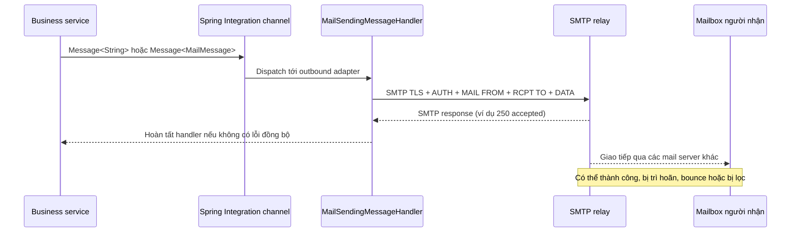
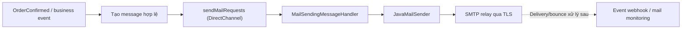
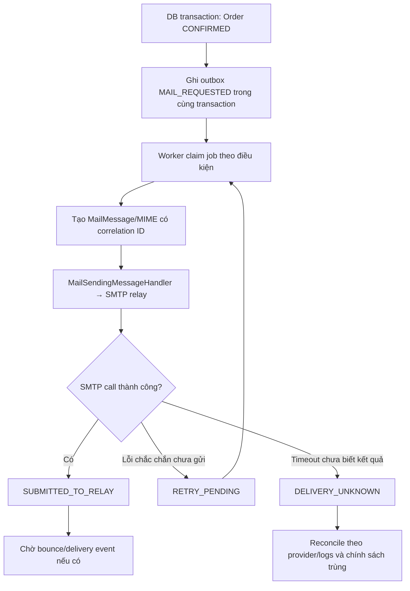

# Mail sending channel adapter

## 1. Bài toán: gửi email từ một integration flow

Ứng dụng xử lý đơn hàng cần gửi email thông báo sau khi giao dịch được xác nhận. Dữ liệu nghiệp vụ đến từ HTTP API, Kafka hoặc cơ sở dữ liệu; service tạo nội dung, chọn người nhận theo chính sách và đưa một Spring Integration `Message<?>` tới channel `sendMailRequests`. Tại cuối luồng, một **mail sending channel adapter** chuyển thông điệp thành email và giao nó cho SMTP server.

Spring Integration cung cấp **`MailSendingMessageHandler`**, một outbound channel adapter có nhiệm vụ gửi email qua **`MailSender`/`JavaMailSender`** của Spring. Đầu vào là message, đầu ra là **side effect gửi SMTP**; thông thường nó **không trả một reply message chứa kết quả phát thư** như outbound gateway request/reply. Email có thể đã được SMTP relay nhận nhưng sau đó vẫn bị trả lại (bounce), bị lọc spam hoặc chưa được người nhận đọc.

Bài này nằm trong chương **Adapter Mail** của module `SPRING_INTEGRATION_ADAPTERS`. Cũng như adapter file, SFTP, HTTP, JMS, AMQP, Kafka và database, mail adapter kết nối hệ thống ngoài qua `MessageChannel`, handler và chính sách lỗi. Điểm riêng của SMTP là **sự khác biệt giữa request được hệ thống giao cho relay và việc email thực sự đến người nhận**, cùng rủi ro gửi trùng khi mất kết nối ở cuối phiên SMTP.

Sau bài này, bạn có thể:

- Phân biệt SMTP outbound adapter với mail receiving adapter và với một outbound gateway có reply.
- Cấu hình `JavaMailSender` để dùng SMTP submission qua **STARTTLS** với timeout và secret riêng.
- Tạo Java DSL flow bằng `Mail.outboundAdapter(...)`, gửi `String` cùng `MailHeaders` hoặc `MailMessage`.
- Tạo email HTML, multipart và attachment bằng `MimeMessageHelper`/`MimeMailMessage`.
- Phân biệt `MailHeaders.TO`, `CC`, `BCC`, `FROM`, `REPLY_TO`, `SUBJECT` và header cho attachment.
- Thiết kế outbox, retry, idempotency và giám sát lỗi mà không khẳng định quá mức về khả năng giao thư.

> **Phạm vi phiên bản:** ví dụ dùng Spring Integration **6.5.x**, Spring Framework 6.x, Java 17+ và Jakarta Mail. Nếu dùng Spring Integration 7.x hoặc Spring Boot phiên bản khác, hãy kiểm tra lại API và dependency qua BOM. Các địa chỉ `example.test` và hostname minh họa không phải tài khoản/SMTP server thật.

## 2. SMTP gửi thư khác gì với IMAP/POP3 nhận thư?

| Thành phần | Hướng trao đổi | Giao thức | Kết quả chính |
| --- | --- | --- | --- |
| **Mail sending channel adapter** | Ứng dụng → mail server | SMTP submission/SMTP relay | Gửi mail bằng `MailSendingMessageHandler` |
| **Mail receiving channel adapter** | Mail server → ứng dụng | IMAP/IMAPS hoặc POP3/POP3S | Phát email nhận được thành Spring `Message` |
| **IMAP IDLE adapter** | Mail server thông báo thay đổi → ứng dụng | IMAP IDLE | Nhận thư theo sự kiện thay vì poll theo lịch |
| **Mail outbound gateway theo nghĩa request/reply** | Không phải mô hình chính của mail sending adapter | Không có ACK người đọc từ SMTP | Cần một quy trình theo dõi riêng nếu phải lấy phản hồi nghiệp vụ |

Thường người dùng gửi mail ra ngoài qua **port 587 với SMTP + STARTTLS bắt buộc** hoặc **port 465 với implicit TLS (SMTPS)**, tùy nhà cung cấp. Không dùng đồng thời hai cách mã hóa này một cách ngẫu nhiên; các thuộc tính JavaMail phải khớp cổng và chính sách của server.



**Ý nghĩa của `250 accepted`:** relay đã **nhận trách nhiệm xử lý** thư theo SMTP, không phải bằng chứng mailbox đích đã nhận, người nhận đã mở hoặc dữ liệu kinh doanh đã được phê duyệt. Nếu quy trình cần biết email thực sự được giao, phải kết nối thêm với sự kiện delivery/bounce từ mail provider hoặc cơ chế xác nhận nghiệp vụ riêng.

## 3. Thành phần và hợp đồng message

`MailSendingMessageHandler` nhận Spring Integration message từ một `MessageChannel` và dùng Spring Mail để gửi. Các payload được hỗ trợ có những cách ánh xạ khác nhau:

| Payload đưa vào adapter | Cách xử lý | Khi nào phù hợp |
| --- | --- | --- |
| **`String`** | Tạo `SimpleMailMessage`, dùng nội dung làm plain text | Thông báo ngắn, không có attachment |
| **`org.springframework.mail.MailMessage`** | Dùng trực tiếp đối tượng `MailMessage`; thường là `SimpleMailMessage` hoặc `MimeMailMessage` | Có nhiều trường mail hoặc MIME phức tạp |
| **`byte[]`** | Tạo nội dung attachment; cần `MailHeaders.ATTACHMENT_FILENAME` | Trường hợp đính kèm một tài liệu có sẵn dưới dạng bytes |
| Đối tượng nghiệp vụ tùy ý | Không mặc định tự dựng email có format nghiệp vụ | Cần transformer chuyển thành `String`/`MailMessage` trước adapter |

Trước adapter, các thành phần khác trong Spring Integration có thể dùng **transformer**, **filter**, **router**, **header enricher** và **service activator**. Ví dụ chọn template theo loại thông báo, kiểm tra domain người nhận rồi đưa message tới kênh gửi mail.

### Header dành cho thư gửi

Spring Integration định nghĩa `org.springframework.integration.mail.MailHeaders`:

| Header | Ý nghĩa | Giá trị ví dụ |
| --- | --- | --- |
| `MailHeaders.TO` | Người nhận chính | `new String[]{"ops@example.test"}` |
| `MailHeaders.CC` | Đồng nhận bản sao | `new String[]{"review@example.test"}` |
| `MailHeaders.BCC` | Đồng nhận ẩn; không hiện trong header To/Cc của thư tới người nhận | `new String[]{"audit@example.test"}` |
| `MailHeaders.FROM` | Địa chỉ người gửi hiển thị theo chính sách mail server | `"no-reply@example.test"` |
| `MailHeaders.REPLY_TO` | Nơi nhận phản hồi | `"support@example.test"` |
| `MailHeaders.SUBJECT` | Chủ đề mail | `"Đơn hàng đã được xác nhận"` |
| `MailHeaders.ATTACHMENT_FILENAME` | Tên attachment khi payload là `byte[]` | `"invoice-0042.pdf"` |

Nếu payload là `MailMessage` và message đồng thời chứa một header tương ứng, **mail header có thể ghi đè giá trị thuộc tính của `MailMessage`**. Ví dụ `SimpleMailMessage` đặt `to=buyer@example.test` nhưng một thành phần trước đó thêm `MailHeaders.TO=other@example.test`, adapter có thể gửi tới địa chỉ trong header. Vì vậy, chính sách người nhận và người gửi phải được kiểm soát ở **ranh giới tin cậy** trước adapter; không để client HTTP tùy ý gắn `MailHeaders.FROM`, `BCC` hoặc thay To.

## 4. Chuẩn bị dependency và cấu hình SMTP

Trong dự án Spring Boot dùng BOM tương thích với Spring Integration 6.5, cấu hình Gradle:

```groovy
dependencies {
    implementation 'org.springframework.boot:spring-boot-starter-integration'
    implementation 'org.springframework.integration:spring-integration-mail'
    implementation 'org.springframework.boot:spring-boot-starter-mail'
}
```

`spring-integration-mail` cung cấp adapter; `spring-boot-starter-mail` cung cấp Spring Mail cùng mail provider triển khai Jakarta Mail. Chỉ thêm API `jakarta.mail-api` mà không có implementation có thể khiến runtime không gửi được thư.

Ví dụ `application.yml` dùng các secret từ môi trường, không commit mật khẩu thật:

```yaml
spring:
  mail:
    host: ${SMTP_HOST:smtp.example.test}
    port: ${SMTP_PORT:587}
    username: ${SMTP_USERNAME:no-reply@example.test}
    password: ${SMTP_PASSWORD}
    properties:
      "[mail.smtp.auth]": true
      "[mail.smtp.starttls.enable]": true
      "[mail.smtp.starttls.required]": true
      "[mail.smtp.ssl.checkserveridentity]": true
      "[mail.smtp.connectiontimeout]": 10000
      "[mail.smtp.timeout]": 30000
      "[mail.smtp.writetimeout]": 30000
      "[mail.debug]": false

app:
  mail:
    sender-address: ${MAIL_FROM:no-reply@example.test}
    allowed-recipient-domain: ${ALLOWED_MAIL_DOMAIN:example.test}
```

Với Spring Boot, các thuộc tính `spring.mail.*` có thể tự cấu hình bean `JavaMailSender` khi điều kiện autoconfiguration thỏa mãn. Code của bài sẽ **tiêm `JavaMailSender` đó**, tránh định nghĩa một sender khác với bộ cấu hình không nhất quán. Nếu dự án tự tạo `JavaMailSenderImpl` thay vì dùng Boot autoconfiguration, phải cấu hình host, port, username, password, JavaMail properties và timeout tương đương.

Các thuộc tính quan trọng:

| Thuộc tính | Ý nghĩa | Rủi ro khi sai |
| --- | --- | --- |
| `mail.smtp.auth` | SMTP AUTH nếu relay yêu cầu | Relay từ chối gửi khi thiếu xác thực |
| `mail.smtp.starttls.enable` | Đề nghị nâng cấp kết nối bằng STARTTLS | Có thể bị hạ cấp nếu không bật `required` |
| `mail.smtp.starttls.required` | **Bắt buộc** TLS cho kiểu submission 587 | Từ chối server không hỗ trợ STARTTLS theo hợp đồng |
| `mail.smtp.ssl.checkserveridentity` | Xác minh tên host trong chứng chỉ TLS | Nếu tắt, tăng rủi ro kết nối nhầm server |
| `mail.smtp.connectiontimeout` | Giới hạn thời gian lập kết nối | Poller/worker có thể treo nếu không đặt |
| `mail.smtp.timeout` | Giới hạn thời gian chờ đọc phản hồi | Khó kiểm soát độ trễ và retry nếu bỏ trống |
| `mail.smtp.writetimeout` | Giới hạn thời gian ghi dữ liệu | Upload MIME lớn có thể treo khi mạng kẹt |

**Nếu dùng cổng 465 (implicit TLS):** cấu hình `mail.smtp.ssl.enable=true` và điều chỉnh `spring.mail.port=465` theo nhà cung cấp; không sao chép nguyên bộ STARTTLS của cổng 587 mà không kiểm tra. Luôn xác minh chứng chỉ/hostname. Không dùng các cách `ssl.trust=*`, trust-all socket factory hoặc `mail.debug=true` trong production để "sửa nhanh" lỗi kết nối.

Nhiều provider dùng OAuth 2.0/XOAUTH2 hoặc credential riêng cho ứng dụng; `spring.mail.username/password` chỉ minh họa kiểu SMTP AUTH bằng credential. Nếu provider yêu cầu OAuth, phải tích hợp cách lấy và làm mới token, scope và JavaMail SASL phù hợp; **không đặt access token vào log, URL hoặc source code**.

## 5. Java DSL: từ `MessageChannel` đến SMTP adapter

Ví dụ dưới dùng một `DirectChannel` làm điểm vào, từ đó một outbound endpoint gửi email bằng `Mail.outboundAdapter(mailSender)`. Đây là lựa chọn gọn, không cần poller: khi code gửi message vào channel đồng bộ, handler được gọi ngay.

```java
import org.springframework.context.annotation.Bean;
import org.springframework.context.annotation.Configuration;
import org.springframework.integration.channel.DirectChannel;
import org.springframework.integration.dsl.IntegrationFlow;
import org.springframework.integration.mail.dsl.Mail;
import org.springframework.mail.javamail.JavaMailSender;
import org.springframework.messaging.MessageChannel;

@Configuration
public class OutboundMailFlowConfiguration {

    @Bean
    public MessageChannel sendMailRequests() {
        return new DirectChannel();
    }

    @Bean
    public IntegrationFlow mailSendingFlow(
            MessageChannel sendMailRequests,
            JavaMailSender mailSender) {

        return IntegrationFlow.from(sendMailRequests)
                .handle(Mail.outboundAdapter(mailSender),
                        endpoint -> endpoint.id("smtpMailOutboundEndpoint"))
                .get();
    }
}
```

`Mail.outboundAdapter(JavaMailSender)` tạo một `MailSendingMessageHandler` đóng vai trò **message-consuming endpoint**. Nó không tự tạo một polling source và không tự gửi mail theo lịch. Muốn gửi theo lịch, hãy đặt poller tại **nguồn công việc** (ví dụ đọc hàng đợi/outbox có trạng thái), không gắn một poller vào `DirectChannel` đang được gọi trực tiếp nếu không có lý do.



Lưu ý một `MessageChannel.send(...)` trả `true` **không tự là chứng chỉ giao email thành công**. Với `DirectChannel` mặc định, handler thường thực hiện đồng bộ và exception có thể truyền ngược về caller; nhưng với `QueueChannel` hoặc channel bất đồng bộ, `send()` có thể chỉ chứng minh message đã được nhận vào kênh. Ngay cả khi SMTP không ném exception, điều được quan sát trước mắt vẫn là **mail server đã chấp nhận xử lý**, chưa phải hộp thư đích nhận được.

## 6. Gửi email plain text bằng payload `String` và `MailHeaders`

Một service có thể tạo message từ nội dung đã qua template, gắn người nhận, chủ đề và sender cố định. Để tránh biến ứng dụng thành SMTP open relay, ví dụ áp dụng chính sách người nhận **chỉ trong miền nội bộ**. Dự án thực tế có thể dùng danh sách người nhận đã được người dùng xác thực và consent hợp lệ thay vì giới hạn theo domain.

```java
import jakarta.mail.internet.AddressException;
import jakarta.mail.internet.InternetAddress;

import org.springframework.beans.factory.annotation.Qualifier;
import org.springframework.beans.factory.annotation.Value;
import org.springframework.integration.mail.MailHeaders;
import org.springframework.messaging.MessageChannel;
import org.springframework.messaging.support.MessageBuilder;
import org.springframework.stereotype.Service;

@Service
public class InternalMailNotificationService {

    private final MessageChannel mailChannel;
    private final String sender;
    private final String allowedDomain;

    public InternalMailNotificationService(
            @Qualifier("sendMailRequests") MessageChannel mailChannel,
            @Value("${app.mail.sender-address}") String sender,
            @Value("${app.mail.allowed-recipient-domain}") String allowedDomain) {
        this.mailChannel = mailChannel;
        this.sender = sender;
        this.allowedDomain = allowedDomain.toLowerCase(java.util.Locale.ROOT);
    }

    public void sendInternalNotice(String recipient, String subject, String body) {
        String validatedRecipient = validateRecipient(recipient);
        if (subject == null || subject.isBlank() || subject.length() > 180
                || subject.contains("\r") || subject.contains("\n")) {
            throw new IllegalArgumentException("Subject không hợp lệ");
        }
        if (body == null || body.length() > 200_000) {
            throw new IllegalArgumentException("Body quá lớn hoặc rỗng null");
        }

        boolean acceptedByChannel = mailChannel.send(
                MessageBuilder.withPayload(body)
                        .setHeader(MailHeaders.TO, new String[] { validatedRecipient })
                        .setHeader(MailHeaders.FROM, sender)
                        .setHeader(MailHeaders.SUBJECT, subject)
                        .build());

        if (!acceptedByChannel) {
            throw new IllegalStateException("Channel chưa nhận thông điệp gửi mail");
        }
    }

    private String validateRecipient(String raw) {
        try {
            InternetAddress[] parsed = InternetAddress.parse(raw, true);
            if (parsed.length != 1) {
                throw new IllegalArgumentException("Chỉ cho phép một người nhận");
            }
            parsed[0].validate();
            String address = parsed[0].getAddress();
            int at = address.lastIndexOf('@');
            if (at < 1 || !address.substring(at + 1)
                    .toLowerCase(java.util.Locale.ROOT).equals(allowedDomain)) {
                throw new IllegalArgumentException("Domain chưa được cấp quyền");
            }
            return address;
        }
        catch (AddressException exception) {
            throw new IllegalArgumentException("Địa chỉ email không hợp lệ", exception);
        }
    }
}
```

Trong ví dụ này, payload là `String`, nên `MailSendingMessageHandler` tạo một **plain-text `SimpleMailMessage`**. Người nhận/From/Subject lấy từ các `MailHeaders`. `MessageBuilder` là phần của Spring Messaging, không phải Jakarta Mail. Việc kiểm tra cú pháp qua `InternetAddress` không xác thực quyền sử dụng hộp thư; chính sách domain/recipient allowlist hoặc dữ liệu người dùng đã xác thực vẫn là trách nhiệm của ứng dụng.

**Tránh nhầm giữa `send` và `delivered`:** tên biến `acceptedByChannel` cố ý nói về kênh Spring. Đây không phải `SMTP_ACCEPTED` hay `DELIVERED`. Trong hệ thống có outbox, chỉ chuyển trạng thái sang `SUBMITTED_TO_RELAY` khi bước gửi SMTP đã hoàn tất theo thiết kế worker, và trạng thái `DELIVERED` phải đến từ sự kiện provider nếu provider hỗ trợ.

## 7. Gửi một `MailMessage` đã dựng sẵn

Với nhiều thuộc tính, có thể tạo `SimpleMailMessage` ngay trong service hoặc transformer rồi đưa vào flow. Khi payload đã là `MailMessage`, handler dùng các thuộc tính trong object; **không cần set thêm header cùng tên** trừ khi có lý do rõ ràng.

```java
import org.springframework.mail.SimpleMailMessage;
import org.springframework.messaging.MessageChannel;
import org.springframework.messaging.support.MessageBuilder;

public void sendPlainMail(MessageChannel channel) {
    SimpleMailMessage mail = new SimpleMailMessage();
    mail.setFrom("no-reply@example.test");
    mail.setTo("ops@example.test");
    mail.setReplyTo("helpdesk@example.test");
    mail.setSubject("Batch hoàn tất");
    mail.setText("Batch 0042 đã được hệ thống ghi nhận.");

    channel.send(MessageBuilder.withPayload(mail).build());
}
```

Một `SimpleMailMessage` phù hợp mail thuần text. Nó không biểu diễn HTML multipart và attachment phức tạp như `MimeMessage`. Nếu payload là một Java bean `OrderMailCommand`, đừng đưa thẳng bean vào adapter rồi mong handler tự render đúng template: hãy thêm transformer trả về `String` hoặc `MailMessage`.

### Header enrichment trước endpoint

Khi `Message<?>` đi từ một route nội bộ đến mail adapter, có thể dùng `.enrichHeaders(...)` hoặc `Mail.headers()` trong Java DSL để đặt các giá trị như `MailHeaders.TO` và `MailHeaders.SUBJECT` từ payload. Ví dụ cấu trúc (các trường được lấy từ command **đã kiểm tra**):

```java
// Trích đoạn nối tiếp vào một IntegrationFlow nhận NotificationCommand.
.enrichHeaders(headers -> headers
        .headerExpression(MailHeaders.TO, "new String[] { payload.recipient }")
        .headerExpression(MailHeaders.SUBJECT, "payload.subject")
        .header(MailHeaders.FROM, "no-reply@example.test"))
.transform(NotificationCommand.class, NotificationCommand::body)
.handle(Mail.outboundAdapter(mailSender))
```

Đây là **trích đoạn DSL**, không phải class Java độc lập. `NotificationCommand` là một record do ứng dụng định nghĩa, và mọi trường phải được validate **trước khi tạo mail headers**. Với dữ liệu không tin cậy, ưu tiên code xây dựng header rõ ràng trong một service hơn là biểu thức SpEL phức tạp.

## 8. HTML email và nhiều attachment với `MimeMailMessage`

Khi cần HTML, plain-text alternative, inline image hoặc nhiều attachment, dùng `JavaMailSender#createMimeMessage()` và `MimeMessageHelper` của Spring Mail để tạo MIME. `MimeMailMessage` là wrapper **triển khai `org.springframework.mail.MailMessage`**, nên có thể làm payload cho `MailSendingMessageHandler`. Đây là điểm quan trọng: một `jakarta.mail.internet.MimeMessage` thô **không phải** `MailMessage` của Spring; không giả định đặt raw `MimeMessage` làm payload sẽ được handler xử lý giống wrapper.

```java
import jakarta.mail.MessagingException;
import jakarta.mail.internet.MimeMessage;

import org.springframework.core.io.ByteArrayResource;
import org.springframework.mail.javamail.JavaMailSender;
import org.springframework.mail.javamail.MimeMailMessage;
import org.springframework.mail.javamail.MimeMessageHelper;
import org.springframework.messaging.MessageChannel;
import org.springframework.messaging.support.MessageBuilder;

public void sendReportWithAttachment(
        JavaMailSender mailSender,
        MessageChannel mailChannel,
        byte[] pdfBytes,
        String validatedRecipient) throws MessagingException {

    if (pdfBytes == null || pdfBytes.length == 0 || pdfBytes.length > 5_000_000) {
        throw new IllegalArgumentException("PDF không hợp lệ hoặc quá giới hạn");
    }

    MimeMessage mime = mailSender.createMimeMessage();
    MimeMessageHelper helper =
            new MimeMessageHelper(mime, true, "UTF-8");

    helper.setFrom("reports@example.test");
    helper.setTo(validatedRecipient); // recipient đã qua chính sách allowlist
    helper.setSubject("Báo cáo settlement #0042");
    helper.setText(
            "Báo cáo settlement 0042 đã sẵn sàng.",
            "<html><body><p><strong>Báo cáo #0042</strong> đã sẵn sàng.</p></body></html>");
    helper.addAttachment("settlement-0042.pdf",
            new ByteArrayResource(pdfBytes), "application/pdf");

    // Wrapper Spring MailMessage giúp outbound adapter nhận diện MIME mail.
    MimeMailMessage payload = new MimeMailMessage(helper);
    mailChannel.send(MessageBuilder.withPayload(payload).build());
}
```

`MimeMessageHelper` có thể đặt cả bản text và HTML alternative, nhưng HTML chỉ nên dựng bằng **template được kiểm soát**. Nếu nhúng tên người dùng, mô tả đơn hàng hoặc nội dung nhập từ bên ngoài vào HTML, phải **escape HTML** theo context, không nối chuỗi HTML không được kiểm tra. Email client có cơ chế sanitize riêng nhưng không thể xem đó là bảo vệ ứng dụng khỏi template injection.

`ByteArrayResource` thích hợp cho file nhỏ sau khi bạn đã áp giới hạn kích thước. Với attachment lớn, cân nhắc file/object storage có quyền đọc và vòng đời rõ ràng; tránh giữ nhiều byte array lớn trong bộ nhớ hàng đợi. **Không** gửi attachment bằng cách tạo `MimeMessage` phụ thuộc một stream đã đóng hoặc file bị xóa trước khi worker thực sự gửi.

### Nếu phải tạo MIME phức tạp hơn nữa

`MimeMessageHelper` hỗ trợ `addInline(...)`, `addAttachment(...)`, `setReplyTo(...)`, danh sách người nhận và mã hóa charset. Hãy tạo MIME trước khi gửi, kiểm tra toàn bộ attachment, nội dung và địa chỉ. Với cấu trúc MIME phức tạp, bài kiểm thử nên kiểm tra **cây MIME thực tế** (multipart/alternative vs multipart/mixed), không chỉ xem câu lệnh SMTP trả thành công.

## 9. Payload `byte[]` và header attachment

Spring Integration có mapping đơn giản: nếu payload là **`byte[]`**, `MailSendingMessageHandler` coi dữ liệu là attachment, yêu cầu `MailHeaders.ATTACHMENT_FILENAME` trong message. Ví dụ dưới chỉ minh họa cách adapter nhận byte array; mail gửi đi cần các header người nhận/chủ đề đúng hợp đồng:

```java
import org.springframework.integration.mail.MailHeaders;
import org.springframework.messaging.MessageChannel;
import org.springframework.messaging.support.MessageBuilder;

public void sendOneAttachment(MessageChannel mailChannel, byte[] validatedPdf) {
    if (validatedPdf.length > 5_000_000) {
        throw new IllegalArgumentException("Attachment vượt giới hạn");
    }

    mailChannel.send(MessageBuilder.withPayload(validatedPdf)
            .setHeader(MailHeaders.TO, new String[] { "ops@example.test" })
            .setHeader(MailHeaders.FROM, "reports@example.test")
            .setHeader(MailHeaders.SUBJECT, "Báo cáo PDF")
            .setHeader(MailHeaders.ATTACHMENT_FILENAME, "report.pdf")
            .build());
}
```

Nếu thiếu `ATTACHMENT_FILENAME`, handler không có thông tin tên file đính kèm và có thể từ chối message. Với nhiều attachment, HTML body hoặc inline image, **ưu tiên `MimeMessageHelper`** thay vì cố gắn nhiều byte array vào header rồi hy vọng adapter tự tạo cây MIME theo ý.

## 10. `DirectChannel`, `QueueChannel` và poller: nơi nào thực sự gửi mail?

Mail outbound adapter là **consumer**, không phải message source. Nó hoạt động khi một message được giao tới endpoint. Loại channel ảnh hưởng thời điểm side effect diễn ra và thời điểm caller nhận lỗi:

| Thiết kế | Nơi gọi SMTP | Điều caller biết sau `send()` | Vấn đề cần kiểm soát |
| --- | --- | --- | --- |
| `DirectChannel` → mail adapter | Đồng bộ trên thread của caller | Thông thường exception từ handler được truyền ngược về caller | Độ trễ SMTP có thể làm chậm request HTTP/transaction |
| `ExecutorChannel` → mail adapter | Bất đồng bộ trong JVM | Có thể chỉ biết message đã được giao cho executor | Mất message khi process crash nếu không có lưu trữ bền vững |
| `QueueChannel` + poller → mail adapter | Poller lấy message rồi gọi handler | Send vào queue không đồng nghĩa SMTP đã nhận | Queue trong RAM không có durability mặc định, cần xử lý queue capacity |
| DB outbox/AMQP/Kafka → mail sender worker | Worker riêng lấy job đã commit | HTTP/business caller chỉ biết job đã được ghi nhận | Cần claim, retry, idempotency, reconciliation và DLQ |

Với thông báo quan trọng phát sinh từ transaction DB, cách làm bền vững hơn thường là **outbox sau commit**, sau đó mail worker đọc job và gọi adapter. Không giữ transaction đặt hàng mở trong suốt thời gian TCP/SMTP trao đổi, vì SMTP không rollback cùng transaction DB và một mail server chậm có thể làm tăng lock contention.

### Outbox mẫu: khác biệt giữa `REQUESTED`, `SUBMITTED`, `DELIVERED`



Gợi ý bảng outbox:

```text
notification_id       // định danh nghiệp vụ ổn định (unique)
recipient_id          // tham chiếu người nhận đã được cấp quyền
template_id
payload_reference      // khóa tới dữ liệu đã render/đủ để render lại
status                 // REQUESTED, SENDING, SUBMITTED, DELIVERY_UNKNOWN, ...
attempt_count
next_retry_at
provider_message_id    // nếu provider trả và được tích hợp
last_error_code
created_at, updated_at
```

Khóa unique như `(order_id, notification_type, recipient_id)` ngăn **hai event giống nhau tạo hai outbox job**. Nhưng **không tự ngăn gửi trùng ở SMTP** nếu worker mất kết nối ngay sau khi relay nhận email. Một số provider có API hỗ trợ idempotency key; SMTP truyền thống không bảo đảm dùng `Message-ID` để server/recipient tự loại bỏ bản sao. Với email có rủi ro trùng cao, phải chấp nhận đánh đổi giữa *khả năng gửi lặp* và *khả năng mất thông báo* hoặc sử dụng provider có cơ chế xác nhận/idempotency tốt hơn.

## 11. Retry: không nhầm timeout với chắc chắn chưa gửi

Một lỗi `MailSendException` có thể do DNS, kết nối TCP, TLS, SMTP AUTH, server trả lỗi 4xx/5xx hoặc mất reply sau `DATA`. Không nên đặt `RequestHandlerRetryAdvice` retry mọi exception không phân biệt:

| Thời điểm lỗi | Ví dụ | Quyết định retry |
| --- | --- | --- |
| Trước khi kết nối được SMTP relay | Kết nối bị từ chối, timeout TCP ngắn | Có thể retry có giới hạn với backoff |
| TLS handshake / certificate invalid | CA/hostname sai hoặc chính sách TLS không khớp | **Không** tự tắt TLS; sửa cấu hình và certificate |
| SMTP authentication failed | Sai secret, OAuth scope/credential hết hạn | Dừng và alert, không login vô hạn |
| Server báo **4xx tạm thời** | Relay quá tải hoặc mailbox tạm không sẵn sàng | Retry có giới hạn theo mã lỗi và SLA; tôn trọng rate limit |
| Server báo **5xx cố định** | Người nhận không tồn tại, policy không cho gửi | Không retry mù; chuyển lỗi bền vững hoặc sửa dữ liệu |
| Mất mạng **sau khi gửi `DATA`** | Relay có thể đã chấp nhận mail nhưng client không thấy reply | Đánh dấu **`DELIVERY_UNKNOWN`**, đối soát trước retry nếu có thể |
| Mail bị bounce nhiều giờ sau khi server chấp nhận | Delivery event bất đồng bộ | Cập nhật delivery/bounce status, **không** suy từ lời gọi adapter |

Các exception thường gặp ở Spring Mail gồm `MailAuthenticationException`, `MailSendException`, `MailParseException` hoặc exception được bọc từ Jakarta Mail. **Cùng một exception class có thể có nhiều nguyên nhân**, nên đọc chain và response code trong nguồn lỗi được phân quyền trước khi áp policy. Không dùng `retryOn(MailException.class)` một cách mặc định cho mọi tình huống.

Trong Spring Integration, `RequestHandlerRetryAdvice` gắn vào endpoint có thể thử gọi lại handler khi exception xảy ra. Tuy nhiên lời gọi lại nghĩa là **gửi thêm một phiên SMTP**. Với thông báo quan trọng, hãy chọn policy kết hợp business ledger, giới hạn số lượt và đối soát delivery. Không đặt nhiều lớp retry (handler, worker, queue redelivery, scheduled job) đều ba lần mà không tính số SMTP request tối đa.

**Cách hiểu đúng:** `SMTP submission succeeded` không đồng nghĩa `recipient received`. Ngược lại, `SMTP submission threw timeout` cũng không chứng minh `relay did not accept`. Phải có trạng thái `UNKNOWN` trong workflow, không chỉ `SUCCESS/FAILED`.

## 12. Error channel và hợp đồng message một chiều

Mail sending adapter là một **one-way outbound channel adapter**. Khi `DirectChannel` đồng bộ, một lỗi handler có thể propagate tới caller; khi đi qua `ExecutorChannel` hoặc pollable channel, lỗi phải được chuyển tới **error flow** phù hợp. Một `ErrorMessage` thường giữ exception và thông điệp gốc để điều tra. Tạo error channel chỉ là **đường vận chuyển lỗi**, không phải retry hoặc outbox tự động.

Ví dụ logic error consumer ở mức kiến trúc:

```text
Message<NotificationCommand> + notificationId
  -> validate, render
  -> MailSendingMessageHandler
  -> success: cập nhật SUBMITTED_TO_RELAY theo policy
  -> exception: ErrorMessage
       -> classify SMTP/network/auth/policy
       -> update outbox RETRY_PENDING / DELIVERY_UNKNOWN / FAILED_PERMANENT
       -> send alert/metrics (không gửi lại ngay nếu result unknown)
```

Khi xử lý `ErrorMessage`, đừng in nguyên payload chứa thông tin người nhận, body và attachment vào log. Cần lưu correlation/notification ID an toàn để đối chiếu với outbox. Nếu lỗi nằm ở **biến đổi nội dung trước khi endpoint**, advice chỉ gắn trên mail adapter không tự bắt transformer lỗi; ranh giới error handling phải bao trùm đúng thành phần.

## 13. An toàn email: tránh open relay, rò rỉ và phishing

SMTP integration rất dễ bị lạm dụng nếu một API cho phép người dùng bất kỳ cung cấp `to`, `from`, `bcc`, `subject` và `html` tự do rồi chuyển thẳng tới mail adapter. Các nguyên tắc production:

1. **Quyền gửi:** xác thực caller và kiểm tra họ có quyền tạo loại thông báo đó; không biến adapter thành dịch vụ gửi mail tới địa chỉ bất kỳ.
2. **Danh sách người nhận:** lấy từ hồ sơ đã được kiểm chứng hoặc allowlist; giới hạn số người nhận, số mail mỗi phút và quota theo tenant.
3. **From/Reply-To:** quản lý bởi server/domain của tổ chức; tránh cho client giả mạo người gửi. Cần cấu hình SPF, DKIM, DMARC theo domain và nhà cung cấp, không chỉ thay `MailHeaders.FROM`.
4. **HTML:** render qua template được kiểm soát, escape biến, giới hạn liên kết và tracking, không đưa HTML không tin cậy vào body.
5. **Attachment:** kiểm tra nội dung thực và size; quét malware nếu file từ người dùng, sanitize basename, không lấy đường dẫn local từ tên gốc của attachment.
6. **Secret/TLS:** dùng secret manager, bắt buộc TLS và verify hostname, không log password/token, không commit `spring.mail.password` thật.
7. **Thông tin cá nhân:** log tối thiểu, hạn chế retention, mã hóa outbox/body/attachment khi lưu, kiểm soát quyền đọc theo tenant.
8. **Chống spam/abuse:** throttling, alert khi bounce rate cao, unsubscribe/consent theo loại mail và yêu cầu pháp lý áp dụng.

Việc đặt `BCC` vào header mang tính nhạy cảm: tuy người nhận thường không thấy danh sách Bcc, ứng dụng có thể vô tình log cả `MessageHeaders` hoặc gửi nội dung debug làm lộ danh sách. Không để người dùng bên ngoài quyết định Bcc cho các địa chỉ nội bộ.

## 14. Quan sát hệ thống và giới hạn vận hành

| Metric/thuộc tính | Mục đích | Ghi chú |
| --- | --- | --- |
| `mail_submit_attempt_total` | Đếm các lần worker gọi SMTP | Phân biệt attempt với notification duy nhất |
| `mail_submit_success_total` | Đếm lời gọi hoàn tất ở adapter | Không dùng tên `delivered_total` |
| `mail_submit_error_total{reason}` | Phân loại auth/TLS/network/4xx/5xx | Không đưa địa chỉ email nhạy cảm vào tag |
| `mail_submit_duration` | Phát hiện relay chậm/timeout | Đo cả latency và rate |
| `mail_outbox_pending` | Số job chưa được worker gửi | Theo dõi backlog/SLA |
| `mail_outbox_unknown` | Job không rõ đã được relay nhận hay chưa | Ưu tiên reconciliation |
| `mail_bounced_total` | Event bounce từ provider nếu tích hợp | Có thể đến bất đồng bộ sau nhiều phút/giờ |
| `mail_attachment_bytes` | Giám sát kích thước tài nguyên gửi | Giới hạn heap và bandwidth |

Log nên có `notificationId`, `templateId`, `recipientId` (hoặc hash phù hợp), tên endpoint, số lần thử, thời gian và loại lỗi. Đừng log password, token, raw MIME, HTML cá nhân hay attachment. Tránh đặt SMTP debug/wire logging ở production, đặc biệt khi có user/recipient data.

Một SMTP server có thể áp quota kết nối, messages/day, recipients/minute hoặc kích thước mail. Cấu hình concurrency và backoff phải tuân thủ những giới hạn này; tăng `ExecutorChannel` lên hàng trăm worker không có nghĩa provider chấp nhận hàng trăm phiên đồng thời. Nên có circuit breaker/rate limiter nếu gửi khối lượng lớn, nhưng đây là **chính sách bổ sung**, không phải tính năng tự sinh khi gọi `Mail.outboundAdapter(...)`.

## 15. Kịch bản kiểm thử bằng SMTP test server

Dùng SMTP sandbox hoặc server **test** mà nhóm phát triển kiểm soát (chẳng hạn GreenMail, Mailpit hoặc một SMTP capture server). Không thử gửi mail hàng loạt đến người thật; khi kiểm thử attachment, chỉ dùng dữ liệu giả và tên file an toàn.

1. **Plain text thành công:** gửi message `String` với `TO`, `FROM`, `SUBJECT`; xác minh SMTP test server nhận đúng một thư và body khớp UTF-8.
2. **Header precedence:** tạo `SimpleMailMessage` có `to` khác với `MailHeaders.TO` trong Spring message; kiểm chứng quy tắc override và vì sao phải kiểm soát header trước adapter.
3. **Thiếu người nhận:** gửi message không có To/Cc/Bcc và không có recipient mặc định; xác nhận handler hoặc SMTP từ chối, error được ghi rõ mà không retry vô hạn.
4. **Attachment:** gửi `byte[]` có `MailHeaders.ATTACHMENT_FILENAME`; xác nhận cây MIME và tên file trên server test, thử thiếu header để nhận lỗi thích hợp.
5. **HTML và PDF:** dùng `MimeMessageHelper`, `MimeMailMessage`; xác minh `text/plain` alternative, HTML content và PDF attachment đúng loại.
6. **STARTTLS bắt buộc:** thử server không hỗ trợ STARTTLS với `starttls.required=true`; xác nhận gửi bị chặn, không hạ cấp plaintext.
7. **Sai SMTP AUTH:** thử credential sai; xác nhận phân loại auth error và không retry storm.
8. **SMTP 4xx:** cho relay trả mã lỗi tạm thời; kiểm tra retry có backoff/rate limit và chuyển `RETRY_PENDING` nếu hết SLA.
9. **SMTP 5xx:** mô phỏng recipient bị từ chối; xác nhận chuyển permanent failure hoặc yêu cầu sửa địa chỉ, không thử lại vô hạn.
10. **Mất response sau DATA:** mô phỏng server đã nhận mail nhưng client timeout; kiểm tra workflow ghi `DELIVERY_UNKNOWN` và không auto gửi lần hai ngay lập tức.
11. **Outbox restart:** giết worker sau khi lấy job hoặc sau khi SMTP nhận; khởi động lại và xác minh business ledger, attempts, khả năng gửi trùng được quan sát.
12. **Bảo mật:** thử đổi `FROM`/`BCC` không được phép, HTML chưa escape, filename `../secret.pdf` và attachment vượt giới hạn; phải chặn trước SMTP handler.

### Ma trận kỳ vọng

| Tình huống | Trạng thái ngay sau bước SMTP | Trạng thái nghiệp vụ tiếp theo |
| --- | --- | --- |
| Handler gửi xong, relay trả success | `SUBMITTED_TO_RELAY` | Theo dõi delivery/bounce nếu provider hỗ trợ |
| TLS/auth thất bại | `FAILED_CONFIG` hoặc cần can thiệp | Không gửi lại mù |
| Lỗi network trước kết nối | `RETRY_PENDING` | Backoff có giới hạn |
| Timeout khi kết quả chưa rõ | `DELIVERY_UNKNOWN` | Đối soát provider/log hoặc áp chính sách trùng |
| Provider báo bounce sau đó | Vẫn đã submit, nhưng delivery thất bại | Cập nhật bounce/recipient hygiene |
| Hai event cùng notification ID | Một outbox job nếu unique constraint đúng | Không tạo hai thông báo nghiệp vụ |

## 16. Những sai lầm thường gặp

- **Nhầm `mailChannel.send() == true` với người nhận đã đọc thư:** Spring channel không đại diện delivery receipt.
- **Coi SMTP `250 accepted` là thư đã tới inbox:** relay có thể bounce hoặc trì hoãn sau đó.
- **Đưa `MimeMessage` thô vào adapter và mong nó là Spring `MailMessage`:** dùng `MimeMailMessage` wrapper cho MIME đã dựng.
- **Gửi DTO nghiệp vụ trực tiếp:** adapter không tự render subject/HTML theo domain model; phải transform trước.
- **Bỏ trống `MailHeaders.ATTACHMENT_FILENAME` cho payload `byte[]`:** attachment cần tên hợp lệ.
- **Cho HTTP client tự gắn `MailHeaders.FROM`/`BCC`:** có thể tạo giả mạo người gửi hoặc lộ người nhận.
- **Bật STARTTLS nhưng không bật `required`:** tùy server, có nguy cơ downgrade nếu không yêu cầu TLS.
- **Bật `mail.smtp.ssl.trust=*` hay tắt kiểm tra hostname:** làm giảm bảo mật kết nối.
- **Retry mọi `MailException` dù không rõ relay đã chấp nhận DATA:** có thể tạo email trùng.
- **Giữ transaction DB trong lúc SMTP call kéo dài:** SMTP không rollback cùng DB, tăng latency và lock contention.
- **Đặt mail job trong queue RAM rồi tin không mất khi restart:** cần outbox hoặc broker bền vững theo SLA.
- **Tin `Message-ID` tự loại trùng ở mọi mail server:** SMTP thông thường không bảo đảm idempotency theo header đó.
- **Gom attachment lớn vào hàng nghìn byte array:** dễ OOM và tăng áp lực GC; cần giới hạn/lưu nguồn dữ liệu phù hợp.

## 17. Câu hỏi tự kiểm tra

1. Vì sao `MailSendingMessageHandler` được gọi là **outbound channel adapter**, không phải gateway có reply xác nhận người nhận?
2. `Mail.outboundAdapter(mailSender)` làm nhiệm vụ gì so với `JavaMailSender` và SMTP relay?
3. Khi payload là `String`, `MailHeaders.TO`, `SUBJECT`, `FROM` ảnh hưởng tới thư được tạo như thế nào?
4. Khi dùng payload `MailMessage` đồng thời có header `TO` khác, nguồn nào có thể được ưu tiên và rủi ro bảo mật là gì?
5. Vì sao raw `MimeMessage` khác `MimeMailMessage`? Khi nào nên dùng `MimeMessageHelper`?
6. `MailHeaders.ATTACHMENT_FILENAME` cần trong trường hợp nào? Giới hạn của cách gửi `byte[]` là gì?
7. STARTTLS trên 587 khác implicit TLS trên 465 ở cấu hình nào? Vì sao phải verify hostname?
8. Vì sao `DirectChannel` và `QueueChannel` làm thay đổi ý nghĩa của giá trị trả về từ `send()`?
9. Sau `DATA`, server có thể đã nhận thư nhưng client timeout. Bạn sẽ ghi trạng thái gì và xử lý retry ra sao?
10. DB outbox bảo đảm điều gì khi một order event được phát hai lần? Nó **chưa** bảo đảm điều gì ở SMTP?
11. Tại sao không nên dùng `retryOn(MailException.class)` cho mọi mail exception?
12. Bạn sẽ kiểm thử những gì để phân biệt **đã gửi tới relay**, **được giao tới mailbox** và **được người nhận đọc**?

## Tài liệu tham khảo

- [Spring Integration 6.5 Reference — Mail Support / Mail-sending Channel Adapter](https://docs.spring.io/spring-integration/reference/6.5/mail.html)
- [Spring Integration 6.5 Reference — Using Protocol Adapters with Java DSL](https://docs.spring.io/spring-integration/reference/6.5/dsl/java-protocol-adapters.html)
- [Spring Integration 6.5 API — `MailSendingMessageHandler`](https://docs.spring.io/spring-integration/docs/6.5.x/api/org/springframework/integration/mail/MailSendingMessageHandler.html)
- [Spring Integration 6.5 API — `Mail` DSL](https://docs.spring.io/spring-integration/docs/6.5.0/api/org/springframework/integration/mail/dsl/Mail.html)
- [Spring Integration 6.5 API — `MailHeaders`](https://docs.spring.io/spring-integration/docs/6.5.0/api/org/springframework/integration/mail/MailHeaders.html)
- [Spring Framework 6.2 API — `MimeMailMessage`](https://docs.spring.io/spring-framework/docs/6.2.3/javadoc-api/org/springframework/mail/javamail/MimeMailMessage.html)
- [Spring Boot Reference — Sending Email](https://docs.spring.io/spring-boot/reference/io/email.html)
- [Eclipse Angus Mail / Jakarta Mail documentation](https://eclipse-ee4j.github.io/angus-mail/)
