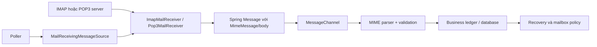
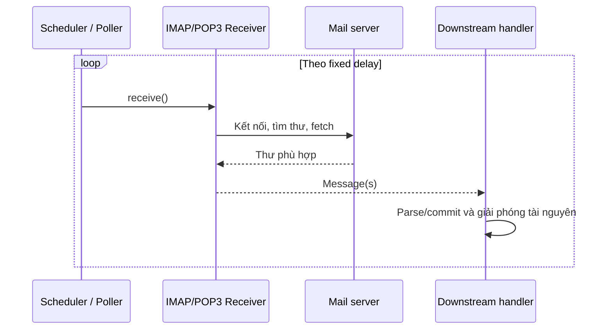
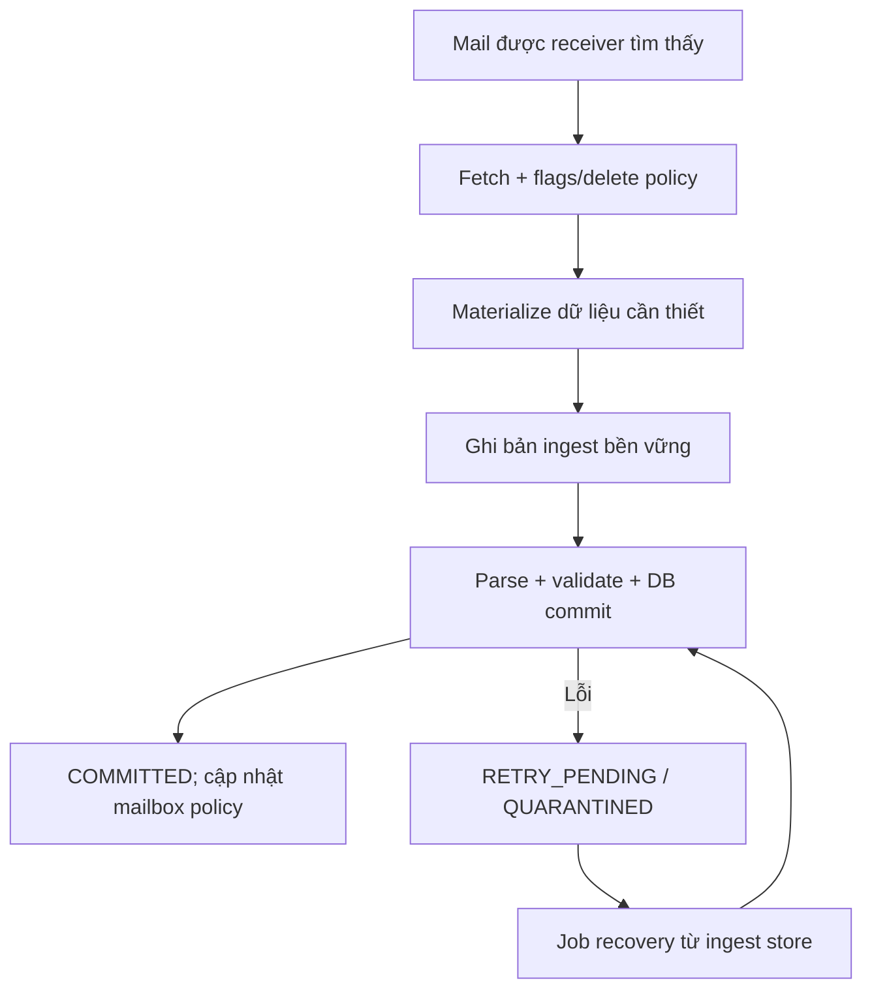

# IMAP và POP3 inbound

## 1. Bài toán: nhận email đáng tin cậy vào hệ thống tích hợp

Một hệ thống xử lý hóa đơn nhận email từ đối tác qua `invoices@example.test`. Mỗi email có thể mang nội dung text, HTML, một hoặc nhiều tệp đính kèm. Ứng dụng Spring Boot cần tìm thư mới, đọc và kiểm tra MIME, đưa dữ liệu vào service import rồi cập nhật trạng thái xử lý; công việc phải tiếp tục đúng sau khi mất mạng, restart hoặc khi ứng dụng mở rộng thành nhiều replica.

Trong **Spring Integration**, mail inbound adapter là điểm vào đưa thư từ **IMAP/IMAPS** hoặc **POP3/POP3S** thành `Message<?>` trên `MessageChannel`. Ứng dụng có thể nối tiếp transformer, filter, router, service activator, database, HTTP, JMS, AMQP hay Kafka. Adapter là **bộ nối giao thức**, không phải kho lưu job bền vững hoặc transaction coordinator của database.

Bài này thuộc chương **Adapter Mail** của module `SPRING_INTEGRATION_ADAPTERS`, với phạm vi kết nối hệ thống ngoài bằng inbound/outbound adapter, poller, gateway và `MessageChannel`, quản lý hợp đồng message, lỗi và vòng đời kết nối. Trọng tâm là **so sánh đúng bản chất IMAP và POP3 khi dùng inbound adapter**, không phải SMTP outbound.

Sau bài này bạn có thể:

- Phân biệt `ImapMailReceiver`, `Pop3MailReceiver`, `MailReceivingMessageSource` và `ImapIdleChannelAdapter`.
- Cấu hình Java DSL để poll inbox qua IMAPS hoặc POP3S, sử dụng credential và TLS an toàn.
- Giải thích khác biệt giữa IMAP folder/flags/UID và phiên POP3 không có trạng thái `\Seen`.
- Xử lý `MimeMessage`, header mapper, attachment, `autoCloseFolder` và `closeableResource` đúng cách.
- Thiết kế retry/idempotency khi receiver đã thay đổi flag hoặc xóa thư trước khi nghiệp vụ commit.
- Chọn IMAP polling, IMAP IDLE hay POP3 cho từng yêu cầu và kiểm thử các trường hợp mất kết nối/nhận trùng.

> **Phiên bản:** ví dụ hướng tới Spring Integration **6.5.x**, Spring Framework 6.x, Java 17+ và **Jakarta Mail** (`jakarta.mail.*`). Trong Spring Integration 5.x, package Java Mail thường là `javax.mail.*`; không trộn hai namespace khi chuyển code giữa phiên bản. Các server, địa chỉ và secret được minh họa, không phải endpoint thực.

## 2. So sánh IMAP và POP3 từ góc nhìn integration

| Thuộc tính | **IMAP/IMAPS** | **POP3/POP3S** |
| --- | --- | --- |
| Mô hình | Truy cập mailbox, folder và trạng thái thư trên server | Lấy thư từ một maildrop theo phiên truy cập |
| Folder | Có `INBOX`, folder con, khả năng di chuyển tùy server | Không có folder phong phú như IMAP |
| Cờ `\Seen`, `\Answered`, `\Deleted` | Có system flags; hỗ trợ user-defined flags tùy server | Không có `\Seen`/`\Answered` tương đương |
| Chọn thư mới | Search term và flags/UID theo khả năng server | Thường dựa vào những thư trong maildrop/phiên nhận |
| IMAP IDLE | Có thể nhận thông báo thay đổi nếu server hỗ trợ | Không có IDLE |
| Restart khi giữ thư trên server | Có thể lọc qua flags/UID; vẫn cần idempotency | Có thể tải lại các thư đã nhận trước restart |
| Sau khi lấy thư | Có thể mark seen, set user flag, delete/expunge theo chính sách | Có thể giữ trên server hoặc phát lệnh delete; không có Seen |
| Sử dụng điển hình | Inbox có workflow, cần audit/khôi phục, phân loại | Hạ tầng chỉ hỗ trợ POP3 hoặc tải thư đơn giản |

**IMAPS** thường dùng cổng 993; **POP3S** thường dùng cổng 995. Các cổng IMAP 143 và POP3 110 có thể hỗ trợ STARTTLS tùy provider, nhưng nếu dùng thì phải **bắt buộc nâng cấp TLS**, không cho phép plaintext fallback. Những con số này là quy ước giao thức, không thay thế cấu hình do nhà cung cấp mailbox công bố.

**SMTP** nằm ở phía gửi thư, không thay thế cho IMAP hay POP3 inbound. Trong Spring Integration, outbound mail adapter dùng `MailSendingMessageHandler`; inbound dùng `MailReceiver` kết hợp message source/adapter.

## 3. Kiến trúc của mail inbound adapter



Các vai trò:

| Thành phần | Nhiệm vụ | Điều cần chú ý |
| --- | --- | --- |
| `ImapMailReceiver` | Kết nối IMAP, tìm và lấy thư theo `SearchTerm` | Hỗ trợ cờ mailbox và IDLE |
| `Pop3MailReceiver` | Kết nối POP3, lấy thư từ maildrop | Không hỗ trợ `\Seen`/IDLE |
| `MailReceivingMessageSource` | Biến `MailReceiver` thành nguồn message được poll | Cần polling endpoint để thực thi theo lịch |
| `Mail.imapInboundAdapter(...)` | Factory DSL cho polling inbound IMAP | Trả spec source để gắn vào flow |
| `Mail.pop3InboundAdapter(...)` | Factory DSL cho polling inbound POP3 | Vẫn cần `.poller(...)` |
| `Mail.imapIdleAdapter(...)` | Factory DSL cho IMAP IDLE adapter | Dựa vào sự kiện từ server, **không gắn poller** |
| Handler nghiệp vụ | Parse, validate, import, ghi trạng thái | Phải idempotent và xử lý tài nguyên MIME |

Một `Message<?>` được phát khi receiver **đã nhận thư để xử lý**, không phải bằng chứng dữ liệu đã được import vào DB. Việc mail server gắn cờ `Seen` hoặc thực thi delete cũng không cùng transaction với hệ thống nghiệp vụ.

### Polling không giống IMAP IDLE



IMAP IDLE có cách tương tác khác: receiver giữ kết nối hỗ trợ lệnh IDLE để được server thông báo khi mailbox thay đổi, sau đó tìm/fetch mail. IDLE chỉ có trên IMAP; nó **không biến xử lý email thành exactly-once** và vẫn cần chiến lược reconnect.

## 4. Cơ chế flags của IMAP và những giới hạn

Các IMAP system flags quan trọng:

| Flag | Nghĩa trên mailbox | Ý nghĩa đối với adapter |
| --- | --- | --- |
| `\Recent` | Thư mới theo semantics của IMAP server | Một phần tiêu chí tìm thư mặc định khi server hỗ trợ |
| `\Seen` | Thư đã được xem/đọc | Có thể được set khi receiver nhận thư nếu cấu hình |
| `\Answered` | Thư đã được trả lời | Default search của receiver thường bỏ qua |
| `\Deleted` | Thư được đánh dấu để xóa | Có thể bị expunge theo chính sách/lifecycle folder |
| User flag | Cờ tùy server/người dùng, ví dụ `spring-integration-mail-adapter` | Giúp receiver tránh nhận lại thư đã đánh dấu |
| `\Flagged` | Cờ đánh dấu nổi bật | Có thể là fallback khi thiếu user flag/`\Recent` |

`ImapMailReceiver` có `setShouldMarkMessagesAsRead(Boolean)` để quyết định đặt `\Seen`; nhưng **`false` không có nghĩa adapter không bao giờ thay đổi bất kỳ cờ nào**. Khi server không hỗ trợ `\Recent`, Spring Integration có thể dùng user flag `spring-integration-mail-adapter`; nếu server không hỗ trợ user flag, có thể dùng `\Flagged` làm phương án thay thế. Từ Spring Integration 6.4, có `setFlaggedAsFallback(false)` để tắt fallback này khi cần, và cần đánh giá lại hành vi lựa chọn mail.

```text
Server nhận thư mới -> IMAP SearchTerm -> receiver fetch thư
    -> có thể set \Seen hoặc user flag/\Flagged
    -> phát Message<MimeMessage>
    -> handler parse/DB commit hoặc ném exception
```

**Điểm nguy hiểm:** receiver có thể đánh dấu mail đã nhận **trước khi handler xử lý hoàn tất**. Nếu handler thất bại nhưng cờ đã thay đổi, poll tiếp theo có thể không chọn lại email đó. Cơ chế flags chỉ hỗ trợ nhận biết mailbox state, **không đồng nghĩa giao dịch đã commit**.

### SearchTermStrategy và tính đúng của bộ lọc

Mặc định, `ImapMailReceiver` sử dụng tìm kiếm có xét trạng thái **recent, chưa trả lời, chưa xóa, chưa seen và chưa được receiver đánh dấu**, phụ thuộc khả năng flags của server. Có thể thay bằng `setSearchTermStrategy(...)` để truy vấn theo sender, subject, date hoặc điều kiện nghiệp vụ. Tuy nhiên, thay search term có thể loại bỏ điều kiện mặc định tránh phát trùng; phải kiểm thử toàn bộ vòng đời trước khi chạy production.

Không dùng downstream `.filter(...)` như biện pháp duy nhất để ngăn đánh dấu các email không liên quan: mail có thể đã được fetch và được gắn cờ trước khi xuống downstream filter. Nếu cần giảm side effect và băng thông, lọc ở receiver bằng search term/selector thích hợp.

## 5. POP3: giữ thư hay xóa thư là quyết định bắt buộc

POP3 không có system flag `\Seen`. Trong một phiên làm việc, receiver biết những message đã được lấy, nhưng khi đóng phiên và mở phiên mới, ứng dụng có thể nhận lại mail đã nhận trước đó nếu server **vẫn giữ thư**. Điều này khiến chính sách `shouldDeleteMessages` rất quan trọng:

| Cấu hình POP3 | Sau khi receive | Sau restart/reconnect | Rủi ro |
| --- | --- | --- | --- |
| `shouldDeleteMessages(false)` | Không chủ động xóa mail trên server | Có thể fetch lại cùng thư | Ghi trùng business record nếu không idempotent |
| `shouldDeleteMessages(true)` | Đánh dấu xóa theo POP3 và hoàn tất theo lifecycle/QUIT | Mail đã xóa không còn để fetch lại | Mất nguồn để retry nếu downstream parse/DB lỗi |

Khi đặt `shouldMarkMessagesAsRead` cho POP3 polling spec, giá trị này **không có tác dụng** vì POP3 không có `\Seen`. Đừng nhầm `DELE` với `Seen`; đó là yêu cầu xóa mail. Một số server/mailbox có giới hạn hoặc semantics riêng về delete và multi-session; phải xác minh trên server thực.

**Khuyến nghị cho quy trình quan trọng:** nếu chỉ có POP3, ưu tiên **giữ thư trên server ở giai đoạn ingest**, lưu bản MIME/attachment cần xử lý vào kho bền vững kèm unique key, rồi mới thực hiện chính sách retention/xóa sau khi có cơ chế phục hồi riêng. POP3 không cung cấp primitive mailbox phong phú để di chuyển thư qua folder như IMAP. Việc xóa đúng một thư sau commit thường cần một quy trình được thiết kế riêng, không thể chỉ dựa vào `shouldDeleteMessages(true)` của inbound receiver.

`POP3 UIDL` có thể giúp nhận diện message ổn định **trong maildrop** nếu server hỗ trợ. Nhưng UIDL không phải business ID toàn cục và không thay thế unique key dữ liệu nghiệp vụ. `Message-ID` của email cũng có thể thiếu, trùng hoặc bị giả mạo.

## 6. Dependency và cấu hình TLS/credential

Với Spring Boot có BOM quản lý phiên bản Spring Integration tương thích:

```groovy
dependencies {
    implementation 'org.springframework.boot:spring-boot-starter-integration'
    implementation 'org.springframework.integration:spring-integration-mail'
    implementation 'org.springframework.boot:spring-boot-starter-mail'
}
```

`spring-integration-mail` cung cấp mail adapter; Jakarta Mail cần provider/implementation tại runtime. Starter mail của Spring Boot giúp lấy implementation thích hợp. Việc thêm starter không có nghĩa phải cấu hình SMTP nếu ứng dụng chỉ nhận email; inbound dùng `ImapMailReceiver` hoặc `Pop3MailReceiver`, không dùng `JavaMailSender` để fetch hộp thư.

Ví dụ cấu hình **không chứa mật khẩu thật**:

```yaml
app:
  mail:
    imap-url: ${MAIL_IMAP_URL:imaps://invoices%40example.test@imap.example.test:993/INBOX}
    pop3-url: ${MAIL_POP3_URL:pop3s://invoices%40example.test@pop3.example.test:995/INBOX}
    username: ${MAIL_USERNAME:invoices@example.test}
    password: ${MAIL_PASSWORD}
    poll-delay-ms: ${MAIL_POLL_DELAY_MS:15000}
    max-fetch-size: ${MAIL_MAX_FETCH_SIZE:1}
```

Trong URL có user là địa chỉ email, ký tự `@` thuộc userinfo nên cần encode phù hợp, thường thành `%40`. Cách Jakarta Mail xử lý URL và username phải được kiểm tra theo provider thực tế. **Không nhúng password vào URL** vì URL có thể xuất hiện trong exception hoặc log. Dùng `Authenticator` hoặc cơ chế OAuth2 được nhà cung cấp hỗ trợ.

### Cần cấu hình gì để kết nối an toàn?

- Dùng **IMAPS/POP3S** hoặc STARTTLS với chính sách bắt buộc và hostname/certificate verification; không dùng trust-all SSL socket factory.
- Đặt `connectiontimeout`, `timeout`, `writetimeout` để poller không kẹt vô hạn.
- Lưu credential/token trong secret manager; không đưa vào Git, Docker image hoặc wire protocol debug.
- Hạn chế quyền mailbox, giới hạn số thư/attachment, và không tự động mở file đính kèm không tin cậy.
- Với provider chỉ hỗ trợ OAuth2/XOAUTH2, thêm token acquisition/refresh và cơ chế SASL phù hợp; không retry username/password vô hạn.

## 7. Cấu hình `ImapMailReceiver` cho polling

Sau đây là bean IMAPS chỉ nhận một mail mỗi lượt fetch để minh họa rõ **vòng đời folder**, không chủ động xóa hoặc mark `\Seen`, có timeout và xác minh host TLS:

```java
import java.util.Properties;

import jakarta.mail.Authenticator;
import jakarta.mail.PasswordAuthentication;

import org.springframework.beans.factory.annotation.Value;
import org.springframework.context.annotation.Bean;
import org.springframework.context.annotation.Configuration;
import org.springframework.integration.mail.ImapMailReceiver;

@Configuration
public class ImapInboxConfiguration {

    @Bean
    public ImapMailReceiver invoiceImapReceiver(
            @Value("${app.mail.imap-url}") String imapUrl,
            @Value("${app.mail.username}") String username,
            @Value("${app.mail.password}") String password) {

        ImapMailReceiver receiver = new ImapMailReceiver(imapUrl);
        receiver.setJavaMailAuthenticator(new Authenticator() {
            @Override
            protected PasswordAuthentication getPasswordAuthentication() {
                return new PasswordAuthentication(username, password);
            }
        });

        Properties props = new Properties();
        props.setProperty("mail.store.protocol", "imaps");
        props.setProperty("mail.imaps.ssl.enable", "true");
        props.setProperty("mail.imaps.ssl.checkserveridentity", "true");
        props.setProperty("mail.imaps.connectiontimeout", "10000");
        props.setProperty("mail.imaps.timeout", "30000");
        props.setProperty("mail.imaps.writetimeout", "30000");
        props.setProperty("mail.debug", "false");
        receiver.setJavaMailProperties(props);

        receiver.setShouldMarkMessagesAsRead(false);
        receiver.setShouldDeleteMessages(false);
        receiver.setMaxFetchSize(1);
        receiver.setUserFlag("invoice-ingestion-v1");

        // Giữ folder mở khi handler cần lazy-load MIME/attachments.
        receiver.setAutoCloseFolder(false);
        return receiver;
    }
}
```

`setAutoCloseFolder(false)` làm Spring Integration đưa tài nguyên đóng folder vào header `IntegrationMessageHeaderAccessor.CLOSEABLE_RESOURCE`. **Consumer phải `close()` khi đã đọc xong**. Lợi ích: một `MimeMessage` có thể tải attachment theo nhu cầu trong handler. Rủi ro: nếu consumer quên close, session/IMAP folder bị giữ và dễ cạn kết nối. Ví dụ đặt `setMaxFetchSize(1)` để tránh phải phối hợp đóng cùng folder sau khi xử lý nhiều message trong một đợt fetch.

**Chú ý:** `setUserFlag(...)` chỉ có ý nghĩa khi IMAP server hỗ trợ user flags và khi fallback được áp dụng. Không giả định giá trị flag sẽ luôn được đặt ở mọi server. Nếu cần dùng `setFlaggedAsFallback(false)`, kiểm thử hành vi search mới khi server không hỗ trợ user flag/`\Recent`.

## 8. Java DSL: IMAP inbound adapter với poller

`Mail.imapInboundAdapter(receiver)` tạo source có thể gắn vào `IntegrationFlow.from`, và cấu hình poller làm nhiệm vụ gọi receive định kỳ:

```java
import org.springframework.context.annotation.Bean;
import org.springframework.context.annotation.Configuration;
import org.springframework.integration.dsl.IntegrationFlow;
import org.springframework.integration.dsl.Pollers;
import org.springframework.integration.mail.ImapMailReceiver;
import org.springframework.integration.mail.dsl.Mail;

@Configuration
public class ImapPollingFlow {

    @Bean
    public IntegrationFlow invoiceMailInboundFlow(
            ImapMailReceiver invoiceImapReceiver,
            InvoiceMailHandler invoiceMailHandler) {

        return IntegrationFlow.from(
                        Mail.imapInboundAdapter(invoiceImapReceiver),
                        endpoint -> endpoint.id("invoiceImapPollingEndpoint")
                                .poller(Pollers.fixedDelay(15_000)
                                        .maxMessagesPerPoll(1)))
                .handle(invoiceMailHandler)
                .get();
    }
}
```

Flow này có một **polling inbound adapter** lấy email từ IMAPS rồi gửi `Message<MimeMessage>` vào handler đồng bộ. Nếu không khai báo header mapper và dùng `autoCloseFolder(false), simpleContent(false)`, Spring Integration có thể giữ nguyên `MimeMessage` để lazy-load nội dung; handler cần hoàn tất parse trước khi đóng folder. Chúng ta chưa thêm `ExecutorChannel`, để không vô tình chuyển ownership của folder sang thread khác.

Đừng tạo thêm một `MailReceivingMessageSource` với `@InboundChannelAdapter` hoặc bật IMAP IDLE song song trên **cùng inbox** mà chưa thiết kế phân chia công việc: các receiver sẽ cạnh tranh flags và có thể bỏ sót/nhận trùng.

### `maxFetchSize` và `maxMessagesPerPoll` khác nhau

| Tham số | Được đặt trên | Giới hạn |
| --- | --- | --- |
| `receiver.setMaxFetchSize(1)` | `ImapMailReceiver` | Số thư receiver lấy trong một lời gọi `receive()` |
| `maxMessagesPerPoll(1)` | Polling endpoint | Số message source được poll/đẩy ra trong một lượt poll |
| `fixedDelay(15_000)` | Poller | Khoảng chờ giữa lượt poll theo fixed delay |

Nếu `maxFetchSize` lớn hơn `maxMessagesPerPoll`, source có thể còn email trong buffer nội bộ để phát ở các lượt sau, tùy implementation. Tăng thông lượng phải tính đồng thời băng thông, thời gian parse MIME, dung lượng RAM, thời gian mở folder và giới hạn kết nối của provider.

## 9. POP3 inbound: code tương đương nhưng semantics khác

Với POP3S, chúng ta dùng `Pop3MailReceiver`. Bean dưới đây **không xóa mail**, vì mục tiêu là giữ dữ liệu gốc trong giai đoạn ingest. Cơ chế chống trùng phải do business layer xử lý, đặc biệt sau restart:

```java
import java.util.Properties;

import jakarta.mail.Authenticator;
import jakarta.mail.PasswordAuthentication;

import org.springframework.beans.factory.annotation.Value;
import org.springframework.context.annotation.Bean;
import org.springframework.context.annotation.Configuration;
import org.springframework.integration.mail.Pop3MailReceiver;

@Configuration
public class Pop3InboxConfiguration {

    @Bean
    public Pop3MailReceiver invoicePop3Receiver(
            @Value("${app.mail.pop3-url}") String pop3Url,
            @Value("${app.mail.username}") String username,
            @Value("${app.mail.password}") String password) {

        Pop3MailReceiver receiver = new Pop3MailReceiver(pop3Url);
        receiver.setJavaMailAuthenticator(new Authenticator() {
            @Override
            protected PasswordAuthentication getPasswordAuthentication() {
                return new PasswordAuthentication(username, password);
            }
        });

        Properties props = new Properties();
        props.setProperty("mail.store.protocol", "pop3s");
        props.setProperty("mail.pop3s.ssl.enable", "true");
        props.setProperty("mail.pop3s.ssl.checkserveridentity", "true");
        props.setProperty("mail.pop3s.connectiontimeout", "10000");
        props.setProperty("mail.pop3s.timeout", "30000");
        props.setProperty("mail.pop3s.writetimeout", "30000");
        props.setProperty("mail.debug", "false");
        receiver.setJavaMailProperties(props);

        // Không xóa gốc trước khi có quy trình phục hồi bền vững.
        receiver.setShouldDeleteMessages(false);
        receiver.setMaxFetchSize(1);

        // KHÔNG dùng setAutoCloseFolder(false) cho POP3:
        // cơ chế giữ folder mở này không hỗ trợ ở Pop3MailReceiver.
        return receiver;
    }
}
```

Adapter POP3 dùng cùng nguyên tắc wiring:

```java
import org.springframework.context.annotation.Bean;
import org.springframework.context.annotation.Configuration;
import org.springframework.integration.dsl.IntegrationFlow;
import org.springframework.integration.dsl.Pollers;
import org.springframework.integration.mail.Pop3MailReceiver;
import org.springframework.integration.mail.dsl.Mail;

@Configuration
public class Pop3PollingFlow {

    @Bean
    public IntegrationFlow invoicePop3Flow(
            Pop3MailReceiver invoicePop3Receiver,
            InvoiceMailHandler invoiceMailHandler) {

        return IntegrationFlow.from(
                        Mail.pop3InboundAdapter(invoicePop3Receiver),
                        endpoint -> endpoint.poller(
                                Pollers.fixedDelay(15_000)
                                        .maxMessagesPerPoll(1)))
                .handle(invoiceMailHandler)
                .get();
    }
}
```

**Hai cấu hình là các lựa chọn thay thế**. Không bật cả `ImapPollingFlow` và `Pop3PollingFlow` trên cùng mailbox chỉ để 'dự phòng', bởi hai giao thức có cách nhận/thay đổi trạng thái thư khác nhau và có thể cùng xử lý một dữ liệu. Nếu provider có IMAP, thông thường ưu tiên IMAP khi cần workflow dài, folder, flags và replay có kiểm soát.

Với POP3, `setAutoCloseFolder(false)` **không hỗ trợ semantics closeable resource của IMAP**: receiver phải mở/đóng folder để tìm thư mới. Từ đó không thể giả định giữ `MimeMessage` lazy-loaded sang một asynchronous channel rồi đọc attachment sau khi kết nối POP3 đã đóng; phải **materialize đủ nội dung cần xử lý khi nguồn còn hợp lệ** hoặc xây dựng ingestion bền vững có kiểm chứng.

## 10. MIME: payload và header mapping có thể khác nhau

Email không chỉ là một chuỗi: một thư có thể có `text/plain`, `text/html`, `multipart/alternative`, `multipart/mixed`, inline image, forwarded message hoặc attachment nhị phân. Khi chưa cấu hình header mapper, Spring Integration thường đưa `jakarta.mail.internet.MimeMessage` làm payload (trường hợp cụ thể phụ thuộc các tùy chọn `simpleContent`/folder). Với `DefaultMailHeaderMapper`, header mail được chuyển thành Spring `MessageHeaders`, còn payload có thể là **`String` hoặc `byte[]`**, tùy MIME content.

| Cấu hình | Payload thường gặp | Điểm cần chú ý |
| --- | --- | --- |
| Không `HeaderMapper`, `simpleContent(false)` | `MimeMessage` | Cần parser MIME và quản lý vòng đời mail folder |
| Có `DefaultMailHeaderMapper`, text message | `String` | Mail headers như `mail_subject`, `mail_from` được ánh xạ |
| Có `HeaderMapper`, embedded `Multipart`/`Part` | `byte[]` theo mặc định | Có thể rất lớn; phải giới hạn kích thước |
| `embeddedPartsAsBytes(false)` | Có thể nhận object `Part`/`Multipart` | Không nên serialize/đẩy qua queue nếu object phụ thuộc folder |
| `simpleContent(true)` | Nội dung body thay vì MIME message đầy đủ | Có thể làm mất metadata MIME cần thiết cho một số workflow |

Khi bật mapper, **không ép cast payload sang `MimeMessage`** trong handler. Ngược lại, nếu chưa bật mapper, đừng lấy `message.getHeaders().get("mail_subject")` rồi giả định mọi header đã được trích sẵn. Phải định nghĩa **một hợp đồng payload thống nhất** cho các downstream handler.

Các header do `DefaultMailHeaderMapper` cung cấp có thể gồm `mail_from`, `mail_to`, `mail_cc`, `mail_replyTo`, `mail_subject`, `mail_receivedDate`, `mail_contentType`, `mail_size` và `mail_raw`. Các field thực tế tùy thư gửi/mapper và không được xem là dữ liệu xác thực danh tính. `From` và `Message-ID` đều có thể bị giả mạo.

### Attachment an toàn

- Kiểm tra kích thước email/attachment **trước khi** materialize toàn bộ vào RAM; đặt quota storage, giới hạn record và thời gian parse.
- Dùng parser MIME phù hợp và phân biệt inline image với attachment; không coi một `Multipart` là một `String` plain text.
- Chuẩn hóa basename của attachment, cấm `../`, đường dẫn tuyệt đối, ký tự điều khiển và ghi đè file local.
- Quét malware nếu file đến từ bên ngoài; không thực thi macro/script, không tự động mở file đính kèm trên server.
- Không tin `Content-Type`, filename hay `From` là bằng chứng nội dung an toàn; kiểm tra file signature, schema và quyền người gửi theo chính sách.

## 11. Handler IMAP đọc text và đóng `closeableResource`

Handler dưới đây minh họa xử lý **mail text/plain** khi dùng IMAP bean có `autoCloseFolder(false)` ở mục 7. Với email `multipart/*`, handler sẽ từ chối để một pipeline MIME chuyên dụng xử lý; không cố parse attachment bằng `toString()`.

```java
import java.io.Closeable;
import java.io.IOException;

import jakarta.mail.internet.MimeMessage;

import org.springframework.integration.StaticMessageHeaderAccessor;
import org.springframework.messaging.Message;
import org.springframework.messaging.MessageHandler;
import org.springframework.messaging.MessageHandlingException;
import org.springframework.stereotype.Component;

@Component
public class InvoiceMailHandler implements MessageHandler {

    private final InvoiceImportService importer;

    public InvoiceMailHandler(InvoiceImportService importer) {
        this.importer = importer;
    }

    @Override
    public void handleMessage(Message<?> message) {
        Closeable closeable =
                StaticMessageHeaderAccessor.getCloseableResource(message);

        // Trong IMAP: đóng folder sau khi đọc và import xong, kể cả khi lỗi.
        try (Closeable folder = closeable == null ? () -> { } : closeable) {
            MimeMessage email = (MimeMessage) message.getPayload();

            if (!email.isMimeType("text/plain")) {
                throw new IllegalArgumentException(
                        "MIME khác text/plain: chuyển sang parser riêng");
            }

            String messageId = email.getMessageID();
            String subject = email.getSubject();
            Object content = email.getContent();
            if (!(content instanceof String text)) {
                throw new IllegalArgumentException("Nội dung không phải text");
            }

            // Chỉ trả về khi transaction nghiệp vụ đã commit.
            // Không dùng Message-ID một mình như unique key toàn cục.
            importer.importTextOnce(messageId, subject, text);
        }
        catch (jakarta.mail.MessagingException | IOException ex) {
            throw new MessageHandlingException(message,
                    "Không thể đọc email hoặc đóng mail folder", ex);
        }
    }
}
```

```java
public interface InvoiceImportService {
    /**
     * Ghi dữ liệu theo khóa business/mailbox ổn định và idempotent.
     * Thành công chỉ sau khi DB commit; exception khi parse/commit lỗi.
     */
    void importTextOnce(String messageId, String subject, String body);
}
```

Đoạn handler có thể dùng với cấu hình IMAP ở trên. Với cấu hình **POP3**, code phải được đánh giá lại vì folder thường đã được đóng ngay sau fetch và không có closeable-resource semantics như IMAP. Cách an toàn cho POP3 attachment là xử lý dữ liệu MIME đã materialize trong phạm vi receiver hoặc dùng một bước ingest có trạng thái rõ ràng; **không** cấu hình `autoCloseFolder(false)` cho POP3 rồi chờ nó giữ kết nối.

### Trách nhiệm của `closeableResource`

Từ Spring Integration 5.2, khi IMAP receiver có `autoCloseFolder(false)`, mỗi message có header `IntegrationMessageHeaderAccessor.CLOSEABLE_RESOURCE`. Consumer cần đóng **sau khi** đọc xong. Trong một flow có nhiều thư cùng dùng folder, phải đánh giá ownership khi đóng resource; giới hạn fetch = 1 trong ví dụ để đơn giản hóa. Với `autoCloseFolder(true)`, folder được đóng sau fetch và không được kỳ vọng lazy-load attachment ở downstream.

Nếu handler được chuyển sang thread khác qua `ExecutorChannel` hoặc được đẩy vào queue, `MimeMessage` có thể **phụ thuộc vào folder/session sẽ bị đóng sớm hoặc bị giữ quá lâu**. Chỉ chuyển qua ranh giới bất đồng bộ **dữ liệu đã materialize thành DTO/bytes an toàn** và có kho bền vững phù hợp; không chuyển raw `MimeMessage` chưa xử lý.

## 12. IMAP IDLE: thay poller bằng sự kiện, không thay thế recovery

Khi mail server hỗ trợ IMAP IDLE, có thể dùng `Mail.imapIdleAdapter(...)`. Đây là **mô hình khác** với polling IMAP và không hỗ trợ POP3:

```java
import org.springframework.context.annotation.Bean;
import org.springframework.context.annotation.Configuration;
import org.springframework.integration.dsl.IntegrationFlow;
import org.springframework.integration.mail.ImapMailReceiver;
import org.springframework.integration.mail.dsl.Mail;

@Configuration
public class ImapIdleFlow {

    @Bean
    public IntegrationFlow invoiceImapIdleFlow(
            ImapMailReceiver invoiceImapReceiver,
            InvoiceMailHandler invoiceMailHandler) {

        return IntegrationFlow.from(Mail.imapIdleAdapter(invoiceImapReceiver))
                .handle(invoiceMailHandler)
                .get();
    }
}
```

**Không thêm `.poller(...)`** vào flow này: `ImapIdleChannelAdapter` chờ server thông báo theo giao thức IMAP IDLE. Khi kết nối bị cắt im lặng, Spring Integration có `cancelIdleInterval` (mặc định khoảng **120 giây**) để làm mới việc IDLE; cấu hình heartbeat/reconnect và theo dõi `ImapIdleExceptionEvent` để phát hiện gián đoạn.

Từ Spring Integration 6.0.5, IDLE adapter không tự phát message bất đồng bộ trong tầng adapter. Handler đồng bộ có thể giữ vòng IDLE khi parse attachment lớn. Nếu thêm executor/channel bất đồng bộ, phải có chiến lược giữ và đóng folder hoặc materialize dữ liệu trước khi handoff. Dùng IDLE **không loại bỏ** nhu cầu idempotency, rate limiting và khôi phục sau restart.

## 13. Khi nào chọn IMAP polling, IMAP IDLE hoặc POP3?

| Yêu cầu | Cách chọn | Lý do |
| --- | --- | --- |
| Mailbox có folder, flags, cần quản lý đã đọc/chưa đọc | **IMAP polling** | Có state trên server và dễ giới hạn chu kỳ lấy thư |
| Cần nhận gần thời gian thực và provider hỗ trợ IDLE | **IMAP IDLE** | Giảm độ trễ do khoảng poll, nhưng cần reconnect |
| Mail server chỉ cung cấp POP3/POP3S | **POP3 polling** | Tương thích hạ tầng cũ, chấp nhận giới hạn trạng thái |
| File đính kèm lớn, lazy MIME parsing | **IMAP + autoCloseFolder(false)** với consumer đồng bộ | Giữ folder tới khi parse xong, phải đóng đúng |
| Có nhiều replica, cần audit và exactly-once nghiệp vụ | **IMAP hoặc POP3 + ingestion ledger** | Giao thức không tự bảo đảm DB commit một lần |
| Chỉ cần forward nội dung đã chuẩn hóa tới Kafka/JMS | Poll/IDLE → materialize → bền vững → publish | Tránh queue raw `MimeMessage` phụ thuộc session |

Đối với một hệ thống mới cần nhận thư kèm file, **IMAP polling** thường là điểm khởi đầu dễ kiểm thử: có flags, folder, search term và chu kỳ kiểm tra dễ quan sát. Chuyển sang **IMAP IDLE** khi SLA cần độ trễ thấp và đội vận hành có thể quan sát reconnect. Chỉ chọn POP3 khi đây là hạn chế của provider hoặc yêu cầu nghiệp vụ đơn giản đã có phương án idempotency tốt.

## 14. Retry, trạng thái mailbox và idempotency

Giả sử IMAP receiver tìm được mail, nhận mail và gắn cờ trước khi handler xử lý; handler import được 80% thì DB lỗi. Dù thư chưa bị xóa, poll sau có thể không phát lại vì cờ đã bị cập nhật. Với POP3 `shouldDeleteMessages(false)`, sau restart thư cũ có thể lại được nhận và import trùng. Cả hai đều cần **business ledger**.



Một ledger có thể lưu:

```text
mailbox_account, folder_name, provider_uid, uid_validity,
message_id, content_hash, business_invoice_id,
ingest_storage_uri, status, attempt_count,
last_error_code, next_retry_at, created_at, updated_at
```

Với IMAP, `(mailbox, folder, UIDVALIDITY, UID)` là định danh **trong phạm vi mailbox/folder/epoch UID** nếu provider cho lấy UID. Với POP3, `UIDL` nếu hỗ trợ có thể giúp nhận diện trong maildrop. Không xem những ID này là khóa hóa đơn nghiệp vụ: một hóa đơn có thể được gửi bằng hai email khác nhau. Nên có unique constraint theo business invoice ID và chiến lược kiểm tra checksum khi cần.

### Giới hạn của retry adapter

- Lỗi **kết nối** trước fetch có thể retry với backoff, giới hạn số lượt.
- Lỗi **MIME/validation** không nên retry vô hạn cùng dữ liệu; chuyển `FAILED`/quarantine để kiểm tra.
- Lỗi **sau khi flags/delete đã thay đổi** không tự rollback mail server khi DB rollback.
- Lỗi khi **đang đọc attachment** đòi hỏi đóng folder/stream đúng cách; không retry trên object đã đóng.
- Một downstream `RequestHandlerRetryAdvice` không tự bắt được mọi lỗi nằm **trong mail source trước khi tạo message**; phải đặt error/recovery ở đúng tầng.
- Một email trùng có thể đến do **người gửi gửi lại, restart, POP3 retention hoặc nhiều consumer**; chống trùng phải dựa trên business ID và transaction, không chỉ cờ mailbox.

Một mô hình bền vững là lưu MIME/attachment vào object storage hoặc inbox table trước, ghi trạng thái `INGESTED`, sau đó publish một sự kiện đã chuẩn hóa sang JMS/Kafka cho worker nhập DB. Chỉ sau commit mới áp dụng chính sách đánh dấu/di chuyển/xóa mail (nếu giao thức cho phép) cùng cơ chế reconciliation nếu thao tác mailbox thất bại. Không có transaction phân tán mặc định bao trùm IMAP/POP3 và database.

## 15. Nhiều consumer và khả năng nhận trùng

Hai instance cùng poll một mailbox IMAP có thể **cạnh tranh flag**, và có race khi cả hai cùng tìm thư trước khi một bên đánh dấu. Hai instance POP3 càng dễ tải trùng nếu cùng thấy maildrop và không xóa thư. Không dựa vào `maxFetchSize=1` hoặc user flag để kết luận exactly-once.

Phương án thường an toàn hơn cho thông báo quan trọng:

1. Dùng **một ingestion service** là chủ sở hữu mailbox hoặc chia mailbox/folder theo luồng rõ ràng; nó materialize nội dung vào kho bền vững.
2. Đưa công việc xử lý đã chuẩn hóa qua queue/broker có consumer group và unique business ID; scale downstream độc lập với IMAP/POP3 connections.
3. Dùng **unique constraint** và transaction ở DB để ngăn xử lý trùng, kể cả khi queue phát lại hoặc sender gửi email trùng.
4. Nếu bắt buộc nhiều mailbox receiver, đánh giá server flags/search term, UID/UIDL, phân chia workload, lock và recovery; không tưởng rằng hai JVM dùng cùng `userFlag` đủ để khóa một mail như distributed transaction.

`messageId`, sender và subject chỉ nên dùng làm metadata quan sát; email headers có thể bị giả mạo và có thể chứa thông tin cá nhân. Chỉ ghi những trường cần thiết vào log, tránh ghi raw MIME/attachment hoặc credential.

## 16. Sự cố thường gặp và hướng chẩn đoán

| Triệu chứng | Nguyên nhân có thể | Hành động đầu tiên |
| --- | --- | --- |
| `AuthenticationFailedException` | Sai secret, provider yêu cầu OAuth/app password | Kiểm tra auth mechanism, secret rotation và scope |
| TLS handshake/hostname mismatch | CA/chứng chỉ/hostname sai | Xác minh certificate chain; không tắt TLS validation |
| IMAP poll không phát mail dù inbox còn thư | SearchTerm loại vì `\Seen`, `\Answered`, `\Recent` hoặc user flag | Kiểm tra flags và search term trên server test |
| POP3 nhận lại thư sau restart | `shouldDeleteMessages(false)` và POP3 không có Seen | Kiểm tra ledger/UIDL/idempotency |
| Mail biến mất sau receive dù handler lỗi | `shouldDeleteMessages(true)` hoặc mailbox policy cập nhật trước commit | Điều tra delete/expunge, bản ingest và cơ chế phục hồi |
| `FolderClosedException` khi parse attachment | IMAP folder bị đóng trước lazy-load hoặc handoff async | `autoCloseFolder(false)`, `closeableResource`, ownership |
| POP3 lazy-load không thành công | POP3 receiver đóng folder để nhận thư mới | Materialize MIME khi kết nối hợp lệ hoặc đổi IMAP |
| IMAP IDLE ngừng nhận | Mất kết nối im lặng/thiếu reconnect | Theo dõi `ImapIdleExceptionEvent`, timeout, cancel interval |
| RAM tăng mạnh khi có attachment | Tải tất cả multipart thành `byte[]`, không quota | Giới hạn size và buffering, staging an toàn |
| Hai replica cùng nhập một hóa đơn | Mailbox flag không phải distributed lock | Unique key nghiệp vụ, claim ledger và reconciliation |

Các metric hữu ích: `mail_receive_attempt_total`, `mail_received_total`, `mail_parse_failure_total`, `mail_duplicate_skipped_total`, `mail_folder_open`, `mail_poll_duration`, `mail_idle_reconnect_total`, `mail_ingest_pending`, `mail_attachment_bytes`. Tách lỗi auth/TLS khỏi timeout mạng tạm thời để tránh retry storm. Không bật `mail.debug=true` ở production vì wire logs có thể chứa thông tin nhạy cảm.

## 17. Thực hành kiểm thử trên mailbox sandbox

Sử dụng mail server **test** hỗ trợ IMAP và POP3 (ví dụ một môi trường GreenMail hoặc server tương đương), TLS được xác minh và account test có quyền riêng. Không thử chính sách xóa mail trên mailbox thật, không dùng dữ liệu khách hàng hoặc attachment nguy hiểm.

1. **IMAP happy path:** gửi mail text mới, poll, nhận `Message<MimeMessage>`, handler commit một lần và đóng `closeableResource`.
2. **IMAP flags:** lần lượt đặt `shouldMarkMessagesAsRead(true/false)`, kiểm tra `\Seen`, user flag hoặc `\Flagged`; poll lại và đo hành vi thực tế.
3. **IMAP search:** đưa mail đã `\Answered`/`\Deleted`, thư chưa đọc và thư có subject khác nhau; kiểm chứng filter và custom `SearchTermStrategy`.
4. **POP3 giữ thư:** đặt `shouldDeleteMessages(false)`, fetch một mail, restart ứng dụng và quan sát mail có thể được nhận lại; DB chỉ commit một invoice.
5. **POP3 xóa thư:** bật `shouldDeleteMessages(true)` trên **test**, xác minh thư bị xóa theo lifecycle; mô phỏng handler lỗi để thấy rủi ro mất nguồn.
6. **Multipart/attachment:** gửi HTML + PDF và một tệp lớn; kiểm tra parser, giới hạn dung lượng và thời điểm folder đóng.
7. **Header mapper:** bật `DefaultMailHeaderMapper` trong flow test riêng; xác minh payload có thể đổi kiểu và headers được ánh xạ.
8. **Kết nối bị cắt:** mô phỏng timeout trong poll/IDLE; đo recovery, không rò rỉ folder/session.
9. **IMAP IDLE:** gửi thư sau khi kết nối IDLE ổn định; kiểm tra phát hiện mà không dùng poller và reconnect khi server im lặng.
10. **Hai instance:** cho hai receiver cùng quan sát inbox; ghi nhận rủi ro double fetch và chứng minh unique DB constraint bảo vệ import.
11. **Restart sau fetch trước commit:** ngắt app sau khi receiver đã đánh dấu nhưng trước import; recovery job phải có dữ liệu/ledger để tiếp tục.
12. **Bảo mật:** thử sai hostname TLS, sai credential, MIME giả, attachment `../private.pdf` và mail quá lớn; hệ thống phải phân loại và từ chối/quarantine phù hợp.

### Kỳ vọng sau mỗi test

| Kiểm thử | Mail adapter đảm nhiệm | Business layer đảm nhiệm |
| --- | --- | --- |
| IMAP polling thành công | Nhận thư theo search term và phát message | Validate/commit/idempotency |
| POP3 sau restart | Có thể phát lại thư còn trên server | Phát hiện trùng, không nhập lại |
| MIME lỗi | Propagate lỗi và giải phóng tài nguyên | Quarantine/retry có kiểm soát |
| IMAP IDLE mất kết nối | Báo lỗi/reconnect theo cấu hình | Không mất job từ dữ liệu bền vững |
| Hai receiver cùng thấy thư | Có thể cạnh tranh mailbox state | Unique key và claim để không double commit |

## 18. Những nhầm lẫn cần tránh

- **Tưởng POP3 có `\Seen` như IMAP:** POP3 chỉ biết lịch sử đọc trong session, không có cùng flag semantics.
- **Tưởng IMAP `\Seen`/user flag = DB đã commit:** cờ có thể cập nhật trước khi handler xử lý xong.
- **Bật POP3 delete trước khi lưu bản ingest bền vững:** nếu importer lỗi có thể mất nguồn retry.
- **Bỏ poller khỏi `MailReceivingMessageSource`:** pollable source sẽ không tự chạy định kỳ.
- **Gắn poller vào IMAP IDLE adapter:** IDLE là nguồn sự kiện từ server, không dùng poller như polling source.
- **Dùng `setAutoCloseFolder(false)` cho POP3:** không có semantics giữ folder mở như IMAP.
- **Đọc MIME attachment sau khi đóng folder:** lazy-load có thể ném `FolderClosedException`.
- **Chuyển raw `MimeMessage` vào queue bất đồng bộ:** session và object MIME không bảo đảm tồn tại/serializable.
- **Bật `DefaultMailHeaderMapper` rồi vẫn ép payload sang `MimeMessage`:** payload có thể là `String`/`byte[]`.
- **Tin `Message-ID` hoặc From có độ tin cậy như token xác thực:** email headers có thể bị giả mạo.
- **Cho hai adapter IMAP/POP3 cùng đọc một inbox để dự phòng mà không điều phối:** dễ nhận trùng hoặc thay đổi flags ngoài ý muốn.
- **Tắt TLS certificate verification để chữa kết nối:** nguy cơ mất bảo mật và kết nối sai mail server.

## 19. Câu hỏi tự kiểm tra

1. IMAP và POP3 khác nhau ở folder, search, flags, IDLE và khả năng nhận lại sau restart như thế nào?
2. Vì sao `shouldMarkMessagesAsRead(false)` của IMAP không đồng nghĩa receiver không thay đổi bất kỳ flag nào?
3. Nếu POP3 receiver dùng `shouldDeleteMessages(false)`, điều gì có thể xảy ra sau restart?
4. Nếu dùng `shouldDeleteMessages(true)`, tại sao DB rollback có thể khiến hệ thống mất cơ hội retry?
5. `MailReceivingMessageSource`, poller và `MessageChannel` chia nhau những trách nhiệm nào?
6. Tại sao không nên bật cùng lúc IMAP polling và IMAP IDLE trên một mailbox chưa có phân chia công việc?
7. Payload của mail inbound thay đổi thế nào khi bật `DefaultMailHeaderMapper`?
8. Khi xử lý attachment qua IMAP và `autoCloseFolder(false)`, component nào phải đóng `closeableResource`?
9. Vì sao không thể dùng `autoCloseFolder(false)` với POP3 để phục vụ lazy-loading như IMAP?
10. Với hai replica, tại sao user flag hoặc `maxFetchSize=1` vẫn chưa phải distributed transaction?
11. Khi nào nên lưu MIME vào object storage trước khi nhập DB hoặc gửi Kafka/JMS?
12. Bạn sẽ lưu những khóa nào để tránh import hai lần cùng một hóa đơn được gửi qua hai email khác nhau?

## Tài liệu tham khảo

- [Spring Integration 6.5 Reference — Mail Support](https://docs.spring.io/spring-integration/reference/6.5/mail.html)
- [Spring Integration Reference — Mail Support](https://docs.spring.io/spring-integration/reference/mail.html)
- [Spring Integration 6.5 API — Mail DSL](https://docs.spring.io/spring-integration/docs/6.5.0/api/org/springframework/integration/mail/dsl/Mail.html)
- [Spring Integration 6.5 API — ImapMailReceiver](https://docs.spring.io/spring-integration/docs/6.5.0/api/org/springframework/integration/mail/ImapMailReceiver.html)
- [Spring Integration 6.5 API — Pop3MailReceiver](https://docs.spring.io/spring-integration/docs/6.5.0/api/org/springframework/integration/mail/Pop3MailReceiver.html)
- [Spring Integration 6.5 API — AbstractMailReceiver](https://docs.spring.io/spring-integration/docs/6.5.0/api/org/springframework/integration/mail/AbstractMailReceiver.html)
- [Jakarta Mail Specification](https://jakarta.ee/specifications/mail/)
