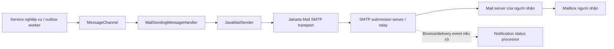
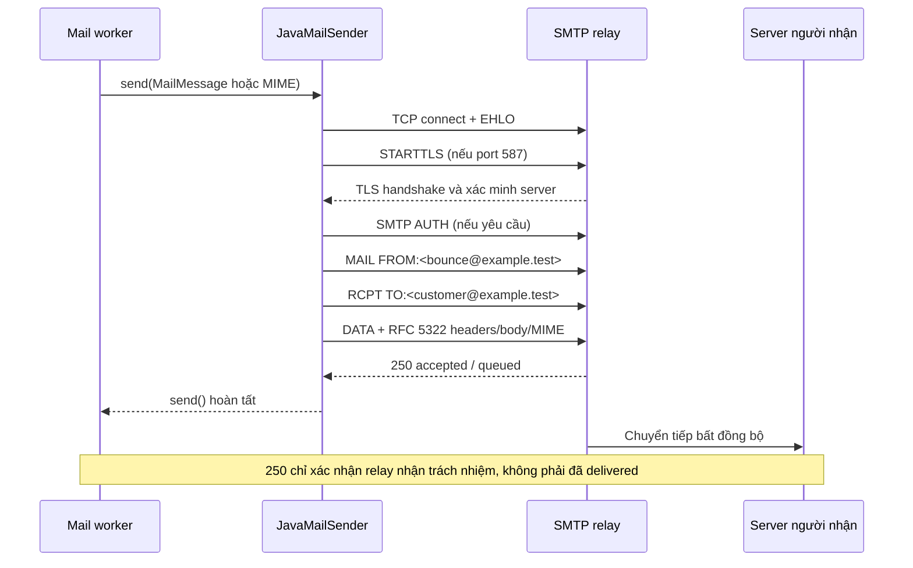
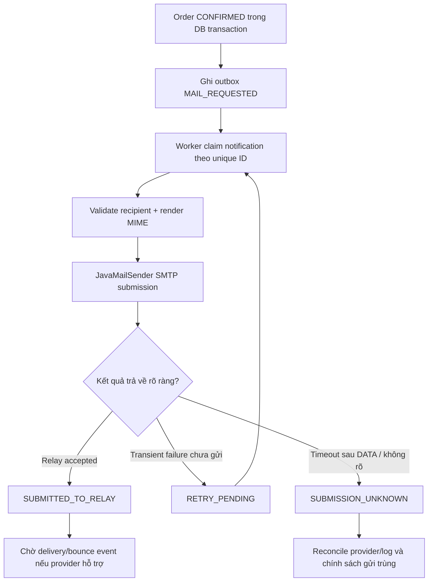

# SMTP outbound và JavaMailSender

## 1. Bài toán: đưa thông báo nghiệp vụ ra hệ thống email

Một dịch vụ quản lý đơn hàng phát sinh sự kiện `ORDER_CONFIRMED`. Ứng dụng Spring Boot cần gửi email xác nhận cho khách hàng, đồng thời gửi bản sao báo cáo dạng PDF tới bộ phận vận hành. Nội dung thư được tạo từ template nghiệp vụ, nhưng công việc kết nối SMTP, xác thực và chuyển nội dung phải được tách khỏi logic đặt hàng.

Trong **Spring Integration**, **SMTP outbound** được triển khai qua **mail sending channel adapter**, với handler nền tảng `MailSendingMessageHandler`. Handler này nhận một Spring `Message<?>` từ `MessageChannel`, chuyển payload và các mail header thành `MailMessage`, rồi ủy quyền cho `MailSender` hoặc **`JavaMailSender`** để liên lạc với SMTP server. Kết quả chính là một **side effect gửi thư**, không phải reply message cho biết khách hàng đã đọc email.

Bài thuộc chương **Adapter Mail** của module `SPRING_INTEGRATION_ADAPTERS`: kết nối các hệ thống ngoài bằng inbound/outbound adapter, gateway, poller và `MessageChannel`; thực hành xử lý hợp đồng message, lỗi, retry và vòng đời kết nối. Khác với inbound mail qua IMAP/POP3, SMTP outbound **chủ động đẩy** nội dung đến mail relay. Tương tự khi gửi dữ liệu ra HTTP, JMS, AMQP hoặc Kafka, ứng dụng phải phân biệt **lệnh gửi thành công** với **toàn bộ quy trình nghiệp vụ đã hoàn tất**.

### Mục tiêu sau bài

- Phân biệt `MailSender`, `JavaMailSender`, `JavaMailSenderImpl`, `MailSendingMessageHandler` và SMTP relay.
- Cấu hình SMTP submission dùng **STARTTLS bắt buộc**, TLS hostname verification, SMTP AUTH, timeout và quản lý secret.
- Xây dựng flow outbound dùng `Mail.outboundAdapter(mailSender)` và `MessageChannel`.
- Gửi email văn bản với `MailHeaders`, email HTML/attachment với `MimeMessageHelper` và `MimeMailMessage`.
- Phân biệt **SMTP envelope**, các header `From`/`To`/`Cc`/`Bcc`, mã trả lời SMTP và trạng thái delivery.
- Thiết kế retry, outbox, giới hạn tốc độ và monitoring khi kết quả gửi thư không chắc chắn.

> **Phiên bản minh họa:** Spring Integration **6.5.x**, Spring Framework **6.2.x**, Spring Boot tương thích, Java **17+** và Jakarta Mail (`jakarta.mail.*`). Các địa chỉ `example.test`, tên host và tên file trong bài đều là ví dụ. Cần đối chiếu BOM và API đúng phiên bản của dự án trước khi triển khai.

## 2. Phân lớp trách nhiệm từ message đến SMTP relay



| Thành phần | Chịu trách nhiệm | Không tự bảo đảm |
| --- | --- | --- |
| `MessageChannel` | Chuyển message tới endpoint trong Spring Integration | Message đã được gửi lên Internet, hoặc được lưu bền vững |
| `MailSendingMessageHandler` | Ánh xạ payload/header sang mail, gọi mail sender | ACK đã đọc, theo dõi bounce, retry exactly-once |
| `MailSender` | Giao diện Spring Mail cho thư đơn giản | Tự tạo MIME attachment phức tạp |
| `JavaMailSender` | Mở rộng `MailSender` để tạo/gửi `MimeMessage` qua Jakarta Mail | Email chắc chắn đến hộp thư đích |
| `JavaMailSenderImpl` | Implementation cấu hình SMTP host, auth và Jakarta Mail properties | Outbox, quota theo tenant, business transaction |
| SMTP relay | Nhận và chuyển tiếp thư theo SMTP | Người nhận sẽ mở thư, đồng ý nội dung hoặc xử lý nghiệp vụ |

Một thông điệp `Message<String>` có thể trở thành thư text đơn giản; một `Message<MailMessage>` có thể mang cấu hình chi tiết hơn. Nếu ứng dụng cần HTML, nhiều attachment hoặc inline image, nên **dựng MIME rõ ràng trước handler**, không yêu cầu adapter tự suy từ DTO `OrderConfirmedEvent`.

**Mail sending adapter là outbound *channel adapter*, không phải outbound *gateway*.** Nó không nhận một email delivery receipt bằng reply channel. Nếu cần xác nhận thực tế thư được giao, hãy tích hợp webhook/sự kiện bounce của nhà cung cấp hoặc quy trình xác nhận nghiệp vụ riêng.

## 3. SMTP submission: từ handshake đến `250` sau `DATA`

Một lượt gửi SMTP thường gồm kết nối đến relay, `EHLO`, nâng cấp TLS nếu dùng STARTTLS, xác thực khi server yêu cầu, rồi gửi envelope và nội dung thư:



Ba trạng thái cần phân biệt:

| Trạng thái | Bằng chứng | Giới hạn |
| --- | --- | --- |
| **Accepted by Spring channel** | `MessageChannel.send(...)` trả `true` | Chỉ có nghĩa channel nhận message; đặc biệt với channel bất đồng bộ |
| **Submitted to SMTP relay** | `JavaMailSender` hoàn tất không exception, relay chấp nhận yêu cầu | Relay có thể trì hoãn, bounce hoặc từ chối ở các chặng sau |
| **Delivered to recipient mailbox** | Provider/relay cung cấp delivery event đáng tin cậy | Vẫn khác với việc người nhận *mở* và *đọc* thư |

**Lỗi nguy hiểm nhất:** mất kết nối **sau khi relay đã chấp nhận `DATA`**, trước khi JavaMail nhận đủ phản hồi cuối. Worker có thể ném timeout trong khi relay đã đưa thư vào hàng đợi. Retry ngay có thể tạo **hai email**. Không mô hình hóa kết quả SMTP chỉ bằng hai giá trị `SUCCESS/FAILED`; cần cả trạng thái **`DELIVERY_UNKNOWN`/`SUBMISSION_UNKNOWN`** khi không rõ side effect.

## 4. Kết nối bảo mật: STARTTLS 587 và implicit TLS 465

Thông thường ứng dụng gửi thư ra ngoài qua **SMTP submission** thay vì trực tiếp đóng vai một máy chủ MX. Hai kiểu mã hóa phổ biến:

| Kiểu | Cổng thường gặp | Cách thiết lập TLS | JavaMail property chính |
| --- | --- | --- | --- |
| **STARTTLS** | `587` | Kết nối SMTP, `EHLO`, lệnh `STARTTLS`, sau đó trao đổi TLS | `mail.smtp.starttls.enable=true` và **`required=true`** |
| **Implicit TLS** | `465` | Bắt đầu TLS ngay sau TCP connect | `mail.smtp.ssl.enable=true` |
| SMTP trên port 25 | `25` | Chủ yếu liên lạc giữa mail servers, tùy relay policy | Không mặc định dùng làm submission không xác thực |

STARTTLS chỉ có tính bảo mật khi **bắt buộc nâng cấp** (`starttls.required=true`) và **xác minh danh tính server**. Nếu chỉ đặt `enable=true` nhưng server không quảng bá STARTTLS, client có thể tiếp tục không mã hóa theo hành vi của thư viện/cấu hình. Không dùng `mail.smtp.ssl.trust=*`, trust-all trust manager hoặc vô hiệu hóa certificate check để "sửa" lỗi handshake.

**Phân biệt TLS của SMTP với TLS của IMAP/POP3:** khi nhận mail, các protocol/store properties có thể là `mail.imaps.*` hoặc `mail.pop3s.*`; khi gửi qua SMTP, dùng `mail.smtp.*`. Không cấu hình `mail.imaps.timeout` rồi kỳ vọng nó áp dụng cho `JavaMailSender`.

### SMTP AUTH và danh tính gửi

SMTP relay thường yêu cầu `AUTH` dựa trên username/password, app password hoặc OAuth 2.0/SASL. Account dùng để **đăng nhập relay** không nhất thiết trùng địa chỉ `From` hiển thị, nhưng relay có thể giới hạn địa chỉ hoặc domain được phép gửi. Nên dùng tài khoản chuyên dụng, phân quyền tối thiểu, quota, rotation và secrets manager.

Với các nhà cung cấp chỉ hỗ trợ OAuth, cần cơ chế cấp và làm mới access token cùng thiết lập SASL/XOAUTH2 phù hợp. Không đưa token vào URL, header log hoặc repository; SMTP AUTH bằng password trong ví dụ chỉ là một lựa chọn khi server hỗ trợ.

## 5. Dependency và cấu hình Spring Boot

Nếu Spring Boot quản lý phiên bản qua BOM, khai báo Gradle:

```groovy
dependencies {
    implementation 'org.springframework.boot:spring-boot-starter-integration'
    implementation 'org.springframework.integration:spring-integration-mail'
    implementation 'org.springframework.boot:spring-boot-starter-mail'
}
```

`spring-integration-mail` cung cấp `MailSendingMessageHandler` và Mail DSL. `spring-boot-starter-mail` cung cấp Spring Mail/Jakarta Mail implementation để tạo `JavaMailSender`. Chỉ thêm `jakarta.mail-api` mà không có provider thực thi sẽ không đủ để liên lạc với SMTP server.

Ví dụ cấu hình `application.yml` cho **port 587, STARTTLS bắt buộc**:

```yaml
spring:
  mail:
    host: ${SMTP_HOST:smtp.example.test}
    port: ${SMTP_PORT:587}
    username: ${SMTP_USERNAME:notifications@example.test}
    password: ${SMTP_PASSWORD}
    protocol: smtp
    default-encoding: UTF-8
    properties:
      "[mail.smtp.auth]": true
      "[mail.smtp.starttls.enable]": true
      "[mail.smtp.starttls.required]": true
      "[mail.smtp.ssl.checkserveridentity]": true
      "[mail.smtp.connectiontimeout]": 10000
      "[mail.smtp.timeout]": 30000
      "[mail.smtp.writetimeout]": 30000
      "[mail.debug]": false

app:
  mail:
    from-address: ${MAIL_FROM:notifications@example.test}
    reply-to: ${MAIL_REPLY_TO:support@example.test}
    allowed-recipient-domain: ${MAIL_ALLOWED_DOMAIN:example.test}
```

`spring.mail.host` và thư viện mail cần thiết cho phép Spring Boot **auto-configure `JavaMailSender`** nếu chưa có bean do ứng dụng khai báo. Một số timeout mặc định của JavaMail có thể là **vô hạn**, vì vậy đặt timeout là biện pháp quan trọng để worker không treo khi relay không phản hồi.

Giá trị `SMTP_PASSWORD` phải do secret manager hoặc hệ thống cấp secret đưa vào runtime. Đừng viết mật khẩu thật vào `application.yml`, Docker image, Git hay test report. Với production có nhiều environment, cấu hình server/credential theo environment và chặn dùng nhầm SMTP production trong test.

### Implicit TLS trên 465 cần cấu hình khác

Nếu provider yêu cầu implicit TLS:

```yaml
spring:
  mail:
    port: 465
    properties:
      "[mail.smtp.auth]": true
      "[mail.smtp.ssl.enable]": true
      "[mail.smtp.ssl.checkserveridentity]": true
      "[mail.smtp.connectiontimeout]": 10000
      "[mail.smtp.timeout]": 30000
      "[mail.smtp.writetimeout]": 30000
```

Đây là **phương án thay thế**, không phải đoạn cần cộng nguyên xi lên cấu hình STARTTLS 587. Phải nhất quán `port`, TLS mode, certificate chain và authentication của provider.

## 6. `JavaMailSender` qua Boot autoconfiguration và cấu hình thủ công

Khi Spring Boot đã tạo bean `JavaMailSender`, service và Spring Integration handler nên dùng **chung bean đó**:

```java
import org.springframework.context.annotation.Bean;
import org.springframework.context.annotation.Configuration;
import org.springframework.integration.dsl.IntegrationFlow;
import org.springframework.integration.mail.dsl.Mail;
import org.springframework.mail.javamail.JavaMailSender;

@Configuration
public class NotificationMailFlow {

    @Bean
    public IntegrationFlow smtpOutboundFlow(JavaMailSender mailSender) {
        return IntegrationFlow.from("mailOutboundRequests")
                .handle(Mail.outboundAdapter(mailSender))
                .get();
    }
}
```

Ở Spring Integration 6.5, overload `Mail.outboundAdapter(MailSender)` trả về `MailSendingMessageHandler` dùng sender đã cấp. Trong flow trên, **`mailOutboundRequests` là input channel** và adapter nhận message khi có producer gửi vào. Không cần poller ở phía outbound nếu đây là `DirectChannel`/subscribable channel thông thường.

Nếu không dùng Spring Boot mail autoconfiguration hoặc muốn khai báo một SMTP sender tùy chỉnh, có thể xây bean `JavaMailSenderImpl`:

```java
import java.util.Properties;

import org.springframework.beans.factory.annotation.Value;
import org.springframework.context.annotation.Bean;
import org.springframework.context.annotation.Configuration;
import org.springframework.mail.javamail.JavaMailSender;
import org.springframework.mail.javamail.JavaMailSenderImpl;

@Configuration
public class ManualSmtpSenderConfiguration {

    @Bean
    JavaMailSender customSender(
            @Value("${smtp.custom.host}") String host,
            @Value("${smtp.custom.port:587}") int port,
            @Value("${smtp.custom.username}") String username,
            @Value("${smtp.custom.password}") String password) {

        JavaMailSenderImpl sender = new JavaMailSenderImpl();
        sender.setHost(host);
        sender.setPort(port);
        sender.setProtocol("smtp");
        sender.setUsername(username);
        sender.setPassword(password);
        sender.setDefaultEncoding("UTF-8");

        Properties props = sender.getJavaMailProperties();
        props.put("mail.smtp.auth", "true");
        props.put("mail.smtp.starttls.enable", "true");
        props.put("mail.smtp.starttls.required", "true");
        props.put("mail.smtp.ssl.checkserveridentity", "true");
        props.put("mail.smtp.connectiontimeout", "10000");
        props.put("mail.smtp.timeout", "30000");
        props.put("mail.smtp.writetimeout", "30000");

        return sender;
    }
}
```

**Không cần bật cả hai cách để làm một bài thực hành.** Nếu định nghĩa bean `JavaMailSender` thủ công, Boot thường không tạo bean mặc định nữa. Ví dụ thủ công cần bổ sung namespace `smtp.custom.*` trong configuration/secret runtime; không được coi những `@Value` đó là một cấu hình chạy được nếu chưa cung cấp property.

### `JavaMailSender` dùng trực tiếp có khác gì qua Spring Integration?

`JavaMailSender#send(...)` có thể được gọi trực tiếp trong service khi ứng dụng không cần pipeline message. Mail adapter hữu ích khi cần **routing, filtering, transforming, channel dispatch, advice, error channel và quan sát theo endpoint** trong một `IntegrationFlow`. Nó **không** tự biến SMTP thành hệ thống messaging có transaction hoặc delivery ACK.

```java
// Direct Spring Mail call: thích hợp một tác vụ đơn giản ngoài IntegrationFlow.
SimpleMailMessage mail = new SimpleMailMessage();
mail.setTo("ops@example.test");
mail.setFrom("notifications@example.test");
mail.setSubject("Hệ thống sẵn sàng");
mail.setText("Kiểm tra đường gửi SMTP.");
mailSender.send(mail); // Thực hiện SMTP ngay tại đây.
```

Ví dụ trên là **đoạn code** bên trong một service có bean `mailSender`; phải import `org.springframework.mail.SimpleMailMessage` và dùng injection đúng cách nếu đưa vào dự án.

## 7. Gửi email text qua `MessageChannel` và `MailHeaders`

Một `String` payload thể hiện nội dung **plain text**. Các mail headers của Spring Integration chỉ định người nhận, chủ đề và người gửi:

```java
import org.springframework.beans.factory.annotation.Qualifier;
import org.springframework.beans.factory.annotation.Value;
import org.springframework.integration.mail.MailHeaders;
import org.springframework.messaging.MessageChannel;
import org.springframework.messaging.support.MessageBuilder;
import org.springframework.stereotype.Service;

@Service
public class OrderNotificationPublisher {

    private final MessageChannel mailChannel;
    private final String from;
    private final String replyTo;

    public OrderNotificationPublisher(
            @Qualifier("mailOutboundRequests") MessageChannel mailChannel,
            @Value("${app.mail.from-address}") String from,
            @Value("${app.mail.reply-to}") String replyTo) {
        this.mailChannel = mailChannel;
        this.from = from;
        this.replyTo = replyTo;
    }

    public void publishOrderConfirmed(
            String validatedRecipient, String orderId) {

        // validatedRecipient phải được kiểm tra bằng chính sách bên ngoài
        // phương thức này (ownership, consent, allowlist, rate limit).
        String subject = "Đơn hàng " + orderId + " đã xác nhận";
        String text = "Đơn hàng " + orderId + " đã được ghi nhận.";

        boolean accepted = mailChannel.send(
                MessageBuilder.withPayload(text)
                        .setHeader(MailHeaders.FROM, from)
                        .setHeader(MailHeaders.REPLY_TO, replyTo)
                        .setHeader(MailHeaders.TO,
                                new String[]{validatedRecipient})
                        .setHeader(MailHeaders.SUBJECT, subject)
                        .build());

        if (!accepted) {
            throw new IllegalStateException("Mail channel từ chối message");
        }
    }
}
```

**Cần kiểm tra đầu vào trước khi gọi adapter.** `validatedRecipient` trong ví dụ là tham số đã được lớp trước xác thực: liên hệ với người dùng/tenant, mục đích gửi, consent, giới hạn domain và chống email header injection. Nếu client HTTP được tự do đặt `MailHeaders.FROM`, `TO`, `BCC`, ứng dụng có thể trở thành **open relay** hoặc vô tình gửi dữ liệu của tenant này cho tenant khác.

### `MailHeaders` nào được adapter hiểu?

| Constant | Nội dung | Lưu ý bảo mật |
| --- | --- | --- |
| `MailHeaders.TO` | Người nhận chính | Phải từ nguồn được cấp quyền |
| `MailHeaders.CC` | Người nhận bản sao | Có thể lộ danh sách cho người nhận khác |
| `MailHeaders.BCC` | Người nhận ẩn | Không log danh sách Bcc vô tội vạ |
| `MailHeaders.FROM` | Header `From` hiển thị | Có thể bị relay giới hạn theo domain đã xác minh |
| `MailHeaders.REPLY_TO` | Địa chỉ nhận phản hồi | Không mặc định đồng nghĩa bounce sender |
| `MailHeaders.SUBJECT` | Chủ đề thư | Giới hạn ký tự và chặn CRLF/control character |
| `MailHeaders.ATTACHMENT_FILENAME` | Tên file khi `byte[]` payload trở thành attachment | Sanitization và giới hạn phần mở rộng/tên |

Nếu payload đã là `MailMessage`, giá trị `MailHeaders` tương ứng **có thể ghi đè** thuộc tính có sẵn của mail object. Vì thế, đừng nhận một `MailMessage` đã kiểm tra người nhận rồi cho phép một component bên ngoài tự ý gắn `MailHeaders.TO` sau đó.

## 8. Header `From` khác SMTP envelope sender

Một email có ít nhất hai lớp địa chỉ:

1. **Header thư (RFC 5322):** `From`, `To`, `Cc`, `Bcc`, `Reply-To` phục vụ việc hiển thị và trả lời.
2. **SMTP envelope (RFC 5321):** `MAIL FROM` là reverse-path/bounce address, còn `RCPT TO` xác định recipient được relay gửi tới.

`MailHeaders.FROM` thiết lập giá trị `From` của mail object, **không tự bảo đảm** nó cũng là SMTP envelope sender. Jakarta Mail có các cấu hình transport như `mail.smtp.from` để chỉ định envelope sender, nhưng đây thường là property **của mail session/sender**, có thể ảnh hưởng **mọi mail** sử dụng sender đó. Không tùy tiện đặt một giá trị toàn cục cho nhiều tenant mà không có hợp đồng bounce routing. Một số provider còn tự kiểm soát envelope sender để thực hiện DKIM/SPF/DMARC hoặc xử lý bounce.

**Trường `Bcc` cũng có hai cách hiểu:** các địa chỉ Bcc được đưa vào recipients của envelope, nhưng header Bcc thường bị loại khỏi thông điệp đến người nhận. Đừng kiểm thử Bcc bằng cách chỉ đọc `To`/`Cc` headers; dùng SMTP sandbox để kiểm tra danh sách envelope recipients và đảm bảo không lộ dữ liệu Bcc trong log.

SPF, DKIM và DMARC **không được thiết lập chỉ bằng `MailHeaders.FROM`**. Chúng cần cấu hình DNS, domain và chính sách signing/authentication của hệ thống gửi. Ứng dụng cần phối hợp mail provider/đội vận hành để domain gửi không bị từ chối hoặc bị đánh dấu spam.

## 9. `SimpleMailMessage` và `MimeMailMessage`: chọn đối tượng phù hợp

Với mail thuần văn bản, một `SimpleMailMessage` là đủ. Service có thể tạo sẵn mail object, đặt người nhận, subject, body và gửi qua channel:

```java
import org.springframework.mail.SimpleMailMessage;
import org.springframework.messaging.MessageChannel;
import org.springframework.messaging.support.MessageBuilder;

public void publishSimpleMail(MessageChannel channel) {
    SimpleMailMessage mail = new SimpleMailMessage();
    mail.setFrom("notifications@example.test");
    mail.setTo("ops@example.test");
    mail.setSubject("Báo cáo batch");
    mail.setText("Batch 0042 đã hoàn tất.");

    channel.send(MessageBuilder.withPayload(mail).build());
}
```

`SimpleMailMessage` triển khai interface Spring `MailMessage`, còn **`jakarta.mail.internet.MimeMessage` là object Jakarta Mail**, không tự triển khai interface đó. Nếu muốn dùng MIME qua outbound adapter, tạo `MimeMailMessage` wrapper hoặc một tầng transformer tương thích.

| Yêu cầu | Lựa chọn phù hợp | Vì sao |
| --- | --- | --- |
| Một đoạn text ngắn | `String` payload + `MailHeaders` | Ít code, phù hợp plain text |
| Plain-text có nhiều địa chỉ và Reply-To | `SimpleMailMessage` | Rõ đối tượng mail được dựng |
| HTML và text alternative | `MimeMessageHelper` + `MimeMailMessage` | Cần MIME multipart/charset |
| Nhiều attachment/inline image | `MimeMessageHelper` + `MimeMailMessage` | Cấu trúc MIME chi tiết |
| File nhỏ bằng bytes | `byte[]` + `MailHeaders.ATTACHMENT_FILENAME` | Mapping đơn giản, hạn chế tính linh hoạt |

## 10. Tạo email HTML và PDF attachment với `JavaMailSender`

`JavaMailSender#createMimeMessage()` tạo một MIME message có `Session`/encoding phù hợp với sender. `MimeMessageHelper` hỗ trợ charset, HTML, plain-text alternative, attachment và inline image. Sau khi chuẩn bị MIME, **`MimeMailMessage`** bọc nó thành Spring `MailMessage` để handler gửi qua SMTP.

```java
import jakarta.mail.MessagingException;
import jakarta.mail.internet.MimeMessage;

import org.springframework.core.io.ByteArrayResource;
import org.springframework.mail.javamail.JavaMailSender;
import org.springframework.mail.javamail.MimeMailMessage;
import org.springframework.mail.javamail.MimeMessageHelper;
import org.springframework.messaging.MessageChannel;
import org.springframework.messaging.support.MessageBuilder;

public void sendSettlementReport(
        JavaMailSender mailSender,
        MessageChannel mailChannel,
        String validatedRecipient,
        byte[] pdfData) throws MessagingException {

    if (pdfData == null || pdfData.length == 0
            || pdfData.length > 5_000_000) {
        throw new IllegalArgumentException("PDF trống hoặc quá giới hạn");
    }

    MimeMessage raw = mailSender.createMimeMessage();
    MimeMessageHelper mime =
            new MimeMessageHelper(raw, true, "UTF-8");

    mime.setFrom("reports@example.test");
    mime.setTo(validatedRecipient);
    mime.setSubject("Báo cáo settlement 0042");
    mime.setText(
            "Báo cáo settlement đã sẵn sàng. Xem tệp PDF đính kèm.",
            "<html><body><p>Báo cáo <strong>settlement 0042</strong> đã sẵn sàng.</p></body></html>");

    mime.addAttachment(
            "settlement-0042.pdf",
            new ByteArrayResource(pdfData),
            "application/pdf");

    MimeMailMessage payload = new MimeMailMessage(mime);
    mailChannel.send(MessageBuilder.withPayload(payload).build());
}
```

`ByteArrayResource` phù hợp khi attachment nhỏ **đã được kiểm tra** và không có nhu cầu giữ stream mở ngoài lời gọi. Với dữ liệu lớn, có thể dùng `FileSystemResource` hoặc tài nguyên lưu trữ khác được kiểm soát, nhưng đừng xóa file/đóng nguồn trước thời điểm adapter gửi MIME hoàn tất. Nếu gửi bất đồng bộ, thời gian sống của attachment **phải vượt qua** thời gian chờ trong channel/queue. File tải từ khách hàng cần scan malware và chuẩn hóa basename, không đưa đường dẫn do client cung cấp trực tiếp vào `addAttachment`.

### HTML text và template injection

Nội dung HTML phải được render bằng template có escaping theo ngữ cảnh. Không ghép trực tiếp `customerName`, `address` hay nội dung người dùng nhập vào HTML nếu chưa escape/sanitize. Email client có thể chặn một số script, nhưng không thay thế validation phía ứng dụng. Với email chứa dữ liệu cá nhân, tránh đưa toàn bộ HTML/attachment vào log và thiết lập retention phù hợp.

### Nếu chỉ gửi một attachment `byte[]`

`MailSendingMessageHandler` hỗ trợ mapping `byte[]` thành attachment khi có `MailHeaders.ATTACHMENT_FILENAME`:

```java
import org.springframework.integration.mail.MailHeaders;
import org.springframework.messaging.support.MessageBuilder;

var message = MessageBuilder.withPayload(validatedPdf)
        .setHeader(MailHeaders.TO, new String[]{"ops@example.test"})
        .setHeader(MailHeaders.FROM, "reports@example.test")
        .setHeader(MailHeaders.SUBJECT, "Tệp PDF")
        .setHeader(MailHeaders.ATTACHMENT_FILENAME, "report.pdf")
        .build();

// mailChannel.send(message);
```

Đây là **trích đoạn** giả định `validatedPdf` và `mailChannel` đã được kiểm soát bởi service; không phải một class Java hoàn chỉnh. Với nhiều attachment hoặc HTML alternative, dùng `MimeMessageHelper` thay vì kỳ vọng handler tự ghép cấu trúc MIME phức tạp từ nhiều custom headers.

## 11. Vòng đời gửi: đồng bộ, bất đồng bộ và queue

Việc dùng `MessageChannel` không tự có nghĩa gửi bất đồng bộ. Spring Integration có nhiều kiểu channel, mỗi kiểu ảnh hưởng thời điểm lỗi tới caller:

| Đường đi | Thời điểm gọi SMTP | `send()` trả `true` có nghĩa | Rủi ro |
| --- | --- | --- | --- |
| `DirectChannel → mail adapter` | Handler chạy trên thread caller | Channel đã dispatch; nếu handler ném lỗi, thường propagate cùng lời gọi | SMTP chậm giữ thread HTTP/worker |
| `ExecutorChannel → mail adapter` | Worker thread gửi sau | Message đã được chấp nhận để dispatch vào executor | Lỗi gửi có thể không truyền lại caller, crash có thể mất message |
| `QueueChannel + poller → adapter` | Poller lấy message ra queue rồi gửi | Message được đưa vào queue | Queue RAM không bền khi process crash theo mặc định |
| DB outbox/broker → mail worker → adapter | Worker theo lịch/consumer nhóm | Trạng thái job tùy hệ thống bền vững | Cần thiết kế claim, retry và trùng lặp |

Mail sending adapter **không cần poller riêng nếu producer chủ động gửi vào `DirectChannel`**. Chỉ khi đầu vào là `PollableChannel`, endpoint phải có poller để lấy message. Khi yêu cầu gửi từ HTTP, không nên để response HTTP phải chờ SMTP nhiều chục giây nếu SLA không yêu cầu; chọn outbox hoặc async worker có lưu trữ bền vững.

## 12. Outbox: bảo vệ thông báo khi DB và SMTP không có transaction chung

Một transaction DB xác nhận đơn hàng có thể commit thành công trong khi SMTP đang lỗi. Ngược lại, relay có thể đã nhận mail nhưng ứng dụng chết trước khi đánh dấu thông báo là `SENT`. **Không có transaction phân tán mặc định** giữa DB và SMTP. Vì vậy, nên lưu một **outbox notification job** trong cùng transaction với nghiệp vụ, rồi gửi sau:



Một bản ghi outbox gợi ý:

```text
notification_id        // ID ổn định cho đúng một yêu cầu gửi
order_id               // nghiệp vụ sinh yêu cầu
recipient_reference    // ID người nhận được cấp quyền
template_id
payload_reference      // lưu bản render an toàn hoặc dữ liệu để render lại
status                 // REQUESTED, SENDING, SUBMITTED_TO_RELAY, UNKNOWN...
attempt_count
next_retry_at
provider_message_id    // nếu provider trả về theo API riêng
last_error_code
created_at, updated_at
```

Đặt unique constraint theo `(order_id, notification_type, recipient_id)` hoặc một `notification_id` có tính ổn định để **không tạo nhiều job cho một business event**. Tuy nhiên, unique key của outbox **không ngăn SMTP gửi trùng** nếu worker chết sau khi relay đã nhận mail. Header `Message-ID` không phải idempotency key được SMTP server mặc định dùng để dedupe.

**Trạng thái nên tách:** `REQUESTED` (DB đã ghi công việc), `SUBMITTED_TO_RELAY` (SMTP adapter hoàn tất), `DELIVERED` (provider báo giao thành công nếu có), `BOUNCED` (bị trả lại), `OPENED` (nếu có tracking và người dùng/luật cho phép). Không tự đặt `DELIVERED` ngay khi `JavaMailSender.send()` trả về.

## 13. Phân loại `MailException` và chính sách retry

Spring Mail có các lớp exception như `MailAuthenticationException`, `MailParseException`, `MailSendException`, và có thể bọc `MessagingException`/`SendFailedException` của Jakarta Mail. `MailSendException` có thể chứa lỗi của từng message, trong đó có tình huống server chấp nhận một phần người nhận (tùy cấu hình SMTP và response). Phải phân tích error response, không retry toàn bộ một batch mail một cách mù quáng.

| Lỗi | Ví dụ | Chính sách gợi ý |
| --- | --- | --- |
| DNS/network trước kết nối | Connection refused, connect timeout | Retry ngắn có backoff và giới hạn tổng số lần |
| TLS handshake/certificate | Chứng chỉ sai hoặc tên host không khớp | Dừng gửi, sửa trust/certificate; không trust-all |
| SMTP AUTH thất bại | Sai credential hoặc OAuth token hết hạn | Cảnh báo/refresh token theo policy, không brute-force retry |
| SMTP **4xx** | Relay tạm bận, throttling hoặc mailbox tạm không sẵn sàng | Retry có backoff, tôn trọng quota và mã provider |
| SMTP **5xx** | Recipient invalid hoặc policy không cho phép | Không retry vô hạn; sửa dữ liệu hoặc trạng thái permanent failure |
| Lỗi encode/MIME | Subject/attachment không hợp lệ | Sửa nội dung đầu vào, không retry mạng |
| Timeout **sau `DATA`** | Relay có thể đã chấp nhận thư | Ghi `SUBMISSION_UNKNOWN`, đối soát trước retry nếu có thể |
| Bounce đến sau vài phút | Provider không giao được tới đích | Xử lý event riêng, không lẫn với lỗi gọi JavaMailSender |

Có thể gắn `RequestHandlerRetryAdvice` vào outbound endpoint trong Spring Integration, nhưng việc retry handler tương đương **gọi SMTP lại**. Chỉ dùng immediate retry khi biết lỗi có thể retry an toàn, và cần đặt tổng số lần, backoff, jitter/rate limit. Trong production, retry dài hạn thường nên nằm ở **outbox worker** với lịch `next_retry_at` và trạng thái bền vững; nhiều lớp retry lồng nhau có thể gây **retry storm** khi SMTP provider bị outage.

### Vì sao kết quả gửi một phần khó xử lý?

Một email có 10 người nhận. Relay có thể chấp nhận một số địa chỉ và từ chối các địa chỉ khác ở pha `RCPT TO`, tùy policy, phiên SMTP, cấu hình `mail.smtp.sendpartial` và exception của provider. Nếu ứng dụng retry lại **toàn bộ 10 địa chỉ**, các người đã được chấp nhận có nguy cơ nhận thư trùng. Với thông báo quan trọng, cân nhắc **mỗi người nhận là một outbox job**, hoặc có sổ trạng thái recipient-level nếu cần batch gửi. Không diễn giải một exception duy nhất là "không có người nhận nào đã được chấp nhận".

## 14. Error channel, correlation và cách ghi log an toàn

Khi flow dùng `DirectChannel`, exception đồng bộ thường truyền về caller. Khi flow chạy qua executor hoặc poller, lỗi có thể đi vào **error channel** thay vì truyền ngược. Một error consumer nên nhận `ErrorMessage`, lấy notification ID từ message gốc, phân loại lỗi, cập nhật outbox và gửi metric/alert. **Chỉ khai báo error channel không tự thực hiện retry hoặc dọn job.**

Ví dụ sơ đồ:

```text
OrderEvent + notificationId
    -> validate destination / consent
    -> render String hoặc MimeMailMessage
    -> mailOutboundRequests
    -> MailSendingMessageHandler
       -> SMTP completed: outbox = SUBMITTED_TO_RELAY
       -> exception: classify -> RETRY_PENDING / FAILED_CONFIG / SUBMISSION_UNKNOWN
    -> delivery webhook nếu provider hỗ trợ: DELIVERED / BOUNCED
```

Thông tin hữu ích trong log/metric: `notificationId`, tenant/partner ID, template ID, SMTP relay name, `attemptCount`, latency, loại exception, mã SMTP khi có và `submissionStatus`. **Không log** password, OAuth token, full message body, raw MIME, toàn bộ recipient list hoặc attachment. Header `Bcc` phải được bảo vệ như dữ liệu nhạy cảm ngay cả khi không xuất hiện trong thư được giao.

Các metric gợi ý: `mail_submit_attempt_total`, `mail_submit_success_total`, `mail_submit_error_total{reason}`, `mail_submit_duration`, `mail_outbox_pending`, `mail_outbox_unknown`, `mail_bounce_total`. Không đặt tên `mail_delivered_total` cho counter chỉ đo `JavaMailSender.send()` thành công.

## 15. Quota, chống lạm dụng và chính sách gửi thư

SMTP provider thường có giới hạn kết nối, request/giây, recipients/phút, dung lượng attachment và số thư/ngày. Tăng số consumer hoặc thread trong `ExecutorChannel` không thể vượt các quota đó một cách an toàn. Khi bị throttle, cần giảm concurrency, backoff và quan sát backlog thay vì tăng retry tức thì.

Các nguyên tắc vận hành:

1. **Xác thực quyền tạo notification:** service không nhận `To`, `Bcc`, `From` tùy ý từ user không được cấp quyền.
2. **Mẫu thư được kiểm soát:** template, sender identity và Reply-To thuộc cấu hình; dữ liệu người dùng phải escape đúng context.
3. **Consent/unsubscribe:** áp dụng với mail marketing hoặc nội dung cần cơ chế opt-out, phù hợp quy định và hợp đồng.
4. **Domain authentication:** cấu hình SPF/DKIM/DMARC và bounce processing cùng đội vận hành email/provider.
5. **Attachment an toàn:** loại file được phép, giới hạn dung lượng, scan malware, chống path traversal.
6. **Rate limit:** giới hạn theo tenant, user, recipient, provider và toàn hệ thống; chặn hành vi gửi hàng loạt bất thường.
7. **Bảo vệ dữ liệu:** mã hóa thông tin lưu trong outbox/attachment store nếu cần, hạn chế log và thời gian lưu.
8. **Secret rotation:** tài khoản SMTP/tokens được xoay định kỳ, thử kết nối sau rotation mà không bật verbose protocol logging.

Một `JavaMailSender` dùng chung cho nhiều tenant có thể không phù hợp nếu mỗi tenant cần danh tính envelope/bounce domain và credential riêng. Khi đó thiết kế router chọn sender theo tenant/đối tác **sau xác thực quyền**, không để untrusted header trở thành hostname, username hoặc SMTP password.

## 16. Kiểm thử tích hợp với SMTP sandbox

Sử dụng một SMTP test server hoặc sandbox mà nhóm kiểm soát, chẳng hạn GreenMail/Mailpit. Không gửi các bài test tới mailbox khách hàng thật. Kiểm thử cả payload, envelope recipients, TLS và các pha lỗi:

1. **Text mail happy path:** gửi `Message<String>` với `MailHeaders.TO/FROM/SUBJECT`; xác nhận sandbox nhận thư body UTF-8 đúng.
2. **`SimpleMailMessage` payload:** gửi object có From/To/Reply-To; xác nhận các thuộc tính được map đúng.
3. **Header precedence:** đặt `MailHeaders.TO` khác `SimpleMailMessage.to`; kiểm tra header được ưu tiên và quy tắc kiểm tra recipient ở boundary.
4. **HTML + PDF:** tạo `MimeMailMessage` từ `MimeMessageHelper`, xác nhận cây MIME có text alternative và attachment chính xác.
5. **`byte[]` attachment:** gửi payload `byte[]` có/không `MailHeaders.ATTACHMENT_FILENAME`, xác nhận tên file và lỗi phù hợp.
6. **TLS bắt buộc:** dùng relay test không hỗ trợ STARTTLS với `starttls.required=true`; xác nhận kết nối bị từ chối thay vì plaintext fallback.
7. **Sai hostname hoặc CA:** xác nhận validation thất bại và không được dùng trust-all workaround.
8. **Sai SMTP AUTH:** xác nhận phân loại lỗi cấu hình, không retry vô hạn.
9. **SMTP 4xx/5xx:** giả lập cả lỗi tạm thời và cố định, kiểm tra retry/backoff và outbox status.
10. **Mất phản hồi sau `DATA`:** cho relay ghi nhận thư rồi ngắt kết nối; worker phải ghi `SUBMISSION_UNKNOWN`, không tự kết luận chưa gửi.
11. **Hai event cùng `notificationId`:** unique constraint chỉ tạo một outbox job; xác nhận DB state trước khi worker chạy.
12. **Crash sau SMTP accepted:** giết worker trước khi cập nhật outbox; khi restart phải thấy trạng thái chưa chắc chắn và cơ chế reconciliation/chống gửi trùng.
13. **Nhiều recipients:** kiểm tra `To`, `Cc`, `Bcc` và tình huống một recipient bị reject; không retry mọi người một cách mù.
14. **An toàn:** thử `From` giả, `Bcc` tùy ý, subject CRLF, HTML chưa escape, tệp `../secret.pdf` hoặc PDF quá lớn; chặn trước khi gửi.

### Ma trận kết quả mong đợi

| Tình huống | Trạng thái adapter/caller | Trạng thái nghiệp vụ |
| --- | --- | --- |
| Relay chấp nhận mail | Send hoàn tất không exception | `SUBMITTED_TO_RELAY`, **chưa** `DELIVERED` |
| TLS hoặc SMTP AUTH sai | Exception | `FAILED_CONFIG`, alert, không retry storm |
| Network lỗi trước kết nối | Exception có thể retry | `RETRY_PENDING` với backoff |
| Timeout sau `DATA` | Kết quả không chắc | `SUBMISSION_UNKNOWN` và reconciliation |
| Provider báo bounce sau đó | Không ảnh hưởng lời gọi send đã xong | `BOUNCED` từ event riêng |
| Two duplicate order events | Channel có thể nhận hai message | Outbox unique key ngăn tạo hai notification job |

## 17. Sai lầm thường gặp

- **Hiểu `JavaMailSender` là một `MessageChannel`:** sender là API SMTP; `MailSendingMessageHandler` mới là adapter nối nó vào Spring Integration.
- **Gọi `Mail.outboundAdapter(...)` rồi chờ reply email delivery:** outbound adapter một chiều không cung cấp ACK đọc thư.
- **Nhầm `250 accepted` với `DELIVERED`:** có thể bounce hoặc trì hoãn sau đó.
- **Đưa `OrderConfirmedEvent` thẳng vào handler:** adapter không tự biết render HTML, địa chỉ, template hay consent nghiệp vụ.
- **Không giới hạn `MailHeaders.TO`, `FROM`, `BCC`:** dễ biến app thành open relay hoặc gửi nhầm tenant.
- **Cho rằng `From` giống SMTP envelope sender:** `MAIL FROM` và MIME header có ngữ nghĩa khác nhau.
- **Đặt STARTTLS `enable=true` nhưng không `required=true`:** có thể tiếp tục không mã hóa nếu server không hỗ trợ.
- **Dùng port 465 nhưng cấu hình như STARTTLS 587 mà không xác minh protocol:** dẫn tới lỗi TLS khó chẩn đoán.
- **Không đặt network timeout:** JavaMail có thể chờ quá lâu khi relay không phản hồi.
- **Truyền raw `MimeMessage` vào adapter như `MailMessage`:** hãy dùng `MimeMailMessage` wrapper hoặc chuyển đúng payload.
- **Gom quá nhiều attachment vào `byte[]`:** dễ cạn heap và khiến queue/worker chịu áp lực GC.
- **Retry mọi `MailException` sau timeout:** relay có thể đã nhận mail, dẫn đến email trùng.
- **Mặc định `QueueChannel` trong RAM là outbox bền vững:** process crash có thể làm mất notification.
- **Đánh dấu outbox `DELIVERED` ngay sau `send()` trả về:** trạng thái đúng hơn là `SUBMITTED_TO_RELAY`.
- **Không theo dõi bounce, quota, Bcc và dữ liệu cá nhân:** có thể gây vấn đề deliverability, bảo mật và tuân thủ.

## 18. Câu hỏi tự kiểm tra

1. `MailSendingMessageHandler`, `MailSender`, `JavaMailSender` và SMTP relay chịu trách nhiệm khác nhau như thế nào?
2. Vì sao `JavaMailSender.send()` thành công chưa có nghĩa email đã vào inbox người nhận?
3. STARTTLS trên cổng 587 khác implicit TLS trên cổng 465 ở bước handshake và thuộc tính JavaMail nào?
4. Vì sao cần cả `mail.smtp.starttls.required=true` và xác minh server hostname?
5. Trong Java DSL, vai trò của `Mail.outboundAdapter(mailSender)` và `MessageChannel` là gì? Khi nào mới cần poller?
6. Khi nào dùng `String`, `SimpleMailMessage`, `byte[]` và `MimeMailMessage` làm payload?
7. Nếu `MailHeaders.TO` khác `MailMessage.to`, rủi ro bảo mật và cách xác minh ở đâu?
8. `MailHeaders.FROM` khác envelope `MAIL FROM` và `Return-Path` như thế nào?
9. Vì sao email có nhiều recipients cần chú ý trạng thái từ chối một phần khi retry?
10. Nếu relay đã nhận `DATA` nhưng reply bị mất, nên đặt notification ở trạng thái gì?
11. Unique key của outbox bảo đảm điều gì và **không** bảo đảm điều gì ở SMTP?
12. Bạn sẽ dùng những metric/log nào để phân biệt lỗi cấu hình TLS/AUTH với lỗi mạng tạm thời?
13. Khi nào nên chọn gọi `JavaMailSender` trực tiếp thay vì dùng `MailSendingMessageHandler` trong một flow?
14. Khi provider đổi credential hoặc yêu cầu OAuth, chính sách secret và retry cần thay đổi ra sao?

## Tài liệu tham khảo

- [Spring Integration 6.5 Reference — Mail-sending Channel Adapter](https://docs.spring.io/spring-integration/reference/6.5/mail.html)
- [Spring Integration 6.5 API — `MailSendingMessageHandler`](https://docs.spring.io/spring-integration/docs/6.5.x/api/org/springframework/integration/mail/MailSendingMessageHandler.html)
- [Spring Integration 6.5 API — Mail DSL `outboundAdapter`](https://docs.spring.io/spring-integration/docs/6.5.0/api/org/springframework/integration/mail/dsl/Mail.html)
- [Spring Boot Reference — Sending Email](https://docs.spring.io/spring-boot/reference/io/email.html)
- [Spring Framework Reference — Email](https://docs.spring.io/spring-framework/reference/6.2/integration/email.html)
- [Spring Framework 6.2 API — `MimeMessageHelper`](https://docs.spring.io/spring-framework/docs/6.2.14/javadoc-api/org/springframework/mail/javamail/MimeMessageHelper.html)
- [Spring Framework 6.2 API — `MimeMailMessage`](https://docs.spring.io/spring-framework/docs/6.2.3/javadoc-api/org/springframework/mail/javamail/MimeMailMessage.html)
- [Eclipse Angus Mail: SMTP properties and provider](https://eclipse-ee4j.github.io/angus-mail/)
