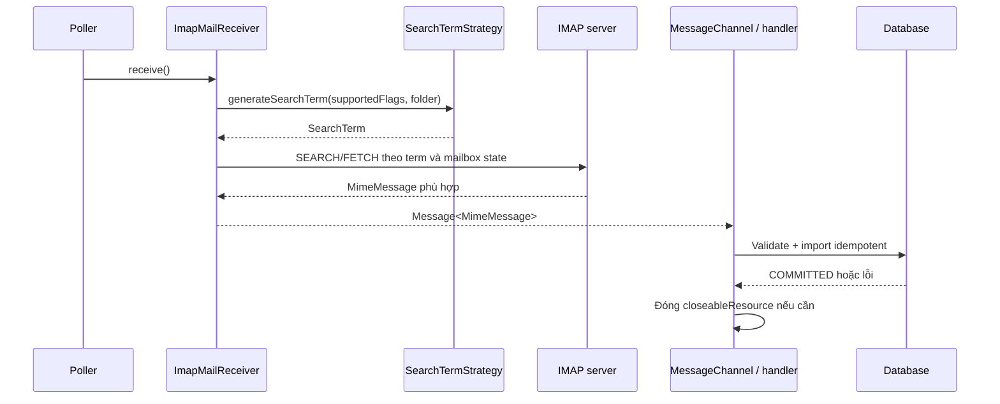
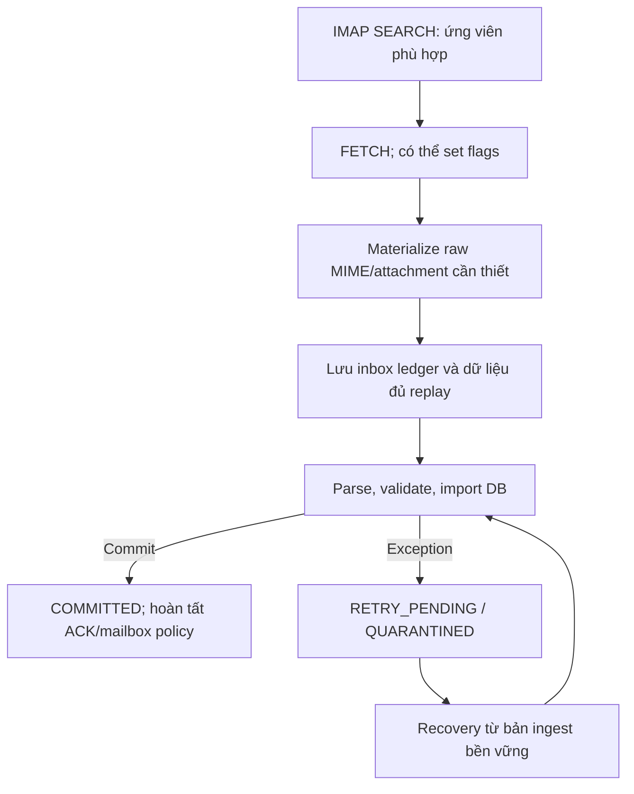

# SearchTerm lọc thư đến

## 1. Bài toán: chỉ lấy email cần xử lý từ hộp thư chung

Một doanh nghiệp nhận nhiều loại email vào `operations@example.test`: hóa đơn, báo cáo, thư quảng cáo, cảnh báo hệ thống và yêu cầu hỗ trợ. Dịch vụ Spring Boot chỉ cần xử lý hóa đơn có tiêu đề chứa `[INVOICE]`, gửi tới hộp thư IMAP trong một khoảng thời gian xác định và chưa được nhận bởi pipeline. Nếu ứng dụng tải toàn bộ email rồi mới lọc nội dung ở downstream handler, nó vừa tốn băng thông để fetch MIME/attachment không cần thiết, vừa có nguy cơ **đánh dấu email là đã đọc/đã nhận** trước khi quyết định bỏ qua.

**`SearchTerm`** của **Jakarta Mail** biểu diễn điều kiện tìm kiếm email: subject, sender, ngày, header, kích thước và IMAP flags. **`SearchTermStrategy`** của **Spring Integration** tạo `SearchTerm` khi `ImapMailReceiver` cần tìm thư mới. Đặt bộ lọc ngay ở **receiver** giúp chọn ứng viên phù hợp trước khi phát `Message<?>` vào Spring Integration `MessageChannel`.

Bài thuộc chương **Adapter Mail** của module `SPRING_INTEGRATION_ADAPTERS`. Tương tự các adapter File, SFTP, HTTP, JMS, AMQP, Kafka và database, mail inbound phải xác định đúng điểm đầu vào, hợp đồng message, lỗi, retry và vòng đời kết nối. Với mail, ranh giới quan trọng là: **thư thỏa `SearchTerm` chưa có nghĩa đã được xử lý nghiệp vụ**; các IMAP flag và transaction DB không tự đồng bộ với nhau.

Sau bài này, bạn có thể:

- Hiểu vị trí của `SearchTerm` so với `ImapMailReceiver`, `MailReceivingMessageSource`, poller và downstream filter.
- Viết `SearchTermStrategy#generateSearchTerm(Flags, Folder)` theo Spring Integration 6.x và ghép `AndTerm`, `OrTerm`, `FlagTerm`, `SubjectTerm`, `FromStringTerm`, `HeaderTerm`, `ReceivedDateTerm`.
- Biết khi nào phải giữ điều kiện mặc định tránh lặp thư khi **thay thế** `SearchTermStrategy`.
- Tạo cấu hình IMAPS an toàn và Java DSL nhận thư qua polling; hiểu cách áp dụng tương tự với IMAP IDLE.
- Nhận biết sự khác biệt với POP3, filter downstream và `selectorExpression`.
- Thiết kế phục hồi, chống nhận trùng, kiểm thử các flag và giới hạn tìm kiếm của mail server.

> **Phiên bản minh họa:** Spring Integration **6.5.x**, Spring Boot tương thích, Java 17+, Jakarta Mail (`jakarta.mail.*`). Với Spring Integration 5.x, namespace có thể là `javax.mail.*`. Đoạn code là mẫu học tập, chưa thay thế bài kiểm thử với IMAP provider thực tế. `SPECIAL_NOTE` của bài được giao là rỗng nên không có ràng buộc bổ sung.

## 2. `SearchTerm` hoạt động ở đâu trong inbound flow?



Khi dùng IMAP polling, **poller** kích hoạt `MailReceivingMessageSource`, source gọi `ImapMailReceiver`, receiver tìm thư theo `SearchTerm`, sau đó chuyển thành Spring message. Nếu mailbox hỗ trợ **IMAP IDLE**, server có thể thông báo khi có thư mới, nhưng receiver vẫn có chiến lược tìm ứng viên; không có poller định kỳ ở mô hình IDLE.

Ba điểm lọc thường bị nhầm:

| Điểm lọc | API | Khi nào chạy | Mục tiêu | Giới hạn |
| --- | --- | --- | --- | --- |
| **IMAP search** | `SearchTermStrategy` → `SearchTerm` | Trong receiver, lúc tìm mail | Giảm số email ứng viên phải fetch | Tính năng SEARCH, cờ và khả năng đánh chỉ mục phụ thuộc server |
| **Receiver selector** | `AbstractMailReceiver#setSelectorExpression(...)` | Trong quá trình receiver xét message đã fetch | Thêm điều kiện biểu thức trên mail | Không tương đương một IMAP SEARCH được thực thi hoàn toàn ở server |
| **Downstream Spring filter** | `.filter(...)` hoặc service activator | Sau khi adapter phát message | Chặn/định tuyến message tới nghiệp vụ | Mail có thể đã fetch và **được gắn cờ** trước khi filter chạy |

Trong provider hỗ trợ tìm kiếm phía server, một số `SearchTerm` được chuyển thành lệnh IMAP `SEARCH`; một số điều kiện có thể được thư viện/provider đánh giá theo cách khác. Không khẳng định mọi custom predicate đều được server thực thi hoàn toàn hoặc luôn nhanh hơn tải về. Luôn đo thời gian SEARCH/FETCH và số thư thực tế nhận trong môi trường đích.

## 3. Các lớp `SearchTerm` phổ biến của Jakarta Mail

`SearchTerm` là lớp trừu tượng trong `jakarta.mail.search`. Các lớp con cung cấp phép so khớp với metadata hoặc các cờ của `jakarta.mail.Message`:

| Lớp | Điều kiện | Ví dụ sử dụng | Lưu ý |
| --- | --- | --- | --- |
| `SubjectTerm` | Chủ đề chứa một chuỗi | `new SubjectTerm("[INVOICE]")` | Thường là tìm **substring**, không phải đối sánh chính xác toàn bộ subject |
| `FromStringTerm` | Chuỗi xuất hiện trong địa chỉ người gửi | `new FromStringTerm("@partner.example")` | **Không xác thực** danh tính người gửi; `From` có thể bị giả mạo |
| `FromTerm` | So khớp địa chỉ người gửi | `new FromTerm(new InternetAddress("billing@partner.example"))` | Vẫn là header của email, không phải chứng chỉ DKIM/SPF |
| `RecipientStringTerm` | So khớp địa chỉ người nhận | `RecipientStringTerm(Message.RecipientType.TO, "team@...")` | Email có thể được forward/alias, không luôn có To như dự kiến |
| `HeaderTerm` | Header tùy chọn có chứa giá trị | `new HeaderTerm("X-Batch-Type", "invoice")` | Header do sender đặt, không tự đáng tin cậy |
| `FlagTerm` | Có/không có IMAP flag | `new FlagTerm(new Flags(Flags.Flag.SEEN), false)` | Cần hiểu server có hỗ trợ flag không |
| `ReceivedDateTerm` | Ngày nhận của message | `new ReceivedDateTerm(ComparisonTerm.GE, cutoff)` | Phụ thuộc ngày và độ phân giải từ mail provider |
| `SentDateTerm` | Ngày gửi do sender cung cấp | `new SentDateTerm(ComparisonTerm.GE, cutoff)` | Sender có thể đặt ngày sai/giả |
| `SizeTerm` | So sánh kích thước thông điệp | `new SizeTerm(ComparisonTerm.LE, maxBytes)` | Kích thước mail không luôn tương đương tổng byte attachment đã giải mã |
| `AndTerm` | Giao của nhiều điều kiện | `new AndTerm(term1, term2)` | Tất cả điều kiện phải đúng |
| `OrTerm` | Hợp của các điều kiện | `new OrTerm(term1, term2)` | Ít nhất một điều kiện đúng |
| `NotTerm` | Phủ định điều kiện | `new NotTerm(term)` | Tránh phủ định quá rộng khi quét mailbox lớn |

Ví dụ đơn giản:

```java
import jakarta.mail.Flags;
import jakarta.mail.search.AndTerm;
import jakarta.mail.search.FlagTerm;
import jakarta.mail.search.SearchTerm;
import jakarta.mail.search.SubjectTerm;

SearchTerm notSeen = new FlagTerm(new Flags(Flags.Flag.SEEN), false);
SearchTerm invoiceSubject = new SubjectTerm("[INVOICE]");
SearchTerm query = new AndTerm(notSeen, invoiceSubject);
```

Đây mới là **predicate**, chưa phải một poller hoặc adapter hoàn chỉnh. Từ cùng một `SearchTerm`, provider có thể xử lý lệnh trên server hoặc kết hợp với logic client, tùy loại term và khả năng giao thức. Với tiêu chí phức tạp (ví dụ nội dung attachment hoặc xác minh chữ ký), hãy để lớp nghiệp vụ làm sau khi mail được nhận; `SearchTerm` không thay thế parser MIME và kiểm tra bảo mật.

## 4. Chiến lược mặc định của `ImapMailReceiver` là một phần bảo vệ chống trùng

Theo tài liệu Spring Integration 6.5, khi **không cung cấp** custom `SearchTermStrategy`, IMAP receiver tìm những email:

- Có `\Recent` **nếu server hỗ trợ**.
- **Chưa** được trả lời (`\Answered=false`), **chưa** bị đánh dấu xóa (`\Deleted=false`) và **chưa** được đọc (`\Seen=false`).
- **Chưa** được adapter ghi dấu đã xử lý, qua user flag (mặc định `spring-integration-mail-adapter`) hoặc cơ chế fallback `\Flagged` khi phù hợp.

Điều này có nghĩa Spring Integration không đơn giản dùng điều kiện `SubjectTerm` để tìm mail. Nó còn dùng **mailbox state** nhằm tránh liên tục lấy lại một email cũ.

**Cảnh báo quan trọng:** gọi `receiver.setSearchTermStrategy(customStrategy)` **thay thế** cách xây `SearchTerm` mặc định; nó không tự thêm điều kiện tùy chỉnh vào default search. Nếu custom term chỉ có `new SubjectTerm("[INVOICE]")`, cả thư đã `\Seen`, đã xử lý hoặc đã mang adapter user flag có thể tiếp tục được tìm thấy sau mỗi poll, tùy khả năng của provider và các bước xử lý khác.

| Thành phần trạng thái | Nếu bỏ khỏi custom term | Hệ quả có thể gặp |
| --- | --- | --- |
| `\Seen=false` | Thư đã đọc có thể lọt vào kết quả | Nhận lại thư cũ hoặc xử lý mail mà người dùng đã đọc |
| `\Deleted=false` | Thư đánh dấu xóa có thể bị fetch | Đụng thư chuẩn bị expunge hoặc gây exception |
| `\Answered=false` | Thư đã trả lời vẫn được chọn | Lặp quy trình ngoài ý muốn |
| `\Recent` khi được hỗ trợ | Có thể xét toàn bộ thư chưa đọc cũ | Phù hợp backfill, nhưng có thể gây backlog lớn |
| User flag / `\Flagged` do adapter đặt | Mail đã được nhận vẫn có thể khớp | Dễ phát lại mỗi lượt khi `shouldMarkMessagesAsRead=false` |

Từ Spring Integration **6.4**, `AbstractMailReceiver` có `setFlaggedAsFallback(false)` để không dùng `\Flagged` làm fallback khi thiếu `\Recent`/user flag. Tùy chọn đó thay đổi cách nhận diện thư đã từng được adapter chọn; không bật/tắt một cách tùy tiện. `setUserFlag("...")` cho phép thay tên flag nếu mail server hỗ trợ custom user flags. Cần kiểm thử trên mailbox sandbox vì nhiều provider có cách triển khai `\Recent` hoặc user flags khác nhau.

### Quy ước trong bài thực hành

Để ví dụ dễ kiểm chứng, ta sẽ dùng chiến lược **"hóa đơn chưa Seen, chưa Answered, chưa Deleted, có marker subject"** và đặt `shouldMarkMessagesAsRead(true)` để hạn chế chọn lại sau khi fetch. Đây **không phải** thay thế đầy đủ thuật toán default của Spring Integration, đặc biệt khi `\Recent`, user flags và fallback được cấu hình. Đánh dấu Seen trước khi DB commit có thể gây **mất cơ hội tự động retry** nếu downstream lỗi: phần 12 trình bày cách phục hồi bền vững. Với ứng dụng thực tế cần dựa vào user flag hoặc giữ nguyên toàn bộ tiêu chí mặc định, hãy tạo strategy riêng có xét `supportedFlags`, test theo server và thêm ledger nghiệp vụ.

## 5. API `SearchTermStrategy` và ý nghĩa hai tham số

Spring Integration khai báo một functional interface:

```java
package org.springframework.integration.mail;

// Chữ ký rút gọn để minh họa; xem Javadoc gốc để dùng nguyên API.
public interface SearchTermStrategy {
    jakarta.mail.search.SearchTerm generateSearchTerm(
            jakarta.mail.Flags supportedFlags,
            jakarta.mail.Folder folder);
}
```

`supportedFlags` cho biết những flag mà folder/server hỗ trợ. `folder` biểu diễn mailbox đang được tìm. Strategy được gọi khi receiver cần chuẩn bị search term, **không** cần truy cập body của mỗi thư để xây predicate.

Hai tình huống sử dụng `folder`:

1. Chọn tiêu chí khác nhau theo folder, ví dụ `INBOX` cho hóa đơn còn `INBOX/ALERTS` cho cảnh báo, nhưng phải giới hạn folder theo cấu hình đáng tin cậy.
2. Kiểm tra `supportedFlags` và server capabilities khi cần giữ hành vi chống trùng; không giả định mọi server hỗ trợ `\Recent` hoặc user flags.

**Đừng dùng `folder.getMessages()` rồi lặp tất cả email trong `generateSearchTerm()`** để tự lọc: việc đó có thể phải tải rất nhiều metadata, làm chậm poller và thay đổi folder state. Hãy trả về một cây `SearchTerm` bất biến, gọn và kiểm thử được.

## 6. Dependency và IMAPS an toàn

Trong Spring Boot với BOM tương thích Spring Integration 6.5, khai báo Gradle:

```groovy
dependencies {
    implementation 'org.springframework.boot:spring-boot-starter-integration'
    implementation 'org.springframework.integration:spring-integration-mail'
    implementation 'org.springframework.boot:spring-boot-starter-mail'
}
```

Module integration cung cấp `ImapMailReceiver`, `SearchTermStrategy` và Mail DSL; Jakarta Mail cần implementation/provider ở runtime. `spring-boot-starter-mail` là một cách lấy implementation theo BOM, không có nghĩa inbound phải dùng SMTP.

`application.yml` chỉ dùng placeholder, không lưu credential thật:

```yaml
app:
  mail:
    store-uri: ${INVOICE_IMAP_URI:imaps://invoices%40example.test@imap.example.test:993/INBOX}
    username: ${INVOICE_IMAP_USER:invoices@example.test}
    password: ${INVOICE_IMAP_PASSWORD}
    poll-interval-ms: ${INVOICE_IMAP_POLL_MS:15000}
```

`%40` biểu diễn ký tự `@` của username trong URI userinfo khi provider/parser yêu cầu; kiểm tra URL parsing trên mail implementation thực tế. Không nhúng password vào URI vì connection string có thể đi vào exception hoặc log. Với provider dùng OAuth2/XOAUTH2, phải thay auth mechanism và quản lý vòng đời token riêng.

Các cấu hình bắt buộc cho IMAPS:

- TLS và xác minh **server hostname** (`mail.imaps.ssl.checkserveridentity=true`).
- Timeout connect/read/write để poller không chờ vô hạn.
- Credential/token từ secret manager, không in bằng protocol debug.
- Tài khoản mailbox có quyền đọc cần thiết; chỉ bật quyền thay flag/xóa nếu workflow yêu cầu.
- Hạn chế số message fetch và số kết nối đang hoạt động; `SearchTerm` không thay được giới hạn tài nguyên.

## 7. Viết `SearchTermStrategy` lọc hóa đơn bằng AND

Ví dụ tạo bean chỉ lấy thư có subject chứa `[INVOICE]` và các flag **chưa Seen/Answered/Deleted**. Biểu thức dùng một `AndTerm` gom nhiều điều kiện, tránh tự gọi `getSubject()` từng message.

```java
import jakarta.mail.Flags;
import jakarta.mail.search.AndTerm;
import jakarta.mail.search.FlagTerm;
import jakarta.mail.search.SearchTerm;
import jakarta.mail.search.SubjectTerm;

import org.springframework.context.annotation.Bean;
import org.springframework.context.annotation.Configuration;
import org.springframework.integration.mail.SearchTermStrategy;

@Configuration
public class InvoiceSearchTermsConfiguration {

    @Bean
    public SearchTermStrategy invoiceSearchTermStrategy() {
        return (supportedFlags, folder) -> {
            SearchTerm notSeen = new FlagTerm(
                    new Flags(Flags.Flag.SEEN), false);
            SearchTerm notAnswered = new FlagTerm(
                    new Flags(Flags.Flag.ANSWERED), false);
            SearchTerm notDeleted = new FlagTerm(
                    new Flags(Flags.Flag.DELETED), false);
            SearchTerm invoiceSubject = new SubjectTerm("[INVOICE]");

            return new AndTerm(new SearchTerm[] {
                    notSeen, notAnswered, notDeleted, invoiceSubject
            });
        };
    }
}
```

`AndTerm` này có ngữ nghĩa: **chưa Seen AND chưa Answered AND chưa Deleted AND subject chứa `[INVOICE]`**. `SubjectTerm` là kiểm tra chuỗi con, không xác nhận mẫu `^\[INVOICE\]-[0-9]+$` hay danh tính đối tác. Nếu cần subject đúng regex hoặc mã hóa đơn theo schema, vẫn phải validate trong handler sau khi fetch.

**Đây là chiến lược minh họa có chủ đích**, không tái dựng hoàn toàn default strategy: nó không thêm điều kiện `\Recent`, user flag/fallback. Ví dụ đi kèm `shouldMarkMessagesAsRead(true)` trong receiver phía sau để thư được chọn không tiếp tục đáp ứng `notSeen`; vì vậy phải có recovery riêng khi import thất bại. Nếu không muốn đổi Seen và muốn dùng user flag để chống phát trùng, cần kiểm tra user flag được server hỗ trợ và **thêm điều kiện không có user flag** vào term.

### Mở rộng kiểm tra user flag khi server hỗ trợ

Ví dụ ý tưởng nếu server đã được xác nhận có hỗ trợ user flag `invoice-ingest-v1`:

```java
import jakarta.mail.Flags;
import jakarta.mail.search.AndTerm;
import jakarta.mail.search.FlagTerm;
import jakarta.mail.search.SearchTerm;

// Chỉ thêm khi đã xác minh server hỗ trợ user-defined flags.
SearchTerm baseTerm = invoiceSearchTermStrategy
        .generateSearchTerm(supportedFlags, folder);
SearchTerm notClaimed = new FlagTerm(new Flags("invoice-ingest-v1"), false);
SearchTerm combined = new AndTerm(baseTerm, notClaimed);

// Đồng thời cấu hình receiver.setUserFlag("invoice-ingest-v1").
```

Đây là **trích đoạn** (các biến `invoiceSearchTermStrategy`, `supportedFlags`, `folder` đã tồn tại trong strategy), không phải bean thứ hai cần copy nguyên xi. Về triển khai, hãy gộp điều kiện này vào **một** strategy. Nếu server không hỗ trợ user flags, có thể cần `\Flagged` fallback hoặc ledger bền vững; đừng cứ thêm `FlagTerm(userFlag,false)` rồi tin rằng nó chống trùng trên mọi provider.

Một số IMAP server không cung cấp hoặc không ổn định `\Recent`; thư mới không nhất thiết có `RECENT=true` trong mọi session. Do đó, hãy cân nhắc có thực sự muốn yêu cầu RECENT hay muốn quét **mọi thư chưa xử lý** (ví dụ backfill). Việc lựa chọn này quyết định độ lớn tập search và cơ chế dedupe sau restart.

## 8. Tích hợp strategy vào `ImapMailReceiver`

Đoạn cấu hình bên dưới dùng **IMAPS** và `Authenticator` tách password khỏi URI. Trong ví dụ chọn `setShouldMarkMessagesAsRead(true)` để phù hợp `FlagTerm(SEEN,false)`; đây là lựa chọn cho demo cần quan sát rõ, **không nên sao chép nguyên trạng nếu yêu cầu retry email trước commit**.

```java
import java.util.Properties;

import jakarta.mail.Authenticator;
import jakarta.mail.PasswordAuthentication;

import org.springframework.beans.factory.annotation.Value;
import org.springframework.context.annotation.Bean;
import org.springframework.context.annotation.Configuration;
import org.springframework.integration.mail.ImapMailReceiver;
import org.springframework.integration.mail.SearchTermStrategy;

@Configuration
public class InvoiceImapReceiverConfiguration {

    @Bean
    public ImapMailReceiver invoiceImapReceiver(
            SearchTermStrategy invoiceSearchTermStrategy,
            @Value("${app.mail.store-uri}") String storeUri,
            @Value("${app.mail.username}") String username,
            @Value("${app.mail.password}") String password) {

        ImapMailReceiver receiver = new ImapMailReceiver(storeUri);
        receiver.setJavaMailAuthenticator(new Authenticator() {
            @Override
            protected PasswordAuthentication getPasswordAuthentication() {
                return new PasswordAuthentication(username, password);
            }
        });

        Properties props = new Properties();
        props.setProperty("mail.store.protocol", "imaps");
        props.setProperty("mail.imaps.ssl.enable", "true");
        props.setProperty("mail.imaps.ssl.checkserveridentity", "true");
        props.setProperty("mail.imaps.connectiontimeout", "10000");
        props.setProperty("mail.imaps.timeout", "30000");
        props.setProperty("mail.imaps.writetimeout", "30000");
        props.setProperty("mail.debug", "false");
        receiver.setJavaMailProperties(props);

        receiver.setSearchTermStrategy(invoiceSearchTermStrategy);
        receiver.setShouldMarkMessagesAsRead(true);
        receiver.setShouldDeleteMessages(false);
        receiver.setMaxFetchSize(1);
        receiver.setAutoCloseFolder(false);
        return receiver;
    }
}
```

**Các lựa chọn vòng đời có hệ quả:**

- `setShouldMarkMessagesAsRead(true)` làm receiver có thể set `\Seen` **trước khi downstream handler commit**. Khi handler lỗi, mail không còn khớp `notSeen`; cần lưu bản ingest bền vững hoặc reset flag có kiểm soát.
- `setShouldDeleteMessages(false)` giữ thư gốc trên server nhưng **không tự bảo đảm sẽ được poll lại** khi Seen/user flag đã thay đổi.
- `setAutoCloseFolder(false)` giữ folder mở để handler có thể đọc MIME/attachment khi cần; mỗi message cần `closeableResource` được consumer đóng. Với `maxFetchSize=1`, ownership của folder dễ theo dõi hơn.
- Nếu đặt `mail.imaps.peek=false`, việc đọc nội dung có thể đánh dấu `Seen` bất kể một số lựa chọn mark-as-read. Với IMAP, cần đối chiếu `mail.imaps.peek` và cấu hình adapter trước khi kết luận tìm kiếm không làm thay đổi flag.

**Không coi địa chỉ From/subject là nguồn xác thực đối tác.** `SearchTerm` chỉ chọn ứng viên từ mailbox; xác minh người gửi có thể đòi hỏi chính sách SPF/DKIM/DMARC, account/partner registry, chữ ký dữ liệu và so sánh business ID.

## 9. Gắn vào Java DSL polling inbound flow

```java
import org.springframework.context.annotation.Bean;
import org.springframework.context.annotation.Configuration;
import org.springframework.integration.dsl.IntegrationFlow;
import org.springframework.integration.dsl.Pollers;
import org.springframework.integration.mail.ImapMailReceiver;
import org.springframework.integration.mail.dsl.Mail;

@Configuration
public class InvoiceMailPollingFlow {

    @Bean
    public IntegrationFlow invoiceMailInboundFlow(
            ImapMailReceiver invoiceImapReceiver,
            InvoiceMailHandler invoiceMailHandler) {

        return IntegrationFlow.from(
                        Mail.imapInboundAdapter(invoiceImapReceiver),
                        endpoint -> endpoint.id("invoiceImapPollingEndpoint")
                                .poller(Pollers.fixedDelay(15_000)
                                        .maxMessagesPerPoll(1)))
                .handle(invoiceMailHandler)
                .get();
    }
}
```

`Mail.imapInboundAdapter(receiver)` tạo một **pollable inbound source**. Poller gọi `receive()` theo chu kỳ; receiver áp `SearchTerm`; khi chọn được thư, flow phát `Message<?>` cho handler. `maxMessagesPerPoll(1)` giới hạn **số message mà polling endpoint phát trong một lượt**, trong khi `receiver.setMaxFetchSize(1)` giới hạn **số thư receiver lấy trong một lần fetch**.

Ví dụ dùng channel đồng bộ mặc định để handler có thể đọc MIME **trước khi đóng folder**. Nếu thêm queue/executor ở giữa, cần materialize nội dung cần xử lý thành DTO/bytes an toàn và quản lý folder ownership rõ ràng. Không gửi raw `MimeMessage` phụ thuộc folder đang mở qua một broker như Kafka/JMS rồi mong phía bên kia tiếp tục đọc attachment.

### Thử flow bằng annotation thay vì Java DSL

Một cách thay thế, không nên kích hoạt đồng thời với flow trên trên cùng mailbox:

```java
import org.springframework.context.annotation.Bean;
import org.springframework.integration.annotation.InboundChannelAdapter;
import org.springframework.integration.annotation.Poller;
import org.springframework.integration.mail.ImapMailReceiver;
import org.springframework.integration.mail.MailReceivingMessageSource;

@Bean
@InboundChannelAdapter(value = "invoiceMailInputChannel",
        poller = @Poller(fixedDelay = "15000", maxMessagesPerPoll = "1"))
public MailReceivingMessageSource imapMailSource(ImapMailReceiver receiver) {
    return new MailReceivingMessageSource(receiver);
}
```

Đây là **trích đoạn đặt trong một class `@Configuration`**, không phải method tự tồn tại trong file riêng. Cả hai cách đều đưa mail đã qua `SearchTerm` vào channel; không phải hai tầng filter cần dùng chồng lên nhau.

## 10. Kết hợp AND/OR theo sender, subject, header và ngày

Trong thực tế, doanh nghiệp có thể nhận hóa đơn từ hai đối tác với cách đặt tiêu đề khác nhau:

- Partner A: From chứa `billing@partner-a.example`, subject chứa `[INVOICE]`.
- Partner B: From chứa `statements@partner-b.example`, subject chứa `[BILL]`.
- Chỉ xử lý thư **không bị xóa/đã đọc**, được server nhận trong 14 ngày gần nhất (nếu đây là hợp đồng ingestion).

Ví dụ xây cây điều kiện từ các `SearchTerm`:

```java
import java.time.Instant;
import java.time.temporal.ChronoUnit;
import java.util.Date;

import jakarta.mail.Flags;
import jakarta.mail.search.AndTerm;
import jakarta.mail.search.ComparisonTerm;
import jakarta.mail.search.FlagTerm;
import jakarta.mail.search.FromStringTerm;
import jakarta.mail.search.OrTerm;
import jakarta.mail.search.ReceivedDateTerm;
import jakarta.mail.search.SearchTerm;
import jakarta.mail.search.SubjectTerm;

SearchTerm partnerA = new AndTerm(
        new FromStringTerm("billing@partner-a.example"),
        new SubjectTerm("[INVOICE]"));

SearchTerm partnerB = new AndTerm(
        new FromStringTerm("statements@partner-b.example"),
        new SubjectTerm("[BILL]"));

SearchTerm fromEitherPartner = new OrTerm(partnerA, partnerB);
SearchTerm notDeleted =
        new FlagTerm(new Flags(Flags.Flag.DELETED), false);
SearchTerm notSeen =
        new FlagTerm(new Flags(Flags.Flag.SEEN), false);
SearchTerm receivedRecently = new ReceivedDateTerm(
        ComparisonTerm.GE,
        Date.from(Instant.now().minus(14, ChronoUnit.DAYS)));

SearchTerm combined = new AndTerm(new SearchTerm[] {
        fromEitherPartner, notDeleted, notSeen, receivedRecently
});

// Trích đoạn: đặt vào generateSearchTerm(...) của SearchTermStrategy.
```

**Không dùng biến `Instant.now()` bên ngoài lambda rồi tái sử dụng mãi.** Nếu cần cửa sổ trượt 14 ngày, tính cutoff **mỗi lần `generateSearchTerm`**; trong một method `@Bean` tạo term một lần tại startup, thời gian không tự trượt. Ngược lại, một cửa sổ ngày trượt có thể loại email tồn đọng quá 14 ngày sau outage kéo dài. Nếu SLA yêu cầu backfill toàn bộ backlog, **không** thêm cutoff hẹp hoặc dùng checkpoint/batch source rõ ràng.

`ReceivedDateTerm` và `SentDateTerm` có độ tin cậy/độ phân giải tùy server, timezone và dữ liệu header. Đừng coi ranh giới `GE` theo timestamp là chính xác tới từng milli-giây trên mọi IMAP implementation; thiết kế test ở thời điểm ranh giới và xác nhận semantics thực tế.

**`FromStringTerm` không phải authentication.** Nếu attacker có thể đưa email vào inbox, họ có thể đặt From giả mạo `billing@partner-a.example`. Xác minh danh tính bằng chính sách mail security, chữ ký hợp đồng/invoice hoặc registry trước khi phát sinh side effect như ghi DB, chuyển tiền, thực thi script hoặc gửi thông tin nhạy cảm.

## 11. `HeaderTerm`, kích thước mail và điều kiện cần lọc sau fetch

Nếu đối tác gửi header `X-Document-Type: invoice`, bạn có thể kết hợp:

```java
import jakarta.mail.search.AndTerm;
import jakarta.mail.search.HeaderTerm;
import jakarta.mail.search.SearchTerm;
import jakarta.mail.search.SizeTerm;
import jakarta.mail.search.ComparisonTerm;

SearchTerm invoiceHeader =
        new HeaderTerm("X-Document-Type", "invoice");
SearchTerm sizeLimit =
        new SizeTerm(ComparisonTerm.LE, 10_000_000);

SearchTerm headerAndSize = new AndTerm(invoiceHeader, sizeLimit);
```

Mục tiêu của `SizeTerm` là **giới hạn ứng viên**, không phải thay việc kiểm soát kích thước nội dung trong handler. Email có thể mang MIME base64, nhiều attachments, multipart lồng nhau hoặc attachment nén (ZIP), khiến kích thước giải mã/giải nén khác kích thước thô. Áp dụng thêm giới hạn số phần, số byte giải mã, tổng lưu trữ và thời gian parse.

`HeaderTerm` chỉ so khớp **header do người gửi hoặc mail infrastructure đặt**. Không dùng một header như `X-Is-Trusted: true` để tự cấp quyền thực hiện nghiệp vụ. Khi server không hỗ trợ SEARCH trên header tùy chọn hiệu quả, phép tìm này có thể chậm; theo dõi thời gian và đánh giá dùng thêm bước filter trong receiver sau khi lấy metadata.

### Khi nào nên dùng downstream `.filter(...)`?

SearchTerm phù hợp để **giảm tập ứng viên**; downstream filter phù hợp để xác minh schema, tenant, MIME type hoặc business policy phức tạp. Ví dụ:

```java
// Một đoạn minh họa trong flow mà payload đã được transform thành DTO.
.filter(InvoiceCandidate.class, candidate ->
        candidate.partnerId() != null && candidate.validSchema())
.handle(invoiceService, "importOnce")
```

Đây là **trích đoạn DSL**, không phải toàn bộ bean; `InvoiceCandidate` và `invoiceService` là loại/bean do dự án định nghĩa. Việc lọc sau adapter có ưu điểm không buộc mọi rule nghiệp vụ vào IMAP SEARCH; đổi lại, mail có thể đã được receiver đánh dấu Seen hoặc user flag. Khi downstream filter từ chối, phải có chính sách rõ: bỏ qua vĩnh viễn, quarantine hay cho phép đọc lại.

## 12. Handler đọc MIME trong phạm vi folder còn mở

Khi `autoCloseFolder(false)`, mail inbound message có thể kèm header **`IntegrationMessageHeaderAccessor.CLOSEABLE_RESOURCE`**. Nếu một `MimeMessage` còn lazy-load body/attachment, handler cần **đọc xong trước khi đóng** folder. Ví dụ dưới chỉ nhận `text/plain`; MIME multipart cần parser chuyên dụng.

```java
import java.io.Closeable;
import java.io.IOException;

import jakarta.mail.internet.MimeMessage;

import org.springframework.integration.StaticMessageHeaderAccessor;
import org.springframework.messaging.Message;
import org.springframework.messaging.MessageHandler;
import org.springframework.messaging.MessageHandlingException;
import org.springframework.stereotype.Component;

@Component
public class InvoiceMailHandler implements MessageHandler {

    private final InvoiceImportService importer;

    public InvoiceMailHandler(InvoiceImportService importer) {
        this.importer = importer;
    }

    @Override
    public void handleMessage(Message<?> message) {
        Closeable resource = StaticMessageHeaderAccessor
                .getCloseableResource(message);

        try (Closeable folder = resource == null ? () -> { } : resource) {
            MimeMessage email = (MimeMessage) message.getPayload();
            String messageId = email.getMessageID();

            if (!email.isMimeType("text/plain")) {
                throw new IllegalArgumentException(
                        "Bắt buộc MIME parser riêng cho multipart/HTML");
            }

            Object content = email.getContent();
            if (!(content instanceof String body)) {
                throw new IllegalArgumentException("Body không phải text");
            }

            // Hợp đồng: importOnce chỉ trả về sau DB transaction COMMIT.
            importer.importOnce(messageId, body);

        } catch (jakarta.mail.MessagingException | IOException ex) {
            throw new MessageHandlingException(message,
                    "Lỗi đọc MIME/đóng IMAP folder", ex);
        }
    }
}

public interface InvoiceImportService {
    void importOnce(String messageId, String body);
}
```

Ví dụ chỉ minh họa vòng đời tài nguyên và phương thức idempotency. Trong production, `Message-ID` **không đủ** làm business key: có thể thiếu, bị trùng hoặc giả mạo. Khi có IMAP UID, định danh thư có thể dùng `(mailbox, folder, UIDVALIDITY, UID)` với giới hạn phạm vi mailbox/UID epoch; để tránh nhập lại cùng một hóa đơn từ nhiều email khác nhau, hãy dùng **invoice business ID** hoặc checksum và unique constraint theo hợp đồng.

Nếu bật `DefaultMailHeaderMapper`, payload có thể trở thành `String`/`byte[]` thay vì `MimeMessage`; khi đó handler phải sửa hợp đồng kiểu dữ liệu, không cast cứng theo ví dụ này. Nếu có `FileSplitter`/transformer/downstream async, đảm bảo resource được đóng **đúng một lần** và không gửi raw `MimeMessage` còn phụ thuộc folder tới thread/queue không có ownership.

## 13. SearchTerm với IMAP IDLE: cùng filter, cách kích hoạt khác

`SearchTermStrategy` không chỉ dùng cho polling IMAP. Nó cũng có thể được cấu hình cho receiver dùng bởi **`ImapIdleChannelAdapter`**. Khi server hỗ trợ IDLE, adapter đợi server thông báo thay đổi, nhưng vẫn tìm ứng viên qua receiver; không cần cấu hình poller cho IDLE.

```java
import org.springframework.context.annotation.Bean;
import org.springframework.context.annotation.Configuration;
import org.springframework.integration.dsl.IntegrationFlow;
import org.springframework.integration.mail.ImapMailReceiver;
import org.springframework.integration.mail.dsl.Mail;

@Configuration
public class InvoiceImapIdleFlow {

    @Bean
    public IntegrationFlow invoiceIdleInbound(
            ImapMailReceiver invoiceImapReceiver,
            InvoiceMailHandler invoiceMailHandler) {

        return IntegrationFlow.from(
                        Mail.imapIdleAdapter(invoiceImapReceiver))
                .handle(invoiceMailHandler)
                .get();
    }
}
```

Đây là **phương án thay thế** cho polling flow ở mục 9. Không bật cả polling và IDLE trên cùng một account/folder nếu chưa có cơ chế phân chia công việc: hai receiver có thể cạnh tranh flags, nhận trùng hoặc bỏ sót. IDLE cần xử lý timeout, reconnect, `cancelIdleInterval` và `ImapIdleExceptionEvent`; một search term chính xác không bảo đảm connection sẽ tồn tại mãi.

## 14. Vì sao `SearchTermStrategy` không áp dụng như thế cho POP3?

**POP3** không cung cấp bộ lệnh tìm kiếm thư và flags phong phú như IMAP. `SearchTermStrategy` được Spring Integration gắn với **`ImapMailReceiver`**, không phải một cơ chế tìm kiếm server-side tương đương trên `Pop3MailReceiver`.

| Yêu cầu | IMAP | POP3 |
| --- | --- | --- |
| Tìm chưa `\Seen` | `FlagTerm(SEEN,false)` | Không có Seen flag |
| Tìm theo Subject/From trên server | `SearchTerm` nếu server/provider hỗ trợ | Thường phải lấy metadata/nội dung rồi lọc tại ứng dụng |
| Dựa vào user flag của adapter | Có thể nếu server hỗ trợ | Không có IMAP user flags |
| IDLE thông báo thư mới | Có nếu provider hỗ trợ | Không có |
| Xử lý lại khi restart | Cần phối hợp flags/ledger | Nếu giữ mail, dễ nhận lại; cần idempotency |

Với POP3 inbound, ứng dụng có thể dùng `selectorExpression` của receiver hoặc downstream `.filter(...)` sau khi mail được lấy, nhưng không thể kỳ vọng POP3 xử lý `SEARCH SUBJECT` ở server. Nếu bật `shouldDeleteMessages(true)`, thư có thể được xóa trước khi downstream commit DB; nếu `false`, thư có thể được lấy lại qua các phiên kết nối sau. Vì vậy, cần **lưu dữ liệu ingest và business state** một cách bền vững.

## 15. SearchTerm, cờ mail và lỗi sau khi nhận

Xét tình huống:

1. Receiver chọn `invoice-0042.eml` vì subject chứa `[INVOICE]`, `Seen=false`.
2. Receiver fetch thư và do cấu hình `shouldMarkMessagesAsRead(true)` nên có thể set `Seen=true`.
3. Handler parse attachment, ghi DB rồi lỗi validation ở bản ghi cuối; transaction rollback.
4. Lần poll sau, `FlagTerm(SEEN,false)` **không còn khớp**. Không có cơ chế nào của `SearchTerm` tự rollback Seen theo transaction DB.

Vậy cần **business ledger** và quy trình phục hồi:



Một bảng inbox ledger có thể lưu `mailbox_account`, `folder`, `uid_validity`, `uid`, `message_id`, `invoice_id`, `content_hash`, `raw_mail_reference`, `status`, `attempt_count`, `last_error`, `updated_at`. `SearchTerm` hỗ trợ giảm danh sách thư ứng viên nhưng **không thay thế unique constraint hoặc transaction** của importer. Không xóa/đổi Seen hàng loạt để "retry" vì có thể làm các worker khác nhận lại những thư đang xử lý.

### Nếu cố ý giữ mail chưa đọc để retry thì sao?

Có thể đặt `shouldMarkMessagesAsRead(false)` và dùng cờ nhận riêng khi server hỗ trợ, hoặc chỉ cập nhật trạng thái mailbox sau commit theo một workflow có kiểm soát. Tuy nhiên user flag/fallback do adapter quản lý cũng có thể được đặt **trước khi import thành công**; giữ `Seen=false` không tự làm mail xuất hiện lại nếu custom strategy loại user flag. Phục hồi cần biết **thư nào đã được nhận nhưng chưa được xử lý**, không chỉ dựa vào trạng thái chưa đọc.

## 16. Performance và thiết kế bộ lọc ổn định

Một bộ lọc tốt phải cân bằng **độ chính xác, khả năng phục hồi và chi phí tìm kiếm**:

| Quyết định | Lợi ích | Rủi ro cần kiểm thử |
| --- | --- | --- |
| Lọc subject theo token cố định | Dễ hiểu, giảm ứng viên | Forward/reply có thể làm lệch subject; substring không phải regex |
| Lọc From | Giảm thư ngoài đối tác | From giả, alias hoặc display name thay đổi |
| Lọc `ReceivedDateTerm` | Giảm backlog quét mỗi poll | Có thể bỏ sót thư cũ sau outage hoặc khác ranh giới ngày |
| Lọc `Seen=false` | Hạn chế nhận lại mail đã đọc | User đọc trước hoặc receiver mark Seen trước commit có thể làm mất thư |
| Lọc `\Recent` | Giảm tập mail mới theo server semantics | Không ổn định/tùy provider, có thể mất thư qua session |
| Lọc theo user flag | Theo dõi thư adapter đã chọn | Không đồng bộ DB, server có thể không hỗ trợ |
| `SizeTerm` | Giảm mail lớn | MIME decode/attachment zip bomb vẫn cần kiểm soát |
| Nhiều `OrTerm` và header criteria | Bao phủ nhiều loại đối tác | Search phức tạp có thể gây tải server |

Chỉ khi thực sự cần mới kết hợp nhiều mailbox vào cùng một flow. Tách folder/đối tác hoặc route sau khi materialize thường dễ quản trị hơn một `SearchTerm` có hàng trăm nhánh OR và thay đổi liên tục. Với nhiều replica, IMAP flag/term không là **distributed transaction**; cân nhắc một ingestion owner cho mailbox hoặc claim ledger ở DB để scale downstream.

### Observability nên thu thập

- `mail_search_duration`: thời gian IMAP SEARCH/fetch.
- `mail_search_matched_total`: số thư được chọn trong lượt tìm; không đồng nghĩa số batch commit.
- `mail_inbound_fetched_total`: số mail receiver đã lấy.
- `mail_parse_failure_total` và `mail_import_committed_total`.
- `mail_retry_pending`, `mail_stale_unprocessed` theo business ledger.
- `mail_folder_open`/`mail_idle_reconnect_total` và lỗi TLS/auth.

Log `mailboxId`, `filterVersion`, `pollId`, số mail phù hợp, lỗi đã chuẩn hóa và business correlation ID. **Không log** password, OAuth token, raw body, attachment, full header danh tính hoặc dữ liệu cá nhân nếu không có yêu cầu kiểm toán hợp lệ. Việc bật `mail.debug=true` ở production có thể lộ thông tin giao thức/email.

## 17. Các kịch bản kiểm thử bắt buộc

Dùng IMAP sandbox có TLS và user riêng; kiểm thử email giả, không thay đổi flags trên mailbox production. Các test cần đọc **cả mailbox flags lẫn business ledger**, không chỉ đếm Spring messages.

1. **Subject khớp:** gửi email `[INVOICE] INV-0042`; `SearchTermStrategy` chọn thư nếu các flag đúng. Handler commit một batch.
2. **Subject không khớp:** gửi `[ALERT] ...`; receiver không phát message, quan sát mail vẫn giữ trạng thái như dự kiến.
3. **Đã Seen:** tạo thư cùng subject nhưng `Seen=true`; term `NOT SEEN` loại ra.
4. **Đã Deleted hoặc Answered:** quan sát từng điều kiện flag và phép `AndTerm` loại thư phù hợp.
5. **Đổi default search term:** tắt custom strategy trong test và so sánh điều kiện `Recent`/user flag với custom term; xác minh không vô tình phát lại hàng loạt.
6. **Restart sau fetch:** email đã gắn Seen/user flag nhưng DB chưa commit; recovery job phải tiếp tục được từ ingest store, không dựa vào poll tiếp.
7. **Hai đối tác:** gửi một mail từ Partner A và một từ Partner B; `OrTerm(AndTerm(A), AndTerm(B))` nhận đúng cả hai, một thư từ nguồn khác không được xem là đã xác thực.
8. **Cửa sổ 14 ngày:** gửi/thêm mail trước và sau cutoff; kiểm chứng timezone, ngày ranh giới và cách server xử lý `ReceivedDateTerm`.
9. **Header và kích thước:** mail có/không `X-Document-Type`, attachment lớn hơn giới hạn; kiểm tra `HeaderTerm`/`SizeTerm` và validation sau fetch.
10. **MIME multipart:** gửi HTML + PDF; SearchTerm chọn theo header/subject nhưng parser phải xử lý MIME chuyên biệt, đóng `closeableResource` cả khi lỗi.
11. **Mất mạng giữa SEARCH/FETCH:** test timeout/reconnect và không giữ folder/session vô hạn; retry mạng không tự rollback flag.
12. **Hai receiver cùng inbox:** chạy polling và IDLE trong test để quan sát race; về production chỉ giữ kiến trúc có ownership rõ.
13. **Provider không hỗ trợ `Recent`/user flag:** kiểm tra fallback `Flagged` hoặc chiến lược claim bền vững; không giả định mailbox flags giống Gmail/server test khác.
14. **Security:** thử `From` giả, header tùy ý giả, subject có CRLF/encoding khác và attachment `../secret.pdf`; filter không cấp quyền, parser/validator phải từ chối xử lý nguy hiểm.

### Ma trận kỳ vọng

| Tình huống | `SearchTerm`/receiver | Tầng nghiệp vụ |
| --- | --- | --- |
| Subject đúng, chưa Seen | Chọn ứng viên nếu thỏa các flag còn lại | Validate/import một lần |
| Subject sai | Không chọn hoặc loại trong receiver | Không tạo batch mới |
| Thư đã Seen | Loại nếu có `FlagTerm(SEEN,false)` | Có thể recovery qua ledger nếu trước đó lỗi |
| Fetch thành công, import lỗi | Mail có thể đã được gắn Seen/user flag | Lưu `RETRY_PENDING`; không mất dữ liệu |
| Restart hoặc hai consumer | Term/flags có thể thay đổi khả năng phát lại | Idempotency và ownership bảo đảm không double commit |

## 18. Các sai lầm cần tránh

- **Thay `SearchTermStrategy` bằng chỉ `SubjectTerm` rồi nghĩ default flags vẫn còn:** custom term là **thay thế**, không phải tự động bổ sung.
- **Nhầm `SubjectTerm` là regex hoặc exact-match:** nó thường đối chiếu chuỗi con; business validation phải tự thực hiện.
- **Coi `FromStringTerm`/`HeaderTerm` là xác thực danh tính:** email header có thể bị giả mạo.
- **Đặt `Seen=false` trong term nhưng không có kế hoạch khi receiver mark Seen trước DB commit:** có thể bỏ sót retry.
- **Tưởng `shouldMarkMessagesAsRead(false)` nghĩa là không thay đổi flag:** user flag/fallback vẫn có thể được đặt.
- **Mặc định mọi IMAP server đều hỗ trợ `\Recent` và custom user flags giống nhau:** cần kiểm thử `supportedFlags` và provider thực tế.
- **Gọi `folder.getMessages()` trong strategy để tự loop và filter:** có thể đọc quá nhiều metadata và gây tải không cần thiết.
- **Dùng cửa sổ ngày 7/14 ngày rất hẹp mà không có backfill:** outage kéo dài có thể khiến thư quá cutoff bị bỏ qua.
- **Đưa raw `MimeMessage` sang Kafka/JMS queue mà chưa materialize:** attachment có thể phụ thuộc mail folder đã đóng.
- **Không đóng `closeableResource` khi `autoCloseFolder=false`:** dễ rò rỉ session/folder.
- **Dùng `SearchTerm` như tính năng tương đương trên POP3:** POP3 không có IMAP SEARCH/flags.
- **Tin `SearchTerm` + Seen là exactly-once:** cần ledger bền vững, unique business key và retry/reconciliation.

## 19. Câu hỏi tự kiểm tra

1. `SearchTerm` khác `SearchTermStrategy` ở trách nhiệm nào? `generateSearchTerm(Flags, Folder)` được gọi khi nào?
2. Vì sao `setSearchTermStrategy(new SubjectTerm(...))` không phải cách cấu hình hợp lệ? Làm sao trả một `SubjectTerm` từ strategy?
3. Default IMAP strategy xét những flags nào, và vì sao việc ghi đè bằng một custom strategy có thể làm phát mail trùng?
4. `AndTerm`, `OrTerm` và `NotTerm` dùng để ghép điều kiện như thế nào?
5. `SubjectTerm` khác việc kiểm tra subject theo regex hay business invoice ID ở điểm nào?
6. Vì sao `FromStringTerm`/`HeaderTerm` chỉ là điều kiện lọc, không phải bằng chứng sender đáng tin?
7. `ReceivedDateTerm` khác `SentDateTerm` ở nguồn thời gian nào? Vì sao dùng cửa sổ ngày trượt cần cân nhắc backlog?
8. `SearchTerm` khác `.filter(...)` downstream ở thời điểm thay đổi Seen/user flag như thế nào?
9. Nếu handler thất bại sau khi receiver mark Seen, cần làm gì để phục hồi mà không nhập trùng dữ liệu?
10. Tại sao cùng một `SearchTermStrategy` có thể dùng cho polling và IMAP IDLE nhưng không dùng tương đương cho POP3?
11. `maxFetchSize` và `maxMessagesPerPoll` khác nhau thế nào, và chúng có làm việc tìm kiếm trở thành distributed lock không?
12. Với hai replica và hai đối tác, bạn sẽ quản lý mailbox ownership, filter version và business ledger ra sao?

## Tài liệu tham khảo

- [Spring Integration 6.5 Reference — Mail Support và SearchTerm](https://docs.spring.io/spring-integration/reference/6.5/mail.html)
- [Spring Integration 6.5 API — SearchTermStrategy](https://docs.spring.io/spring-integration/docs/6.5.x/api/org/springframework/integration/mail/SearchTermStrategy.html)
- [Spring Integration 6.5 API — ImapMailReceiver](https://docs.spring.io/spring-integration/docs/6.5.x/api/org/springframework/integration/mail/ImapMailReceiver.html)
- [Spring Integration 6.5 API — AbstractMailReceiver](https://docs.spring.io/spring-integration/docs/6.5.x/api/org/springframework/integration/mail/AbstractMailReceiver.html)
- [Spring Integration 6.5 API — Mail DSL](https://docs.spring.io/spring-integration/docs/6.5.x/api/org/springframework/integration/mail/dsl/Mail.html)
- [Jakarta Mail API — SearchTerm và IMAP](https://jakarta.ee/specifications/mail/)
- [Spring Integration Reference — Message Filtering](https://docs.spring.io/spring-integration/reference/filter.html)
