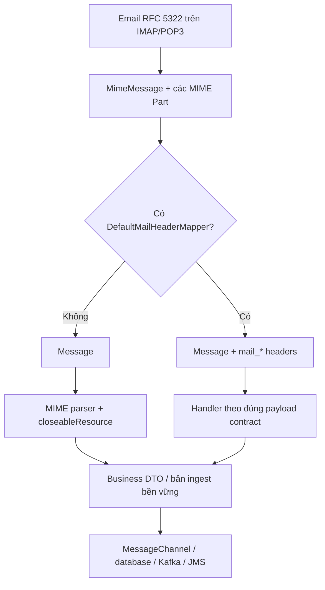
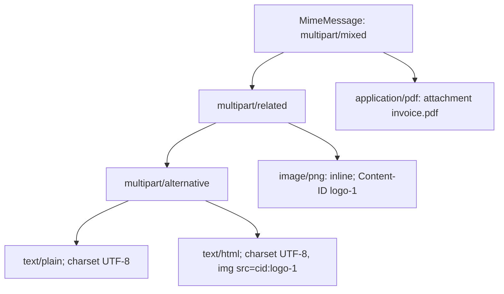
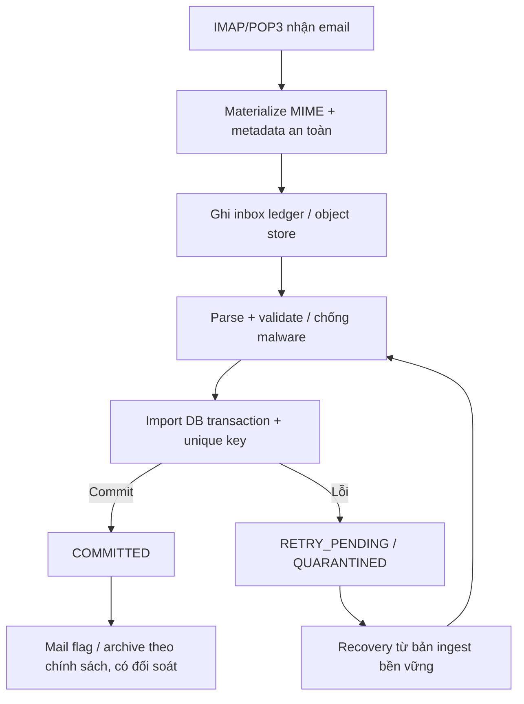

# Mail headers và cấu trúc MIME

## 1. Bài toán: một email không chỉ có subject và body

Hệ thống Spring Boot nhận thư vào `invoices@example.test`. Một email có tiêu đề `[INVOICE] INV-0042`, phần nội dung tiếng Việt, bản HTML có logo và tệp PDF đính kèm. Ứng dụng phải đọc đúng người gửi/người nhận, lấy nội dung text, lưu attachment vào vùng cách ly, kiểm tra dữ liệu và nhập hóa đơn vào database. Một luồng khác cần gửi email phản hồi có cả text và HTML, kèm báo cáo PDF.

Nếu coi email là **một chuỗi duy nhất**, ứng dụng dễ nhầm các lớp header, làm mất attachment khi transform, đọc sai charset hoặc giữ `MimeMessage` sau khi IMAP folder đã đóng. Bài này giải thích hai khái niệm liên quan nhưng không đồng nhất:

1. **Mail headers và MIME headers**: dữ liệu ở định dạng email Internet (`From`, `Subject`, `Content-Type`, `Content-Disposition`, `Content-ID`...) do Jakarta Mail đọc/ghi.
2. **Spring Integration `MessageHeaders`**: metadata nằm trên Spring `Message<?>`, dùng để định tuyến, ánh xạ các thuộc tính mail và kiểm soát vòng đời xử lý.

Bài thuộc chương **Adapter Mail** của module `SPRING_INTEGRATION_ADAPTERS`. Phạm vi module là kết nối hệ thống ngoài bằng inbound/outbound adapter, gateway, poller và `MessageChannel`, thực hành hợp đồng message, lỗi và vòng đời kết nối với file, SFTP, HTTP, JMS, AMQP, Kafka và database. Đối với mail adapter, **hợp đồng payload và header** đặc biệt quan trọng vì dữ liệu có thể gồm nhiều MIME part và được tải theo nhu cầu từ mail server.

Sau bài này, bạn có thể:

- Phân biệt RFC 5322 mail header, từng MIME part header và Spring Integration message header.
- Hiểu cây `multipart/mixed`, `multipart/alternative`, `multipart/related`, attachment và inline image.
- Dùng `MimeMessage`, `Multipart`, `BodyPart`, `Part`, `InternetAddress`, `DefaultMailHeaderMapper` và `MailHeaders` đúng vai trò.
- Chọn cấu hình inbound **giữ nguyên `MimeMessage`** hoặc **map header + body**, biết khi nào payload đổi từ `MimeMessage` sang `String`/`byte[]`.
- Gửi email text, HTML, inline image và attachment bằng `JavaMailSender`, `MimeMessageHelper`, `MimeMailMessage` qua outbound adapter.
- Quản lý charset, giải mã transfer encoding, đóng IMAP folder, giới hạn kích thước, xử lý tệp không tin cậy và phục hồi idempotent.

> **Phiên bản minh họa:** Spring Integration **6.5.x**, Spring Framework **6.2.x**, Java 17+ và Jakarta Mail (`jakarta.mail.*`). Các phiên bản Spring Integration 5.x cũ có thể dùng `javax.mail.*`. Mọi địa chỉ `example.test`, credential, dữ liệu và tên thư trong bài là giả lập; không cần gửi email thật.

## 2. Ba lớp header phải phân biệt

| Lớp | Ví dụ | Ai tạo/đọc? | Có mặt ở đâu? |
| --- | --- | --- | --- |
| **Email message headers** (RFC 5322) | `From`, `To`, `Subject`, `Date`, `Message-ID`, `Reply-To`, `Received` | Sender, mail server, Jakarta Mail `MimeMessage` | Phía đầu email, trước dòng trống tách body |
| **MIME entity headers** (RFC 2045–2049 và các phần mở rộng) | `Content-Type`, `Content-Transfer-Encoding`, `Content-Disposition`, `Content-ID` | Jakarta Mail `Part`/`BodyPart`, mail clients | Ở email gốc **và ở từng MIME part** |
| **Spring Integration `MessageHeaders`** | `MailHeaders.SUBJECT`, `MailHeaders.TO`, `MessageHeaders.ID`, `MessageHeaders.TIMESTAMP` | Spring Messaging và header mapper | Trong `Message<?>` đi qua `MessageChannel` |

Một email **có** `Subject: Báo cáo` chưa chắc Spring message có `message.getHeaders().get(MailHeaders.SUBJECT)`. Nếu inbound receiver **không** cấu hình `HeaderMapper<MimeMessage>`, payload mặc định là `MimeMessage` và các thông tin thư được đọc từ chính payload. Ngược lại, khi dùng `DefaultMailHeaderMapper`, trường `Subject` có thể được ánh xạ thành `mail_subject` trong Spring headers và body có thể trở thành payload khác kiểu.



**Header mail không phải bằng chứng xác thực.** Các trường `From`, `Reply-To`, `Message-ID` và `X-*` có thể bị giả mạo; `Received` có thể do nhiều máy chủ thêm vào; DKIM/SPF/DMARC cần được đánh giá bằng chính sách email security, không suy luận từ một chuỗi header tự khai báo.

## 3. Cấu trúc một email RFC 5322 ở mức văn bản

Email Internet có **header section**, một dòng trống và **body**. Ví dụ đơn giản (minh họa, không phải raw sample dùng trong test parser):

```text
From: Billing <billing@partner.example.test>
To: invoices@example.test
Subject: [INVOICE] INV-0042
Date: Mon, 23 Nov 2026 09:00:00 +0700
Message-ID: <inv-0042@partner.example.test>
MIME-Version: 1.0
Content-Type: text/plain; charset=UTF-8
Content-Transfer-Encoding: quoted-printable

Xin ch=C3=A0o, =C4=91=C3=A2y l=C3=A0 h=C3=B3a =C4=91=C6=A1n.
```

Các điểm quan trọng:

- **Dòng trống** kết thúc header section; nội dung bên dưới là body. Trên wire, email dùng cặp CRLF theo các RFC liên quan; đoạn code Java nên để thư viện chuẩn xử lý line ending.
- `Content-Type` khai báo kiểu dữ liệu và charset. `text/plain; charset=UTF-8` khác với `text/html; charset=UTF-8`.
- `Content-Transfer-Encoding` mô tả cách bytes được biểu diễn trên đường truyền; `quoted-printable` và `base64` thường dùng cho nội dung có ký tự phi ASCII hoặc nhị phân.
- `Message-ID` là một header danh tính mail do sender hoặc hạ tầng đặt; nó **không mặc định là khóa nghiệp vụ duy nhất đáng tin cậy**.
- Với header Unicode như subject tiếng Việt, Jakarta Mail có thể mã hóa theo cơ chế encoded-word; không tự cắt byte hoặc giải mã bằng charset mặc định của hệ điều hành.

**Đừng giải mã Base64 hai lần.** Khi lấy `Part.getInputStream()` hoặc `MimeMessage.getContent()` từ Jakarta Mail, thư viện thường đã xử lý `Content-Transfer-Encoding` cần thiết. Nếu bạn lại gọi `Base64.getDecoder()` trên bytes đã được giải mã, nội dung PDF/ảnh có thể bị hỏng.

## 4. Cây MIME: email có nhiều nội dung và attachment

MIME định nghĩa email dưới dạng **các thực thể (entity)**. Mỗi entity có header riêng và body riêng. `multipart/*` dùng một **boundary** để phân định các phần, có thể lồng nhau ở nhiều cấp.



| MIME content type | Mục đích | Hành vi đọc cần lưu ý |
| --- | --- | --- |
| `text/plain` | Nội dung văn bản thuần | `Part.getContent()` thường trả `String` theo charset |
| `text/html` | Nội dung HTML để mail client render | Nội dung không đáng tin; tránh hiển thị HTML thô trong admin UI |
| `multipart/alternative` | Nhiều phiên bản **cùng một nội dung**, ví dụ plain + HTML | Chọn phiên bản phù hợp, **không nối cả hai** thành hai bản thông báo |
| `multipart/mixed` | Nhiều phần độc lập, thường gồm nội dung và attachment | Duyệt `BodyPart` theo thứ tự, kiểm tra disposition |
| `multipart/related` | Nội dung HTML liên kết tới inline image/stylesheet qua CID | Ghép `Content-ID` với `cid:` nhưng không coi CID là URL đáng tin |
| `application/pdf`, `application/octet-stream` | Dữ liệu file/nhị phân | Đọc qua `InputStream`, kiểm tra magic bytes và giới hạn kích thước |
| `message/rfc822` | Một email khác được đính kèm/chuyển tiếp | `getContent()` có thể trả `Message`, cần duyệt đệ quy |

Một phần có `Content-Disposition: attachment; filename=...` thường được mail client hiển thị như tệp đính kèm. Một phần có `inline` và `Content-ID` có thể được dùng trực tiếp trong HTML. Tuy nhiên, **disposition và filename không đáng tin tuyệt đối**: một số mail không gắn disposition; một attachment có thể xuất hiện với `inline` hoặc có filename mà không có disposition. Parser nên xem **cả disposition, content type, filename và quan hệ part**.

### Multipart nesting quan trọng thế nào?

Đừng giả định `MimeMessage.getContent()` luôn là `String`, hoặc `multipart.getBodyPart(0)` luôn là text chính. Một email có thể chứa `multipart/mixed` lồng `multipart/alternative`, một `message/rfc822` lại chứa `multipart/mixed` khác. Parser phải **duyệt cây MIME có giới hạn độ sâu và số part** để tránh nested MIME làm cạn CPU hoặc bộ nhớ.

## 5. MIME headers ở từng part

| Header | Ví dụ | Giải thích |
| --- | --- | --- |
| `MIME-Version` | `1.0` | Cho biết thông điệp dùng MIME |
| `Content-Type` | `multipart/mixed; boundary=abc` | Kiểu nội dung và tham số; `boundary` phân định các part |
| `Content-Transfer-Encoding` | `base64` | Cách biểu diễn nội dung của **part cụ thể** khi truyền |
| `Content-Disposition` | `attachment; filename=invoice.pdf` | Gợi ý hiển thị/tên file, không phải đường dẫn an toàn |
| `Content-ID` | `<logo-1@example.test>` | Định danh inline content tham chiếu bởi `cid:` |
| `Content-Description` | `Hóa đơn tháng 11` | Mô tả tùy chọn, không bắt buộc |
| `Content-Language` | `vi` | Ngôn ngữ nội dung nếu sender cung cấp |

Trong `multipart`, mỗi `BodyPart` có **bộ headers riêng**. Header `Content-Type: multipart/mixed` của **email gốc** không đồng nghĩa tất cả part đều là `multipart/mixed`; mỗi part có thể là `text/plain`, `image/png` hoặc `application/pdf`.

Đoạn ví dụ rút gọn mô tả boundary và nested MIME. Chuỗi `[base64-PDF-data]` chỉ là ký hiệu mô phỏng, không phải Base64 hợp lệ để gửi:

```text
MIME-Version: 1.0
Content-Type: multipart/mixed; boundary="root-boundary"

--root-boundary
Content-Type: multipart/alternative; boundary="alt-boundary"

--alt-boundary
Content-Type: text/plain; charset=UTF-8

Vui lòng xem PDF đính kèm.
--alt-boundary
Content-Type: text/html; charset=UTF-8

<p>Vui lòng xem <strong>PDF</strong> đính kèm.</p>
--alt-boundary--
--root-boundary
Content-Type: application/pdf; name="invoice-0042.pdf"
Content-Disposition: attachment; filename="invoice-0042.pdf"
Content-Transfer-Encoding: base64

[base64-PDF-data]
--root-boundary--
```

**Không tự parse MIME bằng `split("--root-boundary")`.** Boundary là tham số do sender đặt; có thể được quote, escape, lồng nhau; body còn có các quy tắc encoding và line folding. Dùng Jakarta Mail `MimeMessage`, `Multipart`, `BodyPart` và thư viện xử lý MIME chuyên dụng khi cần nhiều tính năng.

## 6. Jakarta Mail API: `MimeMessage`, `Part`, `Multipart`, `BodyPart`

| API | Vai trò | Phương thức hay dùng |
| --- | --- | --- |
| `MimeMessage` | Một email với header và body, triển khai `Part` | `getSubject()`, `getFrom()`, `getRecipients(...)`, `getContent()`, `getMessageID()` |
| `Part` | Giao diện cho email hoặc phần của email | `isMimeType(...)`, `getContentType()`, `getDisposition()`, `getFileName()`, `getInputStream()` |
| `Multipart` | Tập các phần con | `getCount()`, `getBodyPart(index)` |
| `BodyPart` | Một thực thể MIME bên trong multipart | Header, body và `getContent()` |
| `InternetAddress` | Địa chỉ email theo cấu trúc Jakarta Mail | `getAddress()`, `getPersonal()`, `validate()` |
| `Flags` | Trạng thái mailbox, không phải MIME part header | `Flags.Flag.SEEN`, `DELETED`, `ANSWERED` |

Hầu hết parser dùng `Part.isMimeType("text/plain")` thay vì so sánh toàn bộ `part.getContentType()` bằng chuỗi đúng bằng `"text/plain"`, vì Content-Type có thể đi kèm `charset`, `name` và các tham số khác. Tương tự, `isMimeType("multipart/*")` hỗ trợ nhận diện nhóm multipart.

```java
import jakarta.mail.Part;

public static String describePart(Part part) throws Exception {
    String type = part.getContentType();
    String disposition = part.getDisposition();
    String fileName = part.getFileName();

    if (part.isMimeType("multipart/*")) {
        return "Multipart: " + type;
    }
    if (Part.ATTACHMENT.equalsIgnoreCase(disposition) || fileName != null) {
        return "Attachment candidate: " + fileName;
    }
    if (part.isMimeType("text/plain")) {
        return "Plain text";
    }
    return "Other MIME part: " + type;
}
```

Đây là **helper minh họa**, không phải một parser đầy đủ. `getFileName()` có thể trả tên bất ngờ, chuỗi không hợp lệ hoặc tên chứa đường dẫn. Chỉ dùng filename sau khi **chuẩn hóa để hiển thị**; không truyền trực tiếp vào `Path.resolve(...)` để ghi file. Quan trọng hơn, không cho phép metadata MIME quyết định người dùng nào có quyền truy cập tài liệu.

## 7. `MailHeaders`: cầu nối từ mail sang Spring Integration

`org.springframework.integration.mail.MailHeaders` khai báo các **constant key** có tiền tố `mail_`. Với inbound, `DefaultMailHeaderMapper` dùng các key đó để đưa metadata vào `MessageHeaders`. Với outbound, `MailSendingMessageHandler` có thể đọc các key tương ứng để đặt thông tin trên email đang gửi.

| Constant Spring Integration | Giá trị key | Ý nghĩa |
| --- | --- | --- |
| `MailHeaders.FROM` | `mail_from` | Chuỗi địa chỉ From của email |
| `MailHeaders.TO` | `mail_to` | Mảng địa chỉ To |
| `MailHeaders.CC` | `mail_cc` | Mảng địa chỉ Cc |
| `MailHeaders.BCC` | `mail_bcc` | Mảng địa chỉ Bcc, có thể không xuất hiện trên thư đã nhận |
| `MailHeaders.REPLY_TO` | `mail_replyTo` | Nơi nhận phản hồi |
| `MailHeaders.SUBJECT` | `mail_subject` | Chủ đề |
| `MailHeaders.RECEIVED_DATE` | `mail_receivedDate` | Ngày nhận từ mail store, nếu có |
| `MailHeaders.CONTENT_TYPE` | `mail_contentType` | Content-Type của **email gốc** |
| `MailHeaders.SIZE` | `mail_size` | Kích thước email nếu có |
| `MailHeaders.LINE_COUNT` | `mail_lineCount` | Số dòng nếu server/provider cung cấp |
| `MailHeaders.EXPUNGED` | `mail_expunged` | Trạng thái expunged của thư |
| `MailHeaders.RAW_HEADERS` | `mail_raw` | MultiValueMap các header gốc |
| `MailHeaders.FLAGS` | `mail_flags` | Constant có sẵn, không suy ra mọi mapper đều tự map đầy đủ IMAP flags |
| `MailHeaders.ATTACHMENT_FILENAME` | `mail_attachmentFilename` | Header outbound khi payload `byte[]` trở thành attachment |
| `MailHeaders.MULTIPART_MODE` | `mail_multipartMode` | Tùy chọn liên quan chế độ multipart khi tạo MIME theo handler |

Ngoài `mail_*`, Spring Messaging còn có `MessageHeaders.ID`, `MessageHeaders.TIMESTAMP`, `MessageHeaders.CONTENT_TYPE`, `REPLY_CHANNEL`, `ERROR_CHANNEL`. **`MailHeaders.CONTENT_TYPE` (`mail_contentType`) và `MessageHeaders.CONTENT_TYPE` (`contentType`) khác key, khác ý nghĩa.** Khi inbound mapper bật, `mail_contentType` phản ánh content type của email gốc, còn `contentType` phản ánh kiểu payload Spring message đã map.

Ví dụ khi email gốc có `multipart/mixed`, mapper có thể cho:

```text
mail_subject      = "[INVOICE] INV-0042"
mail_contentType  = "multipart/mixed; boundary=..."
contentType       = "application/octet-stream"
payload          = byte[]  // khi mapper chuyển Part/Multipart thành bytes
```

**Không dùng `mail_contentType` để suy payload là `Multipart`.** Kiểu runtime của payload còn phụ thuộc `HeaderMapper`, `simpleContent` và `embeddedPartsAsBytes`; luôn xác định hợp đồng đầu vào cho downstream handler.

## 8. `DefaultMailHeaderMapper`: mapping inbound đổi cả header **và payload**

Spring Integration mặc định đưa `MimeMessage` làm payload khi **không** cấu hình header mapper. Khi cấu hình `DefaultMailHeaderMapper`, các header mail được map ra Spring headers, còn payload được lấy từ **nội dung mà Jakarta Mail render**:

| Cấu hình inbound | Payload thường thấy | Headers | Rủi ro |
| --- | --- | --- | --- |
| Không mapper, `simpleContent(false)` | `MimeMessage` | Không tự có bộ `mail_*` đầy đủ | Downstream phải đọc MIME từ payload |
| Có `DefaultMailHeaderMapper`, `text/*` | `String` | Có `mail_subject`, `mail_from`, `mail_contentType`... | Cast sang `MimeMessage` sẽ lỗi |
| Có mapper, multipart hoặc embedded `Part` | Thường `byte[]` (mặc định `embeddedPartsAsBytes=true`) | `mail_contentType` của mail và `contentType` của payload | Có thể eager-load lượng bytes lớn |
| Có mapper, `embeddedPartsAsBytes(false)` | Có thể là `Part`/`Multipart` | Headers được map | Part không phù hợp serialization/async queue |
| `simpleContent(true)` | Thể hiện nội dung theo cơ chế body-only | Tùy có mapper hay không | Thay đổi hợp đồng payload, cần test với server |

Ví dụ tạo receiver **cho pipeline mapping**, không dùng cùng một receiver với flow raw MIME ở mục sau:

```java
import org.springframework.context.annotation.Bean;
import org.springframework.context.annotation.Configuration;
import org.springframework.integration.mail.ImapMailReceiver;
import org.springframework.integration.mail.support.DefaultMailHeaderMapper;

@Configuration
public class MappedMailReceiverConfiguration {

    @Bean
    public ImapMailReceiver mappedReceiver() {
        ImapMailReceiver receiver = new ImapMailReceiver(
                "imaps://mail-reader@imap.example.test:993/INBOX");

        receiver.setHeaderMapper(new DefaultMailHeaderMapper());
        receiver.setEmbeddedPartsAsBytes(true); // Mặc định khi mapper được dùng.
        receiver.setShouldDeleteMessages(false);
        // Ví dụ wiring: production còn phải cấu hình Authenticator,
        // TLS hostname verification, timeout và secret phù hợp.
        return receiver;
    }
}
```

Ví dụ trên **chỉ minh họa hành vi mapping**, không phải cấu hình IMAP production hoàn chỉnh. Không copy endpoint mẫu rồi chạy mà thiếu xác thực/TLS. Mỗi pipeline phải chọn **một trong hai hợp đồng chính**: giữ `MimeMessage` để parse cây MIME, hoặc map sang body/header để xử lý nhanh các email đơn giản.

### Đọc header đã được map

```java
import org.springframework.integration.mail.MailHeaders;
import org.springframework.messaging.Message;

public static void inspectMappedMessage(Message<?> message) {
    String subject = message.getHeaders()
            .get(MailHeaders.SUBJECT, String.class);
    String from = message.getHeaders()
            .get(MailHeaders.FROM, String.class);
    Object payload = message.getPayload();

    if (payload instanceof String text) {
        // Xử lý plain-text body, validate trước khi nhập DB.
    } else if (payload instanceof byte[] data) {
        // Multipart/Part có thể đã được map thành bytes.
        // Áp giới hạn dung lượng trước khi xử lý và đừng giả định PDF duy nhất.
    } else {
        // Cấu hình khác có thể tạo loại payload khác.
    }
}
```

`mail_raw` có thể chứa địa chỉ cá nhân, tracking headers, message routing trace hoặc dữ liệu nhạy cảm. **Không log toàn bộ `MessageHeaders`** chỉ vì bật header mapper. Header mapper phục vụ **trao đổi dữ liệu**, không tự thực hiện redaction hoặc xác thực sender.

## 9. Inbound Java DSL: giữ nguyên `MimeMessage` để parse MIME phức tạp

Khi mục tiêu là lấy attachment hoặc phân tích MIME đa tầng, hợp đồng **raw MIME** thường rõ ràng hơn: không cấu hình mapper, dùng `simpleContent(false)`, `autoCloseFolder(false)` trên IMAP receiver và handler đóng tài nguyên sau khi đọc xong.

```groovy
dependencies {
    implementation 'org.springframework.boot:spring-boot-starter-integration'
    implementation 'org.springframework.integration:spring-integration-mail'
    implementation 'org.springframework.boot:spring-boot-starter-mail'
}
```

Ví dụ `application.yml` chỉ chứa placeholder:

```yaml
app:
  mail:
    inbox-uri: ${MAIL_INBOX_URI:imaps://invoices%40example.test@imap.example.test:993/INBOX}
    user: ${MAIL_INBOX_USER:invoices@example.test}
    password: ${MAIL_INBOX_PASSWORD}
```

```java
import java.util.Properties;

import jakarta.mail.Authenticator;
import jakarta.mail.PasswordAuthentication;

import org.springframework.beans.factory.annotation.Value;
import org.springframework.context.annotation.Bean;
import org.springframework.context.annotation.Configuration;
import org.springframework.integration.mail.ImapMailReceiver;

@Configuration
public class RawMimeInboxConfiguration {

    @Bean
    public ImapMailReceiver rawMimeReceiver(
            @Value("${app.mail.inbox-uri}") String inboxUri,
            @Value("${app.mail.user}") String user,
            @Value("${app.mail.password}") String password) {

        ImapMailReceiver receiver = new ImapMailReceiver(inboxUri);
        receiver.setJavaMailAuthenticator(new Authenticator() {
            @Override
            protected PasswordAuthentication getPasswordAuthentication() {
                return new PasswordAuthentication(user, password);
            }
        });

        Properties props = new Properties();
        props.setProperty("mail.store.protocol", "imaps");
        props.setProperty("mail.imaps.ssl.enable", "true");
        props.setProperty("mail.imaps.ssl.checkserveridentity", "true");
        props.setProperty("mail.imaps.connectiontimeout", "10000");
        props.setProperty("mail.imaps.timeout", "30000");
        props.setProperty("mail.imaps.writetimeout", "30000");
        props.setProperty("mail.debug", "false");

        receiver.setJavaMailProperties(props);
        receiver.setShouldDeleteMessages(false);
        receiver.setShouldMarkMessagesAsRead(false);
        receiver.setMaxFetchSize(1);
        receiver.setSimpleContent(false);
        receiver.setAutoCloseFolder(false);
        // KHÔNG gọi setHeaderMapper cho flow giữ raw MimeMessage.
        return receiver;
    }
}
```

```java
import org.springframework.context.annotation.Bean;
import org.springframework.context.annotation.Configuration;
import org.springframework.integration.dsl.IntegrationFlow;
import org.springframework.integration.dsl.Pollers;
import org.springframework.integration.mail.ImapMailReceiver;
import org.springframework.integration.mail.dsl.Mail;

@Configuration
public class RawMimePollingFlow {

    @Bean
    public IntegrationFlow receiveRawMime(
            ImapMailReceiver rawMimeReceiver,
            IncomingMimeHandler incomingMimeHandler) {

        return IntegrationFlow.from(
                        Mail.imapInboundAdapter(rawMimeReceiver),
                        endpoint -> endpoint.poller(
                                Pollers.fixedDelay(15_000)
                                        .maxMessagesPerPoll(1)))
                .handle(incomingMimeHandler)
                .get();
    }
}
```

`shouldMarkMessagesAsRead(false)` không bảo đảm receiver không gắn **user flag hoặc fallback `\Flagged`** để nhận diện thư đã được chọn. Cần business ledger để khôi phục thư bị lỗi sau bước fetch. Không tạo đồng thời một flow mapped MIME khác trên **cùng inbox** nếu chưa phân chia trách nhiệm; hai receiver có thể cạnh tranh flag hoặc phát trùng.

## 10. Đọc raw header và nội dung trong `IncomingMimeHandler`

Với `autoCloseFolder(false)`, Spring Integration đặt **`IntegrationMessageHeaderAccessor.CLOSEABLE_RESOURCE`** trong message. Tài nguyên đó giữ vòng đời IMAP folder; downstream phải gọi `close()` **sau khi** hoàn tất việc đọc MIME/attachment, kể cả khi parse hoặc DB import lỗi.

```java
import java.io.Closeable;
import java.io.IOException;

import jakarta.mail.MessagingException;
import jakarta.mail.internet.MimeMessage;

import org.springframework.integration.StaticMessageHeaderAccessor;
import org.springframework.messaging.Message;
import org.springframework.messaging.MessageHandler;
import org.springframework.messaging.MessageHandlingException;
import org.springframework.stereotype.Component;

@Component
public class IncomingMimeHandler implements MessageHandler {

    private final RawMimeIngestService ingestService;

    public IncomingMimeHandler(RawMimeIngestService ingestService) {
        this.ingestService = ingestService;
    }

    @Override
    public void handleMessage(Message<?> message) {
        Closeable resource = StaticMessageHeaderAccessor
                .getCloseableResource(message);

        try (Closeable folder = resource == null ? () -> { } : resource) {
            if (!(message.getPayload() instanceof MimeMessage mime)) {
                throw new IllegalArgumentException(
                        "Flow này yêu cầu payload MimeMessage");
            }

            String subject = mime.getSubject();
            String messageId = mime.getMessageID();
            String mimeType = mime.getContentType();

            // Ingest hoàn tất lưu dữ liệu MIME cần thiết trước khi trả về.
            // Không chuyển raw MimeMessage sang broker hoặc thread khác.
            ingestService.ingestOnce(messageId, subject, mimeType, mime);

        } catch (MessagingException | IOException ex) {
            throw new MessageHandlingException(
                    message, "Lỗi đọc MIME hoặc đóng mail folder", ex);
        }
    }
}

public interface RawMimeIngestService {
    /**
     * Đọc và lưu đủ dữ liệu cần xử lý khi folder còn mở;
     * dùng khóa nghiệp vụ bền vững/idempotent, chỉ trả về sau commit.
     */
    void ingestOnce(String messageId, String subject,
                    String mimeType, MimeMessage mime)
            throws MessagingException, IOException;
}
```

**Cần chú ý ngoại lệ:** đoạn handler chỉ bọc lỗi `MessagingException`/`IOException` phục vụ giải thích, các lỗi validation/runtime có thể truyền lên framework. `try-with-resources` vẫn đóng folder ở mọi nhánh. `RawMimeIngestService` phải **đọc hoặc materialize nội dung cần thiết khi folder còn mở**; nếu nó chỉ lưu con trỏ tới `MimeMessage`, sau khi method trả về folder bị đóng và attachment lazy-load có thể lỗi.

Đối với **POP3**, cơ chế `autoCloseFolder(false)` không áp dụng như IMAP, vì receiver phải mở/đóng folder khi tìm thư. Không sao chép flow này rồi giả định POP3 vẫn giữ mail folder cho handler; cần một quy trình materialize được kiểm thử hoặc ưu tiên IMAP khi cần xử lý MIME lazy-load.

## 11. Duyệt cây MIME đúng cách và có giới hạn tài nguyên

Một parser thực tế phải phân biệt multipart, forwarded message, body text và attachment. Ví dụ bên dưới chỉ minh họa **thuật toán duyệt và phân loại**, giới hạn độ sâu/số part. Phần lưu file được tách riêng để dễ áp chính sách bảo mật.

```java
import java.io.IOException;

import jakarta.mail.BodyPart;
import jakarta.mail.Message;
import jakarta.mail.MessagingException;
import jakarta.mail.Multipart;
import jakarta.mail.Part;

public final class MimeTreeWalker {

    private static final int MAX_DEPTH = 8;
    private static final int MAX_PARTS = 40;

    private int visitedParts;

    public void visit(Part part, int depth) throws MessagingException, IOException {
        if (depth > MAX_DEPTH || ++visitedParts > MAX_PARTS) {
            throw new IllegalArgumentException("MIME quá sâu hoặc quá nhiều part");
        }

        if (part.isMimeType("multipart/*")) {
            Object content = part.getContent();
            if (!(content instanceof Multipart multipart)) {
                throw new IllegalArgumentException("Multipart không hợp lệ");
            }
            for (int i = 0; i < multipart.getCount(); i++) {
                BodyPart child = multipart.getBodyPart(i);
                visit(child, depth + 1);
            }
            return;
        }

        if (part.isMimeType("message/rfc822")) {
            Object nested = part.getContent();
            if (nested instanceof Message message) {
                visit(message, depth + 1);
            }
            return;
        }

        String disposition = part.getDisposition();
        String fileName = part.getFileName();
        boolean isAttachment =
                Part.ATTACHMENT.equalsIgnoreCase(disposition)
                || fileName != null;

        if (isAttachment) {
            // KHÔNG ghi fileName trực tiếp thành path; gọi bộ lưu
            // quarantine có quota và kiểm tra nội dung (mục 12).
            return;
        }

        if (part.isMimeType("text/plain")) {
            Object body = part.getContent();
            if (body instanceof String text && text.length() <= 200_000) {
                // Chọn nội dung phù hợp theo cấu trúc alternative.
            }
        }

        // Các loại khác như text/html, image/*, application/*
        // cần chiến lược riêng; không tự động chạy hoặc render HTML.
    }
}
```

Đây **không** phải implementation đầy đủ của `multipart/alternative`: trong thực tế, bạn phải chọn một đại diện ưu tiên (ví dụ `text/plain` hoặc HTML đã sanitize) và biết phần nào thuộc cùng một alternative group. Không nối mọi text part thành một nội dung, không ghi mọi inline image thành attachment cho người dùng, không tự execute `message/rfc822` và không tin file extension do sender cung cấp.

## 12. Lưu attachment an toàn: tên file là dữ liệu không đáng tin

Khi part được xác định là attachment, ứng dụng cần một **vùng cách ly (quarantine)** với quota, giới hạn byte và tách biệt quyền truy cập trước khi đưa tài liệu tới business service. Không ghi attachment thẳng theo `part.getFileName()`; tên có thể chứa `../`, đường dẫn tuyệt đối, ký tự điều khiển, Unicode gây nhầm hoặc tên trùng với file cũ.

```java
import java.io.IOException;
import java.io.InputStream;
import java.io.OutputStream;
import java.nio.file.Files;
import java.nio.file.Path;

import jakarta.mail.MessagingException;
import jakarta.mail.Part;

public final class QuarantineAttachmentWriter {

    private static final long MAX_BYTES_PER_PART = 10_000_000L;

    public record StagedFile(Path path, long size) { }

    public StagedFile stage(Part part, Path quarantineDirectory)
            throws MessagingException, IOException {

        // Thư mục đã được ứng dụng tạo/cấp quyền từ cấu hình tin cậy.
        Path target = Files.createTempFile(
                quarantineDirectory, "mime-", ".quarantine");

        long total = 0;
        try (InputStream input = part.getInputStream();
             OutputStream output = Files.newOutputStream(target)) {

            byte[] buffer = new byte[8192];
            int size;
            while ((size = input.read(buffer)) != -1) {
                total += size;
                if (total > MAX_BYTES_PER_PART) {
                    throw new IOException("Attachment vượt giới hạn byte");
                }
                output.write(buffer, 0, size);
            }
            return new StagedFile(target, total);

        } catch (IOException | MessagingException | RuntimeException ex) {
            Files.deleteIfExists(target);
            throw ex;
        }
    }
}
```

**Yêu cầu khi tích hợp:** thư mục quarantine phải tồn tại, được cấp quyền tối thiểu và có giới hạn disk quota; code trên chưa tự tạo thư mục. Mỗi lần gọi chỉ giới hạn **một** attachment: hệ thống cần thêm **tổng byte/toàn mail**, số attachment, số MIME part, thời gian parse và giới hạn độ lớn sau giải nén. Sau khi ghi, hãy kiểm tra magic bytes/schema, quét malware nếu có rủi ro, mã hóa khi lưu và chỉ **publish đường dẫn/tài liệu** sau khi trạng thái kiểm tra cho phép. Xử lý cleanup staging khi pipeline lỗi hoặc thời gian lưu hết hạn.

`part.getInputStream()` trả về dữ liệu đã được mail provider giải mã transfer encoding theo giao diện Jakarta Mail; không mặc định cần `Base64.decode` nữa. Đối với `text/plain`, dùng `part.getContent()` theo charset thay vì tự gọi `new String(bytes)` bằng charset mặc định.

## 13. Charset tiếng Việt, tiêu đề và nội dung transfer encoding

Một thư có thể sử dụng `UTF-8`, `ISO-8859-*`, `windows-1258` hoặc charset khác do sender khai báo. `Content-Type` chứa tham số charset; `Content-Transfer-Encoding` mô tả **cách bytes được chuyển** trên SMTP/IMAP, không phải charset. Ví dụ `text/plain; charset=UTF-8` kết hợp `base64` vẫn là văn bản UTF-8 sau khi Base64 được decode.

| Khái niệm | Ví dụ | Vì sao phải tách? |
| --- | --- | --- |
| Charset | `charset=UTF-8` | Chuyển bytes thành ký tự Unicode |
| Transfer encoding | `base64`, `quoted-printable`, `7bit` | Chuyển nội dung qua kênh mail phù hợp giao thức |
| Encoded-word của header | Header `Subject` có non-ASCII | Mã hóa header text theo quy tắc riêng |
| MIME type | `text/html`, `application/pdf` | Quyết định cách xử lý nội dung, không phải cách xác thực |

Với Jakarta Mail, `mime.getSubject()` thường cho subject đã được decode phù hợp; `part.getContent()` cho text đã xử lý charset theo provider. **Không** tự xóa dấu tiếng Việt, decode bằng `StandardCharsets.UTF_8` trên chuỗi đã có sẵn, hoặc cắt một `String` thành bytes rồi suy encoding từ header một cách thiếu kiểm soát.

Đối với filename Unicode, RFC 2231 và các mở rộng liên quan có cơ chế tham số có charset. Tên file có thể bị encode/escape khác nhau tùy mail client. Parser nên để Jakarta Mail xử lý trước, sau đó vẫn phải **sanitize** tên hiển thị, chặn path traversal và chuẩn hóa theo chính sách filesystem/Unicode của ứng dụng.

## 14. Outbound: từ `MailHeaders` đến SMTP message

Khi **gửi** email bằng Spring Integration, `MailSendingMessageHandler` đọc payload và mail headers. Nếu payload là `String`, handler có thể tạo thư plain text; nếu payload là `MailMessage` của Spring, handler dùng các thuộc tính object đó; nếu payload là `byte[]`, nó có thể tạo attachment và cần `MailHeaders.ATTACHMENT_FILENAME`.

```java
import org.springframework.context.annotation.Bean;
import org.springframework.context.annotation.Configuration;
import org.springframework.integration.dsl.IntegrationFlow;
import org.springframework.integration.mail.dsl.Mail;
import org.springframework.mail.javamail.JavaMailSender;

@Configuration
public class MailOutboundFlow {

    @Bean
    public IntegrationFlow sendMail(JavaMailSender mailSender) {
        return IntegrationFlow.from("outboundMailRequests")
                .handle(Mail.outboundAdapter(mailSender))
                .get();
    }
}
```

```java
import org.springframework.integration.mail.MailHeaders;
import org.springframework.messaging.MessageChannel;
import org.springframework.messaging.support.MessageBuilder;

public static void sendPlainText(MessageChannel outboundMailRequests) {
    outboundMailRequests.send(MessageBuilder
            .withPayload("Báo cáo INV-0042 đã sẵn sàng.")
            .setHeader(MailHeaders.TO,
                    new String[]{"operations@example.test"})
            .setHeader(MailHeaders.FROM, "notifications@example.test")
            .setHeader(MailHeaders.REPLY_TO, "support@example.test")
            .setHeader(MailHeaders.SUBJECT, "Báo cáo hóa đơn 0042")
            .build());
}
```

Điểm cần nhớ: **outbound header có thể ghi đè** giá trị tương ứng trong `MailMessage` payload. Không cho client HTTP tự đặt `MailHeaders.FROM`, `MailHeaders.BCC` hoặc thay To sau khi service đã xác nhận quyền người nhận. `MailHeaders.FROM` là header hiển thị `From`, **không tự bảo đảm bằng SMTP envelope `MAIL FROM`**; provider có thể dùng envelope sender khác để nhận bounce và đáp ứng SPF/DKIM/DMARC.

## 15. Tạo `multipart/alternative` và attachment qua `MimeMessageHelper`

Khi cần plain text + HTML + PDF + inline logo, nên sử dụng `JavaMailSender#createMimeMessage()` và `MimeMessageHelper`. Sau đó bọc MIME thành **`MimeMailMessage`** (Spring `MailMessage`) để outbound adapter có thể gửi; một raw `jakarta.mail.internet.MimeMessage` không tự là Spring `MailMessage`.

```java
import jakarta.mail.MessagingException;
import jakarta.mail.internet.MimeMessage;

import org.springframework.core.io.ByteArrayResource;
import org.springframework.mail.javamail.JavaMailSender;
import org.springframework.mail.javamail.MimeMailMessage;
import org.springframework.mail.javamail.MimeMessageHelper;
import org.springframework.messaging.MessageChannel;
import org.springframework.messaging.support.MessageBuilder;

public static void sendMimeInvoice(
        JavaMailSender sender,
        MessageChannel outboundMailRequests,
        byte[] pdf,
        byte[] approvedLogoPng) throws MessagingException {

    if (pdf == null || pdf.length == 0 || pdf.length > 5_000_000
            || approvedLogoPng == null || approvedLogoPng.length > 500_000) {
        throw new IllegalArgumentException("MIME resources không hợp lệ");
    }

    MimeMessage raw = sender.createMimeMessage();
    MimeMessageHelper helper =
            new MimeMessageHelper(raw, true, "UTF-8");

    helper.setFrom("reports@example.test");
    helper.setTo("operations@example.test");
    helper.setSubject("Hóa đơn INV-0042");
    helper.setText(
            "Vui lòng xem hóa đơn PDF đính kèm.",
            "<html><body><p>Hóa đơn <strong>INV-0042</strong></p>"
                + "</body></html>");

    // Inline resources phải thêm SAU khi setText(...).
    helper.addInline("company-logo",
            new ByteArrayResource(approvedLogoPng), "image/png");
    helper.addAttachment("invoice-0042.pdf",
            new ByteArrayResource(pdf), "application/pdf");

    MimeMailMessage springMail = new MimeMailMessage(helper);
    outboundMailRequests.send(
            MessageBuilder.withPayload(springMail).build());
}
```

`helper.setText(plain, html)` tạo các alternative để email client chọn; `addInline` tạo phần có `Content-ID` phù hợp tham chiếu `cid:company-logo`; `addAttachment` tạo file riêng. `MimeMessageHelper` thiết kế MIME tree theo multipart mode; **không** tự chọn `boundary` hoặc tự ghép raw MIME. Việc thêm inline resource **sau** `setText` là quan trọng để mail client nhận ra tham chiếu CID đúng cấu trúc.

**Giới hạn của ví dụ:** recipient và file đã được cố định/kiểm tra cho môi trường mẫu. Trong production, validate recipient ownership/consent và sanitize template HTML trước khi gọi. `ByteArrayResource` chỉ hợp với file nhỏ; attachment lớn cần storage có lifecycle và quyền rõ ràng. Nếu đưa MIME payload qua queue bất đồng bộ, đừng xóa file/đóng nguồn trước khi SMTP worker gửi xong.

### Một attachment từ `byte[]` dùng header nào?

```java
import org.springframework.integration.mail.MailHeaders;
import org.springframework.messaging.support.MessageBuilder;

// Trích đoạn khi validatedPdf đã được kiểm tra kích thước và nội dung.
var request = MessageBuilder.withPayload(validatedPdf)
        .setHeader(MailHeaders.FROM, "reports@example.test")
        .setHeader(MailHeaders.TO, new String[]{"operations@example.test"})
        .setHeader(MailHeaders.SUBJECT, "File hóa đơn")
        .setHeader(MailHeaders.ATTACHMENT_FILENAME, "invoice-0042.pdf")
        .build();
```

Đối với một attachment đơn giản, `mail_attachmentFilename` giúp handler xác định tên đính kèm. Với nhiều tệp, text alternative và inline images, ưu tiên dựng `MimeMessageHelper` đầy đủ thay vì dựa vào một tập custom headers tùy ý.

## 16. `MailToStringTransformer` giải quyết gì và không giải quyết gì?

Spring Integration cung cấp `MailToStringTransformer` / `Mail.toStringTransformer()` để chuyển mail payload thành `String`. Đây là công cụ tiện ích cho những flow chỉ cần văn bản, nhưng **không phải bộ phân tích đầy đủ mọi cây MIME** và không làm cho attachment tự được scan/validate. Khi cần phân biệt `multipart/alternative` và attachment, giữ `MimeMessage` rồi dùng parser có chiến lược rõ.

```java
import org.springframework.integration.mail.dsl.Mail;

// Trích đoạn DSL từ flow nhận MimeMessage:
.transform(Mail.toStringTransformer())
.handle(textProcessingService, "acceptText")
```

Chỉ dùng trích đoạn khi đầu vào transformer phù hợp; cần kiểm thử với mail text, HTML, multipart và forwarded message của provider thực tế. Đừng đưa `String` đã được transform vào service cần kiểm tra chữ ký/tập part rồi mong có thể khôi phục nguyên raw MIME từ đó.

## 17. MIME parsing, mail security và boundary tin cậy

Email là dữ liệu **không đáng tin cậy**, kể cả khi đã đi qua IMAP được TLS bảo vệ. TLS xác nhận kênh tới mail server; nó không chứng minh mỗi sender và attachment đều an toàn.

Các biện pháp cần có:

1. **Kiểm tra sender độc lập:** kết hợp account/partner allowlist, kết quả xác thực email từ hạ tầng, chữ ký nội dung hoặc business contract; `From`/`Reply-To` chỉ là metadata.
2. **Giới hạn MIME tree:** cap độ sâu, số part, tổng bytes, attachment size, số file và thời gian parse; không để multipart/ZIP bomb tiêu hao tài nguyên.
3. **Chặn path traversal:** filename từ `Content-Disposition` không được quyết định đường dẫn hệ thống; lưu bằng tên ngẫu nhiên trong quarantine.
4. **Phân loại file theo nội dung:** content-type/file extension do sender có thể giả; kiểm tra signature/schema và scan malware trước khi publish.
5. **HTML an toàn:** không render HTML email thô trong giao diện nội bộ không có sanitizer/CSP phù hợp; chú ý link, `cid:` và remote images/tracking pixel.
6. **Không log dữ liệu riêng tư:** `mail_raw`, full MIME, body, attachment, token, địa chỉ người nhận/Bcc và auth headers có thể chứa thông tin nhạy cảm.
7. **Chặn header injection khi gửi:** validate `To`, `From`, `Reply-To`, Subject; không cho người dùng ngoài gắn CRLF để tạo header bổ sung.
8. **Định danh nghiệp vụ:** `Message-ID` có thể trùng/thiếu/giả; dùng khóa nghiệp vụ và unique constraint để ngăn import hoặc gửi lặp.

### Bcc và danh tính giao thức

Đối với thư gửi, `To`/`Cc` là header hiển thị, `Bcc` là nhóm người nhận ẩn và SMTP envelope recipient mới là danh sách thực sự dùng để chuyển thư. Mail được giao đến recipient thường không mang danh sách Bcc để bảo vệ riêng tư. Đừng xem một `MimeMessage` nhận được không có `Bcc` là bằng chứng không có người nhận Bcc ban đầu. `Return-Path` và SMTP envelope sender còn khác `From` dùng cho hiển thị.

## 18. Metadata, idempotency và lỗi giữa quá trình nhận mail

Một IMAP receiver có thể đánh dấu `\Seen`, user flag hoặc `\Flagged` khi nhận thư; điều đó có thể xảy ra **trước khi downstream importer commit**. Nếu handler parse MIME lỗi, poll tiếp theo có thể không chọn mail vì flags đã thay đổi. Với POP3, khi không xóa mail, thư cũ có thể được tải lại sau restart; khi bật delete quá sớm lại có nguy cơ mất nguồn retry. **Mail headers không phải cơ chế transaction với database.**



Ví dụ một inbox ledger có `mailbox_account`, `folder`, `uid_validity`, `uid`, `message_id`, `content_hash`, `business_invoice_id`, `mime_reference`, `status`, `attempt_count`, `last_error`, `updated_at`. **IMAP UID** hữu ích trong phạm vi `(mailbox, folder, UIDVALIDITY)`; **business invoice ID** mới là khóa nghiệp vụ để tránh hai email khác nhau nhập cùng hóa đơn. Đừng lưu nguyên raw MIME lâu vô hạn nếu chưa có retention và quyền truy cập phù hợp.

Đối với outbound, `MailSendingMessageHandler` có thể gửi xong SMTP `DATA` nhưng client timeout trước phản hồi. Một retry vô điều kiện có thể tạo hai mail. Dùng outbox với trạng thái `REQUESTED`, `SUBMITTED_TO_RELAY`, `SUBMISSION_UNKNOWN`, `BOUNCED`, `DELIVERED` (khi có provider event đáng tin). Một thành công của Spring `MessageChannel.send()` không tự bảo đảm người nhận đã nhận hoặc đọc thư.

## 19. Lỗi điển hình và phương pháp chẩn đoán

| Hiện tượng | Khả năng | Hướng xử lý |
| --- | --- | --- |
| `ClassCastException` khi cast payload sang `MimeMessage` | Receiver đang dùng header mapper | Kiểm tra hợp đồng mapped vs raw MIME; sửa consumer |
| `FolderClosedException` khi đọc PDF | IMAP folder đã đóng trước khi lazy-load | `autoCloseFolder(false)` và đóng closeable resource sau parse |
| `OutOfMemoryError` với mail multipart | Mapper eager-load Part thành `byte[]`, file quá lớn | Giới hạn dữ liệu hoặc dùng raw MIME streaming có quota |
| Thư text tiếng Việt bị lỗi font | Đọc sai charset hoặc decode lại | Dùng `getContent()`/Jakarta Mail, kiểm tra `charset` |
| File PDF hỏng sau giải mã | Base64 decode hai lần hoặc lưu raw encoded text | Dùng `part.getInputStream()` cho bytes đã giải mã |
| Email HTML hiển thị sai logo | `Content-ID`/CID không khớp hoặc thứ tự MIME sai | `MimeMessageHelper.addInline` sau `setText` |
| Attachment lưu thành `../secret.pdf` | Dùng filename từ sender làm filesystem path | Dùng temp filename ở quarantine, validate/scan |
| Bcc lộ trong log | Ghi toàn bộ `mail_raw` hoặc Spring headers | Redact, giới hạn log và retention |
| Mail được nhận nhưng DB chưa commit | Receiver gắn flag trước importer | Inbox ledger và recovery riêng |
| Raw `MimeMessage` đưa vào Kafka không đọc được | Part không serializable hoặc folder đã đóng | Materialize DTO/bytes vào kho bền vững trước |
| `Subject` giả hoặc From lạ được chấp nhận | Tin email headers như xác thực | Kiểm tra sender/partner và quyền nghiệp vụ độc lập |
| Tạo email outbound trùng | Retry SMTP sau timeout chưa rõ kết quả | Outbox, classify exception và reconciliation |

Theo dõi metric `mail_received_total`, `mail_mime_part_total`, `mail_attachment_bytes`, `mail_mime_parse_failed_total`, `mail_folder_open`, `mail_ingest_pending`, `mail_submit_unknown`, `mail_outbox_pending`. Log nên có `mailboxId`, `correlationId`, `messageType`, `partCount`, mã lỗi và status, nhưng không cần ghi nguyên `mail_raw`/body/attachment.

## 20. Bài thực hành kiểm thử end-to-end

Dùng SMTP/IMAP **sandbox** hoặc mail test server do nhóm quản lý, dữ liệu giả, TLS đã xác minh và credential test. Không upload mail chứa dữ liệu khách hàng hoặc thử attachment độc hại trên mailbox production.

1. **Plain text UTF-8:** gửi email tiếng Việt, nhận bằng raw MIME, dùng `getSubject()` và `getContent()`, kiểm tra không lỗi dấu.
2. **Header mapper:** bật `DefaultMailHeaderMapper` trên flow test riêng, quan sát `MailHeaders.SUBJECT`, `FROM`, `CONTENT_TYPE` và payload chuyển sang `String`.
3. **Multipart/alternative:** email có cả text và HTML, kiểm tra parser chỉ chọn nội dung thích hợp, không nối đôi.
4. **Multipart/mixed:** đính kèm PDF, xác minh `getDisposition()`/`getFileName()` và bytes lưu quarantine khớp checksum.
5. **Multipart/related:** inline logo có `Content-ID`; xác nhận HTML `cid:` hiển thị đúng trong SMTP capture client.
6. **Forwarded message:** `message/rfc822` chứa multipart lồng; kiểm tra giới hạn recursion và tổng số part.
7. **File quá lớn:** attachment vượt quota dừng an toàn, xóa temp và không commit business data.
8. **Tên file nguy hiểm:** `../secret.pdf`, tên tuyệt đối hoặc ký tự điều khiển; không bao giờ ghi theo path do sender tự đặt.
9. **Mapper + byte[]:** với multipart, kiểm tra `embeddedPartsAsBytes(true)` và `contentType=application/octet-stream`; thử `false` trong flow riêng để quan sát `Part` không serializable.
10. **Folder lifecycle:** `autoCloseFolder(false)` xử lý attachment khi folder còn mở, rồi đóng trong `finally`; giả lập lỗi parse vẫn không rò rỉ folder.
11. **Đọc sau close:** cố ý đọc part sau khi IMAP folder đã đóng trong sandbox để thấy nguyên nhân `FolderClosedException` hoặc lỗi tùy provider.
12. **Missing headers:** thư không có Message-ID hoặc subject; handler phải quyết định xử lý theo hợp đồng, không `NullPointerException` hay import trùng.
13. **HTML và data giả:** mail có script/link/tracking pixel; hệ thống không render HTML thô, không tự tải remote image trước khi kiểm tra.
14. **Outbox MIME:** tạo email bằng `MimeMessageHelper` có plain+HTML+PDF, kiểm tra SMTP server nhận đúng MIME tree, recipients và headers.
15. **Restart/retry:** dừng ứng dụng sau fetch trước DB commit, xác minh có thể replay từ ingest store và unique key không import trùng.
16. **SMTP timeout:** giả lập relay đã nhận `DATA` nhưng client mất reply, kiểm tra trạng thái `SUBMISSION_UNKNOWN` và không gửi lại mù.

### Ma trận xác nhận đầu ra

| Trường hợp | Kết quả kỹ thuật | Kết quả nghiệp vụ |
| --- | --- | --- |
| Raw MIME inbound | Payload `MimeMessage`, parse khi folder còn mở | Ghi dữ liệu đã chuẩn hóa, idempotent |
| Header-mapped inbound | `mail_*` headers, payload `String`/`byte[]` tùy loại | Consumer không cast sai kiểu |
| Multipart attachment | File staged theo tên ngẫu nhiên, giới hạn bytes | Chỉ publish sau validation/scan |
| Outbound HTML + PDF | MIME tree và Content-ID hợp lệ | Gửi tới người nhận đã được cấp quyền |
| Lỗi sau fetch | Folder đóng và trạng thái lỗi rõ ràng | Recovery từ ledger, không mất hóa đơn |
| SMTP submit timeout | Kết quả có thể chưa chắc chắn | Reconciliation, tránh gửi trùng |

## 21. Những sai lầm cần tránh

- **Coi `mail_subject` là RFC 5322 header xuất hiện tự động trong Spring Message:** chỉ có khi mapper hoặc component khác tạo header tương ứng.
- **Nhầm `MailHeaders.CONTENT_TYPE` với `MessageHeaders.CONTENT_TYPE`:** một key mô tả email gốc, key kia mô tả payload Spring.
- **Cast mọi payload mail inbound sang `MimeMessage`:** header mapper có thể đổi thành `String`/`byte[]`.
- **Hiểu `multipart/mixed` nghĩa mọi part đều là PDF:** mỗi part có MIME type/header riêng.
- **Parse multipart bằng string split theo boundary:** không xử lý đúng encoding, nested multipart hay header folding.
- **Decode Base64 trên `Part.getInputStream()` lần nữa:** có thể làm hỏng dữ liệu đã được Jakarta Mail decode.
- **Dùng `getFileName()` làm đường dẫn lưu file:** path traversal và ghi đè ngoài vùng cho phép.
- **Cho rằng `text/html` an toàn nếu mail đến qua TLS:** HTML và sender vẫn không đáng tin.
- **Giữ `MimeMessage` sau khi đóng folder IMAP:** attachment lazy-load có thể không còn đọc được.
- **Bật `autoCloseFolder(false)` rồi không đóng resource:** rò rỉ session/connection.
- **Chuyển raw `Part`/`MimeMessage` sang Kafka/JMS queue như DTO serializable:** có thể mất metadata/session và lỗi serialization.
- **Tin `From`, `Message-ID` hoặc `X-Trusted` là authentication:** cần xác minh business identity độc lập.
- **Nhầm SMTP `From` với `MAIL FROM` envelope:** bounce, SPF/DMARC và provider có semantics riêng.
- **Đánh dấu mail đã import chỉ dựa trên IMAP Seen:** flags không đồng bộ transaction DB.
- **Cho rằng `JavaMailSender.send()` xong nghĩa đã delivered:** SMTP relay acceptance còn khác delivery và opened.

## 22. Câu hỏi tự kiểm tra

1. Ba lớp email message headers, MIME part headers và Spring Integration `MessageHeaders` khác nhau như thế nào?
2. `MIME-Version`, `Content-Type`, `Content-Disposition`, `Content-ID` có tác dụng gì trong một email nhiều part?
3. `multipart/mixed`, `multipart/alternative`, `multipart/related` khác nhau về mục đích?
4. Vì sao không thể gọi `MimeMessage.getContent()` rồi cast mặc định thành `String`?
5. `MailHeaders.CONTENT_TYPE` khác `MessageHeaders.CONTENT_TYPE` như thế nào khi bật `DefaultMailHeaderMapper`?
6. Vì sao có mapper thì payload `text/*` thường là `String`, còn multipart có thể là `byte[]`?
7. `embeddedPartsAsBytes(false)` gây hệ quả gì đối với serialization và asynchronous channels?
8. Duyệt `BodyPart` bằng `Part.isMimeType(...)` tốt hơn so sánh `getContentType()` nguyên chuỗi ở điểm nào?
9. Vì sao `part.getInputStream()` thường không cần Base64 decode thủ công nữa?
10. Khi lưu attachment, vì sao phải dùng tên file ngẫu nhiên và cap byte/depth/part count?
11. Với IMAP `autoCloseFolder(false)`, ai phải đóng `closeableResource`, vào thời điểm nào?
12. `MimeMessageHelper.setText(plain,html)`, `addInline` và `addAttachment` tạo những nhánh MIME nào?
13. Trong outbound mail, `MailHeaders.TO` có thể ghi đè thuộc tính nào và tại sao phải kiểm soát nguồn header?
14. Vì sao `Message-ID`/`From` không đủ để chống trùng hóa đơn hoặc xác thực sender?
15. Sau khi mail đã được fetch nhưng import DB thất bại, hệ thống phục hồi bằng cách nào nếu IMAP flags đã đổi?
16. Nếu SMTP relay đã nhận thư nhưng client timeout, trạng thái nghiệp vụ nào phù hợp để tránh retry trùng?

## Tài liệu tham khảo

- [Spring Integration 6.5 — Mail Support và Inbound Mail Message Mapping](https://docs.spring.io/spring-integration/reference/6.5/mail.html)
- [Spring Integration 6.5 API — `MailHeaders`](https://docs.spring.io/spring-integration/docs/6.5.x/api/org/springframework/integration/mail/MailHeaders.html)
- [Spring Integration 6.5 API — `DefaultMailHeaderMapper`](https://docs.spring.io/spring-integration/docs/6.5.x/api/org/springframework/integration/mail/support/DefaultMailHeaderMapper.html)
- [Spring Integration 6.5 API — `AbstractMailReceiver`](https://docs.spring.io/spring-integration/docs/6.5.x/api/org/springframework/integration/mail/AbstractMailReceiver.html)
- [Spring Integration 6.5 API — Mail DSL](https://docs.spring.io/spring-integration/docs/6.5.x/api/org/springframework/integration/mail/dsl/Mail.html)
- [Spring Framework 6.2 — Email, Attachments và Inline Resources](https://docs.spring.io/spring-framework/reference/6.2/integration/email.html)
- [Spring Framework 6.2 API — `MimeMessageHelper`](https://docs.spring.io/spring-framework/docs/6.2.14/javadoc-api/org/springframework/mail/javamail/MimeMessageHelper.html)
- [Jakarta Mail Specification và API](https://jakarta.ee/specifications/mail/)
- [RFC 5322 — Internet Message Format](https://www.rfc-editor.org/rfc/rfc5322)
- [RFC 2045 — MIME Part One](https://www.rfc-editor.org/rfc/rfc2045)
- [RFC 2046 — MIME Part Two: Media Types](https://www.rfc-editor.org/rfc/rfc2046)
