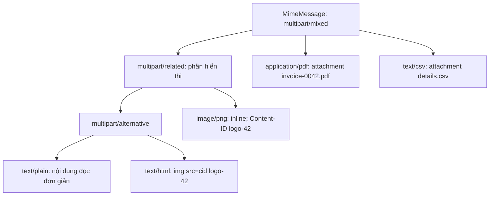
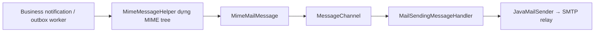
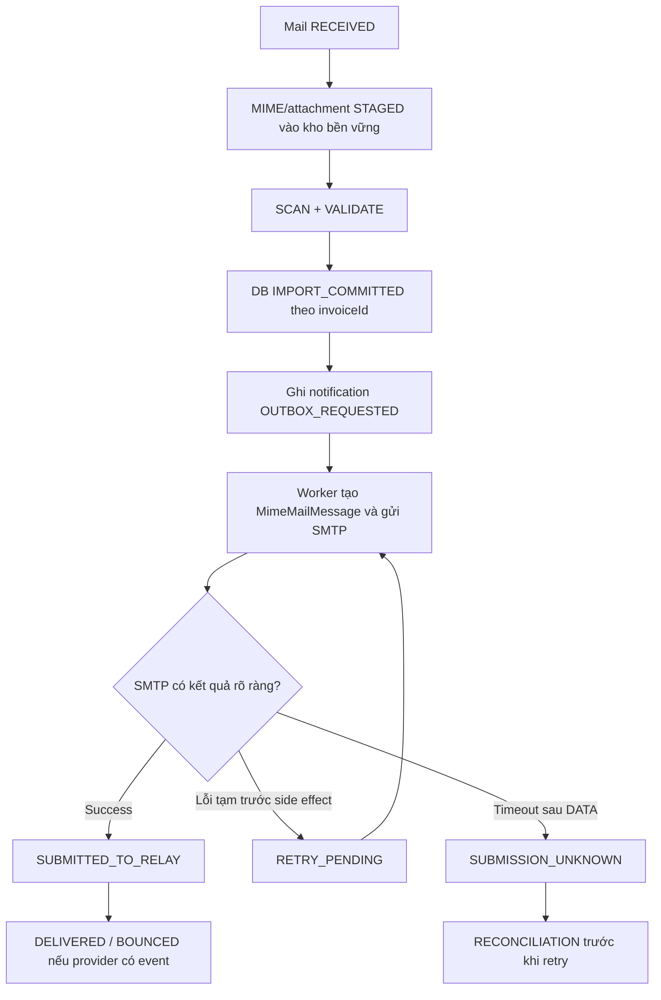

# Attachment và multipart message

## 1. Bài toán: nhận hóa đơn PDF và gửi thư có nhiều phần nội dung

Một dịch vụ Spring Boot nhận email hóa đơn từ đối tác qua IMAPS. Email có phần **text/plain**, một bản **text/html**, logo hiển thị bên trong HTML và hai tài liệu đính kèm (`invoice-0042.pdf`, `details.csv`). Dịch vụ phải xác định đúng phần body, lưu file vào vùng cách ly, quét/kiểm tra nội dung rồi nhập dữ liệu vào database. Sau khi commit, nó gửi email phản hồi có bản text, HTML và báo cáo PDF. Nếu bất kỳ bước nào thất bại, hệ thống phải biết cần thử lại **bước nào** mà không nhập hóa đơn hoặc gửi email trùng một cách mù quáng.

Trong chương **Adapter Mail** của module `SPRING_INTEGRATION_ADAPTERS`, chúng ta kết nối hệ thống ngoài bằng inbound/outbound adapter, gateway, poller và `MessageChannel`, đồng thời quản lý hợp đồng message, lỗi và vòng đời kết nối. Mail là một trường hợp đặc biệt: message đến từ IMAP/POP3 có thể là **cây MIME có nhiều phần**, còn message đi tới SMTP có thể cần **dựng lại cây MIME tương thích mail client**. Spring Integration lo việc kết nối channel với mail provider, nhưng không tự kiểm định an toàn mọi attachment hoặc bảo đảm transaction với database.

Sau bài này, bạn sẽ có khả năng:

- Giải thích `multipart/mixed`, `multipart/alternative`, `multipart/related`, `message/rfc822`, inline resource và attachment.
- Duyệt `MimeMessage`/`Multipart`/`BodyPart` qua Jakarta Mail, xác định metadata quan trọng mà không tin mù quáng `Content-Type`, `filename` hoặc `Content-Disposition`.
- Chọn hợp đồng inbound raw `MimeMessage` hoặc `DefaultMailHeaderMapper`; hiểu tác động của `embeddedPartsAsBytes` và `autoCloseFolder`.
- Đọc/ghi attachment theo stream, giới hạn kích thước, số lượng, độ sâu và quyền filesystem; dùng staging/quarantine rồi mới xử lý nghiệp vụ.
- Tạo email có text + HTML, inline image và nhiều attachment qua `JavaMailSender`, `MimeMessageHelper` và `MimeMailMessage`.
- Thiết kế retry, outbox, idempotency và kiểm thử end-to-end, không nhầm SMTP accepted với delivered.

> **Phiên bản:** ví dụ dựa trên Spring Integration **6.5.x**, Spring Framework **6.2.x**, Spring Boot tương thích, Java 17+ và Jakarta Mail (`jakarta.mail.*`). Đối chiếu dependency BOM thực tế trước khi triển khai; ví dụ địa chỉ và file chỉ dùng để học tập, không chỉ ra hệ thống thật.

## 2. `multipart` là cây nội dung, không phải một chuỗi

Email dạng **đơn phần** có một `Content-Type` như `text/plain; charset=UTF-8`, còn email **đa phần** có phần gốc `multipart/*` chứa các `BodyPart` con. Mỗi part lại có thể là một multipart khác, nên độ sâu không cố định.



| MIME type | Hợp đồng | Cách xử lý thường gặp |
| --- | --- | --- |
| `text/plain` | Văn bản thuần | Đọc thành `String` với charset đúng; giới hạn chiều dài |
| `text/html` | HTML email | Chỉ render sau khi sanitize, không tự tải remote image/tracking pixel |
| `multipart/alternative` | Nhiều **cách trình bày của cùng một thông điệp** | Chọn một bản ưu tiên; không nối cả plain và HTML như hai thông điệp độc lập |
| `multipart/mixed` | Nhiều nội dung độc lập | Thường chứa body chính và các attachment |
| `multipart/related` | Các phần liên quan, ví dụ HTML + ảnh CID | Liên kết qua `Content-ID` và `cid:`; không đồng nhất inline với attachment tải xuống |
| `multipart/signed` | Nội dung + dữ liệu chữ ký | Cần bộ kiểm tra chữ ký chuẩn tương ứng; việc nhìn thấy part chữ ký chưa chứng minh hợp lệ |
| `message/rfc822` | Một email khác nằm trong email hiện tại | Có thể lồng cả cây MIME; phải giới hạn độ sâu |
| `application/pdf` hoặc `application/octet-stream` | Bytes nhị phân | Lưu stream an toàn, kiểm tra signature/schema/malware |

**Không suy luận chỉ từ phần mở rộng file.** Sender có thể khai báo `Content-Type: application/pdf` nhưng bytes thực là ZIP hoặc executable; cũng có thể gửi PDF dưới `application/octet-stream`. Cả `Content-Type`, filename và `Content-Disposition` là dữ liệu do bên gửi hoặc hạ tầng mail cung cấp, không phải xác nhận an toàn.

### `BodyPart` không đồng nghĩa attachment

Trong `multipart/alternative`, một `BodyPart` chứa **text/plain**; trong `multipart/related`, một `BodyPart` chứa logo **inline**. Nếu parser cứ coi tất cả `BodyPart` là file cần tải, ứng dụng sẽ lưu cả body và ảnh logo như attachment của hóa đơn. Trái lại, nếu chỉ lấy `multipart.getBodyPart(0)`, ứng dụng có thể bỏ qua PDF hoặc đọc sai nội dung vì body không nhất thiết đứng đầu.

## 3. Các MIME header cần đọc đúng phạm vi

Một email có header ngoài như `From`, `To`, `Subject`, `Date`, `Message-ID`, `MIME-Version`, `Content-Type`. **Mỗi part** có thể có header riêng:

| Header | Ví dụ | Cần hiểu gì? |
| --- | --- | --- |
| `Content-Type` | `multipart/mixed; boundary="b1"` | Chỉ kiểu nội dung **của entity này**; part con có thể khác |
| `Content-Disposition` | `attachment; filename="invoice.pdf"` | Gợi ý cách hiển thị; không phải quyền truy cập hoặc đường dẫn hợp lệ |
| `Content-ID` | `<company-logo@example.test>` | Định danh để tham chiếu trong HTML bằng `cid:` |
| `Content-Transfer-Encoding` | `base64`, `quoted-printable`, `7bit` | Cách bytes được mã hóa trên đường truyền, khác charset |
| `Content-Language` | `vi` | Ngôn ngữ sender mô tả; không nhất thiết chính xác |
| `Content-Description` | `Hóa đơn tháng 11` | Mô tả tùy chọn, không đáng tin cậy để phân quyền |
| `Content-Type` parameter `charset` | `UTF-8` | Dùng khi giải mã bytes thành ký tự văn bản |
| `Content-Type` parameter `boundary` | `b1` | Phân chia các phần MIME; thư viện quản lý, không tự split chuỗi |

```text
From: billing@partner.example.test
To: invoices@example.test
Subject: [INVOICE] INV-0042
MIME-Version: 1.0
Content-Type: multipart/mixed; boundary="outer-42"

--outer-42
Content-Type: text/plain; charset=UTF-8

Xin xem hóa đơn đính kèm.
--outer-42
Content-Type: application/pdf; name="invoice-0042.pdf"
Content-Disposition: attachment; filename="invoice-0042.pdf"
Content-Transfer-Encoding: base64

[bytes PDF đã mã hóa Base64, chỉ là ký hiệu ví dụ]
--outer-42--
```

Đây là **minh họa cấu trúc**, không phải raw MIME hợp lệ để gửi, vì dòng Base64 được thay bằng ký hiệu. Không parse MIME bằng `String.split("--outer-42")`: boundary có thể đổi, được quote/escape và lồng nhau; còn nhiều quy tắc về CRLF, header folding và encoding. Dùng Jakarta Mail `Part`, `Multipart` và `MimeMessage`.

## 4. Jakarta Mail API: đọc phần nội dung đúng cách

| API | Vai trò | Ví dụ |
| --- | --- | --- |
| `MimeMessage` | Email gốc, cũng triển khai `Part` | `getSubject()`, `getFrom()`, `getMessageID()` |
| `Part` | Giao diện của email hoặc một phần MIME | `isMimeType(...)`, `getContent()`, `getInputStream()` |
| `Multipart` | Nhiều phần con | `getCount()`, `getBodyPart(index)` |
| `BodyPart` | Một MIME entity con | `getDisposition()`, `getFileName()`, `getContentType()` |
| `InternetAddress` | Địa chỉ email có cấu trúc | `getAddress()`, `getPersonal()`, `validate()` |
| `MimeUtility` | Hỗ trợ encoding/decoding MIME khi cần | Không dùng để tự decode lại bytes đã được mail provider xử lý |

Ví dụ phân loại một part:

```java
import jakarta.mail.Part;

public static String inspectPart(Part part) throws Exception {
    String disposition = part.getDisposition();
    String filename = part.getFileName();

    if (part.isMimeType("multipart/*")) {
        return "Multipart, cần duyệt các BodyPart";
    }
    if (part.isMimeType("message/rfc822")) {
        return "Email được đính kèm, cần duyệt có giới hạn";
    }
    if (Part.ATTACHMENT.equalsIgnoreCase(disposition) || filename != null) {
        return "Attachment candidate: " + filename;
    }
    if (Part.INLINE.equalsIgnoreCase(disposition)) {
        return "Inline MIME part";
    }
    if (part.isMimeType("text/plain")) {
        return "Plain text";
    }
    return "MIME type khác: " + part.getContentType();
}
```

Đây chỉ là **heuristic phân loại**. `Content-Disposition` có thể thiếu, `filename` có thể xuất hiện cho một inline image, `Content-ID` có thể dùng dù disposition không phải `inline`. Một parser production phải kết hợp quan hệ cây MIME, `Content-ID`, loại nội dung và nghiệp vụ, không đưa ra quyết định solely dựa vào một header.

### Giải mã bytes và charset

- Với `text/plain`, `part.getContent()` thường trả `String` đã giải mã theo `Content-Type; charset=...` và encoding phù hợp do provider xử lý.
- Với attachment, `part.getInputStream()` trả bytes nội dung theo Jakarta Mail abstraction. **Không mặc định Base64-decode thêm một lần**, vì transfer encoding đã được mail provider xử lý.
- Không dùng `new String(pdfBytes)` để xem PDF; không dùng charset mặc định của JVM để đọc text từ mail.
- `Content-Type`/charset do sender khai báo có thể không đúng; nếu dữ liệu hỏng, đưa vào quy trình lỗi/quarantine thay vì âm thầm sửa bằng heuristic không kiểm soát.
- Filename Unicode có thể đi qua tham số encoded theo chuẩn MIME và mail client; sau khi thư viện trả `getFileName()`, **vẫn phải chuẩn hóa và chặn path traversal**.

## 5. Spring Integration inbound: raw `MimeMessage` hay mapped payload?

Khi nhận mail bằng `ImapMailReceiver` hoặc `Pop3MailReceiver`, **hợp đồng payload** khác nhau theo cấu hình:

| Cấu hình | Payload thường gặp | Hệ quả cho attachment |
| --- | --- | --- |
| Không `HeaderMapper`, `simpleContent(false)` | `MimeMessage` | Có thể duyệt cây MIME đầy đủ; cần lưu ý folder còn mở |
| Có `DefaultMailHeaderMapper`, mail `text/*` | `String` | Tiện cho text nhưng không còn raw MimeMessage để duyệt |
| Có mapper, nội dung có `Part`/`Multipart`, `embeddedPartsAsBytes(true)` | Thường `byte[]` | Có thể eager-load/serialize bytes lớn; `contentType` payload thường `application/octet-stream` |
| Có mapper, `embeddedPartsAsBytes(false)` | Có thể là `Part` hoặc `Multipart` | Đối tượng không phù hợp serializer và queue bất đồng bộ |
| `simpleContent(true)` | Nội dung đã giản lược theo cơ chế receiver | Không dùng khi cần giữ đầy đủ MIME tree mà chưa kiểm thử |

Theo tài liệu Spring Integration 6.5, nếu **không có header mapper**, payload là `MimeMessage`. Khi bật `DefaultMailHeaderMapper`, các header như `mail_subject`, `mail_from`, `mail_to`, `mail_contentType`, `mail_raw` có thể được thêm vào Spring `MessageHeaders`; payload được render riêng theo MIME content. **`MailHeaders.CONTENT_TYPE` (`mail_contentType`) khác `MessageHeaders.CONTENT_TYPE` (`contentType`)**: một cái mô tả email gốc, một cái mô tả Spring payload đã map.

Một `Message<byte[]>` phát từ mapper khi gặp multipart **không mặc định là file PDF duy nhất**. Nó có thể là bytes biểu diễn một MIME part/multipart và cần parser phù hợp. Đừng lấy `mail_contentType="multipart/mixed"` rồi coi toàn bộ `payload` là PDF. Nếu cần đọc nhiều attachment, lựa chọn raw MIME/streaming có quota thường rõ hơn.

### Ví dụ chỉ minh họa bật mapper

```java
import org.springframework.integration.mail.ImapMailReceiver;
import org.springframework.integration.mail.support.DefaultMailHeaderMapper;

// Đặt trong cấu hình bean của một flow mapped-payload riêng.
ImapMailReceiver receiver = new ImapMailReceiver(storeUri);
receiver.setHeaderMapper(new DefaultMailHeaderMapper());
receiver.setEmbeddedPartsAsBytes(true);

// Flow này phải xử lý đúng kiểu payload String/byte[]/Part,
// không được cast mọi payload sang MimeMessage.
```

Nếu chọn mẫu này, cần thêm xác thực/TLS/timeout và điều kiện lọc mailbox như các mục dưới. Đây là **phương án khác** với flow raw MIME, không phải một cấu hình cần bật đồng thời trên cùng inbox.

## 6. Inbound IMAPS: giữ folder mở để đọc attachment lazy-load

Khi email nằm trên IMAP server, một số `MimeMessage` hoặc `BodyPart` có thể tải dữ liệu khi code truy cập nội dung. Nếu folder đã đóng trước đó, việc gọi `getContent()` hoặc `getInputStream()` có thể báo `FolderClosedException`. Với Spring Integration, cấu hình **`autoCloseFolder(false)`** giúp gửi header `IntegrationMessageHeaderAccessor.CLOSEABLE_RESOURCE` để downstream đóng folder **sau khi** xử lý MIME.

Kết hợp phù hợp khi cần raw MIME on demand:

- Không cấu hình header mapper.
- `setSimpleContent(false)`.
- `setAutoCloseFolder(false)`.
- Handler xử lý **đồng bộ trong phạm vi resource còn mở**, đóng `Closeable` ở mọi nhánh.

`autoCloseFolder(false)` không phù hợp với `Pop3MailReceiver` theo cơ chế tương tự IMAP, bởi POP3 phải mở/đóng folder để tìm thư mới. Với POP3, cần materialize nội dung ở đúng giai đoạn và kiểm thử thực tế; không dựa vào raw MIME lazy-load sau khi connection đã đóng.

### Gradle và cấu hình kết nối mẫu

```groovy
dependencies {
    implementation 'org.springframework.boot:spring-boot-starter-integration'
    implementation 'org.springframework.integration:spring-integration-mail'
    implementation 'org.springframework.boot:spring-boot-starter-mail'
}
```

```yaml
app:
  mailbox:
    url: ${MAILBOX_URI:imaps://invoices%40example.test@imap.example.test:993/INBOX}
    username: ${MAILBOX_USERNAME:invoices@example.test}
    password: ${MAILBOX_PASSWORD}
    staging-dir: ${MAIL_STAGING_DIR:./data/mail-quarantine}
```

Không chứa password thật trong URI/source code. Tài khoản/mail provider có thể đòi OAuth2 thay vì password; cần cấu hình auth mechanism, refresh token và quyền scope tương ứng. Dùng IMAPS hoặc STARTTLS bắt buộc kèm **hostname/certificate validation**, không trust-all để né lỗi môi trường.

```java
import java.util.Properties;

import jakarta.mail.Authenticator;
import jakarta.mail.PasswordAuthentication;

import org.springframework.beans.factory.annotation.Value;
import org.springframework.context.annotation.Bean;
import org.springframework.context.annotation.Configuration;
import org.springframework.integration.mail.ImapMailReceiver;

@Configuration
public class InvoiceMailReceiverConfiguration {

    @Bean
    public ImapMailReceiver invoiceMimeReceiver(
            @Value("${app.mailbox.url}") String url,
            @Value("${app.mailbox.username}") String username,
            @Value("${app.mailbox.password}") String password) {

        ImapMailReceiver receiver = new ImapMailReceiver(url);
        receiver.setJavaMailAuthenticator(new Authenticator() {
            @Override
            protected PasswordAuthentication getPasswordAuthentication() {
                return new PasswordAuthentication(username, password);
            }
        });

        Properties props = new Properties();
        props.setProperty("mail.store.protocol", "imaps");
        props.setProperty("mail.imaps.ssl.enable", "true");
        props.setProperty("mail.imaps.ssl.checkserveridentity", "true");
        props.setProperty("mail.imaps.connectiontimeout", "10000");
        props.setProperty("mail.imaps.timeout", "30000");
        props.setProperty("mail.imaps.writetimeout", "30000");
        props.setProperty("mail.debug", "false");
        receiver.setJavaMailProperties(props);

        receiver.setShouldDeleteMessages(false);
        receiver.setShouldMarkMessagesAsRead(false);
        receiver.setMaxFetchSize(1);
        receiver.setSimpleContent(false);
        receiver.setAutoCloseFolder(false);
        // Không setHeaderMapper: payload giữ nguyên MimeMessage.
        return receiver;
    }
}
```

**Lưu ý mailbox state:** `shouldMarkMessagesAsRead(false)` không có nghĩa receiver không đặt cờ user-defined hoặc fallback `\Flagged` để đánh dấu thư đã chọn. Thư đã fetch nhưng xử lý lỗi có thể không được poll lại chỉ bằng cách giữ `\Seen=false`; thiết kế recovery phải lưu trạng thái bền vững, không phụ thuộc duy nhất vào IMAP flag.

## 7. Polling flow và handler giữ đúng vòng đời resource

```java
import org.springframework.context.annotation.Bean;
import org.springframework.context.annotation.Configuration;
import org.springframework.integration.dsl.IntegrationFlow;
import org.springframework.integration.dsl.Pollers;
import org.springframework.integration.mail.ImapMailReceiver;
import org.springframework.integration.mail.dsl.Mail;

@Configuration
public class InvoiceMailInboundFlow {

    @Bean
    public IntegrationFlow inboundInvoices(
            ImapMailReceiver invoiceMimeReceiver,
            InvoiceMimeHandler invoiceMimeHandler) {

        return IntegrationFlow.from(
                        Mail.imapInboundAdapter(invoiceMimeReceiver),
                        spec -> spec.poller(
                                Pollers.fixedDelay(15_000)
                                        .maxMessagesPerPoll(1)))
                .handle(invoiceMimeHandler)
                .get();
    }
}
```

`Mail.imapInboundAdapter(...)` là source nhận thư theo polling; `maxFetchSize` trên receiver khác `maxMessagesPerPoll` của poller. Giữ fetch nhỏ làm ví dụ dễ quản lý một folder/resource tại một thời điểm, nhưng không phải distributed lock. Nếu chuyển qua `ExecutorChannel` hoặc message broker, phải **materialize attachment thành file/DTO** khi folder còn mở và chuyển **tham chiếu bền vững** thay vì raw `MimeMessage` phụ thuộc session.

```java
import java.io.Closeable;
import java.io.IOException;
import java.nio.file.Path;

import jakarta.mail.MessagingException;
import jakarta.mail.internet.MimeMessage;

import org.springframework.beans.factory.annotation.Value;
import org.springframework.integration.StaticMessageHeaderAccessor;
import org.springframework.messaging.Message;
import org.springframework.messaging.MessageHandler;
import org.springframework.messaging.MessageHandlingException;
import org.springframework.stereotype.Component;

@Component
public class InvoiceMimeHandler implements MessageHandler {

    private final MimeIngestService ingestService;
    private final Path stagingDirectory;

    public InvoiceMimeHandler(
            MimeIngestService ingestService,
            @Value("${app.mailbox.staging-dir}") String stagingDir) {
        this.ingestService = ingestService;
        this.stagingDirectory = Path.of(stagingDir);
    }

    @Override
    public void handleMessage(Message<?> message) {
        Closeable resource =
                StaticMessageHeaderAccessor.getCloseableResource(message);

        try (Closeable folder = resource == null ? () -> { } : resource) {
            if (!(message.getPayload() instanceof MimeMessage mime)) {
                throw new IllegalArgumentException("Yêu cầu payload MimeMessage");
            }

            String messageId = mime.getMessageID();
            // Ingest service phải đọc/stage đủ nội dung trong method này.
            // Không giữ raw MimeMessage để xử lý sau khi folder đã đóng.
            ingestService.ingestOnce(messageId, mime, stagingDirectory);

        } catch (MessagingException | IOException e) {
            throw new MessageHandlingException(message,
                    "Không đọc được MIME hoặc không đóng được IMAP folder", e);
        }
    }
}

public interface MimeIngestService {
    /** Đọc MIME, stage + validate, ghi trạng thái DB idempotent. */
    void ingestOnce(String messageId, MimeMessage mime, Path stagingDirectory)
            throws MessagingException, IOException;
}
```

`try-with-resources` đóng `closeableResource` kể cả khi parser/DB ném lỗi. Nếu `ingestOnce(...)` chỉ lưu reference tới `MimeMessage` mà không đọc body/attachment, job xử lý sau có thể gặp folder đã đóng. Trạng thái thành công nên được xác nhận bằng business transaction và attachment storage, **không** bằng việc gọi `close()`.

## 8. Mẫu thuật toán duyệt MIME có giới hạn

Parser phải giải quyết **thứ tự ưu tiên**: attachment/inline, multipart lồng nhau, forwarded mail và bản text/HTML. Chương trình production nên dùng parser được kiểm thử trên các mail client mục tiêu; ví dụ dưới tập trung vào cơ chế duyệt và giới hạn để tránh deep nesting/part explosion.

```java
import java.io.IOException;

import jakarta.mail.BodyPart;
import jakarta.mail.Message;
import jakarta.mail.MessagingException;
import jakarta.mail.Multipart;
import jakarta.mail.Part;

public final class BoundedMimeVisitor {

    private static final int MAX_DEPTH = 8;
    private static final int MAX_PARTS = 50;

    private int visited;

    /** Tạo instance MỚI cho mỗi email; không share mutable visitor giữa thread. */
    public void walk(Part part, int depth) throws MessagingException, IOException {
        if (depth > MAX_DEPTH || ++visited > MAX_PARTS) {
            throw new IllegalArgumentException("MIME quá sâu hoặc có quá nhiều part");
        }

        if (part.isMimeType("multipart/*")) {
            Object content = part.getContent();
            if (!(content instanceof Multipart multipart)) {
                throw new IllegalArgumentException("Multipart không hợp lệ");
            }

            // Nếu là multipart/alternative, consumer nên CHỌN một
            // representation phù hợp, không nối tất cả các bản.
            for (int i = 0; i < multipart.getCount(); i++) {
                BodyPart child = multipart.getBodyPart(i);
                walk(child, depth + 1);
            }
            return;
        }

        if (part.isMimeType("message/rfc822")) {
            Object nested = part.getContent();
            if (nested instanceof Message nestedMail) {
                walk(nestedMail, depth + 1);
            }
            return;
        }

        String disposition = part.getDisposition();
        String fileName = part.getFileName();
        boolean isAttachment =
                Part.ATTACHMENT.equalsIgnoreCase(disposition)
                || fileName != null;

        if (isAttachment) {
            // Đưa Part tới attachment staging có quota ở mục 9.
            return;
        }
        if (part.isMimeType("text/plain")) {
            Object content = part.getContent();
            if (content instanceof String body && body.length() <= 200_000) {
                // Ghi nhận body candidate; không lưu vô hạn vào RAM.
            }
        }
        // text/html / inline image / application/*: chính sách riêng.
    }
}
```

**Giới hạn đã chủ động nêu:** visitor trên *duyệt* cả hai nhánh của `multipart/alternative`, chưa triển khai **selection** cuối cùng và chưa phân biệt inline CID với attachment đầy đủ. Nó không được coi là parser production hoàn chỉnh. Muốn chọn bản text, có thể thu hai candidate riêng rồi ưu tiên `text/plain` hợp lệ; nếu chỉ có HTML, sanitize/convert theo chính sách. Không bao giờ tự render HTML chưa xử lý hoặc tải ảnh remote/tracking pixel như một thao tác ngầm.

### `multipart/alternative` nên được giải quyết thế nào?

Giả sử email có cả `text/plain` và `text/html` mô tả cùng một hóa đơn. Nếu service ghi cả hai vào DB như hai mô tả độc lập, việc trích xuất dữ liệu có thể bị trùng. Với pipeline text-only, ưu tiên bản plain-text hợp lệ. Với UI cần HTML, lưu **hai representation riêng**, sanitize HTML và cho UI chọn hiển thị; không tự ghép chúng.

### `multipart/related` và CID

HTML có thể chứa ``. Phần ảnh tương ứng có `Content-ID: <company-logo>`; `Content-Disposition` có thể là `inline` hoặc vắng mặt. Parser cần đối chiếu CID ở **cùng nhóm related**, không lấy tên `company-logo` làm URL công khai. Nếu sau này render HTML nội bộ, chỉ hiển thị inline resource đã scan và được cấp quyền, không tự tải URL từ nội dung HTML.

## 9. Stage attachment theo stream, không tin filename từ sender

Một attachment có thể rất lớn; `InputStream.readAllBytes()` sẽ tăng heap theo kích thước file. Thay vào đó, stage tới thư mục riêng có quota bằng buffer cố định. Đặt **tên ngẫu nhiên do server tạo**, không dùng `part.getFileName()` làm đường dẫn. Metadata tên gốc chỉ lưu ở DB sau khi sanitize để hiển thị.

```java
import java.io.IOException;
import java.io.InputStream;
import java.io.OutputStream;
import java.nio.file.Files;
import java.nio.file.Path;

import jakarta.mail.MessagingException;
import jakarta.mail.Part;

public final class SafeMailAttachmentStager {

    private static final long MAX_PART_BYTES = 10_000_000L;

    public record StagedPart(Path path, long size, String declaredContentType) { }

    public StagedPart stage(Part part, Path quarantineDirectory)
            throws MessagingException, IOException {

        // quarantineDirectory phải là path tin cậy, đã tồn tại,
        // có ownership/permission/quota do ứng dụng quản lý.
        Path file = Files.createTempFile(
                quarantineDirectory, "attachment-", ".pending");

        long bytes = 0;
        try (InputStream input = part.getInputStream();
             OutputStream output = Files.newOutputStream(file)) {
            byte[] buffer = new byte[8192];
            int n;
            while ((n = input.read(buffer)) != -1) {
                bytes += n;
                if (bytes > MAX_PART_BYTES) {
                    throw new IOException("Attachment vượt giới hạn 10 MB");
                }
                output.write(buffer, 0, n);
            }
            return new StagedPart(file, bytes, part.getContentType());

        } catch (IOException | MessagingException | RuntimeException ex) {
            Files.deleteIfExists(file);
            throw ex;
        }
    }
}
```

Code trên giới hạn **một** attachment, **chưa** giới hạn tổng mail, tổng số attachment hoặc dung lượng sau giải nén. Trong production cần tổng quota per message, timeouts, max depth/parts, free-space guard, antivirus/content scanning, quyền filesystem tối thiểu, cleanup cho `.pending` và chỉ publish file sau khi validation đạt. `Files.createTempFile` đặt tên ngẫu nhiên giúp giảm path traversal, nhưng vẫn phải bảo vệ thư mục khỏi symlink/permission abuse bởi process không tin cậy.

**Điểm quan trọng về lỗi:** nếu `part.getInputStream()` đứt giữa stream, file `.pending` bị xóa ở nhánh lỗi. Không để downstream đọc file bị cắt rồi coi là PDF hợp lệ. Với job cần replay, hãy có bản ingest bền vững hoặc khả năng fetch lại email/attachment theo trạng thái mailbox và idempotency, không chỉ dựa vào file staging không hoàn chỉnh.

## 10. Metadata attachment: lưu gì trong business ledger?

Một attachment là dữ liệu nghiệp vụ có thể cần truy vết. Nên lưu **metadata đã xác minh** và tham chiếu tới blob trong vùng tin cậy:

| Trường | Ví dụ | Tác dụng |
| --- | --- | --- |
| `mailbox_id`, `folder`, `uid_validity`, `uid` | Tham chiếu IMAP hợp lệ theo phạm vi | Tìm lại mail trong cùng mailbox/epoch UID |
| `message_id` | Header mail gốc | Dùng correlation, không phải unique business key tuyệt đối |
| `invoice_id` | `INV-0042` từ tài liệu đã validate | Idempotency theo nghiệp vụ |
| `attachment_id` | UUID do hệ thống tạo | Định danh bản lưu nội bộ |
| `original_filename` | Giá trị hiển thị đã chuẩn hóa | Không dùng làm filesystem path |
| `declared_mime_type` | `application/pdf` | Tham khảo; có thể bị giả |
| `detected_mime_type` | Kết quả phân tích bytes | Giúp chọn parser/kiểm tra rủi ro |
| `size_bytes`, `sha256` | Kích thước/checksum sau stream | Kiểm tra integrity và hỗ trợ dedupe nội bộ |
| `storage_key`, `scan_status` | Tham chiếu blob/quarantine | Phân quyền, retention và publish trạng thái |

Không coi checksum trùng đồng nghĩa cùng hóa đơn trong mọi trường hợp: hai người gửi khác nhau có thể gửi cùng một file, hoặc một email có nhiều file giống nhau nhưng cần provenance riêng. Chọn khóa dedupe dựa trên `(partner_id, invoice_id, document_type, version)` hoặc hợp đồng nghiệp vụ, kết hợp SHA-256 để xác minh nội dung.

### MIME filename có thể chứa dữ liệu nguy hiểm

`Content-Disposition` có thể mang `filename="../../etc/config"`, tên tuyệt đối, ký tự điều khiển, chuỗi Unicode gây nhầm hoặc tên trùng bản lưu trước. Không `Path.resolve(originalName)` trực tiếp. Hãy bỏ đường dẫn, chuẩn hóa ký tự cho hiển thị, cap chiều dài, ghi blob theo ID ngẫu nhiên và giới hạn quyền truy cập. `Content-Type` có thể giả; kiểm tra file signature và schema trước khi cho parser nghiệp vụ xử lý.

## 11. Outbound multipart: `JavaMailSender`, `MimeMessageHelper` và `MimeMailMessage`

Khi gửi email, `JavaMailSender#createMimeMessage()` tạo object `jakarta.mail.internet.MimeMessage`; `MimeMessageHelper` giúp cấu trúc multipart, thiết lập charset/recipients, thêm inline resource và attachment. Spring Integration `MailSendingMessageHandler` có thể nhận payload **`org.springframework.mail.MailMessage`**; `MimeMailMessage` là wrapper Spring Mail phù hợp cho MIME đã dựng. **Raw `MimeMessage` không tự triển khai `MailMessage` của Spring**.



`MimeMessageHelper` hỗ trợ bốn multipart mode. Chọn mode theo cấu trúc nội dung và khả năng tương thích mail client:

| Mode | Cấu trúc | Khi nào cân nhắc |
| --- | --- | --- |
| `MULTIPART_MODE_NO` | Không multipart | Chỉ plain text/HTML đơn phần, không attachment/inline |
| `MULTIPART_MODE_MIXED` | Một root `multipart/mixed` | Một số mail client (ví dụ Outlook) xử lý tốt; có thể hiển thị nhầm inline/attachment |
| `MULTIPART_MODE_RELATED` | Một root `multipart/related` | Phù hợp một số client có inline image, nhưng attachment có thể bị hiểu sai |
| `MULTIPART_MODE_MIXED_RELATED` | Root mixed + nested related | **Mặc định** khi dùng constructor multipart `true`; tách attachment khỏi nội dung và inline |

Không có mode nào hoàn hảo trên mọi mail client. Hãy kiểm thử Outlook, Gmail, Apple Mail và các khách hàng mục tiêu khi cần inline image/attachment. MIME structure thực tế còn phụ thuộc `setText(plain, html)`, số attachment, inline resource và version framework.

## 12. Ví dụ hoàn chỉnh: gửi HTML + text + logo inline + hai attachment

Giả sử `pdfBytes`, `csvBytes`, `logoPng` đã có từ tài liệu được phép gửi và đã được validate/quét phù hợp. Ví dụ chủ động dùng `MULTIPART_MODE_MIXED_RELATED` và giới hạn byte trước khi giữ chúng trong bộ nhớ:

```java
import jakarta.mail.MessagingException;
import jakarta.mail.internet.MimeMessage;

import org.springframework.core.io.ByteArrayResource;
import org.springframework.mail.javamail.JavaMailSender;
import org.springframework.mail.javamail.MimeMailMessage;
import org.springframework.mail.javamail.MimeMessageHelper;
import org.springframework.messaging.MessageChannel;
import org.springframework.messaging.support.MessageBuilder;

public final class InvoiceReplyComposer {

    public void send(
            JavaMailSender mailSender,
            MessageChannel outboundMailRequests,
            String authorizedRecipient,
            byte[] pdfBytes,
            byte[] csvBytes,
            byte[] logoPng) throws MessagingException {

        validateBytes(pdfBytes, 5_000_000, "PDF");
        validateBytes(csvBytes, 2_000_000, "CSV");
        validateBytes(logoPng, 300_000, "logo");

        // authorizedRecipient phải đã được validate về quyền và cú pháp.
        MimeMessage raw = mailSender.createMimeMessage();
        MimeMessageHelper helper = new MimeMessageHelper(
                raw, MimeMessageHelper.MULTIPART_MODE_MIXED_RELATED, "UTF-8");

        helper.setFrom("reports@example.test");
        helper.setTo(authorizedRecipient);
        helper.setReplyTo("support@example.test");
        helper.setSubject("Kết quả xử lý hóa đơn INV-0042");
        helper.setText(
                "Hóa đơn INV-0042 đã xử lý. Vui lòng xem file đính kèm.",
                "<html><body><p><strong>INV-0042</strong> đã xử lý.</p>"
                    + "</body></html>");

        // Phải gọi addInline SAU setText để các mail client resolve CID.
        helper.addInline("brand-logo",
                new ByteArrayResource(logoPng), "image/png");

        helper.addAttachment("invoice-0042.pdf",
                new ByteArrayResource(pdfBytes), "application/pdf");
        helper.addAttachment("details-0042.csv",
                new ByteArrayResource(csvBytes), "text/csv");

        MimeMailMessage springMail = new MimeMailMessage(helper);
        boolean accepted = outboundMailRequests.send(
                MessageBuilder.withPayload(springMail).build());
        if (!accepted) {
            throw new IllegalStateException("Mail channel chưa nhận message");
        }
    }

    private static void validateBytes(byte[] data, int maxBytes, String label) {
        if (data == null || data.length == 0 || data.length > maxBytes) {
            throw new IllegalArgumentException(label + " trống hoặc vượt quota");
        }
    }
}
```

`setText(plain, html)` tạo hai lựa chọn nội dung; `addInline` gắn CID với logo; `addAttachment` thêm hai part độc lập. `ByteArrayResource` cung cấp **InputStream mới mỗi lần**, phù hợp với Jakarta Mail có thể đọc attachment nhiều lần khi tính MIME hoặc gửi. **Không** đưa một `InputStreamResource` bọc stream đã tiêu thụ vào `addAttachment`/`addInline`, vì mail provider có thể yêu cầu đọc lại.

### Với attachment lớn hơn thì sao?

Ưu tiên một `FileSystemResource`/blob-backed `InputStreamSource` **có khả năng mở stream mới** và tài nguyên còn tồn tại đến khi SMTP send hoàn tất. Nếu mail job nằm trong queue bất đồng bộ, không gửi reference tới file tạm vừa xóa hoặc `InputStream` đã đóng. Nên lưu attachment vào object storage được cấp quyền, cho worker tải lại theo ID an toàn và dọn theo retention sau khi trạng thái submission đã rõ.

## 13. Java DSL SMTP outbound adapter

```java
import org.springframework.context.annotation.Bean;
import org.springframework.context.annotation.Configuration;
import org.springframework.integration.dsl.IntegrationFlow;
import org.springframework.integration.mail.dsl.Mail;
import org.springframework.mail.javamail.JavaMailSender;

@Configuration
public class InvoiceMailOutboundFlow {

    @Bean
    public IntegrationFlow sendInvoiceMail(JavaMailSender mailSender) {
        return IntegrationFlow.from("outboundMailRequests")
                .handle(Mail.outboundAdapter(mailSender))
                .get();
    }
}
```

`Mail.outboundAdapter(mailSender)` tạo message-consuming endpoint; nó **không phải pollable source** và không trả delivery receipt. Một `DirectChannel` mặc định sẽ gọi handler đồng bộ và exception thường truyền lại caller, nhưng một queue/executor có thể chỉ xác nhận message đã được nhận trong ứng dụng. Với hệ thống cần chịu crash, dùng DB outbox/broker bền vững làm nguồn việc, không coi queue RAM là email đã được gửi.

### SMTP/TLS mẫu cho Spring Boot

```yaml
spring:
  mail:
    host: ${SMTP_HOST:smtp.example.test}
    port: ${SMTP_PORT:587}
    username: ${SMTP_USERNAME:reports@example.test}
    password: ${SMTP_PASSWORD}
    properties:
      "[mail.smtp.auth]": true
      "[mail.smtp.starttls.enable]": true
      "[mail.smtp.starttls.required]": true
      "[mail.smtp.ssl.checkserveridentity]": true
      "[mail.smtp.connectiontimeout]": 10000
      "[mail.smtp.timeout]": 30000
      "[mail.smtp.writetimeout]": 30000
      "[mail.debug]": false
```

Đây là cấu hình submission cổng **587 + STARTTLS bắt buộc**. Với **465 implicit TLS**, cần `mail.smtp.ssl.enable=true` và cấu hình cổng/TLS mode tương thích provider, không áp đồng thời tùy tiện. Không tắt hostname validation hoặc dùng trust-all SSL factory. Credential/token chỉ nên đến từ secret manager hoặc runtime secret, không đưa vào Git/log.

## 14. `MailHeaders.ATTACHMENT_FILENAME` và giới hạn của `byte[]` payload

`MailSendingMessageHandler` hỗ trợ một cách đơn giản: khi payload là `byte[]`, nó coi đó là attachment và cần header **`MailHeaders.ATTACHMENT_FILENAME`**. Người nhận, From, Subject được cung cấp qua `MailHeaders` như một mail text bình thường.

```java
import org.springframework.integration.mail.MailHeaders;
import org.springframework.messaging.MessageChannel;
import org.springframework.messaging.support.MessageBuilder;

public static void sendPdf(MessageChannel outboundMailRequests, byte[] validatedPdf) {
    if (validatedPdf == null || validatedPdf.length > 5_000_000) {
        throw new IllegalArgumentException("PDF không hợp lệ");
    }

    outboundMailRequests.send(MessageBuilder.withPayload(validatedPdf)
            .setHeader(MailHeaders.TO,
                    new String[]{"ops@example.test"})
            .setHeader(MailHeaders.FROM, "reports@example.test")
            .setHeader(MailHeaders.SUBJECT, "Báo cáo PDF")
            .setHeader(MailHeaders.ATTACHMENT_FILENAME, "report.pdf")
            .build());
}
```

Đây phù hợp **một attachment đơn giản**; khi cần HTML, text alternative, inline logo hoặc nhiều tệp, dùng `MimeMessageHelper` như mục 12. Không tạo custom header `mail_attachment_2` rồi mong framework tự ghép thành nhiều tệp. Với payload `MimeMailMessage`, người gửi/recipients có thể đã được đặt trong object; **một số `MailHeaders` trong Spring message có thể ghi đè giá trị tương ứng**, nên cần xác thực ở ranh giới tin cậy trước handler.

## 15. Xử lý dữ liệu đã nhập và tránh gửi email trùng

IMAP inbox, storage chứa attachment, database và SMTP relay **không tham gia chung một transaction phân tán mặc định**. Phân biệt rõ các mốc:



Nếu handler import DB lỗi sau khi IMAP receiver đã gắn `\Seen`, user flag hoặc fallback `\Flagged`, lần poll sau có thể **không nhận lại** thư dù server chưa xóa. Với POP3 không xóa, sau restart có thể nhận lại cùng thư. Cả hai trường hợp cần **inbox ledger** có trạng thái `INGESTED`, `RETRY_PENDING`, `COMMITTED`, `QUARANTINED`, cùng unique business key và tham chiếu MIME đã lưu; không dùng `Message-ID` của email làm khóa duy nhất đáng tin cậy.

Khi gửi SMTP, relay có thể đã nhận email sau `DATA` nhưng client timeout trước khi đọc phản hồi. **Không retry mù**, vì email có thể được gửi trùng. Một DB outbox có notification ID duy nhất giúp tránh tạo hai yêu cầu cho cùng một business event nhưng **không tự bảo đảm exactly-once SMTP submission**; cần provider acknowledgement/idempotency API nếu có, hoặc reconciliation và chính sách chấp nhận rủi ro trùng.

## 16. Bảo mật attachment và multipart trong production

| Rủi ro | Ví dụ | Cách phòng vệ |
| --- | --- | --- |
| Path traversal | `filename="../../secret.txt"` | Không dùng filename làm path; lưu bằng ID ngẫu nhiên |
| Giả MIME type | `.pdf` nhưng bytes là executable | Kiểm tra signature/scan/schema thay vì tin header |
| ZIP bomb/decompression bomb | ZIP nhỏ nén dữ liệu rất lớn | Cap kích thước sau giải nén, depth, thời gian và CPU |
| MIME part explosion | Hàng nghìn nested multipart | Giới hạn tổng part và nesting depth |
| HTML/phishing/tracking | HTML chứa remote image hoặc link xấu | Sanitize HTML, không tự fetch remote URL trong parser |
| Malware/macros | Office/PDF chứa nội dung nguy hiểm | Quarantine và scan trước khi publish/file preview |
| Lộ thông tin nhạy cảm | Log `mail_raw`, body, Bcc, attachment | Redaction, quyền truy cập và retention phù hợp |
| Sai domain người nhận outbound | User thay To/Bcc/From | Xác thực caller, allowlist/ownership/consent và rate limit |
| File staging tồn tại quá lâu | `.pending` do process crash | Job cleanup TTL có điều kiện từ ledger |
| Session IMAP không đóng | `autoCloseFolder(false)` nhưng không close resource | `try-with-resources`/finally, metric folder open |

`Multipart` có thể chứa file gửi từ đối tác đáng tin ở cấp SMTP nhưng **nội dung vẫn cần kiểm tra**. TLS bảo vệ kết nối tới mail server, không chứng minh người gửi hoặc bytes an toàn. Các quyết định nhạy cảm như ghi tiền, tạo tài khoản, mở link hoặc thực thi macro không được thực hiện chỉ dựa vào `From`, `Subject`, `Message-ID` hoặc một custom `X-Trusted` header.

## 17. Hiệu năng và tài nguyên

Ba nguồn tài nguyên cần đặc biệt chú ý:

1. **Mail server/IMAP folder:** raw `MimeMessage` lazy-load có thể giữ kết nối; giảm `maxFetchSize`, đóng closeable resource, không giữ folder qua queue bất đồng bộ.
2. **Heap và disk:** mapper `embeddedPartsAsBytes(true)` và `ByteArrayResource` có thể giữ toàn bộ attachment trong bộ nhớ. Với inbound file lớn, streaming vào quarantine; với outbound job lớn, lưu blob bền vững rồi mở stream mới khi gửi.
3. **SMTP connection/quota:** mỗi email có PDF lớn làm tăng số bytes gửi và thời gian kết nối. Tôn trọng provider limits, timeout, concurrency và retry backoff.

Metrics gợi ý: `mail_inbound_received_total`, `mail_mime_parse_failed_total`, `mail_mime_part_count`, `mail_attachment_bytes`, `mail_quarantine_pending`, `mail_folder_open`, `mail_ingest_retry_pending`, `mail_outbound_submit_duration`, `mail_outbox_unknown`, `mail_bounce_total`. Đặt `messageCorrelationId`/`invoiceId` và trạng thái chuẩn hóa trong log; không ghi raw MIME, full attachment, token, password hoặc danh sách Bcc.

### Tối ưu mà không làm hỏng hợp đồng

Đừng tăng `maxMessagesPerPoll` trước khi giải quyết giới hạn mail folder, quota và số consumer. Không chuyển cả `Multipart`/`Part` vào Kafka/JMS chỉ để "scale"; các đối tượng này không phù hợp serialization và có thể phụ thuộc kết nối mail. Thay vào đó, lưu dữ liệu đã chuẩn hóa/attachment vào storage, phát message chứa **tham chiếu bền vững và business ID**, rồi scale downstream độc lập với IMAP.

## 18. Kịch bản thực hành và kiểm thử

Dùng IMAPS/SMTP sandbox hoặc mail test server do nhóm kiểm soát; không thao tác trên mailbox và dữ liệu khách hàng thật. Test nên kiểm chứng **MIME tree, attachment bytes và business state**, không chỉ đếm email nhận/gửi.

1. **Email text đơn phần:** gửi `text/plain` UTF-8; `MimeMessage.getContent()` cho nội dung đúng dấu tiếng Việt.
2. **`multipart/alternative`:** mail có plain + HTML; parser phân biệt hai representation, không ghi trùng nội dung.
3. **`multipart/mixed`:** mail có body và PDF; parser chỉ stage attachment đúng phần.
4. **`multipart/related`:** HTML tham chiếu `cid:brand-logo`; kiểm tra resource inline không bị hiểu nhầm là file PDF nghiệp vụ.
5. **Nested multipart:** `mixed → related → alternative` cùng hai attachments; kết quả có đúng một mô tả và hai tài liệu cần ingest.
6. **Forwarded email:** `message/rfc822` có multipart lồng; visitor không vượt quá depth/part count.
7. **Mapped receiver:** bật `DefaultMailHeaderMapper` trên flow test **riêng**, xác nhận payload có thể là `String` hoặc `byte[]`; consumer không cast nhầm sang `MimeMessage`.
8. **Giữ folder mở:** với `autoCloseFolder(false)`, đọc PDF xong rồi đóng `closeableResource`; mô phỏng exception và xác minh folder vẫn được đóng.
9. **Thử đọc sau khi folder đóng:** trong sandbox, xác nhận hành vi lazy-load và lỗi tùy provider, tránh phụ thuộc vào việc mail đã cache tình cờ.
10. **Attachment quá lớn:** upload file lớn hơn quota; stage dừng, xóa `.pending`, không commit invoice.
11. **Tên file nguy hiểm:** gửi `../secret.pdf`, tên tuyệt đối và tên Unicode gây nhầm; file vẫn được stage theo ID an toàn.
12. **Giả MIME type:** gửi `application/pdf` nhưng bytes không phải PDF; validator/quarantine từ chối.
13. **Lỗi DB sau staging:** bảo đảm không coi mail đã Seen là `COMMITTED`; ledger chuyển retry/quarantine mà không double import.
14. **Gửi plain + HTML + inline + hai files:** SMTP capture xác minh MIME tree, CID, disposition, body và byte checksum.
15. **Thử multipart mode:** thay `MIXED_RELATED` bằng `MIXED` hoặc `RELATED` trong sandbox để quan sát khác biệt trên mail clients mục tiêu.
16. **Đứt SMTP sau DATA:** relay đã nhận nhưng client timeout; outbox vào `SUBMISSION_UNKNOWN`, không auto resend ngay.
17. **Crash giữa render và send:** khởi động lại worker, xác nhận attachment reference còn hợp lệ và notification ID không tạo job thứ hai.
18. **Quyền truy cập:** người dùng tenant A không được gửi bản invoice của tenant B; không cho client tự đặt From/Bcc/attachment path.

### Ma trận kết quả kỳ vọng

| Tình huống | Hành vi kỹ thuật cần xác nhận | Hành vi nghiệp vụ |
| --- | --- | --- |
| Raw MIME inbound | `MimeMessage` còn đọc được trong scope folder mở | Staging/ledger theo business ID |
| Header mapper inbound | Payload biến theo loại mail, headers được map | Consumer không cast sai và không hiểu nhầm file |
| Attachment lớn/hỏng | Stream bị giới hạn và cleanup `.pending` | Không import tài liệu chưa hợp lệ |
| Inline + PDF | CID/attachment được nhận diện khác nhau | Chỉ PDF hợp lệ đi vào invoice workflow |
| Outbound MIME | Plain/HTML alternative, inline logo, attachment đúng | Gửi cho recipient đã được cấp quyền |
| IMAP/DB thất bại | Folder đóng và lỗi được ghi | Recovery từ ledger, không double commit |
| SMTP timeout chưa rõ | Kết quả không chắc chắn | Reconciliation trước retry |

## 19. Những sai lầm thường gặp

- **Coi email multipart là `String`:** `getContent()` có thể trả `Multipart`, `Message` hoặc phần nội dung khác.
- **Lấy `getBodyPart(0)` làm body chắc chắn:** vị trí và cấu trúc có thể khác nhau giữa các mail client.
- **Lưu cả `text/plain` và `text/html` của alternative như hai giao dịch:** đó là hai cách biểu diễn cùng một nội dung.
- **Coi mọi `BodyPart` là attachment:** logo CID và text part có vai trò khác.
- **Tin `Content-Type`/filename để quyết định file an toàn:** header có thể bị giả mạo hoặc sai.
- **Parse boundary bằng string split:** không xử lý nested MIME, encoding, CRLF và header folding.
- **Base64-decode thêm lên `Part.getInputStream()`:** dữ liệu thường đã được Jakarta Mail xử lý transfer encoding.
- **Dùng `part.getFileName()` làm path lưu file:** có nguy cơ traversal và ghi đè.
- **Gọi `readAllBytes()` cho attachment lớn:** dễ cạn heap; cần stream và quota.
- **Bật `DefaultMailHeaderMapper` rồi luôn cast payload sang `MimeMessage`:** payload có thể là `String`/`byte[]`.
- **Giữ raw `MimeMessage` qua executor/queue sau khi đóng IMAP folder:** lazy attachment có thể đọc lỗi.
- **Bật `autoCloseFolder(false)` nhưng quên đóng closeable resource:** rò rỉ IMAP session.
- **Dùng `InputStreamResource` không repeatable cho `MimeMessageHelper.addAttachment`:** Jakarta Mail có thể cần mở stream nhiều lần.
- **Gọi `addInline` trước `setText`:** nhiều mail client không resolve CID đúng.
- **Dùng một SMTP send success để đánh dấu `DELIVERED`:** relay accepted khác mailbox delivery.
- **Retry send sau timeout không rõ kết quả:** có thể tạo email trùng.
- **Tin `From` hoặc `Message-ID` đủ xác thực/dedupe:** cần chính sách sender và unique business key riêng.

## 20. Câu hỏi tự kiểm tra

1. Vì sao `multipart/alternative` khác `multipart/mixed` và `multipart/related` về ý nghĩa?
2. Khi một email chứa HTML và logo CID, vì sao logo không tự là attachment nghiệp vụ?
3. `Content-Type`, `Content-Disposition`, `Content-ID`, `Content-Transfer-Encoding` quyết định điều gì?
4. Tại sao không nên parse MIME bằng cách cắt chuỗi theo boundary?
5. `MimeMessage`, `Multipart`, `BodyPart`, `Part` khác nhau ở cấp dữ liệu nào?
6. Sau khi `Part.getInputStream()` trả bytes của PDF, vì sao không nên Base64-decode thêm lần nữa?
7. Khi bật `DefaultMailHeaderMapper`, payload của text và multipart có thể là kiểu gì?
8. `embeddedPartsAsBytes(false)` có rủi ro gì nếu đưa part vào queue/broker?
9. Với IMAP raw MIME, vì sao cần `autoCloseFolder(false)` và đóng `closeableResource` sau khi parse?
10. Vì sao POP3 không dùng được cùng mô hình giữ folder mở như IMAP?
11. Những quota nào cần đặt khi duyệt MIME và stage attachment? Vì sao size per-part chưa đủ?
12. Tại sao tên file từ sender phải bị bỏ qua khi chọn filesystem path?
13. `MimeMessageHelper.MULTIPART_MODE_MIXED_RELATED` khác `MIXED`/`RELATED` như thế nào?
14. Vì sao `addInline` nên gọi sau `setText`, và HTML tham chiếu resource qua cú pháp nào?
15. Khi gửi attachment từ storage, tại sao `InputStreamSource` cần mở stream mới mỗi lần?
16. Khi nào dùng `byte[]` + `MailHeaders.ATTACHMENT_FILENAME`, khi nào dùng `MimeMailMessage`?
17. Nếu DB commit xong nhưng SMTP timeout sau DATA, làm sao hạn chế gửi trùng?
18. Cần lưu những khóa nào để bảo đảm một hóa đơn gửi lại qua email khác không bị nhập trùng?

## Tài liệu tham khảo

- [Spring Integration 6.5 — Mail Support, Inbound Mail Message Mapping](https://docs.spring.io/spring-integration/reference/6.5/mail.html)
- [Spring Integration 6.5 API — AbstractMailReceiver](https://docs.spring.io/spring-integration/docs/6.5.x/api/org/springframework/integration/mail/AbstractMailReceiver.html)
- [Spring Integration 6.5 API — MailSendingMessageHandler](https://docs.spring.io/spring-integration/docs/6.5.x/api/org/springframework/integration/mail/MailSendingMessageHandler.html)
- [Spring Integration 6.5 API — MailHeaders](https://docs.spring.io/spring-integration/docs/6.5.x/api/org/springframework/integration/mail/MailHeaders.html)
- [Spring Framework 6.2 API — MimeMessageHelper và multipart modes](https://docs.spring.io/spring-framework/docs/6.2.14/javadoc-api/org/springframework/mail/javamail/MimeMessageHelper.html)
- [Spring Framework 6.2 — Email Integration](https://docs.spring.io/spring-framework/reference/6.2/integration/email.html)
- [Jakarta Mail Specification](https://jakarta.ee/specifications/mail/)
- [RFC 2045 — MIME Part One](https://www.rfc-editor.org/rfc/rfc2045)
- [RFC 2046 — MIME Part Two: Media Types](https://www.rfc-editor.org/rfc/rfc2046)
- [RFC 2387 — Multipart/Related](https://www.rfc-editor.org/rfc/rfc2387)
