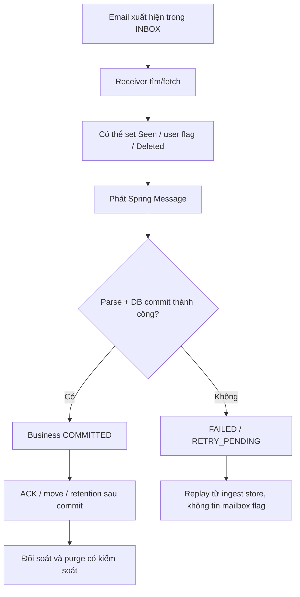
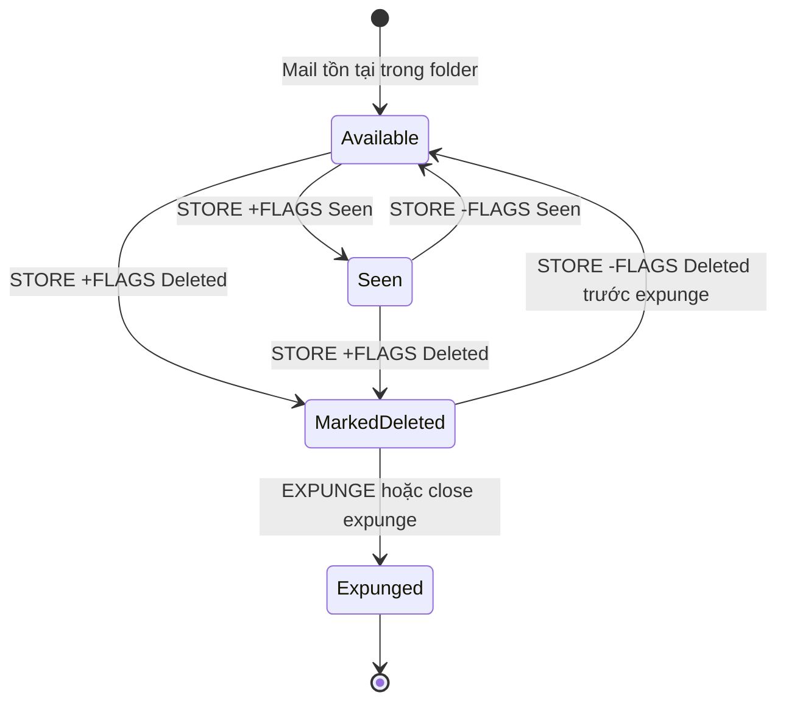
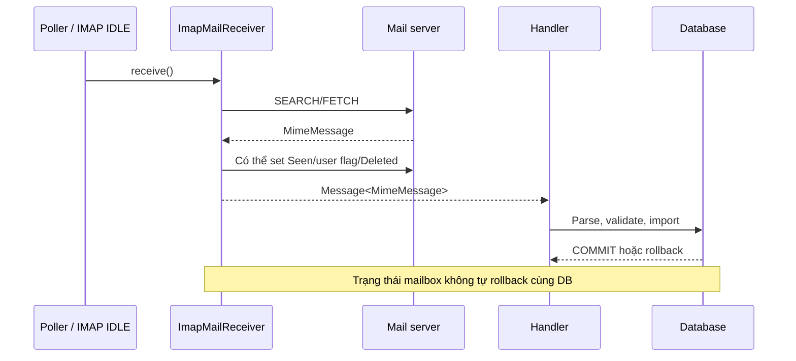
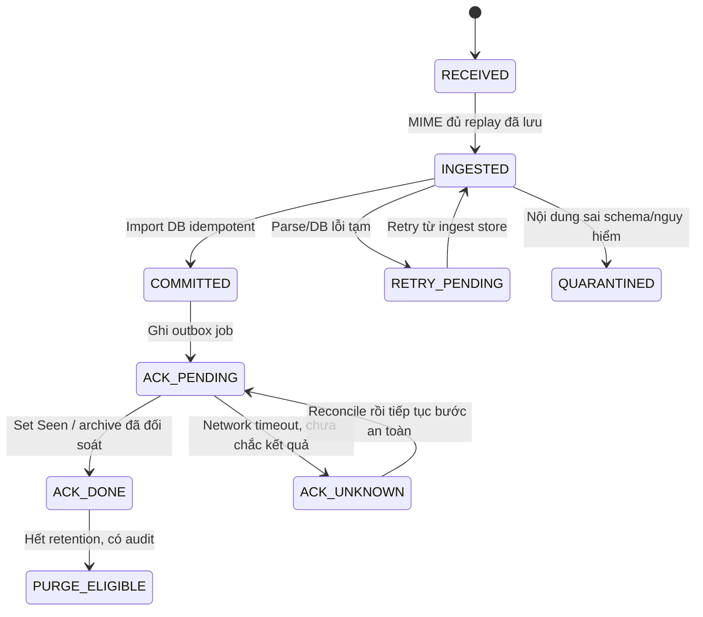

# Mark as read và xóa thư

## 1. Bài toán: đã nhận email có phải là đã xử lý xong?

Ứng dụng Spring Boot đọc email chứa hóa đơn từ hộp thư `invoices@example.test` qua IMAP. Một email mới được `ImapMailReceiver` tải về và đưa vào `MessageChannel`, nhưng service nhập hóa đơn gặp lỗi database ngay sau đó. Mail client hiển thị thư đã đọc, còn lần poll kế tiếp không nhận lại nó. Người vận hành không biết thư đã được xử lý hay mới chỉ được tải xuống.

Ở luồng khác, để tránh nhận lại những thư cũ, lập trình viên bật `shouldDeleteMessages(true)` trên POP3. Ứng dụng khởi động lại sau khi mail đã bị xóa nhưng trước khi tệp đính kèm được lưu bền vững. Dữ liệu không còn để phục hồi từ mail server.

Đây là vấn đề **đánh dấu đã đọc (mark as read), đánh dấu xóa và xóa hẳn (delete/expunge)** trong mail inbound adapter. Các thao tác này thay đổi **trạng thái mailbox trên server**, không phải transaction nghiệp vụ trong database. Một email được receiver nhìn thấy **không đồng nghĩa** đã được import, đã gửi ACK cho đối tác hoặc đã có thể xóa an toàn.

Bài thuộc chương **Adapter Mail** trong module `SPRING_INTEGRATION_ADAPTERS`: tích hợp hệ thống ngoài bằng inbound/outbound adapter, gateway, poller và `MessageChannel`, quản lý message contract, retry, lỗi và vòng đời kết nối. Tương tự file/SFTP, HTTP, JMS, AMQP, Kafka và database, phải phân biệt **đã lấy dữ liệu**, **đã ghi nhận bền vững** và **đã hoàn tất nghiệp vụ**; riêng email còn có semantics của IMAP `\Seen`, `\Deleted`, user flag, POP3 `DELE` và IMAP `EXPUNGE`.

Sau bài này bạn có thể:

- Hiểu `\Seen`, `\Deleted`, `\Recent`, `\Flagged`, user flag, IMAP expunge và POP3 DELE/QUIT.
- Cấu hình `setShouldMarkMessagesAsRead(...)`, `setShouldDeleteMessages(...)`, `setUserFlag(...)`, `setFlaggedAsFallback(...)` và IMAP `peek` đúng mục tiêu.
- Phân biệt polling inbound với IMAP IDLE và ảnh hưởng của default `SearchTermStrategy` đến khả năng nhận lại thư.
- Viết Java DSL và handler đọc `MimeMessage`/attachment, đóng tài nguyên folder và ghi trạng thái nghiệp vụ.
- Dùng IMAP UID/UIDVALIDITY để xác minh lại thư trước thao tác mark-as-read/delete sau commit.
- Thiết kế archive, retention, retry, idempotency và kiểm thử crash/restart trên một mailbox test.

> **Phạm vi:** ví dụ dùng Spring Integration **6.5.x**, Spring Boot tương thích, Java 17+ và **Jakarta Mail** (`jakarta.mail.*`). Các API minh họa được đối chiếu với tài liệu Spring Integration 6.5; cú pháp/provider cụ thể cần kiểm thử trong dự án. Địa chỉ email, host và tên folder đều là giá trị giả lập. Không thực hiện thao tác xóa trên mailbox production khi thực hành.

## 2. Từ trạng thái mailbox đến trạng thái nghiệp vụ

| Khái niệm | Thuộc về đâu? | Ý nghĩa | Có chứng minh DB đã commit? |
| --- | --- | --- | --- |
| Mail **được tìm thấy** | IMAP/POP3 receiver | Lệnh tìm/fetch thấy một thông điệp | Không |
| Mail **được phát ra channel** | Spring Integration | Source tạo một `Message<?>` cho downstream | Không |
| `\Seen` | IMAP server | Mail đã được đánh dấu đã đọc | **Không** |
| User flag `spring-integration-mail-adapter` | IMAP server nếu hỗ trợ | Receiver đã đánh dấu thông điệp theo chiến lược của adapter | **Không** |
| `\Deleted` | IMAP server | Thư được đánh dấu **chờ xóa** | Không, và chưa chắc đã bị xóa vật lý |
| `EXPUNGE` | IMAP server | Loại bỏ thư đã gắn `\Deleted` khỏi folder | Không; có thể không khôi phục được qua inbox |
| POP3 `DELE`/`QUIT` | POP3 session/server | Đánh dấu xóa trong session và hoàn tất ở pha kết thúc | Không |
| `INGESTED` | DB/ingest store của ứng dụng | Nội dung đủ để replay đã được lưu bền vững | Chỉ chứng minh bước ingest |
| `COMMITTED` | DB nghiệp vụ | Import hóa đơn đã commit thành công | Có, theo định nghĩa transaction |
| `ARCHIVED`/`PURGED` | Quản trị dữ liệu | Đã chuyển lưu trữ/xóa theo retention policy | Chỉ khi có bằng chứng riêng |

**Quy tắc:** chỉ dựa vào `\Seen` để ngăn trùng có thể khiến mất công việc chưa hoàn tất. Chỉ dựa vào `\Seen=false` để retry có thể khiến import trùng. Ngược lại, bật xóa tự động để giảm bản sao trong mailbox có thể **mất nguồn để phục hồi**. Phải có **business ledger** và một quy trình ACK/retention được thiết kế rõ ràng.



## 3. IMAP flags: `\Seen` và `\Deleted` khác nhau hoàn toàn

Trong IMAP, `jakarta.mail.Flags` mô tả các system flags mà mail server cho phép thao tác. Các flag thường gặp:

| Flag | Nghĩa | Lưu ý tích hợp |
| --- | --- | --- |
| `Flags.Flag.SEEN` (`\Seen`) | Thư đã đọc | Có thể do mail client, receiver hoặc cách fetch nội dung gây ra |
| `Flags.Flag.ANSWERED` (`\Answered`) | Đã được trả lời | Không phải trạng thái đã import vào DB |
| `Flags.Flag.DELETED` (`\Deleted`) | Đánh dấu xóa | Cần expunge hoặc hành vi folder/server cụ thể mới xóa hẳn |
| `Flags.Flag.FLAGGED` (`\Flagged`) | Đánh dấu quan trọng | Spring Integration có thể dùng làm fallback để tránh nhận lại thư |
| `Flags.Flag.RECENT` (`\Recent`) | Trạng thái thư mới theo semantics IMAP server/session | Không phải số thứ tự/cursor bền vững; khả năng hỗ trợ khác nhau |
| User-defined flag | Cờ do ứng dụng đặt | Chỉ dùng khi server hỗ trợ; không phải distributed lock/DB commit |

**Mark as read** thường có nghĩa đặt `\Seen=true`, để giao diện email hiển thị thư đã đọc và để bộ lọc `NOT SEEN` loại thư khỏi các lượt tìm sau. Nó **không di chuyển**, **không xóa** và **không gửi reply email**.

**Mark as deleted** đặt `\Deleted=true`. Thông điệp có thể vẫn tồn tại trong folder, còn được trả về bởi một số thao tác nếu chưa expunge. Lệnh **EXPUNGE** hoặc thao tác đóng folder với expunge sẽ xóa các message đã bị đánh dấu `\Deleted` theo semantics server. Đây là bước **có khả năng phá hủy dữ liệu**, không phải chỉ đổi cờ.

### IMAP delete gồm hai giai đoạn



Nếu một client khác đã gắn `\Deleted` cho nhiều mail trong **cùng folder**, thao tác `folder.expunge()` có thể xóa **tất cả thư đã được đánh dấu** đó, không chỉ email mà batch của bạn vừa xử lý. Do đó, **không gọi expunge hàng loạt trong shared INBOX** chỉ vì một job hoàn tất. Cần ownership/retention riêng, lưu audit và cân nhắc folder lưu trữ chuyên dụng hoặc cơ chế expunge theo UID được server/provider hỗ trợ.

## 4. POP3: không có `\Seen`, xóa phụ thuộc phiên làm việc

POP3 không có bộ cờ folder của IMAP, không có `\Seen` hoặc IMAP IDLE. Trạng thái mail đã được lấy trong một session không tự được lưu như IMAP Seen. Khi khởi động lại receiver, những mail **vẫn còn trên server** có thể được trả về lần nữa.

| Thiết lập POP3 | Ý nghĩa | Sau restart | Rủi ro |
| --- | --- | --- | --- |
| `shouldDeleteMessages(false)` | Giữ thư trên server | Có thể tải lại thư cũ | Trùng import nếu không idempotent |
| `shouldDeleteMessages(true)` | Adapter chủ động xóa sau khi nhận theo POP3 session | Thư đã xóa không còn để tải lại | Mất dữ liệu nếu importer chưa commit |
| `shouldMarkMessagesAsRead(true/false)` | **Không có tác dụng đối với POP3** | Không tạo ra cờ Seen | Hiểu sai hành vi receive |

Trong POP3, lệnh **`DELE`** đánh dấu message trong phiên; việc xóa thường được thực hiện khi session chuyển sang pha **UPDATE** lúc `QUIT` thành công. Nếu kết nối đứt trước khi hoàn tất QUIT, server có thể không xóa; nếu phản hồi QUIT thất lạc, client có thể **không biết kết quả cuối cùng**. Các provider có giới hạn riêng, nên phải kiểm thử hành vi thực tế thay vì giả định một exception chứng minh mail vẫn còn.

`UIDL` (khi POP3 server hỗ trợ) giúp nhận diện message trong **maildrop**, nhưng không phải khóa hóa đơn toàn cục. Hai email khác nhau có thể chứa cùng một hóa đơn. Cần unique business key, ví dụ `(partner_id, invoice_id, version)`, thay vì chỉ dựa vào UIDL hoặc header `Message-ID` có thể trùng/giả mạo.

**Khuyến nghị cho POP3 có dữ liệu quan trọng:** để `shouldDeleteMessages(false)` khi mới xây pipeline, materialize raw MIME/attachments vào ingest store bền vững, ghi ledger và import idempotent. Chỉ bật delete tự động khi đã chấp nhận rõ trade-off mất nguồn retry hoặc có một kiến trúc ingest bảo đảm độc lập với mail server. POP3 không cung cấp cơ chế chuyển folder/mark Seen phong phú như IMAP.

## 5. Spring Integration nhận và đánh dấu thư ở thời điểm nào?

Spring Integration document nêu rõ các thao tác **mark-as-read và delete thực hiện sau khi receiver nhận mail nhưng trước khi downstream consumer hoàn tất xử lý**. Vì vậy `shouldMarkMessagesAsRead(true)` hoặc `shouldDeleteMessages(true)` không phải cách để ACK **sau** transaction DB.



| Ngữ cảnh | Có thể xảy ra | Không nên suy ra |
| --- | --- | --- |
| Source đã fetch mail | Mail có thể được gắn cờ theo receiver config | Consumer đã xử lý xong |
| Handler ném exception | Source/poller có thể đã thay đổi mail flags | IMAP server sẽ tự rollback flags |
| DB transaction rollback | Dữ liệu DB không commit | Mail chắc chắn được phát lại ở poll tiếp |
| Mail không còn trong default search | Mail có thể đã Seen hoặc mang user flag | Mail đã nhập DB thành công |
| Restart ứng dụng | Receiver/poller mở session mới | Local retry context tự khôi phục và tránh duplicate |

Nếu yêu cầu nghiệp vụ là **chỉ mark read hoặc xóa sau commit**, phải thiết kế riêng bước xác nhận và lưu trạng thái. `TransactionSynchronizationFactory` có thể nối các hành động after-commit/after-rollback vào polling/IDLE flow, nhưng không tạo ra một transaction phân tán giữa IMAP/POP3 và database; phần sau sẽ giải thích giới hạn.

## 6. Hai thuộc tính dễ hiểu nhầm: `shouldMarkMessagesAsRead` và `shouldDeleteMessages`

Trong Spring Integration:

```java
ImapMailReceiver imap = new ImapMailReceiver(storeUri);
imap.setShouldMarkMessagesAsRead(false);
imap.setShouldDeleteMessages(false);

Pop3MailReceiver pop3 = new Pop3MailReceiver(pop3Uri);
pop3.setShouldDeleteMessages(false);
```

Đây là **trích đoạn cấu hình** (biến URI phải được khai báo, thêm auth/TLS/timeout trong bean thực tế). Ý nghĩa:

- `setShouldMarkMessagesAsRead(true)` trên IMAP: receiver chủ động đặt `\Seen` cho mail được chọn. `false` nghĩa là **không chủ động đặt Seen qua tùy chọn này**, không có nghĩa không có bất kỳ flag nào bị đổi.
- `setShouldDeleteMessages(true)`: receiver chủ động xóa sau khi lấy thư, theo protocol và lifecycle. **Không phải sau khi importer commit**.
- Với POP3, `shouldMarkMessagesAsRead` không giúp ghi lại mail đã đọc vì giao thức không có Seen. Muốn chống trùng qua restart, cần lưu trạng thái trong ứng dụng.
- Với IMAP, giữ thư (`shouldDeleteMessages=false`) không đồng nghĩa mail tự được phát lại nếu đã có Seen/user flag hoặc default `SearchTermStrategy` loại nó.

Một cấu hình phổ biến khi mới triển khai một pipeline cần audit là **không xóa**, **không chủ động mark Seen**, dùng staging + ledger rồi mới thực hiện mailbox action sau khi có bằng chứng commit. Tuy nhiên vẫn phải hiểu **các flag bổ sung của chính adapter** và thư có thể được fetch theo cách làm đổi Seen nếu `peek` bị tắt.

## 7. User flag, `\Recent` và fallback `\Flagged`

Tài liệu Spring Integration mô tả hành vi khi IMAP server **không hỗ trợ `\Recent`**:

1. Receiver có thể gắn **user flag**, mặc định `spring-integration-mail-adapter`, nếu server hỗ trợ custom flags.
2. Nếu user flag không khả dụng, receiver có thể dùng **`Flags.Flag.FLAGGED`** làm fallback.
3. Các flag này có thể được đặt **bất kể** `shouldMarkMessagesAsRead` là `true` hay `false`.
4. Từ Spring Integration **6.4**, `setFlaggedAsFallback(false)` cho phép tắt fallback dùng `\Flagged`, nhưng không tự xóa cơ chế user flag hoặc tạo durable ledger.

```java
ImapMailReceiver receiver = new ImapMailReceiver(storeUri);
receiver.setShouldMarkMessagesAsRead(false);
receiver.setShouldDeleteMessages(false);
receiver.setUserFlag("invoice-receiver-v1");
receiver.setFlaggedAsFallback(false); // Chỉ khi hiểu hệ quả với server này.
```

Trích đoạn này **không phải zero-side-effect mail reader**. User flag có thể vẫn được thêm, và việc không fallback sang `\Flagged` có thể đổi tập email mà receiver phát lại. Không bật tuỳ chọn này chỉ để làm cho mailbox "trông sạch": cần test flags thực tế và search behavior khi restart, khi user đọc mail bằng client khác, khi có hai adapter và khi mail server thiếu `\Recent`.

### Vì sao default search có thể khiến mail không xuất hiện lại?

`ImapMailReceiver` dùng `SearchTermStrategy` để tìm ứng viên, với các điều kiện liên quan tới `\Recent`, `\Seen`, `\Answered`, `\Deleted`, user flag/fallback tùy server. Một thư đã được receiver gắn cờ có thể không còn thỏa default search, **ngay cả khi DB rollback**.

Nếu thay default bằng custom `SearchTermStrategy` chỉ kiểm tra subject, các điều kiện chống duplicate có thể bị loại bỏ và mail được phát lại nhiều lần. Custom search là **thay thế** chiến lược tìm, không tự cộng thêm các điều kiện mặc định. Cần test từng loại flag, không suy rằng filter của receiver đồng nghĩa idempotency nghiệp vụ.

## 8. IMAP `peek`: đọc nội dung cũng có thể đặt `\Seen`

Trong Jakarta Mail IMAP provider, **PEEK** cho phép fetch nội dung mà không chủ động đặt `\Seen` theo semantics protocol. Spring Integration từ phiên bản 4.1.1 có đọc property `mail.imap.peek` / `mail.imaps.peek`. Theo tài liệu chính thức:

- Nếu không khai báo property, hành vi cũ được giữ lại: **peek mặc định là `true` trong receiver**.
- Nếu đặt `mail.imaps.peek=false`, IMAP message có thể bị đặt `\Seen` khi fetch, **bất kể** `shouldMarkMessagesAsRead=false`.
- Nếu muốn triển khai chính sách không đánh dấu Seen khi fetch, phải kiểm tra **cả** `shouldMarkMessagesAsRead` **và** IMAP peek, đồng thời quan sát user flag/`\Flagged` riêng.

```java
Properties props = new Properties();
props.setProperty("mail.store.protocol", "imaps");
props.setProperty("mail.imaps.ssl.enable", "true");
props.setProperty("mail.imaps.ssl.checkserveridentity", "true");
props.setProperty("mail.imaps.peek", "true");
props.setProperty("mail.imaps.connectiontimeout", "10000");
props.setProperty("mail.imaps.timeout", "30000");
props.setProperty("mail.imaps.writetimeout", "30000");
props.setProperty("mail.debug", "false");
```

Đây chỉ là JavaMail properties, chưa phải receiver hoàn chỉnh. **Peek không biến nhận mail thành exactly-once**; nó chỉ ảnh hưởng cách đọc IMAP. Một số mail client khác có thể đánh dấu Seen bất kỳ lúc nào, nên Seen vẫn không thể là business completion marker trong môi trường chia sẻ mailbox.

## 9. Cấu hình IMAPS inbound an toàn bằng Java

Ví dụ sử dụng key/credential do hệ thống cấp quyền, IMAPS có hostname verification, không xóa và không chủ động mark Seen. Vì cần parse attachment lazy-load, handler sẽ chịu trách nhiệm đóng folder khi `autoCloseFolder(false)`:

```groovy
dependencies {
    implementation 'org.springframework.boot:spring-boot-starter-integration'
    implementation 'org.springframework.integration:spring-integration-mail'
    implementation 'org.springframework.boot:spring-boot-starter-mail'
}
```

```yaml
app:
  mail:
    imap-uri: ${MAIL_IMAP_URI:imaps://invoices%40example.test@imap.example.test:993/INBOX}
    username: ${MAIL_USERNAME:invoices@example.test}
    password: ${MAIL_PASSWORD}
    folder: ${MAIL_FOLDER:INBOX}
```

Không đặt password trong URL vì URL có thể xuất hiện trong exception/log. Với một provider yêu cầu OAuth2, cấu hình SASL/XOAUTH2 và vòng đời token theo provider; ví dụ `Authenticator` dưới đây dành cho endpoint cho phép xác thực username/password hoặc credential tương thích.

```java
import java.util.Properties;

import jakarta.mail.Authenticator;
import jakarta.mail.PasswordAuthentication;

import org.springframework.beans.factory.annotation.Value;
import org.springframework.context.annotation.Bean;
import org.springframework.context.annotation.Configuration;
import org.springframework.integration.mail.ImapMailReceiver;

@Configuration
public class InvoiceImapConfiguration {

    @Bean
    public ImapMailReceiver invoiceImapReceiver(
            @Value("${app.mail.imap-uri}") String imapUri,
            @Value("${app.mail.username}") String username,
            @Value("${app.mail.password}") String password) {

        ImapMailReceiver receiver = new ImapMailReceiver(imapUri);
        receiver.setJavaMailAuthenticator(new Authenticator() {
            @Override
            protected PasswordAuthentication getPasswordAuthentication() {
                return new PasswordAuthentication(username, password);
            }
        });

        Properties props = new Properties();
        props.setProperty("mail.store.protocol", "imaps");
        props.setProperty("mail.imaps.ssl.enable", "true");
        props.setProperty("mail.imaps.ssl.checkserveridentity", "true");
        props.setProperty("mail.imaps.peek", "true");
        props.setProperty("mail.imaps.connectiontimeout", "10000");
        props.setProperty("mail.imaps.timeout", "30000");
        props.setProperty("mail.imaps.writetimeout", "30000");
        props.setProperty("mail.debug", "false");
        receiver.setJavaMailProperties(props);

        receiver.setShouldMarkMessagesAsRead(false);
        receiver.setShouldDeleteMessages(false);
        receiver.setMaxFetchSize(1);
        receiver.setSimpleContent(false);
        receiver.setAutoCloseFolder(false);

        // Receiver vẫn có logic user flag / fallback theo server.
        // Không khẳng định cấu hình này loại bỏ mọi side effect lên mailbox.
        return receiver;
    }
}
```

**Khi `autoCloseFolder(false)`:** Spring Integration cung cấp header `IntegrationMessageHeaderAccessor.CLOSEABLE_RESOURCE`. Handler phải `close()` sau khi đọc xong, kể cả lỗi. Nếu folder đóng sớm, `MimeMessage` có lazy attachment có thể ném `FolderClosedException`. Nếu giữ folder mở rồi không đóng, ứng dụng rò rỉ IMAP session và có thể chặn các consumer khác.

Không bật `shouldDeleteMessages(true)` cho mẫu này khi chưa xây đủ ingest ledger. Xóa thư ở bước nhận không bảo đảm importer sẽ commit trước đó.

## 10. Java DSL polling và ranh giới source/handler

```java
import org.springframework.context.annotation.Bean;
import org.springframework.context.annotation.Configuration;
import org.springframework.integration.dsl.IntegrationFlow;
import org.springframework.integration.dsl.Pollers;
import org.springframework.integration.mail.ImapMailReceiver;
import org.springframework.integration.mail.dsl.Mail;

@Configuration
public class InvoiceMailInboundFlow {

    @Bean
    public IntegrationFlow invoiceMailFlow(
            ImapMailReceiver invoiceImapReceiver,
            InvoiceMessageHandler invoiceMessageHandler) {

        return IntegrationFlow.from(
                        Mail.imapInboundAdapter(invoiceImapReceiver),
                        endpoint -> endpoint.id("invoiceMailPollingEndpoint")
                                .poller(Pollers.fixedDelay(15_000)
                                        .maxMessagesPerPoll(1)))
                .handle(invoiceMessageHandler)
                .get();
    }
}
```

`Mail.imapInboundAdapter(...)` là **pollable source**; poller kích hoạt `receive()`, rồi source phát `Message<MimeMessage>` cho handler. Lệnh fetch/flag/delete nằm ở phía **receiver**, trước khi handler có cơ hội xác nhận business transaction. Một `RequestHandlerRetryAdvice` đặt trên downstream handler không bao phủ mọi exception xảy ra **trong mail source trước khi tạo message**.

`maxFetchSize(1)` trên receiver giới hạn số thư fetch một lần; `maxMessagesPerPoll(1)` giới hạn số message phát mỗi poll. Hai giới hạn không phải distributed lock hoặc chính sách tránh trùng qua nhiều replica. Một `ExecutorChannel` đặt giữa source và handler có thể làm phức tạp vòng đời `MimeMessage`/folder; chỉ handoff **dữ liệu đã materialize** cùng khóa nghiệp vụ bền vững.

## 11. Handler: trích xuất định danh IMAP, lưu dữ liệu, đóng folder

Nếu sau commit muốn thay đổi flag chính xác cho **thư đã nhận**, không tìm lại qua subject hoặc `Message-ID` một cách mù quáng. IMAP có **UID** ổn định trong một folder cho đến khi UIDVALIDITY thay đổi. Cặp `(mailbox account, folder, UIDVALIDITY, UID)` là một định danh hợp lý **trong phạm vi mailbox/epoch UID**.

```java
import jakarta.mail.Folder;
import jakarta.mail.Message;
import jakarta.mail.MessagingException;
import jakarta.mail.UIDFolder;
import jakarta.mail.internet.MimeMessage;

public record MailUidKey(
        String mailboxId, String folderName, long uidValidity, long uid) { }

public final class MailIdentityReader {

    public MailUidKey readUid(MimeMessage mime, String mailboxId)
            throws MessagingException {

        Folder folder = mime.getFolder();
        if (!(folder instanceof UIDFolder uids)) {
            throw new IllegalStateException("Provider không hỗ trợ IMAP UID");
        }
        long uid = uids.getUID(mime);
        if (uid <= 0) {
            throw new IllegalStateException("Không lấy được UID của email");
        }
        return new MailUidKey(
                mailboxId, folder.getFullName(), uids.getUIDValidity(), uid);
    }
}
```

Đọc UID khi folder còn mở và lưu vào ledger. Một message được **move/copy** sang folder khác sẽ có định danh folder/UID mới; không giữ nguyên UID để tiếp tục thao tác trong folder khác. Khi UIDVALIDITY không còn khớp, **dừng tự động mark/delete** và chuyển sang đối soát, không sử dụng UID cũ trên mailbox epoch mới.

Handler minh họa parse văn bản đơn giản, ghi business ingest và đóng folder. Email multipart/attachment phải chuyển qua parser MIME có giới hạn thay vì ép body sang `String`:

```java
import java.io.Closeable;
import java.io.IOException;

import jakarta.mail.MessagingException;
import jakarta.mail.internet.MimeMessage;

import org.springframework.integration.StaticMessageHeaderAccessor;
import org.springframework.messaging.Message;
import org.springframework.messaging.MessageHandler;
import org.springframework.messaging.MessageHandlingException;
import org.springframework.stereotype.Component;

@Component
public class InvoiceMessageHandler implements MessageHandler {

    private final MailIdentityReader identityReader = new MailIdentityReader();
    private final InvoiceIngestService ingestService;

    public InvoiceMessageHandler(InvoiceIngestService ingestService) {
        this.ingestService = ingestService;
    }

    @Override
    public void handleMessage(Message<?> message) {
        Closeable resource =
                StaticMessageHeaderAccessor.getCloseableResource(message);

        try (Closeable folder = resource == null ? () -> { } : resource) {
            MimeMessage mime = (MimeMessage) message.getPayload();
            MailUidKey key = identityReader.readUid(mime, "partner-invoices");

            if (!mime.isMimeType("text/plain")) {
                throw new IllegalArgumentException(
                        "Mail multipart phải qua parser/staging MIME riêng");
            }
            Object content = mime.getContent();
            if (!(content instanceof String text)) {
                throw new IllegalArgumentException("Mail body không phải text");
            }

            // Contract: lưu nội dung đủ replay + business ledger có unique key.
            // Bản ghi ACK_REQUESTED được lưu sau commit theo quy trình riêng.
            ingestService.ingestOnce(key, mime.getMessageID(), text);

        } catch (MessagingException | IOException ex) {
            throw new MessageHandlingException(
                    message, "Lỗi đọc IMAP mail hoặc đóng folder", ex);
        }
    }
}

public interface InvoiceIngestService {
    void ingestOnce(MailUidKey key, String messageId, String body);
}
```

Đây là ví dụ về **hợp đồng ingest**, không phải transaction end-to-end đã triển khai. `InvoiceIngestService` trong dự án thực tế phải có unique business key, persistence và transaction phù hợp. **Không** chỉ ghi một con trỏ tới `MimeMessage` còn phụ thuộc folder rồi đóng resource; hãy materialize dữ liệu cần replay hoặc raw MIME vào kho bền vững có giới hạn dung lượng, retention và quyền đọc.

`Message-ID` là header do sender đặt, có thể thiếu, trùng hoặc bị giả mạo. Nó hữu ích để correlation nhưng không thay thế IMAP UID/UIDVALIDITY và **không thay business invoice ID** để chống import cùng hóa đơn qua nhiều email.

## 12. Mark-as-read sau commit bằng UID, không bằng subject

Khi DB đã ghi `COMMITTED`, một worker ACK riêng có thể kết nối IMAPS, mở **đúng folder** và xác minh UIDVALIDITY/UID trước khi đặt Seen. Ví dụ service dưới đây cố ý chỉ đặt `\Seen`, **không xóa** hoặc expunge:

```java
import jakarta.mail.Flags;
import jakarta.mail.Folder;
import jakarta.mail.Message;
import jakarta.mail.MessagingException;
import jakarta.mail.Session;
import jakarta.mail.Store;
import jakarta.mail.UIDFolder;

public final class ImapSeenAcknowledger {

    private final Session mailSession;
    private final String host;
    private final int port;
    private final String username;
    private final String password;

    public ImapSeenAcknowledger(Session mailSession, String host,
                               int port, String username, String password) {
        this.mailSession = mailSession;
        this.host = host;
        this.port = port;
        this.username = username;
        this.password = password;
    }

    public void markSeenAfterCommit(MailUidKey key) throws MessagingException {
        Store store = null;
        Folder folder = null;

        try {
            store = mailSession.getStore("imaps");
            store.connect(host, port, username, password);
            folder = store.getFolder(key.folderName());
            folder.open(Folder.READ_WRITE);

            if (!(folder instanceof UIDFolder uidFolder)) {
                throw new IllegalStateException("Server thiếu UIDFolder");
            }
            if (uidFolder.getUIDValidity() != key.uidValidity()) {
                throw new IllegalStateException("UIDVALIDITY đã thay đổi");
            }
            Message mail = uidFolder.getMessageByUID(key.uid());
            if (mail == null || mail.isExpunged()) {
                throw new IllegalStateException("Không tìm thấy mail theo UID");
            }

            mail.setFlag(Flags.Flag.SEEN, true);
            // Không gọi expunge và không xóa ở ACK step.

        } finally {
            if (folder != null && folder.isOpen()) {
                folder.close(false); // Không expunge các mail Deleted của người khác.
            }
            if (store != null && store.isConnected()) {
                store.close();
            }
        }
    }
}
```

**Điều kiện vận hành quan trọng:** `mailSession` phải được tạo bằng cấu hình IMAPS/TLS hostname verification/timeout và credential từ secret manager. Đoạn code chọn `Store` qua `mailSession.getStore("imaps")`; không được đưa password vào log, không dùng trust-all TLS. `key.mailboxId()` phải được xác minh thuộc đúng tài khoản cấu hình trước khi gọi; không cho request HTTP bên ngoài chọn `host`, `folder` hoặc UID tùy ý.

Thao tác `setFlag(SEEN, true)` nhìn chung là **idempotent về trạng thái đích**: gọi lại vẫn giữ Seen. Tuy nhiên nếu người dùng chủ ý đánh dấu unread giữa các lượt, worker cũ có thể set lại Seen và gây xung đột UX. Cần giới hạn thời điểm ACK, quyền sở hữu mailbox và audit. Nếu kết nối đứt sau khi gửi lệnh STORE, client có thể không biết flag đã được đặt; lần retry phải **đọc lại trạng thái mailbox**, không mặc định thao tác chưa xảy ra.

### `Session` cho ACK worker

Có thể tạo `Session` Jakarta Mail với `Properties` tương tự mục 9, `mail.imaps.ssl.checkserveridentity=true` và timeout. Bean này có thể chia sẻ cấu hình kết nối với receiver nhưng **không chia sẻ một `Folder` mutable** giữa nhiều thread. Quản lý password/token bằng một cơ chế cấp secret và rotation rõ ràng; nếu dùng OAuth2, ví dụ username/password ở trên phải được thay bằng cơ chế xác thực phù hợp provider.

## 13. Xóa thư sau commit: `\Deleted` chưa phải `EXPUNGE`

Nếu yêu cầu là **xóa hẳn** email sau một thời gian lưu trữ, cần tách **quyết định xóa** khỏi **thao tác phá hủy**. Một chiến lược an toàn hơn với IMAP:

1. Lưu raw MIME/attachment cần thiết vào storage được quản lý và ghi `INGESTED`.
2. Import idempotent, ghi `COMMITTED`.
3. Mark Seen hoặc **copy/move** email sang folder `Processed`/`Archive` tùy chính sách, xác minh kết quả.
4. Sau retention window và đối soát, đánh dấu `\Deleted` trong **folder có ownership riêng**.
5. Chỉ **expunge** khi biết rõ các thư đang Deleted trong folder đó đều được phép purge; lưu audit và metric.

Với Jakarta Mail, đoạn lệnh cơ bản để đánh dấu xóa một message đã được xác minh:

```java
// Trích đoạn: chạy sau khi đã kết nối, mở Folder.READ_WRITE,
// xác minh UIDVALIDITY và lấy đúng Message theo UID như mục 12.
if (!mail.isSet(Flags.Flag.DELETED)) {
    mail.setFlag(Flags.Flag.DELETED, true);
}

// folder.close(false): KHÔNG expunge ở bước này.
// Chỉ một job retention riêng có quyền mới được thực hiện expunge.
```

`\Deleted` có thể được **gỡ lại** trước expunge bằng `mail.setFlag(Flags.Flag.DELETED,false)` nếu thư còn tồn tại và server cho phép. Nhưng khi một client khác expunge shared INBOX, bạn có thể mất cơ hội gỡ; đừng dựa vào việc `\Deleted` luôn có thể phục hồi.

### Vì sao `folder.close(true)`/`folder.expunge()` nguy hiểm?

Trên IMAP, `folder.close(true)` có thể expunge **mọi thư đã đánh dấu `\Deleted` trong folder**, kể cả thư do client khác đánh dấu. Tương tự, `folder.expunge()` thường loại tất cả messages đánh dấu Deleted trong folder theo semantics provider. Một ứng dụng chỉ muốn xóa `invoice-0042` **không được giả định** gọi expunge sẽ tác động duy nhất tới email này.

Nếu server hỗ trợ mở rộng như UIDPLUS/UID EXPUNGE hoặc MOVE, có thể cân nhắc hành vi **được giới hạn theo UID** qua API/provider tương ứng; không tự giả định Jakarta Mail `Folder.expunge()` là expunge chọn lọc. Kiểm thử với server thật và bảo đảm audit/ownership trước khi dùng lệnh có tác dụng phá hủy.

## 14. Archive sau commit: copy rồi delete không tự là atomic move

Một yêu cầu thường gặp: sau khi import hóa đơn, chuyển email ra khỏi INBOX tới `Processed`. IMAP server có thể hỗ trợ MOVE tối ưu, nhưng không phải nhà cung cấp nào cũng hỗ trợ cùng cách. Cách portable hơn là **copy vào folder đích**, kiểm tra bản sao, sau đó **mark source Deleted**, và để retention job xử lý việc purge.

```text
DB COMMITTED
  -> mở đúng source folder và tìm thư bằng UIDVALIDITY/UID
  -> COPY thư sang Processed (chưa xóa source)
  -> xác minh thư/bản sao đích theo hợp đồng, lưu target reference nếu có
  -> STORE source +FLAGS Deleted (khi quyền và retention cho phép)
  -> KHÔNG expunge tự động trong shared INBOX
  -> retention job purge sau đối soát
```

`Folder.copyMessages(new Message[]{sourceMail}, archiveFolder)` là primitive Jakarta Mail để copy khi folder đích đã tồn tại. Tuy nhiên **copy + mark Deleted không atomic**: worker chết giữa hai bước có thể khiến thư tồn tại ở cả hai folder. Nếu copy timeout sau khi server đã tạo bản sao, retry mù có thể tạo nhiều bản sao trong `Processed`. Phải có ledger trạng thái `ARCHIVE_PENDING`, `ARCHIVE_COPIED`, `SOURCE_MARKED_DELETED`, `PURGE_ELIGIBLE`, và phương án reconciliation.

| Trạng thái sau lỗi | Diễn giải có thể | Quyết định |
| --- | --- | --- |
| Source còn, target chưa có | Copy có thể chưa chạy | Có thể retry sau khi đối soát |
| Source còn, target có bản đúng | Copy đã thành công nhưng chưa mark source | Không copy lại mù; thực hiện bước còn thiếu |
| Source đã Deleted, target đúng | Chờ retention/purge | Không import lại và không xóa target |
| Source không còn, target có bản đúng | Có thể đã MOVE/EXPUNGE | Ghi nhận trạng thái sau đối soát |
| Source và target đều không xác minh được | Lỗi quyền, concurrent client hoặc mất dữ liệu | Cảnh báo, dừng delete/expunge tự động |

Mail đã copy qua folder khác có thể có **UID mới**. Không dùng UID của source làm target UID. Khi copy/move qua provider hoặc thay UIDVALIDITY, phải cập nhật mapping identity bằng bằng chứng đáng tin, không dựa vào `Message-ID` trùng là đủ.

## 15. POP3 inbound: cấu hình giữ/xóa như hai lựa chọn khác nhau

POP3 chỉ có lựa chọn thực tế là **đọc rồi giữ** hoặc **đọc rồi xóa theo phiên**, không có một `\Seen` bền vững. Cấu hình mẫu an toàn để xây ingestion có thể replay:

```java
import java.util.Properties;

import jakarta.mail.Authenticator;
import jakarta.mail.PasswordAuthentication;

import org.springframework.beans.factory.annotation.Value;
import org.springframework.context.annotation.Bean;
import org.springframework.context.annotation.Configuration;
import org.springframework.integration.mail.Pop3MailReceiver;

@Configuration
public class InvoicePop3Configuration {

    @Bean
    public Pop3MailReceiver invoicePop3Receiver(
            @Value("${app.mail.pop3-uri}") String pop3Uri,
            @Value("${app.mail.username}") String username,
            @Value("${app.mail.password}") String password) {

        Pop3MailReceiver receiver = new Pop3MailReceiver(pop3Uri);
        receiver.setJavaMailAuthenticator(new Authenticator() {
            @Override
            protected PasswordAuthentication getPasswordAuthentication() {
                return new PasswordAuthentication(username, password);
            }
        });

        Properties props = new Properties();
        props.setProperty("mail.store.protocol", "pop3s");
        props.setProperty("mail.pop3s.ssl.enable", "true");
        props.setProperty("mail.pop3s.ssl.checkserveridentity", "true");
        props.setProperty("mail.pop3s.connectiontimeout", "10000");
        props.setProperty("mail.pop3s.timeout", "30000");
        props.setProperty("mail.pop3s.writetimeout", "30000");
        receiver.setJavaMailProperties(props);

        receiver.setShouldDeleteMessages(false); // Giữ nguồn để replay.
        receiver.setMaxFetchSize(1);
        // setShouldMarkMessagesAsRead() không áp dụng cho POP3.
        return receiver;
    }
}
```

Thêm cấu hình `app.mail.pop3-uri` tương ứng với `pop3s://...` và secret runtime nếu bật flow POP3. **Không kích hoạt đồng thời flow POP3 và IMAP trên cùng mailbox** chỉ để dự phòng: hai giao thức có cách nhận/trạng thái riêng, rất dễ lặp import.

Để chủ động xóa qua adapter, thay `setShouldDeleteMessages(false)` thành `true`, nhưng chỉ khi đó là chính sách có ý thức về rủi ro: mail có thể bị xóa **trước** khi service downstream nhập DB thành công. Một thiết kế yêu cầu xóa **chỉ sau commit** nên dùng ingestion riêng/worker có checkpoint và cơ chế POP3 deletion được kiểm thử, không dựa một flag của adapter để thực hiện hậu xử lý transaction.

## 16. Transaction synchronization: giúp chạy sau commit, không tạo atomicity với mailbox

Spring Integration hỗ trợ **transaction synchronization** cho inbound poller và IMAP IDLE, thông qua `TransactionSynchronizationFactory`/`transactionSynchronizationFactory(...)`. Nó có thể chạy logic trong các callback như **after commit** và **after rollback** để chuyển thư hoặc cập nhật trạng thái mailbox.

```text
Poller / IMAP IDLE
  -> nhận mail
  -> bắt đầu transaction context phù hợp
  -> downstream parse + DB import
  -> DB COMMIT thành công
      -> after-commit callback: ghi/lên lịch ACK hoặc archive
  -> DB ROLLBACK
      -> after-rollback: ghi trạng thái lỗi hoặc bù trừ có kiểm soát
```

Một số dự án dùng `PseudoTransactionManager` để có callbacks dù không có DB transaction thực. **Pseudo transaction không có commit DB để bảo vệ**, và transaction synchronization cũng không biến lệnh IMAP `STORE`/`COPY`/`EXPUNGE` thành một phần atomic của transaction database.

**Bẫy crash:** DB có thể commit rồi JVM chết trước khi callback after-commit đánh dấu Seen. Khi restart, email có thể lại được fetch. Trường hợp ngược lại còn nguy hiểm hơn: receiver đã gắn user flag hoặc Seen trước commit rồi JVM chết trong parse; mail có thể không xuất hiện lại dù chưa có bản ingest. Do đó, với yêu cầu dữ liệu quan trọng, hãy ghi **ACK/ARCHIVE job vào outbox trong DB transaction**, rồi để worker riêng thực hiện và đối soát thao tác mailbox. Nếu thiết kế có ranh giới cần at-least-once ingestion thực sự, phải thử việc crash ở mọi điểm và cân nhắc IMAP client/custom receiver kiểm soát flag thay vì giả định default receiver hoàn toàn read-only.

## 17. Business ledger và recovery qua restart

Một inbox ledger có thể lưu:

```text
mailbox_account
folder_name
uid_validity
uid
message_id                // tham khảo/correlation, không phải business unique key
business_invoice_id        // key nghiệp vụ đã validate
raw_mime_storage_key       // dữ liệu đủ replay nếu có
content_sha256
status                    // RECEIVED, INGESTED, COMMITTED, ACK_PENDING...
ack_status                // PENDING, SEEN, ARCHIVE_PENDING, DONE, UNKNOWN
attempt_count
last_error_code
next_retry_at
created_at, updated_at
```

Ví dụ transition:



Hãy đặt unique constraint **business invoice ID** để chặn hai mail khác nhau cùng nhập một hóa đơn, cùng với unique identity `(mailbox_account, folder, UIDVALIDITY, UID)` để nhận diện lặp fetch cùng một email. `COMMITTED` phải do transaction nghiệp vụ xác nhận, không được suy từ `Seen=true`. Khi một worker thất bại, error channel chỉ chuyển lỗi; **không tự replay mail** đã bị receiver đánh dấu hoặc delete.

### Ma trận phục hồi

| Điểm crash | Mailbox có thể đang ở trạng thái | Cách phục hồi |
| --- | --- | --- |
| Trước fetch | Mail chưa bị nhận | Poll/IDLE lại theo chính sách search |
| Đã fetch, chưa stage bền vững | Có thể đã có Seen/user flag | Cần redrive/scan mail có kiểm soát hoặc nguồn upstream khác; không giả định tự retry |
| Đã stage, DB import lỗi | Mailbox có thể đã đổi flags | Retry từ ingest store, không cần tải cùng thư lại |
| DB commit, chưa mark Seen | Mail có thể vẫn unread | Outbox ACK job tiếp tục; business unique key ngăn import lại |
| Mark Seen xong, mất reply | Seen có thể đã được đặt | Re-fetch flags theo UID và hoàn tất idempotent |
| Copy archive xong, trước mark Deleted | Có thể có hai bản | Kiểm tra archive trước khi copy lại |
| Mark Deleted xong, chưa expunge | Mail còn nhưng chờ xóa | Chỉ retention job có quyền mới quyết định purge |
| Expunge hoàn tất, DB còn pending | Nguồn IMAP có thể không còn | Cần bản raw MIME/attachment bền vững và audit |

## 18. Nhiều consumer: mailbox flag không phải distributed lock

Hai replica cùng poll một IMAP folder có thể cùng thấy mail **trước khi** một replica cập nhật user flag/Seen. POP3 giữ thư cũng có thể cho hai lần fetch hoặc fetch lại sau restart. Một user flag dùng chung có thể hạn chế phát lại trong một số trường hợp, nhưng nó không thay thế atomic claim ở DB hoặc queue.

Các mô hình vận hành:

| Mô hình | Ưu điểm | Thách thức |
| --- | --- | --- |
| **Một mailbox ingestion owner** → DB/queue | Dễ hiểu ownership và flags | Cần HA/failover có fencing hoặc checkpoint |
| Nhiều instance cùng IMAP inbox | Tăng số kết nối | Race flags, trùng, khó giải quyết delete/expunge |
| Chia folder/tenant/partner cho receiver | Phân chia trách nhiệm rõ | Phải định tuyến/di chuyển mail đúng folder |
| Inbox ledger có claim/lease DB | Recovery và idempotency rõ | Cần unique key, lease expiry, reconciliation |

Ngay cả khi chỉ một receiver fetch mailbox, các mail client khác vẫn có thể thay Seen/Deleted. Không dùng `\Seen` làm distributed ACK. Nếu một batch cần đảm bảo exactly-once **nghiệp vụ**, đặt tính chất đó ở DB transaction + unique key; giao thức mail thường cho semantics **at-least-once hoặc không xác định** khi kết nối gián đoạn.

## 19. Bảo mật và retention khi đánh dấu/xóa

Xóa email không chỉ là tối ưu dung lượng; nó có thể ảnh hưởng kiểm toán, quyền riêng tư, hợp đồng lưu trữ và khả năng giải quyết tranh chấp. Cần chính sách phê duyệt và quyền truy cập:

1. **Principle of least privilege:** tài khoản ingestion chỉ cần read/quyền flag nếu workflow yêu cầu; dùng tài khoản/worker riêng có quyền delete/expunge khi có retention job.
2. **Quyền theo folder và tenant:** không cho request không tin cậy chỉ định folder/UID/host để mark/delete; lấy từ business ledger đã được cấp quyền.
3. **Không trust-all TLS:** IMAPS/POP3S phải verify certificate chain và hostname. Không log credential/OAuth token hoặc `mail.debug=true` ở production.
4. **Không xóa quá sớm:** chỉ purge khi MIME/attachments đã được lưu bền vững, nghiệp vụ đã commit và retention policy cho phép.
5. **Log và audit:** lưu `mailboxId`, UIDVALIDITY, UID, actor, thời điểm, trạng thái trước/sau, correlation ID; không log full body, Bcc, attachment nhạy cảm.
6. **Attachment an toàn:** cần kiểm tra MIME, scan malware và quota; mail được mark Seen không chứng minh attachment đã xử lý an toàn.
7. **Mailbox chia sẻ:** không expunge hàng loạt INBOX có nhiều client; tránh thao tác của worker này phá dữ liệu do worker/client khác quản lý.
8. **Thay key/password:** phải kiểm tra secret rotation, timeout và alert auth failure; retry đăng nhập vô hạn không sửa được cấu hình sai.

Một thư có `From: billing@partner.example.test` chưa chắc thật sự từ đối tác đó. Các header `From`, `Message-ID`, `X-*` có thể bị giả mạo. Không cho phép các header đó tự quyết định quyền xóa, chuyển tiền hoặc ghi đè tài liệu; xác thực theo business contract, mail security policy và nội dung đã validate.

## 20. Quan sát, lỗi thường gặp và cảnh báo

| Triệu chứng | Nguyên nhân có thể | Hướng điều tra |
| --- | --- | --- |
| Mail bị mark Seen dù đặt `shouldMarkMessagesAsRead(false)` | `mail.imaps.peek=false`, client khác hoặc logic set flag | Xem JavaMail properties, flag history, server test |
| Mail không được poll lại sau DB rollback | User flag/`\Flagged`/Seen đã đổi trước handler | Ingest ledger, search term và redrive/recovery |
| POP3 tải lại mail sau restart | Giao thức không lưu Seen, `shouldDeleteMessages(false)` | Dùng UIDL/unique business key, không dựa vào session |
| Mail bị mất khi bật POP3 delete | Delete ở receiver xảy ra trước importer commit | Tắt xóa sớm, bổ sung ingest staging bền vững |
| IMAP mark Deleted nhưng thư vẫn ở folder | Chưa expunge hoặc client hiển thị message đánh dấu xóa | Phân biệt Deleted/Expunged, không purge mù |
| Expunge làm mất nhiều thư | Nhiều message khác cũng đã gắn Deleted | Dừng job, kiểm tra ownership/backup/audit |
| `FolderClosedException` khi parse MIME | Auto-close folder trước khi downstream đọc attachment | `autoCloseFolder(false)`, đóng resource sau parse |
| UID không tìm thấy hoặc UIDVALIDITY đổi | Message đã move/expunge hoặc mailbox epoch đổi | Dừng ACK và reconciliation, không dùng sequence number |
| Hai replica cùng import mail | Race mailbox flags/search | Atomic DB unique key và claim ledger |
| Timeout khi set Seen | Server có thể đã áp flag dù client không nhận reply | Đọc trạng thái hiện tại theo UID trước retry |
| Copy archive tạo nhiều bản | Mất reply sau COPY rồi worker retry | Kiểm tra target bằng audit/identity trước copy lại |
| Authentication/TLS failure | Secret/certificate/hostname sai | Alert, sửa cấu hình; không tắt verification |

Metric gợi ý: `mail_received_total`, `mail_ingest_committed_total`, `mail_ingest_retry_pending`, `mail_mark_seen_attempt_total`, `mail_mark_seen_failure_total`, `mail_archive_pending`, `mail_deleted_pending_expunge`, `mail_purged_total`, `mail_uid_reconciliation_total`, `mail_folder_open` và `mail_poll_failure_total`. Không nhầm **mail_received_total** với **mail_business_processed_total**.

## 21. Kịch bản kiểm thử trên IMAP/POP3 sandbox

Dùng mail server **test** (GreenMail hoặc provider sandbox hỗ trợ giao thức cần thử), mailbox và credential test. Với bài về xóa, **tuyệt đối không thử `expunge()` trên shared production INBOX**. Kiểm thử phải quan sát flags thực trên server và trạng thái DB, không chỉ đếm số message trong flow.

1. **IMAP chưa đọc:** gửi mail mới, `shouldMarkMessagesAsRead(false)` + peek; kiểm tra `\Seen` trước/sau và user flag tương ứng.
2. **IMAP mark read:** đặt `shouldMarkMessagesAsRead(true)` trong flow test riêng; xác minh `\Seen` đổi dù downstream handler chưa commit.
3. **IMAP peek=false:** đặt `mail.imaps.peek=false` với `shouldMarkMessagesAsRead(false)`; xác minh mail có thể bị set Seen khi đọc.
4. **User flag fallback:** thử server hỗ trợ/không hỗ trợ `\Recent` và user flag; kiểm tra `spring-integration-mail-adapter` hoặc `\Flagged`.
5. **Tắt fallback:** với Spring Integration 6.5, `setFlaggedAsFallback(false)` và quan sát rủi ro phát lại thư trong default search.
6. **DB rollback sau fetch:** cho handler ném exception sau khi source nhận; xác minh mail flag có thể không rollback và recovery phải có lộ trình.
7. **UID/UIDVALIDITY:** lưu UID của mail, gọi ACK worker; thử folder/epoch UID không khớp và xác nhận dừng mark/delete.
8. **ACK idempotent:** set Seen thành công, gọi lại với cùng UID; kiểm tra trạng thái vẫn Seen và không tạo hai record nghiệp vụ.
9. **Đánh dấu Deleted chưa expunge:** set Deleted, đóng folder bằng `close(false)`; xác minh server vẫn giữ mail theo semantics của sandbox.
10. **Expunge folder riêng:** trong folder **độc lập dành riêng cho test**, tạo nhiều mail, mark Deleted theo policy rồi gọi expunge; kiểm tra tổng các mail bị xóa và audit.
11. **Copy/archive timeout:** giả lập COPY thành công nhưng mất reply; reconciliation tìm bản đích trước khi quyết định retry.
12. **POP3 giữ mail:** `shouldDeleteMessages(false)`, restart receiver và xác minh khả năng mail xuất hiện lại; DB unique key chặn import trùng.
13. **POP3 delete:** bật `shouldDeleteMessages(true)` ở mailbox **sandbox**, giả lập handler lỗi, nhận diện nguy cơ mất nguồn phục hồi.
14. **POP3 ngắt trước QUIT:** kiểm tra server giữ/xóa theo trạng thái phiên thực tế; không suy từ exception rằng delete đã hoàn tất.
15. **Hai replica:** hai instance cùng đọc một inbox; xác minh có thể trùng fetch nhưng chỉ một business record được commit.
16. **IMAP IDLE:** dùng flow IDLE không có poller, đổi flags từ client khác, ngắt mạng và kiểm tra recovery/reconnect + trạng thái ledger.
17. **Quyền xóa:** tài khoản ingestion không có quyền purge; retention worker chỉ purge folder và tập job đã được cấp phép.
18. **MIME attachment:** xử lý PDF lazy-loaded, đóng `closeableResource` cả khi parse lỗi, stage đủ dữ liệu để retry không cần mở lại mail gốc.

### Bảng kỳ vọng sau kiểm thử

| Tình huống | Kết quả mailbox | Kết quả nghiệp vụ |
| --- | --- | --- |
| Mark Seen trước handler | Có thể thấy `\Seen=true` dù import thất bại | Không tự đánh dấu `COMMITTED` |
| POP3 không xóa | Mail có thể nhận lại khi restart | Unique key ngăn import trùng |
| IMAP `\Deleted` chưa expunge | Mail chờ xóa và có thể còn trong folder | Chưa ghi `PURGED` |
| IMAP expunge ở folder riêng | Các mail Deleted của folder đó bị xóa | Audit có quyền và retention evidence |
| DB commit xong, ACK timeout | Seen có thể đã đổi hoặc chưa | Reconcile bằng UID trước khi retry |
| Copy archive xong, chưa delete source | Source và target cùng tồn tại | Tiếp tục đúng bước, không copy lại mù |

## 22. Sai lầm thường gặp

- **Coi `\Seen=true` là hóa đơn đã nhập DB:** mail client và receiver có thể đặt Seen trước commit.
- **Đặt `shouldMarkMessagesAsRead(false)` rồi tin mọi flag đều không đổi:** user flag, fallback `\Flagged` và peek vẫn có thể ảnh hưởng.
- **Không kiểm tra `mail.imaps.peek`:** đặt peek=false có thể mark Seen ngoài ý định.
- **Bật `shouldDeleteMessages(true)` để chống trùng:** có thể làm mất email trước khi importer commit.
- **Nhầm `\Deleted` với expunged:** một flag chưa chắc đã xóa hẳn khỏi server.
- **Gọi `folder.expunge()` trên shared INBOX:** có thể xóa nhiều thư của client khác cùng đánh dấu Deleted.
- **Gọi `folder.close(true)` mà không hiểu hành vi expunge:** có tác dụng phá hủy dữ liệu beyond current batch.
- **Cho rằng POP3 có Seen/IDLE như IMAP:** hai giao thức khác hẳn về mailbox state.
- **Đặt after-commit callback rồi tin có distributed transaction:** IMAP/POP3 không commit atomic với DB.
- **Dùng message sequence number thay cho IMAP UID:** sequence number có thể thay đổi sau expunge.
- **Dùng UID mà không kiểm tra UIDVALIDITY:** UID có thể không còn chỉ đúng message sau epoch đổi.
- **Copy email sang Archive rồi retry mù khi timeout:** có thể tạo bản sao trùng.
- **Dựa vào header Message-ID làm unique business key:** header có thể thiếu/trùng/giả mạo.
- **Gửi raw MimeMessage sang Kafka/JMS queue sau khi folder đóng:** attachment lazy-load có thể lỗi và object không phù hợp serialization.
- **Không đóng closeableResource:** giữ session/IMAP folder quá lâu hoặc rò rỉ.
- **Không có retention/audit trước xóa thật:** mất khả năng recovery và vi phạm chính sách dữ liệu.

## 23. Câu hỏi tự kiểm tra

1. `\Seen`, `\Deleted` và IMAP expunge khác nhau ở tác động nào? Khi nào thao tác trở nên không đảo ngược?
2. Vì sao `shouldMarkMessagesAsRead(true)` không chứng minh business service đã commit?
3. Nếu đặt `shouldMarkMessagesAsRead(false)`, những cơ chế nào vẫn có thể thay đổi flags?
4. `mail.imaps.peek=false` ảnh hưởng đến `\Seen` như thế nào?
5. Tại sao POP3 không có trạng thái đã đọc tương đương IMAP và có thể phát mail trùng sau restart?
6. Khi nào nên đặt `shouldDeleteMessages(false)` và khi nào cần cân nhắc bật xóa tự động?
7. `Folder.close(false)`, `Folder.close(true)` và `Folder.expunge()` khác nhau ra sao trong IMAP?
8. Vì sao expunge trong shared INBOX nguy hiểm ngay cả khi job chỉ muốn xóa một email?
9. `(mailbox, folder, UIDVALIDITY, UID)` giúp thao tác ACK đúng message như thế nào?
10. Nếu UIDVALIDITY thay đổi, vì sao worker không được dùng UID cũ để tự động delete?
11. Vì sao copy mail sang `Processed` rồi mark source Deleted không phải atomic move?
12. Transaction synchronization giúp điều phối after-commit ra sao, và giới hạn nào vẫn tồn tại với IMAP/DB?
13. Nếu ứng dụng crash giữa fetch và ingest store commit, cách nào giúp phát hiện mail bị bỏ sót?
14. Vì sao một outbox ACK job sau commit hữu ích hơn chỉ gọi `setFlag(SEEN,true)` rồi không ghi trạng thái?
15. Khi hai replica cùng poll, bạn cần unique key, claim/lease và ownership như thế nào?
16. Trong sandbox, bạn sẽ chứng minh những trạng thái nào để phân biệt `RECEIVED`, `COMMITTED`, `ACK_DONE` và `PURGED`?

## Tài liệu tham khảo

- [Spring Integration 6.5 — Mail Support và các thiết lập mark/delete](https://docs.spring.io/spring-integration/reference/6.5/mail.html)
- [Spring Integration 6.5 API — AbstractMailReceiver](https://docs.spring.io/spring-integration/docs/6.5.x/api/org/springframework/integration/mail/AbstractMailReceiver.html)
- [Spring Integration 6.5 API — ImapMailReceiver](https://docs.spring.io/spring-integration/docs/6.5.x/api/org/springframework/integration/mail/ImapMailReceiver.html)
- [Spring Integration 6.5 API — Pop3MailReceiver](https://docs.spring.io/spring-integration/docs/6.5.x/api/org/springframework/integration/mail/Pop3MailReceiver.html)
- [Spring Integration — Transaction Synchronization](https://docs.spring.io/spring-integration/reference/transactions.html)
- [Spring Integration 6.5 — Mail DSL](https://docs.spring.io/spring-integration/docs/6.5.x/api/org/springframework/integration/mail/dsl/Mail.html)
- [Jakarta Mail Specification](https://jakarta.ee/specifications/mail/)
- [RFC 3501 — IMAP4rev1 (các flags, STORE, EXPUNGE)](https://www.rfc-editor.org/rfc/rfc3501)
- [RFC 1939 — Post Office Protocol Version 3](https://www.rfc-editor.org/rfc/rfc1939)
