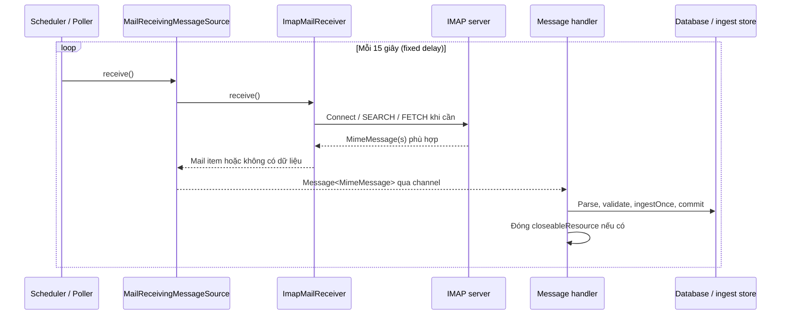
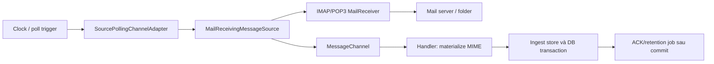
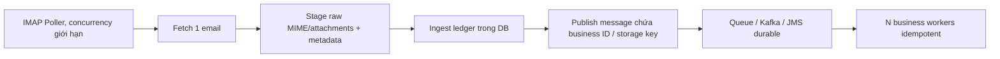
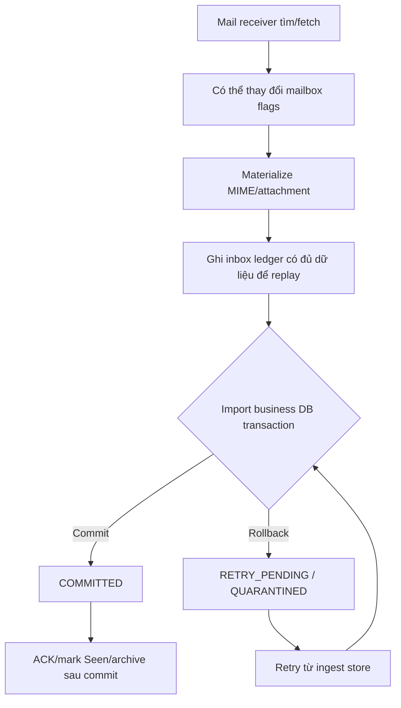

# Polling mail folder

## 1. Bài toán: kiểm tra hộp thư theo chu kỳ và xử lý đúng một hóa đơn

Một ứng dụng Spring Boot nhận hóa đơn từ đối tác qua mailbox `invoices@example.test`. Đối tác không có HTTP webhook hoặc Kafka producer; họ gửi email có nội dung và file PDF vào `INBOX`. Ứng dụng phải **kiểm tra folder định kỳ**, phát hiện thư mới, lưu attachment, xác minh invoice ID và ghi database. Khi SMTP/IMAP server tạm ngừng hoạt động, việc nhận phải phục hồi; khi nhiều thư cùng đến, lịch poll không được tạo hàng trăm kết nối đồng thời; khi restart, cùng một hóa đơn không được import hai lần.

Đó là mục tiêu của **polling mail folder**: dùng một **mail receiving source** của Spring Integration, gọi `receive()` theo một `Poller` và phát `Message<?>` vào `MessageChannel`. Polling là hoạt động ở **phía nhận IMAP hoặc POP3**, không phải cách SMTP outbound adapter gửi email. Mỗi lượt poll chỉ xác định mail cần xử lý; **mail được fetch không đồng nghĩa đã commit nghiệp vụ**.

Bài thuộc chương **Adapter Mail** của module `SPRING_INTEGRATION_ADAPTERS`, nơi xây các kết nối bên ngoài qua inbound/outbound adapter, gateway, poller và `MessageChannel` (File, SFTP, HTTP, JMS, AMQP, Kafka, database...). Những nguyên tắc chung — message contract, bounded polling, retry, error channel và kết nối có vòng đời hữu hạn — tiếp tục áp dụng cho IMAP/POP3, nhưng mailbox flags và MIME attachment khiến việc xử lý có nhiều rủi ro riêng.

Sau bài này, bạn có thể:

- Giải thích `MailReceivingMessageSource`, `ImapMailReceiver`, `Pop3MailReceiver`, `SourcePollingChannelAdapter` và `Poller`.
- Viết **Java DSL** cho IMAPS polling với `Pollers.fixedDelay(...)`, `maxMessagesPerPoll(...)` và `setMaxFetchSize(...)`.
- Cấu hình bảo mật IMAPS/POP3S, authentication, timeouts và giới hạn tài nguyên.
- Phân biệt `fixedDelay`, `fixedRate`, cron; phân tích backlog, latency, độ trễ poll và concurrency.
- Hiểu điều kiện tìm mail mới bằng IMAP flags/`SearchTermStrategy` so với khả năng nhận trùng của POP3.
- Xử lý MIME có `autoCloseFolder(false)`/`closeableResource`, tách ingest bền vững khỏi việc mark as read/delete.
- Xử lý outage, crash sau fetch, error channel, recovery, idempotency và kiểm thử mailbox sandbox.

> **Phiên bản:** các ví dụ dùng Spring Integration **6.5.x**, Spring Framework 6.x, Spring Boot tương thích và Java **17+**, với Jakarta Mail (`jakarta.mail.*`). Namespace `javax.mail.*` trong tài liệu Spring Integration cũ không tương thích trực tiếp với các ví dụ này. Địa chỉ `example.test` và secret chỉ là giá trị minh họa; không dùng mailbox thật để kiểm thử xóa thư.

## 2. Một vòng poll thực hiện những bước nào?



`Poller` là **bộ kích hoạt theo lịch**. `MailReceivingMessageSource` đóng vai trò **nguồn** lấy thư từ `MailReceiver`. `ImapMailReceiver` hoặc `Pop3MailReceiver` giao tiếp với mail server. Khi có email phù hợp, source chuyển thành Spring `Message` và endpoint phát nó tới handler trong flow.

Nếu không có mail mới, nguồn có thể trả **không có message**. Đây là hoạt động bình thường, **không phải lỗi**. Nếu không kết nối được IMAP server hoặc xác thực thất bại, poll có thể ném exception; cần phân biệt sự cố này với hộp thư trống.



| Thành phần | Trách nhiệm | **Không** tự đảm bảo |
| --- | --- | --- |
| Poller | Khi nào và tối đa bao nhiêu lần lấy message trong một chu kỳ | SMTP/IMAP message được lưu bền vững hoặc xử lý exactly-once |
| `MailReceivingMessageSource` | Cầu nối receiver ↔ Spring Integration | Business retry/DB commit |
| `ImapMailReceiver` | Truy cập folder, tìm/fetch thư, quản lý IMAP flags theo cấu hình | Flags chỉ đổi **sau** khi DB commit |
| `Pop3MailReceiver` | Lấy thư từ POP3 maildrop | IMAP Seen/IDLE, folder management, chống trùng qua restart |
| `MessageChannel` | Đưa message tới transformer/filter/handler | Đảm bảo bên nhận đã hoàn tất xử lý ở mọi loại channel |
| Handler | Parse MIME, kiểm tra và ghi nghiệp vụ | Mail server tự rollback khi DB rollback |

## 3. Polling khác IMAP IDLE và SMTP outbound như thế nào?

| Phương án | Cách kích hoạt | Giao thức | Khi phù hợp |
| --- | --- | --- | --- |
| **IMAP polling inbound** | Scheduler gọi `receive()` theo lịch | IMAP/IMAPS | Dễ giám sát SLA, chủ động giới hạn tần suất và batch size |
| **POP3 polling inbound** | Scheduler gọi `receive()` theo lịch | POP3/POP3S | Provider chỉ cung cấp POP3 hoặc mailbox đơn giản |
| **IMAP IDLE inbound** | Mail server phát thông báo IDLE khi folder thay đổi | IMAP/IMAPS | Muốn độ trễ thấp và provider hỗ trợ IDLE |
| **SMTP outbound** | Handler nhận message và gọi `JavaMailSender` | SMTP/SMTPS | Gửi thông báo ra mail relay; không phải poll inbox |

IMAP IDLE không cần `Poller` như một polling inbound source; thay vào đó, adapter giữ kết nối và phản ứng với thông báo từ server. Nó vẫn cần reconnect và idempotency. Không bật **cả polling và IDLE cùng đọc một mailbox/folder** mà chưa thiết kế phân chia ownership: hai receiver có thể cạnh tranh cờ, bỏ sót hoặc cùng phát một email.

**Polling không phải một cơ chế exactly-once.** Nếu receiver đã chọn mail rồi handler lỗi, flag trên IMAP server có thể đã thay đổi. Nếu POP3 giữ mail, restart có thể fetch lại. DB unique key/ingest ledger mới kiểm soát nghiệp vụ một lần; giao thức chỉ giúp khám phá và lấy mail.

## 4. IMAP và POP3: dữ liệu nào được xem là “mới”?

| Đặc điểm | IMAP / IMAPS | POP3 / POP3S |
| --- | --- | --- |
| Folder | Có `INBOX`, folder con, flags và UID | Không có mô hình folder/flag phong phú tương đương |
| Nhận biết thư chưa đọc | `\Seen`, `\Recent`, user flag, search term | Không có `\Seen` hoặc IMAP SEARCH |
| Server-side filtering | `SearchTerm` qua receiver với điều kiện hỗ trợ | Chủ yếu lấy thư rồi lọc tại client/flow |
| IMAP IDLE | Có nếu server hỗ trợ | Không có |
| Khả năng fetch lại sau restart | Tùy flags và search strategy | Dễ fetch lại nếu thư vẫn được giữ trên server |
| Chính sách xóa | `\Deleted` + expunge hoặc MOVE theo server | `DELE` trong phiên, thường hoàn tất khi `QUIT` |

**IMAPS** thường dùng cổng 993, **POP3S** cổng 995. IMAP/POP3 STARTTLS cũng có thể được cung cấp trên cổng không TLS theo provider; nếu chọn STARTTLS, phải bắt buộc nâng cấp và xác minh certificate. Không gửi password qua kết nối plaintext, không dùng trust-all SSL.

### IMAP `SearchTermStrategy` có tác động trực tiếp tới poll

`ImapMailReceiver` dùng `SearchTermStrategy` để tạo truy vấn tìm thư. Tùy khả năng `\Recent` và user flags, receiver mặc định có điều kiện liên quan tới `\Seen`, `\Answered`, `\Deleted` và cờ riêng của adapter nhằm hạn chế phát lại. Khi tự thay strategy, **toàn bộ logic xây điều kiện tìm kiếm mặc định bị thay thế**; không mặc định được cộng với biểu thức mới. Một custom `SubjectTerm("[INVOICE]")` thiếu điều kiện flags có thể liên tục trả lại thư cũ.

Ngoài `shouldMarkMessagesAsRead`, IMAP receiver còn có thể đặt user flag (mặc định `spring-integration-mail-adapter`) hoặc fallback `\Flagged` nếu server thiếu tính năng cần thiết. Việc này có thể diễn ra **trước khi downstream handler commit**. `shouldMarkMessagesAsRead(false)` không tương đương “không sửa bất kỳ flag nào”.

### POP3 cần xác nhận rõ chính sách giữ/xóa

`Pop3MailReceiver#setShouldDeleteMessages(false)` giữ thư trên server nhưng có thể fetch lại cùng thư sau restart. Với `true`, thư có thể bị xóa trong vòng đời nhận thư **trước khi import DB hoàn tất**. Vì POP3 không có `\Seen`, cấu hình mark-as-read không mang ý nghĩa giống IMAP. Với hóa đơn hoặc tài liệu cần audit, nên **giữ mail ở giai đoạn đầu**, lưu đủ raw MIME/attachment vào storage có trạng thái và xử lý idempotent.

## 5. Các tham số thường bị nhầm trong một lần poll

| Tham số | Cấu hình ở đâu? | Tác động |
| --- | --- | --- |
| `fixedDelay(15_000)` | Poller | Lịch trigger tiếp theo sau khoảng delay |
| `fixedRate(15_000)` | Poller | Cố gắng lên lịch theo khoảng cách đều giữa các lần bắt đầu, tùy scheduler |
| `maxMessagesPerPoll(1)` | Polling endpoint | Tối đa số message được poller lấy/phát **trong một chu kỳ** |
| `receiver.setMaxFetchSize(1)` | Mail receiver | Tối đa số email **receiver fetch** trong một lượt gọi backend |
| `setShouldMarkMessagesAsRead(false)` | IMAP receiver | Không chủ động đặt Seen theo tùy chọn này; vẫn có cơ chế user flag/peek |
| `setShouldDeleteMessages(false)` | Mail receiver | Không chủ động xóa ở bước receive |
| `setAutoCloseFolder(false)` | IMAP receiver | Cho phép xử lý MIME lazy-load khi folder còn mở; consumer phải đóng resource |
| `SearchTermStrategy` | IMAP receiver | Quyết định tập thư ứng viên phù hợp tiêu chí tìm kiếm |

`maxMessagesPerPoll` và `maxFetchSize` **không tương đương**. Một lần gọi backend có thể lấy một số mail vào bộ đệm nội bộ; polling endpoint lại điều tiết số Spring messages được phát trong một chu kỳ. Để dễ kiểm soát vòng đời folder và retry trong bài học, ví dụ đặt **cả hai bằng 1**. Khi tăng thông lượng, phải kiểm tra toàn bộ hành vi fetch/cache/folder của phiên bản Spring Integration thực tế.

### Sizing nhanh: backlog và độ trễ

Nếu có 600 thư chờ và cấu hình **chỉ xử lý 1 thư mỗi 15 giây**, tốc độ danh nghĩa tối đa là khoảng **4 thư/phút**, chưa tính thời gian fetch/parse/DB. Backlog 600 thư có thể mất ít nhất khoảng 150 phút nếu không có thêm lỗi hoặc thời gian xử lý. Đây là lý do phải quan sát **mailbox backlog, poll duration, mail đã commit**, không chỉ đặt interval đẹp mắt.

Không tăng batch size vô hạn: một email có attachment 100 MB hoặc handler chậm có thể giữ IMAP folder lâu, làm poller kẹt và tăng memory pressure. Cần giới hạn mail size, thời gian, concurrency và số message qua các phase riêng.

## 6. Dependency và cấu hình IMAPS an toàn

Trong dự án Spring Boot dùng BOM tương thích với Spring Integration 6.5:

```groovy
dependencies {
    implementation 'org.springframework.boot:spring-boot-starter-integration'
    implementation 'org.springframework.integration:spring-integration-mail'
    implementation 'org.springframework.boot:spring-boot-starter-mail'
}
```

`spring-integration-mail` cung cấp mail adapter/DSL và receiver, còn starter mail giúp có Spring Mail cùng Jakarta Mail provider ở runtime. Nếu ứng dụng chỉ nhận email thì **không cần bean `JavaMailSender` để fetch**; giao tiếp IMAP/POP3 nằm ở `MailReceiver` và Jakarta Mail Store.

Ví dụ `application.yml` chỉ chứa **placeholder**:

```yaml
app:
  mailbox:
    imap-url: ${MAIL_IMAP_URL:imaps://invoices%40example.test@imap.example.test:993/INBOX}
    pop3-url: ${MAIL_POP3_URL:pop3s://invoices%40example.test@pop3.example.test:995/INBOX}
    username: ${MAIL_USERNAME:invoices@example.test}
    password: ${MAIL_PASSWORD}
    poll-delay-ms: ${MAIL_POLL_DELAY_MS:15000}
    mailbox-id: ${MAILBOX_ID:invoice-partners}
```

`%40` là percent-encoding cho dấu `@` trong thành phần username của URL nếu provider/parser sử dụng dạng này. Không nhúng password vào URI — chuỗi kết nối dễ lọt vào exception hoặc log. Nếu provider yêu cầu OAuth2/XOAUTH2, phải có token acquisition/refresh và SASL mechanism riêng, không áp username/password như một giả định chung.

**Tối thiểu cho production:** TLS có kiểm tra hostname, timeout TCP/read/write, secret manager, quota mail/attachment, giới hạn kết nối, observability theo mailbox và chính sách quyền đọc/đổi flags. Không bật `mail.debug=true` ở production khi có dữ liệu người dùng, vì protocol logs có thể chứa thông tin nhạy cảm.

## 7. Bean `ImapMailReceiver`: giới hạn fetch và quản lý mailbox state

Bean sau dùng IMAPS qua `Authenticator`, giữ thư gốc và đặt `maxFetchSize(1)` để một lần fetch xử lý một mail. Trường hợp cần đọc MIME lazy-loaded, chọn `autoCloseFolder(false)` và **handler phải đóng `closeableResource`**.

```java
import java.util.Properties;

import jakarta.mail.Authenticator;
import jakarta.mail.PasswordAuthentication;

import org.springframework.beans.factory.annotation.Value;
import org.springframework.context.annotation.Bean;
import org.springframework.context.annotation.Configuration;
import org.springframework.context.annotation.Profile;
import org.springframework.integration.mail.ImapMailReceiver;

@Configuration
@Profile("mail-imap")
public class InvoiceImapReceiverConfiguration {

    @Bean
    public ImapMailReceiver invoiceImapReceiver(
            @Value("${app.mailbox.imap-url}") String imapUrl,
            @Value("${app.mailbox.username}") String username,
            @Value("${app.mailbox.password}") String password) {

        ImapMailReceiver receiver = new ImapMailReceiver(imapUrl);
        receiver.setJavaMailAuthenticator(new Authenticator() {
            @Override
            protected PasswordAuthentication getPasswordAuthentication() {
                return new PasswordAuthentication(username, password);
            }
        });

        Properties properties = new Properties();
        properties.setProperty("mail.store.protocol", "imaps");
        properties.setProperty("mail.imaps.ssl.enable", "true");
        properties.setProperty("mail.imaps.ssl.checkserveridentity", "true");
        properties.setProperty("mail.imaps.connectiontimeout", "10000");
        properties.setProperty("mail.imaps.timeout", "30000");
        properties.setProperty("mail.imaps.writetimeout", "30000");
        properties.setProperty("mail.imaps.peek", "true");
        properties.setProperty("mail.debug", "false");
        receiver.setJavaMailProperties(properties);

        receiver.setShouldMarkMessagesAsRead(false);
        receiver.setShouldDeleteMessages(false);
        receiver.setMaxFetchSize(1);
        receiver.setSimpleContent(false);
        receiver.setAutoCloseFolder(false);

        // Không set HeaderMapper: consumer nhận MimeMessage gốc.
        // Receiver vẫn có thể thay đổi user flag/fallback theo server.
        return receiver;
    }
}
```

Với `@Profile("mail-imap")`, cấu hình chỉ được bật khi profile này hoạt động. Không kích hoạt đồng thời profile `mail-imap` và `mail-pop3` ở các ví dụ sau trên **cùng mailbox**: hai giao thức/receiver không chia sẻ một transaction hoặc lock.

### Về `mail.imaps.peek`

Jakarta Mail IMAP provider có cơ chế **PEEK** khi đọc nội dung: `mail.imaps.peek=true` giúp đọc mà không chủ động đặt `\Seen` theo semantics fetch. Spring Integration cũng áp dụng mặc định tương ứng khi property không được khai báo. Nếu cấu hình `peek=false`, mail có thể bị đánh dấu Seen dù `setShouldMarkMessagesAsRead(false)`. Điều này **không** cấm client khác đổi Seen và **không** ngăn user flag/fallback do receiver đặt.

### Tại sao không chọn `shouldDeleteMessages(true)` cho polling hóa đơn?

Mail receiver có thể mark/delete ngay sau khi lấy, **trước** khi handler lưu PDF hay commit DB. Xóa sớm làm mất nguồn replay. Giữ thư (`false`) chỉ là một phần chiến lược an toàn: vẫn cần ingest store/ledger để khôi phục nếu receiver đã thay đổi flags và poll sau không tìm lại thư.

## 8. Java DSL: `Mail.imapInboundAdapter(...)` và `Pollers.fixedDelay(...)`

```java
import org.springframework.beans.factory.annotation.Value;
import org.springframework.context.annotation.Bean;
import org.springframework.context.annotation.Configuration;
import org.springframework.context.annotation.Profile;
import org.springframework.integration.dsl.IntegrationFlow;
import org.springframework.integration.dsl.Pollers;
import org.springframework.integration.mail.ImapMailReceiver;
import org.springframework.integration.mail.dsl.Mail;

@Configuration
@Profile("mail-imap")
public class InvoiceMailPollingFlow {

    @Bean
    public IntegrationFlow invoiceMailInboundFlow(
            ImapMailReceiver invoiceImapReceiver,
            InvoiceMailHandler invoiceMailHandler,
            @Value("${app.mailbox.poll-delay-ms:15000}") long pollDelayMs) {

        return IntegrationFlow.from(
                        Mail.imapInboundAdapter(invoiceImapReceiver),
                        endpoint -> endpoint
                                .id("invoiceImapPollingEndpoint")
                                .poller(Pollers.fixedDelay(pollDelayMs)
                                        .maxMessagesPerPoll(1)))
                .handle(invoiceMailHandler)
                .get();
    }
}
```

Trong đoạn code:

1. `Mail.imapInboundAdapter(invoiceImapReceiver)` tạo pollable mail source.
2. `IntegrationFlow.from(..., endpoint -> ...)` biến source thành inbound endpoint có poller.
3. `Pollers.fixedDelay(pollDelayMs)` đặt chu kỳ kích hoạt (ví dụ 15.000 ms).
4. `.maxMessagesPerPoll(1)` hạn chế số message poller xử lý trong một lượt.
5. `.handle(invoiceMailHandler)` thực hiện logic nghiệp vụ đồng bộ để handler còn sở hữu mail folder khi cần đọc attachment.

Đoạn flow **không tự tạo transaction DB**; business service phải có transaction riêng và idempotency. Mặc định không có nghĩa bất kỳ lỗi từ source trước khi tạo message sẽ được bắt bởi advice gắn trên handler. Phần 16 sẽ phân loại error boundary.

### Vì sao ví dụ dùng handler đồng bộ?

Với `autoCloseFolder(false)`, một số nội dung MIME được **lazy-load** khi đọc `getContent()`/`getInputStream()`. Nếu một `ExecutorChannel`/queue nằm giữa receiver và handler, folder có thể bị giữ quá lâu hoặc bị đóng trước khi worker khác đọc attachment. Để chuyển sang xử lý bất đồng bộ, hãy **materialize đủ dữ liệu** vào object store/ingest table khi folder còn mở, rồi gửi message mang business ID + storage reference sang queue/broker bền vững.

## 9. Handler: đọc mail, commit và đóng folder đúng lúc

Để thực hành một pipeline dễ chạy, ví dụ chỉ chấp nhận `text/plain`; với multipart/attachment cần parser MIME chuyên biệt có giới hạn độ sâu, số part và kích thước. Khi IMAP receiver đặt `autoCloseFolder(false)`, Spring Integration thêm `IntegrationMessageHeaderAccessor.CLOSEABLE_RESOURCE`. Handler phải đóng resource **dù thành công hay thất bại**.

```java
import java.io.Closeable;
import java.io.IOException;

import jakarta.mail.MessagingException;
import jakarta.mail.internet.MimeMessage;

import org.springframework.integration.StaticMessageHeaderAccessor;
import org.springframework.messaging.Message;
import org.springframework.messaging.MessageHandler;
import org.springframework.messaging.MessageHandlingException;
import org.springframework.stereotype.Component;

@Component
public class InvoiceMailHandler implements MessageHandler {

    private final InvoiceIngestService ingestService;

    public InvoiceMailHandler(InvoiceIngestService ingestService) {
        this.ingestService = ingestService;
    }

    @Override
    public void handleMessage(Message<?> message) {
        Closeable closeable =
                StaticMessageHeaderAccessor.getCloseableResource(message);

        try (Closeable folder = closeable == null ? () -> { } : closeable) {
            if (!(message.getPayload() instanceof MimeMessage mime)) {
                throw new IllegalArgumentException("Payload phải là MimeMessage");
            }
            if (!mime.isMimeType("text/plain")) {
                throw new IllegalArgumentException(
                        "Mail multipart cần parser MIME riêng");
            }

            Object content = mime.getContent();
            if (!(content instanceof String body)) {
                throw new IllegalArgumentException("Body không phải text");
            }

            // Ingest service phải commit dữ liệu hoặc ném exception.
            // Không dùng Message-ID như unique business key duy nhất.
            ingestService.ingestOnce(mime.getMessageID(), body);

        } catch (MessagingException | IOException ex) {
            throw new MessageHandlingException(
                    message, "Không đọc được mail hoặc đóng folder", ex);
        }
    }
}

public interface InvoiceIngestService {
    /** Lưu nội dung đủ replay và commit idempotent theo khóa nghiệp vụ. */
    void ingestOnce(String messageId, String body);
}
```

`MimeMessage.getMessageID()` có thể trả `null`, bị trùng hoặc bị giả mạo: dùng để correlation, **không** làm khóa hóa đơn duy nhất. Cần business invoice ID/partner ID đã được validate. `InvoiceIngestService` là interface mô tả **hợp đồng**; code thực tế phải có transaction, unique constraint, raw mail/attachment staging và recovery. Ví dụ handler intentionally không giải mã file PDF bằng `toString()`.

### Mapped payload là một hợp đồng khác

Nếu receiver bật `DefaultMailHeaderMapper`, các header như `mail_subject`, `mail_from`, `mail_contentType` có thể được map sang `MessageHeaders`, còn payload có thể trở thành **`String` hoặc `byte[]`** thay vì raw `MimeMessage`. Không giữ nguyên handler `MimeMessage` rồi kỳ vọng `instanceof` luôn đúng. Chọn **một** dạng payload contract cho mỗi flow và test với text, HTML, multipart lẫn attachment.

## 10. Một cách khai báo polling khác: `@InboundChannelAdapter`

Nếu dự án dùng annotation-based integration, có thể khai báo `MailReceivingMessageSource` cùng `@Poller`. Đây là **phương án thay thế** cho Java DSL ở mục 8, không bật đồng thời trên cùng receiver/mailbox.

```java
import org.springframework.context.annotation.Bean;
import org.springframework.context.annotation.Configuration;
import org.springframework.integration.annotation.InboundChannelAdapter;
import org.springframework.integration.annotation.Poller;
import org.springframework.integration.mail.ImapMailReceiver;
import org.springframework.integration.mail.MailReceivingMessageSource;

@Configuration
public class AnnotationMailSource {

    @Bean
    @InboundChannelAdapter(
            value = "incomingMailMessages",
            poller = @Poller(fixedDelay = "15000", maxMessagesPerPoll = "1"))
    public MailReceivingMessageSource inboundMailSource(
            ImapMailReceiver receiver) {
        return new MailReceivingMessageSource(receiver);
    }
}
```

Khi dùng annotation này, phải có một subscriber/handler đọc channel `incomingMailMessages`, và cần bảo đảm Spring Integration annotation processing được bật theo cấu hình framework. Với Java DSL mẫu ở mục 8, endpoint đã được tạo trực tiếp từ `IntegrationFlow`, không cần tạo thêm một `@InboundChannelAdapter` trùng.

## 11. POP3S polling: thay receiver, không bê nguyên IMAP flags

Nếu provider chỉ hỗ trợ POP3, receiver có cấu hình tương tự về TLS và scheduler nhưng **khác về trạng thái mail**. POP3 không có `\Seen`, IMAP search/user flag hoặc IDLE.

```java
import java.util.Properties;

import jakarta.mail.Authenticator;
import jakarta.mail.PasswordAuthentication;

import org.springframework.beans.factory.annotation.Value;
import org.springframework.context.annotation.Bean;
import org.springframework.context.annotation.Configuration;
import org.springframework.context.annotation.Profile;
import org.springframework.integration.mail.Pop3MailReceiver;

@Configuration
@Profile("mail-pop3")
public class InvoicePop3ReceiverConfiguration {

    @Bean
    public Pop3MailReceiver invoicePop3Receiver(
            @Value("${app.mailbox.pop3-url}") String pop3Url,
            @Value("${app.mailbox.username}") String username,
            @Value("${app.mailbox.password}") String password) {

        Pop3MailReceiver receiver = new Pop3MailReceiver(pop3Url);
        receiver.setJavaMailAuthenticator(new Authenticator() {
            @Override
            protected PasswordAuthentication getPasswordAuthentication() {
                return new PasswordAuthentication(username, password);
            }
        });

        Properties properties = new Properties();
        properties.setProperty("mail.store.protocol", "pop3s");
        properties.setProperty("mail.pop3s.ssl.enable", "true");
        properties.setProperty("mail.pop3s.ssl.checkserveridentity", "true");
        properties.setProperty("mail.pop3s.connectiontimeout", "10000");
        properties.setProperty("mail.pop3s.timeout", "30000");
        properties.setProperty("mail.pop3s.writetimeout", "30000");
        properties.setProperty("mail.debug", "false");
        receiver.setJavaMailProperties(properties);

        receiver.setShouldDeleteMessages(false);
        receiver.setMaxFetchSize(1);
        // Không cấu hình autoCloseFolder(false): POP3 không hỗ trợ
        // semantics giữ folder mở như IMAP.
        return receiver;
    }
}
```

```java
import org.springframework.context.annotation.Bean;
import org.springframework.context.annotation.Configuration;
import org.springframework.context.annotation.Profile;
import org.springframework.integration.dsl.IntegrationFlow;
import org.springframework.integration.dsl.Pollers;
import org.springframework.integration.mail.Pop3MailReceiver;
import org.springframework.integration.mail.dsl.Mail;

@Configuration
@Profile("mail-pop3")
public class InvoicePop3PollingFlow {

    @Bean
    public IntegrationFlow pop3MailInboundFlow(
            Pop3MailReceiver invoicePop3Receiver,
            Pop3MailHandler pop3MailHandler) {
        return IntegrationFlow.from(
                        Mail.pop3InboundAdapter(invoicePop3Receiver),
                        endpoint -> endpoint.poller(
                                Pollers.fixedDelay(15_000)
                                        .maxMessagesPerPoll(1)))
                .handle(pop3MailHandler)
                .get();
    }
}

// Pop3MailHandler là handler do ứng dụng triển khai theo payload
// và lifecycle POP3 đã được kiểm thử; không tái sử dụng logic
// giữ folder lazy-loaded như InvoiceMailHandler của IMAP.
```

Code nêu `Pop3MailHandler` là interface/class **do dự án triển khai**, không phải API Spring Integration. Với POP3, phải đặc biệt kiểm tra khả năng đọc nội dung sau khi receiver đóng folder; có thể cần cấu hình `simpleContent`/mapper hoặc một bước materialize trong thời điểm mail còn hợp lệ. Đừng đưa raw POP3 `MimeMessage` tới queue rồi đọc attachment khi kết nối POP3 đã đóng.

### Nếu POP3 `shouldDeleteMessages(true)` thì sao?

Adapter có thể yêu cầu xóa khi nhận mail, **không đợi DB commit**. Nếu network/handler lỗi hoặc worker crash, dữ liệu có thể không còn ở maildrop để replay. Với thông báo quan trọng, ưu tiên `false` + ingest store/ledger và retention job riêng. POP3 UIDL có thể giúp phát hiện trùng trong maildrop, nhưng business ID mới bảo vệ cùng hóa đơn được gửi qua email khác nhau.

## 12. Lọc thư ngay tại receiver hay sau khi poll?

Với IMAP, bạn có thể dùng `SearchTermStrategy` để giảm số thư ứng viên theo subject, sender, flags và date. Một ví dụ minh họa:

```java
import jakarta.mail.Flags;
import jakarta.mail.search.AndTerm;
import jakarta.mail.search.FlagTerm;
import jakarta.mail.search.SearchTerm;
import jakarta.mail.search.SubjectTerm;

import org.springframework.integration.mail.SearchTermStrategy;

SearchTermStrategy onlyUnseenInvoices = (supportedFlags, folder) -> {
    SearchTerm unseen =
            new FlagTerm(new Flags(Flags.Flag.SEEN), false);
    SearchTerm notDeleted =
            new FlagTerm(new Flags(Flags.Flag.DELETED), false);
    SearchTerm subject = new SubjectTerm("[INVOICE]");
    return new AndTerm(new SearchTerm[]{unseen, notDeleted, subject});
};

// Có thể dùng receiver.setSearchTermStrategy(onlyUnseenInvoices)
// trong bean ImapMailReceiver, sau khi kiểm tra kỹ hành vi flags.
```

**Không bật nguyên xi ví dụ này vào production** khi `shouldMarkMessagesAsRead(false)` mà chưa kiểm soát user flag/recovery: custom strategy có thể bỏ các điều kiện `\Recent`, `\Answered` và cờ riêng mặc định của adapter. Nó không tự cộng logic mặc định. Nếu mail vẫn unseen, nó có thể tiếp tục khớp ở các lượt poll; nếu receiver set flag trước khi DB commit, mail có thể không khớp dù handler đã lỗi. Phải có ledger bền vững và kiểm thử mail server thực tế.

Đối với **POP3**, không có `IMAP SEARCH` tương đương để server lọc Seen/Subject. Dùng selector/downstream filter có thể tránh import dữ liệu không phù hợp nhưng mail **đã được fetch**. Với attachment lớn, hãy hạn chế message size/timeouts hoặc dùng một server-side folder/mailbox riêng thay vì tải toàn bộ rồi bỏ.

## 13. `fixedDelay`, `fixedRate`, cron và các lựa chọn lịch poll

| Lịch | Cách nghĩ | Ví dụ sử dụng | Rủi ro |
| --- | --- | --- | --- |
| **Fixed delay** | Chờ một khoảng sau lượt poll theo trigger semantics của scheduler | Cập nhật invoice inbox đều đặn mỗi 15 giây | Nếu xử lý lâu, thời gian giữa hai lần bắt đầu dài hơn dự kiến |
| **Fixed rate** | Cố duy trì nhịp bắt đầu theo khoảng cố định | Poll một source rất nhanh với SLA đo bằng giây | Nếu scheduler có concurrency/những poll trước chưa xong, có thể tạo áp lực/đua tài nguyên |
| **Cron** | Poll vào các mốc giờ xác định | Batch chỉ nhận mail vào khung giờ business | Backlog và thời điểm DST/timezone cần kiểm soát |
| **Dynamic trigger** | Lịch có thể đổi theo tình trạng runtime | Giãn lịch khi provider rate limit | Cần quản lý cấu hình, metrics và retry riêng |

Một fixed-delay poller thường dễ vận hành khi mail server giới hạn kết nối và MIME parsing có thời gian biến thiên. Nếu muốn rate cao, hãy đo **thời gian `receive()`**, **thời gian xử lý downstream**, **tốc độ mail đến**, **backlog** và **quota provider** trước khi thay đổi interval hoặc thread pool.

**Tránh dùng nhiều scheduler/worker poll cùng một folder chỉ để tăng tốc.** IMAP flags không phải distributed lock. Cách scale hiệu quả thường là **một ingestion owner đọc mailbox**, lưu nội dung/attachment vào kho bền vững và đưa business job lên Kafka/JMS/queue sau đó; downstream xử lý song song với unique constraint.

### Poller có tự chạy song song không?

Không mặc định suy rằng đặt `fixedRate` là sẽ tạo nhiều phiên IMAP đồng thời; điều đó phụ thuộc `TaskScheduler`/`TaskExecutor` và cấu hình endpoint. Tương tự, có executor trong poller không làm thư trở thành bền vững. Hãy cấu hình concurrency rõ ràng, tránh hai poll đồng thời mở/cập nhật cùng IMAP folder, và kiểm thử cả khi poll trước xử lý vượt interval.

## 14. Thông lượng, batching và áp lực bộ nhớ

Trường hợp 1.000 email có attachment, mỗi thư tốn trung bình 2 giây cho fetch+parse+DB:

- Với **một poller đồng bộ** và `maxMessagesPerPoll(1)`, throughput bị giới hạn bởi delay và thời gian xử lý.
- Tăng `maxMessagesPerPoll` có thể xử lý thêm message **trong một lượt poll**, nhưng đồng thời phải xem receiver `maxFetchSize`, session lifecycle và khả năng giữ dữ liệu MIME.
- Tăng `maxFetchSize` làm một lần backend nhận nhiều thư hơn; với `autoCloseFolder(false)`, việc các message dùng chung folder cần chính sách đóng tài nguyên rõ ràng.
- Dùng channel bất đồng bộ khi chỉ truyền **DTO đã materialize và lưu bền vững**, không truyền raw `MimeMessage` mà worker sẽ đọc sau khi folder đóng.



Ở kiến trúc này, mail adapter là **đầu vào chậm nhưng được kiểm soát**, còn phần nặng (PDF extraction, validation, DB import) có thể tách ra sau durable handoff. Cần xác định rõ mốc **`INGESTED`** và **`COMMITTED`**: nếu chưa lưu MIME đủ replay, không được coi chỉ nhận một reference sống trong mail folder là durable handoff.

## 15. Mailbox state, transaction và khả năng phát lại

Một vòng poll qua IMAP có thể set `\Seen`, user flag hoặc fallback `\Flagged` khi receiver fetch. Trong POP3, có thể giữ thư hoặc xóa theo phiên. **Không có transaction atomic mặc định** giữa IMAP/POP3 server và database.



### Một inbox ledger tối thiểu

```text
mailbox_id, folder, uid_validity, uid, // IMAP UID trong phạm vi folder
message_id, content_sha256,           // tham khảo / integrity
business_invoice_id, partner_id,      // unique business key
raw_mail_storage_key,                 // đủ dữ liệu để replay
status, attempt_count, next_retry_at,
last_error_code, created_at, updated_at
```

`Message-ID` của email có thể vắng mặt, trùng hoặc bị giả mạo. IMAP UID cần kèm **UIDVALIDITY** và tên folder; mail chuyển sang folder khác có UID mới. POP3 UIDL chỉ có giá trị trong maildrop nếu server hỗ trợ. Khóa `(partner_id, business_invoice_id, document_version)` mới là cơ sở ngăn **hai email khác nhau** tạo hai lần import cùng hóa đơn. Lưu raw MIME/attachment phải có quota, quyền truy cập và retention.

### Khi nào mark as read hoặc xóa?

Đừng bật `shouldDeleteMessages(true)` như một cách "ACK sau DB commit" — receiver có thể xóa trước handler. Với IMAP, sau khi DB commit, một ACK worker riêng có thể đọc lại thư bằng `(mailbox, folder, UIDVALIDITY, UID)` để set Seen, copy/move sang `Processed` rồi áp dụng retention riêng. **`\Deleted` là cờ chờ xóa, còn expunge mới là thao tác loại khỏi folder**; `Folder.expunge()` trong shared INBOX có thể xóa những mail Deleted do client khác đánh dấu.

Spring Integration hỗ trợ transaction synchronization trong một số inbound flows, nhưng callback after-commit không biến mail server và DB thành transaction phân tán: JVM vẫn có thể crash giữa DB commit và hành động mailbox. Ghi **ACK/outbox job bền vững** để worker reconcile là phương án đáng tin cậy hơn.

## 16. Error handling: polling trống, lỗi nguồn và lỗi handler khác nhau

| Tình huống | Nơi phát hiện | Xử lý đề xuất |
| --- | --- | --- |
| Không có mail phù hợp | `MailReceivingMessageSource.receive()` không phát message | Ghi metric `empty_poll`, không retry như lỗi |
| DNS/network timeout | IMAP/POP3 connect/fetch | Backoff/jitter theo policy, alert nếu kéo dài |
| TLS hostname/certificate sai | Kết nối đến server | Dừng và sửa trust/cert; không vô hiệu hóa verification |
| Authentication failed | JavaMail/receiver | Sửa secret/OAuth mechanism; không đăng nhập retry dồn dập |
| Server rate limit hoặc quá nhiều connections | Mail server | Giảm concurrency/frequency, quan sát retry-after nếu provider cung cấp |
| MIME/attachment malformed | Parser downstream | Quarantine, không retry vô hạn cùng dữ liệu |
| Database timeout/rollback | Business service | Retry từ ingest store với unique key, không giả định mail sẽ poll lại |
| Folder closed khi parse | MIME consumer | Giữ folder tới khi đọc xong và `closeableResource.close()` |
| Một poller bị treo quá lâu | Scheduler/receiver/handler | Đặt connect/read/write timeout và tối ưu đường xử lý |

`RequestHandlerRetryAdvice` gắn vào handler có thể **không bao phủ** lỗi ở mail source **trước khi có Spring message**. Tương tự, `errorChannel` không tự lưu message bền vững hay replay khi receiver đã thay flag. Hãy phân loại exception ở đúng ranh giới: **source errors**, **transformation/MIME errors**, **business commit errors**, **mailbox ACK/retention errors**.

### Error channel và poller

Một poller sử dụng thread từ scheduler; khi handler đồng bộ ném exception, container/integration error infrastructure có thể chuyển lỗi tới error handling được cấu hình của poller. Đừng kỳ vọng lỗi đó sẽ tự trả về HTTP request vốn không trực tiếp gọi `poll()`. Với kiến trúc production, cấu hình error channel/handler để ghi **mailbox ID, poll ID, correlation ID, type of failure**, cập nhật job state và alert. Tránh ghi nguyên MIME, credentials, recipient list hoặc attachment vào error log.

Một `ErrorMessage` có thể tham chiếu exception và failed message khi có, nhưng nếu lỗi xảy ra **trong receiver trước khi message được tạo**, không phải lúc nào cũng có mail payload để replay. Cần source metrics, polling health và khả năng quét/reconcile mailbox trên sandbox/production theo quy trình an toàn.

## 17. Kiến trúc một consumer mailbox và nhiều business workers

Nếu SLA đòi 10.000 email/giờ, không nhất thiết tăng số poller trên một `INBOX` thành hàng chục instance. Một thiết kế thường dễ đảm bảo tính đúng hơn:

1. **Một mailbox ingestion owner** có lease/fencing và quan sát trạng thái fetch, giữ kết nối IMAP giới hạn.
2. **Stage raw MIME/attachment** vào object store hoặc inbox table, có giới hạn kích thước và quét malware.
3. **Ghi ledger idempotent** gắn mailbox identity và business key; chỉ phát downstream job sau khi staging đã bền vững.
4. **Scale business workers** thông qua JMS/AMQP/Kafka/DB queue với consumer group và transaction/unique constraint.
5. **ACK/retention worker riêng** mark Seen/archive/delete theo lịch và đối soát sau commit, không chiếm poller xử lý MIME.

Ngay cả với một instance duy nhất, các mail client khác có thể thay Seen, Deleted, folder hoặc move mail. Hệ thống không được coi IMAP flag là một distributed lock hoàn chỉnh. Nếu phải chạy nhiều receiver, cần chia mailbox/folder rõ ràng hoặc cơ chế claim ngoài mail server, kiểm thử race khi hai instance fetch cùng một UID.

## 18. Bảo mật khi polling mailbox ngoài

**Mailbox là một kênh đầu vào không đáng tin cậy**, dù đã có TLS. Sender có thể giả `From`, `Message-ID`, `X-Trusted`, `Content-Type` và filename. Những điều kiện như `SearchTerm(FromStringTerm)` chỉ là **lọc**, không phải xác thực đối tác.

| Rủi ro | Cách phòng vệ |
| --- | --- |
| Mail server giả hoặc MITM | IMAPS/POP3S với kiểm tra CA/hostname; không trust-all TLS |
| Rò rỉ mailbox credentials | Secret manager, quyền tối thiểu, rotation; không nhúng password URI/log |
| Kẻ ngoài gửi attachment độc hại | MIME parser có giới hạn, quarantine, scan malware, schema/signature validation |
| `filename=../../config` | Không dùng filename gốc làm filesystem path; tạo storage key/tên ngẫu nhiên |
| ZIP/MIME bomb | Giới hạn số part, độ sâu, byte sau giải mã/giải nén, CPU/time |
| Sender mạo danh đối tác | Kiểm tra business relationship, email authentication policy, signed payload nếu cần |
| Data leakage qua log | Log correlation ID, mailbox ID, trạng thái; redact body/recipient/token/attachment |
| Shared mailbox bị xóa nhầm | Không enable delete/expunge mặc định, retention folder/worker có quyền riêng |
| Mail đến quá nhanh | Quota, backpressure, bounded source fetch và metrics backlog |

Không tùy ý bật `mail.debug=true` hoặc protocol wire logging ở production. Khi xử lý HTML, không render raw HTML trong giao diện admin và không tự fetch remote tracking images. Cần giới hạn retention của raw MIME/attachment và phân quyền theo tenant/partner. Một mã hóa đơn chỉ lấy từ subject chưa đủ xác minh quyền import hoặc thực hiện giao dịch tài chính.

## 19. Observability: poll success khác import success

Metrics nên tách rõ các mốc:

| Metric | Ý nghĩa |
| --- | --- |
| `mail_poll_attempt_total{mailbox}` | Số lần scheduler kích hoạt lượt poll |
| `mail_poll_empty_total` | Poll bình thường nhưng không có email phù hợp |
| `mail_poll_error_total{reason}` | Lỗi network/auth/TLS/search/folder |
| `mail_poll_duration` | Thời gian poll bao gồm fetch và đường xử lý đồng bộ liên quan |
| `mail_inbound_fetched_total` | Số email đã được lấy/phát bởi source |
| `mail_ingest_persisted_total` | Số email đã có bản ghi và dữ liệu đủ replay |
| `mail_import_committed_total` | Số hóa đơn import transaction thành công |
| `mail_duplicate_skipped_total` | Số event/mail bị bỏ qua vì unique business key |
| `mail_ingest_retry_pending` | Backlog trong ledger cần xử lý lại |
| `mail_ack_pending` | Số mail đã commit nhưng chưa mark/archive theo policy |
| `mail_folder_open` | Phát hiện session/folder không được đóng |
| `mail_attachment_bytes` | Dữ liệu attachment đã stage/scan |

Một inbox poller có thể hoạt động khỏe và liên tục fetch thư nhưng business import vẫn thất bại 100%. Do đó, alert không chỉ dựa trên **độ thành công của scheduler**. Tách SLO về **mail fetch**, **durable ingest**, **import commit**, **mailbox ACK**, kết hợp tuổi công việc cũ nhất và queue backlog.

### Cần log gì?

`mailboxId`, `pollId`, `provider`, `folder`, `messageCorrelationId`, `attemptCount`, `stage`, `durationMs` và loại exception đã chuẩn hóa. IMAP UID phải có UIDVALIDITY và folder nếu lưu làm identity. Không log raw MIME, `Bcc`, full subject/From nếu chứa PII, password, OAuth token, attachment và toàn bộ mail headers. Có thể dùng ID nội bộ hoặc hash ổn định theo chính sách để debug.

## 20. Thực hành kiểm thử end-to-end

Dùng IMAP/POP3 **sandbox** có quyền riêng (ví dụ GreenMail hoặc một provider test do nhóm kiểm soát). Không thử xóa thư trên shared production INBOX. Ngoài log ứng dụng, cần quan sát mailbox flags, số mail còn lại, ledger DB và attachment storage.

1. **Inbox trống:** poll không phát message; metric `empty_poll` tăng và không phát retry/error giả.
2. **Một thư text:** thêm email `[INVOICE] INV-0042`; poll fetch đúng một thư và handler ingest một lần.
3. **Hai thư cùng lúc:** với `maxFetchSize=1`, `maxMessagesPerPoll=1`, quan sát số lượt poll và backlog; không lấy nhầm giới hạn thành một lần khởi động.
4. **Backlog lớn:** 200 thư tới cùng lúc; đo latency, poll duration, memory, quota và thay đổi từng tham số có kiểm soát.
5. **Fixed delay vs fixed rate:** mô phỏng handler xử lý lâu hơn interval, quan sát lịch thực tế và không cho hai poll đụng cùng folder ngoài ý muốn.
6. **IMAP flags:** `shouldMarkMessagesAsRead(false)` và `mail.imaps.peek=true`; kiểm tra Seen/user flag trước/sau. Thay sang true trong flow test riêng để thấy khác biệt.
7. **Custom `SearchTermStrategy`:** kiểm tra SubjectTerm/FlagTerm và so với default search; đảm bảo không tạo phát lại vô hạn hoặc bỏ sót thư đã đọc bởi user khác.
8. **POP3 giữ thư:** `shouldDeleteMessages(false)`, restart app; quan sát cùng mail có thể được fetch lại, unique DB key ngăn import trùng.
9. **POP3 xóa thư:** chỉ trên sandbox, bật `shouldDeleteMessages(true)` và cho handler lỗi sau fetch để nhận diện rủi ro mất nguồn.
10. **MIME multipart:** thư có HTML + PDF, dùng parser đúng hợp đồng và đóng `closeableResource`; không coi mọi BodyPart là attachment.
11. **Mất mạng trong FETCH:** ngắt kết nối trước khi source trả message, kiểm tra timeout/error metric và không rò rỉ folder/session.
12. **Crash sau fetch trước ingest:** khởi động lại, quan sát flags có thể đã đổi; cần scan/redrive có kiểm soát khi chưa có dữ liệu bền vững.
13. **Crash sau ingest trước import:** worker replay từ storage/ledger, không phụ thuộc mail server còn giữ thư.
14. **DB rollback:** handler lỗi, business record không commit; retry từ ledger thay vì giả định poll tiếp có cùng thư.
15. **Hai receiver cùng inbox:** chạy 2 replica trong sandbox, kiểm tra race và chứng minh unique key chỉ cho phép một import.
16. **Security:** sai TLS hostname/credential phải từ chối kết nối; thử filename traversal, MIME giả và attachment vượt quota.
17. **IMAP IDLE so sánh:** bật IDLE **thay vì** polling trên môi trường thử riêng, so độ trễ, reconnect và chi phí kết nối.
18. **ACK sau commit:** import xong nhưng mark Seen/archive lỗi; job ACK được retry/đối soát riêng mà không import lại.

### Ma trận kết quả kỳ vọng

| Trường hợp | Kết quả ở poller/receiver | Kết quả ở nghiệp vụ |
| --- | --- | --- |
| Không có mail | Source không phát message, không có exception | Không tạo job mới |
| Fetch mail thành công | Email có thể đã thay flags | Chưa coi là DB commit |
| IMAP handler thất bại | Poll error; mail có thể không được tìm lại | Replay từ ledger/scan an toàn |
| POP3 giữ mail qua restart | Có thể phát lại cùng mail | Unique business key ngăn nhập trùng |
| Attachment lớn | Fetch/parse bị quota kiểm soát | Không commit tài liệu chưa validate |
| ACK mail thất bại sau commit | Mail có thể vẫn unread/ở INBOX | Business COMMITTED, ACK_PENDING để retry |

## 21. Sự cố thường gặp và gợi ý xử lý

| Triệu chứng | Nguyên nhân có thể | Gợi ý |
| --- | --- | --- |
| Không nhận thư dù inbox có mail | Default search loại vì Seen/Answered/Deleted/user flag | Kiểm tra flags và `SearchTermStrategy` trên sandbox |
| Nhận lại cùng POP3 mail | POP3 không có Seen, keep-on-server | Thêm ledger/UIDL và unique business key |
| Một mail chỉ được nhận sau nhiều phút | Poll delay quá dài, backlog hoặc handler chậm | Đo SLA, interval, maxFetchSize, maxMessagesPerPoll |
| Poller liên tục lỗi auth | Secret hết hạn/OAuth config sai | Alert, refresh/rotate secret; không retry dồn dập |
| TLS handshake thất bại | CA/hostname không khớp | Sửa certificate, không tắt hostname verification |
| `FolderClosedException` | IMAP lazy MIME được đọc sau khi folder đóng | `autoCloseFolder(false)`, đóng resource sau parse |
| Attachment quá lớn gây OOM | Mapper eager-load bytes hoặc `readAllBytes()` | Stream, quota, storage staging, bounded fetch |
| Handler lỗi nhưng mail không được nhận lại | Receiver đã mark flag trước DB commit | Recovery từ ingest store hoặc scan/clear flag có kiểm soát |
| Poll chậm hơn interval | Fetch/handler/timeout dài | Đo duration, tách business worker sau durable ingest |
| Hai replica cùng import một invoice | Mailbox flags không là distributed lock | Lease/owner + DB unique constraint |
| POP3 mail bị mất sau lỗi | `shouldDeleteMessages(true)` | Dừng auto-delete, kiểm tra backup/ingest staging |
| Mail bị xóa quá sớm | IMAP Deleted/Expunge sai chính sách | Cấm expunge shared folder, retention worker riêng |

## 22. Những sai lầm cần tránh

- **Không khai báo poller cho `MailReceivingMessageSource`:** source không tự lấy thư theo lịch chỉ vì đã là bean.
- **Coi poller là consumer SMS/email gửi:** polling mail inbound là nhận IMAP/POP3; SMTP outbound là hành động khác.
- **Nhầm `maxFetchSize` với `maxMessagesPerPoll`:** hai giới hạn nằm ở receiver và polling endpoint.
- **Tăng parallel poller để tăng throughput mà không có mailbox ownership:** dễ race flags và duplicate.
- **Tin `\Seen` hoặc user flag nghĩa DB đã commit:** receiver có thể đổi flags trước handler.
- **Đặt `shouldMarkMessagesAsRead(false)` rồi cho rằng mailbox hoàn toàn bất biến:** IMAP peek, user flag và fallback còn ảnh hưởng.
- **Bật POP3 `shouldDeleteMessages(true)` trước khi có ingest bền vững:** có thể mất nguồn để retry.
- **Bật `autoCloseFolder(false)` rồi quên đóng resource:** rò rỉ connection/folder.
- **Đọc attachment từ raw `MimeMessage` sau khi handoff async và đóng folder:** lazy-load có thể thất bại.
- **Thay `SearchTermStrategy` bằng chỉ SubjectTerm rồi tưởng default flags vẫn áp dụng:** custom strategy thay thế logic mặc định.
- **Dùng `From`/`Message-ID` làm xác thực hoặc unique business key:** email headers có thể thiếu, trùng hoặc giả mạo.
- **Cho rằng lỗi của handler advice bắt toàn bộ lỗi của source:** phải quan sát error boundary đúng tầng.
- **Tin fixedRate tạo concurrency an toàn mặc định:** phụ thuộc scheduler/executor, mailbox không có transaction toàn cục.
- **Coi thành công của `MessageChannel.send()` là đã nhập DB/ACK:** phụ thuộc channel; cần business ledger.
- **Gọi expunge để dọn inbox mà không kiểm tra mail Deleted của client khác:** có thể mất dữ liệu.

## 23. Câu hỏi tự kiểm tra

1. `MailReceivingMessageSource`, `ImapMailReceiver`, `SourcePollingChannelAdapter` và `Poller` khác nhau về trách nhiệm nào?
2. Tại sao một poll rỗng không phải là exception và không cần retry?
3. `Pollers.fixedDelay(...)` khác `fixedRate(...)` và cron về lịch kích hoạt như thế nào?
4. `receiver.setMaxFetchSize(1)` khác `maxMessagesPerPoll(1)` ở đâu?
5. Vì sao tăng hai giới hạn trên có thể gây áp lực bộ nhớ/folder khi email có attachment lớn?
6. IMAP search/flags hỗ trợ chọn mail mới ra sao, và vì sao `shouldMarkMessagesAsRead(false)` chưa đủ để bảo đảm không đổi flags?
7. POP3 `shouldDeleteMessages(false)` khiến restart có thể nhận lại mail như thế nào?
8. Khi nào dùng IMAP IDLE thay polling, và vì sao không bật cả hai trên cùng mailbox khi chưa có ownership?
9. Nếu bật `DefaultMailHeaderMapper`, payload có thể đổi kiểu như thế nào so với raw MIME?
10. Vì sao phải `close()` `closeableResource` sau khi đọc attachment từ IMAP?
11. Handler ném exception sau khi receiver đã set user flag. Tại sao lời gọi poll kế tiếp không tự đảm bảo retry?
12. Inbox ledger cần chứa những key nào để nhận diện mail và để tránh nhập cùng một hóa đơn qua hai email khác nhau?
13. Làm thế nào tách mail ingestion chậm khỏi business workers chạy song song mà không mất MIME/attachment?
14. Error channel và handler retry advice có bao phủ lỗi xảy ra trước khi source tạo message hay không?
15. Vì sao một outbox ACK job sau commit bền vững hơn việc chỉ set Seen ngay trong handler?
16. Với backlog 600 mail, một thư mỗi 15 giây, bạn kỳ vọng throughput/latency thế nào? Các yếu tố nào khiến kết quả thực tế chậm hơn?

## Tài liệu tham khảo

- [Spring Integration 6.5 Reference — Mail Support và Inbound Mail Channel Adapter](https://docs.spring.io/spring-integration/reference/6.5/mail.html)
- [Spring Integration Reference — Polling Consumer và Pollers](https://docs.spring.io/spring-integration/reference/polling-consumer.html)
- [Spring Integration Reference — Java DSL](https://docs.spring.io/spring-integration/reference/dsl.html)
- [Spring Integration 6.5 API — Mail DSL](https://docs.spring.io/spring-integration/docs/6.5.x/api/org/springframework/integration/mail/dsl/Mail.html)
- [Spring Integration 6.5 API — MailReceivingMessageSource](https://docs.spring.io/spring-integration/docs/6.5.x/api/org/springframework/integration/mail/MailReceivingMessageSource.html)
- [Spring Integration 6.5 API — ImapMailReceiver](https://docs.spring.io/spring-integration/docs/6.5.x/api/org/springframework/integration/mail/ImapMailReceiver.html)
- [Spring Integration 6.5 API — Pop3MailReceiver](https://docs.spring.io/spring-integration/docs/6.5.x/api/org/springframework/integration/mail/Pop3MailReceiver.html)
- [Spring Integration 6.5 API — AbstractMailReceiver](https://docs.spring.io/spring-integration/docs/6.5.x/api/org/springframework/integration/mail/AbstractMailReceiver.html)
- [Jakarta Mail Specification](https://jakarta.ee/specifications/mail/)
- [RFC 3501 — IMAP4rev1](https://www.rfc-editor.org/rfc/rfc3501)
- [RFC 1939 — POP3](https://www.rfc-editor.org/rfc/rfc1939)
