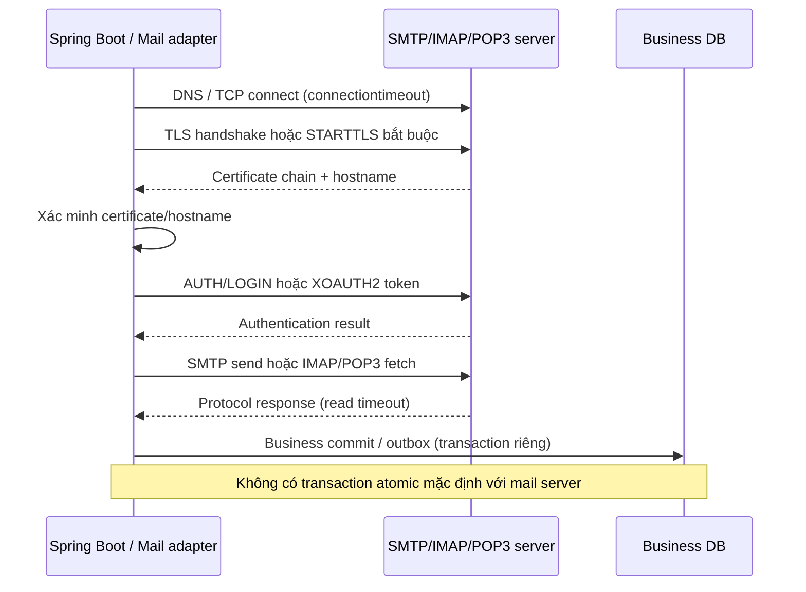
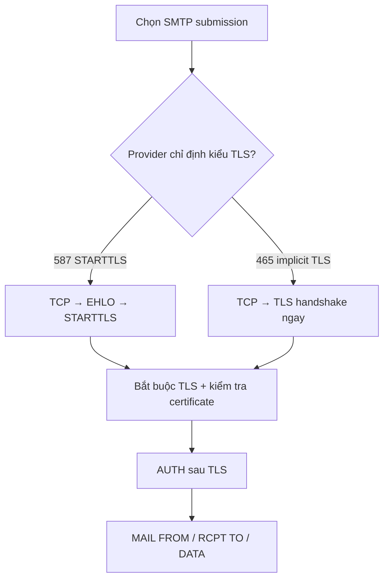
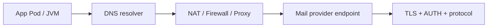
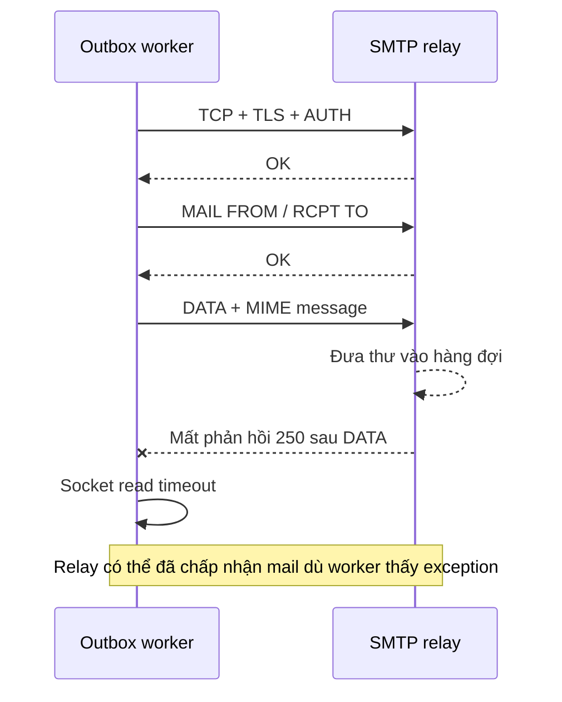
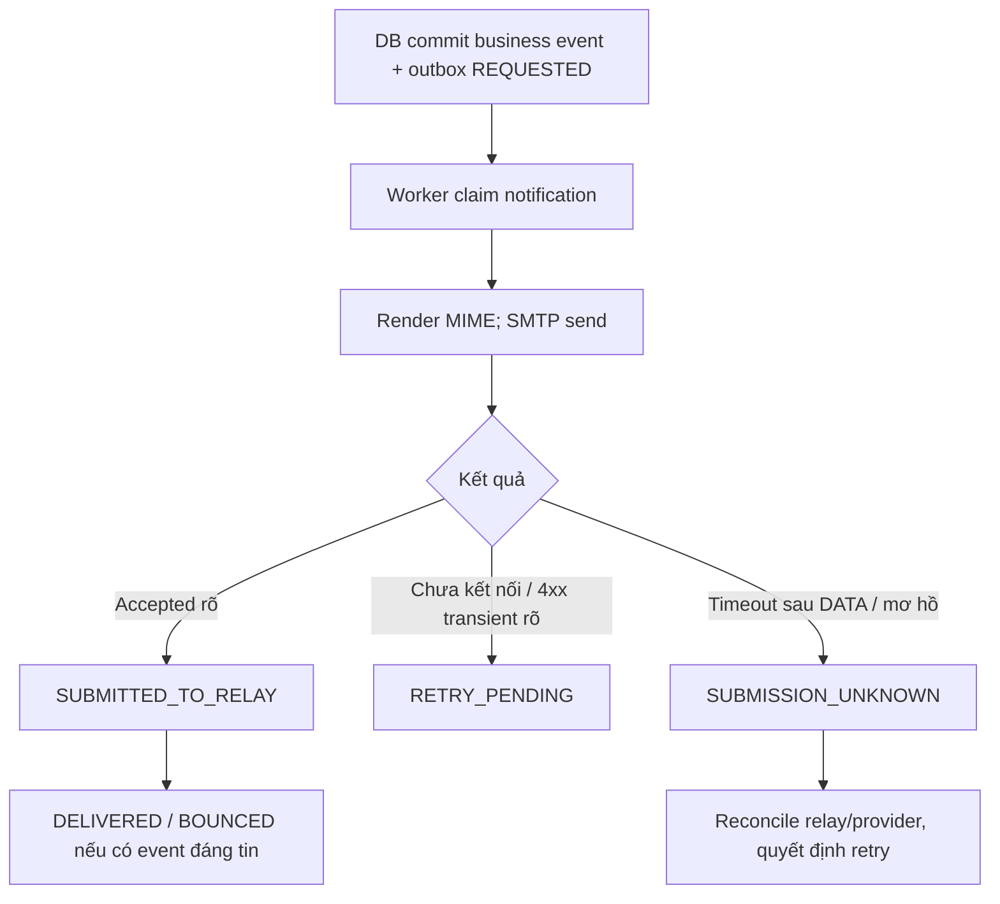
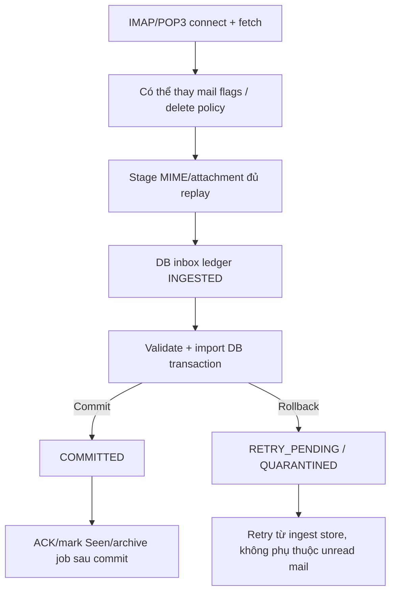

# Authentication TLS và connection timeout

## 1. Bài toán: nhận và gửi mail an toàn, không làm treo integration flow

Hệ thống Spring Boot nhận hóa đơn qua IMAPS, lưu file vào kho nội bộ, rồi gửi thông báo xác nhận qua SMTP. Trong production, cấu hình chỉ đúng host, port, username và password là **chưa đủ**. Có những sự cố tưởng giống nhau nhưng cần cách xử lý hoàn toàn khác: máy chủ mail từ chối mật khẩu; chứng chỉ TLS không khớp hostname; SMTP server hỗ trợ STARTTLS nhưng client vẫn tiếp tục plaintext; một lệnh đọc attachment treo vô thời hạn; hoặc SMTP relay đã chấp nhận email nhưng kết nối bị ngắt trước khi ứng dụng nhận phản hồi.

Trong **Spring Integration**, inbound mail adapter đưa email vào `MessageChannel` qua `ImapMailReceiver`/`Pop3MailReceiver` và poller hoặc IMAP IDLE; outbound adapter dùng `MailSendingMessageHandler`/`JavaMailSender` để gửi SMTP. Adapter **không tự tạo bảo mật đầu-cuối, transaction xuyên mail server và database, hay retry exactly-once**. Cấu hình connection, TLS, authentication, timeout và recovery phải gắn với đặc tính từng giao thức.

Bài thuộc chương **Adapter Mail** của module `SPRING_INTEGRATION_ADAPTERS` — kết nối hệ thống ngoài bằng inbound/outbound adapter, gateway, poller và `MessageChannel`, thực hành trao đổi với file/SFTP/HTTP/JMS/AMQP/Kafka/database, quản lý hợp đồng message, lỗi và vòng đời kết nối. Đây là bài về **độ tin cậy của kết nối email** chứ không chỉ hướng dẫn nhập password vào YAML.

Sau bài học, bạn có thể:

- Phân biệt **xác thực tài khoản** với **xác minh danh tính server qua TLS**, cũng như xác thực đối tác gửi email với SMTP/IMAP login.
- Chọn SMTP submission **587 + STARTTLS bắt buộc** hoặc **465 + implicit TLS**, và cấu hình **IMAPS 993**/**POP3S 995**.
- Đặt đúng `mail.<protocol>.connectiontimeout`, `.timeout`, `.writetimeout` và hiểu giới hạn của từng timeout.
- Dùng Spring Boot `JavaMailSender`, Spring Integration `MailSendingMessageHandler`, `ImapMailReceiver` và `Pop3MailReceiver` với secret và TLS an toàn.
- Nhận biết trường hợp cần OAuth2/XOAUTH2, custom truststore, proxy và chính sách rotation credential.
- Phân loại lỗi TLS/auth/network và xử lý retry có backoff, không nhầm SMTP accepted với email delivered hoặc IMAP fetched với nghiệp vụ committed.
- Thiết kế kiểm thử sandbox cho TLS fail-closed, certificate mismatch, timeout, connection reset, restart và idempotency.

> **Phiên bản mẫu:** Spring Integration **6.5.x**, Spring Framework 6.x, Spring Boot tương thích, Java 17+ và Jakarta Mail/Eclipse Angus Mail (`jakarta.mail.*`). Một số phiên bản cũ dùng `javax.mail.*`; không trộn namespace. Host, địa chỉ và các giá trị trong bài chỉ là ví dụ (`example.test`); mọi secret được cấp qua môi trường hoặc secret manager, không lưu vào Git.

## 2. Ba lớp bảo vệ khác nhau: Authentication, TLS và Timeout

| Lớp | Câu hỏi phải trả lời | Cơ chế | Nếu thiếu |
| --- | --- | --- | --- |
| **Server identity / TLS** | Ta có đang nói chuyện với **đúng server** và kênh có được mã hóa không? | TLS certificate chain, SAN/hostname verification, STARTTLS required hoặc implicit TLS | Dễ bị giả server, lộ credential/nội dung |
| **Client authentication** | Tài khoản ứng dụng có quyền truy cập mailbox hoặc submit email không? | SMTP AUTH, IMAP/POP3 login, app password, OAuth2/XOAUTH2 | Auth fail, sai scope/quyền, hoặc quyền quá rộng |
| **Timeout & lifecycle** | Một connect/read/write được phép giữ thread và socket bao lâu? | TCP connect timeout, socket read/write timeout, deadline, resource close | Thread bị giữ vô hạn, poller kẹt, connection exhaustion |

**Login thành công không chứng minh server TLS là thật** nếu certificate validation bị tắt. Ngược lại, một TLS handshake thành công **không chứng minh application user có quyền mailbox**. Chứng chỉ của SMTP/IMAP server cũng **không xác thực sender của từng email**: `From`, `Reply-To`, `Message-ID` có thể giả mạo. Muốn tin dữ liệu hóa đơn, còn cần email authentication policy, partner registry/chữ ký dữ liệu, schema và business authorization.



**Bảo vệ theo thứ tự:** chọn protocol và server được phép → thiết lập TLS đáng tin → xác thực user/token → giới hạn thời gian và tài nguyên → chuyển message → xác nhận business state độc lập. Không sửa lỗi TLS bằng cách tắt xác minh certificate hoặc chuyển về plaintext.

## 3. Chọn đúng transport và port cho từng giao thức

| Mục đích | Giao thức | Port thường dùng | Kiểu mã hóa | Jakarta Mail properties điển hình |
| --- | --- | --- | --- | --- |
| **Gửi** thư đến relay | SMTP submission | **587** | Bắt đầu SMTP rồi nâng cấp bằng **STARTTLS** | `mail.smtp.starttls.enable=true`, `mail.smtp.starttls.required=true` |
| **Gửi** thư đến relay | SMTP implicit TLS | **465** | TLS ngay khi bắt đầu kết nối | `mail.smtp.ssl.enable=true` |
| **Nhận** thư | IMAPS | **993** | TLS ngay khi kết nối | `mail.imaps.ssl.enable=true` |
| **Nhận** thư | IMAP + STARTTLS | **143** | STARTTLS trước login | `mail.imap.starttls.enable=true`, `.required=true` |
| **Nhận** thư | POP3S | **995** | TLS ngay khi kết nối | `mail.pop3s.ssl.enable=true` |
| **Nhận** thư | POP3 + STLS | **110** | Nâng cấp bằng **STLS** trước login | `mail.pop3.starttls.enable=true`, `.required=true` |

Đây là **cổng theo quy ước**, không phải hợp đồng bắt buộc với mọi provider: ưu tiên tài liệu/hostname/port do nhà cung cấp xác nhận. Port **25** chủ yếu phục vụ trao đổi SMTP server-to-server; ứng dụng thông thường nên dùng submission có authentication. Cấu hình một relay nội bộ riêng trên cổng khác phải có chính sách mạng/TLS/quyền rõ ràng.

### STARTTLS khác implicit TLS ở bước nào?



`starttls.enable=true` **không đồng nghĩa fail-closed**: trong nhiều JavaMail providers, nếu server không quảng bá STARTTLS và không có `starttls.required=true`, client có thể tiếp tục SMTP không mã hóa. Kết hợp **enable + required + hostname verification**. Với implicit TLS trên 465, dùng `ssl.enable=true` và xác minh hostname; không áp nguyên cấu hình STARTTLS 587 lên một cổng implicit TLS rồi mong provider tự suy ra đúng.

### Authentication bắt buộc qua kênh đã mã hóa

SMTP AUTH dùng username/password hoặc token; IMAP/POP3 cũng có login hoặc SASL. Không truyền credential trên kết nối plaintext không được nâng cấp TLS. Nếu server chỉ chấp nhận kiểu cũ không bảo mật, **không** hạ security policy âm thầm; cần thay endpoint/provider hoặc dựng kết nối mạng/relay đáng tin theo yêu cầu bảo mật được phê duyệt.

## 4. Connection timeout, read timeout và write timeout khác nhau ở đâu?

Jakarta Mail/Eclipse Angus dùng các property có hậu tố thống nhất theo protocol. Với SMTP là `mail.smtp.*`, với IMAPS là `mail.imaps.*`, với POP3S là `mail.pop3s.*`.

| Thuộc tính | Điều kiện kích hoạt | Giới hạn | **Không** tự bảo đảm |
| --- | --- | --- | --- |
| `connectiontimeout` | Mở TCP socket đến mail server | Thời gian chờ **TCP connect** (ms) | Tổng thời gian DNS, mọi reconnect, hoặc end-to-end request deadline |
| `timeout` | Đọc dữ liệu phản hồi từ socket | Socket **read timeout** (ms) | Tổng thời gian giao dịch nếu server liên tục gửi từng phần; thời gian xử lý DB |
| `writetimeout` | Ghi dữ liệu ra socket | Socket **write timeout** (ms) | Đảm bảo server nhận toàn bộ DATA hoặc ngăn mail duplicate |

Ví dụ:

```properties
mail.smtp.connectiontimeout=10000
mail.smtp.timeout=30000
mail.smtp.writetimeout=30000

mail.imaps.connectiontimeout=10000
mail.imaps.timeout=30000
mail.imaps.writetimeout=30000

mail.pop3s.connectiontimeout=10000
mail.pop3s.timeout=30000
mail.pop3s.writetimeout=30000
```

Các giá trị trên là **đề xuất khởi đầu để kiểm thử**, không phải tối ưu cho mọi môi trường. Một số timeout mặc định của Jakarta Mail có thể là **vô hạn**. Không để thread poller hoặc HTTP request chờ vô hạn khi provider bị treo. Nhưng cũng **không** đặt read timeout 500 ms cho một provider có high latency/attachment lớn rồi tạo retry storm.

### Timeout có phải deadline toàn quy trình không?

**Không.** Một lời gọi send/fetch gồm nhiều thao tác: DNS, TCP, TLS handshake, AUTH, lệnh SMTP/IMAP, đọc MIME/attachment, xử lý DB và đóng kết nối. Timeout socket được áp theo pha và có thể được làm mới khi có dữ liệu; nó không đồng nghĩa **toàn bộ flow phải kết thúc trong 30 giây**. Nếu cần SLA end-to-end, cần đo deadline/budget ở tầng service/worker và có cancellation/recovery rõ ràng. Cố ngắt thread Java không bảo đảm remote side effect chưa xảy ra.

### Lưu ý đặc biệt về `writetimeout`

Tài liệu Angus Mail mô tả write timeout có thể được thực thi bằng `ScheduledExecutorService`/nhiệm vụ đóng socket, với **chi phí tài nguyên theo kết nối** (một thread quản lý theo cách triển khai mặc định được mô tả). Khi tăng SMTP concurrency lên hàng trăm kết nối, phải đo số thread, memory và khả năng shutdown, không chỉ nhìn mỗi giá trị timeout. Có thể cấu hình executor chung theo provider version nếu thực sự cần tối ưu, nhưng không sửa trước khi đo và kiểm thử lifecycle.

### IMAP IDLE có tính chất timeout khác polling

Polling IMAP kết nối, search/fetch và đọc response trong một lượt hoạt động có thời gian tương đối ngắn. **IMAP IDLE** giữ một lệnh chờ thông báo lâu dài; đặt read timeout ngắn hơn chu kỳ IDLE có thể làm IDLE bị ngắt liên tục hoặc tạo exception không mong muốn. Spring Integration có `cancelIdleInterval` (mặc định **120 giây**) để làm mới IDLE khi kết nối im lặng. Khi dùng IDLE, chọn socket timeout/reconnect/cancel interval **phù hợp nhau**; không sao chép máy móc các giá trị polling 30 giây sang một IDLE connection sống lâu.

## 5. Dependencies và cấu hình source of truth

Trong dự án Spring Boot với BOM quản lý phiên bản Spring Integration tương thích:

```groovy
dependencies {
    implementation 'org.springframework.boot:spring-boot-starter-integration'
    implementation 'org.springframework.integration:spring-integration-mail'
    implementation 'org.springframework.boot:spring-boot-starter-mail'
}
```

`spring-integration-mail` chứa receiver/handler/DSL; `spring-boot-starter-mail` cung cấp API Spring Mail và Jakarta Mail implementation/provider qua dependency tương thích. Đừng tự gắn một phiên bản `javax.mail.*` cũ để sửa lỗi package trong ứng dụng Jakarta Mail. `JavaMailSender` dùng cho **SMTP outbound**; `ImapMailReceiver`/`Pop3MailReceiver` dùng cho **mail inbound**.

Cấu hình bảo mật nên có **một nguồn chuẩn** theo environment/tenant: host, protocol, port, TLS mode, username, secret source, CA trust policy, timeout và quotas. Với nhiều provider, không tạo global trust-all hoặc global SMTP sender dùng chung cho các tenant có miền và credential khác nhau nếu không có phân quyền định tuyến.

## 6. Spring Boot: SMTP AUTH + STARTTLS trên cổng 587

Spring Boot có thể tự tạo `JavaMailSender` khi thư viện mail và `spring.mail.host` được cấu hình, nếu ứng dụng chưa định nghĩa bean tương ứng. Cấu hình sau bật **TLS bắt buộc**, **xác minh hostname**, SMTP AUTH và cả ba socket timeout:

```yaml
spring:
  mail:
    host: ${SMTP_HOST:smtp.example.test}
    port: ${SMTP_PORT:587}
    username: ${SMTP_USERNAME:notifications@example.test}
    password: ${SMTP_PASSWORD}
    protocol: smtp
    default-encoding: UTF-8
    test-connection: false
    properties:
      "[mail.smtp.auth]": true
      "[mail.smtp.starttls.enable]": true
      "[mail.smtp.starttls.required]": true
      "[mail.smtp.ssl.checkserveridentity]": true
      "[mail.smtp.connectiontimeout]": 10000
      "[mail.smtp.timeout]": 30000
      "[mail.smtp.writetimeout]": 30000
      "[mail.debug]": false
```

`SMTP_PASSWORD` đến từ secret manager hoặc biến môi trường có chính sách cấp quyền. Không commit password vào Git hoặc hiển thị cấu hình đã resolve trong log. `test-connection=false` ở ví dụ giúp khởi động không phụ thuộc vào việc relay đang sẵn sàng; nếu tổ chức muốn fail startup khi không kết nối được, có thể đặt `true` **có chủ đích**. Kiểm tra khi startup **không thay thế** runtime health/retry khi provider outage vài phút sau đó.

**Spring Boot property map:** cú pháp `"[mail.smtp.timeout]"` trong YAML giữ nguyên dấu chấm của key JavaMail. Chỉ đặt `spring.mail.timeout=...` theo suy đoán có thể **không tác động** tới socket timeout; phải cấu hình đúng provider property hoặc cơ chế chính thức của phiên bản đang dùng.

### Cấu hình SMTP 465 implicit TLS là một phương án thay thế

```yaml
spring:
  mail:
    host: ${SMTP_HOST:smtp.example.test}
    port: 465
    username: ${SMTP_USERNAME:notifications@example.test}
    password: ${SMTP_PASSWORD}
    protocol: smtp
    properties:
      "[mail.smtp.auth]": true
      "[mail.smtp.ssl.enable]": true
      "[mail.smtp.ssl.checkserveridentity]": true
      "[mail.smtp.connectiontimeout]": 10000
      "[mail.smtp.timeout]": 30000
      "[mail.smtp.writetimeout]": 30000
```

Hai YAML là **hai lựa chọn khác nhau**. Không gộp đoạn 465 vào đoạn 587 một cách tùy tiện: `ssl.enable` bắt đầu TLS ngay, trong khi STARTTLS phải đợi server hỗ trợ lệnh nâng cấp. Với certificate chain sai, JavaMail phải **thất bại an toàn**, không tự rơi xuống plaintext.

### Bean `JavaMailSender` thủ công (khi không dùng Boot auto-config)

```java
import java.util.Properties;

import org.springframework.mail.javamail.JavaMailSender;
import org.springframework.mail.javamail.JavaMailSenderImpl;

public static JavaMailSender newSmtpSender(
        String trustedHost, int port, String username, String password) {
    JavaMailSenderImpl sender = new JavaMailSenderImpl();
    sender.setHost(trustedHost);
    sender.setPort(port); // 587 trong mẫu STARTTLS.
    sender.setProtocol("smtp");
    sender.setUsername(username);
    sender.setPassword(password); // Secret lấy ở runtime, không hardcode.
    sender.setDefaultEncoding("UTF-8");

    Properties properties = sender.getJavaMailProperties();
    properties.setProperty("mail.smtp.auth", "true");
    properties.setProperty("mail.smtp.starttls.enable", "true");
    properties.setProperty("mail.smtp.starttls.required", "true");
    properties.setProperty("mail.smtp.ssl.checkserveridentity", "true");
    properties.setProperty("mail.smtp.connectiontimeout", "10000");
    properties.setProperty("mail.smtp.timeout", "30000");
    properties.setProperty("mail.smtp.writetimeout", "30000");
    properties.setProperty("mail.debug", "false");
    return sender;
}
```

Trích đoạn này thuộc một utility/configuration class, **không phải standalone Java class có thể copy nguyên xi**. Trong một Spring Boot application thông thường, hãy ưu tiên bean autoconfig từ `spring.mail.*` để có một nguồn cấu hình rõ ràng. Nếu tự tạo `JavaMailSender` thì phải kiểm soát xung đột bean và secret rotation; có thể cần tạo sender mới hoặc refresh tài nguyên hợp lệ khi credential thay đổi.

## 7. Nối `JavaMailSender` vào Spring Integration outbound flow

```java
import org.springframework.context.annotation.Bean;
import org.springframework.context.annotation.Configuration;
import org.springframework.integration.dsl.IntegrationFlow;
import org.springframework.integration.mail.dsl.Mail;
import org.springframework.mail.javamail.JavaMailSender;

@Configuration
public class SmtpOutboundIntegration {

    @Bean
    public IntegrationFlow smtpMailOutboundFlow(JavaMailSender mailSender) {
        return IntegrationFlow.from("outboundMailRequests")
                .handle(Mail.outboundAdapter(mailSender))
                .get();
    }
}
```

`MailSendingMessageHandler` nhận message từ channel và gọi sender theo cấu hình SMTP. Đây là **outbound channel adapter**, không có SMTP delivery receipt ở reply channel. Khi `outboundMailRequests` là `DirectChannel`, handler thường chạy trên thread gửi message; timeout SMTP có thể giữ thread HTTP/worker. Nếu channel là executor/queue, `send()` trả về chỉ có nghĩa message được chấp nhận để dispatch, **không phải** relay đã nhận thư. Với thông báo có giá trị, dùng DB outbox và worker riêng.

Ví dụ producer text-only đã được xác thực recipient:

```java
import org.springframework.integration.mail.MailHeaders;
import org.springframework.messaging.MessageChannel;
import org.springframework.messaging.support.MessageBuilder;

public static void sendStatus(MessageChannel mailChannel) {
    mailChannel.send(MessageBuilder
            .withPayload("Báo cáo batch 0042 đã hoàn tất.")
            .setHeader(MailHeaders.FROM, "notifications@example.test")
            .setHeader(MailHeaders.TO, new String[]{"ops@example.test"})
            .setHeader(MailHeaders.SUBJECT, "Thông báo batch 0042")
            .build());
}
```

**Không cho client HTTP tự đặt** From/To/Bcc tùy ý trước khi đi qua mail adapter: ứng dụng có thể bị lạm dụng như open relay hoặc gửi dữ liệu sai tenant. SMTP username không nhất thiết bằng From hiển thị; nhiều provider chỉ cho gửi từ domain/alias đã xác minh, còn SMTP envelope sender phục vụ bounce policy riêng.

## 8. IMAPS inbound: Authenticator + TLS + timeout

Với IMAPS (cổng 993), cấu hình receiver dùng đúng prefix **`mail.imaps.*`**, không phải `mail.smtp.*` hay `mail.imap.*` của STARTTLS trên 143. Ví dụ đặt `Authenticator` để password **không nằm trong URI** và giới hạn tài nguyên poll:

```yaml
app:
  mail:
    imap-uri: ${IMAP_URI:imaps://invoices%40example.test@imap.example.test:993/INBOX}
    username: ${IMAP_USERNAME:invoices@example.test}
    password: ${IMAP_PASSWORD}
    poll-delay-ms: ${IMAP_POLL_DELAY_MS:15000}
```

Ký tự `@` của username trong URI có thể cần encode thành `%40`, theo Spring Integration reference và cách parser của mail provider. Không nhúng `:password@` vào URI vì giá trị này dễ xuất hiện trong logs/exception. Nếu account dùng OAuth2, phải cấu hình SASL/XOAUTH2 và token lifecycle riêng.

```java
import java.util.Properties;

import jakarta.mail.Authenticator;
import jakarta.mail.PasswordAuthentication;

import org.springframework.beans.factory.annotation.Value;
import org.springframework.context.annotation.Bean;
import org.springframework.context.annotation.Configuration;
import org.springframework.context.annotation.Profile;
import org.springframework.integration.mail.ImapMailReceiver;

@Configuration
@Profile("mail-imap")
public class SecureImapReceiverConfiguration {

    @Bean
    public ImapMailReceiver invoiceImapReceiver(
            @Value("${app.mail.imap-uri}") String storeUri,
            @Value("${app.mail.username}") String username,
            @Value("${app.mail.password}") String password) {

        ImapMailReceiver receiver = new ImapMailReceiver(storeUri);
        receiver.setJavaMailAuthenticator(new Authenticator() {
            @Override
            protected PasswordAuthentication getPasswordAuthentication() {
                return new PasswordAuthentication(username, password);
            }
        });

        Properties props = new Properties();
        props.setProperty("mail.store.protocol", "imaps");
        props.setProperty("mail.imaps.ssl.enable", "true");
        props.setProperty("mail.imaps.ssl.checkserveridentity", "true");
        props.setProperty("mail.imaps.connectiontimeout", "10000");
        props.setProperty("mail.imaps.timeout", "30000");
        props.setProperty("mail.imaps.writetimeout", "30000");
        props.setProperty("mail.imaps.peek", "true");
        props.setProperty("mail.debug", "false");
        receiver.setJavaMailProperties(props);

        receiver.setShouldMarkMessagesAsRead(false);
        receiver.setShouldDeleteMessages(false);
        receiver.setMaxFetchSize(1);
        receiver.setSimpleContent(false);
        receiver.setAutoCloseFolder(false);
        return receiver;
    }
}
```

**Đọc đúng ba ý nghĩa:** (1) TLS/hostname verification và timeout bảo vệ kết nối, không thay validation nội dung email; (2) không chủ động xóa/mark Seen **không** có nghĩa receiver không gắn user flag/fallback hoặc client khác không thay Seen; (3) `setAutoCloseFolder(false)` giữ IMAP folder để handler đọc MIME lazy-loaded, **handler phải đóng tài nguyên** trong `finally`/try-with-resources.

### Poller sử dụng IMAP receiver

```java
import org.springframework.context.annotation.Bean;
import org.springframework.context.annotation.Configuration;
import org.springframework.context.annotation.Profile;
import org.springframework.integration.dsl.IntegrationFlow;
import org.springframework.integration.dsl.Pollers;
import org.springframework.integration.mail.ImapMailReceiver;
import org.springframework.integration.mail.dsl.Mail;

@Configuration
@Profile("mail-imap")
public class ImapPollingFlow {

    @Bean
    public IntegrationFlow receiveInvoiceMail(
            ImapMailReceiver invoiceImapReceiver,
            InvoiceMailHandler invoiceMailHandler) {

        return IntegrationFlow.from(
                        Mail.imapInboundAdapter(invoiceImapReceiver),
                        spec -> spec.poller(Pollers.fixedDelay(15_000)
                                .maxMessagesPerPoll(1)))
                .handle(invoiceMailHandler)
                .get();
    }
}
```

Đây là **polling inbound source**: poller kích hoạt receive, mail receiver dùng TLS/timeout rồi phát message cho handler. `maxMessagesPerPoll(1)` giới hạn số Spring messages trong mỗi lượt poll; `setMaxFetchSize(1)` giới hạn số mail receiver lấy mỗi fetch. Cả hai không phải retry policy hoặc transaction lock. `InvoiceMailHandler` là handler do ứng dụng định nghĩa; mục 10 cung cấp mẫu xử lý resource. Bật profile `mail-imap` để sử dụng các bean IMAP này, hoặc dùng profile `mail-pop3` cho giải pháp POP3 riêng; không bật hai reader trên cùng mailbox.

## 9. POP3S: đổi prefix và nhớ khác biệt mailbox state

POP3S (cổng 995) cũng có TLS và timeout nhưng **không có IMAP Seen, SearchTerm hay IDLE**. Khi giữ thư trên server, restart có thể nhận lại mail; bật delete quá sớm có thể làm mất dữ liệu trước khi downstream commit.

```java
import java.util.Properties;

import jakarta.mail.Authenticator;
import jakarta.mail.PasswordAuthentication;

import org.springframework.beans.factory.annotation.Value;
import org.springframework.context.annotation.Bean;
import org.springframework.context.annotation.Configuration;
import org.springframework.context.annotation.Profile;
import org.springframework.integration.mail.Pop3MailReceiver;

@Configuration
@Profile("mail-pop3")
public class SecurePop3ReceiverConfiguration {

    @Bean
    public Pop3MailReceiver invoicePop3Receiver(
            @Value("${app.pop3.uri}") String pop3Uri,
            @Value("${app.pop3.username}") String username,
            @Value("${app.pop3.password}") String password) {

        Pop3MailReceiver receiver = new Pop3MailReceiver(pop3Uri);
        receiver.setJavaMailAuthenticator(new Authenticator() {
            @Override
            protected PasswordAuthentication getPasswordAuthentication() {
                return new PasswordAuthentication(username, password);
            }
        });

        Properties props = new Properties();
        props.setProperty("mail.store.protocol", "pop3s");
        props.setProperty("mail.pop3s.ssl.enable", "true");
        props.setProperty("mail.pop3s.ssl.checkserveridentity", "true");
        props.setProperty("mail.pop3s.connectiontimeout", "10000");
        props.setProperty("mail.pop3s.timeout", "30000");
        props.setProperty("mail.pop3s.writetimeout", "30000");
        props.setProperty("mail.debug", "false");
        receiver.setJavaMailProperties(props);

        receiver.setShouldDeleteMessages(false);
        receiver.setMaxFetchSize(1);
        // Không dùng autoCloseFolder(false): khác IMAP về lifecycle.
        return receiver;
    }
}
```

Ví dụ POP3 là **phương án thay thế**, không bật cùng IMAP trên một mailbox. Để chạy riêng cần cấu hình `app.pop3.uri` (ví dụ `pop3s://...:995/INBOX`) và secret trong environment, đồng thời bật profile `mail-pop3`. Handler POP3 cần hợp đồng **materialize MIME trong phiên nhận hợp lệ** và kiểm thử với provider thực: không sao chép logic `autoCloseFolder(false)` của IMAP. Lịch poll có thể dùng `Mail.pop3InboundAdapter(receiver)` cùng `.poller(...)` như ví dụ IMAP.

### Cấu hình STARTTLS trên IMAP/POP3 port không TLS

Nếu provider **bắt buộc** dùng IMAP 143 hoặc POP3 110 có nâng cấp TLS, không lấy prefix `imaps`/`pop3s` rồi đặt port 143/110 một cách tùy ý. Cần chọn protocol `imap` hoặc `pop3` và cấu hình **bắt buộc nâng cấp**:

```properties
# IMAP + STARTTLS trên 143
mail.store.protocol=imap
mail.imap.starttls.enable=true
mail.imap.starttls.required=true
mail.imap.ssl.checkserveridentity=true
mail.imap.connectiontimeout=10000
mail.imap.timeout=30000
mail.imap.writetimeout=30000

# POP3 + STLS trên 110 (trong Session khác)
mail.store.protocol=pop3
mail.pop3.starttls.enable=true
mail.pop3.starttls.required=true
mail.pop3.ssl.checkserveridentity=true
mail.pop3.connectiontimeout=10000
mail.pop3.timeout=30000
mail.pop3.writetimeout=30000
```

Hai nhóm properties là **mẫu độc lập**: không ghép cả hai `mail.store.protocol` vào một session. Trong giao thức POP3, lệnh nâng cấp được gọi là **STLS**, còn property JavaMail vẫn dùng tên `starttls`. `required=true` buộc fail nếu server không hỗ trợ/upgrade lỗi; không âm thầm gửi password qua plaintext.

## 10. Vòng đời IMAP MIME: timeout không thay thế `closeableResource`

Khi `autoCloseFolder(false)`, IMAP receiver đưa header `IntegrationMessageHeaderAccessor.CLOSEABLE_RESOURCE` vào Spring message. Handler phải đóng sau khi đã đọc attachment/`MimeMessage`, dù import thành công hay lỗi. Một `timeout` chỉ ngắt socket read khi không có dữ liệu; **nó không tự đóng folder trong mọi đường code** và không thay try-with-resources.

```java
import java.io.Closeable;
import java.io.IOException;

import jakarta.mail.MessagingException;
import jakarta.mail.internet.MimeMessage;

import org.springframework.integration.StaticMessageHeaderAccessor;
import org.springframework.messaging.Message;
import org.springframework.messaging.MessageHandler;
import org.springframework.messaging.MessageHandlingException;
import org.springframework.stereotype.Component;

@Component
public class InvoiceMailHandler implements MessageHandler {

    private final InvoiceIngestService ingestService;

    public InvoiceMailHandler(InvoiceIngestService ingestService) {
        this.ingestService = ingestService;
    }

    @Override
    public void handleMessage(Message<?> message) {
        Closeable resource = StaticMessageHeaderAccessor
                .getCloseableResource(message);

        try (Closeable folder = resource == null ? () -> { } : resource) {
            MimeMessage mime = (MimeMessage) message.getPayload();
            if (!mime.isMimeType("text/plain")) {
                throw new IllegalArgumentException(
                        "Multipart cần parser MIME có quota riêng");
            }
            Object content = mime.getContent();
            if (!(content instanceof String body)) {
                throw new IllegalArgumentException("Mail body không phải text");
            }

            // Phải commit idempotent hoặc ném exception; raw MIME cần
            // được stage bền vững trước handoff bất đồng bộ.
            ingestService.importOnce(mime.getMessageID(), body);

        } catch (MessagingException | IOException ex) {
            throw new MessageHandlingException(
                    message, "Không đọc được MIME hoặc đóng folder", ex);
        }
    }
}

public interface InvoiceIngestService {
    void importOnce(String mailMessageId, String text);
}
```

Code trên chỉ nhận `text/plain`, không dùng trực tiếp cho mail có PDF/HTML. Đối với multipart, cần duyệt cây MIME, giới hạn số part/depth/bytes, kiểm tra filename và stream attachment vào vùng quarantine trước khi import. Nếu bật `DefaultMailHeaderMapper`, payload có thể trở thành `String`/`byte[]` thay vì `MimeMessage`; phải thay handler theo **payload contract**. Không chuyển raw `MimeMessage` qua `ExecutorChannel`, Kafka/JMS hoặc queue để lazy-read sau khi IMAP folder đã đóng.

## 11. Authentication theo môi trường: password, app password, OAuth2/XOAUTH2

| Phương thức | Cách triển khai | Điểm phải quản trị |
| --- | --- | --- |
| Username/password SMTP AUTH | `spring.mail.username/password`, `mail.smtp.auth=true` | TLS, service account, rotation, chống brute-force |
| App password do provider cấp | Dùng như credential riêng được giới hạn | Provider có thể thu hồi, phụ thuộc MFA/account policy |
| IMAP/POP3 login | `Authenticator`/Jakarta Mail `Session` | Quyền mailbox và folder, TLS, connection lifecycle |
| OAuth2/XOAUTH2 | Access token + SASL mechanism XOAUTH2 | Scope/consent, token TTL, refresh trước khi reconnect |
| Sender identity/verified domain | Chính sách SMTP relay/provider và DNS | Không đồng nhất với username, From, envelope sender |

**OAuth2 không chỉ là thay password bằng một chuỗi token tĩnh.** Access token có hạn sử dụng. Nếu thư viện mail giữ kết nối lâu, token có thể hết hạn trước reconnect; phải quản lý refresh, token scopes và quyền mailbox/send theo provider. Không retry một token đã expired hàng trăm lần. OAuth/OIDC endpoint và permission được nhà cung cấp quy định, không tự suy từ host SMTP/IMAP.

### Cơ chế XOAUTH2 trong Jakarta Mail/Angus

Theo tài liệu Angus, có thể giới hạn cơ chế xác thực về **XOAUTH2** và truyền **access token** qua tham số password của mail client; đó không phải password tài khoản, mà là cách API truyền secret cho AUTH XOAUTH2:

```properties
# Cấu hình mang tính minh họa, mỗi protocol đặt trong Session riêng.
mail.smtp.auth=true
mail.smtp.auth.mechanisms=XOAUTH2

mail.imaps.auth.mechanisms=XOAUTH2

# Nếu dùng POP3S và provider yêu cầu OAuth2:
mail.pop3s.auth.mechanisms=XOAUTH2
```

**Phải kiểm tra cơ chế cụ thể do Angus version và mail provider hỗ trợ**, đặc biệt với POP3/XOAUTH2 có các tùy chọn định dạng riêng. Không trộn `LOGIN/PLAIN` fallback với access token nếu policy chỉ cho XOAUTH2. Không lưu token vào URI, YAML, thread dump dễ truy cập hoặc protocol debug. Tách token supplier/refresh khỏi config bất biến và bảo đảm receiver/sender nhận token còn hạn khi mở kết nối mới.

## 12. TLS truststore, chứng chỉ server và xác minh hostname

TLS chỉ an toàn khi client **kiểm tra được server certificate chain** tới một trust anchor được tin cậy và xác minh tên máy chủ. Trong Java/Jakarta Mail, các thành phần thường tham gia là JVM truststore, JSSE/SSLContext, TLS endpoint identification, certificate SAN (Subject Alternative Name) và cấu hình riêng của mail provider.

| Thành phần | Cần xác minh | Ví dụ sự cố |
| --- | --- | --- |
| Certificate chain | Leaf → intermediate → trusted root hợp lệ | `PKIX path building failed` do thiếu intermediate/CA |
| Server hostname | Host kết nối khớp DNS SAN trên chứng chỉ | Kết nối qua IP trong khi SAN chỉ có tên DNS |
| Thời hạn certificate | Chứng chỉ chưa hết hạn, hệ thống đúng giờ | `certificate expired` hoặc `not yet valid` |
| Truststore | Root/intermediate của CA thích hợp được tin cậy | CA nội bộ chưa có trong truststore JVM |
| TLS protocol/cipher | Provider và JVM có phiên bản/thuật toán chung | `handshake_failure` vì policy không tương thích |
| SNI và proxy | Server trả đúng certificate theo hostname | TLS terminator/proxy đưa chứng chỉ của domain khác |

### Cấu hình hostname verification phải rõ ràng

```properties
mail.smtp.ssl.checkserveridentity=true
mail.imaps.ssl.checkserveridentity=true
mail.pop3s.ssl.checkserveridentity=true
```

Một số phiên bản/provider đã có mặc định bảo mật phù hợp, nhưng **đặt rõ trong cấu hình** giúp mục đích dễ audit và tương thích khi nâng phiên bản. Không dùng `mail.smtp.ssl.trust=*`/`mail.imaps.ssl.trust=*` hoặc `MailSSLSocketFactory` trust-all chỉ để vượt qua lỗi chứng chỉ. Những cấu hình này có thể bỏ qua phần kiểm chứng chuỗi tin cậy hoặc tạo cửa cho kết nối tới server giả.

### Khi dùng CA nội bộ hoặc certificate tự ký

Ưu tiên CA doanh nghiệp được cấp/quản lý theo quy trình. Nếu server dùng CA private, hãy cấp truststore riêng cho workload và cấu hình **được quản lý bởi môi trường triển khai**, thay vì vô hiệu hóa validation. Ví dụ tham khảo cách chỉ định truststore cho JVM:

```text
-Djavax.net.ssl.trustStore=/etc/app/certs/mail-truststore.p12
-Djavax.net.ssl.trustStoreType=PKCS12
-Djavax.net.ssl.trustStorePassword=<do-secret-manager-cung-cap>
```

Đoạn trên chỉ mô tả **tham số**, tuyệt đối không hardcode literal password như một giá trị triển khai. Cấu hình JVM truststore có thể ảnh hưởng **mọi TLS client trong tiến trình** (HTTP, JDBC TLS, SFTP HTTPS gateway...), vì vậy cần đánh giá tác động hoặc dùng SSLContext/SocketFactory riêng cho mail sender qua một integration được kiểm thử. Không tùy tiện thay toàn bộ truststore hệ thống nếu điều đó làm mất các public CA cần thiết.

**Không nhập chỉ riêng leaf certificate của máy chủ rồi gọi đó là giải pháp dài hạn:** certificate rotation có thể làm kết nối thất bại khi leaf mới được cấp. Tin cậy đúng CA chain, có quy trình rotation, cảnh báo expiry và thử certificate staging trước triển khai production.

### Vì sao kết nối bằng IP có thể thất bại dù TLS server tốt?

Certificate thường cấp cho một DNS hostname trong SAN. Nếu ứng dụng đặt `smtp.host=192.0.2.10` trong khi chứng chỉ chỉ hợp lệ cho `smtp.example.test`, xác minh hostname sẽ thất bại — **đó là bảo vệ cần có**. Dùng DNS endpoint đúng hợp đồng; không chuyển sang `ssl.checkserveridentity=false`. Với load balancer có SNI, xác minh host và route TLS phải được cấu hình nhất quán.

## 13. Kết nối qua firewall, proxy và network policy

Nhiều môi trường container/Kubernetes chỉ cho phép outbound tới một số port/host. Khi kết nối SMTP 587 hoặc IMAPS 993 bị timeout, nguyên nhân có thể nằm ngoài Spring Integration: DNS, egress firewall, NAT gateway, proxy, routing hoặc provider allowlist địa chỉ IP.



**Chẩn đoán theo lớp, không đoán bằng exception chung**:

1. Kiểm tra hostname/port/transport có đúng cấu hình provider không; không dùng cổng SMTP nhận thư thay cho submission.
2. Kiểm tra DNS resolution, egress policy, proxy và whitelist IP từ cùng môi trường chạy ứng dụng.
3. Kiểm tra TCP connect, sau đó TLS handshake/certificate/hostname; không gửi AUTH trước khi TLS được bảo vệ.
4. Kiểm tra cơ chế SMTP AUTH/IMAP/POP3 credential, scope và account status.
5. Kiểm tra quyền folder/recipient và phản hồi từng lệnh, giới hạn quota, rate limit.
6. Chỉ khi các bước trên ổn mới chẩn đoán payload/MIME, business transaction và retry.

**Không nhất thiết mọi provider hỗ trợ generic HTTP proxy** cho giao thức email. Angus Mail có các cơ chế SOCKS hoặc proxy theo protocol/provider, nhưng cần xác nhận khả năng hỗ trợ và cấp credential proxy riêng. Một proxy TLS interception có thể thay chain certificate; không chấp nhận CA proxy mới trừ khi tổ chức phê duyệt và đánh giá tác động quyền riêng tư. Chạy mail egress qua proxy do ứng dụng không kiểm soát không tự bảo đảm an toàn.

## 14. Ước lượng timeout theo SLA và kích thước email

Timeout cần xuất phát từ **đặc tính provider và workload**, không chỉ lấy một giá trị giống nhau cho mọi lệnh. Ví dụ một hệ thống nhận email PDF 5 MB qua đường truyền chậm cần read timeout lớn hơn hệ thống chỉ nhận một đoạn text; SMTP worker gửi attachment lớn phải kiểm tra cả quota và write timeout.

| Tình huống | Connect | Read | Write | Chiến lược chung |
| --- | --- | --- | --- | --- |
| IMAP polling chỉ đọc metadata/text | 5–10 giây khởi điểm | 20–30 giây khởi điểm | 20–30 giây khởi điểm | Giới hạn maxFetchSize, đo p95/p99 |
| IMAP đọc PDF nhiều MB | 5–10 giây khởi điểm | Dựa vào kích thước/p99 truyền file | Dựa provider/network | Stream attachment, cap byte/thời gian |
| SMTP gửi notification text | 5–10 giây khởi điểm | 20–30 giây khởi điểm | 20–30 giây khởi điểm | Outbox, concurrency giới hạn |
| SMTP gửi attachment | 5–10 giây khởi điểm | Provider SLA | Phù hợp upload bytes và bandwidth | Tách worker, resource repeatable |
| IMAP IDLE liên tục | Kết nối có timeout | Khớp chu kỳ IDLE/cancel/reconnect | Theo provider | Không dùng read timeout polling quá ngắn |

Các số trên **chỉ là dải thử nghiệm**, cần lấy metrics của provider thật để điều chỉnh. Cần giới hạn tổng thời gian của business job và tách luồng nhận mail khỏi xử lý DB chậm. Đặt timeout quá dài làm backlog và thread exhaustion; quá ngắn gây timeout giả, reconnect storm và có thể tạo trùng SMTP nếu relay đã chấp nhận thư.

### `fixedDelay` của poller không phải socket timeout

```text
Poller.fixedDelay(15_000)  // lịch khi nào lại gọi receive()
mail.imaps.connectiontimeout=10000  // chờ TCP connect
mail.imaps.timeout=30000           // chờ socket read
mail.imaps.writetimeout=30000      // chờ socket write
```

Nếu một lượt poll gặp socket read timeout, **chính thời gian poll đã vượt 15 giây**, chưa kể transaction/handler. `fixedDelay` không hủy socket đang treo. `maxMessagesPerPoll` giới hạn số message phát trong một lượt, `setMaxFetchSize` giới hạn số mail receiver fetch; hai tham số đó không thay thế timeout/connection close.

### Tác động khi có nhiều replica

10 replica × 5 mailbox × mỗi mailbox giữ nhiều phiên IMAP/SMTP có thể gây connection quota dù mỗi replica riêng lẻ chạy tốt. Đặt cap per-pod và per-provider, thêm leader/lease cho mailbox ingestion, và **không dùng IMAP flag như distributed lock**. Một ingestion owner lưu dữ liệu đã materialize vào DB/object store, rồi phát job sang JMS/AMQP/Kafka thường dễ scale downstream hơn việc tăng số receiver đồng thời trên shared INBOX.

## 15. Phân loại lỗi trước khi quyết định retry

| Triệu chứng/exception | Nguyên nhân thường gặp | Có nên retry ngay? | Hành động |
| --- | --- | --- | --- |
| `ConnectException: Connection refused` | Host/port sai hoặc server không lắng nghe | Có thể retry ngắn nếu outage được xác nhận | Kiểm tra endpoint và alert nếu kéo dài |
| `SocketTimeoutException: connect timed out` | Firewall/routing/NAT/server không phản hồi connect | Retry có backoff và jitter | Đo egress/DNS, chống retry storm |
| `SocketTimeoutException: Read timed out` | Server im lặng hoặc session bị treo | Tùy pha; **không** đoán side effect chưa xảy ra | Reconcile SMTP/IMAP state |
| `SSLHandshakeException` hoặc `PKIX path building failed` | CA chain, truststore, TLS version | **Không** retry vô hạn | Sửa certificate/trust policy |
| Hostname mismatch | SAN/host kết nối không khớp | **Không** retry vô hạn | Dùng đúng DNS/TLS endpoint |
| SMTP `535` / authentication failure | Sai credential, token expired, account locked | Không brute-force retry | Refresh/rotate credential, phân quyền |
| SMTP `454` hoặc 4xx transient | Relay tạm từ chối/throttle | Retry theo policy | Backoff/rate limit/provider status |
| SMTP `550`/5xx permanent | Recipient sai hoặc policy reject | Không retry vô hạn | Sửa recipient/sender policy, dead-letter |
| IMAP `NO` / permission denied | Thiếu quyền folder hoặc mailbox scope | Không retry nếu policy lỗi | Xem ACL/scope, sửa config |
| POP3 `-ERR` auth/lock | Sai credential hoặc maildrop bị khóa | Theo error code/provider | Backoff nhỏ, kiểm tra session concurrency |
| MIME parse failure | Header/charset/attachment malformed | Không retry mạng vô hạn | Quarantine + validate nội dung |

**Mã SMTP 4xx/5xx có ngữ cảnh theo từng lệnh**, không suy tất cả 4xx đều chỉ cần retry nguyên email. Ở pha `RCPT TO`, có thể một vài recipient đã được chấp nhận, còn recipient khác bị từ chối. Ở pha `DATA`, kết quả có thể đã được relay ghi hàng đợi trước khi client mất reply. `MailSendException` có thể bọc nguyên nhân của từng message; phải phân tích thành các trạng thái phù hợp thay vì luôn “gửi lại tất cả”.

### Retry nên nằm ở tầng nào?

- **Source/connect retry:** lỗi DNS/TLS/IMAP fetch xảy ra trước khi Spring message được tạo; advice gắn trên downstream handler không tự bao phủ toàn bộ lỗi này.
- **Handler retry:** có thể dùng `RequestHandlerRetryAdvice` cho lỗi xử lý đã có message, nhưng cần biết thao tác nào đã tạo side effect; không tự rollback flags/SMTP.
- **Durable job retry:** DB inbox ledger/outbox giữ `attempt_count`, `next_retry_at`, `status`, `last_error_code`; áp exponential backoff và giới hạn retry theo reason.
- **Reconciliation:** khi kết quả remote chưa chắc chắn, kiểm tra trạng thái nhà cung cấp/mailbox trước khi gửi lại hoặc xóa dữ liệu.

Không đặt retry ở cả HTTP caller, poller, handler và outbox worker mà không phối hợp: bốn lớp có thể **nhân số lần gửi** hoặc tạo bão kết nối. TLS certificate error hoặc credential không hợp lệ là **lỗi cấu hình cần alert**, không phải tín hiệu “thử 10 lần mỗi giây”.

## 16. Lỗi SMTP sau `DATA`: timeout không có nghĩa chưa gửi thư

Một request SMTP có thể gặp timeout ở các giai đoạn khác nhau:



**Không kết luận** mọi `SocketTimeoutException` hoặc `MailSendException` đồng nghĩa mail chưa được gửi. Nếu mất phản hồi sau `DATA`, worker có thể ở trạng thái **`SUBMISSION_UNKNOWN`**: retry mù có thể làm người nhận nhận **hai email giống nhau**.

Một **DB outbox** giúp tách transaction nghiệp vụ và SMTP submission:

```text
notification_id     // khóa duy nhất theo business event + recipient
recipient_id, template_id, sender_policy
payload_reference, attachment_storage_key
status: REQUESTED | SENDING | SUBMITTED_TO_RELAY
      | SUBMISSION_UNKNOWN | RETRY_PENDING | FAILED_PERMANENT
attempt_count, next_retry_at, last_error_code
provider_response_id (nếu có), created_at, updated_at
```



Ngay cả unique key trong DB outbox cũng **không làm SMTP exactly-once**: worker có thể chết sau khi relay đã accepted nhưng trước khi cập nhật `SUBMITTED_TO_RELAY`. `Message-ID` của email không phải idempotency key được SMTP server mặc định dùng để dedupe. Nếu nhà cung cấp có API submission-idempotency/status, tích hợp theo hợp đồng của họ; nếu không, ghi nhận rủi ro duplicate và chính sách retry/reconciliation rõ ràng.

**Phân biệt `SUBMITTED_TO_RELAY` với `DELIVERED`:** `JavaMailSender.send()` thành công chỉ cho biết quá trình gửi tới relay không báo lỗi, **không chứng minh** mail đã vào inbox hoặc đã được đọc. Bounce/DSN/provider webhook là một dòng xử lý trạng thái khác, có auth và dedup riêng.

## 17. Lỗi IMAP/POP3 khi fetch: flags và DB không rollback cùng nhau

Với IMAP, việc đọc thư có thể gắn `\Seen`, user flag hoặc fallback `\Flagged`, tùy receiver config và mail server. Với POP3, xóa qua `DELE`/`QUIT` có thể hoàn tất ở giai đoạn nhận mail. Nếu downstream parse/DB thất bại, mail server **không** tự phục hồi state theo transaction của ứng dụng.



Với IMAP, khóa tham chiếu thư có thể là `(mailbox_account, folder, UIDVALIDITY, UID)` nếu server hỗ trợ UID. `UID` đổi ý nghĩa khi `UIDVALIDITY` đổi và không được dùng nguyên qua folder khác. Với POP3, `UIDL` chỉ hữu ích trong phạm vi maildrop nếu provider hỗ trợ. `Message-ID` header có thể thiếu/giả mạo; **business invoice ID và unique constraint** mới giúp không import trùng một hóa đơn được gửi bằng hai email khác nhau.

### Timeout khi xóa/đánh dấu mailbox

Nếu network timeout sau lệnh IMAP `STORE +FLAGS Seen`, client có thể không biết server đã đặt flag hay chưa. Retry nên **đọc lại trạng thái bằng UID hợp lệ**, không tự thay bằng sequence number của folder. Nếu timeout sau `COPY` vào archive, retry mù có thể tạo bản sao thứ hai. Với POP3 QUIT, kết quả xóa cũng có thể không chắc chắn khi mất phản hồi. Vì vậy **mailbox ACK/retention** cần ledger và reconciliation, không coi exception là bằng chứng thao tác không xảy ra.

## 18. Kết nối lâu dài, backoff, rate limit và graceful shutdown

Khi ứng dụng dùng poller, mỗi lần lỗi có thể dẫn tới một lượt connect mới. Nếu 30 replica cùng poll 10 mailbox và provider outage, các connect attempts dồn dập có thể làm provider khóa tài khoản hoặc cạn connection quota.

Biện pháp vận hành:

1. **Backoff và jitter** trên lỗi network/transient để các replica không reconnect đồng bộ.
2. **Giới hạn concurrent connections** tới mỗi provider/mailbox; dùng mailbox ingestion owner hoặc leader lease nếu có nhiều instance.
3. **Circuit breaker** khi auth/TLS config sai, kèm alert tới đội vận hành thay vì retry liên tục.
4. **Polling health** ghi thời điểm fetch thành công gần nhất, số lượt poll rỗng, lỗi gần nhất và backlog lâu nhất.
5. **Secret rotation:** tạo session/connection mới khi cần, không giữ stale token trong idle socket vượt chính sách nhà cung cấp.
6. **Graceful shutdown:** dừng nhận job mới, hoàn thành hoặc lưu trạng thái in-flight, đóng IMAP folder/Store, SMTP Transport và resource; không gọi kill -9 như một quy trình shutdown thông thường.
7. **MIME quotas:** cap attachment bytes, tổng mail, số phần, độ sâu, thời gian parse và disk staging; timeout không ngăn zip bomb hoặc parser CPU loop.
8. **Retry budget:** giới hạn lần thử và thời gian; lỗi permanent chuyển thành `FAILED_CONFIG`/quarantine thay vì giữ job bất tận.

**Không dùng một `Session`/`Folder` mutable như distributed client.** Jakarta Mail `Session` có thể là cấu hình và factory, nhưng `Store`/`Folder`/message stream có lifecycle gắn với kết nối. Khi muốn scale business workers, hãy **materialize nội dung** vào storage rồi chuyển business ID/URI bền vững qua queue, tránh truyền raw `MimeMessage` sau khi folder đóng.

## 19. Observability: đo TLS, auth, network và nghiệp vụ riêng

| Metric | Ý nghĩa |
| --- | --- |
| `mail_connect_attempt_total{protocol,provider}` | Số kết nối tới server |
| `mail_connect_failure_total{category}` | Lỗi DNS, connect timeout, TLS, auth |
| `mail_tls_handshake_failure_total` | Lỗi xác minh certificate/protocol TLS |
| `mail_authentication_failure_total` | Credential hoặc token/scope không hợp lệ |
| `mail_connect_duration_ms` | Độ trễ thiết lập TCP/TLS/auth |
| `mail_socket_read_timeout_total` | Số read timeouts |
| `mail_socket_write_timeout_total` | Số write timeouts |
| `mail_poll_duration` và `mail_poll_error_total` | IMAP/POP3 polling health |
| `mail_inbound_fetched_total` | Mail được receiver phát ra |
| `mail_ingest_committed_total` | Giao dịch nghiệp vụ hoàn tất |
| `mail_submit_attempt_total` và `mail_submit_accepted_total` | SMTP submission, **không phải delivered** |
| `mail_submit_unknown_total` | Lần gửi kết quả không chắc chắn |
| `mail_open_folders`, `mail_active_connections` | Theo dõi rò rỉ/session exhaustion |

Log nên có `mailboxId`, `provider`, `protocol`, `correlationId`, `notificationId`, thời gian, loại exception và trạng thái chuẩn hóa; hạn chế tên mailbox/recipient để tránh lộ PII. **Không log password, app password, OAuth access token, raw MIME, attachment, Bcc hoặc full SMTP AUTH transcript.** Bật `mail.debug=true` chỉ trong sandbox có data giả và quy trình redaction/retention phù hợp.

Một hệ thống có `mail_connect_success` cao nhưng `mail_ingest_committed_total=0` vẫn **không hoạt động đúng**. Tách SLO kết nối, fetch, durable ingest, import commit, SMTP submit và provider delivery event. Quan sát **tuổi job chờ lâu nhất** quan trọng hơn chỉ đếm tổng số kết nối thành công.

## 20. Bài thực hành kiểm thử end-to-end

Dùng SMTP/IMAP/POP3 **sandbox** có chứng chỉ và account riêng, hoặc mail test server được nhóm quản trị; không thử chính sách delete trên mailbox thật và không đưa dữ liệu khách hàng vào log. Mỗi test cần xác nhận **cả kết quả kỹ thuật lẫn business state**, không chỉ exception.

1. **SMTP 587 happy path:** server có STARTTLS, cert hợp lệ và AUTH đúng; gửi mail text, thấy relay accepted và outbox `SUBMITTED_TO_RELAY`.
2. **Không hỗ trợ STARTTLS:** relay test cố tình không quảng bá lệnh; với `starttls.required=true` client phải fail, **không** gửi AUTH/plaintext.
3. **SMTP 465 implicit TLS:** dùng endpoint implicit TLS; xác minh handshake trước SMTP AUTH, khác cấu hình 587.
4. **Certificate hostname mismatch:** kết nối qua hostname/IP sai SAN; TLS phải bị từ chối dù user/password đúng.
5. **CA thiếu trong truststore:** server dùng CA nội bộ chưa trust; gặp PKIX failure, sau khi cấp đúng CA mới kết nối thành công.
6. **Chứng chỉ hết hạn:** dùng test cert expired/not yet valid; client fail và cảnh báo phù hợp, không dùng trust-all.
7. **SMTP AUTH sai:** server trả lỗi auth; không retry dồn dập hoặc log password.
8. **XOAUTH2 token hết hạn:** provider test từ chối token cũ; refresh token đúng policy rồi reconnect; không fallback về PLAIN bằng token.
9. **Connect timeout:** chặn egress hoặc dùng endpoint không phản hồi; thử giới hạn `connectiontimeout` và đo thời gian thực (DNS có thể cần budget riêng).
10. **Read timeout:** server nhận kết nối nhưng không trả response, xác minh thread không treo vô hạn và trạng thái lỗi được phân loại.
11. **Write timeout:** server đọc chậm hoặc ngừng đọc khi gửi attachment; quan sát `writetimeout`, thread/scheduler overhead và cleanup socket.
12. **IMAPS 993 happy path:** mở mailbox qua TLS/auth, poll text mới, đóng `closeableResource`, ledger commit đúng một lần.
13. **IMAP `peek` và flags:** `shouldMarkMessagesAsRead(false)` với `mail.imaps.peek=true`; kiểm tra Seen/user flag/fallback, không tự tuyên bố mailbox bất biến.
14. **IMAP IDLE:** cấu hình timeout phù hợp `cancelIdleInterval`, mô phỏng silent disconnect và reconnect; không dùng poller song song trên cùng folder.
15. **POP3S 995:** nhận mail rồi restart khi `shouldDeleteMessages(false)`; phát hiện trùng từ ledger, không import hai lần.
16. **POP3 STLS trên 110:** server không hỗ trợ STLS; `starttls.required=true` phải fail trước auth.
17. **Timeout sau SMTP DATA:** relay test đã nhận thư nhưng client mất reply; outbox đặt `SUBMISSION_UNKNOWN`, không retry toàn bộ mail ngay.
18. **IMAP fetch rồi DB rollback:** mail có thể đã thay flags; kiểm tra recovery từ ingest store hoặc redrive có kiểm soát.
19. **Rate limit/connection storm:** nhiều worker cùng reconnect sau outage; xác minh cap, jitter, circuit breaker và alert.
20. **Secret rotation:** thay credential/TLS cert trong sandbox; cập nhật runtime secret và làm mới connection có kiểm soát, không mất job đang xử lý.

### Ma trận kết quả mong đợi

| Kịch bản | Đầu ra ở transport | Đầu ra nghiệp vụ |
| --- | --- | --- |
| TLS/auth thành công | Connect/fetch/send được phép | Chỉ xử lý sau validation/commit |
| TLS hostname sai | Kết nối bị từ chối | Không sinh job thành công hoặc bỏ qua xác minh |
| AUTH sai | Auth fail, báo lỗi cấu hình | Dừng retry storm; bảo toàn outbox/ledger |
| Read timeout ở IMAP | Lượt fetch không hoàn tất | Không suy mail chắc chắn chưa bị gắn flags |
| SMTP timeout sau DATA | Remote side effect không chắc chắn | `SUBMISSION_UNKNOWN` + reconciliation |
| IMAP/POP3 restart | Có thể fetch lại hoặc bỏ qua tùy state | Business unique constraint ngăn double commit |
| Attachment quá lớn | Bị quota giới hạn và cleanup staging | Không lưu tài liệu chưa kiểm tra |

## 21. Troubleshooting theo triệu chứng

| Triệu chứng | Kiểm tra đầu tiên | Không nên làm |
| --- | --- | --- |
| `Connection refused` ngay khi mở | Host, port, firewall, provider endpoint | Tắt TLS rồi thử bất kỳ port nào |
| Connect timeout sau 10 giây | Egress/NAT/routing, DNS khác connect timeout | Tăng timeout vô hạn |
| `PKIX path building failed` | Chain/CA truststore JVM, intermediate | `ssl.trust=*`, trust-all socket factory |
| `No subject alternative DNS name matching` | Host kết nối và SAN certificate | `ssl.checkserveridentity=false` |
| STARTTLS không được server hỗ trợ | Đúng port/protocol và capability EHLO/STLS | Bỏ `required=true` để tiếp tục plaintext |
| `535 Authentication failed` | Secret/token/scope/account policy | Brute-force retry hoặc in password vào log |
| `Read timed out` ở SMTP | Pha SMTP lệnh nào, server accepted DATA chưa | Kết luận chắc chắn chưa gửi rồi retry tất cả |
| `Read timed out` ở IMAP IDLE | Read timeout so với IDLE cancel/reconnect | Áp nguyên timeout polling quá ngắn |
| IMAP không fetch lại mail sau lỗi | Seen/user flag/default SearchTerm đã đổi chưa | Cứ restart app để mong automatic redelivery |
| POP3 nhận trùng sau restart | Keep-on-server và UIDL/ledger | Bật delete trước khi có ingest store |
| Số thread tăng theo SMTP load | Connection concurrency, writetimeout implementation | Tăng parallelism vô hạn |
| `FolderClosedException` khi parse MIME | Lifecycle folder/closeableResource và handoff async | Giữ folder mở mãi không close |

## 22. Những sai lầm cần tránh

- **Chỉ có username/password mà không có TLS validation:** login đúng vẫn có thể gửi secret tới server giả nếu trust policy yếu.
- **Bật `starttls.enable=true` nhưng quên `required=true`:** có nguy cơ tiếp tục plaintext nếu relay không hỗ trợ STARTTLS.
- **Dùng port 465 với handshake của 587:** implicit TLS khác lệnh nâng cấp STARTTLS.
- **Dùng `mail.smtp.*` cho IMAPS hoặc POP3S:** prefix property phải khớp protocol provider đang dùng.
- **Coi `connectiontimeout` là timeout của cả send/fetch:** nó chỉ giới hạn kết nối TCP, không bao trùm mọi pha.
- **Không đặt `timeout`/`writetimeout`:** một số provider mặc định chờ vô hạn.
- **Đặt read timeout ngắn hơn chu kỳ IMAP IDLE mà không điều chỉnh cancel/reconnect:** dễ ngắt nối liên tục.
- **Để `mail.debug=true` với token hoặc email thật:** có nguy cơ lộ credential/nội dung trong log.
- **Tin `mail.ssl.trust=*` là giải pháp production:** bỏ qua ranh giới tin cậy, tăng rủi ro MITM.
- **Cài custom truststore mà không đánh giá các TLS clients khác:** có thể làm HTTP/JDBC/mail khác không còn kết nối.
- **Dùng access token XOAUTH2 như password dài hạn:** token hết hạn, cần refresh và re-auth.
- **Thử lại AUTH sai hàng trăm lần:** có thể khóa account và tạo sự cố lan rộng.
- **Tin một `MailSendException` nghĩa relay chắc chắn chưa nhận mail:** kết quả sau DATA có thể mơ hồ.
- **Tin IMAP fetch lỗi sẽ tự rollback Seen/user flag:** mailbox state không atomic với DB.
- **Cho rằng POP3 có Seen/IDLE:** POP3 có semantics khác IMAP, cần ledger để chống nhận lại.
- **Không đóng IMAP folder vì đã có socket timeout:** timeout không thay thế lifecycle/resource close.
- **Cho user tùy ý chọn SMTP From/To/host hay IMAP folder:** có thể thành open relay, SSRF hoặc truy cập sai tenant.
- **Bật nhiều receiver cùng shared inbox để tăng throughput:** flags không phải distributed lock; scale sau durable ingest.

## 23. Câu hỏi tự kiểm tra

1. TLS certificate/hostname verification khác SMTP AUTH hay IMAP login ở mục tiêu bảo mật nào?
2. Với SMTP 587, vì sao cần cả `starttls.enable` và `starttls.required`? Với 465 thì cấu hình gì thay thế?
3. IMAPS 993 khác IMAP 143 STARTTLS ở handshake và property prefix nào?
4. Tại sao POP3S 995 khác POP3 110 + STLS, và `mail.pop3.starttls.required` giải quyết vấn đề gì?
5. `connectiontimeout`, `timeout` và `writetimeout` lần lượt giới hạn pha nào? Vì sao chúng không tạo end-to-end deadline?
6. Vì sao write timeout có thể ảnh hưởng số thread ở mail provider khi SMTP concurrency cao?
7. Điều gì gây `PKIX path building failed`, hostname mismatch và certificate expired? Hướng sửa đúng là gì?
8. Vì sao không nên dùng trust-all TLS factory hay `mail.smtp.ssl.trust=*` trong production?
9. `spring.mail.test-connection=true` có giúp chứng minh mail sẽ gửi thành công trong suốt vòng đời ứng dụng không?
10. Khi dùng XOAUTH2, vì sao token cần được làm mới trước reconnect và không được fallback tùy tiện sang LOGIN/PLAIN?
11. Nếu IMAP IDLE cứ timeout sau 30 giây, cần xem xét socket timeout, `cancelIdleInterval` và network idle policy như thế nào?
12. Vì sao `RequestHandlerRetryAdvice` trên downstream handler không bắt được mọi lỗi xảy ra trong mail source?
13. Nếu SMTP relay đã nhận DATA nhưng không gửi phản hồi trước read timeout, worker nên làm gì với outbox job?
14. Nếu IMAP fetch thành công nhưng DB rollback, vì sao không thể chỉ dựa vào thư chưa đọc để retry?
15. Tại sao `Message-ID`/From header không đủ làm business idempotency key hoặc xác thực đối tác?
16. Đâu là các metric bạn cần để phân biệt lỗi TLS/authentication, lỗi network và lỗi business commit?
17. Khi 20 replica cùng kết nối lại sau outage, bạn thiết kế retry jitter, quota và owner mailbox ra sao?

## Tài liệu tham khảo

- [Spring Integration 6.5 Reference — Mail Support](https://docs.spring.io/spring-integration/reference/6.5/mail.html)
- [Spring Integration 6.5 API — AbstractMailReceiver](https://docs.spring.io/spring-integration/docs/6.5.x/api/org/springframework/integration/mail/AbstractMailReceiver.html)
- [Spring Integration Reference — Polling Consumer](https://docs.spring.io/spring-integration/reference/polling-consumer.html)
- [Spring Boot Reference — Sending Email và timeouts](https://docs.spring.io/spring-boot/reference/io/email.html)
- [Spring Framework Reference — Email / JavaMailSender](https://docs.spring.io/spring-framework/reference/integration/email.html)
- [Eclipse Angus Mail — SMTP Provider Properties](https://eclipse-ee4j.github.io/angus-mail/docs/api/org.eclipse.angus.mail/org/eclipse/angus/mail/smtp/package-summary.html)
- [Eclipse Angus Mail — IMAP Provider Properties](https://eclipse-ee4j.github.io/angus-mail/docs/api/org.eclipse.angus.mail/org/eclipse/angus/mail/imap/package-summary.html)
- [Eclipse Angus Mail — POP3 Provider Properties](https://eclipse-ee4j.github.io/angus-mail/docs/api/org.eclipse.angus.mail/org/eclipse/angus/mail/pop3/package-summary.html)
- [Eclipse Angus Mail — OAuth2 / XOAUTH2](https://eclipse-ee4j.github.io/angus-mail/OAuth2)
- [Jakarta Mail Specification](https://jakarta.ee/specifications/mail/)
- [RFC 8314 — Cleartext Considered Obsolete for Email Access and Submission](https://www.rfc-editor.org/rfc/rfc8314)
- [RFC 3207 — SMTP Service Extension for Secure SMTP over TLS](https://www.rfc-editor.org/rfc/rfc3207)
- [RFC 2595 — Using TLS with IMAP, POP3 and ACAP](https://www.rfc-editor.org/rfc/rfc2595)

