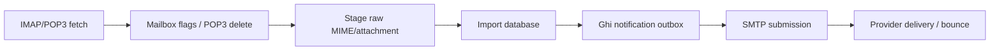
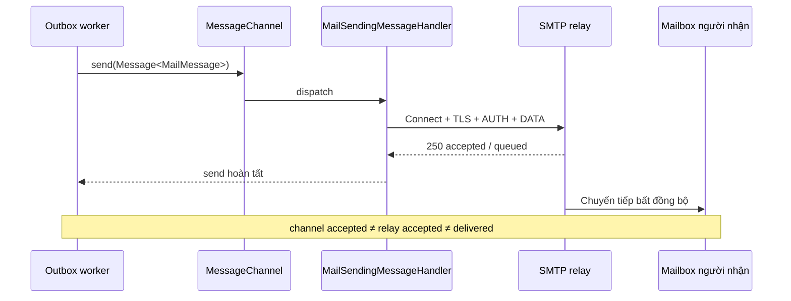
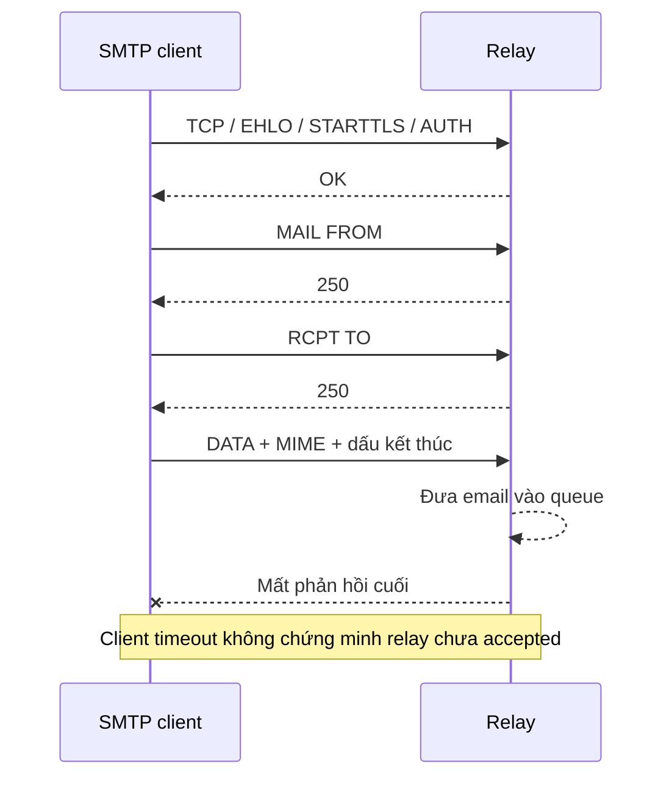
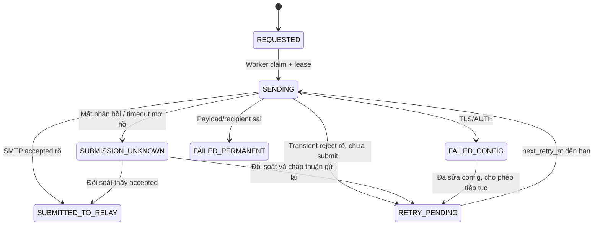
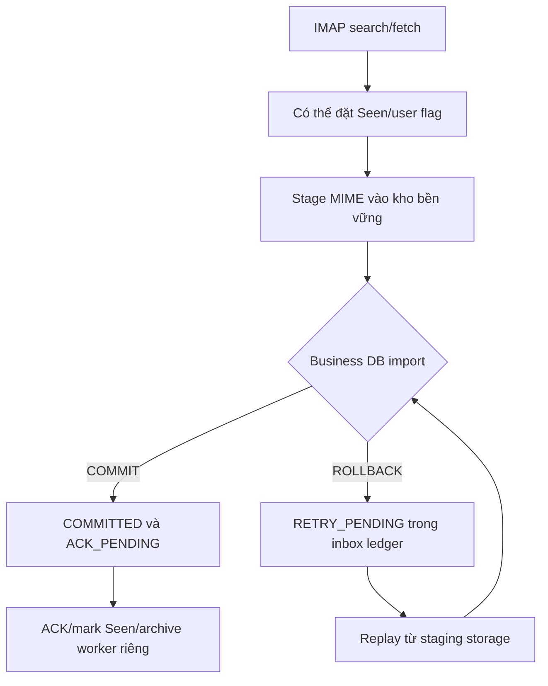
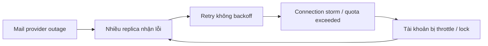
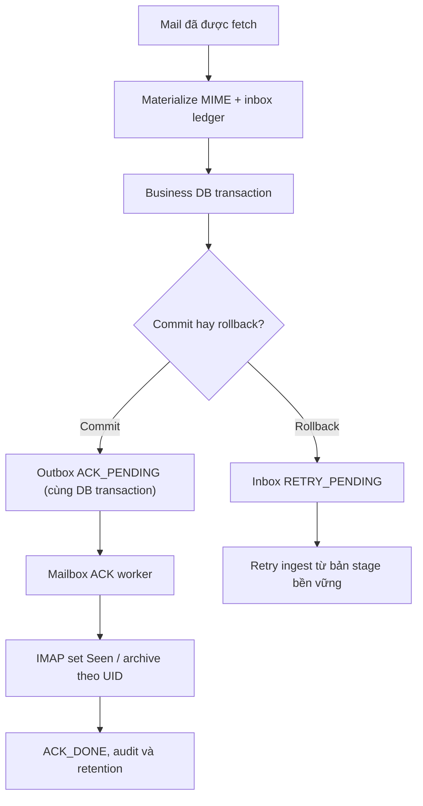

# Retry khi mail server tạm thời lỗi

## 1. Bài toán: mail provider bị gián đoạn, không được mất hoặc gửi trùng thông báo

Một dịch vụ Spring Boot nhận hóa đơn qua IMAPS, ghi database và gửi email xác nhận qua SMTP. Vào giờ cao điểm, mail provider chập chờn trong vài phút: poller không kết nối được mailbox; SMTP relay đôi khi trả mã `451`; sau khi gửi hết nội dung thư bằng lệnh `DATA`, một số worker bị timeout trước khi đọc phản hồi. Ứng dụng phải phục hồi mà **không import trùng hóa đơn, không đánh mất bản ingest, không gửi mail trùng không kiểm soát**.

“Bắt exception rồi gọi lại” là chưa đủ. Một mail request có thể thay đổi trạng thái bên ngoài ứng dụng trước khi exception xuất hiện: IMAP receiver đã gắn `\Seen` hoặc user flag; POP3 server đã xử lý yêu cầu xóa; SMTP relay đã nhận trọn thông điệp nhưng phản hồi bị mất. DB transaction và mail server **không commit nguyên tử**.

Trong **Spring Integration**, inbound adapter sử dụng `ImapMailReceiver`/`Pop3MailReceiver` qua `MailReceivingMessageSource` và poller/IMAP IDLE; outbound adapter sử dụng `MailSendingMessageHandler` với `JavaMailSender`. `RequestHandlerRetryAdvice` chỉ bảo vệ đúng đoạn handler được gắn advice, **không tự bao phủ tất cả lỗi ở source và SMTP transport**.

Bài thuộc chương **Adapter Mail** của module `SPRING_INTEGRATION_ADAPTERS` — kết nối hệ thống ngoài qua inbound/outbound adapter, gateway, poller và `MessageChannel`, thực hành hợp đồng message, lỗi và vòng đời kết nối với file, SFTP, HTTP, JMS, AMQP, Kafka và database. Retry mail phải được thiết kế cùng **idempotency, durable inbox/outbox, backoff, retry budget và reconciliation**.

### Mục tiêu

- Phân biệt lỗi tạm thời (transient), lỗi cấu hình, dữ liệu không hợp lệ và kết quả side effect **không chắc chắn**.
- Biết lúc nào retry phải đặt ở mail source, service activator, outbox worker hay provider-delivery event handler.
- Cấu hình SMTP/IMAPS/POP3S với TLS, network timeout, poller error channel và giới hạn kết nối.
- Dùng `RequestHandlerRetryAdvice` an toàn cho bước nghiệp vụ **idempotent**, tránh retry mù trên outbound SMTP.
- Thiết kế SMTP outbox và IMAP/POP3 inbox ledger có claim/lease, bounded exponential backoff, jitter, circuit breaker.
- Thực hành lỗi `4xx`/`5xx`, timeout sau `DATA`, IMAP flags, POP3 restart và crash-recovery trong sandbox.

> **Phiên bản mẫu:** Spring Integration **6.5.x**, Spring Framework 6.x, Spring Retry 2.x, Spring Boot tương thích, Java 17+ và Jakarta Mail (`jakarta.mail.*`). Địa chỉ `example.test` và secret là ví dụ. Mọi cấu hình retry phải được kiểm thử trên protocol/provider thật, không sao chép nguyên lên hộp thư production.

## 2. Retry và ranh giới remote side effect



| Điểm lỗi | Việc từ xa có thể đã xảy ra | Nếu retry cả luồng sẽ thế nào? |
| --- | --- | --- |
| TCP connect bị từ chối | Chưa có request qua kết nối đó | Có thể tăng tải provider hoặc gây account lock |
| IMAP `FETCH` dở dang | `\Seen`, user flag hoặc fallback có thể đã đổi | Thư không còn khớp search hoặc được fetch lại |
| Đã stage file, DB rollback | MIME đã lưu, nghiệp vụ chưa commit | Có thể tạo nhiều bản file/ledger |
| DB commit, ACK mailbox thất bại | Nghiệp vụ **đã thành công** | Import lại khi thấy thư chưa đọc |
| SMTP lỗi rõ ràng trước `DATA` | Mail chưa được submit bằng kết nối đó | Có thể retry nếu lỗi transient và đã phân loại chắc chắn |
| SMTP mất phản hồi sau `DATA` | Relay **có thể đã accepted** | Gửi hai email nếu submit lại ngay |
| SMTP accepted, sau đó bounce | Relay đã nhận nhưng không giao được | Đánh dấu delivered sai, bỏ qua bounce |

**Ba nguyên tắc:** (1) side effect không tự rollback khi có exception; (2) timeout không chứng minh điều gì đã hoặc chưa xảy ra bên server; (3) retry phải có một chủ sở hữu và budget rõ, không nhân tầng retry từ HTTP caller, poller, handler, broker đến outbox worker.

## 3. Phân loại lỗi: transient, permanent và ambiguous

| Nhóm | Dấu hiệu | Quyết định gợi ý |
| --- | --- | --- |
| Network trước kết nối | Connection refused, connect timeout, DNS tạm lỗi | Backoff có jitter nếu chắc chắn chưa submit |
| SMTP trả `421`/`450`/`451`/`452` | Thường là lỗi tạm thời; phụ thuộc **pha lệnh và recipient** | Lập lịch retry đúng đối tượng bị reject, tôn trọng quota |
| SMTP trả `550`/`553`/`554` | Thường là từ chối vĩnh viễn hoặc policy | Kiểm tra recipient/domain, dead-letter, không retry vô hạn |
| TLS identity | `SSLHandshakeException`, PKIX, hostname mismatch | **Fail closed**, sửa cert/CA/hostname; không trust-all |
| AUTH | SMTP `535`, IMAP login denied, OAuth token invalid | Refresh credential/token đúng policy hoặc alert |
| MIME/payload | Header sai, PDF không hợp lệ, mailbox rule reject | Quarantine/sửa dữ liệu, không retry network |
| DB transient | Deadlock, service DB unavailable | Retry bước **idempotent** sau rollback xác định |
| Kết quả remote không rõ | Timeout sau SMTP `DATA`, mất reply của IMAP `STORE`/`COPY` | `UNKNOWN` và đối soát trước lần thử mới |

Spring Integration có thể bọc exception thực trong `MessageHandlingException`. Spring Mail có `MailSendException`, `MailAuthenticationException`, `MailParseException`; Jakarta Mail có `MessagingException`, `SendFailedException`. **Tên exception một mình không luôn xác định pha SMTP**. Khi chưa thể kết luận thư chưa được relay chấp nhận, ưu tiên trạng thái **`SUBMISSION_UNKNOWN`**.

## 4. Chỉ gửi vào channel khác với SMTP relay chấp nhận, và khác delivery



- `MessageChannel.send(...)` với **`DirectChannel`** thường gọi handler đồng bộ; exception có thể truyền về caller. Với `ExecutorChannel`/queue, `send() == true` thường chỉ có nghĩa nhận để dispatch.
- `JavaMailSender.send(...)` hoàn tất không exception nghĩa quá trình SMTP submission không báo lỗi; **không** chứng minh đã vào inbox hoặc được đọc.
- Provider có thể gửi delivery/bounce/deferral event riêng; cần xác thực event và xử lý idempotent.
- SMTP **không** tự loại trùng bằng RFC `Message-ID`. Dùng cùng `Message-ID` trong retry không phải idempotency protocol.

### Vì sao `DATA` đặc biệt?



Nếu server đã từ chối explicit một `RCPT TO` trước khi gửi DATA, có thể cân nhắc thử lại người nhận đó sau khi phân loại mã SMTP. Nhưng nếu mất phản hồi cuối sau DATA, **không thể suy chắc việc gửi chưa xảy ra**. Với nhiều recipients, một số có thể accepted, số khác rejected tùy phiên SMTP và cấu hình provider (`mail.smtp.sendpartial`); retry toàn bộ một batch có thể tạo trùng một phần.

## 5. Cấu hình nền: TLS, timeout và auth trước khi retry

Nếu không giới hạn socket hoặc TLS không fail-closed, nhiều retry sẽ khuếch đại sự cố. Gradle khi dùng Spring Boot BOM tương thích:

```groovy
dependencies {
    implementation 'org.springframework.boot:spring-boot-starter-integration'
    implementation 'org.springframework.integration:spring-integration-mail'
    implementation 'org.springframework.boot:spring-boot-starter-mail'
    implementation 'org.springframework.retry:spring-retry'
}
```

SMTP submission 587 với STARTTLS **bắt buộc**:

```yaml
spring:
  mail:
    host: ${SMTP_HOST:smtp.example.test}
    port: ${SMTP_PORT:587}
    username: ${SMTP_USERNAME:notifications@example.test}
    password: ${SMTP_PASSWORD}
    protocol: smtp
    default-encoding: UTF-8
    properties:
      "[mail.smtp.auth]": true
      "[mail.smtp.starttls.enable]": true
      "[mail.smtp.starttls.required]": true
      "[mail.smtp.ssl.checkserveridentity]": true
      "[mail.smtp.connectiontimeout]": 10000
      "[mail.smtp.timeout]": 30000
      "[mail.smtp.writetimeout]": 30000
      "[mail.debug]": false
```

Với **465 implicit TLS**, dùng `mail.smtp.ssl.enable=true` và port 465 **thay thế** STARTTLS 587. IMAPS thường 993, POP3S thường 995. Với IMAP 143/POP3 110 phải bắt buộc nâng cấp STARTTLS/STLS và kiểm tra certificate. Không dùng `mail.smtp.ssl.trust=*` hoặc tắt hostname verification để retry “thành công”.

| Property | Giới hạn | Không bảo đảm |
| --- | --- | --- |
| `connectiontimeout` | TCP connect | Tổng thời gian DNS, TLS, gửi mail |
| `timeout` | Socket read | Toàn bộ workflow nằm trong hạn đó |
| `writetimeout` | Socket write | Remote side effect chưa xảy ra khi timeout |

Một số giá trị mặc định của Jakarta Mail có thể là **vô hạn**. Timeout là **giới hạn theo thao tác socket**, không thay deadline toàn job và không tự đóng mọi tài nguyên. Lấy số ví dụ làm baseline, đo latency/quota provider thực tế. Với IMAP IDLE, read timeout và `cancelIdleInterval` cần phù hợp để không ngắt lệnh IDLE liên tục.

## 6. Java DSL outbound: không gắn retry mù vào mail handler

Flow dùng `DirectChannel` để outbox worker nhận được lỗi **đồng bộ**. Không đặt `RequestHandlerRetryAdvice` lên `Mail.outboundAdapter(...)`.

```java
import org.springframework.context.annotation.Bean;
import org.springframework.context.annotation.Configuration;
import org.springframework.integration.channel.DirectChannel;
import org.springframework.integration.dsl.IntegrationFlow;
import org.springframework.integration.mail.dsl.Mail;
import org.springframework.mail.javamail.JavaMailSender;
import org.springframework.messaging.MessageChannel;

@Configuration
public class SmtpSubmissionFlow {

    @Bean
    public MessageChannel smtpSubmitRequests() {
        return new DirectChannel();
    }

    @Bean
    public IntegrationFlow smtpSubmitFlow(
            MessageChannel smtpSubmitRequests, JavaMailSender mailSender) {
        return IntegrationFlow.from(smtpSubmitRequests)
                .handle(Mail.outboundAdapter(mailSender))
                .get();
    }
}
```

`DirectChannel` có thể giữ thread worker trong thời gian SMTP/TLS và timeout. Vì vậy submit nên được kích hoạt **sau business commit** từ một outbox worker riêng, không trực tiếp trong transaction HTTP. Nếu đổi thành `ExecutorChannel`, mã bên ngoài **không được** đánh dấu `SUBMITTED_TO_RELAY` chỉ vì channel trả true.

## 7. Outbox: retry bền vững và trạng thái kết quả không chắc chắn

DB transaction sinh business event đồng thời tạo một outbox job; worker claim và submit SMTP **ngoài DB transaction**. Một schema ý tưởng:

```text
notification_id            // unique, ổn định theo business event + recipient
business_event_id, tenant_id, recipient_id
sender_policy, template_id, payload_reference
attachment_storage_reference
status: REQUESTED | SENDING | SUBMITTED_TO_RELAY
      | RETRY_PENDING | SUBMISSION_UNKNOWN
      | FAILED_CONFIG | FAILED_PERMANENT
attempt_count, next_retry_at, lease_until
last_error_category, provider_submission_id
created_at, updated_at
```



Worker phải **claim nguyên tử** và dùng lease/fencing để không có hai worker đồng thời gửi cùng job. Unique constraint ngăn **tạo nhiều job cho một sự kiện**; nhưng không tự ngăn hai SMTP submissions khi worker chết **sau relay accepted, trước DB status update**. Nếu provider có idempotency API hoặc submission tracking, tận dụng theo hợp đồng; SMTP thông thường không cung cấp exactly-once.

### Code mẫu: một lượt submit qua flow Spring Integration

```java
import java.util.Optional;

import org.springframework.beans.factory.annotation.Qualifier;
import org.springframework.mail.MailAuthenticationException;
import org.springframework.mail.MailParseException;
import org.springframework.mail.SimpleMailMessage;
import org.springframework.messaging.MessageChannel;
import org.springframework.messaging.support.MessageBuilder;
import org.springframework.stereotype.Component;

record MailOutboxJob(
        String id, String sender, String recipient,
        String subject, String plainText) { }

interface MailOutboxStore {
    // Phải claim nguyên tử, có lease + attempt_count ở DB transaction ngắn.
    Optional<MailOutboxJob> claimReady();
    void markSubmitted(String id);
    void markRetryPending(String id);
    void markConfigFailure(String id);
    void markPermanentFailure(String id);
    void markSubmissionUnknown(String id);
}

@Component
public class MailOutboxDispatcher {

    private final MessageChannel smtpChannel;
    private final MailOutboxStore store;

    public MailOutboxDispatcher(
            @Qualifier("smtpSubmitRequests") MessageChannel smtpChannel,
            MailOutboxStore store) {
        this.smtpChannel = smtpChannel;
        this.store = store;
    }

    public void submitOneReadyJob() {
        Optional<MailOutboxJob> claimed = store.claimReady();
        if (claimed.isEmpty()) {
            return;
        }
        MailOutboxJob job = claimed.get();

        // Địa chỉ và nội dung đã được kiểm tra quyền ở bước tạo job.
        SimpleMailMessage mail = new SimpleMailMessage();
        mail.setFrom(job.sender());
        mail.setTo(job.recipient());
        mail.setSubject(job.subject());
        mail.setText(job.plainText());

        try {
            boolean dispatched = smtpChannel.send(
                    MessageBuilder.withPayload(mail)
                            .setHeader("notificationId", job.id())
                            .build());
            if (!dispatched) {
                store.markRetryPending(job.id()); // Channel chưa dispatch.
                return;
            }
            store.markSubmitted(job.id()); // Chỉ SUBMITTED, không DELIVERED.
        } catch (RuntimeException error) {
            // Spring Integration có thể bọc MailException trong cause chain.
            if (hasCause(error, MailAuthenticationException.class)) {
                store.markConfigFailure(job.id());
            } else if (hasCause(error, MailParseException.class)) {
                store.markPermanentFailure(job.id());
            } else {
                // Không biết chắc relay đã accepted DATA hay chưa.
                store.markSubmissionUnknown(job.id());
            }
        }
    }

    private static boolean hasCause(
            Throwable error, Class<? extends Throwable> type) {
        for (Throwable e = error; e != null; e = e.getCause()) {
            if (type.isInstance(e)) {
                return true;
            }
            if (e == e.getCause()) {
                break;
            }
        }
        return false;
    }
}
```

**Giới hạn của code:** `MailOutboxStore` là hợp đồng DB giả lập. `claimReady()`, các update trạng thái, unique key, lease/fencing và retry scheduler phải được triển khai/kiểm thử. Nếu `markSubmitted` ném lỗi sau SMTP success, job vẫn có thể ở trạng thái cũ: **đó cũng là một kết quả cần reconciliation**. Phân loại mặc định ở ví dụ cố ý **bảo thủ**; classifier production chỉ chuyển một số lỗi sang `RETRY_PENDING` khi có bằng chứng chắc chắn **chưa submit**. `SimpleMailMessage` chỉ là plain text; với attachment/HTML dùng `MimeMessageHelper`/`MimeMailMessage` và reference tài nguyên còn hợp lệ sau restart.

## 8. Capped exponential backoff và full jitter

Đối với các lỗi transient **được chứng minh chưa tạo side effect**, lập lịch theo `next_retry_at` trong DB:

```text
baseDelay = 2 giây
maxDelay  = 60 giây
attempt 1 -> cap 2 giây
attempt 2 -> cap 4 giây
attempt 3 -> cap 8 giây
attempt 4 -> cap 16 giây
attempt 5 -> cap 32 giây
attempt 6+ -> cap 60 giây
full jitter: delay = ngẫu nhiên trong [0, cap]
```

```java
import java.time.Duration;
import java.time.Instant;
import java.util.concurrent.ThreadLocalRandom;

public final class MailRetrySchedule {

    private static final long BASE_MS = 2_000;
    private static final long MAX_MS = 60_000;

    public static Instant nextAttemptAt(int attempt, Instant now) {
        if (attempt < 1) {
            throw new IllegalArgumentException("attempt >= 1");
        }
        int shift = Math.min(attempt - 1, 12);
        long cap = Math.min(MAX_MS, BASE_MS * (1L << shift));
        long delay = ThreadLocalRandom.current().nextLong(0, cap + 1);
        return now.plus(Duration.ofMillis(delay));
    }
}
```

Full jitter có thể trả delay gần **0**; nếu policy yêu cầu một sàn tối thiểu, dùng equal/decorrelated jitter thay thế và test bằng random có seed. `maxAttempts=8`, `maxAge=24h`, giới hạn theo tenant/provider là ngưỡng **minh họa**, không phải chuẩn chung. Khi quá budget, chuyển `FAILED_PERMANENT`/**manual review** theo loại lỗi, không để job retry bất tận. Tôn trọng provider throttling và không tự áp HTTP `Retry-After` như một trường luôn có trong SMTP.

**Đừng dùng `Thread.sleep(60_000)` trong tất cả SMTP worker**: nó giữ thread và không còn lịch khi JVM crash. Lưu `next_retry_at` bền vững, scheduler lấy job đến hạn, có global/per-provider concurrency cap.

## 9. `RequestHandlerRetryAdvice`: chỉ retry phần nghiệp vụ idempotent

`RequestHandlerRetryAdvice` là advice dành cho **message handler**; trong Spring Integration **6.5** nó dùng Spring Retry `RetryTemplate`, `RetryPolicy`, `BackOffPolicy` và `RecoveryCallback`. Một tình huống phù hợp: raw MIME đã được stage bền vững, DB importer có **unique business key** và lỗi import thuộc nhóm transient. Retry ở đây **không fetch lại mail** và **không submit SMTP lại**.

```java
import java.util.Map;

import org.springframework.context.annotation.Bean;
import org.springframework.context.annotation.Configuration;
import org.springframework.integration.dsl.IntegrationFlow;
import org.springframework.integration.handler.advice.RequestHandlerRetryAdvice;
import org.springframework.retry.backoff.ExponentialBackOffPolicy;
import org.springframework.retry.policy.SimpleRetryPolicy;
import org.springframework.retry.support.RetryTemplate;

record StagedMailJob(String ingestId, String storageKey, String invoiceId) { }

interface IdempotentInboxImporter {
    // Unique invoice key + database transaction.
    void importOnce(StagedMailJob job);
}

class TransientInboxDbException extends RuntimeException {
    TransientInboxDbException(String message, Throwable cause) {
        super(message, cause);
    }
}

@Configuration
public class DurableInboxImportFlow {

    @Bean
    public RequestHandlerRetryAdvice safeDbImportRetry() {
        Map<Class<? extends Throwable>, Boolean> retryable =
                Map.of(TransientInboxDbException.class, true);
        // Tối đa 3 lời gọi TỔNG, kể cả lần đầu; traverse cause chain.
        SimpleRetryPolicy policy = new SimpleRetryPolicy(3, retryable, true);

        ExponentialBackOffPolicy backoff = new ExponentialBackOffPolicy();
        backoff.setInitialInterval(500L);
        backoff.setMultiplier(2.0);
        backoff.setMaxInterval(2_000L);

        RetryTemplate template = new RetryTemplate();
        template.setRetryPolicy(policy);
        template.setBackOffPolicy(backoff);

        RequestHandlerRetryAdvice advice = new RequestHandlerRetryAdvice();
        advice.setRetryTemplate(template);
        // Không đặt recovery callback: lỗi hết attempts được ném lại,
        // caller durable phải lưu RETRY_PENDING hoặc dead-letter.
        return advice;
    }

    @Bean
    public IntegrationFlow importStagedMail(
            IdempotentInboxImporter importer,
            RequestHandlerRetryAdvice safeDbImportRetry) {
        return IntegrationFlow.from("durableInboxJobs")
                .handle(importer, "importOnce",
                        endpoint -> endpoint.advice(safeDbImportRetry))
                .get();
    }
}
```

**Chú ý phạm vi:** `StagedMailJob` là ID/reference đủ để tìm lại dữ liệu sau restart, không phải raw `MimeMessage`. `SimpleRetryPolicy(3,...,true)` chỉ thử lại exception do ứng dụng phân loại. `ExponentialBackOffPolicy` chặn thread giữa các attempt, nên chỉ phù hợp **số lần ít và chờ ngắn**; retry hàng giờ phải dùng DB queue/`next_retry_at`. Nếu hết retry mà không có recovery callback, lỗi được ném về nguồn: nguồn đó **phải là durable owner**, vì một `DirectChannel` trong RAM không tự đảm bảo redelivery.

### `ErrorMessageSendingRecoverer` có thay thế outbox không?

Không. Có thể cấu hình `RequestHandlerRetryAdvice#setRecoveryCallback(new ErrorMessageSendingRecoverer(recoveryChannel))` để gửi `ErrorMessage` sau khi exhausted. Nhưng **gửi error message chỉ là chuyển lỗi**, không tự lưu DB/DLQ và có thể khiến upstream coi handler đã recovered. Recovery consumer phải cập nhật trạng thái job bền vững; nếu muốn caller nhận exception, tránh recovery callback nuốt lỗi ngoài ý muốn.

**Stateful retry** có thể thích hợp nếu **nguồn ngoài thật sự redeliver** cùng business event, chẳng hạn JMS/Kafka. Spring Integration 6.5 dùng `RetryStateGenerator`/`SpelExpressionRetryStateGenerator` để gắn retry state với message identity. Nó không tạo lại một IMAP mail đã mất khỏi tập search sau khi receiver cập nhật flags.

## 10. IMAP poller: lỗi connect/search/fetch xảy ra trước handler

`RequestHandlerRetryAdvice` trên importer **không bao phủ** lỗi trong `MailReceivingMessageSource.receive()` xảy ra **trước khi có Spring Message**. Khi poller connect/search/fetch thất bại, lỗi nên được gửi tới **poller error channel**, quan sát theo provider/mailbox và điều chỉnh nhịp polling.

```yaml
app:
  mail:
    inbox-url: ${IMAP_URI:imaps://invoices%40example.test@imap.example.test:993/INBOX}
    username: ${IMAP_USERNAME:invoices@example.test}
    password: ${IMAP_PASSWORD}
```

```java
import java.util.Properties;

import jakarta.mail.Authenticator;
import jakarta.mail.PasswordAuthentication;

import org.springframework.beans.factory.annotation.Value;
import org.springframework.context.annotation.Bean;
import org.springframework.context.annotation.Configuration;
import org.springframework.context.annotation.Profile;
import org.springframework.integration.mail.ImapMailReceiver;

@Configuration
@Profile("mail-imap")
public class ResilientImapReceiverConfig {

    @Bean
    public ImapMailReceiver resilientImapReceiver(
            @Value("${app.mail.inbox-url}") String inboxUrl,
            @Value("${app.mail.username}") String username,
            @Value("${app.mail.password}") String password) {

        ImapMailReceiver receiver = new ImapMailReceiver(inboxUrl);
        receiver.setJavaMailAuthenticator(new Authenticator() {
            @Override
            protected PasswordAuthentication getPasswordAuthentication() {
                return new PasswordAuthentication(username, password);
            }
        });

        Properties props = new Properties();
        props.setProperty("mail.store.protocol", "imaps");
        props.setProperty("mail.imaps.ssl.enable", "true");
        props.setProperty("mail.imaps.ssl.checkserveridentity", "true");
        props.setProperty("mail.imaps.connectiontimeout", "10000");
        props.setProperty("mail.imaps.timeout", "30000");
        props.setProperty("mail.imaps.writetimeout", "30000");
        props.setProperty("mail.imaps.peek", "true");
        props.setProperty("mail.debug", "false");
        receiver.setJavaMailProperties(props);

        receiver.setShouldDeleteMessages(false);
        receiver.setShouldMarkMessagesAsRead(false);
        receiver.setMaxFetchSize(1);
        receiver.setSimpleContent(false);
        receiver.setAutoCloseFolder(false);
        return receiver;
    }
}
```

**Ba điều kiện cần kiểm soát:** password/token lấy từ secret runtime, không nhúng URI; TLS hostname verification/timeout **không bị tắt** khi outage; `shouldMarkMessagesAsRead(false)`/`peek=true` không có nghĩa mailbox hoàn toàn bất biến (user flag/fallback vẫn có thể được đặt). Với `autoCloseFolder(false)`, downstream phải đóng `closeableResource` sau khi đọc raw MIME.

### Java DSL: đưa lỗi polling tới error channel

```java
import org.springframework.beans.factory.annotation.Qualifier;
import org.springframework.context.annotation.Bean;
import org.springframework.context.annotation.Configuration;
import org.springframework.context.annotation.Profile;
import org.springframework.integration.channel.DirectChannel;
import org.springframework.integration.dsl.IntegrationFlow;
import org.springframework.integration.dsl.Pollers;
import org.springframework.integration.mail.ImapMailReceiver;
import org.springframework.integration.mail.dsl.Mail;
import org.springframework.messaging.MessageChannel;
import org.springframework.messaging.support.ErrorMessage;

interface PollFailureMonitor {
    // Phân loại, metric, alert, không ghi raw MIME/secret.
    void record(Throwable cause);
}

interface MimeStagingHandler {
    void stage(Object rawMailPayload);
}

@Configuration
@Profile("mail-imap")
public class ImapPollingWithErrorsFlow {

    @Bean
    public MessageChannel mailPollErrors() {
        return new DirectChannel();
    }

    @Bean
    public IntegrationFlow inboundMailFlow(
            ImapMailReceiver resilientImapReceiver,
            MimeStagingHandler mimeStagingHandler) {
        return IntegrationFlow.from(
                        Mail.imapInboundAdapter(resilientImapReceiver),
                        endpoint -> endpoint.id("imapMailPoller")
                                .poller(Pollers.fixedDelay(15_000)
                                        .maxMessagesPerPoll(1)
                                        .errorChannel("mailPollErrors")))
                .handle(mimeStagingHandler, "stage")
                .get();
    }

    @Bean
    public IntegrationFlow mailPollErrorFlow(
            @Qualifier("mailPollErrors") MessageChannel channel,
            PollFailureMonitor monitor) {
        return IntegrationFlow.from(channel)
                .handle(ErrorMessage.class, (error, headers) -> {
                    monitor.record(error.getPayload());
                    return null;
                })
                .get();
    }
}
```

`PollerSpec#errorChannel("mailPollErrors")` áp dụng cho lỗi của **scheduled polling task**. `ErrorMessage` mang exception, nhưng nếu source lỗi **trước khi tạo message**, có thể **không có failed mail payload** để retry. `PollFailureMonitor` phải được dự án hiện thực để alert/backoff/giới hạn poll/reconciliation; chỉ log lỗi rồi bỏ qua không tạo recovery. `MimeStagingHandler` là interface minh họa, không phải một framework class. Production có thể thay bằng handler có kiểm tra payload và quản lý IMAP folder như mục 11.

## 11. Đọc MIME khi folder còn mở và luôn đóng tài nguyên

Nếu `autoCloseFolder(false)` và **không có header mapper**, payload thường là `MimeMessage`, kèm header `IntegrationMessageHeaderAccessor.CLOSEABLE_RESOURCE`. Mọi MIME part/attachment có thể lazy-load; không gửi raw MIME qua executor/JMS/Kafka rồi đọc sau khi folder đóng.

```java
import java.io.Closeable;
import java.io.IOException;

import jakarta.mail.MessagingException;
import jakarta.mail.internet.MimeMessage;

import org.springframework.integration.StaticMessageHeaderAccessor;
import org.springframework.messaging.Message;
import org.springframework.messaging.MessageHandler;
import org.springframework.messaging.MessageHandlingException;

public final class DurableMailStagingHandler implements MessageHandler {

    private final RawMailIngestStore ingestStore;

    public DurableMailStagingHandler(RawMailIngestStore ingestStore) {
        this.ingestStore = ingestStore;
    }

    @Override
    public void handleMessage(Message<?> message) {
        Closeable resource =
                StaticMessageHeaderAccessor.getCloseableResource(message);
        try (Closeable folder = resource == null ? () -> { } : resource) {
            if (!(message.getPayload() instanceof MimeMessage mime)) {
                throw new IllegalArgumentException("Expected MimeMessage");
            }
            // Lưu đủ raw MIME/attachment với quota và ledger bền vững.
            ingestStore.stageOnce(mime);
        } catch (MessagingException | IOException ex) {
            throw new MessageHandlingException(
                    message, "IMAP staging hoặc đóng folder thất bại", ex);
        }
    }
}

interface RawMailIngestStore {
    void stageOnce(MimeMessage mime) throws MessagingException, IOException;
}
```

`RawMailIngestStore` là hợp đồng do ứng dụng cung cấp: giới hạn MIME depth, số part, attachment bytes, lưu theo random storage key, không tin filename sender. Sau khi stage xong mới gửi `StagedMailJob` sang durable queue. `MimeMessage.getMessageID()` có thể thiếu/trùng/giả; IMAP UID cần đi cùng folder và UIDVALIDITY, còn business invoice key mới chặn cùng hóa đơn từ nhiều thư.

Ví dụ `DurableMailStagingHandler` có thể thay interface `MimeStagingHandler` ở mục 10; chúng mô tả **cùng một giai đoạn**, không phải hai handler phải chạy nối tiếp.

## 12. IMAP flags: retry nguồn và retry nghiệp vụ không đồng nhất

Spring Integration IMAP receiver tìm mail theo `SearchTermStrategy` và có thể đánh dấu `\Seen` khi `shouldMarkMessagesAsRead(true)`. Khi server thiếu `\Recent`, receiver còn có thể gắn user flag mặc định `spring-integration-mail-adapter`; nếu không có user flags, có thể fallback sang `\Flagged`. Từ Spring Integration 6.4 có `setFlaggedAsFallback(false)`, nhưng tắt fallback **không biến IMAP thành queue có ACK transaction**.

Một kịch bản cần kiểm thử:

1. Receiver chọn `invoice-0042` từ INBOX và fetch MIME.
2. Receiver/JavaMail có thể đặt flag trước khi DB import commit.
3. DB importer ném lỗi do deadlock. Transaction DB rollback.
4. Poll kế tiếp không nhất thiết tìm lại email: `SearchTerm` có thể loại mail đã có flags.



Đừng cố xóa flags hàng loạt để buộc poller fetch lại: điều đó có thể tạo ra nhiều bản sao và đua trạng thái giữa các client/replica. Với mail **chưa được stage bền vững** trước crash, cần job **redrive/scan** theo mailbox/UID và chính sách có audit, chứ không tuyên bố sẽ được retry tự động.

### Inbox ledger tối thiểu

```text
mailbox_account, folder_name, uid_validity, uid
message_id, raw_mime_storage_key, content_sha256
partner_id, business_invoice_id, document_version
status: RECEIVED | INGESTED | RETRY_PENDING
      | COMMITTED | ACK_PENDING | QUARANTINED
attempt_count, next_retry_at, last_error_code
created_at, updated_at
```

IMAP UID có ý nghĩa trong phạm vi `(mailbox, folder, UIDVALIDITY)`. UID/UIDVALIDITY cần được đọc khi folder còn mở; sau khi MOVE, folder đích có UID khác. Header `Message-ID` có thể vắng mặt/trùng/giả; khóa nghiệp vụ như `(partner_id, business_invoice_id, version)` mới chặn **cùng hóa đơn được gửi qua hai email khác nhau**.

## 13. POP3: mail vẫn ở server có thể được lấy lại sau restart

POP3 không có `\Seen` và IMAP IDLE. `Pop3MailReceiver#setShouldDeleteMessages(false)` giữ mail trên server, nhưng sau khi restart một session khác có thể fetch lại các mail đã từng trả về. `true` có thể làm mail bị xóa **trước khi downstream commit**. Vì vậy POP3 ingestion phải có unique key và durable staging nếu cần độ tin cậy.

Mẫu receiver dùng POP3S cổng 995 là **phương án thay thế** cho IMAPS:

```java
import java.util.Properties;

import jakarta.mail.Authenticator;
import jakarta.mail.PasswordAuthentication;

import org.springframework.integration.mail.Pop3MailReceiver;

// Trích đoạn đặt trong một class/configuration phù hợp.
public static Pop3MailReceiver createPop3Receiver(
        String trustedUri, String username, String password) {

    Pop3MailReceiver receiver = new Pop3MailReceiver(trustedUri);
    receiver.setJavaMailAuthenticator(new Authenticator() {
        @Override
        protected PasswordAuthentication getPasswordAuthentication() {
            return new PasswordAuthentication(username, password);
        }
    });

    Properties props = new Properties();
    props.setProperty("mail.store.protocol", "pop3s");
    props.setProperty("mail.pop3s.ssl.enable", "true");
    props.setProperty("mail.pop3s.ssl.checkserveridentity", "true");
    props.setProperty("mail.pop3s.connectiontimeout", "10000");
    props.setProperty("mail.pop3s.timeout", "30000");
    props.setProperty("mail.pop3s.writetimeout", "30000");
    receiver.setJavaMailProperties(props);

    receiver.setShouldDeleteMessages(false);
    receiver.setMaxFetchSize(1);
    return receiver;
}
```

`trustedUri` phải là URI do cấu hình tin cậy cấp (ví dụ `pop3s://...:995/INBOX`), không cho request HTTP tự ý chỉ định host. Với POP3, **không** sao chép `autoCloseFolder(false)` của IMAP; phải kiểm thử khả năng materialize MIME khi session hợp lệ. Lệnh POP3 `DELE` thường hoàn tất xóa ở giai đoạn `QUIT`; nếu reply bị mất, không tự kết luận mail chắc chắn còn hoặc đã xóa. `UIDL` (nếu provider hỗ trợ) giúp nhận diện trong maildrop, nhưng không thay business ID.

## 14. IMAP IDLE: reconnect là vấn đề khác so với job retry

`ImapIdleChannelAdapter` lắng nghe thay đổi mailbox qua IMAP IDLE **không dùng poller**. Kết nối có thể mất âm thầm; `ImapMailReceiver#setCancelIdleInterval(...)` (mặc định **120 giây**) giúp làm mới IDLE. Lựa chọn `mail.imaps.timeout` phải phù hợp với IDLE/cancel interval và hành vi provider. Áp read timeout ngắn của một poller sang IDLE có thể tạo reconnect liên tục.

Spring Integration phát `ImapIdleChannelAdapter.ImapIdleExceptionEvent` khi IDLE gặp exception; ứng dụng có thể nghe bằng `ApplicationListener` hoặc `@EventListener` để ghi metric/alert và theo dõi thời điểm kết nối hồi phục. **Event lỗi này không chứa một bản MIME đã lưu bền vững để tự động replay**. Sau outage dài, cần quét/đối soát các thư xuất hiện trong khoảng mất kết nối bằng UID/ledger.

Không đồng thời bật IMAP polling và IDLE trên cùng folder nếu không có ownership rõ ràng: hai receiver có thể thấy cùng mail hoặc cập nhật flags của nhau. Một mail source owner với durable staging rồi scale worker xử lý downstream thường dễ kiểm soát hơn.

## 15. Retry budget, circuit breaker và rate-limit theo provider

Khi provider outage, tăng concurrency và retry ngay lập tức có thể **khuếch đại** sự cố:



Một chính sách vận hành có thể gồm:

| Cơ chế | Mục tiêu | Triển khai/thận trọng |
| --- | --- | --- |
| **Capped backoff + jitter** | Dàn tải trong thời gian provider gián đoạn | `next_retry_at` bền vững, tránh đồng bộ tất cả workers |
| **Retry budget** | Không lặp vô hạn | Giới hạn attempts và tuổi job theo SLA/nguyên nhân |
| **Circuit breaker** | Ngắt truy cập khi provider đã được xác định unavailable | Half-open probe có giới hạn; không nuốt job chưa xử lý |
| **Rate limiter** | Tôn trọng quota thư và kết nối | Giới hạn theo tenant/provider; đặc biệt SMTP attachment lớn |
| **Bulkhead** | Provider A không làm hết thread provider B | Executor/connection pool/cap riêng |
| **Dead-letter/quarantine** | Tách lỗi permanent/content invalid | Ghi nguyên nhân đã chuẩn hóa, cho phép review/replay hợp lệ |
| **Mailbox owner/lease** | Tránh hai replica cùng thay flags | Một ingestion owner hoặc phân chia folder/tenant rõ ràng |

Spring Integration có `RequestHandlerCircuitBreakerAdvice` và `RateLimiterRequestHandlerAdvice` ở **handler level**, nhưng chúng không tự bao phủ mọi lỗi connect **trong mail source**. Đối với mail polling, cơ chế `PollSkipAdvice`/`SimplePollSkipStrategy` hoặc scheduler/circuit gate do ứng dụng quản lý có thể **bỏ qua lượt poll khi provider đang outage**. Phải ghi metric số poll bị skip, health provider và thời điểm probe tiếp; skip không đồng nghĩa data đã được nhận hoặc ACK.

### Nhiều lớp retry gây “retry multiplication”

Ví dụ HTTP caller thử 3 lần × broker redelivery 4 lần × handler retry 3 lần × SMTP worker thử 5 lần = có thể lên tới **180 lần thực hiện** một thao tác khi các lớp không phối hợp. Mỗi lớp phải có contract rõ:

- **HTTP/API:** lưu một business event/outbox duy nhất bằng idempotency key; trả job ID, không gửi SMTP trực tiếp nhiều lần.
- **Broker:** durable redelivery theo message key; consumer import idempotent.
- **Handler advice:** số lần **ngắn** cho lỗi đã phân loại, không dùng cho mọi side effect.
- **Mail worker:** long-term retry bền vững sau khi phân biệt `RETRY_PENDING` và `UNKNOWN`.
- **Provider event processor:** chống trùng bounce/delivery events, không tạo lại job gửi chỉ vì một callback.

## 16. Phân biệt retry stateless và stateful

`RequestHandlerRetryAdvice` trong Spring Integration 6.5 hỗ trợ:

| Kiểu | Cách hoạt động | Phù hợp | Không phù hợp |
| --- | --- | --- | --- |
| **Stateless** | Handler chạy lại **trong cùng lời gọi**, có backoff nếu cấu hình | DB operation idempotent, transient failure ngắn | Outage SMTP dài, HTTP thread nhạy SLA |
| **Stateful** | Ném lỗi để **upstream thực sự redeliver**, giữ retry state theo định danh ổn định | JMS/Kafka có redelivery/rollback và stable message key | Mail source đã thay flags, không có đảm bảo redelivery |
| **DB scheduled retry** | Lưu attempts, `next_retry_at` và payload reference | SMTP outbox, inbox replay, provider outage dài | Nếu store không durable/claim không atomic |

Stateful retry **không phải** một checkbox biến bất kỳ source thành at-least-once. Nếu nguồn gốc là IMAP và email không còn trong default `SearchTermStrategy`, không có upstream nào tự phát lại message theo retry state. Vì vậy mail ingestion muốn chịu crash phải lưu đủ nội dung/metadata rồi mới giao durable job cho hệ thống khác.

## 17. Transaction synchronization và ACK mailbox sau commit

Spring Integration hỗ trợ `TransactionSynchronizationFactory` và các callback **after commit/after rollback** cho một số mail inbound adapter. Có thể dùng chúng để điều phối thao tác sau khi DB hoàn thành, nhưng **không tạo transaction phân tán** giữa IMAP/POP3 và database:



**Hai cửa sổ crash cần mô tả chính xác:**

1. **DB commit nhưng JVM chết trước callback after-commit:** mail có thể vẫn unread hoặc chưa được move; khi nhận lại, unique business key phải ngăn import lần hai. Nếu muốn đảm bảo ACK vẫn chạy, hãy ghi job `ACK_PENDING` **trong cùng DB transaction** và để worker khác thực hiện.
2. **Mail receiver gắn Seen/user flag trước DB commit rồi JVM chết:** mail có thể không còn xuất hiện trong default search dù DB chưa có dữ liệu. Việc gắn after-rollback callback không bảo đảm callback chạy nếu JVM bị kill. Cần durable ingest hoặc cơ chế redrive có kiểm soát.

Khi ACK bằng IMAP, nên xác định mail theo `(account, folder, UIDVALIDITY, UID)` rồi đọc lại trạng thái trước khi set `\Seen` hoặc archive. Đừng tìm bằng `Subject` hoặc `Message-ID` rồi xóa “bản tương tự”. `\Deleted` là cờ chờ xóa; `EXPUNGE` hoặc `folder.close(true)` có thể xóa **mọi mail đã bị đánh dấu Deleted trong folder**, bao gồm mail do client khác gắn. Xóa thực tế cần retention worker/folder có ownership riêng và audit.

**Mail transport không phải transaction resource** tham gia 2PC của DB: không hứa “commit DB và SMTP cùng lúc”. Sự khác nhau giữa `ACK_PENDING`, `SUBMITTED_TO_RELAY` và `DELIVERED` phải được duy trì trong trạng thái nghiệp vụ.

## 18. SMTP partial recipients và tín hiệu provider dễ gây hiểu nhầm

Nếu gửi một mail tới nhiều địa chỉ, cần chú ý `jakarta.mail.SendFailedException` và chain của `SMTPAddressFailedException`/provider:

- Khi `mail.smtp.sendpartial=false` (**mặc định của Angus SMTP**), nếu một địa chỉ không hợp lệ ở bước `RCPT TO`, provider có thể abort trước khi gửi nội dung cho **toàn bộ** recipients của message đó.
- Khi `mail.smtp.sendpartial=true`, provider có thể gửi nội dung cho những địa chỉ được chấp nhận, **đồng thời ném `SendFailedException`** để báo những địa chỉ thất bại. Nếu retry lại tất cả, người đã nhận có thể nhận thư lần hai.
- `mail.smtp.reportsuccess=true` có thể khiến provider gắn thêm exception thông tin thành công theo địa chỉ và ném `SendFailedException` dù gửi thành công: không được đồng nhất **mọi exception** với **mọi recipient đều thất bại**.
- Transport event tên `MESSAGE_DELIVERED` của Jakarta Mail thường nói về **submission tới SMTP host**, không phải đã vào mailbox người nhận; đừng đặt nhãn metric `mail_delivered_total` cho event đó.

Với các email quan trọng, cân nhắc **một outbox job cho một recipient** (cùng template và content reference) thay vì một email có 50 người nhận. Việc đó đơn giản hóa correlation và tránh gửi trùng một phần; đổi lại phải tính quota và chi phí provider. Nếu bắt buộc gửi batch, lưu trạng thái **per-recipient** và chỉ retry những recipient được xác định bị từ chối, không suy kết quả từ một boolean chung.

## 19. Reconciliation khi kết quả không chắc chắn

Reconciliation không có nghĩa “gửi lại sau 30 giây”. Đây là **quy trình điều tra bằng chứng** theo từng protocol và provider:

| Tình huống | Bằng chứng cần đối soát | Quyết định |
| --- | --- | --- |
| SMTP mất phản hồi sau `DATA` | Provider submission API, relay logs, submission reference, mail audit | Nếu accepted: ghi `SUBMITTED_TO_RELAY`; nếu chắc chắn chưa: cho phép retry |
| SMTP provider không có API trạng thái | Log server, người vận hành, tính nghiêm trọng của duplicate | Chấp nhận quy trình manual review/duplicate risk, không tự khẳng định exactly-once |
| IMAP `STORE Seen` timeout | Đọc lại flags theo UID/UIDVALIDITY | Nếu flag đã set: ACK_DONE; chưa set: có thể thử lại |
| IMAP `COPY` timeout | Xem source và target folder, identity/provenance | Không copy lại nếu target đã có bản hợp lệ |
| POP3 delete/QUIT mất phản hồi | Kiểm tra maildrop/UIDL khi có thể | Không coi mail đã hoặc chưa xóa nếu chưa xác minh |
| DB state update lỗi sau SMTP success | Outbox lease/state, provider log và timeline | Không gửi lần thứ hai chỉ để sửa DB status |

Một provider có thể không cho truy vấn email theo RFC `Message-ID`; việc tìm mailbox bên nhận không chứng minh tuyệt đối trạng thái toàn bộ recipient. Reconciliation phải thừa nhận **mức độ chắc chắn của bằng chứng**. Có thể dùng `manual-review` cho trường hợp không phân giải được mà gửi trùng có tác hại lớn.

### Quy trình recovery sau outage kéo dài

1. Kiểm tra trạng thái provider, credentials và TLS; dừng các retry loop đang khuếch đại sự cố.
2. Đọc outbox/inbox ledger để phân nhóm `RETRY_PENDING`, `UNKNOWN`, `FAILED_CONFIG`, `INGESTED` chưa import, `ACK_PENDING`.
3. Đối soát `UNKNOWN` trước; không trộn vào danh sách “job đến hạn” mặc định.
4. Cho phép retry có rate limit đối với nhóm đã phân loại transient/side-effect safe; phân tán jitter theo tenant/provider.
5. Chạy business importer idempotent từ ingest store, không đòi cùng mail phải còn unread.
6. Chạy ACK/retention riêng sau DB commit; kiểm tra UIDVALIDITY và quyền folder.
7. Theo dõi backlog, tuổi job cũ nhất, bounce và tỷ lệ duplicate; chỉ mở rộng concurrency khi provider khỏe.

## 20. Observability và alerting cho retry mail

| Metric | Nội dung đo | Cảnh báo khi |
| --- | --- | --- |
| `mail_connect_failure_total{provider,reason}` | Kết nối SMTP/IMAP/POP3 lỗi | Tăng nhanh theo provider |
| `mail_tls_failure_total` | Handshake/certificate/hostname fail | Bất kỳ lỗi liên tục sau rotation |
| `mail_auth_failure_total` | SMTP AUTH/IMAP login từ chối | Spike hoặc một credential bị khóa |
| `mail_poll_attempt_total` | Số poll thực hiện | Không tăng dù ingestion phải chạy |
| `mail_poll_error_total{reason}` | Lỗi nguồn trước message | Tỷ lệ lỗi vượt ngưỡng |
| `mail_inbox_staged_total` | MIME đã được stage bền vững | Không tăng dù mailbox có thư |
| `mail_import_committed_total` | Business transaction thành công | Chênh lệch lớn với staged |
| `mail_outbox_retry_pending` | Job đã xác nhận có thể retry | Backlog/tuổi job tăng |
| `mail_submission_unknown` | SMTP gửi không rõ kết quả | Bất kỳ tồn đọng vượt SLA |
| `mail_submit_relay_accepted_total` | Submission completed | Không tăng khi outbox có việc |
| `mail_bounced_total` | Provider báo giao thất bại | Tăng theo sender/template |
| `mail_open_folders` và `mail_active_connections` | Vòng đời mail resource | Rò rỉ hoặc vượt quota |
| `mail_retry_attempt_total{reason}` | Số lần retry ở một chủ sở hữu | Vượt budget hoặc nhảy tầng |

**Đừng ghi `mail_delivered_total` cho các lời gọi `JavaMailSender.send()` hoàn tất.** Chỉ những event provider được xác thực mới có thể làm bằng chứng giao thư, với giới hạn semantics từng provider.

Log tối thiểu: `notificationId` hoặc `ingestId`, `mailboxId`, `tenantId`, tên provider, protocol, attempt, error category, duration, state transition, correlation ID. **Không log** password, OAuth token, raw MIME, Bcc, toàn bộ recipient list, attachment, nội dung email hoặc protocol AUTH transcript. Nếu phải bật JavaMail debug trên sandbox, chỉ dùng dữ liệu giả và có redaction/retention.

## 21. Bài thực hành: fault injection với SMTP/IMAP/POP3 sandbox

Dùng GreenMail/Mailpit hoặc sandbox được nhóm quản lý; các tính năng mô phỏng lỗi nâng cao có thể đòi proxy test/harness riêng. **Không thử expunge, reset flags hoặc SMTP duplicate injection trên hộp thư production.** Mỗi test cần xác minh cả **transport result** và **DB inbox/outbox state**.

1. **SMTP bình thường:** gửi text qua `DirectChannel`; relay accepted, outbox chuyển `SUBMITTED_TO_RELAY`, chưa `DELIVERED`.
2. **Connect refused:** tắt SMTP sandbox trước khi worker connect; job được phân loại transient **pre-connect**, lập lịch retry theo budget.
3. **SMTP AUTH sai:** sandbox từ chối credential; job sang `FAILED_CONFIG`, không retry liên tục.
4. **TLS hostname sai:** cert SAN không khớp endpoint; kết nối fail closed, không dùng trust-all.
5. **STARTTLS không hỗ trợ:** với `starttls.required=true` client không được gửi password/plaintext.
6. **SMTP `451` trước `DATA`:** sandbox trả transient reject; chỉ job chưa submit được đưa vào `RETRY_PENDING`.
7. **SMTP `550`:** recipient/policy permanent; job sang `FAILED_PERMANENT` và có alert/review.
8. **Partial recipients:** bật `mail.smtp.sendpartial=true` và giả lập một địa chỉ bị reject; kiểm tra không retry lại các recipient đã được accepted.
9. **Mất phản hồi sau `DATA`:** relay đã ghi email, nhưng proxy cắt phản hồi `250`; outbox chuyển `SUBMISSION_UNKNOWN`, không auto resend.
10. **Worker crash sau relay accepted:** giết process trước khi DB cập nhật submitted; restart phải đối soát job với lease expired.
11. **SMTP timeout ghi attachment:** sandbox đọc rất chậm, kiểm tra `writetimeout`, đóng socket, không giữ thread vô hạn.
12. **IMAPS server offline:** poller tạo `ErrorMessage` vào `mailPollErrors`; không có failed mail payload nếu source chưa tạo message.
13. **IMAP AUTH/TLS fail:** classification là `FAILED_CONFIG`/alert, không thử password liên tục.
14. **IMAP fetch rồi DB rollback:** flags có thể đổi; retry nghiệp vụ từ staging ledger, không dựa vào Seen.
15. **IMAP MIME chưa stage xong:** ngắt kết nối giữa PDF; file staging dở dang được cleanup/quarantine, có redrive có kiểm soát.
16. **IMAP flags khác nhau:** server có/không user flags, `\Recent` và fallback `\Flagged`; kiểm tra default search và restart.
17. **IMAP IDLE mất kết nối âm thầm:** cấu hình `cancelIdleInterval`, quan sát exception event và reconciliation khoảng outage.
18. **POP3 giữ thư qua restart:** với `shouldDeleteMessages(false)`, fetch có thể lặp nhưng unique business key chỉ commit một lần.
19. **POP3 delete trong sandbox:** bật `shouldDeleteMessages(true)`, giả lập handler crash để nhận diện nguy cơ mất nguồn replay.
20. **DB importer transient:** gửi `StagedMailJob` vào flow có `RequestHandlerRetryAdvice`, xác minh tối đa ba attempts và backoff; không gọi SMTP thêm lần nào.
21. **DB importer permanent:** phát `IllegalArgumentException`/validation failure; cấu hình classifier phải không retry.
22. **Hết retry budget:** job vào dead-letter/manual review, không bị scheduler nhận lại vô hạn.
23. **Hai replica claim cùng outbox:** tạo race bằng test barrier, chỉ một claim/fencing token hợp lệ; không hai workers cùng submit.
24. **Provider hồi phục sau outage:** nhiều job pending được xả dần theo rate limit, jitter, không tạo connection storm.
25. **Timeout khi IMAP ACK Seen:** set flag thành công nhưng mất response; worker đọc lại flag theo UID, không rollback business.
26. **Security:** thử tenant A sử dụng sender/recipient/attachment của tenant B, header injection và tên file path traversal; chặn trước khi retry/gửi.

### Ma trận trạng thái kỳ vọng

| Thử nghiệm | Kết quả transport | Trạng thái nghiệp vụ |
| --- | --- | --- |
| SMTP 250 accepted | Không có exception | `SUBMITTED_TO_RELAY`, chưa `DELIVERED` |
| SMTP 451 trước DATA | Explicit transient reject | `RETRY_PENDING` có lịch và budget |
| Timeout sau DATA | Không biết relay đã accepted chưa | `SUBMISSION_UNKNOWN`, reconciliation |
| AUTH/TLS sai | Fail closed | `FAILED_CONFIG`/alert, không retry storm |
| IMAP fetch xong, DB rollback | Mail flags có thể đã đổi | Replay từ inbox ledger |
| POP3 restart khi giữ thư | Có thể fetch lại | Unique business key ngăn double commit |
| Retry DB transient exhausted | Advice ném exception | Durable owner giữ `RETRY_PENDING` |
| Provider bounce muộn | SMTP submit trước đó có thể đã thành công | Cập nhật `BOUNCED` từ event riêng |

## 22. Sai lầm thường gặp

- **Bọc cả flow gửi email bằng `while(true) { retry }`:** không có retry budget, dễ duplicate và connection storm.
- **Gắn `RequestHandlerRetryAdvice` mặc định vào SMTP outbound adapter:** retry mọi exception có thể gửi hai thư sau timeout `DATA`.
- **Tin `MailSendException` đồng nghĩa chưa có recipient nào được nhận:** partial recipient và tình huống ambiguous đều có thể xảy ra.
- **Cho rằng cùng `Message-ID` sẽ được SMTP server dedupe:** giao thức không bảo đảm điều đó.
- **Dùng `ExecutorChannel` rồi đánh dấu gửi thành công ngay sau `send() == true`:** adapter có thể chưa chạy.
- **Coi `SUBMITTED_TO_RELAY` là `DELIVERED`:** provider có thể bounce hoặc trì hoãn sau đó.
- **Retry TLS hostname mismatch bằng cách tắt SSL verification:** biến lỗi cấu hình thành lỗ hổng MITM.
- **Retry password/OAuth token đã hết hạn vô hạn:** có thể bị khóa account, cần refresh/rotate credential đúng policy.
- **Không đặt connect/read/write timeout:** thread pool có thể cạn khi server không phản hồi.
- **Đặt backoff bằng `Thread.sleep` dài trong tất cả worker:** giữ thread và mất lịch khi restart.
- **Không lưu `next_retry_at`/`attempt_count` bền vững:** process restart xóa dấu vết retry.
- **Cho HTTP caller, Kafka consumer, Spring Retry và outbox cùng retry:** nhân số lần side effect lên nhiều tầng.
- **Tin `RequestHandlerRetryAdvice` bảo vệ lỗi IMAP source trước khi tạo message:** phải có poller error channel và source health.
- **Đặt `shouldMarkMessagesAsRead(false)` rồi tin không flag nào đổi:** user flag/fallback và `peek` vẫn quan trọng.
- **Dựa vào mail chưa đọc để retry sau DB rollback:** source có thể đã thay đổi flags.
- **Bật POP3 `shouldDeleteMessages(true)` để tránh duplicate trước durable staging:** có nguy cơ mất dữ liệu.
- **Truyền raw `MimeMessage` qua queue rồi đọc sau khi folder đóng:** lazy MIME/attachment có thể lỗi.
- **Không đóng `closeableResource` khi `autoCloseFolder=false`:** rò rỉ IMAP sessions.
- **Gọi IMAP `expunge()` trong shared INBOX khi retry lỗi:** có thể xóa thư do client khác đánh dấu.
- **Dùng From/Subject/Message-ID làm xác thực hoặc unique business key:** các header này có thể thiếu/trùng/giả mạo.
- **Không theo dõi `SUBMISSION_UNKNOWN`:** job có thể treo hoặc bị resend một cách thiếu kiểm soát.

## 23. Câu hỏi tự kiểm tra

1. Vì sao retry SMTP sau một `SocketTimeoutException` không luôn an toàn? Phân biệt trước và sau `DATA`.
2. `MessageChannel.send()`, relay accepted và provider delivered là ba loại xác nhận nào?
3. Những lỗi nào nên chuyển `FAILED_CONFIG`, lỗi nào `RETRY_PENDING`, và khi nào phải dùng `UNKNOWN`?
4. `mail.smtp.sendpartial` ảnh hưởng thế nào khi gửi tới nhiều recipients?
5. Vì sao không nên để `RequestHandlerRetryAdvice` mặc định xử lý mọi lỗi của `MailSendingMessageHandler`?
6. `SimpleRetryPolicy(3, map, true)`, `ExponentialBackOffPolicy` và `RecoveryCallback` đảm nhiệm các chức năng khác nhau nào?
7. Tại sao retry stateless ngắn khác retry bền vững trong outbox?
8. Khi poller IMAP connect thất bại trước khi tạo message, vì sao retry advice trên importer không nhận lỗi?
9. `PollerSpec.errorChannel(...)` cho phép giám sát gì và **không** cung cấp điều gì?
10. Khi `shouldMarkMessagesAsRead(false)`, những cơ chế nào vẫn có thể ảnh hưởng IMAP flags?
11. POP3 giữ mail trên server thì sao ứng dụng có thể nhận trùng sau restart?
12. Vì sao inbox ledger cần cả mailbox identity và unique **business** key?
13. Cơ chế `autoCloseFolder(false)` giúp đọc attachment thế nào và ai phải đóng resource?
14. Vì sao `TransactionSynchronizationFactory` không tạo transaction atomic với IMAP/SMTP?
15. Một outbox job có unique key và claim lease đã bảo đảm exactly-once SMTP chưa? Vì sao?
16. Backoff có jitter và retry budget xử lý những vấn đề nào khi provider outage?
17. Vì sao không bật cả IMAP IDLE và polling trên cùng folder nếu không có ownership?
18. Nếu worker chết sau `250` nhưng trước update DB, bạn sẽ đối soát bằng chứng gì trước khi retry?
19. Trong cấu hình production, những metric nào phân biệt mail đã fetch, mail đã nhập DB, SMTP đã submit và mail được giao?
20. Bạn sẽ tổ chức bộ fault-injection tests nào để chứng minh không mất dữ liệu, không gửi trùng mù và không làm lộ credential?

## Tài liệu tham khảo

- [Spring Integration 6.5 — Mail Support: source/adapter, IMAP flags, IDLE và transaction synchronization](https://docs.spring.io/spring-integration/reference/6.5/mail.html)
- [Spring Integration 6.5 — Provided Advice Classes: RequestHandlerRetryAdvice, circuit breaker](https://docs.spring.io/spring-integration/reference/6.5/handler-advice/classes.html)
- [Spring Integration 6.5 — Poller và Pollable Message Source](https://docs.spring.io/spring-integration/reference/6.5/polling-consumer.html)
- [Spring Integration 6.5 — Error Handling](https://docs.spring.io/spring-integration/reference/6.5/error-handling.html)
- [Spring Integration 6.5 — Transaction Synchronization](https://docs.spring.io/spring-integration/reference/6.5/transactions.html)
- [Spring Integration 6.5 API — ImapMailReceiver](https://docs.spring.io/spring-integration/docs/6.5.x/api/org/springframework/integration/mail/ImapMailReceiver.html)
- [Spring Integration 6.5 API — MailReceivingMessageSource](https://docs.spring.io/spring-integration/docs/6.5.x/api/org/springframework/integration/mail/MailReceivingMessageSource.html)
- [Spring Integration 6.5 API — MailSendingMessageHandler](https://docs.spring.io/spring-integration/docs/6.5.x/api/org/springframework/integration/mail/MailSendingMessageHandler.html)
- [Spring Boot — Sending Email và SMTP socket timeouts](https://docs.spring.io/spring-boot/reference/io/email.html)
- [Spring Retry — RetryTemplate, RetryPolicy và BackOffPolicy](https://github.com/spring-projects/spring-retry)
- [Eclipse Angus Mail — SMTP Provider Properties, partial delivery và timeouts](https://eclipse-ee4j.github.io/angus-mail/docs/api/org.eclipse.angus.mail/org/eclipse/angus/mail/smtp/package-summary.html)
- [Jakarta Mail Specification](https://jakarta.ee/specifications/mail/)
- [RFC 5321 — Simple Mail Transfer Protocol](https://www.rfc-editor.org/rfc/rfc5321)
- [RFC 3501 — IMAP4rev1](https://www.rfc-editor.org/rfc/rfc3501)
- [RFC 1939 — POP3](https://www.rfc-editor.org/rfc/rfc1939)


