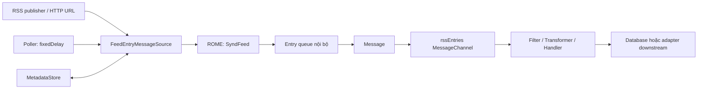
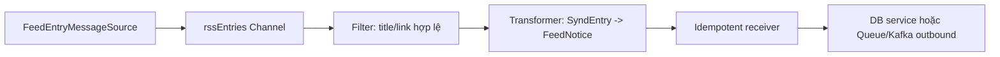

# Feed inbound channel adapter cho RSS

## 1. Bài toán và mục tiêu

Một hệ thống tổng hợp thông báo cần lấy bài viết mới từ địa chỉ RSS của nhà cung cấp. Ví dụ, đối tác công bố các thông báo qua `https://feeds.example.org/announcements.xml`. Ứng dụng Spring Boot phải kiểm tra feed theo lịch, tách từng mục tin, chuẩn hóa tiêu đề/đường dẫn/thời điểm xuất bản rồi gửi sang luồng xử lý nội bộ. Việc tải cả XML và tự viết vòng lặp HTTP, XML parser, scheduler, hàng đợi và logic chống trùng trong một service sẽ khiến mã khó bảo trì.

**Feed inbound channel adapter** của Spring Integration làm cầu nối giữa nguồn syndication RSS/Atom và hệ thống message. Nó **poll** một URL hoặc một `Resource`, dùng thư viện **ROME** parse feed, chuyển **từng entry** thành `Message<SyndEntry>` và đưa vào `MessageChannel`. Từ channel, ứng dụng có thể lọc, biến đổi, lưu database hoặc gọi các adapter khác.

Bài thuộc chương **Adapter Feed** trong module `SPRING_INTEGRATION_ADAPTERS`. Module này nghiên cứu cách kết nối hệ thống ngoài thông qua inbound/outbound adapter, gateway, poller và `MessageChannel`; thực hành tích hợp file, SFTP, HTTP, JMS, AMQP, Kafka và cơ sở dữ liệu; quản lý hợp đồng message, lỗi và vòng đời kết nối. Với RSS, điểm quan trọng là một **polling inbound source** nhận dữ liệu công bố trên web, không phải message broker đẩy sự kiện chủ động.

Sau bài học, bạn có thể:

- Giải thích RSS, Atom, `SyndFeed`, `SyndEntry` và sự khác nhau giữa feed-level document với entry-level message.
- Cấu hình `spring-integration-feed`, `Feed.inboundAdapter(...)`, poller và `MessageChannel` bằng Java DSL.
- Xây một consumer đọc `SyndEntry`, chuẩn hóa trường có thể thiếu và chuyển thành đối tượng nghiệp vụ.
- Dùng `MetadataStore` và `metadataKey` để hạn chế các entry đã được phát trước đó.
- Hiểu `maxMessagesPerPoll`, local entry queue và tần suất HTTP fetch thực tế.
- Xử lý timeout, HTTP lỗi, RSS XML không hợp lệ, feed không có ngày và dữ liệu không tin cậy.
- Thiết kế idempotency nghiệp vụ, giám sát và bài thử dùng feed cố định trong lab.

## 2. RSS và Atom là gì?

**RSS** là định dạng XML để công bố các cập nhật như bài báo, bài blog, thông báo sản phẩm hoặc thay đổi tài liệu. Một RSS 2.0 document thường có một `channel` chứa các phần tử `item`. Mỗi item có thể gồm `title`, `link`, `guid`, `pubDate` và `description`.

Ví dụ một feed ngắn để học:

```xml
<?xml version="1.0" encoding="UTF-8"?>
<rss version="2.0">
  <channel>
    <title>Thông báo tích hợp</title>
    <link>https://feeds.example.org/</link>
    <description>Cập nhật mới của hệ thống</description>
    <item>
      <title>Phát hành API phiên bản 2</title>
      <link>https://feeds.example.org/posts/api-v2</link>
      <guid isPermaLink="false">post-api-v2</guid>
      <pubDate>Mon, 23 Nov 2026 01:00:00 GMT</pubDate>
      <description>Thay đổi giao diện lập trình</description>
    </item>
    <item>
      <title>Lịch bảo trì</title>
      <link>https://feeds.example.org/posts/maintenance</link>
      <guid isPermaLink="false">post-maintenance-01</guid>
      <pubDate>Mon, 23 Nov 2026 02:00:00 GMT</pubDate>
      <description>Thông báo cửa sổ bảo trì</description>
    </item>
  </channel>
</rss>
```

**Atom** cũng là XML syndication nhưng dùng cấu trúc `feed/entry` và một số quy ước metadata khác. Spring Integration dùng **ROME** để cung cấp API chung cho nhiều kiểu feed. Ở bài này, nguồn giả định là **RSS**; payload phía Java vẫn dùng interface ROME `com.rometools.rome.feed.synd.SyndEntry`.

| Lớp/khái niệm | Ý nghĩa | Có phải payload từng message? |
|---|---|---|
| RSS XML | Tài liệu tải từ HTTP hoặc đọc từ resource | Không trực tiếp |
| `SyndFeed` | Đối tượng ROME đại diện toàn bộ feed | Không mặc định |
| `SyndEntry` | Một item (RSS) hoặc entry (Atom) | **Có** |
| `SyndContent` | Mô tả/nội dung của entry; có thể chứa HTML | Không trực tiếp |
| `FeedEntryMessageSource` | Message source đọc và phát các entry | Không; đây là thành phần nguồn |
| `MessageChannel` | Đường chuyển message tới handler | Không; đây là kênh |

**Không nhầm payload:** một lần HTTP fetch có thể nhận XML gồm 50 item, nhưng inbound adapter không phát một `Message<SyndFeed>` chứa cả danh sách theo mặc định. Nó tạo message riêng cho từng `SyndEntry`.

## 3. Feed inbound adapter nằm ở đâu trong IntegrationFlow?



Một trình tự đơn giản:

1. Poller đến chu kỳ, gọi source để lấy một message.
2. Nếu nguồn chưa có entry chờ, adapter tải và parse RSS document thành `SyndFeed`.
3. Các item của feed được chuyển thành `SyndEntry` và đưa vào **hàng đợi entry trong adapter**.
4. Mỗi lần source được hỏi, một entry đủ điều kiện được phát thành `Message<SyndEntry>`.
5. Poller có thể gọi source nhiều lần trong một chu kỳ theo `maxMessagesPerPoll`.
6. Khi queue nội bộ hết, nguồn có thể cần đọc lại feed để kiểm tra entry mới.
7. Metadata theo dõi mốc thời gian đã phát giúp tránh lặp lại một số entry khi poll tiếp.

### 3.1. Poller là bắt buộc

Feed inbound là **polling consumer**: nguồn RSS không tự mở kết nối WebSocket hay đẩy message đến Spring. Ta cần khai báo poller cho endpoint, ví dụ `Pollers.fixedDelay(30_000).maxMessagesPerPoll(10)`. Không có poller phù hợp, endpoint không có lịch yêu cầu source sinh message.

### 3.2. `maxMessagesPerPoll` không phải kích thước RSS

Giả sử RSS đã có **23 entry mới**, còn poller đặt:

```java
Pollers.fixedDelay(30_000).maxMessagesPerPoll(10)
```

Minh họa khi entry queue không bị thay đổi bởi nguồn trong lúc đọc:

| Chu kỳ poll | Số message tối đa phát | Entry còn đợi sau chu kỳ |
|---|---:|---:|
| 1 | 10 | 13 |
| 2 | 10 | 3 |
| 3 | 3 | 0 |

Đây là **mô phỏng giới hạn message**, không phải cam kết một HTTP request luôn được gửi đúng ở mỗi chu kỳ. Thực tế source có thể tiếp tục kiểm tra feed khi queue rỗng. `maxMessagesPerPoll` không giới hạn số item mà server trả về trong XML và cũng không phải giới hạn số kết nối HTTP song song.

Nếu chuyển sang `fixedRate`, thời điểm kích hoạt có ý nghĩa khác `fixedDelay`; khi handler chậm hoặc poller có executor, cần xem khả năng chồng lấp và giới hạn concurrency. RSS publisher cũng có thể có quy định tần suất truy cập nên chọn interval phù hợp.

## 4. Cấu hình Spring Boot và Java DSL

Ví dụ dùng **Spring Boot 3.x** với **Spring Integration 6.5.x tương thích**. Dùng BOM/dependency management của dự án để thống nhất version; API trong tài liệu được đối chiếu theo dòng 6.5. Khi nâng major version, cần kiểm tra API và behavior theo Javadoc của version thực tế.

### 4.1. Dependencies

**Gradle:**

```gradle
dependencies {
    implementation 'org.springframework.boot:spring-boot-starter-integration'
    implementation 'org.springframework.integration:spring-integration-feed'
}
```

Module `spring-integration-feed` sử dụng thư viện **ROME** để parse RSS/Atom. Các lớp `SyndEntry` ở Spring Integration 6.x nằm trong package:

```java
import com.rometools.rome.feed.synd.SyndEntry;
```

Không dùng import cũ `com.sun.syndication.feed.synd.SyndEntry` từ những hướng dẫn nhiều năm trước.

### 4.2. Cấu hình URL và poller

**`application.yml`:**

```yaml
demo:
  rss:
    url: ${RSS_URL:https://feeds.example.org/announcements.xml}
    metadata-key: ${RSS_METADATA_KEY:rss:partner-news:v1}
    poll-delay-ms: ${RSS_POLL_DELAY_MS:30000}
    max-messages-per-poll: ${RSS_MAX_MESSAGES_PER_POLL:10}
    connect-timeout-ms: ${RSS_CONNECT_TIMEOUT_MS:5000}
    read-timeout-ms: ${RSS_READ_TIMEOUT_MS:10000}
```

URL là ví dụ **minh họa**, không phải lời hứa rằng domain đó đang cung cấp RSS. Khi thực hành, thay bằng RSS URL bạn quản lý hoặc một endpoint lab. Không nhận URL tùy ý từ request công khai rồi cấp ngay cho feed client vì có thể tạo **SSRF** đến mạng nội bộ.

### 4.3. Flow dùng `Feed.inboundAdapter(...)`

**`RssFeedConfig.java`:**

```java
import java.io.IOException;
import java.net.HttpURLConnection;
import java.net.MalformedURLException;

import com.rometools.rome.feed.synd.SyndEntry;

import org.springframework.beans.factory.annotation.Value;
import org.springframework.context.annotation.Bean;
import org.springframework.context.annotation.Configuration;
import org.springframework.core.io.UrlResource;
import org.springframework.integration.config.EnableIntegration;
import org.springframework.integration.dsl.IntegrationFlow;
import org.springframework.integration.dsl.Pollers;
import org.springframework.integration.feed.dsl.Feed;
import org.springframework.integration.metadata.MetadataStore;
import org.springframework.integration.metadata.SimpleMetadataStore;

@Configuration
@EnableIntegration
public class RssFeedConfig {

    // Chỉ dành cho lab: mất state khi ApplicationContext restart.
    // Production cần một MetadataStore bền vững.
    @Bean("rssMetadataStore")
    MetadataStore rssMetadataStore() {
        return new SimpleMetadataStore();
    }

    @Bean
    IntegrationFlow rssInboundFlow(
            @Value("${demo.rss.url}") String rssUrl,
            @Value("${demo.rss.metadata-key}") String metadataKey,
            @Value("${demo.rss.poll-delay-ms}") long delayMs,
            @Value("${demo.rss.max-messages-per-poll}") int maxPerPoll,
            @Value("${demo.rss.connect-timeout-ms}") int connectMs,
            @Value("${demo.rss.read-timeout-ms}") int readMs,
            MetadataStore rssMetadataStore) throws MalformedURLException {

        UrlResource feedResource = new UrlResource(rssUrl) {
            @Override
            protected void customizeConnection(HttpURLConnection connection)
                    throws IOException {
                super.customizeConnection(connection);
                connection.setConnectTimeout(connectMs);
                connection.setReadTimeout(readMs);
            }
        };

        return IntegrationFlow
                .from(Feed.inboundAdapter(feedResource, metadataKey)
                            .metadataStore(rssMetadataStore)
                            .preserveWireFeed(true),
                    endpoint -> endpoint
                            .id("partnerRssInbound")
                            .poller(Pollers.fixedDelay(delayMs)
                                    .maxMessagesPerPoll(maxPerPoll)
                                    .errorChannel("rssPollErrors")))
                .channel("rssEntries")
                .get();
    }

    @Bean
    IntegrationFlow rssProcessFlow() {
        return IntegrationFlow.from("rssEntries")
                .handle(message -> {
                    SyndEntry entry = (SyndEntry) message.getPayload();
                    String title = entry.getTitle();
                    String link = entry.getLink();
                    System.out.printf("RSS: %s | %s%n", title, link);
                    // Production: validate, normalize, persist idempotently.
                })
                .get();
    }

    @Bean
    IntegrationFlow rssErrorFlow() {
        return IntegrationFlow.from("rssPollErrors")
                .handle(message -> {
                    Throwable cause = (Throwable) message.getPayload();
                    System.err.println(
                            "RSS poll error: "
                                    + cause.getClass().getSimpleName());
                    // Production: classify, metric/alert và xử lý retry.
                })
                .get();
    }
}
```

**Giải thích chính xác từng lớp:**

- `Feed.inboundAdapter(feedResource, metadataKey)` là factory method của Java DSL, tạo spec cho `FeedEntryMessageSource`.
- `UrlResource` đại diện URL hoặc một nguồn tài nguyên có thể mở để đọc. Dùng subclass `customizeConnection(HttpURLConnection)` để cấu hình connect/read timeout theo hướng dẫn chính thức của Spring Integration 6.5. Nếu dùng constructor URL thuần, cần kiểm tra khả năng cấu hình timeout trước khi kết luận source không bao giờ treo.
- `metadataStore(...)` cung cấp nơi ghi mốc ngày đã phát cho source. Trong ví dụ này là `SimpleMetadataStore` **chỉ cho lab**.
- `preserveWireFeed(true)` giữ đối tượng gốc khi ROME tạo `SyndFeed`; nó **không** đổi payload message từ `SyndEntry` sang XML hoặc `SyndFeed`.
- `endpoint.id("partnerRssInbound")` là ID của polling endpoint trong flow; `metadataKey` là key cho metadata của nguồn. Chúng không phải cùng một thuộc tính.
- `rssEntries` là `MessageChannel` giữa inbound và consumer; handler chỉ ví dụ in title/link, không có logic database thật.
- `.errorChannel("rssPollErrors")` dành cho các lỗi được phát hiện theo đường xử lý poller. Nếu luồng thiết kế thêm asynchronous channel/task executor, phải kiểm tra đường lan truyền exception riêng.

Giá trị `RSS_MAX_MESSAGES_PER_POLL` nên là số dương. Tùy SLA, backlog và tốc độ consumer, chọn poll interval phù hợp; không để một nguồn RSS chậm làm nghẽn toàn bộ scheduled poller của ứng dụng.

### 4.4. Cách tạo source trực tiếp với annotation

Ngoài Java DSL, Spring Integration cho phép `@InboundChannelAdapter` tạo nguồn feed:

```java
import com.rometools.rome.feed.synd.SyndEntry;
import org.springframework.context.annotation.Bean;
import org.springframework.integration.annotation.InboundChannelAdapter;
import org.springframework.integration.annotation.Poller;
import org.springframework.integration.feed.inbound.FeedEntryMessageSource;

// Đoạn bổ sung nằm trong một class @Configuration.
@Bean
@InboundChannelAdapter(
        channel = "rssEntries",
        poller = @Poller(fixedDelay = "30000", maxMessagesPerPoll = "10"))
FeedEntryMessageSource annotatedRssSource() throws Exception {
    return new FeedEntryMessageSource(
            new java.net.URL("https://feeds.example.org/announcements.xml"),
            "rss:partner-news:v1");
}
```

Đây là **phương án thay thế** bean `rssInboundFlow`, không được khai báo đồng thời với Java DSL ở phần 4.3 nếu chúng cùng dùng kênh/nguồn, vì có thể phát trùng. Nếu dùng cách annotation, hãy cấu hình `MetadataStore`, timeout và nguồn URL hợp lệ theo yêu cầu dự án. Với một feed nội bộ yêu cầu header HTTP đặc biệt, cần quản lý cấu hình HTTP tại nguồn, không ghi token tĩnh trong Java.

## 5. Làm việc với `SyndEntry` và hợp đồng message

ROME chuẩn hóa một số thuộc tính của RSS item/Atom entry:

| Thuộc tính Java | Ví dụ | Lưu ý |
|---|---|---|
| `entry.getUri()` | `post-api-v2` | Thường từ GUID/entry ID; có thể null/không ổn định ở nguồn kém chất lượng |
| `entry.getTitle()` | `Phát hành API phiên bản 2` | Có thể rỗng, phải kiểm tra null và giới hạn độ dài |
| `entry.getLink()` | `https://feeds.example.org/posts/api-v2` | Là dữ liệu từ bên ngoài, không tự coi là URL đáng tin |
| `entry.getPublishedDate()` | Ngày xuất bản | Có thể null; phụ thuộc nguồn |
| `entry.getUpdatedDate()` | Ngày cập nhật | Có thể null; không phải feed nào cũng cập nhật đúng |
| `entry.getDescription()` | `SyndContent` | Có thể chứa HTML; dùng `getValue()` sau kiểm tra null |
| `entry.getContents()` | Danh sách `SyndContent` | Không nhất thiết có hoặc đồng nhất với description |
| `entry.getAuthor()` | Tác giả | Tùy nguồn, có thể null |
| `entry.getEnclosures()` | Danh sách tệp/media đính kèm | Không tự tải file đính kèm |

### 5.1. Chuyển thành đối tượng nghiệp vụ

Không lưu nguyên `SyndEntry` như một domain entity nếu lớp nghiệp vụ chỉ cần một số trường. Một bản ghi gọn có thể là:

```java
import java.time.Instant;
import java.util.Date;

import com.rometools.rome.feed.synd.SyndContent;
import com.rometools.rome.feed.synd.SyndEntry;

public record FeedNotice(
        String source,
        String externalId,
        String title,
        String link,
        Instant publishedAt,
        String descriptionHtml) {

    public static FeedNotice from(String source, SyndEntry entry) {
        String externalId = entry.getUri();
        if (externalId == null || externalId.isBlank()) {
            externalId = entry.getLink();
        }
        if (externalId == null || externalId.isBlank()) {
            throw new IllegalArgumentException("RSS item thiếu ID ổn định");
        }

        Date when = entry.getPublishedDate();
        SyndContent description = entry.getDescription();
        return new FeedNotice(
                source,
                externalId,
                entry.getTitle(),
                entry.getLink(),
                when == null ? null : when.toInstant(),
                description == null ? null : description.getValue());
    }
}
```

Đây là ví dụ **chuẩn hóa dữ liệu**, chưa bao gồm validation đầy đủ và lưu database. `descriptionHtml` là HTML/text **không tin cậy**; nếu đưa lên UI, phải sanitize/escape phù hợp để tránh XSS. Một URL từ RSS cũng phải được validate trước khi ứng dụng tự động fetch tiếp nội dung hoặc attachment để tránh SSRF.

Trong sản phẩm thực, cần quyết định nguồn nào có quyền đặt `externalId`, chuẩn hóa link hợp lệ và đối chiếu version của entry. Fallback bằng `getLink()` chỉ phù hợp nếu nguồn dùng link ổn định; nếu publisher thay URL cho cùng nội dung, hãy có quy tắc dedup riêng.

### 5.2. Từ `Message<SyndEntry>` sang channel khác

Một quy trình thông dụng:



Ở đây `FeedNotice` là contract nghiệp vụ, tách khỏi thư viện ROME. Khi gửi tiếp qua JMS/AMQP/Kafka, không nên phụ thuộc việc serialization một object `SyndEntry` có thể thay đổi theo thư viện; hãy chuyển thành DTO/JSON/Avro phù hợp hợp đồng của message downstream.

## 6. MetadataStore và bài toán entry trùng

Feed adapter có cơ chế lưu mốc thời gian để giảm phát lại entry đã thấy. Theo tài liệu **Spring Integration 6.5**, mỗi khi message mới được phát, adapter dùng thông tin **published date** để cập nhật timestamp mới nhất trong `MetadataStore`. `metadataKey` giúp định danh trạng thái của nguồn feed.

```text
RSS endpoint key: rss:partner-news:v1
MetadataStore:   latest published timestamp -> ...
Lần poll sau:    dùng watermark để hạn chế phát entry cũ
```

**Đừng hiểu metadata này là một tập khóa của từng GUID.** Đây chủ yếu là mốc thời gian; không phải kết quả xử lý database, không phải xác nhận tất cả subscriber đã nhận message và không tự khử trùng nội dung.

| Tình huống | Điều có thể xảy ra nếu chỉ dựa vào timestamp |
|---|---|
| Poll lại feed không đổi | Entry cũ thường bị bỏ qua |
| Restart dùng metadata trong memory | Mốc cũ biến mất, entry có thể phát lại |
| Hai entry có cùng published date | Rủi ro xử lý biên timestamp; cần kiểm thử hành vi của phiên bản nguồn |
| Publisher đăng bài mới với published date cũ | Watermark có thể khiến bài đến muộn không được nhận |
| Publisher sửa nội dung nhưng giữ published date | Có thể không phát lại bản sửa |
| Item thiếu published date hoặc ngày không hợp lệ | Cần kiểm tra cách parser/source 6.5 xử lý; không tự giả định sẽ được phát một lần |
| Nhiều instance cùng poll cùng URL | Không có giao dịch DB nghiệp vụ chung chỉ nhờ `MetadataStore` |

Tài liệu của các phiên bản Spring Integration mới hơn có thể mô tả thêm cách dùng `updatedDate` hay fallback; **bài này lấy 6.5 làm chuẩn**. Khi đổi version, hãy thử dữ liệu feed thực có ngày trùng, cập nhật muộn và ngày null để xác nhận hành vi, thay vì dựa vào giả định từ tài liệu khác dòng.

### 6.1. SimpleMetadataStore cho bài lab

`SimpleMetadataStore` ở ví dụ Java DSL chỉ lưu trong **vòng đời ApplicationContext**. Restart làm mất watermark và có thể khiến nguồn cũ được phát lại. Dùng nó để hiểu dòng dữ liệu, không coi đây là giải pháp bền vững khi chạy nhiều pod.

### 6.2. Store bền vững qua restart

Một cách đơn giản để lưu state vào file là `PropertiesPersistingMetadataStore`:

```java
import org.springframework.context.annotation.Bean;
import org.springframework.integration.metadata.MetadataStore;
import org.springframework.integration.metadata.PropertiesPersistingMetadataStore;

@Bean("rssMetadataStore")
MetadataStore persistentRssMetadataStore() {
    PropertiesPersistingMetadataStore store =
            new PropertiesPersistingMetadataStore();
    store.setBaseDirectory("./data/rss-metadata");
    return store;
}
```

**Thay thế** bean `rssMetadataStore()` trong phần 4.3 bằng bean này; không tạo cả hai cùng tên trong một ApplicationContext. Directory phải ghi được và có chính sách backup/retention phù hợp. Theo tài liệu Metadata Store, `PropertiesPersistingMetadataStore` mặc định lưu ổn định vào lúc **ApplicationContext đóng bình thường** và cung cấp `flush()` nếu muốn ghi ra đĩa ở thời điểm khác. Do đó, khi ứng dụng bị kill đột ngột, **đừng giả định mọi watermark đã đến disk**.

Production nhiều instance thường cần một backend chia sẻ phù hợp (chẳng hạn `JdbcMetadataStore` hoặc kho metadata tương thích) cùng chiến lược namespace/atomic update. Tuy nhiên, việc có store chung chưa đủ để bảo đảm chính xác một lần cho side effect nghiệp vụ.

### 6.3. Idempotency cấp nghiệp vụ

Nên lưu một bảng có khóa duy nhất trên nguồn và ID bên ngoài (hoặc một khóa bền vững tương đương):

```sql
CREATE TABLE feed_entries (
    source_key      VARCHAR(128) NOT NULL,
    external_id     VARCHAR(512) NOT NULL,
    title           VARCHAR(1024),
    source_url      VARCHAR(2048),
    published_at    TIMESTAMP,
    received_at     TIMESTAMP NOT NULL,
    PRIMARY KEY (source_key, external_id)
);
```

Nếu gặp lại cùng `(source_key, external_id)`, database có thể bỏ qua duplicate hoặc cập nhật bản sửa **theo chính sách rõ ràng**. Nếu hệ thống chỉ cần thông báo một lần, unique key giúp không INSERT lần hai; nếu cần cập nhật bài đã sửa, phải có version/updated timestamp và xử lý thay đổi theo quy định.

**Chú ý race:** kiểm tra “có tồn tại không” rồi INSERT trong hai thao tác riêng không an toàn khi nhiều worker đồng thời. Dùng unique constraint và câu lệnh upsert/transaction thích hợp.

`MetadataStore` của adapter giảm số message phải xử lý lại; **database constraint** giữ cho trạng thái nghiệp vụ không bị trùng khi adapter phát lại.

## 7. Lựa chọn lịch poll và cách điều tiết tải

| Tham số | Ảnh hưởng | Hướng quyết định |
|---|---|---|
| `fixedDelay` | Khoảng chờ giữa các lần thực thi poll khi đã hoàn tất | Chọn phù hợp mức cập nhật RSS/SLA |
| `maxMessagesPerPoll` | Số entry phát tối đa trong mỗi poll | Tăng khi backlog lớn, nhưng tính đến tốc độ downstream |
| HTTP connect timeout | Thời gian chờ tạo kết nối HTTP | Tránh một feed chậm giữ scheduler quá lâu |
| HTTP read timeout | Thời gian chờ đọc dữ liệu từ server | Đặt theo latency và kích thước feed |
| Error channel | Đường nhận lỗi của poller | Ghi log, phân loại, cảnh báo và có chính sách retry |
| Channel type | Sync/async, buffering và giới hạn backlog | Quyết định áp lực lên handler và tính bền vững |
| Metadata store | Khả năng giữ watermark giữa các lần chạy | Phụ thuộc yêu cầu restart, nhiều instance |

### 7.1. Backpressure và queue

Nếu publisher đẩy hàng nghìn entry vào một RSS document, `maxMessagesPerPoll=10` chỉ kiểm soát tốc độ **phát message**, không làm XML RSS trên mạng tự nhỏ đi. ROME vẫn phải parse tài liệu gốc; nguồn giữ các entry trong một queue nội bộ. Hãy kiểm soát kích thước feed theo hợp đồng với publisher và giới hạn heap thích hợp.

Đừng chuyển tùy tiện sang một `QueueChannel` trong memory rồi coi đó là hàng đợi bền vững. Nếu handler bị chậm, backlog có thể tăng và mất khi restart. Khi cần xử lý không đồng bộ hoặc replay, cân nhắc gửi DTO có id ổn định vào một broker, kèm outbox/idempotency ở phía nhận.

### 7.2. Tần suất poll và tần suất HTTP

Vì source có queue entry nội bộ, số lần hỏi source trong một poll không luôn bằng số request HTTP. Việc queue hết, logic lấy lại feed và cache tại HTTP server đều có thể ảnh hưởng tần suất tải thực tế. Không tuyên bố “fixedDelay 30 giây nghĩa là đúng một HTTP GET mỗi 30 giây” nếu chưa đo trên môi trường triển khai.

Nên phối hợp publisher về tần suất truy vấn, giới hạn rate limit, và nếu cần dùng HTTP client/Resource tùy chỉnh để hỗ trợ policy HTTP thích hợp. Đừng giả định `FeedEntryMessageSource` tự cung cấp mọi tối ưu HTTP như ETag/If-Modified-Since, request retry và circuit breaker ở mọi phiên bản.

## 8. Xử lý lỗi HTTP, XML và message downstream

### 8.1. Các nhóm lỗi phải phân biệt

| Triệu chứng | Khả năng | Xử lý |
|---|---|---|
| Không phân giải DNS hoặc TCP timeout | Network, DNS, firewall, proxy | Kiểm tra kết nối, backoff và cảnh báo |
| HTTP 401/403 | Thiếu xác thực/quyền hoặc feed không công khai | Kiểm tra secret/policy; không retry dồn dập |
| HTTP 404/410 | URL đổi hoặc feed bị gỡ | Cập nhật cấu hình theo publisher |
| HTTP 429 | Rate limit | Tôn trọng yêu cầu nhà cung cấp và giảm tần suất |
| HTTP 5xx | Publisher đang lỗi | Retry có backoff/jitter, giới hạn số lần |
| XML malformed/encoding sai | RSS không hợp lệ hoặc bị cắt | Ghi lỗi parse, lưu bằng chứng an toàn, liên hệ publisher |
| Feed hợp lệ nhưng không có entry mới | Watermark hoặc feed không đổi | Không coi là lỗi |
| Entry thiếu ngày/GUID/link | Dữ liệu không đủ cho contract | Validate, đưa vào xử lý ngoại lệ nghiệp vụ |
| Handler ném exception | Lỗi downstream, DB hoặc mapping | Phân biệt với lỗi source; dùng idempotency khi retry |
| Restart làm phát lại entry | Metadata store memory hoặc watermark chưa flush | Persistent store và unique key nghiệp vụ |

### 8.2. Poller error channel

Trong Java DSL, cấu hình `.errorChannel("rssPollErrors")` trên poller cho phép định tuyến exception xảy ra trong tác vụ poll sang `ErrorMessage`. Ở flow mẫu, `rssErrorFlow` chỉ in tên lớp lỗi, để tránh rò toàn bộ nội dung HTTP/XML/secret trong console.

Trong production, handler lỗi phải:

- Xem nguyên nhân gốc, endpoint, source key, thời điểm, số lần thất bại và độ trễ;
- phân loại lỗi tạm thời (timeout/503) và lỗi cấu hình lâu dài (401/403/404);
- đặt backoff, retry budget và cảnh báo nếu feed gián đoạn quá SLA;
- không tự xóa watermark mỗi khi gặp exception;
- làm sạch log, tránh ghi token, cookie, raw RSS có PII hoặc URL chứa credential.

**Giới hạn quan trọng:** nếu một handler downstream đã ghi DB rồi ném lỗi, source metadata không phải một transaction với DB. Reprocess có thể tạo duplicate hoặc bị watermark bỏ qua; nghiệp vụ cần trạng thái riêng và khả năng đối soát/replay có kiểm soát.

### 8.3. RSS là dữ liệu ngoài không tin cậy

Một RSS item có thể chứa HTML, URL bên ngoài, ký tự Unicode, tên tác giả và media enclosure. Không hiển thị nguyên `description.getValue()` qua UI nếu chưa sanitize. Không tự fetch link/enclosure hoặc follow redirect đến IP nội bộ chỉ vì nó xuất hiện trong feed. Giới hạn host/domain cho phép, kích thước phản hồi, timeout và quyền truy cập mạng, đồng thời xem xét bảo vệ XML parser trước tài liệu độc hại.

ROME cho phép dùng `SyndFeedInput` tùy chỉnh qua `syndFeedInput(...)` hoặc `FeedEntryMessageSource.setSyndFeedInput(...)`; chỉ thay đổi các tùy chọn parser như xử lý DOCTYPE khi có lý do rõ ràng, sau khi đánh giá XXE và rủi ro xử lý XML không đáng tin.

## 9. Feed inbound so với HTTP, File, SFTP và các adapter khác

| Khía cạnh | Feed inbound | HTTP inbound gateway | File/SFTP inbound | JMS/AMQP/Kafka inbound |
|---|---|---|---|---|
| Ai khởi xướng tương tác? | Ứng dụng định kỳ đọc feed | Client HTTP gọi endpoint ứng dụng | Poller hoặc consumer đọc nguồn file | Broker/consumer nhận dữ liệu |
| Payload mặc định | Một `SyndEntry` | Dữ liệu HTTP request đã map | `File`, stream hoặc payload được cấu hình | Message từ broker đã chuyển đổi |
| Ranh giới message | **Từng item trong RSS/Atom** | Từng request HTTP | Từng file/message | Từng record/message |
| Cơ chế phát hiện cập nhật | Watermark ngày của entry và poll | Request mới từ client | Remote/local filter, metadata | Offset/ack/broker semantics |
| Bước quyết định cadence | Poller | Client và HTTP endpoint | Poller hoặc listener | Consumer/container/broker |
| Có transaction DB nghiệp vụ tự động? | Không | Không | Không | Không, cần cấu hình và thiết kế phù hợp |

Điểm học chung trong module `SPRING_INTEGRATION_ADAPTERS` là **dùng adapter chuyển ngoại giới thành message chuẩn**, sau đó mới ghép các `MessageChannel`, filter, transformer, router và handler. Nhưng adapter Feed được thiết kế cho **web syndication**, không phải thay thế chung cho mọi HTTP API. Nếu nguồn cung cấp REST/JSON với pagination/auth phức tạp thay vì RSS/Atom, nên cân nhắc HTTP outbound gateway hoặc client thích hợp.

## 10. Kiểm thử bằng một RSS Resource cố định

Để loại phụ thuộc Internet khi học, dùng một file RSS mẫu được cung cấp **trong phạm vi bộ test/lab** dưới tên `sample-feed.xml`. Đây là hướng dẫn tạo fixture khi làm bài tập, không phải yêu cầu thay đổi các file khác trong bước soạn Knowledge.

Ví dụ thay URL bằng `Resource`:

```java
import org.springframework.core.io.ClassPathResource;
import org.springframework.core.io.Resource;
import org.springframework.integration.feed.dsl.Feed;

Resource sample = new ClassPathResource("sample-feed.xml");

// Khi xây test flow:
Feed.inboundAdapter(sample, "rss:sample-fixture")
    .metadataStore(testMetadataStore);
```

Constructor nhận `Resource` hữu ích không chỉ cho file classpath mà còn cho resource tùy chỉnh. Nó được đưa vào `SyndFeedInput` để parse thành `SyndFeed`. Test cần ghi nhận thứ tự item, số message, publishedDate và behavior khi metadata state thay đổi.

### 10.1. Đề cương integration test

| Trường hợp | Thay đổi dữ liệu đầu vào | Điều muốn xác minh |
|---|---|---|
| Feed có 2 item mới | Hai GUID và hai published dates | Có hai `Message<SyndEntry>` hợp lệ |
| Poll lại cùng feed | Không thay đổi fixture | Không phát lặp ngoài chính sách watermark |
| `maxMessagesPerPoll=1` | Giữ hai item | Một poll phát tối đa một message |
| Restart với store memory | Tạo lại context | Mốc trong memory mất, dữ liệu có thể phát lại |
| Restart với store bền vững | Giữ cùng key/store | Watermark được giữ theo cơ chế lưu |
| Hai entry cùng ngày | Hai GUID, cùng publishedDate | Quan sát biên dedup; không khẳng định tuyệt đối |
| Entry đến muộn | GUID mới nhưng ngày cũ | Xác minh nguy cơ bị watermark bỏ qua |
| RSS hỏng | Thiếu tag đóng hoặc encoding sai | Error channel nhận lỗi parse |
| Publisher trả 503/timeout | Mock HTTP server | Backoff/cảnh báo, không xoá state |
| Consumer lỗi sau DB commit | Ném exception có kiểm soát | Unique key ngăn commit trùng khi retry |

Trong bài này không thực thi build/test; các tình huống là checklist để triển khai tại bước thực hành và QA sau.

## 11. Bài tập thực hành

### Lab A — Nhận từng item thành `Message<SyndEntry>`

1. Chuẩn bị `sample-feed.xml` với hai item ở phần 2.
2. Cấu hình `Feed.inboundAdapter(new ClassPathResource("sample-feed.xml"), "rss:lab-a")`.
3. Đặt poller `fixedDelay(1000)` và `maxMessagesPerPoll(1)` trong môi trường lab.
4. Quan sát handler nhận hai lần message, mỗi lần payload là một `SyndEntry`.
5. Ghi lại `getTitle()`, `getUri()`, `getLink()`, `getPublishedDate()`.

**Kết quả cần giải thích:** một RSS document chứa nhiều item nhưng flow phát **một item/một message**.

### Lab B — Phân biệt queue nội bộ và số lần poll

1. Thêm 15 item mới vào fixture có ngày hợp lệ, tăng dần.
2. Giữ `maxMessagesPerPoll(5)`.
3. Quan sát số message qua các chu kỳ poll đến khi hết backlog.
4. So sánh với `maxMessagesPerPoll(1)` và `maxMessagesPerPoll(20)`.
5. Không đồng nhất số message với số HTTP GET khi chuyển lại nguồn URL.

**Kết quả:** poller giới hạn tốc độ phát entry, không trực tiếp cắt giảm số item trong RSS XML.

### Lab C — MetadataStore và restart

1. Xử lý một fixture rồi poll lại với `SimpleMetadataStore`.
2. Xác nhận nguồn thường không phát lại entry cũ khi watermark đã được ghi.
3. Restart context, quan sát khả năng phát lại vì store memory mất state.
4. Chuyển sang `PropertiesPersistingMetadataStore`, thử shutdown bình thường và xác nhận metadata còn được giữ.
5. Mô phỏng crash ở môi trường cô lập để thấy vì sao cần xét thời điểm `flush()`/state bền vững.

**Kết quả:** tên `metadataStore` chưa đủ; phải chọn backend và vòng đời lưu đúng yêu cầu.

### Lab D — Item đến muộn hoặc thay đổi ngày

1. Tạo hai entry đã phát có ngày `T1` và `T2`.
2. Thêm entry mới GUID khác nhưng publishedDate cũ hơn `T2`.
3. Quan sát adapter có thể không phát entry đến muộn khi watermark đã tiến.
4. Sửa nội dung một entry cũ nhưng giữ nguyên publishedDate, kiểm tra hành vi.
5. Thiết kế policy riêng cho việc cập nhật entry và reconciliation nếu publisher có dữ liệu đến muộn.

**Kết quả:** cơ chế mốc thời gian không thay thế dedup theo GUID và theo dõi version nghiệp vụ.

### Lab E — Timeout và feed XML lỗi

1. Dùng mock HTTP server trả feed hợp lệ, sau đó mô phỏng timeout/HTTP 503.
2. Quan sát `rssPollErrors` khi source không lấy/parse được dữ liệu.
3. Khôi phục server và xem quá trình poll hoạt động trở lại.
4. Thử XML thiếu tag đóng và lỗi encoding, ghi loại exception.
5. Kiểm tra không có token/credential hoặc toàn bộ nội dung nhạy cảm bị in vào log.

**Kết quả:** phân biệt lỗi kết nối, lỗi HTTP, lỗi parse và lỗi handler.

### Lab F — Bảo vệ database khỏi duplicate

1. Xây bảng thử `feed_entries` với primary key `(source_key, external_id)` như phần 6.
2. Cho một item được phát hai lần do giả lập restart.
3. Dùng upsert hoặc xử lý duplicate-key rõ ràng; xác minh DB không tạo bản ghi thứ hai.
4. Cho publisher thay title nhưng giữ ID và xác định policy: bỏ qua hay update theo version.
5. Nếu handler còn đẩy tiếp JMS/Kafka, đánh giá outbox/idempotency bên nhận.

**Kết quả:** DB idempotency là tuyến phòng vệ khi feed adapter không thể hứa đúng một lần.

### Lab G — Kiểm tra dữ liệu HTML và URL không tin cậy

1. Tạo một item có `description` chứa HTML và một `link` không thuộc danh sách domain cho phép.
2. Chuyển `SyndEntry` sang `FeedNotice`.
3. Trước khi hiển thị HTML, dùng sanitizer/escape phù hợp.
4. Không fetch link ngoài whitelist; ghi nhận item không đạt chính sách.
5. Xác nhận ứng dụng không vô tình cho phép truy cập URL nội bộ qua nội dung feed.

**Kết quả:** parse RSS thành object hợp lệ không đồng nghĩa dữ liệu đã an toàn để hiển thị hay gọi tiếp qua HTTP.

## 12. Những nhầm lẫn thường gặp

| Nhầm lẫn | Cách hiểu đúng |
|---|---|
| Feed inbound là một HTTP server nhận RSS qua POST | Nó là client polling đọc nguồn feed và phát message |
| Một RSS document tương ứng một message | Mỗi item/entry được đưa thành một `Message<SyndEntry>` |
| Payload là `SyndFeed` hoặc `String XML` | Mặc định payload của feed inbound là ROME `SyndEntry` |
| `fixedDelay(30000)` bảo đảm đúng một HTTP GET mỗi 30 giây | Source còn có queue nội bộ; cần quan sát hành vi fetch thực |
| `maxMessagesPerPoll` giới hạn số item publisher trả | Nó giới hạn số message phát tối đa trong một chu kỳ poll |
| `metadataKey` là mã GUID của từng entry | Nó định danh trạng thái thời gian của feed source |
| `SimpleMetadataStore` vẫn giữ qua restart | Store memory chỉ tồn tại trong vòng đời context |
| Store file-backed mặc định lưu mọi thay đổi ngay lập tức | Cần xem quy tắc shutdown/`flush()` của store |
| Metadata watermark là exactly-once trong DB | Nó không tham gia transaction nghiệp vụ |
| Cùng GUID nhưng nội dung khác chắc chắn là một item mới | Cần policy update/version, không chỉ dựa publishedDate |
| RSS luôn có `pubDate` hoặc GUID | Nguồn có thể thiếu/null; consumer phải kiểm tra |
| `preserveWireFeed(true)` chuyển payload thành XML | Nó giữ wire feed trong ROME model, payload vẫn là `SyndEntry` |
| Source tự động retry/circuit-breaker mọi lỗi HTTP | Cần cấu hình timeouts, error handling và chính sách retry phù hợp |
| Description được ROME parse là an toàn để render | HTML/URL vẫn không tin cậy, cần sanitize/validate |
| Muốn đọc REST JSON thì Feed adapter là lựa chọn mặc định | Feed adapter chuyên RSS/Atom, không thay cho REST client/gateway |

## 13. Tài liệu tham khảo

- [Spring Integration 6.5 — Feed Adapter](https://docs.spring.io/spring-integration/reference/6.5/feed.html): inbound RSS/Atom, `Feed.inboundAdapter`, `SyndEntry`, queue nội bộ, watermark và `UrlResource` timeout.
- [FeedEntryMessageSource API — Spring Integration 6.5](https://www.springframework.org/spring-integration/docs/6.5.0/api/org/springframework/integration/feed/inbound/FeedEntryMessageSource.html): các constructor URL/Resource và setter cho `MetadataStore`, `SyndFeedInput`.
- [FeedEntryMessageSourceSpec API — Spring Integration 6.5](https://www.springframework.org/spring-integration/docs/6.5.10-SNAPSHOT/api/org/springframework/integration/feed/dsl/FeedEntryMessageSourceSpec.html): `metadataStore`, `preserveWireFeed`, `syndFeedInput`.
- [Spring Integration 6.5 — Metadata Store](https://docs.spring.io/spring-integration/reference/6.5/meta-data-store.html): `SimpleMetadataStore`, `PropertiesPersistingMetadataStore`, persistent backend, duplicate và trạng thái qua restart.
- [ROME project](https://rometools.github.io/rome/): các kiểu `SyndFeed`, `SyndEntry` và khả năng parse RSS/Atom.

**Ghi nhớ:** Feed inbound channel adapter chuyển một RSS/Atom feed thành **các message riêng cho từng entry** thông qua poller. `FeedEntryMessageSource` và `MetadataStore` giúp giảm phát lại, nhưng một hệ thống đáng tin cậy vẫn phải chuẩn hóa `SyndEntry`, giới hạn HTTP/XML, theo dõi lỗi, dùng idempotency nghiệp vụ và xử lý đúng vòng đời message khi kết nối với các adapter khác.
