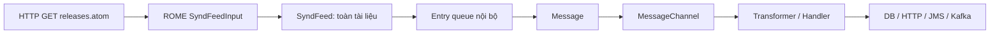
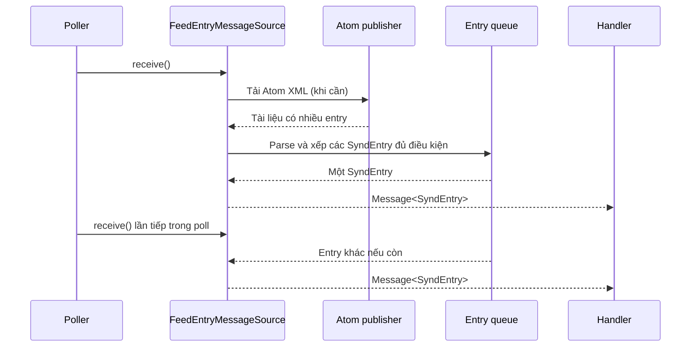
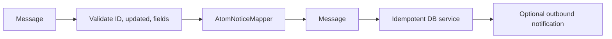

# Feed inbound channel adapter cho Atom

## 1. Bài toán thực tế và mục tiêu

Một nhóm phát triển cần theo dõi danh sách bản phát hành kỹ thuật do đối tác công bố tại `https://feeds.example.org/releases.atom`. Mỗi bản phát hành có **mã định danh ổn định**, tiêu đề, thời điểm tạo, thời điểm cập nhật, đường dẫn bài viết và nội dung tóm tắt. Cứ 30 giây, ứng dụng Spring Boot cần kiểm tra feed, biến từng entry thành message nội bộ rồi lưu vào database hoặc chuyển tiếp sang một kênh thông báo.

Ta muốn tránh ba vấn đề:

1. **Đọc trùng:** một entry còn nằm trong tài liệu Atom ở nhiều lần poll.
2. **Bỏ sót cập nhật:** cùng `atom:id` được sửa nội dung sau khi công bố; `updated` thay đổi trong khi `published` có thể giữ nguyên.
3. **Lỗi lan truyền:** HTTP timeout, XML không hợp lệ hoặc database tạm thời không sẵn sàng không được làm ứng dụng mất dấu những entry quan trọng.

Spring Integration cung cấp **Feed inbound channel adapter** trong module `spring-integration-feed`. Adapter tải RSS hoặc Atom qua URL/`Resource`, nhờ **ROME** chuyển tài liệu thành `SyndFeed` và phát từng `SyndEntry` qua `MessageChannel`. Poller quyết định khi nào lấy tiếp; filter/transformer/handler phía sau quyết định cách xử lý nghiệp vụ.

Bài thuộc chương **Adapter Feed** của module `SPRING_INTEGRATION_ADAPTERS`, nơi học cách kết nối các hệ thống ngoài qua inbound/outbound adapter, gateway, poller và `MessageChannel`; xử lý hợp đồng message, lỗi, vòng đời kết nối khi tích hợp file, SFTP, HTTP, JMS, AMQP, Kafka và database. Trong trường hợp Atom, nguồn là **web syndication có cơ chế polling**, không phải JMS/AMQP/Kafka broker đẩy record và cũng không phải HTTP inbound server.

Sau bài học, bạn có thể:

- Đọc cấu trúc **Atom 1.0**, namespace và ý nghĩa `feed`, `entry`, `id`, `updated`, `published`, `link`, `summary`, `content`.
- Phân biệt `SyndFeed` và `Message<SyndEntry>`, cũng như cách ROME ánh xạ trường Atom.
- Cấu hình `Feed.inboundAdapter(Resource, metadataKey)` và poller bằng Java DSL.
- Xây handler chuyển entry thành DTO, bảo vệ các trường HTML/URL và quản lý entry cập nhật.
- Dùng `MetadataStore` và khóa nghiệp vụ để xử lý duplicate, restart và multiple instances.
- Chẩn đoán lỗi kết nối HTTP, parse XML, thiếu ngày xuất bản và lỗi downstream.
- Thực hành với một Atom fixture cố định, không phụ thuộc RSS/Atom server thật.

## 2. Atom 1.0 khác RSS như thế nào?

**Atom** là định dạng XML để công bố và phân phối danh sách nội dung theo **RFC 4287**. Atom 1.0 dùng XML namespace chuẩn `http://www.w3.org/2005/Atom`. Tài liệu Atom thường được phân phối qua HTTP với media type `application/atom+xml`.

Tài liệu Atom có thể chứa nhiều `entry` dưới phần tử gốc `feed`. Mỗi entry đại diện một nội dung như release note, bài viết hoặc thông báo, không bắt buộc là một file đính kèm.

### 2.1. Ví dụ Atom feed có hai entry

Đây là XML **minh họa**, tự tạo cho bài học:

```xml
<?xml version="1.0" encoding="UTF-8"?>
<feed xmlns="http://www.w3.org/2005/Atom">
  <title>Release announcements</title>
  <id>urn:example:engineering-releases</id>
  <updated>2026-11-23T05:00:00Z</updated>
  <link rel="self" type="application/atom+xml"
        href="https://feeds.example.org/releases.atom"/>
  <author><name>Release Bot</name></author>

  <entry>
    <title type="text">Integration API 4.1</title>
    <id>tag:example.org,2026:release-41</id>
    <updated>2026-11-23T04:00:00Z</updated>
    <published>2026-11-23T03:00:00Z</published>
    <link rel="alternate" type="text/html"
          href="https://feeds.example.org/releases/41"/>
    <summary type="text">API endpoints have changed.</summary>
    <content type="html">&lt;p&gt;Read the migration guide.&lt;/p&gt;</content>
  </entry>

  <entry>
    <title type="text">Maintenance notice</title>
    <id>tag:example.org,2026:maintenance-nov</id>
    <updated>2026-11-23T05:00:00Z</updated>
    <link rel="alternate" type="text/html"
          href="https://feeds.example.org/maintenance/nov"/>
    <summary type="text">A maintenance window is planned.</summary>
  </entry>
</feed>
```

Entry thứ hai **không có `published` nhưng vẫn có `updated`**. Đây là trường hợp quan trọng: Atom 1.0 yêu cầu `updated` ở entry, còn `published` là tùy chọn. Không được tự động kết luận Atom không hợp lệ chỉ vì không có ngày xuất bản.

### 2.2. Ý nghĩa những phần tử chính

| Phần tử / thuộc tính | Ví dụ | Hợp đồng cần nhớ |
|---|---|---|
| `feed` + namespace | `xmlns="http://www.w3.org/2005/Atom"` | Root của Atom feed; không phải RSS `<rss>` |
| `feed/id` | `urn:example:engineering-releases` | ID feed, khác ID từng entry |
| `feed/updated` | `2026-11-23T05:00:00Z` | Thời điểm feed thay đổi |
| `entry/id` | `tag:example.org,2026:release-41` | **ID ổn định** của entry; không buộc là URL mở được |
| `entry/updated` | `2026-11-23T04:00:00Z` | Thời điểm entry được cập nhật, bắt buộc trong Atom 1.0 hợp lệ |
| `entry/published` | `2026-11-23T03:00:00Z` | Thời điểm công bố ban đầu, **có thể thiếu** |
| `link rel="alternate"` | Trang HTML của bản phát hành | Đường dẫn nội dung người dùng có thể đọc |
| `link rel="self"` | Chính URL feed | Dùng để tự mô tả tài liệu; không phải trang HTML của entry |
| `link rel="enclosure"` | File media/binary | Liên kết tệp đi kèm, không được tự tải nếu chưa có chính sách |
| `summary` | Văn bản ngắn | Nội dung tóm tắt; có thể là text/HTML/XHTML |
| `content` | Nội dung đầy đủ hoặc tham chiếu | Có thể chứa HTML/XHTML hoặc tham chiếu qua `src` |
| `author` | `Release Bot` | Thông tin người/tổ chức xuất bản; có thể kế thừa từ feed theo quy tắc Atom |

**Lưu ý:** các yêu cầu chính xác về số lượng, vị trí, kế thừa của author, các dạng content và link nằm trong RFC 4287. Không nên tự viết XML parser bằng cách tìm chuỗi `<entry>`; dùng thư viện XML/ROME hỗ trợ namespace và hợp đồng Atom đúng cách.

### 2.3. Atom ID không phải URL và không phải timestamp

`atom:id` thường là URI/IRI dùng làm **định danh**, chẳng hạn:

```text
tag:example.org,2026:release-41
urn:uuid:f4df4d22-f1aa-4f03-b447-5e889b70ea0b
https://publisher.example.org/entries/release-41
```

ID không bắt buộc phải truy cập được qua HTTP. Với ingestion, hãy coi nó là chuỗi định danh do publisher cấp; không tự ý thay bằng `link.href` hoặc `updated` khi Atom feed hợp lệ đã cung cấp `id`. Trong database, kết hợp `sourceKey + entryId` để tránh va chạm khi hai publisher dùng cùng một ID.

### 2.4. Khi nào dùng `updated` và `published`?

Atom cho phép một entry được công bố một lần rồi chỉnh sửa nhiều lần:

```text
entry.id        = tag:example.org,2026:release-41
entry.published = 2026-11-23T03:00:00Z
entry.updated   = 2026-11-23T04:00:00Z

Sau chỉnh sửa:
entry.id        = tag:example.org,2026:release-41  (GIỮ NGUYÊN)
entry.published = 2026-11-23T03:00:00Z             (GIỮ NGUYÊN)
entry.updated   = 2026-11-23T06:00:00Z             (THAY ĐỔI)
```

Do đó: `published` thường hữu ích khi muốn biết entry ra đời lúc nào; `updated` quan trọng khi theo dõi phiên bản/sửa đổi. Một consumer chỉ dựa vào `published` có thể bỏ qua thay đổi hợp lệ.

## 3. Spring Integration và ROME ánh xạ Atom thành gì?

**ROME** chuyển Atom (và RSS) thành mô hình syndication chung. Khi gọi feed inbound adapter, một tài liệu XML trở thành `SyndFeed`, rồi từng entry trở thành một payload `com.rometools.rome.feed.synd.SyndEntry`.



| Atom XML | Mô hình ROME thường dùng | Ghi chú |
|---|---|---|
| `feed` | `SyndFeed` | Đối tượng tài liệu; không phải payload mặc định |
| `entry` | `SyndEntry` | **Payload của mỗi message** |
| `entry/id` | `SyndEntry.getUri()` | ID của entry; thường nên dùng cho khóa nghiệp vụ |
| `entry/title` | `getTitle()` | Có thể chứa text sau khi chuyển từ text construct |
| `entry/updated` | `getUpdatedDate()` | Ngày cập nhật entry theo mapping Atom 1.0 của ROME |
| `entry/published` | `getPublishedDate()` | Ngày công bố; có thể null |
| `entry/link rel="alternate"` | `getLink()` / `getLinks()` | Chú ý nhiều rel/hreflang |
| `entry/summary` | `getDescription()` | Một `SyndContent`, phải kiểm tra null |
| `entry/content` | `getContents()` | Danh sách `SyndContent`; có thể HTML/XHTML |
| `entry/author` | `getAuthor()` hoặc `getAuthors()` | Thông tin người tạo khi được ROME chuyển |
| `feed/updated` | `SyndFeed.getPublishedDate()` trong mapping Atom 1.0 | **Tên thuộc tính ROME khác tên trường Atom nguồn** |

Đây là điểm dễ gây nhầm lẫn: **ROME có mô hình thống nhất**, nên tên property không luôn trùng tên phần tử XML. Theo tài liệu date mapping của ROME, `feed/updated` vào `SyndFeed.publishedDate`; còn ngày của entry được tách thành `SyndEntry.updatedDate` và `publishedDate`.

### 3.1. RSS và Atom cùng dùng một adapter

| Chủ đề | RSS 2.0 | Atom 1.0 |
|---|---|---|
| Root XML | `rss/channel` | `feed xmlns="http://www.w3.org/2005/Atom"` |
| Đơn vị nội dung | `item` | `entry` |
| Định danh | `guid` thường dùng | `id` trong entry |
| Ngày | `pubDate` phổ biến | `updated` bắt buộc, `published` tùy chọn |
| Link | `link` text | `link href="..." rel="..."` |
| Phần mô tả | `description` | `summary` / `content` |
| Payload Spring Integration | `SyndEntry` | `SyndEntry` |
| Java DSL | `Feed.inboundAdapter(...)` | `Feed.inboundAdapter(...)` |

Adapter Feed không yêu cầu một DSL đặc biệt tên `Atom.inboundAdapter(...)`. **ROME xử lý sự khác biệt định dạng**; consumer vẫn nhận `SyndEntry`. Phần nghiệp vụ cần quan tâm hơn tới ID, ngày sửa, type của content và quy tắc theo dõi thay đổi.

## 4. Vòng đời poller, queue và MessageChannel

`FeedEntryMessageSource` là một **message source được poll**, không phải listener nhận server push:



Khi source đã có entry đang chờ, mỗi lần `receive()` thường lấy một entry từ queue đó. Khi queue hết, source có thể yêu cầu cập nhật feed và parse một tài liệu mới. Vì vậy:

- **Một HTTP response có thể sinh nhiều message.**
- **Một poll có thể phát nhiều message** tùy `maxMessagesPerPoll`.
- **Số HTTP GET không nhất thiết bằng số lần poll**; còn tùy queue và cách source kiểm tra nguồn.
- Khi downstream lỗi, cơ chế watermark của source không tự tạo một transaction với database hay broker khác.

Ví dụ nếu một lần tải được 17 entry mới và `maxMessagesPerPoll(5)`:

| Lượt poll minh họa | Message tối đa từ backlog | Entry còn lại |
|---|---:|---:|
| 1 | 5 | 12 |
| 2 | 5 | 7 |
| 3 | 5 | 2 |
| 4 | 2 | 0 |

Đây là minh họa trong điều kiện queue không có entry mới xen vào; không phải lời cam kết về số lần HTTP hoặc thứ tự publication của mọi feed ngoài Internet.

### Poller khác scheduler riêng của người lập trình

Ta dùng `SourcePollingChannelAdapter` của Spring Integration cùng `Pollers.fixedDelay(...)` thay vì một vòng `while(true)` tự ngủ. Poller quản lý cadence và tích hợp vào cơ chế error channel, lifecycle, metrics của Spring Integration. Tuy nhiên, nó **không** tự cung cấp distributed leadership hay exactly-once khi nhiều pod cùng quét.

## 5. Cấu hình Spring Boot và Java DSL

Ví dụ nhắm tới **Spring Boot 3.x và Spring Integration 6.5.x tương thích**; phụ thuộc vào BOM/dependency management của ứng dụng. Sử dụng lớp ROME ở package `com.rometools.rome.*`.

### 5.1. Dependencies

**`build.gradle`:**

```gradle
dependencies {
    implementation 'org.springframework.boot:spring-boot-starter-integration'
    implementation 'org.springframework.integration:spring-integration-feed'
}
```

Module `spring-integration-feed` kéo những thành phần cần thiết để dùng ROME trong dependency graph tương thích. Tránh trộn phiên bản Spring Integration 6.x với các module một major version khác hoặc dùng import ROME cũ `com.sun.syndication.*`.

### 5.2. Properties của nguồn Atom

**`application.yml`:**

```yaml
demo:
  atom:
    url: ${ATOM_URL:https://feeds.example.org/releases.atom}
    source-key: ${ATOM_SOURCE_KEY:partner-releases}
    metadata-key: ${ATOM_METADATA_KEY:atom:partner-releases:v1}
    poll-delay-ms: ${ATOM_POLL_DELAY_MS:30000}
    max-messages-per-poll: ${ATOM_MAX_MESSAGES_PER_POLL:10}
    connect-timeout-ms: ${ATOM_CONNECT_TIMEOUT_MS:5000}
    read-timeout-ms: ${ATOM_READ_TIMEOUT_MS:10000}
```

`feeds.example.org` chỉ là **ví dụ**, không nhất thiết có Atom feed thực. Khi chạy lab, thay URL bằng endpoint/mock server do bạn quản lý hoặc dùng `ClassPathResource` (phần 11). Trong production, chỉ cho phép URL từ cấu hình đáng tin cậy, có chính sách host/TLS/redirect; không nối URL tùy ý của người dùng để tránh **SSRF**.

### 5.3. Source, MetadataStore, poller và channel

**`AtomFeedConfig.java`:**

```java
import java.io.IOException;
import java.net.HttpURLConnection;
import java.net.MalformedURLException;

import com.rometools.rome.feed.synd.SyndEntry;

import org.springframework.beans.factory.annotation.Qualifier;
import org.springframework.beans.factory.annotation.Value;
import org.springframework.context.annotation.Bean;
import org.springframework.context.annotation.Configuration;
import org.springframework.core.io.Resource;
import org.springframework.core.io.UrlResource;
import org.springframework.integration.config.EnableIntegration;
import org.springframework.integration.dsl.IntegrationFlow;
import org.springframework.integration.dsl.Pollers;
import org.springframework.integration.feed.dsl.Feed;
import org.springframework.integration.metadata.MetadataStore;
import org.springframework.integration.metadata.SimpleMetadataStore;

@Configuration
@EnableIntegration
public class AtomFeedConfig {

    @Bean("atomMetadataStore")
    MetadataStore atomMetadataStore() {
        // Lab: trong bộ nhớ. Production cần store phù hợp với restart.
        return new SimpleMetadataStore();
    }

    @Bean("atomFeedResource")
    Resource atomFeedResource(
            @Value("${demo.atom.url}") String atomUrl,
            @Value("${demo.atom.connect-timeout-ms}") int connectMs,
            @Value("${demo.atom.read-timeout-ms}") int readMs)
            throws MalformedURLException {

        return new UrlResource(atomUrl) {
            @Override
            protected void customizeConnection(HttpURLConnection connection)
                    throws IOException {
                super.customizeConnection(connection);
                connection.setConnectTimeout(connectMs);
                connection.setReadTimeout(readMs);
            }
        };
    }

    @Bean
    IntegrationFlow atomInboundFlow(
            @Qualifier("atomFeedResource") Resource resource,
            @Qualifier("atomMetadataStore") MetadataStore metadataStore,
            @Value("${demo.atom.metadata-key}") String metadataKey,
            @Value("${demo.atom.poll-delay-ms}") long delayMs,
            @Value("${demo.atom.max-messages-per-poll}") int maxPerPoll) {

        return IntegrationFlow
                .from(Feed.inboundAdapter(resource, metadataKey)
                            .metadataStore(metadataStore)
                            .preserveWireFeed(true),
                    endpoint -> endpoint
                            .id("atomInboundEndpoint")
                            .poller(Pollers.fixedDelay(delayMs)
                                    .maxMessagesPerPoll(maxPerPoll)
                                    .errorChannel("atomPollErrors")))
                .channel("atomRawEntries")
                .get();
    }

    @Bean
    IntegrationFlow atomLogFlow() {
        return IntegrationFlow.from("atomRawEntries")
                .handle(message -> {
                    SyndEntry entry = (SyndEntry) message.getPayload();
                    System.out.printf(
                            "Atom ID=%s; title=%s; updated=%s%n",
                            entry.getUri(),
                            entry.getTitle(),
                            entry.getUpdatedDate());
                    // Demo: production phải validate, dedup và lưu dữ liệu.
                })
                .get();
    }

    @Bean
    IntegrationFlow atomErrorsFlow() {
        return IntegrationFlow.from("atomPollErrors")
                .handle(message -> {
                    Throwable error = (Throwable) message.getPayload();
                    System.err.println(
                            "Atom polling error type: "
                                    + error.getClass().getSimpleName());
                    // Production: phân loại, metric, alert, backoff.
                })
                .get();
    }
}
```

**Diễn giải hợp đồng:**

1. `Feed.inboundAdapter(resource, metadataKey)` dùng một `Resource` có thể mở để đọc Atom XML. API Feed chung cho cả RSS lẫn Atom.
2. `UrlResource` cho phép cấu hình thời gian kết nối/đọc qua `customizeConnection(HttpURLConnection)` như tài liệu Spring Integration 6.5 minh họa; không hard-code token vào URL.
3. `metadataStore(...)` đặt kho watermark của source. `SimpleMetadataStore` phù hợp để học, nhưng **mất khi restart**.
4. `preserveWireFeed(true)` giữ mô hình wire feed trong ROME khi cần truy cập metadata XML nguyên gốc; **payload của message vẫn là `SyndEntry`**, không phải raw XML.
5. `Pollers.fixedDelay(delayMs)` đặt chu kỳ kiểm tra; `maxMessagesPerPoll(maxPerPoll)` giới hạn số message của **một lần poll**, không giới hạn số entry HTTP response trả về.
6. `atomRawEntries` là channel nội bộ nhận các `SyndEntry`. Nếu consumer xử lý chậm và channel đồng bộ, thời gian xử lý cũng ảnh hưởng nhịp poll.
7. `atomPollErrors` nhận `ErrorMessage` từ tác vụ poll khi xảy ra lỗi; handler lỗi chỉ log loại exception để tránh in nội dung/feed URL chứa secret.

**Giới hạn của ví dụ:** đây là flow minh họa đọc Atom và log entry. Chưa có database repository, circuit breaker, HTTP client nâng cao hay validation schema đầu cuối. Các đoạn về idempotency ở phần sau mô tả cách bổ sung vào thiết kế, không giả định Java DSL một mình đã bảo đảm chính xác một lần.

### 5.4. Thay URL bằng Resource cố định khi kiểm thử

Spring Integration 6.x cho phép source nhận `Resource`, hữu ích khi muốn parse file có sẵn thay vì phải chạy HTTP server:

```java
import org.springframework.core.io.ClassPathResource;
import org.springframework.core.io.Resource;
import org.springframework.integration.feed.dsl.Feed;

Resource atomFixture = new ClassPathResource("sample-atom.xml");
var sourceSpec = Feed.inboundAdapter(
        atomFixture, "atom:lab:fixture");
```

Trong test, cung cấp `sample-atom.xml` (XML phần 2) ở test resources, gắn `sourceSpec` vào một flow với poller và metadata store độc lập. Đây là hướng dẫn **cho lab**, không phải yêu cầu tạo file test trong bước viết Knowledge này.

## 6. Chuẩn hóa `SyndEntry` thành dữ liệu nghiệp vụ

Tầng nghiệp vụ nên nhận một DTO ổn định, thay vì phải biết mọi kiểu của ROME hoặc phụ thuộc XML của publisher.

### 6.1. Định nghĩa `AtomNotice`

```java
import java.time.Instant;

public record AtomNotice(
        String sourceKey,
        String entryId,
        String title,
        String alternateLink,
        Instant publishedAt,
        Instant updatedAt,
        String summary,
        String contentType,
        String contentValue) {
}
```

`sourceKey` do ứng dụng cấu hình, không lấy từ một XML field chưa xác thực. `entryId` là Atom ID đã qua kiểm tra; `publishedAt` được phép null; `updatedAt` được kỳ vọng có trong Atom 1.0 hợp lệ sau khi parse nhưng consumer vẫn phải validate vì dữ liệu thực có thể bị lỗi.

### 6.2. Mapping từ ROME với null handling

```java
import java.time.Instant;
import java.util.Date;
import java.util.List;

import com.rometools.rome.feed.synd.SyndContent;
import com.rometools.rome.feed.synd.SyndEntry;
import com.rometools.rome.feed.synd.SyndLink;

public final class AtomNoticeMapper {

    public AtomNotice map(String sourceKey, SyndEntry entry) {
        String id = entry.getUri();
        if (id == null || id.isBlank()) {
            throw new IllegalArgumentException(
                    "Atom entry không có id ổn định");
        }

        Date updated = entry.getUpdatedDate();
        if (updated == null) {
            throw new IllegalArgumentException(
                    "Atom entry thiếu updated hợp lệ");
        }

        String alternate = chooseAlternateLink(entry.getLinks());
        SyndContent desc = entry.getDescription();
        List<SyndContent> contents = entry.getContents();
        SyndContent content =
                contents == null || contents.isEmpty()
                        ? null : contents.get(0);
        Date published = entry.getPublishedDate();

        return new AtomNotice(
                sourceKey, id, entry.getTitle(), alternate,
                published == null ? null : published.toInstant(),
                updated.toInstant(),
                desc == null ? null : desc.getValue(),
                content == null ? null : content.getType(),
                content == null ? null : content.getValue());
    }

    private String chooseAlternateLink(List<SyndLink> links) {
        if (links == null) {
            return null;
        }
        for (SyndLink link : links) {
            String rel = link.getRel();
            if (rel == null || rel.isBlank()
                    || "alternate".equalsIgnoreCase(rel)) {
                return link.getHref();
            }
        }
        return null;
    }
}
```

Đoạn mapper là Java thuần có thể đặt trong service. Lấy `getLinks()` thay vì chọn đại link đầu tiên giúp tránh nhầm `self` hoặc `enclosure` với đường dẫn trang HTML. Nhưng với một entry có nhiều `alternate` theo `type`/`hreflang`, logic cần thêm chính sách ưu tiên ngôn ngữ và content type.

**Không ép `getDescription()` là plain text an toàn.** Atom `summary`/`content` có thể chứa HTML/XHTML. Mã chỉ giữ giá trị; khi render UI phải escape hoặc sanitize theo chính sách. Khi dùng `content src="..."`, nội dung có thể được tham chiếu ra ngoài; adapter không nên tự fetch các URL đó nếu chưa kiểm tra allowlist/SSRF.

### 6.3. Dùng transformer/handler đúng lớp trách nhiệm



Có thể đặt mapper vào transformer phía sau `atomRawEntries` hoặc gọi ở handler tùy quy mô ứng dụng. Không lưu trực tiếp toàn bộ `SyndEntry` vào một schema nghiệp vụ khi chỉ cần 5–10 trường; mô hình ROME có thể chứa markup/phụ thuộc thư viện không phù hợp để làm hợp đồng message bền vững qua broker.

## 7. MetadataStore và rủi ro bỏ sót Atom entry

### 7.1. Watermark của Feed adapter 6.5

Tài liệu Spring Integration **6.5** mô tả cơ chế giảm entry lặp bằng việc lưu **ngày xuất bản mới nhất** trong `MetadataStore` dưới một `metadataKey`. Nó là **watermark thời gian** chứ **không phải bảng chứa mỗi `atom:id`**. Khi nguồn được poll lại, adapter dùng trạng thái này để hạn chế phát entry cũ.

```text
metadataKey = atom:partner-releases:v1
metadataStore[key] = watermark ngày xuất bản gần nhất (khái niệm)

poll tiếp:
  feed có những entry cũ và mới
  adapter chọn các entry theo thuật toán thời gian của phiên bản đang chạy
```

Atom mang hai trường `published` và `updated`, còn ROME mapping giữ chúng ở hai property khác nhau. **Không được giả định** cơ chế watermark được tài liệu 6.5 mô tả sẽ tự đáp ứng mọi trường hợp entry chỉ có `updated` hoặc entry được chỉnh sửa giữ nguyên `published`.

Các phiên bản Spring Integration khác có thể thay đổi chi tiết thuật toán; khi nâng phiên bản, cần kiểm tra source/reference của đúng version và chạy test dữ liệu Atom thực tế. Đặc biệt không áp dụng mô tả mới của phiên bản 7.x cho 6.5 mà không xác minh.

### 7.2. Những trường hợp cần kiểm thử

| Tình huống | Nguy cơ nếu chỉ dựa vào watermark |
|---|---|
| Atom entry mới có `published` mới nhất | Thường được chọn để phát |
| Atom entry không có `published`, chỉ có `updated` | Hành vi phụ thuộc cách adapter 6.5 xử lý date null/fallback; **phải kiểm thử** |
| Hai entry có cùng `published` | Có thể gặp biên bằng nhau; cần test để tránh bỏ sót |
| Bài mới được nhập vào feed muộn nhưng `published` cũ | Watermark có thể chặn entry đến muộn |
| Cùng `id`, `updated` thay đổi, `published` giữ nguyên | Có thể bỏ sót **bản sửa** |
| Restart và mất `SimpleMetadataStore` | Watermark mất; nhiều entry cũ có thể xuất hiện lại |
| Hai pod poll cùng Atom URL | Có thể xử lý trùng ở DB; watermark không phải distributed transaction |
| Publisher thay `id` cho cùng nội dung | Có thể tạo một bản ghi khác dù văn bản trùng |

Vì vậy cần quyết định **bài toán nghiệp vụ**: chỉ lấy entry mới nhất theo ngày xuất bản hay phải phát hiện cả chỉnh sửa/backfill? Nếu cần đồng bộ mọi lần cập nhật, không nên chỉ phụ thuộc watermark mặc định. Có thể thiết kế một nguồn lấy snapshot feed đầy đủ hoặc API lịch sử và so sánh các `(sourceKey, entryId, updatedAt/checksum)` tại ứng dụng. Nếu publisher chỉ giữ 20 entry gần đây, **các entry đã rơi khỏi feed không thể được tái tạo chỉ bằng polling**; cần API phân trang/historical feed hoặc đối soát riêng.

### 7.3. MetadataStore phù hợp vòng đời

| Store | Ưu điểm | Giới hạn |
|---|---|---|
| `SimpleMetadataStore` | Không cần backend; lab nhanh | Dữ liệu mất khi context restart |
| `PropertiesPersistingMetadataStore` | Có thể lưu file metadata trên disk | Cần flush/persistent volume; không phù hợp tự động cho nhiều pod |
| `JdbcMetadataStore` | Lưu DB, có thể chia sẻ trạng thái qua instance | Cần schema/transaction/quyền và kế hoạch vận hành |
| Store ngoài process tương thích | Có thể phối hợp ứng dụng nhiều node | Cần xác minh atomic update, version, TTL và tính nhất quán |

Ví dụ thay store lab bằng file-backed store:

```java
import org.springframework.context.annotation.Bean;
import org.springframework.integration.metadata.MetadataStore;
import org.springframework.integration.metadata.PropertiesPersistingMetadataStore;

@Bean("atomMetadataStore")
MetadataStore persistentAtomStore() {
    PropertiesPersistingMetadataStore store =
            new PropertiesPersistingMetadataStore();
    store.setBaseDirectory("./data/atom-metadata");
    return store;
}
```

Đây là **bean thay thế**, không định nghĩa đồng thời với `atomMetadataStore()` ở phần 5.3. File-backed store không mặc nhiên flush mọi thay đổi ngay lập tức; khi process bị kill bất ngờ có thể mất state chưa được ghi. Với nhiều pod, dùng một cơ chế chia sẻ và phối hợp phù hợp, không giả định hai bản file-backed store cục bộ là một kho chung.

## 8. Idempotency và theo dõi phiên bản Atom ở tầng nghiệp vụ

### 8.1. Khóa ổn định theo `sourceKey + atom:id`

Một đề xuất cho thông báo kỹ thuật:

```text
sourceKey   = partner-releases
entryId     = tag:example.org,2026:release-41
publishedAt = 2026-11-23T03:00:00Z
updatedAt   = 2026-11-23T04:00:00Z
contentHash = SHA-256(canonical business content)
```

**Ý nghĩa:** `(sourceKey, entryId)` xác định **một entry**. `updatedAt` và hash giúp phân biệt **phiên bản** của cùng entry. Không dùng message ID của Spring Integration làm khóa; message ID có thể thay đổi khi poll/retry. Không dựa vào duy nhất tiêu đề hay link vì publisher có thể đổi chúng.

### 8.2. Ví dụ schema PostgreSQL

```sql
CREATE TABLE atom_notices (
    source_key      VARCHAR(128) NOT NULL,
    entry_id        VARCHAR(768) NOT NULL,
    title           VARCHAR(1024),
    alternate_url   VARCHAR(2048),
    published_at    TIMESTAMPTZ,
    updated_at      TIMESTAMPTZ NOT NULL,
    content_sha256  CHAR(64) NOT NULL,
    received_at     TIMESTAMPTZ NOT NULL DEFAULT now(),
    PRIMARY KEY (source_key, entry_id)
);
```

Cơ chế ingest cần xử lý nguyên tử cả trường hợp insert mới và cập nhật entry cũ. Ví dụ ý tưởng PostgreSQL:

```sql
INSERT INTO atom_notices (
    source_key, entry_id, title, alternate_url,
    published_at, updated_at, content_sha256
) VALUES (
    :sourceKey, :entryId, :title, :alternateUrl,
    :publishedAt, :updatedAt, :sha256
)
ON CONFLICT (source_key, entry_id)
DO UPDATE SET
    title = EXCLUDED.title,
    alternate_url = EXCLUDED.alternate_url,
    published_at = EXCLUDED.published_at,
    updated_at = EXCLUDED.updated_at,
    content_sha256 = EXCLUDED.content_sha256,
    received_at = now()
WHERE atom_notices.updated_at < EXCLUDED.updated_at;
```

Đây là **một chính sách cụ thể**, không phải quy định duy nhất. Nó chấp nhận phiên bản có `updated_at` mới hơn và bỏ qua cùng timestamp/cũ hơn. Nếu publisher sửa nội dung nhưng **không tăng `updated`**, SQL này sẽ không cập nhật. Khi đó cần phát hiện hash khác cùng timestamp và đưa ra cảnh báo hoặc xử lý version conflict riêng. Nếu muốn giữ lịch sử mọi phiên bản, tạo bảng `atom_notice_versions` riêng với khóa phù hợp.

Trường hợp nhiều instance, **unique constraint** của database ngăn chèn trùng trên cùng khóa. Kiểm tra “chưa thấy ID” rồi INSERT không ràng buộc duy nhất có race condition, nhất là khi hai pod cùng poll.

### 8.3. Side effect downstream và outbox

Giả sử DB đã ghi bản phát hành nhưng ứng dụng timeout khi gửi thông báo qua HTTP hoặc Kafka. Poll lại/handler retry có thể gửi thông báo lần nữa. Cần idempotency key ở đích hoặc **transactional outbox** để ghi sự kiện cần gửi cùng transaction dữ liệu, rồi một worker giao hàng có thể retry an toàn.

Một entry mới có thể được tiếp nhận qua `MessageChannel`, nhưng **không có transaction mặc định bao phủ Atom publisher, metadata watermark, database và broker downstream**. Tách những mốc này trong log và trạng thái nghiệp vụ.

## 9. Xử lý lỗi HTTP, XML và dữ liệu ngoài không tin cậy

### 9.1. Phân loại lỗi

| Nhóm lỗi | Triệu chứng | Xử lý |
|---|---|---|
| DNS/connect timeout | Không kết nối tới Atom server | Kiểm tra mạng, proxy, timeout, backoff |
| HTTP 401/403 | Endpoint yêu cầu auth hoặc từ chối quyền | Kiểm tra credentials/chính sách; không retry ồ ạt |
| HTTP 404/410 | Feed URL đổi hoặc bị gỡ | Đối chiếu publisher; cập nhật cấu hình |
| HTTP 429 | Rate limit | Tôn trọng hướng dẫn server, giảm tần suất poll |
| HTTP 5xx | Publisher có sự cố | Retry có giới hạn, jitter, circuit breaker nếu cần |
| XML malformed/namespace sai | ROME không parse được | Đưa vào lỗi nguồn, lưu bằng chứng đã làm sạch |
| Atom entry thiếu `id/updated` | Feed không đạt contract Atom 1.0 | Validation/alert; không tự tạo ID tùy tiện |
| Atom entry thiếu `published` | **Có thể hợp lệ** | Kiểm thử và xử lý giới hạn watermark của adapter |
| HTML/script trong `summary/content` | Dữ liệu không an toàn để render trực tiếp | Sanitize/escape, CSP phù hợp |
| URL `link/content src` ngoài domain | Dẫn tới SSRF/phishing khi fetch lại | Allowlist, DNS/IP/redirect policy, không tự follow |
| Handler/DB lỗi sau khi nhận message | Downstream side effect chưa chắc hoàn thành | Dựa ledger/unique key, retry có kiểm soát |

### 9.2. Error channel của poller

Trong ví dụ Java DSL:

```java
.poller(Pollers.fixedDelay(delayMs)
        .maxMessagesPerPoll(maxPerPoll)
        .errorChannel("atomPollErrors"))
```

Cấu hình này nhận lỗi từ tác vụ poll trên đường `ErrorMessage`. Handler ở `atomErrorsFlow` có thể phân loại `root cause`, đếm số lần thất bại và kích hoạt alert. Nhưng error channel **không tự chữa lỗi**. Ngoài ra, khi kiến trúc dùng `DirectChannel` đồng bộ hoặc `ExecutorChannel`/queue khác, cần hiểu đường lan truyền exception của từng channel và thời điểm metadata source đã cập nhật. Đừng mặc nhiên coi mọi lỗi downstream đều quay về cùng poller.

### 9.3. Bảo mật XML và Atom content

Atom có thể chứa text, HTML/XHTML, URI, email/author và extension elements của bên thứ ba. Hướng xử lý:

- Chỉ đọc feed từ các host đã duyệt, qua HTTPS khi có thể; không dùng URL do request không đáng tin cung cấp.
- Kiểm soát redirect, DNS rebinding, IP private/link-local và proxy theo chính sách để tránh SSRF.
- Đặt connect/read timeout và giới hạn kích thước response, entry count, thời gian parse; `maxMessagesPerPoll` **không giới hạn kích thước XML HTTP**.
- Không tự mở file đính kèm theo `rel=enclosure` hoặc tải `content src` khi chưa có policy.
- Nếu tùy chỉnh `SyndFeedInput`, đánh giá cấu hình DOCTYPE và XML external entities; không bật hỗ trợ entity ngoại để “sửa lỗi parse” một cách tùy tiện.
- Escape hoặc sanitize `summary/content` trước khi hiển thị; nội dung HTML đã được ROME parse vẫn là dữ liệu **chưa đáng tin**.
- Không log bearer token, cookie, URL có user-info hoặc toàn bộ feed chứa thông tin nhạy cảm.

Atom hỗ trợ `xml:base` cho các link tương đối. Cần hiểu nguồn gốc/giá trị cuối cùng của URL sau khi được parser giải quyết, kiểm tra link với allowlist trước khi sử dụng; không chỉ kiểm tra chuỗi ban đầu.

## 10. Giới hạn hiệu năng và mô hình đồng bộ

| Tín hiệu | Vấn đề có thể gặp |
|---|---|
| Feed có hàng chục nghìn entry | ROME parse nguyên tài liệu, tăng bộ nhớ |
| Publisher cập nhật feed rất thường | Quá nhiều HTTP fetch, chạm rate limit |
| `maxMessagesPerPoll` quá nhỏ | Backlog nội bộ thoát chậm |
| Handler DB chậm trên channel đồng bộ | Poll bị kéo dài, các source khác tranh scheduler |
| Hai pod dùng watermark riêng | Entry trùng và tải HTTP dư thừa |
| Store watermark bền nhưng parser lỗi | Đứt quãng ingest, phải theo dõi để retry |
| Feed chỉ giữ vài entry mới nhất | Một giai đoạn downtime dài có thể **không thể** khôi phục từ feed hiện tại |

Khuyến nghị đo: số lần fetch/latency HTTP, XML response size, số entry parse/phát, số duplicate từ DB, thời gian parse, số lỗi 429/5xx và thời gian từ `updated` của entry đến lúc ingest hoàn tất.

**Điểm cần tránh:** feed adapter phát từng `SyndEntry` không có nghĩa bộ phân tích đọc XML theo stream hằng số bộ nhớ. Tài liệu được lấy và parse thành `SyndFeed` trước khi cấp các entry. Nếu publisher có lịch sử lớn, nên thỏa thuận pagination/API lịch sử hoặc phân đoạn feed thay vì chỉ tăng heap.

## 11. Thực hành với Atom fixture

Chuẩn bị `sample-atom.xml` bằng cách lưu XML phần 2 vào **test resources của project thực hành** (không phải vào bài Knowledge). Tạo `ClassPathResource("sample-atom.xml")` và một metadata key riêng cho từng lab để tránh state cũ ảnh hưởng.

### Lab A — Xác minh mỗi entry là một message

1. Tạo feed Atom gồm hai `entry` như phần 2.
2. Tạo `Feed.inboundAdapter(new ClassPathResource("sample-atom.xml"), "atom:lab-a")` với `SimpleMetadataStore`.
3. Đặt poller `maxMessagesPerPoll(1)` và lưu lại mỗi payload.
4. Xác minh một message chứa một `SyndEntry`; sau các lượt poll, quan sát số entry thực sự được phát.
5. In `entry.getUri()`, `getTitle()`, `getPublishedDate()` và `getUpdatedDate()`.

**Chú ý:** vì một entry mẫu thiếu `published`, đây cũng là dịp kiểm tra hành vi 6.5 thực tế, không giả định cả hai chắc chắn được phát. Nếu cần test số lượng chính xác bất kể thuật toán watermark, hãy tạo một fixture khác có `published` hợp lệ cho cả hai entry.

### Lab B — Mapping Atom `updated` và `published`

1. Tạo entry với `id=release-41`, `published=T1`, `updated=T2`.
2. Parse bằng ROME; xác minh `getPublishedDate()` và `getUpdatedDate()` là hai giá trị khác nhau.
3. Thử sửa `updated=T3` nhưng giữ `id` và `published=T1`.
4. Quan sát khả năng adapter phát lại, đồng thời kiểm tra logic UPSERT của ứng dụng với một sự kiện tái nhận chủ động.

**Kết quả:** phân biệt “thời điểm ra mắt” với “phiên bản mới nhất của cùng nội dung”.

### Lab C — Entry thiếu `published`

1. Giữ `id`, `updated` nhưng xóa `published` khỏi một entry hợp lệ.
2. Thử parse riêng với `SyndFeedInput`, kiểm tra `getUpdatedDate()` không null còn `getPublishedDate()` có thể null.
3. Poll qua adapter version 6.5 và quan sát số message/exception.
4. Đưa ra quyết định nếu cần ingest bắt buộc: yêu cầu publisher bổ sung dữ liệu, hoặc sử dụng cơ chế nguồn/so sánh ID phù hợp với hợp đồng.

**Kết quả:** hiểu giới hạn của watermark ngày và không gộp hai loại timestamp.

### Lab D — Link rel và HTML content

1. Thêm `link rel="alternate"`, `rel="self"` và `rel="enclosure"` có URL khác nhau.
2. Dùng `AtomNoticeMapper` để lấy đúng alternate link.
3. Đặt `summary type="html"` có markup đã escape; xác minh mapper giữ được giá trị dữ liệu.
4. Trước khi render ra web UI, sanitize/escape; không fetch link không nằm trong allowlist.

**Kết quả:** link và HTML phải được kiểm soát theo ý nghĩa/nguồn tin cậy, không chỉ theo định dạng XML hợp lệ.

### Lab E — Watermark và restart

1. Poll fixture với `SimpleMetadataStore`, ghi số message đã phát.
2. Poll lại cùng source/key, quan sát hành vi bỏ qua entry cũ.
3. Tạo lại ApplicationContext, xác minh state trong memory không còn.
4. Chuyển sang `PropertiesPersistingMetadataStore` và shutdown bình thường, thử lại với metadata key không đổi.
5. Đối chiếu metadata source với DB unique key của nghiệp vụ, không coi watermark là đã commit.

**Kết quả:** cơ chế tránh duplicate cấp feed khác với idempotency cấp database.

### Lab F — Lỗi HTTP/Atom XML

1. Dùng mock HTTP server phát Atom XML hợp lệ.
2. Đổi response thành timeout, 503, 429 và tài liệu XML thiếu namespace.
3. Xác minh error channel nhận được các lỗi phát sinh trong tác vụ poll.
4. Khôi phục feed và quan sát ứng dụng tiếp tục phát các entry phù hợp.
5. Kiểm tra log không để lộ secret, raw body nhạy cảm hoặc URL ngoài chính sách.

**Kết quả:** có thể phân biệt lỗi nguồn HTTP, dữ liệu XML và lỗi consumer.

### Lab G — Cập nhật cùng ID ở database

1. Ingest entry ID `release-41` với `updated=T2` và checksum A.
2. Giả lập nhận lại entry giống hệt; unique key phải ngăn tạo row thứ hai.
3. Giả lập entry cùng ID có `updated=T3` và checksum B; áp dụng chính sách update có điều kiện.
4. Thử cùng ID/timestamp nhưng checksum khác; xem đây là version conflict cần xử lý riêng.
5. Nếu gửi notification ra ngoài, thêm outbox hoặc idempotency key cho bên nhận.

**Kết quả:** không bỏ sót bản sửa đã được phát lại, cũng không tạo bản ghi/side effect trùng.

### Lab H — Nhiều nguồn Atom

1. Tạo hai feed/fixture có trùng `entry.id` nhưng thuộc hai publisher khác nhau.
2. Dùng `sourceKey` và `metadataKey` riêng cho từng feed.
3. Xác minh hai entry không tranh khóa database khi nguồn khác nhau.
4. Đổi URL của một nguồn nhưng giữ identity nghiệp vụ; lên phương án duy trì/migrate watermark có kiểm soát.

**Kết quả:** ID entry chỉ ổn định khi gắn với ngữ cảnh publisher/source.

## 12. Quy trình chẩn đoán nhanh

| Triệu chứng | Câu hỏi đầu tiên | Bước tiếp theo |
|---|---|---|
| Có XML nhưng không có message | Feed parse được không? Source có entry hợp watermark không? | Kiểm tra namespace, published/updated, metadata state, poller |
| Một entry mới không được thấy | Có phải published date cũ hoặc thiếu không? | Test ROME mapping, watermark, độ trễ công bố |
| Cùng bài viết được import lại | Restart hoặc store memory? ID/namespace có đổi không? | DB unique key và state riêng |
| Bản sửa không xuất hiện | `updated` đổi nhưng `published` giữ nguyên? | Thiết kế đối soát phiên bản thay vì dựa watermark |
| XML parse lỗi | Atom 1.0 hợp lệ với namespace không? | Test fixture và kiểm tra publisher |
| Lỗi HTTP 429 | Poll quá thường xuyên? Có nhiều instance? | Giảm tần suất, quota, HTTP policy |
| Consumer chậm | Message backlog hay HTTP chậm? | Đo handler latency, `maxMessagesPerPoll`, scheduler |
| Không đọc được content | Content đang nằm ở `summary`, `content` hay `src`? | Kiểm tra mô hình ROME và chính sách fetch ngoài |
| Link mở sai | `rel=self/enclosure` bị dùng thay `alternate`? | Chọn link theo rel/type/language |
| Đổi source URL phát trùng toàn bộ | Metadata key/namespace có thay? | Migrate state hoặc dùng DB dedup |

## 13. Những nhầm lẫn thường gặp

| Nhầm lẫn | Cách hiểu đúng |
|---|---|
| Muốn đọc Atom phải có `Atom.inboundAdapter` riêng | Feed adapter và ROME hỗ trợ cả RSS và Atom |
| Payload là `SyndFeed` hoặc XML toàn tài liệu | Payload mặc định của từng message là `SyndEntry` |
| Atom `id` là URL có thể truy cập trực tiếp | ID là định danh ổn định, có thể là URN hoặc tag URI |
| Atom `published` bắt buộc | `updated` là trường bắt buộc; `published` có thể vắng mặt |
| `SyndFeed.getPublishedDate()` luôn đến từ Atom `published` | Trong mapping Atom 1.0, ROME dùng `feed/updated` |
| `getLink()` luôn là mọi link trong entry | Atom có nhiều `link rel`; nên xem `getLinks()` |
| `summary/content` từ ROME là HTML an toàn | Vẫn phải sanitize/escape trước khi hiển thị |
| `preserveWireFeed(true)` khiến message chứa XML | Nó giữ wire feed cho mô hình ROME, payload vẫn là `SyndEntry` |
| `maxMessagesPerPoll(5)` giới hạn XML còn 5 entry | Nó giới hạn message phát mỗi chu kỳ poll |
| Một poll nghĩa là đúng một HTTP GET | Source có queue entry và logic refresh khi cần |
| Watermark của Feed 6.5 luôn bắt mọi thay đổi `updated` | Tài liệu 6.5 mô tả mốc ngày xuất bản; cần test bản sửa/entry thiếu published |
| `MetadataStore` chính là DB ledger nghiệp vụ | Nó lưu trạng thái của adapter, không xác nhận commit/ACK |
| Có store chung nghĩa là exactly-once giữa nhiều pod | Cần idempotency tại DB/đích downstream |
| Cùng `entry.id` nhưng checksum khác phải silently overwrite | Cần chính sách version/conflict rõ ràng |
| Java parse Atom được thì URL/content an toàn | SSRF, XSS, XML và HTML vẫn là các rủi ro riêng |
| Atom feed lưu toàn bộ lịch sử | Publisher có thể chỉ giữ một cửa sổ entry mới nhất |

## 14. Tài liệu tham khảo

- [Spring Integration 6.5 — Feed Adapter](https://docs.spring.io/spring-integration/reference/6.5/feed.html): `Feed.inboundAdapter`, payload `SyndEntry`, queue, poller, `MetadataStore` và timeout qua `UrlResource`.
- [Spring Integration 6.5 — `FeedEntryMessageSource` API](https://www.springframework.org/spring-integration/docs/6.5.0/api/org/springframework/integration/feed/inbound/FeedEntryMessageSource.html): constructors URL/Resource, `setMetadataStore`, `setPreserveWireFeed`, `setSyndFeedInput`.
- [Spring Integration 6.5 — Metadata Store](https://docs.spring.io/spring-integration/reference/6.5/meta-data-store.html): lựa chọn store, tính bền vững và giới hạn của file-backed store.
- [RFC 4287 — The Atom Syndication Format](https://www.rfc-editor.org/rfc/rfc4287): namespace, cấu trúc Atom 1.0, `id`, `updated`, `published`, `link`, `summary`, `content`.
- [ROME — Date mapping](https://rome.readthedocs.io/en/stable/rome/technical-docs/date-mapping/): ánh xạ `feed/updated`, `entry/updated`, `entry/published` sang mô hình `SyndFeed/SyndEntry`.
- [ROME — Create a feed](https://rome.readthedocs.io/en/stable/rome/getting-started/create-feed/): `atom_1.0` và các thuộc tính syndication ROME.

**Ghi nhớ:** Atom Feed inbound adapter biến **một XML feed thành nhiều `Message<SyndEntry>`**. Atom phân biệt **entry ID**, ngày **published** và ngày **updated**; ROME giữ mapping tương ứng, trong khi cơ chế watermark Feed của Spring Integration 6.5 có giới hạn riêng. Để vận hành an toàn, cần đồng thời cấu hình poller/timeout, kiểm soát dữ liệu XML/HTML/URL, chọn metadata store thích hợp, và dùng **khóa idempotency + theo dõi phiên bản ở tầng nghiệp vụ**.
