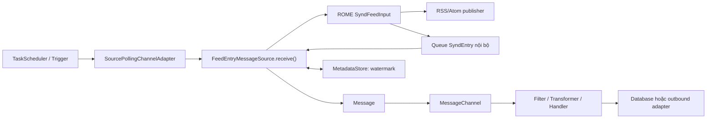
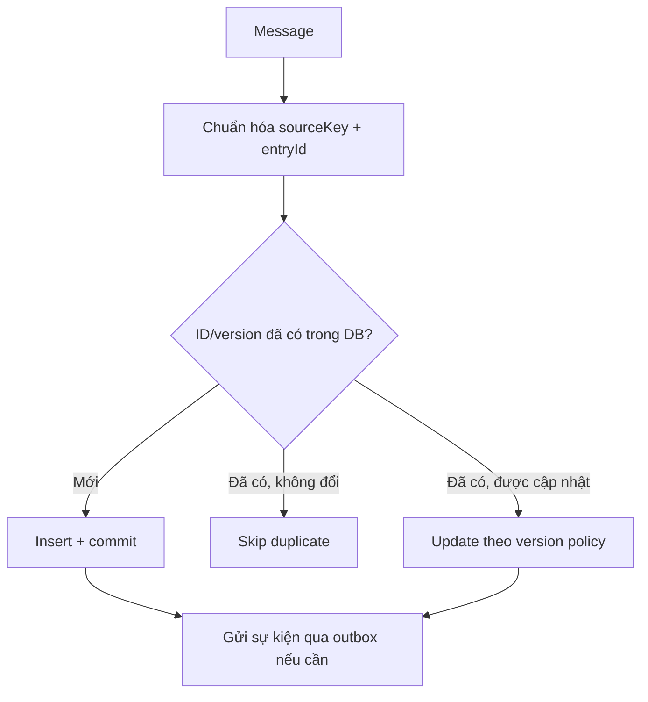

# Feed đọc định kỳ bằng poller trong Spring Integration

## 1. Bài toán: lấy tin mới theo lịch nhưng không làm quá tải nguồn

Một ứng dụng tổng hợp thông báo kỹ thuật đọc nguồn RSS tại `https://feeds.example.org/releases.xml`. Đối tác cập nhật feed vài lần mỗi giờ; mỗi tài liệu có thể chứa hàng chục entry. Ứng dụng cần:

- Kiểm tra nguồn theo lịch, ví dụ cách nhau 30 giây hoặc mỗi 5 phút.
- Chuyển từng mục RSS/Atom thành một `Message<SyndEntry>` rồi gửi qua `MessageChannel`.
- Không phát quá nhiều message một lượt nếu handler database phía sau chậm.
- Giới hạn thời gian kết nối/đọc HTTP, xử lý lỗi 429, 503, XML hỏng và restart.
- Giảm xử lý trùng khi cùng entry xuất hiện ở nhiều lần tải feed.
- Theo dõi được lịch poll, số entry nhận, số entry đã xử lý và thời gian trễ so với nhà xuất bản.

Đây là trọng tâm của **Feed inbound channel adapter** kết hợp **poller**. Trong Spring Integration, feed adapter là một nguồn chủ động **polling**, không phải HTTP server chờ publisher POST dữ liệu. Poller là thành phần điều phối *khi nào* gọi nguồn; `FeedEntryMessageSource` quyết định *entry nào* trả về; channel và handler quyết định *xử lý message như thế nào*.

Bài thuộc chương **Adapter Feed** của module `SPRING_INTEGRATION_ADAPTERS`. Module hướng dẫn kết nối các hệ thống ngoài qua inbound/outbound adapter, gateway, poller và `MessageChannel`; thực hành tích hợp file, SFTP, HTTP, JMS, AMQP, Kafka, database và quản lý hợp đồng message, lỗi, vòng đời kết nối. Đối với feed, khác biệt quan trọng là một tài liệu RSS/Atom có **nhiều entry** nhưng mỗi message thường chỉ chứa **một entry**.

### Mục tiêu học tập

Sau bài này, bạn có thể:

1. Mô tả chính xác mối quan hệ `PollerSpec` → `SourcePollingChannelAdapter` → `FeedEntryMessageSource` → `MessageChannel`.
2. Chọn `fixedDelay`, `fixedRate` hoặc `cron` phù hợp SLA và tải của HTTP publisher.
3. Giải thích `maxMessagesPerPoll`, mặc định của inbound source, tác động của giá trị `0` và rủi ro giá trị âm.
4. Phân biệt **số lần poll**, **số entry được phát** và **số HTTP fetch**.
5. Cấu hình Java DSL, timeout, `MetadataStore`, error channel và điểm đo vận hành.
6. Hiểu các tình huống feed backlog, downstream chậm, dữ liệu ngày không ổn định và nhiều instance cùng poll.
7. Thiết kế bài kiểm thử dựa trên fixture và mock HTTP server, không phụ thuộc Internet công khai.

## 2. Kiến trúc polling của Feed inbound adapter



Hai thành phần phải được phân biệt:

| Thành phần | Nhiệm vụ | Không làm thay |
|---|---|---|
| `TaskScheduler` / `Trigger` | Quyết định thời điểm kích hoạt tác vụ poll | Không parse RSS/Atom |
| `SourcePollingChannelAdapter` | Gọi `MessageSource.receive()`, phát message và quản lý giới hạn mỗi poll | Không phải HTTP publisher |
| `FeedEntryMessageSource` | Tải/parse feed, giữ danh sách entry nội bộ, trả từng `SyndEntry` | Không tự commit nghiệp vụ |
| `SyndFeedInput` của ROME | Parse RSS hoặc Atom thành `SyndFeed` | Không sanitize mọi HTML/URL cho ứng dụng |
| `MetadataStore` | Lưu mốc ngày đã phát theo `metadataKey` | Không phải dedup GUID đầy đủ hoặc DB ledger |
| `MessageChannel` | Kết nối các endpoint | Không tự biến message thành transaction phân tán |
| `MessageHandler` | Xử lý payload, lưu DB hoặc gửi tiếp | Không thay đổi nhịp poll đã cấu hình |

Tài liệu Spring Integration 6.5 mô tả một đặc điểm riêng của feed adapter: khi lần đầu lấy được `SyndFeed`, các `SyndEntry` được đưa vào **queue nội bộ**. Mỗi lần source phát một message, payload của message là **một** `SyndEntry`. Khi queue đã rỗng, source có thể thử cập nhật feed và nạp thêm entry.

### 2.1. Một lần poll không phải một HTTP GET

Ví dụ publisher trả một RSS document có 23 item mới. Poller cấu hình:

```java
Pollers.fixedDelay(30_000)
       .maxMessagesPerPoll(10)
```

Nếu queue có đủ 23 entry và không phát sinh dữ liệu mới, nhịp phát có thể minh họa:

| Lượt kích hoạt | Message tối đa được phát | Entry còn trong queue |
|---|---:|---:|
| Poll 1 | 10 | 13 |
| Poll 2 | 10 | 3 |
| Poll 3 | 3 | 0 |

Các con số trên mô phỏng **hạn mức message**. Không nên kết luận:

- Poll 1 nhất thiết tạo **10 request HTTP**.
- Một HTTP response chỉ chứa **10 entry**.
- Poll 2 chắc chắn gửi thêm một HTTP GET nếu queue vẫn còn entry.
- Poll 3 chắc chắn không cần truy cập nguồn sau khi lấy hết 3 entry.

Trong triển khai thực, source có thể kiểm tra lại feed khi queue rỗng; HTTP cache, thời gian parse, dữ liệu mới và watermark đều ảnh hưởng diễn biến. Muốn biết tần suất HTTP thật, phải đo ở client/mock server thay vì đếm message.

### 2.2. Khi không có entry mới

Nếu source trả `null`, lần poll hiện tại kết thúc dù `maxMessagesPerPoll` còn hạn mức. Lần sau chạy theo trigger. Điều này khác với một `QueueChannel` luôn có sẵn hàng trăm message để lấy.

“Không có message mới” có thể là trạng thái bình thường: publisher chưa phát hành gì, entry đều cũ theo watermark hoặc queue đã hết. Không được tạo cảnh báo lỗi chỉ vì một poll không phát message, trừ khi nghiệp vụ có SLA phát hành rõ ràng.

## 3. Ba kiểu lịch quan trọng: fixedDelay, fixedRate và cron

`Pollers` (package `org.springframework.integration.dsl`) hỗ trợ các factory method `fixedDelay`, `fixedRate`, `cron` và `trigger`. Spring Integration 6.5 cũng cho phép dùng `java.time.Duration` ở các overload tương ứng.

| Kiểu | Lịch tính từ đâu? | Tình huống phù hợp |
|---|---|---|
| `fixedDelay(30_000)` | Chờ thêm 30 giây sau khi tác vụ poll trước **hoàn tất** | Feed HTTP/handler có độ trễ biến động; muốn chừa khoảng nghỉ |
| `fixedRate(30_000)` | Mốc bắt đầu theo chu kỳ danh nghĩa 30 giây | Muốn bám cadence định kỳ, hiểu rõ tài nguyên scheduler |
| `cron("0 */5 * * * *")` | Theo các mốc thời gian lịch, ở đây phút 0,5,10,... | Đồng bộ 5 phút/lần hoặc giờ nghiệp vụ xác định |

### 3.1. Fixed delay: ưu tiên an toàn khi tác vụ chậm

```mermaid
gantt
    title Ví dụ fixedDelay 30 giây, công việc mất 8 giây
    dateFormat HH:mm:ss
    axisFormat %H:%M:%S
    section Polling
    Poll A :a, 09:00:00, 8s
    Nghỉ 30s :b, after a, 30s
    Poll B :c, after b, 8s
    Nghỉ 30s :d, after c, 30s
    Poll C :e, after d, 8s
```



Theo ví dụ, nếu bắt đầu lúc 09:00:00 và mất 8 giây, lần tiếp theo dự kiến có thể bắt đầu quanh 09:00:38. **Độ chính xác thực tế phụ thuộc TaskScheduler, thời gian xử lý và tài nguyên**, không phải cam kết thời gian thực.

Java DSL:

```java
Pollers.fixedDelay(30_000)
       .maxMessagesPerPoll(10);
```

Có thể đặt initial delay, ví dụ:

```java
Pollers.fixedDelay(30_000, 5_000)
       .maxMessagesPerPoll(10);
```

Tham số thứ hai là khoảng chờ đầu theo API `Pollers.fixedDelay(long, long)`. Điều này có ích khi muốn ứng dụng hoàn tất khởi tạo trước khi truy cập HTTP feed; nó không thay thế health check hoặc readiness probe của deployment.

### 3.2. Fixed rate: cadence theo mốc bắt đầu

```java
Pollers.fixedRate(30_000)
       .maxMessagesPerPoll(10);
```

Với một tác vụ chỉ mất 8 giây, mốc danh nghĩa có thể là 09:00:00, 09:00:30, 09:01:00... Không nên khẳng định cứ đúng mốc có **một request HTTP hoàn tất**: scheduler có thể đang bận hoặc task trước đang xử lý.

Khi thời gian fetch/parse/handler **lớn hơn** chu kỳ, `fixedRate` không làm tăng khả năng chịu tải của publisher. Thêm `taskExecutor` hoặc concurrency mà không kiểm soát có thể gây nhiều tác vụ cùng tranh nguồn, tăng số connection và làm khó quản lý watermark.

### 3.3. Cron: theo giờ lịch

Spring cron thường có **6 trường**: giây, phút, giờ, ngày trong tháng, tháng, thứ. Ví dụ:

```java
// Mỗi 5 phút tại giây 0:
Pollers.cron("0 */5 * * * *")
       .maxMessagesPerPoll(20);
```

Hoặc chỉ chạy trong khung giờ:

```java
// Mỗi 10 phút, giờ 9–17 vào thứ Hai đến thứ Sáu:
Pollers.cron("0 */10 9-17 * * MON-FRI")
       .maxMessagesPerPoll(20);
```

Nếu SLA gắn với múi giờ, khai báo rõ thay vì phụ thuộc timezone mặc định của container:

```java
import java.util.TimeZone;

Pollers.cron(
        "0 */5 * * * *",
        TimeZone.getTimeZone("Asia/Ho_Chi_Minh"))
    .maxMessagesPerPoll(20);
```

Code trên là các **phương án chọn một trong ba kiểu trigger** chứ không phải ba lịch chạy chung cho một endpoint. Spring Integration 6.5 có overload `Pollers.cron(String, TimeZone)`. Với múi giờ có DST, cần kiểm tra các mốc giờ bị bỏ qua/lặp vào ngày chuyển mùa; không giả định cron chạy một số lần cố định cho mọi ngày trong năm.

### 3.4. Chọn kiểu lịch theo mục tiêu

| Mục tiêu | Cách bắt đầu hợp lý | Điều cần kiểm tra |
|---|---|---|
| Cập nhật bản tin vài phút một lần | `fixedDelay`, ví dụ 60 giây | HTTP timeout, độ trễ handler, quy định publisher |
| Feed cập nhật đúng mỗi mốc 5 phút | `cron` 5 phút | Timezone, độ trễ phát hành, lịch bảo trì |
| Chạy tại các thời điểm định kỳ danh nghĩa | `fixedRate` | Scheduler/concurrency, handler kéo dài |
| Chỉ đọc ban đêm | Cron theo timezone rõ ràng | Catch-up nếu bỏ qua thông báo ban ngày |
| Nguồn có rate limit nghiêm | Delay dài hơn, backoff và điều tiết nhiều instance | 429, Retry-After, HTTP request thực |

Nếu chưa có bằng chứng cần cadence chặt, `fixedDelay` thường là điểm khởi đầu dễ vận hành cho HTTP polling.

## 4. `maxMessagesPerPoll`: giới hạn message, không phải giới hạn HTTP

Với inbound channel adapter, Spring Integration dùng `SourcePollingChannelAdapter`. Mặc định `maxMessagesPerPoll=1`, khác với một số `PollingConsumer` trên `PollableChannel` thường mặc định `-1` (đọc đến khi source trả `null`).

| Giá trị | Ý nghĩa ở inbound source | Lưu ý |
|---|---|---|
| Không khai báo | Mặc định thông thường **1 message/poll** | Có thể làm backlog dài nếu feed nhiều entry |
| `1` | Gọi source tối đa một lần phát message trong mỗi poll | Dễ dự đoán tải downstream |
| `10` | Phát tối đa 10 message trong mỗi chu kỳ | Cân bằng latency và khả năng xử lý |
| `0` | Không gọi `receive()`; xem như tạm dừng source theo cơ chế đặc biệt từ Spring Integration 5.5 | Không đồng nghĩa stop hẳn endpoint hoặc xoá watermark |
| Số âm, ví dụ `-1` | Tiếp tục gọi `receive()` tới khi trả `null` | Cẩn thận với feed luôn cập nhật, nguồn chậm hoặc queue lớn |

**Giới hạn quan trọng:** số message ở đây không phải kích thước RSS document, không phải số kết nối HTTP, không phải số thread, cũng không phải mức concurrency của database.

### 4.1. Tại sao `-1` có thể gây rủi ro?

Một source có thể không trả `null` ngay nếu khi queue rỗng nó lại fetch feed và liên tục nhận entry mới. Một poll quá dài sẽ chiếm thread và khiến việc dừng/khôi phục theo lifecycle khó dự đoán. Với nguồn có khả năng sinh dữ liệu vô hạn hoặc tác vụ HTTP rất chậm, đặt một giới hạn dương rõ ràng sẽ dễ kiểm soát hơn.

### 4.2. Tại sao `0` không phải circuit breaker?

Giá trị `0` có thể được dùng để **pause** lượt `receive()` khi có cơ chế quản trị thay đổi cấu hình lúc runtime (ví dụ Control Bus), nhưng:

- Không chữa nguyên nhân HTTP 429/503.
- Không huỷ các entry đã ở downstream.
- Không xử lý backlog trong database hoặc broker.
- Không xóa metadata watermark.
- Không thay thế việc stop/start endpoint theo runbook nếu cần bảo trì dài.

Nếu ứng dụng phải pause feed trong production, nên có quyền điều hành, audit và tiêu chí resume rõ ràng thay vì thay bừa tham số trong code.

### 4.3. Lưu ý về `receiveTimeout`

`PollerSpec.receiveTimeout(ms)` chủ yếu liên quan tới việc **nhận từ `PollableChannel`** (ví dụ `QueueChannel`) và không phải timeout HTTP cho nguồn RSS. Feed inbound gọi `FeedEntryMessageSource`; nếu HTTP kết nối/đọc quá lâu, cần cấu hình **HTTP connect/read timeout** tại `Resource` hoặc client HTTP phù hợp.

Đừng đặt `receiveTimeout(1000)` rồi kết luận một request HTTP fetch sẽ dừng sau 1 giây.

## 5. Java DSL: một Feed inbound chạy theo lịch

Đoạn code minh họa dùng **Spring Boot 3.x + Spring Integration 6.5.x tương thích**. Các dependency nên được quản lý qua Spring Boot BOM để những module Spring Integration có phiên bản thống nhất.

### 5.1. Dependency

**`build.gradle`:**

```gradle
dependencies {
    implementation 'org.springframework.boot:spring-boot-starter-integration'
    implementation 'org.springframework.integration:spring-integration-feed'
}
```

`spring-integration-feed` sử dụng ROME; trong dòng 6.5, payload entry nằm ở `com.rometools.rome.feed.synd.SyndEntry`.

### 5.2. Cấu hình theo môi trường

**`application.yml`:**

```yaml
demo:
  feed:
    url: ${FEED_URL:https://feeds.example.org/releases.xml}
    metadata-key: ${FEED_METADATA_KEY:feeds:partner-releases:v1}
    poll-delay-ms: ${FEED_POLL_DELAY_MS:30000}
    max-messages-per-poll: ${FEED_MAX_MESSAGES_PER_POLL:10}
    connect-timeout-ms: ${FEED_CONNECT_TIMEOUT_MS:5000}
    read-timeout-ms: ${FEED_READ_TIMEOUT_MS:10000}
```

Địa chỉ `feeds.example.org` chỉ là URL minh họa. Ở lab, thay bằng mock HTTP server/URL do bạn kiểm soát. Trong production, dùng HTTPS, giới hạn host, kiểm soát redirect và không cấp feed URL trực tiếp từ input chưa được xác thực.

### 5.3. Resource có timeout và Flow có poller

**`ScheduledFeedConfig.java`:**

```java
import java.io.IOException;
import java.net.HttpURLConnection;
import java.net.MalformedURLException;

import com.rometools.rome.feed.synd.SyndEntry;

import org.springframework.beans.factory.annotation.Qualifier;
import org.springframework.beans.factory.annotation.Value;
import org.springframework.context.annotation.Bean;
import org.springframework.context.annotation.Configuration;
import org.springframework.core.io.Resource;
import org.springframework.core.io.UrlResource;
import org.springframework.integration.config.EnableIntegration;
import org.springframework.integration.dsl.IntegrationFlow;
import org.springframework.integration.dsl.Pollers;
import org.springframework.integration.feed.dsl.Feed;
import org.springframework.integration.metadata.MetadataStore;
import org.springframework.integration.metadata.SimpleMetadataStore;

@Configuration
@EnableIntegration
public class ScheduledFeedConfig {

    @Bean("feedPollMetadataStore")
    MetadataStore feedPollMetadataStore() {
        // Chỉ cho lab: mất trạng thái khi ứng dụng khởi động lại.
        return new SimpleMetadataStore();
    }

    @Bean("feedResource")
    Resource feedResource(
            @Value("${demo.feed.url}") String url,
            @Value("${demo.feed.connect-timeout-ms}") int connectMs,
            @Value("${demo.feed.read-timeout-ms}") int readMs)
            throws MalformedURLException {

        return new UrlResource(url) {
            @Override
            protected void customizeConnection(HttpURLConnection connection)
                    throws IOException {
                super.customizeConnection(connection);
                connection.setConnectTimeout(connectMs);
                connection.setReadTimeout(readMs);
            }
        };
    }

    @Bean
    IntegrationFlow scheduledFeedInboundFlow(
            @Qualifier("feedResource") Resource resource,
            @Qualifier("feedPollMetadataStore") MetadataStore metadataStore,
            @Value("${demo.feed.metadata-key}") String metadataKey,
            @Value("${demo.feed.poll-delay-ms}") long delayMs,
            @Value("${demo.feed.max-messages-per-poll}") int maxPerPoll) {

        if (delayMs <= 0 || maxPerPoll <= 0) {
            throw new IllegalArgumentException(
                    "Feed poll delay và max messages phải lớn hơn 0");
        }

        return IntegrationFlow
                .from(Feed.inboundAdapter(resource, metadataKey)
                            .metadataStore(metadataStore)
                            .preserveWireFeed(true),
                    endpoint -> endpoint
                            .id("scheduledFeedInbound")
                            .poller(Pollers.fixedDelay(delayMs)
                                    .maxMessagesPerPoll(maxPerPoll)
                                    .errorChannel("feedPollErrors")))
                .channel("feedEntries")
                .get();
    }

    @Bean
    IntegrationFlow feedConsumerFlow() {
        return IntegrationFlow.from("feedEntries")
                .handle(message -> {
                    SyndEntry entry = (SyndEntry) message.getPayload();
                    String id = entry.getUri();
                    String title = entry.getTitle();
                    System.out.printf("Feed entry: %s | %s%n", id, title);
                    // Production: validate rồi gọi service idempotent.
                })
                .get();
    }

    @Bean
    IntegrationFlow feedPollErrorFlow() {
        return IntegrationFlow.from("feedPollErrors")
                .handle(message -> {
                    Throwable error = (Throwable) message.getPayload();
                    System.err.println(
                            "Feed poll failed: "
                                    + error.getClass().getSimpleName());
                    // Production: phân loại root cause và cảnh báo.
                })
                .get();
    }
}
```

**Đường đi message:**

```text
Poller 30 giây
  -> FeedEntryMessageSource đọc RSS/Atom bằng ROME
  -> Message<SyndEntry>
  -> feedEntries MessageChannel
  -> feedConsumerFlow
  -> nghiệp vụ validate/import/send (triển khai ngoài ví dụ)
```

Một số chi tiết:

1. `Feed.inboundAdapter(resource, metadataKey)` tạo feed message source. Cùng API dùng cho RSS và Atom, vì ROME parse thành `SyndFeed/SyndEntry`.
2. `metadataKey` là namespace watermark của feed; không được nhầm với endpoint ID `scheduledFeedInbound`.
3. `UrlResource.customizeConnection(...)` cấu hình HTTP **connect timeout** và **read timeout**. Timeout ở đây không giới hạn tổng thời gian end-to-end của một chu kỳ; một server có thể gửi dữ liệu từng phần rất chậm.
4. `preserveWireFeed(true)` giữ mô hình feed nguyên gốc trong ROME khi cần, nhưng payload message vẫn là `SyndEntry`.
5. `maxMessagesPerPoll` được gắn vào chính endpoint nguồn. Nó không thay đổi cấu trúc XML của feed.
6. `feedPollErrors` nhận lỗi xảy ra trong polling task; mức độ lỗi/đường lan truyền downstream còn phụ thuộc channel và executor.
7. Ví dụ xử lý một entry bằng `System.out` chỉ để quan sát. Production phải có validation, idempotency, repository và logging đã làm sạch.

### 5.4. Đổi lịch mà không đổi nguồn feed

Trong bean flow, thay đúng **một** cấu hình poller:

**A. Cố định khoảng nghỉ:**

```java
.poller(Pollers.fixedDelay(30_000)
        .maxMessagesPerPoll(10)
        .errorChannel("feedPollErrors"))
```

**B. Mốc bắt đầu định kỳ:**

```java
.poller(Pollers.fixedRate(30_000)
        .maxMessagesPerPoll(10)
        .errorChannel("feedPollErrors"))
```

**C. Mỗi 5 phút theo cron:**

```java
.poller(Pollers.cron("0 */5 * * * *")
        .maxMessagesPerPoll(10)
        .errorChannel("feedPollErrors"))
```

Các đoạn trên là **lựa chọn thay thế** cho `.poller(...)` ở phần 5.3, không phải lời khuyên chạy cả ba trigger cùng lúc. Nếu cần `@InboundChannelAdapter`/`@Poller` annotation thay Java DSL, phải tránh tạo hai inbound source cùng URL và `metadataKey` ngoài ý muốn.

## 6. Sử dụng poller hiệu quả với backlog và handler chậm

### 6.1. Backlog feed không chỉ nằm trên mạng

Một feed có 60 entry mới, nhưng chỉ phát tối đa 5 message mỗi lượt, nghĩa là cần ít nhất 12 lượt để phát hết backlog **trong điều kiện không có entry mới và không có lỗi**. Nếu `fixedDelay=30s`, phải tính thêm thời gian handler và scheduler vào tổng độ trễ.

Với handler đồng bộ mất 2 giây mỗi entry:

```text
maxMessagesPerPoll = 5
thời gian xử lý = 2 s / entry
thời gian một poll có thể ~10 s (chưa tính HTTP và parse)
fixedDelay sau khi poll xong = 30 s
khoảng cách giữa hai lần bắt đầu có thể ~40 s
```

Đây là phép tính minh họa, không phải thông số đảm bảo. Nếu chuyển qua channel bất đồng bộ, thời gian poll có thể ngắn hơn nhưng xuất hiện backlog/giới hạn queue và yêu cầu quản lý retry ở phía consumer.

### 6.2. Vì sao không tăng `maxMessagesPerPoll` lên rất lớn?

Nếu feed chứa nhiều entry, phát tất cả cùng lúc có thể:

- Làm handler database thực hiện một burst INSERT và chiếm connection pool.
- Khiến message được ghi watermark trước khi downstream hoàn tất theo các ranh giới khác nhau.
- Kéo dài một polling task, khiến scheduler phục vụ các endpoint khác chậm.
- Tăng áp lực logging, downstream broker và tài nguyên JVM.
- Khó kiểm soát thời gian bảo trì hoặc graceful stop nếu vòng poll chạy lâu.

Chọn hạn mức dựa trên số entry thực tế mỗi lần xuất bản, latency handler và độ trễ nghiệp vụ cho phép; không chỉ dựa vào tần suất feed.

### 6.3. Channel đồng bộ và bất đồng bộ

| Kiểu channel | Điều thay đổi | Cần phòng ngừa |
|---|---|---|
| `DirectChannel` mặc định/đồng bộ | Handler chạy trong luồng gửi; thời gian handler có thể kéo dài poll | Timeout, khóa tài nguyên, mức tải scheduler |
| `ExecutorChannel` | Gửi message cho executor; handler chạy ở thread khác | Queue/executor bounded, error handling riêng, shutdown |
| `QueueChannel` | Buffer message cho polling consumer phía sau | Không tự bền qua restart, cần poller thứ hai, capacity |
| Broker bên ngoài | Có thể tách ingest và xử lý bền vững hơn | Serialization DTO, ack/retry/DLQ, duplicate delivery |

Không đưa nguyên `SyndEntry` qua nhiều môi trường mà bỏ qua hợp đồng serialization. Thường nên biến đổi thành DTO nhỏ, có khóa nguồn/id ổn định, rồi gửi qua broker nếu cần.

### 6.4. Executor không tự tăng an toàn

`PollerSpec.taskExecutor(executor)` có thể dùng để thực thi polling task bằng executor. Tuy nhiên, tăng concurrency phải đi kèm:

- Bảo vệ việc hai tác vụ cùng tác động đến state trong cùng `FeedEntryMessageSource`.
- Kiểm soát số HTTP connection và tần suất publisher được phép.
- Phân loại ngoại lệ đúng giữa poller và handler bất đồng bộ.
- Giới hạn thread/queue của executor, tránh rơi vào tình trạng đầy backlog không đo được.
- Không dùng executor để giả vờ tạo “exactly-once” khi hai pod cùng poll.

Nếu một nguồn feed đơn giản và nhịp đọc thấp, một flow đồng bộ có giới hạn message thường dễ vận hành hơn cấu hình song song phức tạp.

## 7. MetadataStore và phát lại entry khi poll định kỳ

### 7.1. Watermark của Spring Integration 6.5

Tài liệu **Feed Adapter 6.5** mô tả source dùng `MetadataStore` để ghi **ngày xuất bản mới nhất** của entry được phát theo `metadataKey`. Lần kiểm tra sau sử dụng mốc này để giảm phát lặp.

```text
Feed URL:     https://feeds.example.org/releases.xml
metadataKey:  feeds:partner-releases:v1
metadata:     một timestamp watermark do source quản lý
```

**Không đồng nhất watermark với GUID set**. Một số nhà xuất bản đưa entry đến muộn với `pubDate` cũ, nhiều entry trùng ngày, thiếu ngày, hoặc cập nhật nội dung mà giữ nguyên `publishedDate`. Poller vẫn chạy đúng lịch nhưng source có thể không phát những entry đó theo chính sách ngày của phiên bản đang dùng.

Nếu yêu cầu bắt mọi bản sửa, cần quy trình đối soát theo entry ID và `updatedDate`/checksum hoặc API lịch sử phù hợp; tăng tần suất poll **không tự sửa** giới hạn của thuật toán watermark.

### 7.2. Chọn MetadataStore theo độ bền

| Store | Thích hợp | Điều cần nhớ |
|---|---|---|
| `SimpleMetadataStore` | Lab hoặc dữ liệu có thể quét lại | Memory mất khi context restart |
| `PropertiesPersistingMetadataStore` | Một instance có volume bền và shutdown có kiểm soát | Kiểm tra lúc flush và tình huống crash |
| `JdbcMetadataStore` | Nhiều instance/restart cần state chung | Cần schema/transaction/atomic behavior và monitoring |
| Store tương thích khác | Khi hạ tầng đã có store ngoài process | Phải đánh giá consistency, TTL, backup, quyền |

Trong Java DSL, có thể dùng bean `MetadataStore` khác thay `SimpleMetadataStore`. Chọn `metadataKey` riêng cho mỗi nguồn và môi trường; không để hai feed độc lập dùng chung key nếu không chủ ý phối hợp, vì watermark có thể ghi đè nhau.

**Quan trọng:** ngay cả một store bền vững cũng không bảo đảm việc gửi entry sang DB/broker **exactly-once**; watermark và transaction nghiệp vụ thường là hai hệ thống độc lập.

### 7.3. Entry đến muộn và restart

| Tình huống | Điều có thể xảy ra |
|---|---|
| RSS/Atom không đổi | Lần poll sau thường không có message mới |
| Publisher bổ sung entry ngày mới | Source có thể phát entry mới |
| Entry mới nhưng ngày xuất bản cũ | Có thể bị watermark bỏ qua |
| Cùng entry sửa title nhưng giữ publishedDate | Có thể không phát bản sửa |
| Restart với store memory | Entry cũ có thể được phát lại |
| Store mất key sau lỗi vận hành | Source có thể xem dữ liệu cũ là mới |
| Downstream lỗi sau khi source phát message | Watermark không phải xác nhận commit DB |

Để bảo vệ dữ liệu, ứng dụng nên có khóa nghiệp vụ từ `sourceKey + entry.getUri()` hoặc ID ổn định tương đương, unique constraint và chính sách update version. Trường `entry.getUri()` có thể thiếu ở feed kém chất lượng; khi đó cần chuẩn hóa identity dựa trên hợp đồng publisher, không dùng message ID ngẫu nhiên làm khóa bền.

## 8. Khi HTTP chậm, lỗi 429 hoặc feed hỏng

### 8.1. HTTP timeout khác polling interval

`fixedDelay(30_000)` chỉ mô tả khoảng cách lên lịch. Nếu một HTTP request treo lâu do DNS, TCP, TLS hoặc server không hoàn tất body, polling task có thể chiếm tài nguyên. Cần cấu hình timeout tại tầng đọc HTTP, ví dụ `UrlResource.customizeConnection(HttpURLConnection)` như phần 5.3.

| Tham số | Tác dụng | Không được nhầm với |
|---|---|---|
| Poll delay | Khi nào bắt đầu poll tiếp | HTTP connection timeout |
| HTTP connect timeout | Thời gian chờ tạo kết nối | Tổng thời gian tải mọi entry |
| HTTP read timeout | Thời gian chờ thao tác đọc socket | SLA end-to-end của flow |
| `maxMessagesPerPoll` | Số message được phát trong một chu kỳ | Số byte XML hoặc HTTP request |
| Handler/DB timeout | Giới hạn downstream nghiệp vụ | HTTP read timeout |
| Retry backoff | Khoảng chờ giữa các lần thử sau lỗi | Nhịp poll bình thường |

Mã trên dùng `UrlResource` cho các HTTP/HTTPS connection tương thích với `HttpURLConnection`. Nếu hệ thống dùng HTTP client tùy chỉnh hoặc proxy, cần xác minh cơ chế timeout của chính client đó.

### 8.2. Phân loại lỗi

| Lỗi/triệu chứng | Nguyên nhân có thể | Cách xử lý |
|---|---|---|
| DNS không phân giải | Sai hostname, mạng | Sửa cấu hình/mạng; cảnh báo |
| Connect/read timeout | Publisher chậm hoặc mạng lỗi | Backoff giới hạn, log latency |
| HTTP 401/403 | Credential/quyền không đúng | Dừng retry dồn dập, kiểm tra secret |
| HTTP 404/410 | URL feed không còn | Xác minh publisher, thay URL có kiểm soát |
| HTTP 429 | Vượt quota | Giảm tần suất, tuân thủ `Retry-After` nếu có theo chính sách client |
| HTTP 5xx | Publisher tạm thời gặp lỗi | Retry có giới hạn và jitter |
| XML malformed | Feed trả về XML hỏng | Không cập nhật bừa watermark; cảnh báo nhà cung cấp |
| XML quá lớn / nhiều entry | Bộ nhớ/CPU tăng, parser chậm | Giới hạn response size, thỏa thuận feed nhỏ hơn |
| Consumer ném exception | Lỗi parse/business/DB ở downstream | Không coi là HTTP error; dùng idempotency |
| Poll chạy đúng nhưng không có message | Không có entry mới hoặc watermark lọc | Quan sát source và lịch phát hành |

**Không giả định Feed adapter tự hỗ trợ mọi HTTP tối ưu** như ETag, conditional GET, rate-limit manager hoặc circuit breaker. Nếu cần những chính sách này, phải thiết kế lớp HTTP/Resource hoặc một quy trình fetch riêng có kiểm soát.

### 8.3. Error channel cho polling task

Ở phần 5.3:

```java
.poller(Pollers.fixedDelay(delayMs)
        .maxMessagesPerPoll(maxPerPoll)
        .errorChannel("feedPollErrors"))
```

Điều này giúp định tuyến exception xảy ra trong task poll thành `ErrorMessage` vào channel xử lý lỗi. Handler nên:

1. Phân tích root cause có kiểm soát.
2. Ghi source ID, endpoint ID, mốc thời gian, số lần lỗi và độ trễ.
3. Phân loại transient (timeout/503) so với permanent/config (401/403/404).
4. Áp dụng retry/backoff và đưa cảnh báo nếu vượt SLA.
5. Không log token, cookie, feed raw chứa dữ liệu nhạy cảm hoặc URL có credential.

Nếu chuyển downstream sang `ExecutorChannel` hoặc queue riêng, lỗi của handler có thể xảy ra ngoài polling thread; cần thiết kế error handling ở chính nhánh đó. `errorChannel` không tự khôi phục một transaction đã commit dở hoặc khử trùng khi replay.

## 9. Tính nhất quán và idempotency trong lịch chạy lặp

Một feed thường trả lại nhiều entry cũ. Đồng thời, ứng dụng có thể nhận lại message sau restart hoặc sự cố. Vì thế chọn chiến lược **chấp nhận replay an toàn**:



Ví dụ khóa nghiệp vụ:

```text
sourceKey = partner-release-news
entryId   = urn:example:release:4.1
version   = updatedAt hoặc checksum đã chuẩn hóa
```

Đừng dùng `message.getHeaders().getId()` làm idempotency key: mỗi lần source tạo message mới có thể có ID khác. Nên có unique constraint trong database và so sánh version/hash khi cần phản ánh nội dung sửa.

### 9.1. Tình huống DB commit rồi poller báo lỗi

Một handler có thể đã ghi DB thành công trước khi exception xảy ra ở bước gửi thông báo tiếp theo. Việc cho cả flow retry từ đầu sẽ đưa lại cùng entry vào DB. Dùng **unique key/upsert**, **transactional outbox** hoặc downstream idempotency key để tránh side effect trùng. Không giả định `@Transactional` ở một service DB có thể rollback một HTTP request hoặc message đã được broker nhận.

### 9.2. Nhiều pod cùng poll

Giả sử ba pod cùng chạy `fixedDelay=30s`:

```text
Pod A --HTTP GET--> Feed publisher
Pod B --HTTP GET--> Feed publisher
Pod C --HTTP GET--> Feed publisher
          \--> cùng entry có thể tới ba handler
```

Ba pod có thể tạo nhiều request HTTP, đồng thời cạnh tranh cập nhật watermark. Một `MetadataStore` chia sẻ giúp quản lý state nhưng **không thay thế** leader election, distributed lease hoặc unique constraint của database.

Các lựa chọn thiết kế:

- Một instance được bầu làm **poll leader**; kết quả chuẩn hóa gửi vào broker để nhiều worker xử lý.
- Một job/scheduler riêng tải feed, lưu các entry có ID bền vững vào DB rồi để nhiều consumer xử lý.
- Nhiều pod được phép poll nhưng dùng idempotency/atomic claim ở DB và hạn mức tổng truy cập publisher.

Chọn một mô hình rõ ràng. Không cho tất cả pod poll ngẫu nhiên cùng URL chỉ vì mỗi pod có một `SimpleMetadataStore` riêng.

## 10. Quan sát và vận hành một feed poller

### 10.1. Những metric quan trọng

| Metric / dữ liệu | Giúp trả lời |
|---|---|
| `poll_started_total` / `poll_completed_total` | Lịch trigger có thực sự chạy? |
| `poll_duration_ms` | Thời gian toàn bộ tác vụ poll kéo dài bao lâu? |
| `http_fetch_total`, `http_latency_ms` | Số lần gọi HTTP thực tế và độ trễ |
| `feed_response_bytes` | Feed có đang lớn dần bất thường? |
| `feed_parsed_entries` | Mỗi lần fetch có bao nhiêu entry? |
| `feed_emitted_entries` | Sau watermark, có bao nhiêu message được phát? |
| `duplicate_entry_total` | Bao nhiêu entry bị DB/receiver bỏ qua? |
| `last_successful_poll_at` | Lần đọc thành công gần nhất? |
| `last_new_entry_at` | Độ trễ từ lần phát hiện entry mới gần nhất? |
| `http_429_total` / `http_5xx_total` | Publisher rate limit hay gặp sự cố? |
| `downstream_backlog` | Handler/broker có theo kịp tốc độ phát không? |
| `metadata_store_failures` | Watermark có đang lỗi ghi/đọc? |

Đây là **tên metric gợi ý**, không phải tất cả metric được tạo sẵn bởi Spring Integration. Có thể kết hợp Spring Integration Micrometer/observation, HTTP client metrics và instrumentation tại service nghiệp vụ.

### 10.2. Chẩn đoán nhanh

| Hiện tượng | Điều cần kiểm tra trước |
|---|---|
| Không có entry mới dù feed vừa đổi | Có poll không? HTTP lấy thành công không? Watermark và publishedDate ra sao? |
| Poll chạy quá thường xuyên | FixedRate/cron, taskExecutor, nhiều instance, queue rỗng dẫn tới refetch |
| Một HTTP fetch sinh nhiều message | Đây là hành vi thiết kế: từng `SyndEntry` được phát riêng |
| 30 giây nhưng có lúc 40 giây mới poll | FixedDelay tính từ khi poll xong, handler/HTTP mất thêm thời gian |
| Tăng `maxMessagesPerPoll` nhưng HTTP request không giảm | Nó điều tiết message, không trực tiếp giới hạn HTTP |
| Sau restart nhận lại tin cũ | `SimpleMetadataStore` mất state hoặc key bị đổi |
| Mất tin cập nhật nội dung | PublishedDate/updatedDate của publisher và thuật toán watermark |
| Nhiều pod gây 429 | Mỗi instance poll riêng; cần quota hoặc leader |
| Lỗi DB không đến `feedPollErrors` | Downstream đã chạy bất đồng bộ/khác error path |
| Poll lâu và tốn heap | HTTP response lớn, parse ROME và queue nhiều entry |

## 11. Kiểm thử poller mà không phụ thuộc Internet

Sử dụng Atom/RSS fixture trong test resources khi cần xác minh số entry, cùng **mock HTTP server** khi cần xác minh số request và timeout. Không viết bài test thật trong bước soạn Knowledge; các phần dưới là hướng dẫn lab.

### 11.1. RSS fixture tối thiểu

```xml
<?xml version="1.0" encoding="UTF-8"?>
<rss version="2.0">
  <channel>
    <title>Lab feed</title>
    <link>https://feeds.example.org/</link>
    <description>Thông báo lab</description>
    <item>
      <title>Thông báo A</title>
      <guid isPermaLink="false">entry-a</guid>
      <pubDate>Mon, 23 Nov 2026 01:00:00 GMT</pubDate>
    </item>
    <item>
      <title>Thông báo B</title>
      <guid isPermaLink="false">entry-b</guid>
      <pubDate>Mon, 23 Nov 2026 02:00:00 GMT</pubDate>
    </item>
    <item>
      <title>Thông báo C</title>
      <guid isPermaLink="false">entry-c</guid>
      <pubDate>Mon, 23 Nov 2026 03:00:00 GMT</pubDate>
    </item>
  </channel>
</rss>
```

Ví dụ xây nguồn từ resource cố định:

```java
import org.springframework.core.io.ClassPathResource;
import org.springframework.integration.feed.dsl.Feed;

var fixtureSpec = Feed.inboundAdapter(
        new ClassPathResource("sample-feed.xml"),
        "feeds:lab:polling:v1");
```

Trong test, đưa `sample-feed.xml` vào `src/test/resources` của project lab, dùng metadata store riêng cho mỗi case, tránh trạng thái test trước ảnh hưởng case sau.

### 11.2. Phân biệt test lịch và test HTTP

- **Test với `ClassPathResource`:** kiểm tra việc parse, payload `SyndEntry`, `maxMessagesPerPoll` và watermark mà không bị nhiễu do network.
- **Test với mock HTTP server:** đếm chính xác request, mô phỏng 429/503/timeout, kiểm tra header và kích thước response.
- **Test với fake `MessageSource`:** chỉ tập trung vào trigger, fixedDelay/fixedRate và giới hạn message mà không cần ROME.
- **Test với DB thực nghiệm:** kiểm tra idempotency, duplicate và side effect khi restart.

Không lấy một test “số message được phát” làm bằng chứng trực tiếp cho “số HTTP GET”.

## 12. Bài thực hành theo tình huống

### Lab A — Mặc định một message mỗi lượt poll

1. Cung cấp fixture RSS có 3 entry đều có `pubDate` tăng dần.
2. Tạo feed inbound với `fixedDelay(1000)` nhưng **không** đặt `maxMessagesPerPoll`.
3. Quan sát giới hạn mặc định của `SourcePollingChannelAdapter`.
4. Lặp lại khi đặt `maxMessagesPerPoll(2)`.

**Kết quả:** phân biệt 1 message/poll mặc định với nhiều entry sẵn có trong XML. Cần reset metadata state giữa các lượt test để so sánh công bằng.

### Lab B — So sánh fixedDelay và fixedRate

1. Dùng một fake handler ngủ 2 giây trong môi trường lab (không dùng endpoint thật).
2. Cấu hình `fixedDelay(3000)` và ghi thời điểm bắt đầu/hoàn tất poll.
3. Cấu hình `fixedRate(3000)`, ghi thời gian tương ứng.
4. So sánh khoảng cách giữa các mốc start và quan sát ảnh hưởng của scheduler.

**Kết quả:** fixedDelay tính khoảng nghỉ từ lúc hoàn tất, fixedRate bám chu kỳ bắt đầu danh nghĩa; không cam kết tính thời gian thực.

### Lab C — Backlog 23 entry

1. Tạo fixture có 23 entry mới theo thứ tự thời gian hợp lệ.
2. Đặt `maxMessagesPerPoll(10)` và đo message theo từng lượt.
3. Kiểm tra kỳ vọng tổng 23 message được phát khi không có watermark cũ và parser chấp nhận đủ các entry.
4. Quan sát các lượt 10, 10, 3 theo tình huống mô phỏng; không coi đây là số HTTP GET.

**Kết quả:** hiểu hàng đợi entry nội bộ và cơ chế giới hạn phát message.

### Lab D — HTTP timeout và 503

1. Chạy mock HTTP server trả một RSS hợp lệ.
2. Cho server chậm phản hồi hơn `read-timeout-ms`.
3. Quan sát lỗi poll được gửi tới `feedPollErrors` và ghi phân loại.
4. Đổi server sang HTTP 503, kiểm tra lại.
5. Khôi phục server và xác nhận poller đọc tiếp mà không phải restart toàn ứng dụng.

**Kết quả:** timeout HTTP và polling delay là hai cấu hình riêng; error channel không thay thế retry policy.

### Lab E — MetadataStore qua restart

1. Dùng `SimpleMetadataStore` xử lý một fixture rồi restart context.
2. Quan sát feed có thể phát lại entry cũ.
3. Thay bằng một store bền vững trong lab và giữ nguyên `metadataKey`.
4. Kiểm tra hành vi sau restart và database unique key.

**Kết quả:** watermark chỉ giảm duplicate; idempotency nghiệp vụ vẫn cần thiết.

### Lab F — Cron và timezone

1. Cấu hình `Pollers.cron("0 */5 * * * *")`.
2. Quan sát các mốc bắt đầu ở timezone mặc định của test.
3. Chuyển sang overload có `TimeZone.getTimeZone("Asia/Ho_Chi_Minh")`.
4. Thử một cron chỉ chạy giờ hành chính và kiểm tra kết quả theo thời gian thực tế của môi trường test.

**Kết quả:** cron diễn giải theo lịch và timezone, không phải khoảng nghỉ tính từ lúc task hoàn tất.

### Lab G — Nhiều instance và idempotency

1. Chạy hai instance test cùng poll một mock feed, mỗi instance dùng store memory riêng.
2. Đếm request tới mock server và số message trùng xuất hiện tại downstream.
3. Dùng một nguồn fetch leader hoặc shared coordination phù hợp.
4. Dùng unique constraint trên `sourceKey + entryId` để không tạo hai record nghiệp vụ.

**Kết quả:** mỗi pod có một poller; để điều tiết truy cập và side effect cần chiến lược cluster rõ ràng.

### Lab H — Feed có entry mới đến muộn

1. Phát các entry có `pubDate` T1, T2, T3.
2. Sau khi watermark tiến tới T3, thêm một entry ID mới nhưng `pubDate=T2`.
3. Quan sát khả năng entry đến muộn bị bỏ qua.
4. Đề xuất cơ chế đối soát theo GUID/ID và version nếu nghiệp vụ cần bắt đủ dữ liệu backfill.

**Kết quả:** tăng tần suất poll không sửa được mọi giới hạn của watermark.

### Lab I — Thử pause và resume

1. Với một endpoint lab có khả năng điều hành runtime, thay `maxMessagesPerPoll` thành `0` để không gọi `receive()`.
2. Quan sát không phát thêm entry mới, nhưng metadata và channel không tự xóa.
3. Đặt lại một giá trị dương có kiểm soát hoặc stop/start endpoint qua cơ chế điều hành phù hợp.
4. Kiểm tra backlog và duplicate trước khi mở lại luồng thật.

**Kết quả:** pause ở poller khác với xóa state, xóa backlog hoặc restart publisher.

### Câu hỏi tự kiểm tra

1. Tại sao RSS một tài liệu có 23 item không có nghĩa đã có 23 HTTP GET?
2. `fixedDelay` và `fixedRate` khác nhau ở mốc tính thời gian nào?
3. `maxMessagesPerPoll` mặc định của inbound source khác gì polling consumer trên `QueueChannel`?
4. `maxMessagesPerPoll(0)` và `maxMessagesPerPoll(-1)` khác nhau thế nào?
5. Tại sao `receiveTimeout` không thể thay HTTP read timeout?
6. Nếu handler đồng bộ chậm, lịch `fixedDelay` bị ảnh hưởng thế nào?
7. Watermark trong `MetadataStore` có xác nhận database đã commit không?
8. Hai pod đọc cùng RSS feed sẽ tự động tránh duplicate chưa?
9. Khi publisher trả HTTP 429, tăng `maxMessagesPerPoll` có chắc giảm HTTP traffic?
10. Cron sáu trường và timezone tác động thế nào tới lịch chạy?

## 13. Những nhầm lẫn phổ biến

| Nhầm lẫn | Cách hiểu đúng |
|---|---|
| Feed adapter là cơ chế push từ publisher | Đây là inbound polling source do ứng dụng chủ động kích hoạt |
| Mỗi poll có đúng một HTTP GET | Source có queue entry; khi queue rỗng mới có thể fetch lại |
| Mỗi HTTP response sinh một message chứa toàn XML | Mỗi entry tạo một `Message<SyndEntry>` |
| `fixedDelay` bắt đầu chính xác mỗi 30 giây | Nó đợi 30 giây **sau khi** task hoàn tất |
| `fixedRate` bảo đảm request HTTP kết thúc đúng mốc | Nó định nghĩa cadence theo mốc bắt đầu; scheduler và nguồn có độ trễ |
| Cron là số mili giây giữa các lần poll | Cron dùng mốc theo lịch và timezone |
| Không đặt `maxMessagesPerPoll` sẽ phát hết feed trong một poll | Inbound source mặc định phát tối đa 1 message/poll |
| `maxMessagesPerPoll(10)` nghĩa là 10 HTTP requests | Nó giới hạn số message, không trực tiếp giới hạn HTTP |
| `receiveTimeout` đặt timeout gọi RSS URL | Thường áp dụng khi polling `PollableChannel`, không thay HTTP timeout |
| `maxMessagesPerPoll(-1)` luôn tối ưu nhất | Có thể làm một poll kéo dài và khó dừng với nguồn liên tục |
| `maxMessagesPerPoll(0)` xóa dữ liệu cũ | Chỉ skip `receive()`, không xóa metadata/channel |
| `SimpleMetadataStore` bền vững qua restart | Nó là store memory, trạng thái mất khi khởi động lại |
| Metadata watermark bảo đảm mỗi entry chỉ commit một lần | Cần unique key/idempotency ở tầng nghiệp vụ |
| Đặt `taskExecutor` là tự động có backpressure | Phải cấu hình giới hạn thread/queue và error handling |
| Error channel tự xử lý retry mọi HTTP/DB lỗi | Chỉ nhận lỗi theo phạm vi task/flow, cần policy riêng |
| Feed adapter tự giới hạn kích thước RSS XML | Poller điều tiết message; phải giới hạn response/parse riêng |
| Một app có ba pod vẫn chỉ có một poller | Mỗi instance có endpoint/scheduler riêng nếu không có phối hợp |
| Tăng poll frequency chắc chắn bắt mọi entry bị cập nhật muộn | Watermark/publisher có thể không cho thấy entry đến muộn |

## 14. Tài liệu tham khảo

- [Spring Integration 6.5 — Feed Adapter](https://docs.spring.io/spring-integration/reference/6.5/feed.html): `FeedEntryMessageSource`, queue nội bộ, payload `SyndEntry`, `MetadataStore` và timeout.
- [Spring Integration 6.5 — Channel Adapter](https://docs.spring.io/spring-integration/reference/6.5/channel-adapter.html): `SourcePollingChannelAdapter`, default `maxMessagesPerPoll=1`, `0` và số âm.
- [Spring Integration 6.5 — Message Endpoints](https://docs.spring.io/spring-integration/reference/6.5/endpoint.html): `fixedDelay`, `fixedRate`, `CronTrigger`, poller vs polling consumer và task executor.
- [Spring Integration 6.5 — `Pollers` Java DSL API](https://docs.spring.io/spring-integration/docs/6.5.0/api/org/springframework/integration/dsl/Pollers.html): các factory method cho fixed delay/rate, cron, timezone và custom trigger.
- [Spring Integration 6.5 — `PollerSpec` API](https://docs.spring.io/spring-integration/docs/6.5.0/api/org/springframework/integration/dsl/PollerSpec.html): `maxMessagesPerPoll`, `receiveTimeout`, `errorChannel`, `taskExecutor`, advice.
- [Spring Integration 6.5 — Metadata Store](https://docs.spring.io/spring-integration/reference/6.5/meta-data-store.html): lưu trạng thái, lựa chọn store trong memory và persistent store.
- [ROME project](https://rometools.github.io/rome/): mô hình `SyndFeed` và `SyndEntry` dùng cho RSS/Atom.

**Ghi nhớ:** `FeedEntryMessageSource` biến RSS/Atom thành từng `Message<SyndEntry>`, còn **poller** điều tiết lịch lấy message và số message mỗi lượt. Để vận hành ổn định, cần chọn đúng `fixedDelay/fixedRate/cron`, hiểu queue nội bộ, giới hạn HTTP riêng với `maxMessagesPerPoll`, bảo vệ trạng thái qua restart và triển khai idempotency nghiệp vụ khi feed được phát lại.
