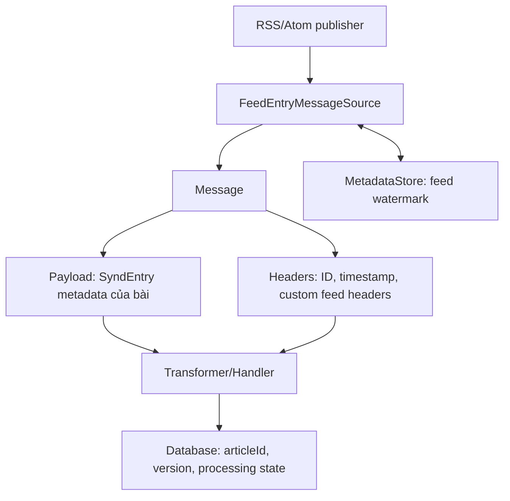
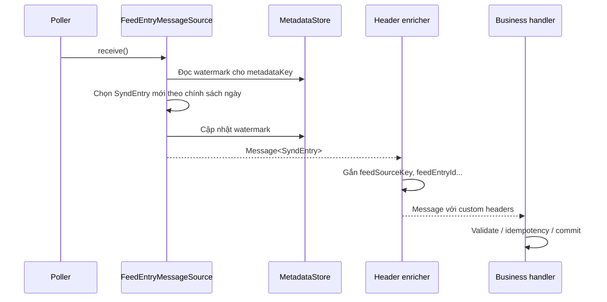

# Feed headers và metadata bài viết trong Spring Integration

## 1. Bài toán: biết bài viết nào, từ nguồn nào, ở phiên bản nào

Một ứng dụng Spring Boot nhận thông báo kỹ thuật từ hai nguồn syndication:

```text
https://feeds.example.org/releases.rss
https://partner.example.org/announcements.atom
```

Nguồn RSS phát item có `guid`, `title`, `link`, `pubDate`; nguồn Atom phát entry có `id`, `updated`, `published`, `summary` và nhiều `link rel` khác nhau. Cả hai đều cần được đưa vào cùng một pipeline Spring Integration để lưu bài viết, gửi thông báo qua Kafka/JMS hoặc chuyển sang HTTP outbound gateway.

Nếu handler chỉ có chuỗi tiêu đề mà không biết **nguồn**, **ID gốc**, **ngày xuất bản** và **phiên bản**, nó dễ nhập trùng bài. Ngược lại, nếu đưa nguyên `SyndEntry` cùng mọi nội dung HTML, enclosure và thông tin phụ vào message headers, hệ thống có thể tạo header quá lớn, rò dữ liệu hoặc khiến message khó serialize khi đi qua broker.

Mục tiêu của bài là phân biệt rõ:

1. **Metadata của bài viết** nằm trong `SyndEntry` do ROME parse.
2. **Message headers** mô tả message đang đi trong Spring Integration.
3. **MetadataStore** của Feed adapter lưu watermark để giảm phát lại entry cũ.
4. **Metadata nghiệp vụ** trong database giúp nhận diện, lưu phiên bản và tránh side effect trùng.

Đây là một bài trong chương **Adapter Feed** thuộc module `SPRING_INTEGRATION_ADAPTERS`. Module hướng tới kết nối các hệ thống ngoài bằng inbound/outbound adapter, gateway, poller và `MessageChannel`; thực hành luồng file, SFTP, HTTP, JMS, AMQP, Kafka và cơ sở dữ liệu, kiểm soát hợp đồng message, lỗi và vòng đời kết nối. Với RSS/Atom, adapter làm nhiệm vụ **biến entry từ nguồn web thành message**; phần gắn context và chuẩn hóa metadata được thiết kế rõ ở các bước sau.

Sau bài học, bạn có thể:

- Đọc và phân biệt `MessageHeaders.ID`, `MessageHeaders.TIMESTAMP` với `SyndEntry.getUri()`, `getPublishedDate()`, `getUpdatedDate()`.
- Trích xuất metadata bài viết từ RSS và Atom qua ROME mà không giả định mọi trường đều hiện diện.
- Tự gắn `feedSourceKey`, `feedEntryId` và ngày phát hành vào header bằng Java DSL `enrichHeaders`.
- Hiểu header propagation qua transformer, router và các outbound adapter, tránh mất context hay ghi đè header chuẩn.
- Phân biệt `metadataKey`/watermark của Feed adapter với khóa idempotency của từng bài viết.
- Xử lý bài sửa lại, ngày trùng, thiếu GUID, nhiều link, HTML, enclosure và nhiều publisher.
- Thiết kế test, log, bảo mật và bảy tình huống lab cho pipeline Feed.

## 2. Ba lớp thông tin trong một `Message<SyndEntry>`

Spring Integration Feed adapter dựa trên ROME. Một lần poll có thể lấy tài liệu RSS/Atom chứa nhiều entry; adapter phát từng entry dưới dạng **payload của một message**:



| Lớp | Ai tạo/quản lý? | Nội dung điển hình | Dùng để làm gì? |
|---|---|---|---|
| `SyndEntry` trong **payload** | ROME từ RSS/Atom | ID gốc, title, link, author, description, categories, dates | Biểu diễn nội dung một bài viết |
| `MessageHeaders` | Spring Messaging và bước enrich của ứng dụng | Message ID/timestamp, feed source key, entry ID đã chuẩn hóa | Định tuyến, tracing, correlation, context |
| `MetadataStore` của source | `FeedEntryMessageSource` | Watermark ngày gần nhất dưới `metadataKey` | Hạn chế entry cũ được phát lại |
| Ledger/bảng nghiệp vụ | Ứng dụng/database | `sourceKey + entryId`, checksum, version, trạng thái import | Idempotency, audit, lưu bản sửa |

**Không có một header chuẩn được Feed adapter cam kết chứa sẵn toàn bộ metadata bài viết.** Mặc định, các trường ROME như `title` hay `publishedDate` nằm ở **payload**. Những header tên `feedSourceKey`, `feedEntryId`, `feedPublishedEpochMs` trong bài là **header do ứng dụng chủ động bổ sung**, không phải constant được Spring Integration Feed tự sinh.

## 3. Header chuẩn của Spring Messaging và header tự định nghĩa

Một `Message<T>` gồm `payload` và `headers`. Với Feed inbound, `T` thông thường là `SyndEntry`.

### 3.1. Các header nền tảng

| Header | Kiểu | Ý nghĩa | Có nên dùng làm khóa bài viết? |
|---|---|---|---|
| `MessageHeaders.ID` / `id` | `UUID` | Danh tính **message instance** trong pipeline | **Không** |
| `MessageHeaders.TIMESTAMP` / `timestamp` | `Long` (epoch milliseconds) | Lúc message được tạo, không phải lúc bài được đăng | **Không** |
| `replyChannel` | Tên kênh hoặc `MessageChannel`, nếu có | Kênh reply của một tương tác request/reply | Không |
| `errorChannel` | Tên kênh hoặc `MessageChannel`, nếu có | Điểm đón lỗi theo ngữ cảnh message | Không |
| `correlationId` | Tùy cấu hình | Liên kết các message trong một workflow | Có thể lấy từ khóa nghiệp vụ, nhưng phải kiểm soát |
| Header riêng của ứng dụng | Ví dụ `feedSourceKey`, `feedEntryId` | Nguồn và ID của bài viết | **Có**, khi xây từ giá trị đã validate |

`id` và `timestamp` là header **read-only** do framework quản lý; tạo message mới hoặc transform có thể khiến chúng thay đổi. Header `timestamp` không đại diện `RSS pubDate` hay `Atom updated`. Không sử dụng `MessageHeaders.ID` làm idempotency key để quyết định bài đã nhập hay chưa.

### 3.2. Đọc header và payload

```java
import com.rometools.rome.feed.synd.SyndEntry;
import org.springframework.messaging.Message;

void inspect(Message<SyndEntry> message) {
    SyndEntry entry = message.getPayload();

    System.out.println("messageId=" + message.getHeaders().getId());
    System.out.println("messageCreatedAtMs=" +
            message.getHeaders().getTimestamp());
    System.out.println("articleId=" + entry.getUri());
    System.out.println("published=" + entry.getPublishedDate());
    System.out.println("updated=" + entry.getUpdatedDate());

    // Chỉ tồn tại sau khi ứng dụng gắn thêm:
    String source = message.getHeaders()
            .get("feedSourceKey", String.class);
    System.out.println("source=" + source);
}
```

Nếu `feedSourceKey` chưa được enrich, `get(...)` có thể trả null. Không giả định adapter tự điền tên feed URL hoặc tenant ID vào header chỉ vì trong cấu hình có `metadataKey`.

### 3.3. Quy ước đặt tên header

Nên dùng tên riêng tránh đụng header nền tảng, ví dụ:

```text
feedSourceKey            = partner-releases
feedEntryId              = tag:example.org,2026:release-41
feedPublishedEpochMs     = 1795412400000
feedUpdatedEpochMs       = 1795416000000
feedSchemaVersion        = 1
```

Các epoch milliseconds trên chỉ là **minh họa giá trị định dạng**; timestamp thực phải được lấy từ dữ liệu entry và kiểm tra. Không sao chép chúng làm test assertion cho bài viết khác.

Header nên giữ **giá trị nhỏ, ổn định và serializable**: source key, entry ID, thời điểm hoặc một correlation ID. Không đặt toàn bộ HTML content, ảnh enclosure, stream, `SyndFeed` hoặc đối tượng ROME phức tạp vào header rồi đẩy nguyên sang JMS/Kafka.

## 4. Metadata bài viết RSS/Atom nằm trong `SyndEntry`

ROME chuẩn hóa RSS và Atom thành `com.rometools.rome.feed.synd.SyndEntry`. Các getter dưới đây cần được dùng theo hợp đồng dữ liệu của publisher:

| Getter | Ý nghĩa | Rủi ro nếu thiếu kiểm tra |
|---|---|---|
| `getUri()` | GUID/entry ID đã được ROME map, có thể null | Không thể lấy làm khóa bền vững nếu publisher thiếu ID |
| `getTitle()` | Tiêu đề | Có thể null/rỗng hoặc chứa ký tự cần escape |
| `getLink()` | Link đại diện của entry | Không phải mọi link đều là trang HTML an toàn để fetch |
| `getLinks()` | Danh sách `SyndLink` với `rel/type/hreflang` | Atom có nhiều link, phải chọn theo mục đích |
| `getPublishedDate()` | Ngày công bố (`Date`), có thể null | Không được thay bằng message timestamp |
| `getUpdatedDate()` | Ngày sửa bài, có thể null | Không nên coi mọi thay đổi của bài là entry mới |
| `getAuthor()`, `getAuthors()` | Tác giả/nguồn ghi công | Có thể trống; không phải identity xác thực |
| `getDescription()` | `SyndContent` mô tả/tóm tắt | Có thể là HTML chưa tin cậy |
| `getContents()` | Nội dung entry, có thể nhiều phần | Không mặc nhiên nhỏ hoặc thuần text |
| `getCategories()` | Danh mục/tag | Cần normalize nếu phục vụ routing |
| `getEnclosures()` | Link media/attachment, MIME, kích thước nếu có | Không tự tải file ngoài vào mạng nội bộ |
| `getSource()` | Feed nguồn được ánh xạ từ metadata **của entry** nếu có | Có thể null; không phải source key đã xác thực của ứng dụng |
| `getWireEntry()` | Mô hình gốc nếu được giữ lại | Có thể phụ thuộc preserveWireFeed và kiểu RSS/Atom |

### 4.1. Tách RSS item

Ví dụ RSS 2.0:

```xml
<item>
  <title>API v4.1 released</title>
  <link>https://feeds.example.org/articles/api-41</link>
  <guid isPermaLink="false">release-api-41</guid>
  <pubDate>Mon, 23 Nov 2026 03:00:00 GMT</pubDate>
  <description>Changes to API endpoints.</description>
  <category>release</category>
</item>
```

ROME có thể map:

```text
entry.getUri()             -> "release-api-41"
entry.getTitle()           -> "API v4.1 released"
entry.getLink()            -> "https://feeds.example.org/articles/api-41"
entry.getPublishedDate()   -> java.util.Date tương ứng pubDate
entry.getDescription()     -> SyndContent với getValue()
entry.getCategories()      -> danh sách SyndCategory
```

Không phải RSS feed nào cũng cung cấp `guid` hoặc `pubDate` hợp lệ. Nếu phải fallback từ `getUri()` sang `getLink()`, đó là **chính sách nghiệp vụ**, chỉ an toàn khi publisher bảo đảm link ổn định; không phải một tính năng idempotency có sẵn của adapter.

### 4.2. Tách Atom entry

Ví dụ Atom 1.0:

```xml
<entry xmlns="http://www.w3.org/2005/Atom">
  <id>tag:example.org,2026:release-41</id>
  <title>API v4.1 released</title>
  <updated>2026-11-23T04:00:00Z</updated>
  <published>2026-11-23T03:00:00Z</published>
  <link rel="alternate" type="text/html"
        href="https://feeds.example.org/articles/api-41"/>
  <summary type="html">&lt;p&gt;Release summary&lt;/p&gt;</summary>
</entry>
```

Trong Atom, `id` biểu diễn danh tính entry, còn `updated` là thời điểm thay đổi. `published` là **tùy chọn**, trong khi `updated` phải có ở một Atom entry hợp lệ. Do đó, dữ liệu nghiệp vụ nên lưu cả published và updated khi nguồn hỗ trợ.

ROME có getter `SyndEntry.getUpdatedDate()` và `getPublishedDate()`; đừng gộp hai thời điểm làm một khi muốn phát hiện bài đã sửa nội dung. Một message có `timestamp` hôm nay không chứng minh bài được công bố hôm nay.

### 4.3. Những trường không nên copy nguyên vào header

`description`, `contents`, `authors`, `categories` và `enclosures` có thể là collection/object phức tạp. Hãy biến đổi thành DTO/domain object khi cần, hoặc chỉ đưa vào header một **giá trị định tuyến đã kiểm tra**, ví dụ `feedCategory=release`, thay vì copy nguyên `List<SyndCategory>` sang message broker.

Chẳng hạn RSS `description` có HTML phải được sanitize/escape trước khi hiển thị. Atom `link rel="enclosure"` có thể dẫn đến HTTP download khác; không tự mở URL do bên ngoài cung cấp nếu không có allowlist để tránh SSRF.

## 5. Cách `MetadataStore` của Feed adapter sử dụng metadata

Theo tài liệu **Spring Integration 6.5**, `FeedEntryMessageSource` lưu **ngày xuất bản mới nhất** của các entry đã phát vào `MetadataStore` bằng khóa `metadataKey`. Khi poll tiếp, watermark này giúp giảm phát lại những item cũ.

```text
Feed source configured:
  resource = https://feeds.example.org/releases.rss
  metadataKey = feed:partner-releases:v1

MetadataStore:
  [feed:partner-releases:v1] -> watermark ngày xuất bản do source quản lý

Message payload:
  SyndEntry(uri, title, link, publishedDate, updatedDate, ...)
```

**Hai thứ không giống nhau:**

- `metadataKey`: tên khóa **của nguồn** trong store, không phải ID của bài viết.
- `entry.getUri()`: ID **của từng item/entry** do publisher cung cấp.

Mỗi feed nên có một `metadataKey` độc lập theo môi trường/nguồn. Nếu hai feed khác nhau dùng chung watermark, trạng thái của một nguồn có thể làm nguồn còn lại bỏ sót thông báo.

### 5.1. Watermark không phải header



Đây là sơ đồ **khái niệm**, không khẳng định tất cả các thao tác xảy ra trong cùng transaction hoặc mọi đường lỗi đều ghi store đúng một lần. Phần ghi metadata của source diễn ra độc lập với commit nghiệp vụ của handler.

### 5.2. Các trường hợp đặc biệt của ngày

| Tình huống | Hạn chế khi chỉ dùng watermark |
|---|---|
| Hai entry cùng publishedDate | Cần kiểm tra điều kiện biên; đừng giả định GUID-set |
| Entry mới đến muộn với publishedDate cũ | Có thể bị bỏ qua dù chưa từng xử lý |
| Cùng ID, title/updatedDate đổi nhưng publishedDate giữ nguyên | Có thể không phát bản sửa |
| RSS item không có pubDate | Hành vi phụ thuộc dữ liệu feed/phiên bản, cần test |
| Atom entry chỉ có updated, thiếu published hợp lệ | Không giả định source 6.5 xử lý như phiên bản mới hơn |
| Metadata store mất dữ liệu khi restart | Item cũ có thể phát lại |
| Handler/database fail sau khi message phát | Watermark không xác nhận import thành công |

Tài liệu Spring Integration ở các phiên bản khác có thể mô tả thuật toán ngày chi tiết hoặc thay đổi thứ tự ưu tiên `updated/published`. Bài này dựa vào hợp đồng của **nhánh 6.5**; khi nâng version, hãy xác minh Javadoc/source và kiểm thử fixture tương ứng.

### 5.3. Chọn store phù hợp

| Store | Ưu điểm | Hạn chế |
|---|---|---|
| `SimpleMetadataStore` | Không cần backend, dễ lab | Trong memory, mất state khi restart |
| `PropertiesPersistingMetadataStore` | Lưu vào filesystem | Cần flush/shutdown, persistent volume; khó điều phối nhiều pod |
| `JdbcMetadataStore` | Bền qua restart, có thể chia sẻ | Cần schema, quyền DB, transaction và vận hành |
| Một store tương thích khác | Có thể khớp hạ tầng hiện có | Phải đánh giá consistency, TTL, key namespace, quyền |

Với production, store bền giúp giảm replay do restart nhưng không tạo **exactly-once** cho database hoặc gửi message sang hệ thống khác. Cần unique key nghiệp vụ.

## 6. Java DSL: gắn headers cho từng bài viết

Ví dụ dưới đây nhắm tới **Spring Boot 3.x và Spring Integration 6.5.x tương thích**. Dùng BOM/dependency management phù hợp để tránh trộn version của các module Spring Integration.

### 6.1. Dependency và cấu hình

**`build.gradle`:**

```gradle
dependencies {
    implementation 'org.springframework.boot:spring-boot-starter-integration'
    implementation 'org.springframework.integration:spring-integration-feed'
}
```

**`application.yml`:**

```yaml
demo:
  feed:
    url: ${FEED_URL:https://feeds.example.org/releases.rss}
    source-key: ${FEED_SOURCE_KEY:partner-releases}
    metadata-key: ${FEED_METADATA_KEY:feed:partner-releases:v1}
    poll-delay-ms: ${FEED_POLL_DELAY_MS:30000}
    max-messages-per-poll: ${FEED_MAX_MESSAGES_PER_POLL:10}
    connect-timeout-ms: ${FEED_CONNECT_TIMEOUT_MS:5000}
    read-timeout-ms: ${FEED_READ_TIMEOUT_MS:10000}
```

`feeds.example.org` là domain minh họa, không phải bảo đảm có feed ở URL này. Khi học, thay bằng mock server hoặc RSS fixture. Không nhận URL tùy ý do một người dùng gửi vào rồi gọi thẳng HTTP: phải có allowlist/SSRF protection cho feed sources.

### 6.2. Cấu hình feed inbound và Header Enricher

**`FeedArticleMetadataConfig.java`:**

```java
import java.io.IOException;
import java.net.HttpURLConnection;
import java.net.MalformedURLException;

import com.rometools.rome.feed.synd.SyndEntry;

import org.springframework.beans.factory.annotation.Qualifier;
import org.springframework.beans.factory.annotation.Value;
import org.springframework.context.annotation.Bean;
import org.springframework.context.annotation.Configuration;
import org.springframework.core.io.Resource;
import org.springframework.core.io.UrlResource;
import org.springframework.integration.config.EnableIntegration;
import org.springframework.integration.dsl.IntegrationFlow;
import org.springframework.integration.dsl.Pollers;
import org.springframework.integration.feed.dsl.Feed;
import org.springframework.integration.metadata.MetadataStore;
import org.springframework.integration.metadata.SimpleMetadataStore;

@Configuration
@EnableIntegration
public class FeedArticleMetadataConfig {

    @Bean("articleFeedMetadataStore")
    MetadataStore articleFeedMetadataStore() {
        // Chỉ dùng cho lab; store memory mất khi ứng dụng restart.
        return new SimpleMetadataStore();
    }

    @Bean("articleFeedResource")
    Resource articleFeedResource(
            @Value("${demo.feed.url}") String feedUrl,
            @Value("${demo.feed.connect-timeout-ms}") int connectMs,
            @Value("${demo.feed.read-timeout-ms}") int readMs)
            throws MalformedURLException {

        return new UrlResource(feedUrl) {
            @Override
            protected void customizeConnection(HttpURLConnection connection)
                    throws IOException {
                super.customizeConnection(connection);
                connection.setConnectTimeout(connectMs);
                connection.setReadTimeout(readMs);
            }
        };
    }

    @Bean
    IntegrationFlow feedInboundWithHeaders(
            @Qualifier("articleFeedResource") Resource resource,
            @Qualifier("articleFeedMetadataStore") MetadataStore store,
            @Value("${demo.feed.source-key}") String sourceKey,
            @Value("${demo.feed.metadata-key}") String metadataKey,
            @Value("${demo.feed.poll-delay-ms}") long delayMs,
            @Value("${demo.feed.max-messages-per-poll}") int maxMessages) {

        return IntegrationFlow
                .from(Feed.inboundAdapter(resource, metadataKey)
                            .metadataStore(store)
                            .preserveWireFeed(true),
                    endpoint -> endpoint
                            .id("feedArticleInbound")
                            .poller(Pollers.fixedDelay(delayMs)
                                    .maxMessagesPerPoll(maxMessages)
                                    .errorChannel("feedArticleErrors")))
                .enrichHeaders(h -> h
                        .header("feedSourceKey", sourceKey)
                        .headerExpression("feedEntryId", "payload.uri")
                        .headerExpression(
                                "feedPublishedEpochMs",
                                "payload.publishedDate != null " +
                                "? payload.publishedDate.time : null")
                        .headerExpression(
                                "feedUpdatedEpochMs",
                                "payload.updatedDate != null " +
                                "? payload.updatedDate.time : null"))
                .channel("feedArticleEntries")
                .get();
    }

    @Bean
    IntegrationFlow feedArticleConsumer() {
        return IntegrationFlow.from("feedArticleEntries")
                .handle(message -> {
                    SyndEntry entry = (SyndEntry) message.getPayload();
                    String source = message.getHeaders()
                            .get("feedSourceKey", String.class);
                    String entryId = message.getHeaders()
                            .get("feedEntryId", String.class);

                    // Demo: log tối thiểu. Production validate + DB upsert.
                    System.out.printf("source=%s; articleId=%s; title=%s%n",
                            source, entryId, entry.getTitle());
                })
                .get();
    }

    @Bean
    IntegrationFlow feedArticleErrorFlow() {
        return IntegrationFlow.from("feedArticleErrors")
                .handle(message -> {
                    Throwable error = (Throwable) message.getPayload();
                    System.err.println("Feed error type="
                            + error.getClass().getSimpleName());
                    // Production: phân loại nguyên nhân và ghi metric/alert.
                })
                .get();
    }
}
```

**Giải thích:**

1. `Feed.inboundAdapter(resource, metadataKey)` nhận RSS hoặc Atom qua ROME và phát một `SyndEntry` cho mỗi message.
2. `metadataStore(...)` lưu watermark nguồn. Nó không đọc/ghi các header `feedSourceKey` hay `feedEntryId`.
3. `enrichHeaders(...)` chạy **sau khi** source đã tạo message. Nó đọc `payload.uri` để gắn `feedEntryId` và lấy `Date.time` để tạo epoch milliseconds dễ truyền qua broker.
4. `headerExpression` với kết quả null có thể khiến header tương ứng **không được thêm**. Handler phải kiểm tra null và thực hiện validation trước khi dùng khóa nghiệp vụ.
5. `sourceKey` là định danh **do ứng dụng cấu hình**, đáng tin hơn việc suy ra một tenant từ link của publisher. Không sao chép nguyên URL vào header nếu URL có token hoặc chứa dữ liệu nhạy cảm.
6. `id`/`timestamp` chuẩn vẫn do Spring Messaging quản lý; ứng dụng không cố ghi đè chúng.
7. `errorChannel` của poller nhận lỗi trong polling task. Exception ở nhánh downstream bất đồng bộ có thể đi theo error path khác.

Ví dụ chỉ ghi log và **không có kiểm thử build trong bước viết Knowledge**. Trong production, thêm validation source ID, chính sách missing metadata và service giao dịch riêng.

### 6.3. Tại sao không copy toàn bộ metadata vào headers?

Khi phát một bài có HTML dài 100 KB, việc đưa `descriptionHtml` vào header:

- Làm message lớn, có thể vượt hạn mức header của broker.
- Khiến log/tracing dễ lộ nội dung ngoài ý muốn.
- Buộc downstream biết mô hình ROME/serialization của Java.
- Khó kiểm soát security khi header được dùng vào routing, HTTP request hay database query.

Thay vào đó, header mang **context ngắn**; payload sau transformer có thể là DTO:

```text
Headers:
  feedSourceKey = partner-releases
  feedEntryId   = tag:example.org,2026:release-41
  feedUpdatedEpochMs = 1795416000000

Payload: ArticleNotice(
    title, alternateUrl, publishedAt, updatedAt,
    summaryHtml, categories, ...
)
```

Các giá trị chỉ minh họa cấu trúc; trong hệ thống thật, mọi ID/URL/ngày phải lấy từ entry đã kiểm tra.

## 7. Mapping metadata bài viết thành DTO rõ hợp đồng

Một DTO hữu ích khi chuyển tiếp JMS/Kafka/HTTP:

```java
import java.time.Instant;
import java.util.List;

public record ArticleNotice(
        String sourceKey,
        String externalId,
        String title,
        String canonicalUrl,
        Instant publishedAt,
        Instant updatedAt,
        String author,
        String summaryHtml,
        List<String> categories) {
}
```

Mapping cần xử lý null, list và URL theo chính sách:

```java
import java.time.Instant;
import java.util.Date;
import java.util.List;
import java.util.Objects;
import java.util.stream.Collectors;

import com.rometools.rome.feed.synd.SyndCategory;
import com.rometools.rome.feed.synd.SyndContent;
import com.rometools.rome.feed.synd.SyndEntry;

public final class ArticleNoticeMapper {

    public ArticleNotice map(String sourceKey, SyndEntry entry) {
        String id = entry.getUri();
        if (id == null || id.isBlank()) {
            // Một RSS nguồn thiếu GUID có thể cần chính sách fallback
            // theo URL đã kiểm tra, nhưng không tự suy bừa từ title.
            throw new IllegalArgumentException(
                    "Entry không có ID ổn định từ publisher");
        }

        Date published = entry.getPublishedDate();
        Date updated = entry.getUpdatedDate();
        SyndContent description = entry.getDescription();

        List<SyndCategory> rawCategories = entry.getCategories();
        List<String> categoryNames = rawCategories == null
                ? List.of()
                : rawCategories.stream()
                    .filter(Objects::nonNull)
                    .map(SyndCategory::getName)
                    .filter(Objects::nonNull)
                    .distinct()
                    .collect(Collectors.toList());

        return new ArticleNotice(
                sourceKey,
                id,
                entry.getTitle(),
                entry.getLink(),
                published == null ? null : published.toInstant(),
                updated == null ? null : updated.toInstant(),
                entry.getAuthor(),
                description == null ? null : description.getValue(),
                categoryNames);
    }
}
```

Đây là **ví dụ mapping**, chưa sanitize HTML hay validate HTTP URL. Việc chọn canonical URL từ `entry.getLink()` chỉ là mặc định cho một publisher đã thỏa thuận dùng nó; với Atom có nhiều `link rel`, phải lựa chọn đúng `alternate` hoặc ngôn ngữ/kiểu media mong muốn.

### 7.1. Nhiều link và enclosure

Atom có thể có:

```xml
<link rel="alternate" type="text/html"
      href="https://feeds.example.org/articles/41"/>
<link rel="self" type="application/atom+xml"
      href="https://feeds.example.org/entries/41.atom"/>
<link rel="enclosure" type="application/pdf"
      href="https://cdn.example.org/files/41.pdf" length="160000"/>
```

Đừng coi mọi link là URL bài viết. Nếu cần chọn liên kết:

```java
import com.rometools.rome.feed.synd.SyndEntry;
import com.rometools.rome.feed.synd.SyndLink;

String alternateHtmlLink(SyndEntry entry) {
    if (entry.getLinks() == null) {
        return null;
    }
    return entry.getLinks().stream()
            .filter(link -> link != null
                    && "alternate".equalsIgnoreCase(link.getRel())
                    && (link.getType() == null
                        || "text/html".equalsIgnoreCase(link.getType())))
            .map(SyndLink::getHref)
            .filter(Objects::nonNull)
            .findFirst()
            .orElse(null);
}
```

Snippet dùng `Objects::nonNull` nên cần import `java.util.Objects` như trong mapper trước. Với RSS, `getLink()` thường là đường dẫn thuận tiện; với Atom, nên dựa vào `rel`, `type` và `hreflang`. Link sau khi chọn vẫn phải qua validation URL và allowlist trước khi ứng dụng tải nội dung.

### 7.2. Cấu trúc categories và author

`entry.getCategories()` trả về collection `SyndCategory` chứ không phải chuỗi phân cách bằng dấu phẩy. Có thể chuyển thành `List<String>`, chuẩn hóa case/whitespace, kiểm tra allowlist trước khi dùng làm routing key. `entry.getAuthors()` trả danh sách người/tổ chức; `getAuthor()` chỉ là cách lấy đơn giản, không chắc chứa mọi người đóng góp.

Không dùng tên tác giả để suy ra danh tính đăng nhập hoặc quyền của hệ thống nguồn. **SourceKey của ứng dụng** mới xác định cấu hình feed đã duyệt; trường author chỉ là metadata của bài.

## 8. Header propagation qua transformer, router và outbound

### 8.1. Khi transformer trả payload

Các transformer thông thường trả **payload mới** và Spring Integration có thể sao chép header từ message đầu vào sang message đầu ra. Ví dụ:

```java
// Đoạn bổ sung cho IntegrationFlow đang nhận SyndEntry:
.transform(SyndEntry.class,
        entry -> new ArticleNoticeMapper()
                .map("partner-releases", entry))
```

Trong một flow thật, nên inject mapper/sourceKey thay vì `new` trong mỗi lần transform; snippet chỉ để thấy rằng `transform` trả **ArticleNotice** chứ không tự tạo full `Message`. Header `feedSourceKey` và `feedEntryId` đã enrich trước đó thường được propagate.

### 8.2. Khi transformer trả nguyên `Message` mới

Nếu transformer tự trả `Message<ArticleNotice>`, lập trình viên phải chú ý **copy header cần thiết**:

```java
import org.springframework.messaging.Message;
import org.springframework.integration.support.MessageBuilder;

Message<ArticleNotice> withPayload(
        Message<SyndEntry> input,
        ArticleNoticeMapper mapper) {

    ArticleNotice notice = mapper.map(
            input.getHeaders().get("feedSourceKey", String.class),
            input.getPayload());

    return MessageBuilder.withPayload(notice)
            .copyHeaders(input.getHeaders())
            .build();
}
```

Ở đây `copyHeaders(...)` sao chép context có thể truyền đi; `id` và `timestamp` được framework kiểm soát và có thể được tạo mới theo quy tắc read-only. Khi code không copy headers mà tạo `MessageBuilder.withPayload(notice).build()`, các header ứng dụng như `feedSourceKey` có nguy cơ bị mất.

**Không phải mọi handler đều giữ hoặc sao chép headers giống nhau**: với các endpoint message-producing, Spring Integration có cơ chế propagation; với message tự xây dựng, connector/broker mapper hoặc header filter, phải kiểm tra hợp đồng cụ thể.

### 8.3. Router dùng header đã kiểm tra

Ví dụ bạn muốn phân chia `sourceKey`:

```text
feedSourceKey = partner-releases -> releaseProcessingChannel
feedSourceKey = security-news   -> securityProcessingChannel
```

Header có thể thuận tiện cho route, nhưng phải được tạo từ cấu hình đáng tin. Nếu cần route theo `category`, hãy normalize/allowlist danh mục trước. Không nhận một header `targetChannel` tùy ý từ RSS rồi cho nó quyết định bean/channel nội bộ mà không kiểm soát.

### 8.4. Đi qua Kafka/JMS/AMQP/HTTP

Khi `Message<ArticleNotice>` được gửi sang adapter outbound, không phải header nội bộ nào cũng được map 1:1 sang giao thức đích:

| Đích | Điều cần làm |
|---|---|
| Kafka | Đặt record key ổn định từ source+entry ID, chọn header mapping và serializer cho payload |
| JMS/AMQP | Chọn DTO/JSON phù hợp, tránh các object ROME và collection phức tạp trong headers |
| HTTP outbound gateway | Chỉ đưa các header được phép thành HTTP headers; không lộ internal context/token |
| Database | Dùng unique constraint và version/checksum; không lấy message UUID làm primary key bài |

Trong Spring Integration, mỗi adapter có quy tắc header mapper và danh sách header được hỗ trợ riêng. **Chuyển sang broker không mặc nhiên giữ nguyên mọi header**, và cũng không tự bảo đảm tiêu thụ một lần.

## 9. Metadata cho tracing, correlation và idempotency

### 9.1. Khóa bài viết và khóa message khác nhau

Giả sử cùng bài được phát lại sau restart:

```text
Message lần 1:
  id = UUID-A
  feedSourceKey = partner-releases
  feedEntryId = tag:example.org,2026:release-41

Message lần 2:
  id = UUID-B
  feedSourceKey = partner-releases
  feedEntryId = tag:example.org,2026:release-41
```

`UUID-A` và `UUID-B` chỉ đại diện hai message instance. Khóa bền vững nên là:

```text
articleKey = (feedSourceKey, feedEntryId)
```

Nếu cần phân biệt **bản sửa** của cùng entry, thêm `updatedAt` hoặc content checksum theo hợp đồng. Một publisher có thể thay `title` nhưng giữ `id` và `published`; nếu chỉ dựa vào watermark published date thì bản sửa có thể không được phát lại.

### 9.2. Ledger database mẫu

Ví dụ PostgreSQL:

```sql
CREATE TABLE feed_articles (
    source_key     VARCHAR(128) NOT NULL,
    external_id    VARCHAR(768) NOT NULL,
    title          VARCHAR(1024),
    canonical_url  VARCHAR(2048),
    published_at   TIMESTAMPTZ,
    updated_at     TIMESTAMPTZ,
    content_sha256 CHAR(64),
    received_at    TIMESTAMPTZ NOT NULL DEFAULT now(),
    PRIMARY KEY (source_key, external_id)
);
```

Khi nhập:

1. Validate `sourceKey` và `externalId` đã có chính sách rõ.
2. Chuẩn hóa ngày UTC, title/link/category, tính checksum khi nghiệp vụ cần.
3. Ghi theo upsert/transaction với unique constraint `(source_key, external_id)`.
4. Nếu bài cũ có `updatedAt` mới hơn hoặc hash khác, áp dụng chính sách **cập nhật bài** thay vì vô tình thêm bản sao.
5. Nếu cần thông báo downstream, sử dụng outbox/idempotency key để tránh gửi trùng khi retry.

**Không dùng watermark của adapter làm bằng chứng DB đã commit.** Source có thể phát message rồi cập nhật metadata trong khi handler tiếp theo lỗi.

### 9.3. Correlation và tracing

Một khóa correlation dễ tìm:

```text
correlationKey = partner-releases|tag:example.org,2026:release-41
```

Có thể ghi nó vào custom header (ví dụ `feedCorrelationKey`), MDC/log hoặc trace attribute **sau khi validate/giới hạn độ dài**. Nếu entry ID dài hoặc có dữ liệu nhạy cảm, cân nhắc hash thành một định danh ngắn cho telemetry.

Không tự ghi đè `MessageHeaders.ID` hoặc `timestamp`; giữ chúng cho lifecycle của message. Cũng không đặt toàn bộ RSS XML vào tracing baggage hoặc metric labels vì gây bùng nổ cardinality và rò dữ liệu.

## 10. Các lỗi metadata phổ biến và cách xử lý

| Triệu chứng | Khả năng | Hướng chẩn đoán |
|---|---|---|
| Header `feedEntryId` null | Publisher thiếu GUID/id hoặc enricher chưa chạy | Đọc `payload.getUri()`, kiểm tra vị trí enrich, áp dụng policy thiếu ID |
| Handler nhầm timestamp của message là ngày bài | Dùng `MessageHeaders.TIMESTAMP` thay vì `getPublishedDate()` | Phân biệt message creation và publication date |
| Bài sửa nội dung nhưng không được nhập lại | Feed watermark dựa published date | Đối soát updated/checksum qua nguồn lịch sử hoặc cơ chế khác |
| Hai nguồn khác nhau ghi đè bản ghi | Dùng duy nhất `entryId` mà không có `sourceKey` | Dùng khóa kép và namespace rõ |
| Sau transformer mất source key | Transformer tự trả Message mới không copy header | Kiểm tra header propagation/copyHeaders |
| Header chứa `SyndContent` không serialize được | Chép object ROME vào headers | Trích scalar nhỏ hoặc DTO ở payload |
| Lỗi cast `feedPublishedEpochMs` thành `String` | Giá trị SpEL là `Long` | Dùng kiểu phù hợp hoặc chuẩn hóa format |
| Feed có nhiều link, mở nhầm enclosure | Chọn link đầu tiên hoặc không xét `rel` | Xác định canonical/alternate theo type và allowlist |
| Payload `SyndEntry` không có author | Feed thiếu trường hoặc ROME mapping khác | Coi author optional và kiểm tra `getAuthors()` |
| Restart khiến bài cũ xuất hiện lại | Dùng `SimpleMetadataStore` | Dùng store bền nếu cần; DB idempotency vẫn bắt buộc |
| Ngày trùng/đến muộn gây bỏ sót | Watermark đơn theo thời gian | Test fixture, dùng ID/version-based reconciliation |
| Nhiều pod cùng phát một entry | Store không chia sẻ hoặc không có claim nghiệp vụ | Unique key, leader/scheduling, store chung phù hợp |
| Bị XSS/SSRF sau khi lưu bài | Tin HTML/link từ RSS/Atom như dữ liệu đáng tin | Sanitize HTML, allowlist URL/redirect, giới hạn fetch |

### 10.1. Ghi log an toàn

Ví dụ log **do ứng dụng thiết kế**:

```text
event=feed_entry_received
sourceKey=partner-releases
entryIdHash=7c3a...93e2
messageId=0b7c...81fa
publishedAt=2026-11-23T03:00:00Z
updatedAt=2026-11-23T04:00:00Z
result=ACCEPTED
```

Không ghi nguyên HTML content, cookie, token trong feed URL hoặc enclosure URL có tham số nhạy cảm. Với metric, ưu tiên các chiều có cardinality thấp như `sourceKey` và trạng thái; không gắn mỗi `entryId` thành một metric label.

## 11. Kiểm thử header và metadata không phụ thuộc Internet

Tạo file RSS/Atom fixture trong **test resources của dự án thực hành** (không nằm trong các file Knowledge của bài này), hoặc tạo trực tiếp `SyndEntryImpl` để test mapper. Một bộ test tốt cần tách:

| Loại test | Kiểm tra điều gì? |
|---|---|
| Unit test `SyndEntryImpl` | Mapping URI, title, published/updated, categories, null handling |
| Java DSL flow test | Header `feedSourceKey`, `feedEntryId` được thêm vào Message |
| Header propagation test | Transformer DTO giữ context, tự tạo Message không copy headers gây thiếu context |
| Fixture Atom/RSS | ROME mapping GUID/id, `pubDate`, `updated`, link/description |
| MetadataStore test | Một entry phát lại sau restart hoặc sau đổi key có đúng kỳ vọng không |
| DB integration test | Unique key ngăn nhập trùng, update version có kiểm soát |
| Mock HTTP test | Timeout, 429/503, XML hỏng và error channel |
| Security test | HTML nguy hiểm, link/enclosure không hợp lệ, header quá dài |

### 11.1. Unit test ý tưởng với ROME

```java
import java.util.Date;
import com.rometools.rome.feed.synd.SyndEntry;
import com.rometools.rome.feed.synd.SyndEntryImpl;

SyndEntry entry = new SyndEntryImpl();
entry.setUri("tag:example.org,2026:release-41");
entry.setTitle("API v4.1 released");
entry.setPublishedDate(new Date(1_795_412_400_000L));
entry.setUpdatedDate(new Date(1_795_416_000_000L));

ArticleNotice result = new ArticleNoticeMapper()
        .map("partner-releases", entry);

// Kỳ vọng:
// result.sourceKey() = "partner-releases"
// result.externalId() = "tag:example.org,2026:release-41"
// result.publishedAt() và result.updatedAt() khác nhau
```

Những con số epoch milliseconds trong snippet là **dữ liệu ví dụ**. Khi viết test thực, tạo chúng từ `Instant.parse("...")` cho dễ đọc và tránh nhầm timezone, sau đó xác nhận mapping theo giá trị nguồn.

### 11.2. Verify header trong một IntegrationFlow

Từ phía sau Header Enricher, quan sát:

```text
payload type: com.rometools.rome.feed.synd.SyndEntry
headers.id: UUID từ Spring
headers.timestamp: thời điểm message
headers.feedSourceKey: partner-releases
headers.feedEntryId: tag:example.org,2026:release-41
headers.feedPublishedEpochMs: Long hoặc absent nếu null
headers.feedUpdatedEpochMs: Long hoặc absent nếu null
```

Hãy thử một entry thiếu GUID và một entry thiếu publishedDate để kiểm tra hành vi thật. Không dùng một kỳ vọng “mọi item đều có đủ header” nếu publisher không cung cấp dữ liệu đó.

## 12. Bài thực hành theo tình huống

### Lab A — Đọc headers mặc định

1. Chuẩn bị một RSS fixture có hai item, mỗi item có `guid`/`pubDate`.
2. Chạy Feed inbound flow với `maxMessagesPerPoll(1)` và consumer ghi loại payload, danh sách key của headers.
3. Xác định `id` và `timestamp` của message; so với `entry.getUri()` và `getPublishedDate()`.
4. Kiểm tra xem có header `feedEntryId` **trước khi** thêm Header Enricher hay không.

**Kết quả:** metadata của bài ban đầu nằm trong payload; header application-specific chưa tự có.

### Lab B — Tạo custom headers

1. Bật `.enrichHeaders(...)` theo phần 6.
2. Quan sát `feedSourceKey`, `feedEntryId`, `feedPublishedEpochMs`.
3. Thay `sourceKey` bằng giá trị lab khác và kiểm tra header tương ứng thay đổi.
4. Đặt một entry `publishedDate=null`; xác minh header ngày thiếu hoặc được xử lý theo policy của bạn, không lỗi ép kiểu trong consumer.

**Kết quả:** hiểu cách enrich headers từ cấu hình và payload.

### Lab C — Metadata của Atom nhiều link

1. Tạo Atom fixture có `id`, `published`, `updated` và ba link `alternate/self/enclosure`.
2. Parse bằng ROME, xem `getLinks()`.
3. Chọn link đúng bằng `rel=alternate` và `type=text/html`; không tự tải enclosure.
4. Đối chiếu `getPublishedDate()` và `getUpdatedDate()`.

**Kết quả:** link, ID và timestamp phục vụ ba mục đích khác nhau.

### Lab D — Header propagation qua transformer

1. Gửi message có `feedSourceKey`/`feedEntryId` qua transformer trả DTO payload.
2. Kiểm tra header còn tồn tại ở consumer sau transformer.
3. Thử transformer tự tạo `MessageBuilder.withPayload(dto).build()` mà không copy headers.
4. Sửa bằng `copyHeaders(input.getHeaders())` và quan sát lại; xác minh `id`/`timestamp` được framework quản lý.

**Kết quả:** biết khi nào phải bảo toàn headers thủ công.

### Lab E — Restart với MetadataStore

1. Dùng `SimpleMetadataStore` cho feed và giữ nguyên `metadataKey`.
2. Poll hai entry rồi restart context; quan sát khả năng phát lại.
3. Thay bằng store bền vững trong lab, poll và restart lại.
4. Xác minh database có unique key `sourceKey + entryId` vẫn không tạo bản ghi trùng.

**Kết quả:** feed watermark và idempotency bài viết là hai lớp khác nhau.

### Lab F — Cùng ID ở hai nguồn

1. Tạo hai feed khác nhau có item cùng `guid=release-41`.
2. Cấu hình hai `feedSourceKey` và hai `metadataKey` độc lập.
3. Quan sát hai message có `feedEntryId` giống nhau nhưng `feedSourceKey` khác nhau.
4. Lưu vào DB với unique key kép; xác minh không ghi đè bản ghi của nguồn khác.

**Kết quả:** ID của entry phải được diễn giải trong namespace của nguồn.

### Lab G — Bài đã cập nhật, nhưng publishedDate không đổi

1. Tạo Atom entry với `id=A`, `published=T1`, `updated=T2`.
2. Cho consumer nhập vào DB.
3. Sửa nội dung và đặt `updated=T3`, giữ `id`/`published` như cũ.
4. Quan sát giới hạn của source watermark 6.5; nếu entry không được phát lại, dùng bài test đối soát snapshot/historical API riêng.
5. Khi ứng dụng được cung cấp bản cập nhật theo cơ chế đã chọn, xác minh logic version/checksum trong DB.

**Kết quả:** muốn theo dõi bản sửa cần metadata nghiệp vụ, không chỉ tăng nhịp poll.

### Lab H — Bảo vệ header, HTML và URL

1. Tạo entry có title/description chứa HTML và link trỏ ra một host ngoài allowlist.
2. Không đưa HTML nguyên vào header; chỉ lấy ID, nguồn và ngày.
3. Trước khi hiển thị, escape/sanitize HTML phù hợp.
4. Thử gửi payload/headers qua một broker test, kiểm tra serializer và kích thước header.
5. Đảm bảo không có token hoặc raw URL nhạy cảm trong log.

**Kết quả:** metadata hợp lệ về mặt XML chưa chắc an toàn để sử dụng trong hệ thống phân tán.

### Câu hỏi tự kiểm tra

1. Khác biệt giữa `MessageHeaders.ID` và `SyndEntry.getUri()` là gì?
2. Tại sao `MessageHeaders.TIMESTAMP` không phải `pubDate` của RSS?
3. Feed adapter có mặc định tạo header `feedEntryId` không?
4. `metadataKey` của nguồn và `feedEntryId` có phải cùng một khóa?
5. Nếu Atom entry có `updated` nhưng thiếu `published`, xử lý ra sao?
6. Vì sao transformer trả full `Message` có thể làm mất headers?
7. Khi nào nên dùng `getLinks()` thay `getLink()`?
8. Tại sao không đặt `SyndContent`/HTML dài vào message headers?
9. Tại sao bài sửa cùng ID có thể bị watermark bỏ qua?
10. Khóa database nào ngăn hai publisher có cùng GUID ghi đè lẫn nhau?

## 13. Những nhầm lẫn thường gặp

| Nhầm lẫn | Cách hiểu đúng |
|---|---|
| Adapter Feed tự sinh header `feed_title`/`feed_guid` cho từng bài | ROME giữ metadata trong payload; header custom phải do flow tạo |
| Message UUID là ID của bài viết | UUID là ID message, có thể đổi qua retry/transform |
| Timestamp message là ngày xuất bản | Nó là thời điểm tạo message |
| `metadataKey` là khóa của từng Atom/RSS item | Nó là tên khóa watermark của feed source |
| Store watermark bảo đảm nhập DB chính xác một lần | Cần unique constraint/idempotency nghiệp vụ |
| Mọi RSS item đều có `guid`/`pubDate` hợp lệ | Có thể thiếu; cần hợp đồng fallback/validation |
| Atom `published` bắt buộc như `updated` | `updated` bắt buộc, `published` tùy chọn |
| Chỉ cần `getLink()` là lấy đúng canonical HTML | Atom có nhiều link với rel/type/language khác nhau |
| `getSource()` luôn có URL feed đã cấu hình | Có thể null; không thay source key tin cậy |
| `preserveWireFeed(true)` biến payload thành XML hoặc thêm header mới | Nó chỉ ảnh hưởng giữ wire model trong ROME |
| Tạo Message mới từ DTO sẽ tự giữ hết mọi header cũ | Cần kiểm tra propagation/copyHeaders |
| Header nào cũng nên được đưa thẳng qua broker/HTTP | Header mapping khác nhau theo adapter; cần whitelist |
| Truyền `SyndEntry` nguyên qua broker là hợp đồng ổn định | DTO/schema rõ ràng phù hợp hơn |
| HTML từ RSS/Atom parse được là HTML đáng tin | Cần sanitize trước render |
| Enclosure/link có thể fetch tự do | Có thể gây SSRF hoặc tải nội dung không mong muốn |
| Dùng memory metadata store là giữ được trạng thái sau restart | `SimpleMetadataStore` mất state khi context dừng |
| Dùng chung ID giữa hai nguồn là cùng một bài | Identity phải có `sourceKey` |

## 14. Tài liệu tham khảo

- [Spring Integration 6.5 — Feed Adapter](https://docs.spring.io/spring-integration/reference/6.5/feed.html): `Message<SyndEntry>`, queue, `MetadataStore` và `metadataKey`.
- [FeedEntryMessageSource API 6.5](https://www.springframework.org/spring-integration/docs/6.5.0/api/org/springframework/integration/feed/inbound/FeedEntryMessageSource.html): constructor URL/Resource, `setMetadataStore`, `setPreserveWireFeed`, `setSyndFeedInput`.
- [Spring Integration 6.5 — Message](https://docs.spring.io/spring-integration/reference/6.5/message.html): `MessageHeaders`, read-only ID/timestamp, header propagation và mutability.
- [Spring Integration 6.5 — Header Enricher](https://docs.spring.io/spring-integration/reference/6.5/content-enrichment.html): thêm headers bằng Java DSL, biểu thức SpEL và custom values.
- [Spring Integration 6.5 — Metadata Store](https://docs.spring.io/spring-integration/reference/6.5/meta-data-store.html): `SimpleMetadataStore`, `JdbcMetadataStore`, store bền và giới hạn restart.
- [ROME SyndEntry API](https://javadoc.io/static/com.rometools/rome/2.1.0/com/rometools/rome/feed/synd/SyndEntry.html): URI, title, links, dates, contents, categories, author và enclosures.
- [RFC 4287 — Atom Syndication](https://www.rfc-editor.org/rfc/rfc4287): `entry/id`, `published`, `updated`, `link` và `content`.

**Ghi nhớ:** trong Feed adapter, **payload `SyndEntry` mang dữ liệu bài viết**, **headers mang context của message/luồng xử lý**, **MetadataStore mang watermark của source**, còn **database ledger mang trạng thái nghiệp vụ**. Khi cần truy vết và chống trùng, hãy lấy khóa ổn định từ **sourceKey + entryId**, enrich những header nhỏ và tin cậy, bảo toàn context qua transformer, và xử lý bài cập nhật theo version/checksum thay vì dựa vào message ID hoặc ngày poll.
