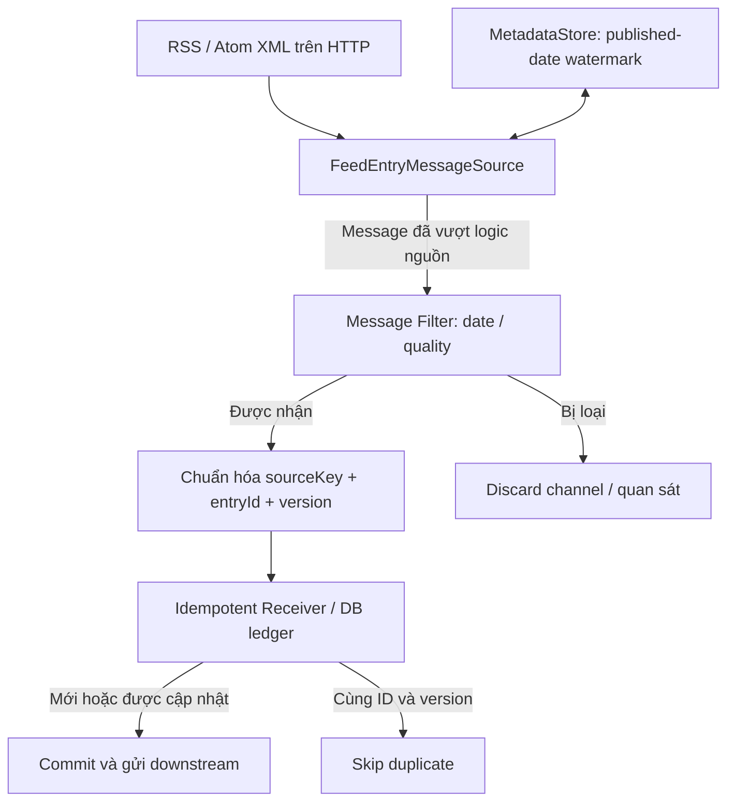
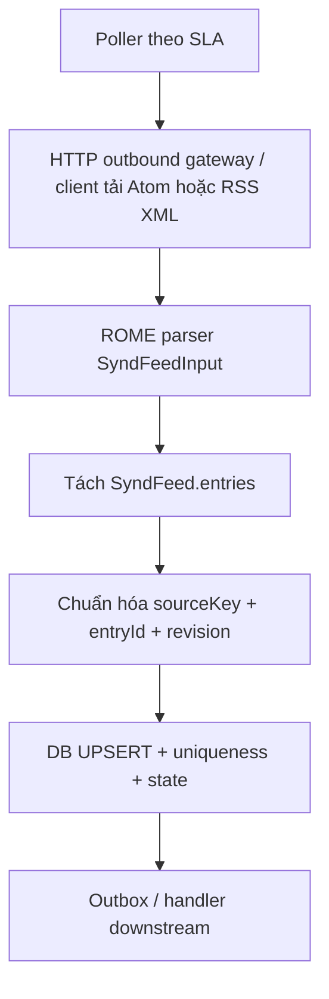
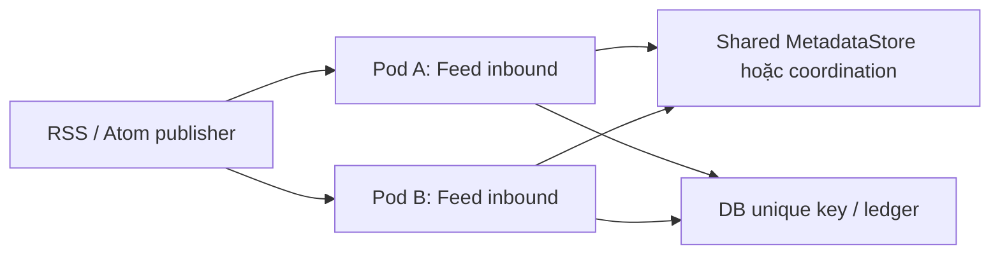

# Feed filter theo thời gian hoặc id trong Spring Integration

## 1. Bài toán và mục tiêu

Ứng dụng Spring Boot của một nền tảng tích hợp định kỳ đọc RSS/Atom từ `https://feeds.example.org/releases.xml`. Feed hiện chứa 50 bài; mỗi lần poll, phần lớn bài đã được xử lý. Tuy vậy, những tình huống sau đều có thể xảy ra:

- Bài **A** có `publishedDate` mới và ID chưa từng xuất hiện: cần tiếp nhận.
- Bài **B** đã xuất hiện ở lần poll trước, vẫn giữ nguyên nội dung: không cần ghi DB hoặc gửi thông báo lần nữa.
- Bài **C** được nhà xuất bản đưa vào feed muộn, nhưng `publishedDate` cũ hơn watermark: vẫn có thể cần xử lý.
- Bài **D** giữ nguyên GUID/Atom ID và ngày xuất bản, chỉ đổi `updatedDate` hoặc nội dung: cần chính sách cập nhật.
- Bài **E** có thời gian xuất bản không hợp lệ, GUID thiếu hoặc link bị thay đổi: cần phân loại, không tự suy đoán.
- Ứng dụng restart hoặc hai pod cùng poll: không được gây ra bản ghi/side effect trùng.

Đây là bài toán **“Feed filter theo thời gian hoặc id”** trong chương **Adapter Feed** thuộc module `SPRING_INTEGRATION_ADAPTERS`. Phạm vi module là kết nối hệ thống ngoài qua inbound/outbound adapter, gateway, poller và `MessageChannel`; thực hành tích hợp file, SFTP, HTTP, JMS, AMQP, Kafka, cơ sở dữ liệu, hợp đồng message, lỗi và vòng đời kết nối. Feed inbound sử dụng ROME để chuyển một RSS/Atom XML thành các `Message<SyndEntry>`; tầng filter quyết định entry nào được chuyển tiếp, còn tầng nghiệp vụ quyết định dữ liệu có được commit hay không.

**Mục tiêu:** biết lựa chọn giữa lọc theo thời gian và lọc theo ID, hiểu giới hạn của watermark mặc định, và thiết kế một pipeline **không bỏ sót dữ liệu quan trọng chỉ vì đã bị source đánh dấu là cũ**.

Sau bài này, bạn có thể:

1. Phân biệt **source-level watermark**, **message filter**, **idempotent receiver** và **unique key nghiệp vụ**.
2. Dùng `SyndEntry.getPublishedDate()`, `getUpdatedDate()` và `getUri()` đúng ngữ cảnh RSS/Atom.
3. Cấu hình `Feed.inboundAdapter(...)`, `MetadataStore`, `.filter(...)`, discard channel và poller trong Java DSL.
4. Lọc entry theo ngưỡng UTC hoặc cửa sổ thời gian, không nhầm thời điểm poll với ngày xuất bản.
5. Áp dụng dedup theo `sourceKey + entryId` và chiến lược phiên bản dựa trên `updatedAt/checksum`.
6. Hiểu vì sao một filter **đặt sau adapter không thể khôi phục entry đã bị adapter bỏ qua**.
7. Thiết kế backfill/reconciliation khi publisher có entry đến muộn, sửa bài hoặc chỉ giữ lịch sử ngắn.
8. Kiểm thử restart, timeout, timestamp trùng, nhiều nguồn và nhiều instance.

## 2. Pipeline có thể lọc ở nhiều lớp



| Lớp | Dữ liệu nhìn thấy | Cơ chế | Giới hạn |
|---|---|---|---|
| **Nguồn Feed** | Toàn bộ entry trong tài liệu đã tải/parse | Watermark ngày xuất bản của `FeedEntryMessageSource` | Có thể **không phát** bài đến muộn hoặc bản sửa |
| **Message filter** | Chỉ những `Message<SyndEntry>` được source phát | `MessageFilter`, `GenericSelector<SyndEntry>`, SpEL | Không thể nhìn entry đã bị source bỏ qua |
| **Idempotent receiver** | Message đi đến handler | `IdempotentReceiverInterceptor`/`MetadataStoreSelector` | Đánh dấu duplicate ở tầng handler, không phải DB commit |
| **Database/service nghiệp vụ** | ID, version, checksum, trạng thái thực | Unique constraint, UPSERT, transaction, outbox | Cần thiết kế khóa và chính sách bản sửa |

### Điểm quyết định quan trọng

Trong Spring Integration **6.5**, tài liệu Feed adapter mô tả cơ chế giảm duplicate bằng cách ghi **ngày xuất bản mới nhất** vào `MetadataStore` dưới `metadataKey`. Đó là một **watermark** chứ không phải bộ sưu tập GUID của từng item.

Nếu entry C có ngày xuất bản cũ đã bị source loại **trước khi tạo message**, thêm `.filter(SyndEntry.class, ...)` ở sau cũng **không lấy lại được C**. Nếu nghiệp vụ cần bảo đảm phát hiện mọi entry cập nhật/đến muộn, phải thay đổi **chiến lược lấy và đối soát dữ liệu tại nguồn**, chứ không chỉ đổi bộ lọc downstream.

## 3. Dữ liệu nào dùng để lọc?

ROME parse RSS/Atom thành `com.rometools.rome.feed.synd.SyndEntry`. Một entry có thể có các trường:

| Trường ROME | Ý nghĩa | Phù hợp để lọc gì? |
|---|---|---|
| `getUri()` | GUID RSS / `atom:id` sau mapping; có thể thiếu với RSS không chuẩn | Định danh một entry |
| `getPublishedDate()` | Thời điểm xuất bản; có thể null | Bài được công bố trong khoảng thời gian |
| `getUpdatedDate()` | Thời điểm cập nhật; có thể null | Bản sửa của một entry |
| `getLink()` | Link trình bày nội dung | Fallback ID **chỉ khi** publisher cam kết URL ổn định |
| `getTitle()` | Tiêu đề | Filter theo ngôn ngữ/từ khóa, không nên dùng làm identity |
| `getCategories()` | Danh mục/tag | Phân luồng theo chủ đề |
| `getDescription()` | Nội dung mô tả, có thể HTML | Không dùng nguyên làm header hoặc log |
| `getContents()` | Nội dung đầy đủ, có thể gồm markup | Có thể dùng tính checksum sau normalize |
| `MessageHeaders.TIMESTAMP` | Thời điểm **message** được tạo | Không phải published/updated của publisher |

### 3.1. RSS item

```xml
<item>
  <title>Release 4.1</title>
  <guid isPermaLink="false">rel-41</guid>
  <link>https://feeds.example.org/releases/41</link>
  <pubDate>Mon, 23 Nov 2026 03:00:00 GMT</pubDate>
</item>
```

`guid` có thể ánh xạ sang `getUri()`; `pubDate` sang `getPublishedDate()`. RSS có thể thiếu GUID hoặc ngày. Với nguồn đó, cần hợp đồng nhận diện và kiểm tra dữ liệu, không lấy `MessageHeaders.ID` của Spring làm ID bài.

### 3.2. Atom entry

```xml
<entry xmlns="http://www.w3.org/2005/Atom">
  <title>Release 4.1</title>
  <id>tag:example.org,2026:release-41</id>
  <updated>2026-11-23T05:00:00Z</updated>
  <published>2026-11-23T03:00:00Z</published>
  <link rel="alternate" href="https://feeds.example.org/releases/41"/>
</entry>
```

Trong Atom 1.0, `updated` là trường bắt buộc của một entry hợp lệ; `published` là tùy chọn. `atom:id` là định danh, có thể là `tag:...` hay `urn:...`, **không bắt buộc là URL truy cập được**. Nếu publisher sửa nội dung, ID và published thường có thể giữ nguyên trong khi updated thay đổi.

Do đó, **“bài viết mới”** và **“bài viết được cập nhật”** là hai điều kiện nghiệp vụ khác nhau.

## 4. Lọc theo thời gian: published, updated hay thời điểm tiếp nhận?

### 4.1. Ba loại thời gian không tương đương

Giả sử hôm nay là ngày hệ thống xử lý, một entry có:

```text
publishedAt: 2026-11-20T10:00:00Z
updatedAt:   2026-11-23T05:00:00Z
receivedAt:  2026-11-23T07:35:20Z
```

| Mục tiêu | Ưu tiên mốc nào? | Lý do |
|---|---|---|
| Chỉ lấy bài **được đăng từ đầu tháng** | `publishedAt` | Theo ngày xuất bản |
| Theo dõi bài **có bản sửa gần đây** | `updatedAt` (nếu publisher đáng tin) | Bắt thay đổi mà published không đổi |
| Đo độ trễ ingestion | `receivedAt` so với ngày nguồn | Đánh giá SLA hệ thống |
| Retry sau restart | ID/version và trạng thái DB | Không để thay đổi đồng hồ làm mất dữ liệu |
| Chống duplicate bền vững | `sourceKey + entryId + version` | Timestamp một mình không đủ định danh |

**Không dùng `MessageHeaders.TIMESTAMP` làm “ngày bài đăng”**. Header đó phản ánh thời điểm tạo message, có thể chênh nhiều ngày hoặc nhiều năm so với dữ liệu gốc.

### 4.2. Lọc một ngưỡng cố định

Giả sử hợp đồng yêu cầu xử lý các entry có `publishedAt >= 2026-11-01T00:00:00Z`. Có thể dùng:

```java
import java.time.Instant;
import java.util.Date;
import com.rometools.rome.feed.synd.SyndEntry;

public final class FeedTimePolicy {

    private final Instant publishedSince;

    public FeedTimePolicy(Instant publishedSince) {
        this.publishedSince = publishedSince;
    }

    public boolean isNewEnough(SyndEntry entry) {
        Date date = entry.getPublishedDate();
        return date != null
                && !date.toInstant().isBefore(publishedSince);
    }
}
```

Điều kiện `!isBefore(since)` nghĩa là **lớn hơn hoặc bằng ngưỡng**. Không viết `date.after(new Date())`, vì gần như mọi bài công bố trong quá khứ đều bị loại. Nếu nhập “ngày” theo múi giờ địa phương, phải chuyển nó thành **Instant UTC** ở ranh giới rõ ràng.

Lưu ý: filter trên sẽ **reject** entry thiếu published date. Với Atom thiếu `published` nhưng có `updated`, đây có thể là entry **hợp lệ**; nghiệp vụ phải quyết định xử lý thế nào trước khi dùng chính sách này.

### 4.3. Lọc theo thời điểm cập nhật

Với một hệ thống cần theo dõi các sửa đổi:

```java
public boolean updatedSince(SyndEntry entry, Instant since) {
    Date updated = entry.getUpdatedDate();
    return updated != null && !updated.toInstant().isBefore(since);
}
```

Đây là **filter logic trên entry đã đến handler**. Nó không thể làm adapter tự phát lại một entry mà source 6.5 đã loại vì published-date watermark. Nếu `getUpdatedDate()` là null, lựa chọn fallback sang `publishedDate` là một **chính sách nghiệp vụ**, không phải suy ra hai trường luôn tương đương.

### 4.4. Cửa sổ thời gian trượt

Một ví dụ muốn chấp nhận entry được cập nhật trong **72 giờ gần nhất**:

```java
import java.time.Clock;
import java.time.Duration;
import java.time.Instant;
import java.util.Date;

public final class RollingWindowPolicy {
    private final Clock clock;
    private final Duration window;

    public RollingWindowPolicy(Clock clock, Duration window) {
        this.clock = clock;
        this.window = window;
    }

    public boolean accept(SyndEntry entry) {
        Date raw = entry.getUpdatedDate() != null
                ? entry.getUpdatedDate()
                : entry.getPublishedDate();
        if (raw == null) {
            return false;
        }

        Instant changedAt = raw.toInstant();
        Instant now = clock.instant();
        return !changedAt.isBefore(now.minus(window))
                && !changedAt.isAfter(now.plus(Duration.ofMinutes(5)));
    }
}
```

Code dùng `Clock` được inject để test có thể cố định thời gian. Mốc cộng 5 phút chỉ là chính sách **chấp nhận lệch đồng hồ tối đa** trong ví dụ. Trong production, cần kiểm tra đồng hồ publisher, time zone, skew và độ trễ truyền tải; đừng mặc nhiên áp dụng 72 giờ hoặc 5 phút cho mọi nguồn.

**Rủi ro:** nếu một entry bị loại vì chưa đến ngưỡng hoặc vì đồng hồ nguồn nằm quá tương lai, adapter có thể vẫn đã cập nhật watermark của source. Sau đó nó có thể không phát entry lại khi điều kiện thời gian thay đổi. Vì thế, dùng cửa sổ trượt **sau source** chỉ là cơ chế chọn message đã phát, không phải một “hàng chờ đánh giá lại” bền vững.

### 4.5. Filter cứng và phân loại dữ liệu chất lượng kém

Với dữ liệu quan trọng, thay vì im lặng bỏ qua entry thiếu date, có thể chia thành:

| Loại | Ví dụ | Chính sách |
|---|---|---|
| `ACCEPT` | ID hợp lệ, updated/published trong ngưỡng | Xử lý |
| `STALE` | Entry cũ thật sự không cần theo hợp đồng | Skip có thống kê |
| `INVALID_DATE` | Ngày thiếu/sai/chệch tương lai quá mức | Discard channel để điều tra |
| `INVALID_ID` | ID không đủ tin cậy để dedup | Quarantine hoặc xử lý thủ công |
| `UPDATE_CANDIDATE` | ID cũ, updated/hash mới | Quy trình version-aware upsert |

Một `MessageFilter` đơn thuần chỉ trả boolean. Nếu cần phân loại nhiều lý do, hãy dùng **router**, chuỗi validation có error/discard flow riêng hoặc ghi một metadata quyết định nhỏ trước khi filter. Đừng để một bộ lọc `false` âm thầm che mọi lỗi dữ liệu.

## 5. Lọc theo ID: GUID RSS và Atom ID

### 5.1. Chọn danh tính ổn định

Khóa đề xuất:

```text
articleKey = (sourceKey, entryId)
```

`sourceKey` là mã nguồn **do ứng dụng cấu hình**, ví dụ `partner-releases`. `entryId` thường lấy từ `SyndEntry.getUri()`. Hai publisher có thể cùng gửi GUID `release-41`, nên không lấy `entryId` làm khóa toàn hệ thống nếu không có namespace nguồn.

| Trường hợp | Xử lý nên có |
|---|---|
| Atom có `id` chuẩn | Dùng `getUri()` nếu mapping hợp lệ |
| RSS có `guid` ổn định | Dùng `getUri()` |
| RSS thiếu GUID nhưng link ổn định theo hợp đồng | Có thể dùng canonical URL đã normalize/validate |
| RSS thiếu cả GUID lẫn link ổn định | Đưa vào nhánh thiếu identity; không tự lấy title làm khóa chắc chắn |
| Cùng ID, title/updated đổi | Xem là bản sửa của **cùng entry**, không tự tạo row mới |
| Cùng ID ở hai nguồn | Phân biệt bằng `sourceKey` |

Đừng dùng `MessageHeaders.ID`, thời gian poll hoặc hash của **toàn bộ message** làm ID bài: chúng có thể đổi dù nội dung bài không đổi.

### 5.2. ID dedup và version tracking là hai nhu cầu

**Chỉ nhận lần đầu**:

```text
source=partner-releases, id=release-41
Lần 1: chưa thấy -> ACCEPT
Lần 2: đã thấy -> DUPLICATE
```

**Nhận cả bản cập nhật**:

```text
source=partner-releases, id=release-41, updated=T1, hash=A -> INSERT
source=partner-releases, id=release-41, updated=T1, hash=A -> SKIP
source=partner-releases, id=release-41, updated=T2, hash=B -> UPDATE
source=partner-releases, id=release-41, updated=T1, hash=C -> VERSION CONFLICT
```

Muốn nắm các bản sửa, chỉ kiểm tra sự hiện diện của ID không đủ: ta cần **version** (`updatedAt`, revision do nguồn cấp hoặc checksum). Ngược lại, muốn gửi thông báo đúng một lần từ lúc bài được tạo, cập nhật bài cũ có thể không được phát thông báo mới theo chính sách.

### 5.3. Vì sao filter dùng memory set chưa đủ?

Một ví dụ nhìn có vẻ đơn giản:

```java
// CHỈ MINH HỌA - KHÔNG ĐỦ CHO PRODUCTION.
Set<String> seen = java.util.concurrent.ConcurrentHashMap.newKeySet();

boolean firstTime(String sourceKey, SyndEntry entry) {
    return seen.add(sourceKey + "|" + entry.getUri());
}
```

Nó có những giới hạn:

- Mất state khi restart.
- Mỗi pod có một set riêng; hai pod có thể cùng nhận.
- Có thể tăng RAM vô hạn nếu feed có rất nhiều entry.
- Ghi dấu “đã thấy” **trước khi** handler/DB hoàn thành; khi handler fail, replay có thể bị bỏ mất.
- Không phân biệt được bản sửa của cùng ID.
- Nếu ID null, các entry khác nhau có thể va chạm vào cùng chuỗi.

Vì vậy set/filter chỉ được dùng cho demo hoặc giảm trùng tạm thời; kết quả cuối cần **unique constraint/transaction** tại hệ thống đích.

## 6. Java DSL: lọc theo thời gian sau Feed inbound

Ví dụ nhắm tới **Spring Boot 3.x + Spring Integration 6.5.x tương thích**, quản lý dependency qua BOM. Đây là flow **một nguồn RSS/Atom**, dùng filter theo ngưỡng fixed `publishedSince` và một discard channel quan sát các entry bị loại.

### 6.1. Dependency và properties

**`build.gradle`:**

```gradle
dependencies {
    implementation 'org.springframework.boot:spring-boot-starter-integration'
    implementation 'org.springframework.integration:spring-integration-feed'
}
```

**`application.yml`:**

```yaml
demo:
  feed:
    url: ${FEED_URL:https://feeds.example.org/releases.xml}
    source-key: ${FEED_SOURCE_KEY:partner-releases}
    metadata-key: ${FEED_METADATA_KEY:feed:partner-releases:v1}
    published-since: ${FEED_PUBLISHED_SINCE:2026-11-01T00:00:00Z}
    poll-delay-ms: ${FEED_POLL_DELAY_MS:30000}
    max-messages-per-poll: ${FEED_MAX_MESSAGES_PER_POLL:10}
    connect-timeout-ms: ${FEED_CONNECT_TIMEOUT_MS:5000}
    read-timeout-ms: ${FEED_READ_TIMEOUT_MS:10000}
```

`feeds.example.org` là domain minh họa, không cam kết có feed thật. Trong lab, dùng mock HTTP server hoặc `ClassPathResource`. Production phải kiểm tra URL nguồn, DNS/TLS, redirect và các địa chỉ IP để phòng **SSRF**; không đưa URL do người dùng tùy ý cung cấp trực tiếp vào client.

### 6.2. Bean và flow

**`FeedFilterConfig.java`:**

```java
import java.io.IOException;
import java.net.HttpURLConnection;
import java.net.MalformedURLException;
import java.time.Instant;

import com.rometools.rome.feed.synd.SyndEntry;

import org.springframework.beans.factory.annotation.Qualifier;
import org.springframework.beans.factory.annotation.Value;
import org.springframework.context.annotation.Bean;
import org.springframework.context.annotation.Configuration;
import org.springframework.core.io.Resource;
import org.springframework.core.io.UrlResource;
import org.springframework.integration.config.EnableIntegration;
import org.springframework.integration.dsl.IntegrationFlow;
import org.springframework.integration.dsl.Pollers;
import org.springframework.integration.feed.dsl.Feed;
import org.springframework.integration.metadata.MetadataStore;
import org.springframework.integration.metadata.SimpleMetadataStore;

@Configuration
@EnableIntegration
public class FeedFilterConfig {

    @Bean("feedSourceMetadataStore")
    MetadataStore feedSourceMetadataStore() {
        // Lab: không bền khi restart.
        return new SimpleMetadataStore();
    }

    @Bean
    FeedTimePolicy feedTimePolicy(
            @Value("${demo.feed.published-since}") String sinceIso) {
        return new FeedTimePolicy(Instant.parse(sinceIso));
    }

    @Bean("feedResource")
    Resource feedResource(
            @Value("${demo.feed.url}") String url,
            @Value("${demo.feed.connect-timeout-ms}") int connectMs,
            @Value("${demo.feed.read-timeout-ms}") int readMs)
            throws MalformedURLException {

        return new UrlResource(url) {
            @Override
            protected void customizeConnection(HttpURLConnection connection)
                    throws IOException {
                super.customizeConnection(connection);
                connection.setConnectTimeout(connectMs);
                connection.setReadTimeout(readMs);
            }
        };
    }

    @Bean
    IntegrationFlow feedFilteredInbound(
            @Qualifier("feedResource") Resource resource,
            @Qualifier("feedSourceMetadataStore") MetadataStore sourceStore,
            FeedTimePolicy timePolicy,
            @Value("${demo.feed.metadata-key}") String metadataKey,
            @Value("${demo.feed.poll-delay-ms}") long delayMs,
            @Value("${demo.feed.max-messages-per-poll}") int maxPerPoll) {

        return IntegrationFlow
                .from(Feed.inboundAdapter(resource, metadataKey)
                            .metadataStore(sourceStore),
                    e -> e.id("feedFilteredInboundEndpoint")
                          .poller(Pollers.fixedDelay(delayMs)
                                  .maxMessagesPerPoll(maxPerPoll)
                                  .errorChannel("feedPollingErrors")))
                .filter(SyndEntry.class,
                        timePolicy::isNewEnough,
                        e -> e.discardChannel("feedFilteredOut"))
                .channel("feedAcceptedEntries")
                .get();
    }

    @Bean
    IntegrationFlow feedAcceptedHandler() {
        return IntegrationFlow.from("feedAcceptedEntries")
                .handle(message -> {
                    SyndEntry e = (SyndEntry) message.getPayload();
                    System.out.printf(
                            "Accepted feed item: %s | %s%n",
                            e.getUri(), e.getTitle());
                    // Production: gọi idempotent DB service.
                })
                .get();
    }

    @Bean
    IntegrationFlow feedDiscardHandler() {
        return IntegrationFlow.from("feedFilteredOut")
                .handle(message -> {
                    SyndEntry e = (SyndEntry) message.getPayload();
                    System.out.println("Skipped by time policy: "
                            + e.getUri());
                    // Production: metric, audit, review queue khi cần.
                })
                .get();
    }

    @Bean
    IntegrationFlow feedErrorHandler() {
        return IntegrationFlow.from("feedPollingErrors")
                .handle(message -> {
                    Throwable error = (Throwable) message.getPayload();
                    System.err.println("Feed poll error: "
                            + error.getClass().getSimpleName());
                })
                .get();
    }
}
```

Mã sử dụng `FeedTimePolicy` đã định nghĩa ở phần 4.2. Đây là **một ví dụ Java DSL minh họa**; thêm file/class đó vào project thực hành thì mới có bean và flow đầy đủ. Dùng `SyndEntry.class` làm payload type và `GenericSelector<SyndEntry>` cho method reference `timePolicy::isNewEnough`. Overload `.filter(Class<P>, GenericSelector<P>, Consumer<FilterEndpointSpec>)` được Spring Integration 6.5 hỗ trợ.

### 6.3. Đọc đúng phạm vi các bước

1. `Feed.inboundAdapter(resource, metadataKey)` trả `Message<SyndEntry>` thông qua `FeedEntryMessageSource` và poller.
2. `metadataStore(sourceStore)` là trạng thái **watermark của source**, không phải bộ nhớ của `MessageFilter`.
3. `timePolicy::isNewEnough` chạy **sau khi** source đã chọn entry. Nó không “mở rộng” tập entry mà source phát.
4. `discardChannel("feedFilteredOut")` định tuyến message bị từ chối. Không đặt tên channel đó là `errorChannel` vì một entry cũ hợp lệ không nhất thiết là lỗi.
5. Theo mặc định, `MessageFilter` có thể bỏ message nếu không có discard channel; khi đã cấu hình discard channel, luồng nên xử lý gọn, có thống kê và không tự tái phát vô hạn.
6. `maxMessagesPerPoll(10)` giới hạn số message mà source phát trong một lượt poll, **không** giới hạn số item mà HTTP feed chứa.
7. `errorChannel("feedPollingErrors")` nhận exception của tác vụ poll; lỗi trong một consumer bất đồng bộ có thể đi qua một đường xử lý khác.

### 6.4. Thay bằng filter theo `updatedDate`

Để lọc các entry **đã được source phát** theo ngày cập nhật:

```java
.filter(SyndEntry.class,
        entry -> entry.getUpdatedDate() != null
                && !entry.getUpdatedDate().toInstant()
                         .isBefore(Instant.parse("2026-11-01T00:00:00Z")),
        e -> e.discardChannel("feedFilteredOut"))
```

Đây là một đoạn **thay thế** cho filter của flow phần 6.2. Đặt ngưỡng từ cấu hình trong production để tránh hard-code. Nó giúp chọn entry mới theo `updatedDate` **trong tập message đã nhận**; nó **không đảm bảo Feed source 6.5 phát lại mọi bản sửa cũ**.

## 7. Filter theo ID với Spring Integration Idempotent Receiver

Nếu muốn kiểm tra “entry này đã thấy chưa?” ở handler, Spring Integration có **Idempotent Receiver Enterprise Integration Pattern**. Thành phần `IdempotentReceiverInterceptor` là `Advice` áp vào `MessageHandler.handleMessage(...)`, không phải bộ lọc ở tầng HTTP/XML.

### 7.1. `MetadataStoreSelector` và khóa do ứng dụng chọn

`MetadataStoreSelector` dùng một strategy để tạo lookup key từ `Message` và có thể dùng `ConcurrentMetadataStore`. Một chiến lược identity:

```text
idempotentKey = "feed:seen:" + sourceKey + ":" + entryId
```

Với một key chưa thấy, selector có thể accept. Với key đã tồn tại, selector xác định duplicate. Mặc định, khi không cấu hình discard hoặc throw, interceptor có thể chuyển message xuống handler với header `duplicateMessage=true` để handler tự quyết định; nó **không luôn tự loại message**.

### 7.2. Một ví dụ advice tối giản

Đoạn code sau là **tùy chọn nâng cao** để lắp vào một handler riêng, thay thế cơ chế lọc/dedup thuần trong DB ở hệ thống không có side effect nguy hiểm:

```java
import com.rometools.rome.feed.synd.SyndEntry;

import org.springframework.context.annotation.Bean;
import org.springframework.integration.handler.advice.IdempotentReceiverInterceptor;
import org.springframework.integration.selector.MetadataStoreSelector;
import org.springframework.integration.metadata.ConcurrentMetadataStore;
import org.springframework.integration.metadata.SimpleMetadataStore;

@Bean("feedSeenStore")
ConcurrentMetadataStore feedSeenStore() {
    // LAB: in-memory, không dùng để bảo đảm bền qua restart.
    return new SimpleMetadataStore();
}

@Bean
IdempotentReceiverInterceptor feedIdempotentAdvice(
        ConcurrentMetadataStore feedSeenStore) {

    MetadataStoreSelector selector = new MetadataStoreSelector(
            message -> "feed:seen:partner-releases:"
                    + ((SyndEntry) message.getPayload()).getUri(),
            feedSeenStore);
    IdempotentReceiverInterceptor interceptor =
            new IdempotentReceiverInterceptor(selector);
    interceptor.setDiscardChannelName("nullChannel");
    return interceptor;
}
```

Ở flow nhận entry, gắn advice tại **handler** thích hợp:

```java
// Đoạn thay thế phần handler tiêu thụ feedAcceptedEntries.
.handle(message -> {
    SyndEntry entry = (SyndEntry) message.getPayload();
    // Consumer bình thường.
    System.out.println(entry.getTitle());
}, e -> e.advice(feedIdempotentAdvice))
```

`feedIdempotentAdvice` ở đây là bean được inject vào phương thức tạo flow; các snippet là thành phần cấu hình bổ sung, không phải một flow hoàn chỉnh độc lập. Thực hành cần cung cấp bean và chọn cách phối hợp với `FeedTimePolicy`.

**Đặc biệt quan trọng:** ví dụ này dùng mã source cố định và tin rằng `getUri()` không null; đó là điều kiện **chỉ phù hợp trong lab với một nguồn sạch**. Trong production, phải kiểm tra ID, namespace theo source và giới hạn chiều dài/giá trị key. Nếu cần nhận bản cập nhật của cùng entry, dùng thêm `valueExpression`/compare policy hoặc một ledger version-aware thay vì chặn tất cả ID đã thấy.

### 7.3. Khi nào Idempotent Receiver chưa đủ?

| Tình huống | Điều cần nhớ |
|---|---|
| Advice ghi key trước handler, handler lỗi | Key có thể đã được ghi nhận; cần recovery/replay strategy |
| Message được đánh dấu duplicate, không có discard | Handler có thể vẫn nhận message với `duplicateMessage` |
| Bật discard channel | Duplicate không vào handler, nhưng metadata không phải DB commit |
| Hai pod dùng `SimpleMetadataStore` riêng | Cả hai có thể cùng chấp nhận ID |
| Same ID, `updatedDate` mới | ID-only selector sẽ coi là duplicate, có thể bỏ lỡ bản sửa |
| Cần giữ trạng thái qua restart | Dùng store bền vững/atomic tương thích |
| Side effect đã gửi tới broker rồi app crash | Advice không thể hoàn tác message đã gửi; cần outbox/dedup downstream |

Idempotent Receiver **không thay thế** unique constraint, transaction hoặc outbox ở tầng dữ liệu. Với nghiệp vụ quan trọng, thường đặt idempotency cuối cùng ngay tại database hoặc downstream service có khả năng kiểm soát side effect.

## 8. Database dedup và cập nhật bài theo phiên bản

### 8.1. Thiết kế khóa và trạng thái

Giả sử nguồn `partner-releases` có bài `release-41`:

```text
sourceKey     = partner-releases
entryId       = release-41
publishedAt   = 2026-11-20T10:00:00Z
updatedAt     = 2026-11-23T05:00:00Z
contentSha256 = hash nội dung đã chuẩn hóa
```

Chọn `(sourceKey, entryId)` làm identity bài. Giữ `publishedAt`, `updatedAt` và checksum làm dữ liệu phiên bản. Không lấy tiêu đề, link hoặc message UUID làm khóa bền nếu publisher không cam kết chúng bất biến.

### 8.2. Schema SQL minh họa

Ví dụ PostgreSQL:

```sql
CREATE TABLE feed_articles (
    source_key       VARCHAR(128) NOT NULL,
    external_id      VARCHAR(768) NOT NULL,
    title            VARCHAR(1024),
    canonical_url    VARCHAR(2048),
    published_at     TIMESTAMPTZ,
    updated_at       TIMESTAMPTZ,
    content_sha256   CHAR(64) NOT NULL,
    ingested_at      TIMESTAMPTZ NOT NULL DEFAULT now(),
    PRIMARY KEY (source_key, external_id)
);
```

Một chính sách cụ thể:

- ID mới: `INSERT`.
- Cùng ID, cùng checksum/version: `SKIP`.
- Cùng ID, `updatedAt` tăng và checksum khác: `UPDATE` (hoặc lưu revision mới).
- Cùng ID, `updatedAt` cũ hơn bản đang lưu: `SKIP` hoặc báo cảnh báo theo quy tắc.
- Cùng ID, cùng timestamp nhưng checksum khác: `CONFLICT`, không âm thầm overwrite.

### 8.3. Upsert chỉ là một phần của giải pháp

```sql
INSERT INTO feed_articles (
    source_key, external_id, title, canonical_url,
    published_at, updated_at, content_sha256
) VALUES (
    :sourceKey, :entryId, :title, :url,
    :publishedAt, :updatedAt, :checksum
)
ON CONFLICT (source_key, external_id)
DO UPDATE SET
    title = EXCLUDED.title,
    canonical_url = EXCLUDED.canonical_url,
    published_at = EXCLUDED.published_at,
    updated_at = EXCLUDED.updated_at,
    content_sha256 = EXCLUDED.content_sha256,
    ingested_at = now()
WHERE feed_articles.updated_at IS NULL
   OR (EXCLUDED.updated_at IS NOT NULL
       AND feed_articles.updated_at < EXCLUDED.updated_at);
```

Ví dụ này không tự xử lý **checksum khác nhưng updatedAt bằng nhau**; cần một bước đối chiếu/ghi nhận conflict theo yêu cầu sản phẩm. Tên trường, unique key và chính sách sửa đổi có thể thay đổi tùy hệ thống; đừng lấy đoạn SQL minh họa làm quy tắc mặc định cho dữ liệu pháp lý/tài chính.

**Chống race:** không dùng hai bước “SELECT chưa có → INSERT” mà bỏ unique constraint. Hai pod có thể cùng đọc “chưa có”. Unique key và transaction/upsert với điều kiện rõ ràng giúp đảm bảo một identity không tạo hai row.

### 8.4. Khi một bài được gửi xuống Kafka/JMS/HTTP

Một record DB đã commit **không** đồng nghĩa thông báo qua Kafka/JMS/HTTP đã được giao thành công. Nếu app timeout sau khi gửi, retry có thể phát lại. Dùng idempotency key (ví dụ hash của source+entryId+revision) ở nơi nhận, hoặc transactional outbox để tách commit dữ liệu khỏi giao hàng. Với Kafka, record key và header mapping phải được thiết kế tường minh; không cho broker tự quyết định identity từ UUID của Spring message.

## 9. Bài đến muộn, bản sửa cũ và cách đối soát

### 9.1. Tình huống bị watermark chặn

Một feed RSS có:

```text
T1: source phát bài A (published=2026-11-23T05:00Z)
T2: source phát bài B (published=2026-11-23T06:00Z)
    watermark đạt B
T3: publisher bổ sung bài C mới (published=2026-11-22T10:00Z)
```

Ở T3, entry C **chưa từng được import**, nhưng published time lại **cũ hơn watermark**. Theo cơ chế source dùng published-date, có nguy cơ C không được phát thành `Message<SyndEntry>`. Một `.filter(e -> mớiTheoID)` phía sau **không nhìn thấy C**.

### 9.2. Cùng ID được sửa sau khi đã phát

```text
Release 41 lần đầu:
  id=release-41
  published=T1
  updated=T1
  hash=A

Release 41 bản sửa:
  id=release-41
  published=T1
  updated=T2
  hash=B
```

Nếu source chỉ lọc published, bản sửa có thể không được phát. Nếu downstream filter chỉ chấp nhận ID chưa thấy, bản sửa cũng có thể bị chặn **lần nữa**. Để theo dõi bản sửa, cần đồng thời:

1. Có chiến lược **lấy được entry đã sửa từ publisher**.
2. So sánh ID và revision/hash ở tầng nghiệp vụ.
3. Update có điều kiện; không nhân đôi bài/notification.

### 9.3. Các chiến lược khi cần đầy đủ dữ liệu

| Chiến lược | Dùng khi nào | Giới hạn/cần thiết kế |
|---|---|---|
| Chấp nhận Feed adapter mặc định + message filter | Bản tin công bố tăng đều, không cần bắt sửa/hồi tố | Có thể bỏ sót entry đến muộn |
| Feed adapter + job đối soát định kỳ | Cần bổ sung dữ liệu bị bỏ sót thỉnh thoảng | Cần API lịch sử/snapshot và DB dedup |
| Custom source tải **toàn bộ snapshot** feed mỗi lần | Nguồn nhỏ, phải so sánh mọi ID/version hiện có | Phải tự parse/điều tiết, kiểm soát RAM và HTTP |
| API publisher có cursor/updatedSince | Publisher hỗ trợ truy vấn lịch sử/cập nhật | Cần quản lý cursor/transaction/retry |
| Webhook/push kết hợp polling backstop | Publisher có sự kiện cập nhật đáng tin cậy | Xử lý duplicate/out-of-order và chữ ký nguồn |

**Điểm quan trọng:** nếu publisher chỉ giữ 20 bài mới nhất trong feed, ứng dụng ngừng hoạt động một tuần có thể **không thể** khôi phục những bài đã bị loại khỏi feed. Không có bộ lọc idempotent nào tái tạo được dữ liệu không còn ở nguồn; phải thỏa thuận nguồn backfill/historical API hoặc lưu bản snapshot.

### 9.4. Quy trình custom fetch/snapshot theo ID

Nếu cần bảo đảm quét toàn bộ entry trong snapshot **đang có**, có thể thiết kế riêng một inbound flow khác:



Đây là **kiến trúc thay thế**, không phải cấu hình trực tiếp một `.filter(...)` để tắt watermark của `FeedEntryMessageSource`. Với nguồn lớn, cần giới hạn XML size, thời gian parse, số entry và bộ nhớ. Với backend có phân trang, theo cursor thay vì tải toàn bộ mỗi lần.

## 10. State bền vững, restart và nhiều instance

### 10.1. Hai loại store khác nhau

Trong cấu hình bài, `sourceStore` dùng để lưu watermark **một mốc ngày của feed**. Một store khác hoặc database có thể dùng để lưu tập identity/version đã xử lý. Đừng dùng chung namespace key và đừng giả định hai cơ chế cập nhật state đồng thời.

| Store | Mục đích | Phải bền qua restart? |
|---|---|---|
| Feed `MetadataStore` | Watermark của nguồn | Nên có khi muốn giảm phát lặp sau restart |
| `ConcurrentMetadataStore` của idempotent receiver | Các key ID đã thấy | Nên có nếu dựa vào nó để chặn duplicate |
| Database ledger | Identity, version, commit/side effect | **Có** nếu dữ liệu nghiệp vụ quan trọng |

`SimpleMetadataStore` chỉ sống trong bộ nhớ của ứng dụng. Với một instance:

```text
poll -> watermark ở RAM
restart -> watermark mất
poll lại -> entry cũ có thể phát lại
DB unique key -> ngăn INSERT trùng
```

Nếu dùng một store bền vững như `JdbcMetadataStore`, cần cài schema/transaction theo tài liệu và bảo đảm quyền DB, thống nhất namespace giữa các pod. Chọn `metadataKey` riêng cho từng feed/môi trường; không để hai feed độc lập cùng viết một watermark.

### 10.2. Nhiều pod cùng poll một URL



Hai pod có thể cùng tải XML và cùng thấy một ID mới. Chia sẻ metadata store hữu ích nhưng không tự biến source thành một hệ thống exactly-once. Các phương án:

- Chỉ một leader poll, rồi phân phối DTO qua broker cho các worker.
- Hai pod đều poll nhưng DB thực hiện atomic upsert/claim và idempotency.
- Một scheduler/job riêng fetch, ghi snapshot/entry vào DB; nhiều worker xử lý bản ghi.

Quy tắc quan trọng là kiểm soát **tổng HTTP rate**, trạng thái watermark, khóa source/entry và side effect nghiệp vụ, không chỉ đặt `maxMessagesPerPoll(1)` trên mỗi pod.

### 10.3. Khi key/source URL thay đổi

Đổi `metadataKey` hoặc mất store có thể khiến nguồn phát lại nhiều entry cũ. Đổi `sourceKey` có thể khiến DB coi toàn bộ entry là **nguồn khác** và INSERT lại. Cần migrate có kiểm soát, ghi log kế hoạch thay đổi và giữ idempotency khi chuyển URL mà vẫn là cùng publisher.

## 11. Xử lý lỗi và độ tin cậy

| Lỗi/triệu chứng | Khả năng | Hành động |
|---|---|---|
| HTTP timeout/5xx | Publisher hoặc mạng tạm lỗi | Retry giới hạn, backoff, giữ nguyên state tới khi đối soát |
| HTTP 429 | Quá tần suất hoặc nhiều pod | Giảm request, tôn trọng quota/Retry-After |
| HTTP 401/403 | Auth/policy sai | Sửa secret/quyền, không retry dồn dập |
| XML không parse được | RSS/Atom lỗi, encoding, parser | Cảnh báo, lưu bằng chứng đã làm sạch |
| Không có `publishedDate` | Feed kém chuẩn hoặc Atom thiếu published hợp lệ | Không tự coi là lỗi chung; áp dụng policy cụ thể |
| ID null/trùng bất thường | Publisher thiếu GUID hoặc mapping sai | Quarantine/normalize theo hợp đồng |
| Filter reject mọi entry | Ngưỡng quá mới, timezone sai hoặc source watermark | Kiểm tra cả ba lớp: feed XML, source, downstream filter |
| Restart làm phát trùng | Store memory bị reset | Dùng store bền nếu cần, DB unique key |
| Bản sửa không được nhận | Published-date watermark hoặc ID-only selector | Đối soát snapshot/API theo version |
| Handler commit rồi lỗi send | Side effect ngoài DB không chắc trạng thái | Outbox/idempotency key đích |

### 11.1. Error channel khác discard channel

**Discard channel** được dùng khi message bị filter từ chối theo chính sách — ví dụ bài quá cũ. **Error channel** nhận exception, chẳng hạn HTTP không đọc được hoặc parser ném lỗi trong tác vụ poll. Một entry bị skip không mặc nhiên là lỗi.

Khi có requirement audit, ghi các con số tách biệt:

```text
feed_fetched_entries
feed_source_emitted_messages
feed_time_filtered_out
feed_missing_id
feed_duplicate_id_version
feed_business_inserted
feed_business_updated
feed_poll_http_errors
```

Đây là tên metric gợi ý; không phải tất cả đều được Spring Integration phát ra sẵn. Không gắn GUID tự do thành metric label vì dễ làm cardinality rất cao.

### 11.2. Phân loại lỗi nghiệp vụ

Nếu entry không có ID ổn định hoặc có ngày nguồn không hợp lệ, thường nên chuyển vào **quarantine/review** thay vì âm thầm bỏ qua nếu bản tin quan trọng. Nếu checksum thay đổi nhưng `updatedAt` không tăng, cần xung đột version để người vận hành biết.

Khi HTTP feed chứa HTML/URL:

- Sanitize/escape trước khi hiển thị để tránh XSS.
- Không tự fetch `link/enclosure/content src` ngoài allowlist; kiểm soát redirect/DNS để phòng SSRF.
- Giới hạn HTTP response size, parse time và entry count; `maxMessagesPerPoll` không giới hạn kích thước XML.
- Không log token, cookie, toàn bộ bài nhạy cảm hoặc raw URL chứa credential.
- Giới hạn ID/title độ dài trước khi đưa vào DB/headers/log.

## 12. Bài thực hành theo tình huống

Các bài tập dùng một RSS/Atom fixture trong **test resources của dự án thực hành** hoặc một mock HTTP server. Không cần Internet thật; không chỉnh dữ liệu sản xuất.

### Lab A — Filter ngưỡng ngày UTC

1. Tạo RSS với ba item có `pubDate` trước, đúng và sau `2026-11-01T00:00:00Z`.
2. Dùng `FeedTimePolicy` ở phần 4.2, poll qua Feed adapter.
3. Quan sát item đúng/ngay sau ngưỡng được accept nếu source phát chúng, item trước ngưỡng vào discard flow.
4. Đặt một item thiếu publishedDate và xem chính sách từ chối.
5. Đối chiếu với UTC, tránh so sánh chuỗi ngày theo timezone local.

**Kết quả:** hiểu ranh giới inclusive và vị trí filter trong IntegrationFlow.

### Lab B — Lọc theo updatedDate nhưng source có watermark

1. Tạo Atom entry A với `published=T1`, `updated=T1`; xử lý xong.
2. Tạo bản sửa cùng ID, `published=T1`, `updated=T2`.
3. Poll lại bằng source 6.5, quan sát entry có được phát lại hay không.
4. Nếu source không phát, giải thích tại sao downstream `updatedDate` filter không nhìn thấy bản sửa.
5. Thử một cơ chế snapshot/đối soát riêng để ghi nhận `T2`.

**Kết quả:** không nhầm filter theo cập nhật với một cơ chế tự nhận mọi bản cập nhật từ nguồn.

### Lab C — Duplicate GUID qua nhiều lượt poll

1. Chuẩn bị RSS có `guid=rel-41`.
2. Phát qua flow nhiều lần trong điều kiện cho phép replay (ví dụ metadata store memory được reset trong lab).
3. Áp dụng identity `sourceKey + entryId`.
4. Kiểm tra DB unique constraint và idempotent receiver có thể bỏ duplicate.
5. Cho cùng ID nhưng version/hash mới để phân biệt update với duplicate không đổi.

**Kết quả:** ID là danh tính bài, còn version mô tả lần sửa.

### Lab D — Hai entry có cùng ngày xuất bản

1. Tạo RSS/Atom gồm hai ID khác nhau nhưng cùng `publishedDate`.
2. Poll với watermark ban đầu trống.
3. Ghi nhận thực tế cả hai message hay có entry bị loại ở biên timestamp theo version đang chạy.
4. Với một pipeline custom snapshot, so sánh theo ID và xác nhận cả hai entry được lưu độc lập.

**Kết quả:** một timestamp không đại diện duy nhất cho một bài viết.

### Lab E — Entry đến muộn

1. Poll entry A với published T2 để watermark tiến lên.
2. Sau đó sửa fixture, thêm entry B ID mới nhưng published T1 cũ hơn T2.
3. Quan sát khả năng B không được `FeedEntryMessageSource` phát ra.
4. Xác minh tăng `maxMessagesPerPoll` hoặc thêm downstream ID filter không giải quyết nguyên nhân.
5. Thử đối soát nguồn lịch sử/snapshot với DB key.

**Kết quả:** biết điều kiện để bắt dữ liệu backfill.

### Lab F — Restart và MetadataStore

1. Dùng `SimpleMetadataStore` cho watermark, poll và xử lý một feed.
2. Restart ApplicationContext để metadata memory mất.
3. Quan sát entry có thể phát lại.
4. Thay bằng store bền vững trong lab và thử lại với cùng `metadataKey`.
5. Đối chiếu ledger DB; không dùng watermark làm chứng cứ đã commit.

**Kết quả:** giảm replay cấp source khác với bảo đảm idempotency cấp DB.

### Lab G — Hai nguồn có GUID giống nhau

1. Cho feed A và feed B đều gửi `guid=release-41`.
2. Cấu hình `sourceKey`, `metadataKey` riêng.
3. Xác minh ledger key `(sourceKey, entryId)` lưu hai bài khác nguồn.
4. Thử thay đổi URL của feed A nhưng giữ nguyên source identity; giải thích cách migrate state.

**Kết quả:** GUID/Atom ID cần được diễn giải trong namespace của publisher.

### Lab H — Nhiều instance cạnh tranh

1. Khởi động hai flow cùng đọc một mock RSS, mỗi flow có `SimpleMetadataStore` riêng.
2. Đếm số HTTP request và số message đến downstream.
3. Thử store chia sẻ hoặc một leader poll và một broker trung gian.
4. Dùng DB unique key bảo đảm không có hai row cho cùng identity.
5. Mô phỏng một handler lỗi sau khi đã commit, xác minh retry không gửi side effect trùng.

**Kết quả:** đồng bộ metadata là hữu ích nhưng không tự tạo exactly-once end-to-end.

### Lab I — Filter rejection và lỗi HTTP

1. Bật `discardChannel("feedFilteredOut")` cho entry quá cũ.
2. Quan sát `feedFilteredOut` nhận entry hợp lệ bị từ chối theo chính sách.
3. Thay mock server bằng HTTP 503 hoặc XML malformed.
4. Quan sát `feedPollingErrors` nhận exception; không nhầm với discard.
5. Kiểm tra metric/log không in credential hoặc nguyên HTML.

**Kết quả:** phân biệt quyết định lọc dữ liệu với lỗi hạ tầng nguồn.

### Câu hỏi tự kiểm tra

1. Feed source watermark của Spring Integration 6.5 dựa vào thông tin nào?
2. Nếu source không phát một entry, downstream `.filter()` có thể nhận entry đó không?
3. `publishedDate`, `updatedDate` và `MessageHeaders.TIMESTAMP` khác nhau thế nào?
4. Khi nào cần `sourceKey + entryId` thay vì chỉ GUID?
5. Vì sao một `HashSet` ID trong JVM chưa đủ cho restart/multi-pod?
6. Idempotent receiver có mặc định chặn hẳn duplicate khỏi handler không?
7. Tại sao key đã có trong metadata store không khẳng định DB đã commit?
8. Nếu publisher đưa một entry mới có published cũ vào feed, chiến lược nào bắt được?
9. Nếu ID giữ nguyên nhưng content hash khác và updatedAt không đổi, cần xử lý gì?
10. Discard channel và error channel phục vụ hai mục đích nào?

## 13. Những nhầm lẫn thường gặp

| Nhầm lẫn | Cách hiểu đúng |
|---|---|
| Feed adapter mặc định đã lọc theo từng GUID | Trong Spring Integration 6.5, tài liệu mô tả watermark ngày xuất bản |
| Thêm `.filter(entryId)` sau source sẽ bắt mọi bài đến muộn | Entry bị source loại trước đó không tới filter |
| `publishedDate` và `updatedDate` luôn giống nhau | Bài có thể được sửa sau khi xuất bản |
| Atom bắt buộc có `published` | Atom 1.0 bắt buộc `updated`; `published` có thể thiếu |
| `MessageHeaders.TIMESTAMP` là giờ bài được đăng | Đó là thời điểm tạo message |
| GUID chỉ cần lưu riêng không có nguồn | Hai publisher có thể dùng cùng GUID |
| Title hoặc link luôn là ID bất biến | Nhà xuất bản có thể đổi title/link |
| Bộ lọc theo date giải quyết duplicate commit | Cần unique key/transaction nghiệp vụ |
| `SimpleMetadataStore` vẫn lưu qua restart | Đây là store memory |
| Idempotent Receiver luôn tự drop duplicate | Mặc định có thể gắn header `duplicateMessage` thay vì discard |
| Key trong metadata store chứng minh xử lý thành công | Key có thể được ghi trước handler/DB commit |
| `maxMessagesPerPoll` giới hạn số entry trong XML | Nó giới hạn message mỗi lượt poll |
| Tăng poll frequency sẽ sửa mất dữ liệu do watermark | Không, vì chính nguồn có thể bỏ qua entry cũ |
| Một HTTP feed luôn giữ toàn bộ lịch sử | Publisher có thể chỉ giữ vài item gần nhất |
| DB upsert đơn giản tự xử lý mọi revision conflict | Cần version/checksum policy |
| Có store chung là exactly-once cho nhiều pod | Cần atomic claim/DB dedup và side-effect idempotency |
| Filter reject đồng nghĩa nguồn HTTP lỗi | Filter rejection thuộc chính sách dữ liệu; lỗi HTTP có error path riêng |
| HTML/link trong RSS có thể tin cậy vì XML parse thành công | Phải phòng XSS, SSRF, lộ secret và response quá lớn |

## 14. Tài liệu tham khảo

- [Spring Integration 6.5 — Feed Adapter](https://docs.spring.io/spring-integration/reference/6.5/feed.html): ROME `SyndEntry`, poller, queue, published-date watermark và `metadataKey`.
- [Spring Integration 6.5 — Filter](https://docs.spring.io/spring-integration/reference/6.5/filter.html): MessageFilter, GenericSelector, Java DSL, `discardChannel` và rejection.
- [Spring Integration 6.5 — Idempotent Receiver](https://docs.spring.io/spring-integration/reference/6.5/handler-advice/idempotent-receiver.html): `IdempotentReceiverInterceptor`, `MetadataStoreSelector`, header `duplicateMessage`, advice/discard.
- [Spring Integration 6.5 — Metadata Store](https://docs.spring.io/spring-integration/reference/6.5/meta-data-store.html): state trong memory/persistent store, key-value và idempotent receiver.
- [Spring Integration 6.5 — BaseIntegrationFlowDefinition API](https://docs.spring.io/spring-integration/docs/6.5.0/api/org/springframework/integration/dsl/BaseIntegrationFlowDefinition.html): overload `filter(Class<P>, GenericSelector<P>, Consumer<FilterEndpointSpec>)` và `handle(..., advice)`.
- [Spring Integration 6.5 — `FeedEntryMessageSource` API](https://docs.spring.io/spring-integration/docs/6.5.0/api/org/springframework/integration/feed/inbound/FeedEntryMessageSource.html): nguồn Feed, metadata, ROME và resource.
- [ROME project](https://rometools.github.io/rome/): `SyndEntry`, RSS/Atom parsing và trường ngày/ID.
- [RFC 4287 — Atom Syndication](https://www.rfc-editor.org/rfc/rfc4287): `atom:id`, `published`, `updated` và hợp đồng Atom 1.0.

**Ghi nhớ:** lọc feed theo thời gian và theo ID là **hai chính sách bổ sung nhau**. Với Spring Integration 6.5, source đã dùng **watermark ngày xuất bản** trước khi các message đi tới filter. Vì vậy, một message filter theo `updatedDate` hoặc ID chỉ tác động đến **entry đã được phát**. Khi cần nhận bài đến muộn hoặc bản sửa cũ, phải có chiến lược lấy snapshot/lịch sử, sau đó so sánh `sourceKey + entryId + version` và commit idempotently ở tầng nghiệp vụ. Tránh nhầm metadata của nguồn với kết quả xử lý database.
