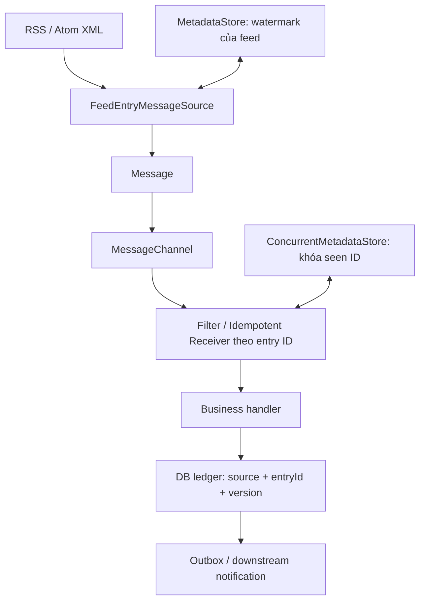
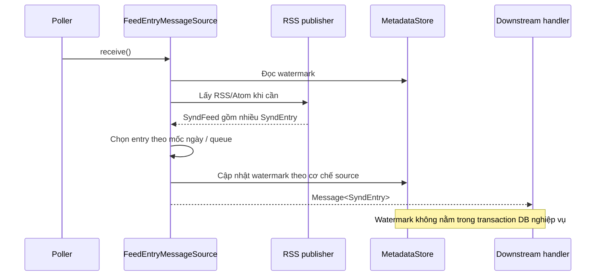
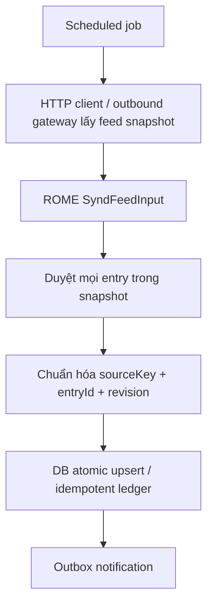
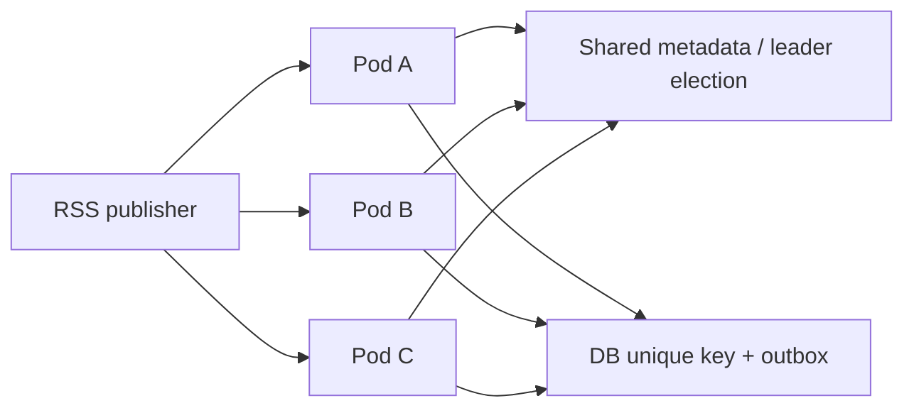

# Đảm bảo không phát lại bài đã đọc trong Spring Integration Feed

## 1. Bài toán: “Đã đọc” nghĩa là gì?

Giả sử một ứng dụng Spring Boot quét RSS tại `https://feeds.example.org/releases.xml` mỗi 30 giây. Feed gồm 40 bài, nhưng trong một giờ chỉ có hai bài mới. Nếu cứ nhận lại toàn bộ danh sách rồi gửi thông báo, người dùng có thể nhận cùng một tin nhiều lần. Ngược lại, nếu đánh dấu “đã đọc” quá sớm, một lần lỗi database có thể khiến bài **chưa được lưu thành công** không bao giờ được phát lại.

Một ví dụ:

```text
09:00  RSS chứa A, B, C. Ứng dụng nhập A, B, C.
09:01  RSS vẫn chứa A, B, C. Không nên gửi lại thông báo.
09:02  RSS chứa A, B, C, D. Chỉ cần xử lý D.
09:03  Ứng dụng restart. Không muốn nhập A..D lần nữa.
09:04  Publisher sửa bài B nhưng giữ GUID. Có cần cập nhật B?
09:05  Database lỗi giữa lúc xử lý E. Không được mất E.
```

Vì vậy, trước khi chọn kỹ thuật, cần định nghĩa **“đã đọc”** theo ranh giới của hệ thống:

| Mốc | Ý nghĩa | Có đủ để bỏ qua bài vĩnh viễn không? |
|---|---|---|
| **Đã thấy** | Feed parser nhận ra entry trong XML | Không |
| **Đã phát** | `FeedEntryMessageSource` tạo `Message<SyndEntry>` | Không |
| **Đã chuyển tới handler** | Channel giao message cho consumer | Chưa chắc |
| **Đã lưu** | Database commit dữ liệu và trạng thái entry | Thường là mốc phù hợp để bỏ qua **cùng phiên bản** |
| **Đã thông báo** | Broker/API phía nhận xác nhận theo hợp đồng | Cần theo dõi riêng nếu có side effect |

Nội dung này thuộc chương **Adapter Feed** của module `SPRING_INTEGRATION_ADAPTERS`. Module học cách kết nối hệ thống ngoài bằng inbound/outbound adapter, gateway, poller và `MessageChannel`; thực hành luồng file, SFTP, HTTP, JMS, AMQP, Kafka, database, xử lý hợp đồng message, lỗi và vòng đời kết nối. Đối với RSS/Atom, phần đặc thù là một **tài liệu feed có nhiều entry**, source poll định kỳ và việc “đã thấy” không thể ghi ngược trở lại website của publisher như một ACK trong broker.

**Mục tiêu của bài:** giảm phát lại bài cũ trong điều kiện thường, đồng thời bảo đảm việc retry/replay có chủ đích **không sinh kết quả nghiệp vụ trùng**.

Sau khi học, bạn có thể:

1. Giải thích Feed adapter tự hạn chế duplicate như thế nào bằng `MetadataStore` và `metadataKey`.
2. Phân biệt watermark theo ngày xuất bản với dedup theo RSS GUID/Atom ID.
3. Chọn store phù hợp để giữ trạng thái qua restart và khi nhiều instance cùng quét.
4. Dùng Java DSL để tạo luồng `Feed.inboundAdapter(...)`, poller, channel và xử lý lỗi.
5. Áp dụng `IdempotentReceiverInterceptor` đúng phạm vi, hiểu header `duplicateMessage` và discard.
6. Xây idempotency ở database, xử lý update/revision và tránh gửi thông báo trùng.
7. Phục hồi khi crash giữa các bước nhận, commit và gửi thông báo.
8. Kiểm thử đầy đủ tình huống bài trùng, trễ ngày, thiếu ngày, restart và đa instance.

## 2. Mô hình ba lớp chống phát lại



| Lớp | Nhiệm vụ | Trạng thái lưu | Điểm không bảo đảm |
|---|---|---|---|
| **1. Source watermark** | Không phát lại các entry cũ theo cách lọc thời gian của Feed adapter | Ngày xuất bản mới nhất của feed | Không biết DB đã commit; có thể bỏ sót bài đến muộn |
| **2. Entry ID filter / receiver** | Không chuyển tiếp cùng ID nhiều lần khi source phát lại | Tập khóa/giá trị theo source+entry ID | Ghi “seen” không chứng minh handler hoàn tất |
| **3. Business idempotency** | Không tạo lại record/thông báo cho cùng bài hoặc cùng phiên bản | Unique key, trạng thái, revision, outbox | Cần transaction và chính sách version cụ thể |

Hai lớp đầu giúp **giảm số message dư thừa**. Lớp thứ ba mới bảo vệ dữ liệu khỏi duplicate do restart, retry, race condition và lỗi sau commit.

### 2.1. Ba loại identity khác nhau

```text
feedSourceKey = partner-releases
feedMetadataKey = feeds:prod:partner-releases:watermark
entryId = tag:example.org,2026:release-41
messageId = 76ce... (UUID do framework tạo)
```

- `feedMetadataKey` định danh **watermark của nguồn**. Nó không phải GUID của bài.
- `entryId` định danh **bài viết** trong namespace của publisher.
- `messageId` định danh **một message instance**. Cùng bài có thể được tạo thành hai message khác ID sau restart/retry.
- `sourceKey + entryId` là một khóa nghiệp vụ hữu ích, nhưng phải bổ sung revision nếu cần theo dõi bản sửa.

## 3. Feed adapter mặc định giảm bài trùng bằng cách nào?

Spring Integration 6.5 sử dụng **ROME** để parse RSS hoặc Atom. `FeedEntryMessageSource` lấy `SyndFeed`, giữ các `SyndEntry` trong queue nội bộ và phát từng `Message<SyndEntry>` theo poller.

Tài liệu chính thức 6.5 mô tả: **mỗi khi message mới được tạo và gửi**, source lưu **giá trị ngày xuất bản mới nhất** vào `MetadataStore`. Giá trị `metadataKey` do cấu hình định danh trạng thái này.



**Chú ý:** sơ đồ cho thấy vai trò các thành phần, không cam kết thứ tự giao dịch chính xác của mọi phiên bản, mọi exception hoặc mọi channel. Một message được phát không có nghĩa consumer đã ghi DB thành công.

### 3.1. Ví dụ watermark

Giả sử feed có các ngày công bố:

| Entry | Published | Trạng thái ban đầu |
|---|---|---|
| A | 2026-11-20 10:00 UTC | Cũ |
| B | 2026-11-21 10:00 UTC | Cũ |
| C | 2026-11-22 10:00 UTC | Cũ |
| D | 2026-11-23 10:00 UTC | Mới |

Nếu watermark đã ở mốc C, D là ứng viên mới cần phát. Poll lại khi feed không đổi thường không tạo thêm message cho D sau khi watermark đã cập nhật.

Đây là **bộ lọc theo thời gian**, không phải danh sách `{A, B, C, D}`. Vì vậy không thể suy rằng tất cả bài chưa từng thấy đều chắc chắn được phát.

### 3.2. Vì sao “không phát lại” không có nghĩa exactly-once?

Giả sử source đã cập nhật watermark khi message E được phát, nhưng consumer lỗi trước khi database commit. Ở lần poll sau, source có thể coi E là cũ và không phát lại. Ngược lại, nếu watermark trong RAM biến mất sau restart, nguồn có thể phát lại các entry đã được database commit.

Do đó có **hai rủi ro đối nghịch**:

1. **Duplicate delivery:** entry đã được xử lý nhưng lại phát.
2. **Missed processing:** entry được phát nhưng chưa xử lý thành công và không được phát lại.

Muốn có kết quả nghiệp vụ đáng tin cậy cần **durable claim/ledger, retry/reconciliation và idempotency ở đích**, không chỉ watermark.

### 3.3. Queue nội bộ và `maxMessagesPerPoll`

Một lần HTTP GET có thể trả 30 entry. Với:

```java
Pollers.fixedDelay(30_000)
       .maxMessagesPerPoll(10);
```

Poller phát tối đa 10 message mỗi lần kích hoạt. Source giữ entry trong queue nội bộ; vì vậy **số lần poll không bằng số HTTP GET**, và `maxMessagesPerPoll` không giới hạn số byte XML hoặc số item publisher trả về.

Nếu nguồn không có item mới, source có thể trả `null` và poller kết thúc lượt đó. Chọn nhịp poll dựa trên SLA và quy định rate limit của publisher; đừng dùng polling dồn dập như cách “chữa” thiếu idempotency.

## 4. Chọn `MetadataStore` để tránh phát lại sau restart

Spring Integration sử dụng interface `org.springframework.integration.metadata.MetadataStore` để lưu key-value. Với Feed adapter, key là `metadataKey`, giá trị là trạng thái thời gian nguồn quản lý.

| Store | Giữ trạng thái sau restart? | Chia sẻ giữa pod? | Khi nào dùng |
|---|---|---|---|
| `SimpleMetadataStore` | **Không** | Không, nếu mỗi pod có JVM riêng | Lab, thử nhanh |
| `PropertiesPersistingMetadataStore` | Có khi đã flush/lưu xuống persistent filesystem | Không tự phối hợp nhiều pod | Một instance, volume bền và shutdown có kiểm soát |
| `JdbcMetadataStore` | Có nếu DB bền | Có khi cấu hình cùng DB/namespace | Production cần state chung và vận hành DB |
| `RedisMetadataStore` | Phụ thuộc độ bền và cấu hình Redis | Có với backend chia sẻ | Tải lớn, cần đánh giá concurrency và persistence |
| Store tương thích khác | Theo backend | Theo backend | Khi hạ tầng có yêu cầu riêng |

### 4.1. `SimpleMetadataStore` không “persistent”

Ví dụ:

```java
@Bean
MetadataStore feedWatermarkStore() {
    return new SimpleMetadataStore();
}
```

Store này tồn tại trong **ApplicationContext hiện tại**. Khi restart, watermark mất. Feed có thể phát lại nhiều bài cũ. Vì vậy dùng nó để học và kiểm thử replay, không xem đó là cơ chế đảm bảo trạng thái bền vững.

Theo tài liệu Spring Integration, nếu không có store được chỉ định và không có bean `metadataStore` trong context, framework có thể khởi tạo `SimpleMetadataStore` cho thành phần. Nên **cấu hình tường minh** để tránh hiểu nhầm về độ bền.

### 4.2. Store dựa trên file

```java
import org.springframework.context.annotation.Bean;
import org.springframework.integration.metadata.MetadataStore;
import org.springframework.integration.metadata.PropertiesPersistingMetadataStore;

// Thay thế bean memory trong một ứng dụng một instance.
@Bean("feedWatermarkStore")
MetadataStore persistedFeedWatermarkStore() {
    PropertiesPersistingMetadataStore store =
            new PropertiesPersistingMetadataStore();
    store.setBaseDirectory("./data/feed-metadata");
    return store;
}
```

**Không khai báo đồng thời** với bean trùng tên ở phần 4.1. File-backed store cần volume/permission phù hợp, có backup/retention và chính sách cleanup.

Quan trọng: `PropertiesPersistingMetadataStore` mặc định lưu state xuống file khi `ApplicationContext` **đóng bình thường**, và có phương thức `flush()` để lưu chủ động. Sau process kill hoặc máy mất điện, một số watermark chưa flush có thể bị mất; điều đó không mâu thuẫn với việc store “có hỗ trợ persist”.

### 4.3. JDBC store và key namespace

`JdbcMetadataStore` trong module `spring-integration-jdbc` có thể lưu state ở database dùng chung:

```gradle
dependencies {
    implementation 'org.springframework.integration:spring-integration-jdbc'
}
```

```java
import javax.sql.DataSource;
import org.springframework.context.annotation.Bean;
import org.springframework.integration.jdbc.metadata.JdbcMetadataStore;
import org.springframework.integration.metadata.MetadataStore;

@Bean("feedWatermarkStore")
MetadataStore jdbcFeedWatermarkStore(DataSource dataSource) {
    return new JdbcMetadataStore(dataSource);
}
```

Chỉ sử dụng sau khi chuẩn bị đúng **schema metadata store của phiên bản Spring Integration**, transaction manager, quyền DB và connection pool. Đây là **bean thay thế** cho các lựa chọn store trước, không phải đoạn code ghép cả ba cùng khởi chạy.

Đề xuất namespace rõ ràng:

```text
feeds:prod:partner-releases:watermark
feeds:prod:security-blog:watermark
feeds:staging:partner-releases:watermark
```

Hai feed độc lập **không được dùng cùng metadataKey**: watermark của nguồn A có thể khiến nguồn B bị bỏ sót. Cũng không tùy tiện đổi key khi deploy, vì source có thể coi mọi bài trong feed là mới.

### 4.4. Giữ nguyên key khi thay URL có được không?

Nếu publisher đổi URL nhưng **vẫn là cùng một feed** và giữ nguyên hợp đồng ID/ngày, có thể cần giữ source identity và migrate watermark. Nhưng nếu URL mới là **một nguồn khác**, không được chia sẻ trạng thái cũ. Quyết định dựa vào publisher/source identity chứ không chỉ string URL.

## 5. GUID RSS, Atom ID và chính sách “đọc một lần”

Watermark không biết **từng bài**. Để chống duplicate theo identity, trước hết chuẩn hóa key.

### 5.1. Dữ liệu quan trọng trong `SyndEntry`

| ROME API | RSS/Atom thường ánh xạ | Lưu ý |
|---|---|---|
| `getUri()` | RSS GUID / Atom `id` | Có thể null với RSS thiếu GUID |
| `getTitle()` | Tiêu đề | Dễ đổi; không làm ID chính |
| `getLink()` | URL bài | Có thể đổi hoặc không phải link duy nhất |
| `getPublishedDate()` | RSS `pubDate` / Atom `published` | Có thể thiếu; Atom published là tùy chọn |
| `getUpdatedDate()` | Thời điểm cập nhật, đặc biệt ở Atom | Dùng theo dõi bản sửa |
| `getDescription()` | Tóm tắt/nội dung | Có thể chứa HTML không tin cậy |
| `getContents()` | Nội dung bổ sung | Dùng version/checksum theo hợp đồng |

Với Atom 1.0 hợp lệ, `updated` là thông tin bắt buộc, còn `published` có thể thiếu. Không tự dùng `MessageHeaders.TIMESTAMP` thay cho `publishedDate`; đó là thời điểm **message được tạo**, không phải bài được đăng.

### 5.2. Khóa đề xuất

```text
sourceKey = partner-releases          # từ cấu hình ứng dụng, đáng tin
entryId = tag:example.org,2026:release-41
articleKey = (sourceKey, entryId)
```

Hai publisher khác nhau có thể dùng cùng GUID `release-41`. Nếu chỉ dùng `entryId` làm primary key, một publisher có thể ghi đè dữ liệu của publisher khác.

Đối với RSS thiếu GUID, có thể dùng URL canonical đã chuẩn hóa **nếu có hợp đồng link ổn định**. Đừng lấy `title`, message UUID hoặc ngày poll để tự tạo ID chắc chắn. Trường hợp không có nguồn identity đáng tin nên đưa vào kiểm tra/chính sách riêng.

### 5.3. Lần đầu và bản sửa của cùng bài

```text
Bài release-41:
    10:00  id=release-41, updated=T1, hash=A    -> NEW
    10:30  id=release-41, updated=T1, hash=A    -> DUPLICATE
    11:00  id=release-41, updated=T2, hash=B    -> UPDATED
    11:30  id=release-41, updated=T1, hash=A    -> STALE VERSION
    12:00  id=release-41, updated=T2, hash=C    -> VERSION CONFLICT
```

Nếu yêu cầu **chỉ thông báo một lần cho mỗi bài**, ID-only dedup có thể phù hợp. Nếu hệ thống cần đồng bộ cả bản sửa, phải dùng **ID + revision** (`updatedDate`, version ID hoặc checksum) và quyết định thông báo bản sửa hay chỉ cập nhật dữ liệu.

ID-only filter không biết khác biệt giữa một bản cập nhật hợp lệ và một duplicate đã đọc; nó có thể bỏ qua cả hai.

## 6. Java DSL: Feed inbound không phát lại theo watermark

Ví dụ nhắm tới **Spring Boot 3.x và Spring Integration 6.5.x tương thích**. Phiên bản module nên được quản lý bằng BOM/dependency management; không trộn major version.

### 6.1. Dependencies và cấu hình

**`build.gradle`:**

```gradle
dependencies {
    implementation 'org.springframework.boot:spring-boot-starter-integration'
    implementation 'org.springframework.integration:spring-integration-feed'
}
```

**`application.yml`:**

```yaml
demo:
  feed:
    url: ${FEED_URL:https://feeds.example.org/releases.xml}
    source-key: ${FEED_SOURCE_KEY:partner-releases}
    metadata-key: ${FEED_METADATA_KEY:feeds:prod:partner-releases:watermark}
    fixed-delay-ms: ${FEED_FIXED_DELAY_MS:30000}
    max-messages-per-poll: ${FEED_MAX_PER_POLL:10}
    connect-timeout-ms: ${FEED_CONNECT_TIMEOUT_MS:5000}
    read-timeout-ms: ${FEED_READ_TIMEOUT_MS:10000}
```

URL trên là **ví dụ**, không có nghĩa endpoint đang tồn tại. Trong lab, thay bằng mock HTTP server hoặc `ClassPathResource`; production cần allowlist nguồn tin cậy, TLS, redirect policy và phòng SSRF.

### 6.2. Feed source, MetadataStore và poller

**`FeedDedupConfig.java`:**

```java
import java.io.IOException;
import java.net.HttpURLConnection;
import java.net.MalformedURLException;

import com.rometools.rome.feed.synd.SyndEntry;
import org.springframework.beans.factory.annotation.Qualifier;
import org.springframework.beans.factory.annotation.Value;
import org.springframework.context.annotation.Bean;
import org.springframework.context.annotation.Configuration;
import org.springframework.core.io.Resource;
import org.springframework.core.io.UrlResource;
import org.springframework.integration.config.EnableIntegration;
import org.springframework.integration.dsl.IntegrationFlow;
import org.springframework.integration.dsl.Pollers;
import org.springframework.integration.feed.dsl.Feed;
import org.springframework.integration.metadata.MetadataStore;
import org.springframework.integration.metadata.SimpleMetadataStore;

@Configuration
@EnableIntegration
public class FeedDedupConfig {

    @Bean("feedWatermarkStore")
    MetadataStore feedWatermarkStore() {
        // Lab: memory. Thay bằng store bền vững ở production.
        return new SimpleMetadataStore();
    }

    @Bean("feedResource")
    Resource feedResource(
            @Value("${demo.feed.url}") String url,
            @Value("${demo.feed.connect-timeout-ms}") int connectMs,
            @Value("${demo.feed.read-timeout-ms}") int readMs)
            throws MalformedURLException {

        return new UrlResource(url) {
            @Override
            protected void customizeConnection(HttpURLConnection connection)
                    throws IOException {
                super.customizeConnection(connection);
                connection.setConnectTimeout(connectMs);
                connection.setReadTimeout(readMs);
            }
        };
    }

    @Bean
    IntegrationFlow feedInboundFlow(
            @Qualifier("feedResource") Resource resource,
            @Qualifier("feedWatermarkStore") MetadataStore watermarkStore,
            @Value("${demo.feed.metadata-key}") String metadataKey,
            @Value("${demo.feed.source-key}") String sourceKey,
            @Value("${demo.feed.fixed-delay-ms}") long delayMs,
            @Value("${demo.feed.max-messages-per-poll}") int maxPerPoll) {

        if (delayMs <= 0 || maxPerPoll <= 0) {
            throw new IllegalArgumentException(
                    "Poll delay và max messages phải > 0");
        }

        return IntegrationFlow
                .from(Feed.inboundAdapter(resource, metadataKey)
                                .metadataStore(watermarkStore),
                    endpoint -> endpoint
                            .id("feedDedupInboundEndpoint")
                            .poller(Pollers.fixedDelay(delayMs)
                                    .maxMessagesPerPoll(maxPerPoll)
                                    .errorChannel("feedPollErrors")))
                .enrichHeaders(h -> h.header("feedSourceKey", sourceKey))
                .channel("feedEntries")
                .get();
    }

    @Bean
    IntegrationFlow feedConsumerFlow() {
        return IntegrationFlow.from("feedEntries")
                .handle(message -> {
                    SyndEntry entry = (SyndEntry) message.getPayload();
                    String sourceKey = message.getHeaders()
                            .get("feedSourceKey", String.class);
                    System.out.printf("Source=%s | ID=%s | title=%s%n",
                            sourceKey, entry.getUri(), entry.getTitle());
                    // Demo chỉ quan sát. Production gọi transactional service
                    // có unique key / version / outbox.
                })
                .get();
    }

    @Bean
    IntegrationFlow feedErrorFlow() {
        return IntegrationFlow.from("feedPollErrors")
                .handle(message -> {
                    Throwable error = (Throwable) message.getPayload();
                    System.err.println("Feed poll failure type: "
                            + error.getClass().getSimpleName());
                    // Production: classify, alert và retry có giới hạn.
                })
                .get();
    }
}
```

Đọc đúng các điểm:

1. `Feed.inboundAdapter(resource, metadataKey)` là Java DSL factory, source parse cả RSS lẫn Atom thành `SyndEntry`.
2. `.metadataStore(watermarkStore)` dùng cho **watermark nguồn**. Nó chưa lưu danh sách GUID hay trạng thái DB.
3. `maxMessagesPerPoll(10)` giới hạn message mỗi lần poll; một HTTP response có thể chứa nhiều hơn 10 entry.
4. `.enrichHeaders(...)` thêm `feedSourceKey` **do ứng dụng cấu hình**. Header này không phải thuộc tính được Feed adapter tự sinh.
5. `feedPollErrors` nhận lỗi của tác vụ poll, không tự thực hiện backoff hoặc rollback transaction.
6. Handler mẫu chỉ log để nhìn dòng dữ liệu, **không thể dùng nó làm bằng chứng “đã đọc”**. Production phải đưa message vào một service lưu bền vững.

### 6.3. Khi kiểm thử nguồn khác URL

Có thể dùng RSS fixture:

```java
import org.springframework.core.io.ClassPathResource;
import org.springframework.integration.feed.dsl.Feed;

var fixture = Feed.inboundAdapter(
        new ClassPathResource("sample-feed.xml"),
        "feed:lab:dedup:fixture");
```

Chạy với `MetadataStore` riêng cho mỗi test, tránh kết quả từ test trước ảnh hưởng test sau.

## 7. Lọc theo ID với Idempotent Receiver

Đối với duplicate vượt qua watermark (chẳng hạn sau restart, sau mất state hoặc publisher tái xuất bản nội dung cũ), Spring Integration cung cấp **Idempotent Receiver Enterprise Integration Pattern**.

`IdempotentReceiverInterceptor` là advice áp dụng cho `MessageHandler.handleMessage(...)`. Nó dùng một `MessageSelector` để đánh giá entry nên được nhận hay không; `MetadataStoreSelector` có thể lưu các key đã thấy bằng `ConcurrentMetadataStore`.

### 7.1. Đừng nhầm “duplicateMessage” với “bị drop”

Theo mặc định, nếu `IdempotentReceiverInterceptor` nhận ra duplicate mà **không có discard channel**, nó có thể chuyển message tới handler cùng header `duplicateMessage=true`. Nếu muốn duplicate **không tới handler**, cấu hình discard channel, ví dụ `nullChannel`.

| Cấu hình | Kết quả duplicate |
|---|---|
| Không có discard channel, không throw | Có thể vào handler với header `duplicateMessage` |
| Có discard channel | Chuyển sang discard, không gọi target handler |
| Discard là `nullChannel` | Im lặng bỏ qua duplicate |
| Bật `throwExceptionOnRejection` | Ném exception rejection theo cấu hình |

Đừng mặc định advice là một bộ lọc “bỏ message” chỉ vì tên gọi có chữ idempotent.

### 7.2. Advice cho một feed sạch (mô hình lab)

Thêm đoạn sau vào cấu hình Spring khi muốn thử dedup **theo entry ID**. Đoạn này dành cho **một nguồn duy nhất**, chỉ chấp nhận entry có `getUri()` hợp lệ. Không dùng nó để thay database ledger.

```java
import com.rometools.rome.feed.synd.SyndEntry;
import org.springframework.beans.factory.annotation.Qualifier;
import org.springframework.context.annotation.Bean;
import org.springframework.integration.handler.advice.IdempotentReceiverInterceptor;
import org.springframework.integration.metadata.ConcurrentMetadataStore;
import org.springframework.integration.metadata.SimpleMetadataStore;
import org.springframework.integration.selector.MetadataStoreSelector;

@Bean("feedSeenStore")
ConcurrentMetadataStore feedSeenStore() {
    return new SimpleMetadataStore(); // Lab, mất state khi restart.
}

@Bean("feedIdAdvice")
IdempotentReceiverInterceptor feedIdAdvice(
        @Qualifier("feedSeenStore") ConcurrentMetadataStore seenStore) {

    MetadataStoreSelector selector = new MetadataStoreSelector(
            message -> {
                SyndEntry entry = (SyndEntry) message.getPayload();
                String id = entry.getUri();
                if (id == null || id.isBlank()) {
                    throw new IllegalArgumentException(
                            "RSS/Atom entry không có ID ổn định");
                }
                return "feed:lab:partner-releases:id:" + id;
            },
            seenStore);

    IdempotentReceiverInterceptor advice =
            new IdempotentReceiverInterceptor(selector);
    advice.setDiscardChannelName("nullChannel");
    return advice;
}
```

Ở một **handler** tiêu thụ `feedEntries`, có thể gắn advice:

```java
@Bean
IntegrationFlow feedIdFilteredFlow(
        @Qualifier("feedIdAdvice") IdempotentReceiverInterceptor advice) {

    return IntegrationFlow.from("feedEntries")
            .handle(message -> {
                SyndEntry entry = (SyndEntry) message.getPayload();
                System.out.println("Entry mới theo ID: " + entry.getUri());
            }, endpoint -> endpoint.advice(advice))
            .get();
}
```

**Hai lưu ý bắt buộc:**

- Đây là **phương án thay thế `feedConsumerFlow()`** ở phần 6.2; không tạo hai consumer cạnh tranh trên cùng channel để thử dedup rồi nghĩ cả hai đều được áp dụng advice.
- ID-only dedup sẽ coi **bản sửa của cùng ID là duplicate**. Chỉ dùng khi yêu cầu thực sự là “một lần cho mỗi identity” hoặc chuyển sang chính sách version-aware.

Trong production, dùng `sourceKey` từ cấu hình đã kiểm soát, validate/encode key, giới hạn chiều dài, chọn store chia sẻ bền vững. Không dùng `SimpleMetadataStore` như một cách đồng bộ ba pod.

### 7.3. `MetadataStoreSelector` ghi key khi accept

Với `MetadataStoreSelector`, một key chưa tồn tại được ghi qua `putIfAbsent` và message được chấp nhận. Nếu handler phía sau sau đó fail, **key có thể đã tồn tại**, khiến lần retry tiếp theo bị đánh dấu duplicate.

Vì thế không dùng key “đã thấy” làm trạng thái duy nhất cho **đã xử lý thành công**. Khi xử lý có rủi ro mất tiền, tạo đơn hàng hoặc gửi thông báo quan trọng, cần một **business ledger** có trạng thái, transaction và cơ chế retry; ID advice chỉ nên là lớp tối ưu hoặc trợ giúp.

### 7.4. Nếu cần chấp nhận revision mới

`MetadataStoreSelector` hỗ trợ strategy để tạo **key**, **value** và `compareValues` (Spring Integration 5.3+). Có thể dùng:

```text
key   = sourceKey + entryId
value = stableRevision hoặc updatedAt/checksum
```

Khi key đã có, một so sánh thích hợp có thể chấp nhận revision mới. Nhưng **không** mặc định mọi chuỗi revision đều so sánh được bằng thứ tự lexicographic, và ghi value mới trước handler vẫn chưa phải DB commit. Với yêu cầu cập nhật bản sửa nghiêm ngặt, hãy thực hiện comparison/version policy **ở transaction của database**.

## 8. Đảm bảo “đã đọc” ở tầng database

Nếu bài dùng để tạo thông báo sản phẩm, định nghĩa **đã xử lý** là record được commit trong database. Ví dụ PostgreSQL:

```sql
CREATE TABLE feed_article_state (
    source_key        VARCHAR(128) NOT NULL,
    entry_id          VARCHAR(768) NOT NULL,
    published_at      TIMESTAMPTZ,
    updated_at        TIMESTAMPTZ,
    content_sha256    CHAR(64),
    processing_state  VARCHAR(32) NOT NULL,
    processed_at      TIMESTAMPTZ,
    PRIMARY KEY (source_key, entry_id)
);

CREATE TABLE feed_outbox (
    event_key         VARCHAR(1024) PRIMARY KEY,
    event_type        VARCHAR(64) NOT NULL,
    payload_json      TEXT NOT NULL,
    delivery_state    VARCHAR(32) NOT NULL,
    created_at        TIMESTAMPTZ NOT NULL DEFAULT now()
);
```

Lược đồ này là **minh họa**. Hãy chọn độ dài key, mô hình trạng thái, cách lưu version và retention dựa trên nghiệp vụ. Một hệ thống cần lưu nhiều revision của cùng bài có thể dùng bảng revision riêng với khóa `(source_key, entry_id, version)`.

### 8.1. Chính sách tiếp nhận

| Trạng thái hiện có | Entry đến | Hành động |
|---|---|---|
| Chưa có article key | ID mới | Insert và commit |
| `COMPLETED`, cùng version/hash | Duplicate | Skip side effect, ghi metric |
| `COMPLETED`, `updatedAt` mới hơn | Bản sửa hợp lệ | Update/lưu revision theo hợp đồng |
| `COMPLETED`, checksum khác nhưng timestamp bằng nhau | Xung đột | Quarantine hoặc quy trình revision conflict |
| `PROCESSING`, claim còn hiệu lực | Worker khác đang làm | Không chạy song song |
| `PROCESSING`, claim hết hạn | Có thể worker chết | Đối chiếu transaction trước khi reclaim |
| `FAILED_RETRYABLE` | Retry được phép | Claim lại an toàn, không ghi trùng |
| DB đã commit nhưng outbox chưa gửi | Thông báo còn pending | Retry **outbox**, không nhập lại bài |

### 8.2. Transaction và unique constraint

Quy tắc cốt lõi: check existence và write phải nằm trong một giao dịch hoặc một thao tác atomic/unique key. Hai pod đều có thể chạy:

```text
Pod A: SELECT -> not found
Pod B: SELECT -> not found
Pod A: INSERT
Pod B: INSERT
```

Nếu không có unique constraint, có thể xuất hiện hai bản ghi. Nếu có primary key `(source_key, entry_id)`, database sẽ giải quyết race theo transaction/constraint thay vì tin rằng check trong memory là đủ.

Ví dụ SQL minh họa cho bản **được nhập lần đầu**:

```sql
INSERT INTO feed_article_state (
    source_key, entry_id, published_at, updated_at,
    content_sha256, processing_state, processed_at
) VALUES (
    :sourceKey, :entryId, :publishedAt, :updatedAt,
    :checksum, 'COMPLETED', now()
)
ON CONFLICT (source_key, entry_id) DO NOTHING;
```

Nếu câu lệnh ảnh hưởng **0 rows**, không suy rằng “đã hoàn tất” mà không kiểm tra: entry hiện có có thể ở trạng thái `PROCESSING`, `FAILED` hoặc đã hoàn tất nhưng **checksum khác**. Nếu cần cập nhật bản sửa, phải dùng UPSERT có điều kiện và version policy phù hợp.

### 8.3. Khi có side effect ngoài database

Giả sử xử lý một entry:

1. DB lưu bài và đánh dấu `COMPLETED`.
2. Ứng dụng gửi thông báo qua HTTP/Kafka/JMS.
3. Kết nối mất trước khi nhận ACK.

Server/broker **có thể đã nhận thông báo** dù phía client timeout. Nếu gửi lại không kèm idempotency key, người nhận có thể nhận trùng.

Giải pháp thường dùng:

- **Transactional outbox:** ghi article và một event cần gửi trong cùng DB transaction.
- Consumer outbox retry việc giao hàng sau khi commit.
- Dùng event key ổn định, ví dụ `sourceKey + entryId + revision + eventType`.
- Bên nhận kiểm tra idempotency key hoặc có bảng inbox/dedup tương đương.

Outbox giảm mất thông báo giữa DB commit và send, nhưng **không tự bảo đảm bên nhận chỉ thấy đúng một request**; receiver vẫn cần dedup khi delivery có thể lặp.

### 8.4. Pseudocode xử lý an toàn

```java
// PSEUDOCODE NGHIỆP VỤ, không phải API sẵn có của Spring Integration.
void ingestArticle(Message<SyndEntry> message) {
    String sourceKey = trustedSourceKey(message);
    SyndEntry entry = message.getPayload();

    ArticleIdentity key = identifyAndValidate(sourceKey, entry);
    ArticleRevision revision = normalizeRevisionAndChecksum(entry);

    // Một giao dịch DB: claim/update article và ghi outbox nếu mới.
    ImportResult result =
        articleService.importAtomically(key, revision, entry);

    if (result.isSameVersionAlreadyCompleted()) {
        return; // Không gửi notification mới.
    }
    if (result.isConflict()) {
        quarantineForReview(key, revision);
        return;
    }

    // Không trực tiếp gọi broker/HTTP trong transaction import.
    // Outbox worker chịu trách nhiệm giao hàng/retry idempotently.
}
```

`ArticleIdentity`, `ArticleRevision`, `articleService` và các method trong ví dụ là thành phần dự án cần triển khai. Với Spring `@Transactional`, bảo đảm transaction proxy được áp dụng đúng (hoặc dùng `TransactionTemplate`), không gọi self-invocation rồi nghĩ DB đã được bao transaction.

## 9. Những khoảng trống có thể làm mất hoặc phát lại bài

### 9.1. Bảng mốc lỗi

| Lỗi ở thời điểm | Watermark | Database | Cần làm gì? |
|---|---|---|---|
| HTTP fetch/parse lỗi | Thường chưa có entry mới phát | Không thay đổi | Backoff và poll lại, không xóa state bừa |
| Source đã phát E, handler chưa commit | Có thể đã tiến | E chưa COMPLETED | Retry/reconcile từ nguồn hoặc durable queue |
| Handler ghi ID “seen”, sau đó fail | Key ID có thể còn | Chưa commit | Không tin key seen; dùng ledger/recovery |
| Database commit rồi ứng dụng crash | Watermark có thể đã/ chưa tiến | E COMPLETED | Phát lại an toàn nhờ unique key |
| DB commit nhưng gửi thông báo lỗi | Article COMPLETED | Outbox pending | Retry outbox, không nhập lại E |
| Restart với watermark memory | Key nguồn mất | Article vẫn COMMITTED | Có thể phát lại, DB skip duplicate |
| Restart với state file chưa flush | Một số mốc mất | DB có thể đã commit | Replay có kiểm soát |
| Publisher sửa bài cùng ID | Published cũ, updated mới | Cần version policy | Đối soát bản sửa nếu source không phát |
| Publisher đưa bài mới nhưng ngày cũ | Có thể bị watermark chặn | Bài chưa có | Cần backfill/historical API |

### 9.2. Vì sao không reset toàn bộ MetadataStore để retry một bài?

Một thao tác xóa toàn bộ key watermark/seen-ID có thể làm source phát lại **hàng trăm bài** và khiến downstream chịu một burst xử lý. Nếu chỉ một entry có lỗi:

1. Xác định `sourceKey`, `entryId` và phiên bản dữ liệu.
2. Kiểm tra trạng thái DB: chưa xử lý, `COMPLETED`, `FAILED` hay đang `PROCESSING`.
3. Xác minh publisher còn giữ entry trong feed hoặc có API lịch sử.
4. Chọn cơ chế replay có mục tiêu: ghi lại event cần xử lý vào durable queue, chạy job đối soát hoặc chỉnh đúng state có audit.
5. Kiểm tra unique key và outbox trước khi gửi lại.

Chỉ chỉnh metadata nguồn nếu đã hiểu key format, mốc thời gian và ảnh hưởng đến những entry khác. Đừng dùng reset watermark làm nút “retry E” mà không lường các bài A..D.

### 9.3. Trường hợp bài đến muộn

```text
T1: Feed xuất bản A ngày 23/11, source lưu watermark = 23/11.
T2: Feed bổ sung B (GUID mới) nhưng published = 21/11.
T3: Source có thể bỏ qua B vì ngày cũ hơn watermark.
```

Một ID filter ở downstream **không thể khôi phục B**, vì nó chưa hề trở thành message. Nếu publisher có cơ chế đưa bài đến muộn, cần **đối soát snapshot** hoặc API lịch sử theo GUID/updated-date, chứ không chỉ thêm filter sau adapter.

### 9.4. Bản sửa của bài cũ

Atom:

```text
id        = tag:example.org,2026:release-41
published = 2026-11-20T10:00:00Z
updated   = 2026-11-23T12:00:00Z
```

Nếu bài vẫn mang published date cũ, watermark dựa ngày công bố có thể bỏ qua bản sửa. ID-only receiver cũng có thể chặn cùng ID. Để đồng bộ bản sửa, cần một nguồn cung cấp **bản cập nhật** và một ledger so sánh revision/hash, không nên coi “đã đọc một lần” là bất biến nếu nghiệp vụ cần cập nhật nội dung.

## 10. Nếu cần chắc chắn nhận cả bài đến muộn và bản sửa

Feed adapter mặc định phù hợp với các nguồn có **ngày xuất bản tăng đều** và nghiệp vụ chỉ quan tâm bài mới. Với yêu cầu cao hơn, cần bổ sung quy trình đối soát hoặc thay chiến lược nhận:

| Chiến lược | Khi phù hợp | Chi phí/giới hạn |
|---|---|---|
| Feed adapter + watermark + DB dedup | Publisher công bố đều, ít sửa/lùi ngày | Có thể bỏ sót late entries |
| Feed adapter + scheduled reconciliation | Thỉnh thoảng cần tìm bài bị bỏ sót | Cần nguồn có snapshot/lịch sử |
| Custom polling source tải **toàn bộ snapshot** | Feed đủ nhỏ, cần so mọi GUID/revision hiện có | Phải kiểm soát HTTP và RAM |
| API publisher có cursor/updatedSince | Có lịch sử và hợp đồng update rõ | Quản lý cursor, paging và checkpoint |
| Webhook/push + polling backstop | Publisher hỗ trợ push đáng tin | Xác thực chữ ký, dedup/out-of-order |

Ví dụ kiến trúc đối soát:



**Đây là kiến trúc thay thế/bổ sung**, không phải một option `.filter(...)` thần kỳ tắt watermark của `FeedEntryMessageSource`. Nếu publisher chỉ công bố 20 entry gần nhất và những entry cũ đã bị gỡ, không có filter nào lấy lại được nội dung đã biến mất; phải yêu cầu historical API hoặc nguồn lưu trữ khác.

Khi đọc toàn bộ snapshot, cần giới hạn HTTP response size, số entry, thời gian parse và dữ liệu HTML/URL. Đừng tăng poll frequency hoặc heap vô hạn để giải quyết một hợp đồng nguồn không phù hợp.

## 11. Nhiều instance: “đã đọc” của ai?

Nếu ba pod cùng chạy `fixedDelay=30s`, cả ba có thể gửi HTTP GET tới publisher. Mỗi pod có `SimpleMetadataStore` riêng có thể đều coi một entry mới là chưa thấy:



Các nguyên tắc:

1. Chọn **một leader poll** nếu cần giảm HTTP traffic và có một điểm quản lý watermark.
2. Hoặc nhiều pod đều poll nhưng dùng shared durable state và **DB unique constraint** để ngăn duplicate commit.
3. Không tin rằng shared `MetadataStore` là distributed transaction của cả HTTP source, message channel và database.
4. Chọn namespace riêng theo môi trường và publisher; không để staging cùng key production.
5. Giới hạn tổng HTTP rate, đừng chỉ giới hạn `maxMessagesPerPoll` trên từng pod.
6. Khi leader chết, instance mới phải kiểm tra watermark/ledger và replay an toàn.
7. Khi có outbox, worker giao notification cần claim/idempotency riêng; không dựa vào cùng một seen-ID set của Feed adapter.

## 12. Theo dõi và chẩn đoán vận hành

### 12.1. Metric hữu ích

| Metric / trạng thái | Giúp trả lời |
|---|---|
| `feed_http_fetch_total` | Bao nhiêu HTTP request thực tế? |
| `feed_source_emitted_total` | Source đã phát bao nhiêu `Message<SyndEntry>`? |
| `feed_seen_id_duplicate_total` | Entry nào bị receiver xem là trùng ID? |
| `feed_db_insert_total` | Bao nhiêu bài được commit lần đầu? |
| `feed_db_update_total` | Bao nhiêu bản sửa được cập nhật? |
| `feed_db_duplicate_skip_total` | Bao nhiêu bài cũ được bỏ qua đúng cách? |
| `feed_outbox_pending` | Thông báo nào đã commit nhưng chưa giao? |
| `feed_invalid_identity_total` | Bao nhiêu entry thiếu GUID/ID hợp lệ? |
| `feed_http_error_total` | Lỗi 401/403/429/5xx/timeout? |
| `last_feed_success_at` | Lần fetch/parse thành công gần nhất? |
| `last_article_committed_at` | Lần nhập bài thành công gần nhất? |
| `feed_reconciliation_gap_total` | Bài có trong snapshot nhưng chưa có trong ledger? |

Đây là **tên metric gợi ý**, không phải metric tất cả tự sinh bởi Spring Integration. Không dùng GUID làm label metric để tránh cardinality cao; nên dùng source alias, trạng thái, error category đã chuẩn hóa.

### 12.2. Chẩn đoán triệu chứng

| Triệu chứng | Nguyên nhân cần xét | Hành động |
|---|---|---|
| Một bài cũ xuất hiện lại sau restart | Metadata trong memory hoặc file chưa flush | Dùng durable store và DB idempotency |
| Feed có bài mới nhưng handler không nhận | Watermark, publishedDate cũ/trùng, source lỗi | Xem RSS/Atom thực, state nguồn và poller |
| Cùng GUID gửi thông báo hai lần | Handler không có unique key/outbox/receiver dedup | Cố định identity và kiểm soát side effect |
| Bài đã fetch nhưng không có DB record | Handler fail sau khi source đánh dấu | Reconcile/replay có mục tiêu |
| Bản sửa Atom không được cập nhật | Published-date watermark và ID-only dedup | Snapshot/API update + version-aware upsert |
| Hai pod cùng nhập một bài | Store riêng, race DB hoặc thiếu unique key | Coordination và unique constraint |
| HTTP 429 liên tục | Poll quá nhanh hoặc nhiều pod | Giảm nhịp, tôn trọng quota/backoff |
| Một bài thiếu GUID bị gom trùng | Fallback ID không ổn định | Quarantine/metadata policy rõ ràng |
| DB COMMITTED nhưng thông báo chưa gửi | Outbox pending | Retry giao hàng, không import lại bài |
| DB có hai bản cùng bài | Source namespace hoặc unique key sai | Kiểm tra sourceKey/entryId và migration |

### 12.3. Log an toàn

```text
event=feed_article_ingest
sourceKey=partner-releases
entryIdHash=92fa...bc10
action=SKIP_SAME_VERSION
dbState=COMPLETED
publishedAt=2026-11-23T03:00:00Z
attempt=2
```

Log trên chỉ là ví dụ do ứng dụng thiết kế. Tránh log token/cookie, toàn bộ HTML, URL chứa credential hoặc raw response nhạy cảm. Với entry từ publisher ngoài, sanitize HTML trước khi hiển thị, không tự fetch enclosure/link ngoài allowlist và giới hạn XML parsing để tránh XSS/SSRF/resource exhaustion.

## 13. Thực hành trên RSS/Atom fixture và mock server

Dùng các fixture trong **test resources của dự án thực hành** (không phải file Knowledge này), một mock HTTP server và database lab. Mỗi lab nên có `sourceKey`/`metadataKey` riêng hoặc reset đúng state thử nghiệm. Không xóa metadata production để quan sát replay.

### Lab A — Poll cùng feed nhiều lần

1. Tạo RSS gồm 3 item có GUID và `pubDate` hợp lệ, tăng dần.
2. Cấu hình `Feed.inboundAdapter(...)` với `SimpleMetadataStore`.
3. Poll, ghi nhận số `Message<SyndEntry>` và watermark đã tạo.
4. Poll lại feed không đổi, quan sát không phát các bài cũ theo cơ chế nguồn.
5. Phân biệt số lần poll, số message và HTTP GET thật.

**Kết quả:** hiểu giảm duplicate tại nguồn theo published date, không phải ID set.

### Lab B — Restart gây phát lại

1. Xử lý các item của Lab A, giữ nguyên RSS.
2. Restart `ApplicationContext` dùng `SimpleMetadataStore`.
3. Quan sát entry cũ có thể được phát lại.
4. Thay store bằng `PropertiesPersistingMetadataStore` hoặc `JdbcMetadataStore` ở lab.
5. Thử restart và kiểm tra độ bền state; với file-backed store kiểm tra shutdown/flush.

**Kết quả:** “có MetadataStore” không đồng nghĩa “bền qua restart”.

### Lab C — Dedup bằng GUID/Atom ID

1. Dùng source có hai bài khác nhau, mỗi bài có `getUri()` ổn định.
2. Gắn `IdempotentReceiverInterceptor` với `MetadataStoreSelector` theo phần 7.
3. Cho cùng ID đi qua handler lần thứ hai bằng cách replay test message.
4. So sánh hành vi **không có discard** (duplicate header) và **có nullChannel** (drop).
5. Cố ý cho entry thiếu ID; xác minh bị validation/quarantine chứ không tạo key `null`.

**Kết quả:** hiểu chính xác advice, key và vị trí áp dụng.

### Lab D — DB đã commit, feed phát lại

1. Tạo bảng `feed_article_state` với primary key `(source_key, entry_id)`.
2. Nhập một bài, ghi `COMPLETED`.
3. Replay message giống hệt sau restart hoặc từ test channel.
4. Xác minh database không tạo row thứ hai và không có outbox event duplicate.
5. Đổi version theo hợp đồng, xác minh được cập nhật có điều kiện.

**Kết quả:** durable idempotency ở DB mới bảo vệ kết quả nghiệp vụ.

### Lab E — Lỗi sau khi source phát message

1. Cho Feed source phát một entry E hợp lệ.
2. Mô phỏng handler ném exception trước khi DB commit.
3. Kiểm tra watermark/seen-ID hiện có và DB ledger.
4. Quan sát vì sao source/seen-ID có thể không tự phát lại E.
5. Sử dụng job reconciliation hoặc durable queue để replay **E** có kiểm soát, rồi commit.

**Kết quả:** “đã phát” không phải “đã xử lý thành công”.

### Lab F — Cùng ID nhưng bản sửa mới

1. Tạo Atom entry `id=release-41`, `published=T1`, `updated=T1`, checksum A.
2. Ingest và đánh dấu `COMPLETED`.
3. Cập nhật cùng ID với `updated=T2`, checksum B, giữ `published=T1`.
4. Quan sát ID-only advice/source watermark có thể bỏ qua bản sửa.
5. Đưa bản cập nhật vào qua snapshot/reconciliation; DB ghi version mới theo policy.

**Kết quả:** một identity có thể có nhiều revision hợp lệ.

### Lab G — Bài đến muộn và trùng timestamp

1. Cho source ghi watermark ở `T3`.
2. Sau đó thêm GUID mới có `pubDate=T2`, cũ hơn T3.
3. Thử thêm hai entry khác GUID nhưng có publishedDate bằng nhau.
4. Ghi lại behavior của đúng Spring Integration version đang dùng.
5. Đối soát tất cả GUID qua snapshot hoặc lịch sử publisher nếu nghiệp vụ cần đầy đủ.

**Kết quả:** timestamp một mình không biểu diễn tập ID đã được xử lý.

### Lab H — Hai instance cùng poll

1. Chạy hai instance test, mỗi instance dùng `SimpleMetadataStore` riêng.
2. Đếm tổng HTTP request và số lần mỗi GUID xuất hiện downstream.
3. Chuyển sang một mô hình leader poll hoặc shared store/coordination.
4. Dù hai node cùng nhận message, DB unique key phải tránh hai lần commit.
5. Giả lập failover giữa lúc gửi outbox, xác minh idempotency tại đích.

**Kết quả:** chống trùng source và chống trùng nghiệp vụ là hai nhiệm vụ khác nhau trong cluster.

### Lab I — Lỗi HTTP và metadata

1. Dùng mock HTTP server trả XML hợp lệ.
2. Đổi thành HTTP 503 hoặc timeout, quan sát `feedPollErrors`.
3. Khôi phục server, kiểm tra source tiếp tục poll.
4. Đừng xóa watermark khi lỗi; quan sát các item chưa thành công.
5. Đối chiếu DB ledger trước khi điều chỉnh retry/replay.

**Kết quả:** retry HTTP không có nghĩa phải reset mọi dấu “đã thấy”.

### Lab J — Side effect ngoài DB

1. Ingest một entry và ghi outbox event trong cùng transaction.
2. Mô phỏng HTTP/Kafka/JMS timeout sau khi bên nhận đã nhận event.
3. Cho worker outbox retry cùng `eventKey`.
4. Bên nhận dedup bằng khóa ổn định, xác minh chỉ một tác dụng nghiệp vụ.
5. Ghi riêng trạng thái giao hàng và trạng thái article.

**Kết quả:** DB `COMPLETED` và notification `DELIVERED` là hai mốc cần kiểm soát riêng.

### Câu hỏi tự kiểm tra

1. Tại sao Feed adapter 6.5 có thể tránh một số duplicate dù chưa lưu từng GUID?
2. `metadataKey` khác `SyndEntry.getUri()` và `MessageHeaders.ID` như thế nào?
3. Vì sao restart với `SimpleMetadataStore` có thể phát lại bài cũ?
4. `PropertiesPersistingMetadataStore` có bảo đảm flush ngay mọi thay đổi không?
5. `IdempotentReceiverInterceptor` mặc định luôn drop duplicate khỏi handler không?
6. Tại sao `MetadataStoreSelector` ghi key trước handler có thể gây bỏ sót retry?
7. Với cùng ID nhưng `updatedAt` mới, nên skip hay update?
8. Nếu DB đã commit nhưng HTTP ACK thất bại, có nên nhập lại bài không?
9. Làm gì khi bài mới có published date cũ hơn watermark?
10. Vì sao hai pod cùng poll có thể gửi thông báo trùng dù dùng shared metadata?

## 14. Những nhầm lẫn thường gặp

| Nhầm lẫn | Cách hiểu đúng |
|---|---|
| Feed adapter theo dõi GUID của mọi bài | Spring Integration 6.5 mô tả **watermark ngày xuất bản** |
| `MetadataStore` có key nghĩa là DB đã commit | Watermark/seen-ID không phải transaction nghiệp vụ |
| Có `SimpleMetadataStore` là restart không phát lại | Store chỉ sống trong memory |
| Store file-backed luôn flush mỗi message | Mặc định có điều kiện ghi khi context đóng và hỗ trợ flush chủ động |
| `metadataKey` chính là ID bài | Nó là namespace trạng thái của nguồn |
| `MessageHeaders.ID` là khóa bài viết | Nó là ID một message instance |
| RSS luôn có GUID và pubDate | Publisher có thể thiếu/đổi, cần policy |
| Atom bắt buộc có `published` | Atom 1.0 yêu cầu `updated`, `published` là tùy chọn |
| IdempotentReceiver mặc định luôn bỏ duplicate | Mặc định có thể gắn `duplicateMessage` rồi tiếp tục handler |
| ID-only dedup sẽ bắt các lần sửa bài | Cùng ID có thể mang revision mới và bị chặn |
| Chỉ dùng `updatedAt` là đủ làm identity | ID và version là hai thuộc tính khác nhau |
| Có shared MetadataStore nghĩa là exactly-once | Cần database unique key, claim và outbox |
| Poller chạy lại nghĩa là DB sẽ retry bài fail | Source watermark có thể đã tiến; cần reconciliation |
| Tăng nhịp poll giúp bắt bài đến muộn | Published-date watermark vẫn có thể lọc entry cũ |
| Xóa hết state là cách retry an toàn | Có thể replay hàng loạt bài và side effect |
| DB commit thành công thì thông báo bên ngoài chắc chắn đã giao | Cần outbox và idempotency downstream |
| `maxMessagesPerPoll` giới hạn số item trong XML | Nó chỉ giới hạn số message của một poll |
| Feed parser xử lý được HTML là có thể hiển thị ngay | Phải sanitize/escape, kiểm soát XSS |

## 15. Tài liệu tham khảo

- [Spring Integration 6.5 — Feed Adapter](https://docs.spring.io/spring-integration/reference/6.5/feed.html): `SyndEntry`, queue, duplicate entries và published-date watermark.
- [Spring Integration 6.5 — Metadata Store](https://docs.spring.io/spring-integration/reference/6.5/meta-data-store.html): `SimpleMetadataStore`, persistent stores, `PropertiesPersistingMetadataStore.flush()`.
- [Spring Integration 6.5 — Idempotent Receiver](https://docs.spring.io/spring-integration/reference/6.5/handler-advice/idempotent-receiver.html): `IdempotentReceiverInterceptor`, duplicate header, discard channel và `MetadataStoreSelector`.
- [MetadataStoreSelector API 6.5](https://docs.spring.io/spring-integration/docs/6.5.0/api/org/springframework/integration/selector/MetadataStoreSelector.html): selector key/value, `putIfAbsent` và `compareValues`.
- [IdempotentReceiverInterceptor API 6.5](https://docs.spring.io/spring-integration/docs/6.5.0/api/org/springframework/integration/handler/advice/IdempotentReceiverInterceptor.html): advice, `setDiscardChannelName`, rejection.
- [Spring Integration 6.5 — JDBC Metadata Store](https://docs.spring.io/spring-integration/reference/6.5/jdbc/metadata-store.html): backend JDBC, schema và transaction.
- [ROME project](https://rometools.github.io/rome/): RSS/Atom parsing, `SyndFeed` và `SyndEntry`.
- [RFC 4287 — Atom Syndication Format](https://www.rfc-editor.org/rfc/rfc4287): Atom `id`, `updated`, `published` và semantics của entry.

**Ghi nhớ:** không phát lại bài đã đọc là một yêu cầu có **nhiều tầng**. `FeedEntryMessageSource` dùng **watermark** để giảm phát lại message; `IdempotentReceiverInterceptor` có thể đánh dấu/chặn cùng entry ID; nhưng chỉ **database ledger có transaction, unique key, version và outbox** mới xác định nghiệp vụ đã được xử lý và thông báo an toàn. Hãy thiết kế cho phép **replay có kiểm soát**: bài cũ không tạo side effect trùng, còn bài thất bại hoặc được cập nhật vẫn có đường để xử lý lại.
