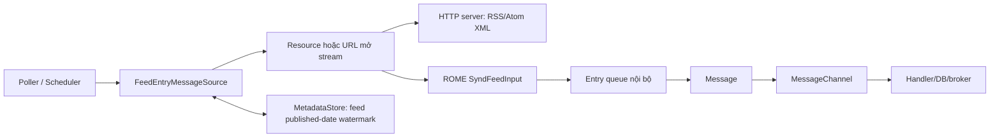
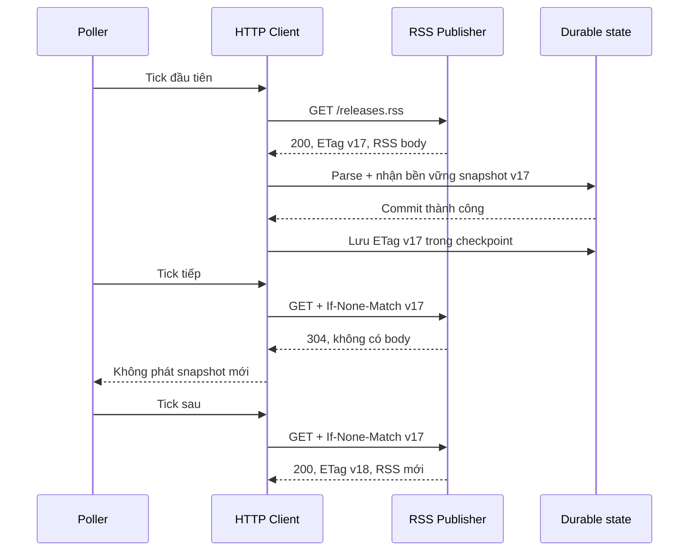
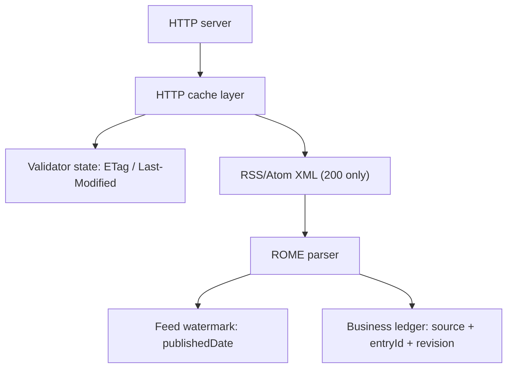
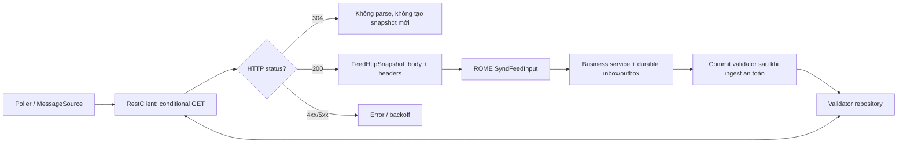
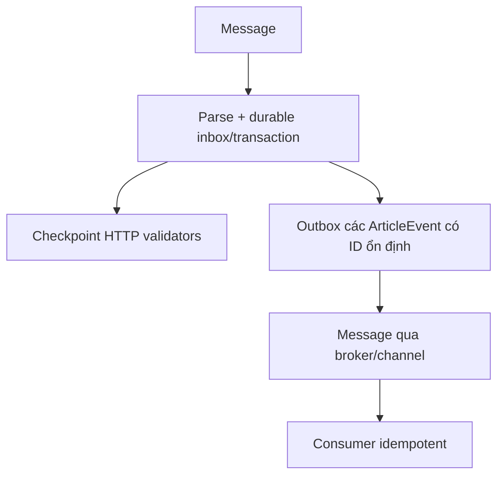
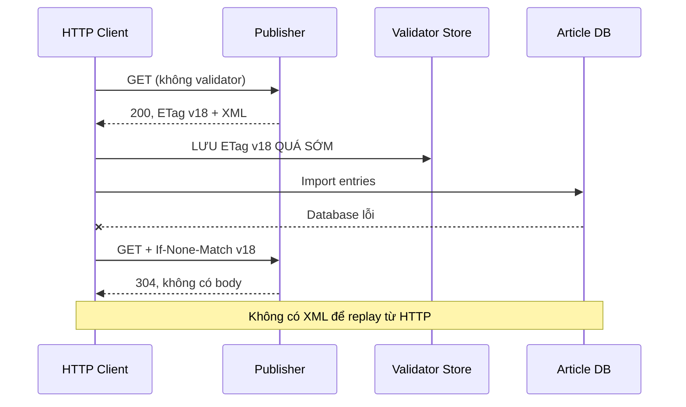

# HTTP client và conditional request khi đọc RSS/Atom Feed

## 1. Bài toán: đọc feed định kỳ mà không tải lại XML không đổi

Một ứng dụng Spring Boot tích hợp thông báo từ hai nguồn:

```text
https://feeds.example.org/releases.rss
https://partner.example.org/announcements.atom
```

Ứng dụng kiểm tra nguồn mỗi phút. Trong phần lớn các lần poll, RSS/Atom vẫn giữ nguyên, nhưng một response có thể dài hàng trăm kilobyte và chứa nhiều entry. Nếu luôn tải lại toàn bộ XML, hệ thống tốn băng thông, CPU parse, tăng số request đến publisher và khó tách biệt "không có cập nhật" với "HTTP đang lỗi".

HTTP có các cơ chế **conditional request**: client giữ thông tin phiên bản của tài nguyên (validator) rồi hỏi server liệu representation hiện tại đã thay đổi chưa. Hai validator thông dụng là `ETag` và `Last-Modified`. Khi điều kiện không thỏa, server có thể trả `304 Not Modified` **không kèm body XML**, tiết kiệm phần truyền tải nội dung.

Đây là bài **“HTTP client và conditional request”** trong chương **Adapter Feed** của module `SPRING_INTEGRATION_ADAPTERS`. Module học cách nối các hệ thống bên ngoài bằng inbound/outbound adapter, gateway, poller và `MessageChannel`; thực hành file, SFTP, HTTP, JMS, AMQP, Kafka, database, quản lý hợp đồng message, lỗi và vòng đời kết nối. Với Feed, cần hiểu rõ **hai lớp độc lập**: HTTP client quyết định có tải lại representation không; Spring Integration/ROME và nghiệp vụ quyết định entry nào phát thành message và entry nào đã xử lý.

### Sau bài học, bạn có thể

1. Giải thích `ETag`, `Last-Modified`, `If-None-Match`, `If-Modified-Since`, HTTP `200 OK` và `304 Not Modified`.
2. Phân biệt *HTTP representation validator* với *watermark của `FeedEntryMessageSource`* và *ID/phiên bản bài viết*.
3. Cấu hình HTTP timeout, `Accept`, header xác thực và source URL đáng tin cho Feed adapter.
4. Hiểu vì sao gắn `If-None-Match` vào `UrlResource` **chưa đủ** để xử lý `304` an toàn.
5. Thiết kế một polling flow tùy chỉnh bằng `RestClient`, `MessageSource` và ROME khi phải điều khiển trực tiếp HTTP response.
6. Chỉ checkpoint validator **sau khi** snapshot được parse và được chấp nhận bền vững.
7. Xử lý restart, 304 sau crash, 4xx/5xx, rate limit, redirect và nhiều pod.
8. Kiểm thử tất cả tình huống bằng một mock HTTP server có ETag/Last-Modified cố định.

## 2. Mối quan hệ giữa Feed adapter, HTTP và ROME

Với đường đi thông thường:



Spring Integration 6.5 có sẵn `Feed.inboundAdapter(resource, metadataKey)`. Module `spring-integration-feed` dùng ROME để chuyển một tài liệu `SyndFeed` thành các `SyndEntry` và phát **mỗi entry một message**. Poller điều chỉnh nhịp đọc và `maxMessagesPerPoll` điều chỉnh số message mỗi lượt.

**Không đồng nhất các đại lượng:**

| Khái niệm | Ví dụ | Điều nó kiểm soát |
|---|---|---|
| Poll interval | `fixedDelay(60_000)` | Khi nào yêu cầu source tiếp tục |
| HTTP GET | `GET /releases.rss` | Tải representation hoặc hỏi điều kiện |
| HTTP validator | `ETag: "feed-v17"` | Phiên bản representation theo góc nhìn server |
| HTTP status | `200` / `304` | Có body mới được trả về không |
| Feed watermark | Ngày bài được công bố mới nhất trong `MetadataStore` | Giảm phát lại entry cũ |
| Article identity | `sourceKey + entry.getUri()` | Định danh bài viết |
| Article revision | `updatedAt`/content checksum | Phân biệt bản sửa của cùng bài |
| Business commit | Row DB/transaction/outbox | Kết quả nghiệp vụ đã bền vững chưa |

Một response HTTP `200` có thể chứa 30 entry nhưng không có entry **mới đối với ứng dụng**. Một response `304` có thể nghĩa representation trên server chưa đổi, nhưng **không chứng minh** một entry bị lỗi trong lần xử lý trước đã được DB commit.

## 3. Conditional GET: ETag và If-None-Match

### 3.1. ETag là một opaque validator

Server có thể trả:

```http
HTTP/1.1 200 OK
Content-Type: application/rss+xml; charset=UTF-8
ETag: "releases-v17"
Last-Modified: Mon, 23 Nov 2026 01:00:00 GMT
Cache-Control: max-age=60

<?xml version="1.0" encoding="UTF-8"?>
<rss version="2.0">...</rss>
```

`ETag` là **entity tag** do origin server sinh cho representation. Client phải giữ nguyên cú pháp, gồm dấu ngoặc kép và nếu có tiền tố `W/`; đừng tự bỏ dấu nháy hoặc suy rằng nội dung giữa dấu nháy là SHA-256.

Hai dạng:

```http
ETag: "releases-v17"
ETag: W/"releases-v17"
```

- **Strong ETag:** thích hợp cho các phép so sánh đòi hỏi representation bytes tương ứng.
- **Weak ETag:** có tiền tố `W/`, thường dùng xác nhận nội dung tương đương ngữ nghĩa ngay cả khi byte-level có thể khác.
- Với `If-None-Match`, RFC 9110 dùng **weak comparison**, nên validator weak vẫn hợp lệ cho cache revalidation.

### 3.2. Request tiếp theo

```http
GET /releases.rss HTTP/1.1
Host: feeds.example.org
Accept: application/rss+xml, application/atom+xml, application/xml;q=0.9
If-None-Match: "releases-v17"
```

Nếu selected representation chưa đổi, server trả:

```http
HTTP/1.1 304 Not Modified
ETag: "releases-v17"
Cache-Control: max-age=60
Date: Mon, 23 Nov 2026 01:01:00 GMT
```

**304 không có body RSS/Atom để đưa vào ROME.** Đó không phải XML rỗng, không phải một feed không có item và cũng không phải lỗi parse. Ở tầng HTTP, client cần hiểu `304` là "tài nguyên được chọn vẫn khớp validator" và tránh gọi parser với response body không tồn tại.

Nếu representation đổi, server có thể trả `200 OK` cùng body mới và validator mới:

```http
HTTP/1.1 200 OK
Content-Type: application/rss+xml
ETag: "releases-v18"

<rss version="2.0">...</rss>
```

Trình tự minh họa:



**Không dùng `If-None-Match: *` cho vòng polling bình thường.** Dấu `*` kiểm tra sự tồn tại của representation, khác với điều kiện dùng ETag của bản đã chấp nhận. Dùng chính giá trị validator được server cấp.

## 4. Conditional GET bằng Last-Modified

Nếu publisher không có ETag nhưng có:

```http
Last-Modified: Mon, 23 Nov 2026 01:00:00 GMT
```

Client có thể gửi:

```http
GET /releases.rss HTTP/1.1
Host: feeds.example.org
If-Modified-Since: Mon, 23 Nov 2026 01:00:00 GMT
```

Theo RFC 9110, nếu server đánh giá representation chưa sửa sau mốc đó, nó **có thể** trả `304 Not Modified`. Đây là HTTP date (UTC/GMT), **không phải** RSS `pubDate` hay `Atom updated` của từng entry.

### 4.1. Dùng cả hai validator

Một request được phép gửi cả:

```http
If-None-Match: "releases-v17"
If-Modified-Since: Mon, 23 Nov 2026 01:00:00 GMT
```

**Thứ tự ưu tiên theo RFC 9110:** khi có `If-None-Match`, server phải **bỏ qua `If-Modified-Since`** trong đánh giá điều kiện. Hai header có thể được gửi cùng nhằm hỗ trợ intermediary cũ, nhưng đừng diễn giải như hai điều kiện AND.

### 4.2. Nhược điểm của Last-Modified

| Vấn đề | Hệ quả |
|---|---|
| Độ phân giải HTTP-date thường tới **giây** | Nội dung thay đổi nhiều lần trong một giây có thể khó phân biệt |
| Đồng hồ server bị lệch | Điều kiện dựa thời gian có thể không phản ánh thay đổi mong muốn |
| Publisher phát lại bản cũ và giữ Last-Modified | Có thể nhận 304 dù cần một loại đối soát khác |
| Reverse proxy sinh Last-Modified không nhất quán | Cache có thể trả kết quả bất ngờ |
| Feed thay đổi item nhưng server không cập nhật header đúng | Conditional request không phát hiện thay đổi |

Ưu tiên ETag nếu server cung cấp đúng và ổn định. Nếu publisher không giữ validator chuẩn, conditional GET không bảo đảm giảm tải hoặc phát hiện thay đổi; cần kiểm thử với endpoint thật và cân nhắc kiểm tra không điều kiện/đối soát định kỳ theo SLA.

## 5. HTTP cache khác với MetadataStore của Spring Integration



| Cơ chế | Khóa tương ứng | Thời điểm cập nhật hợp lý | Nếu mất state |
|---|---|---|---|
| HTTP validator checkpoint | Source URL/variant/auth scope | Khi representation mới đã được nhận bền vững | GET không điều kiện, tốn băng thông nhưng an toàn hơn |
| Feed `MetadataStore` | `metadataKey` của Feed source | Theo thuật toán phát entry của framework | Entry cũ có thể phát lại |
| Business ledger | `sourceKey + entryId + version` | Trong transaction nghiệp vụ | Nguy cơ duplicate/loss, cần DB backup |

**Phân biệt kỹ:** ETag phản ánh **toàn bộ selected representation**. Nếu XML đổi thứ tự item, tăng một item hoặc đổi phần mô tả ở feed-level, ETag có thể đổi dù không có bài mới. Ngược lại, một `304` không chứng minh mỗi bài trong lần tải trước đã được xử lý.

`Cache-Control: max-age=60` là chính sách **freshness**; `ETag/Last-Modified` là **validators để revalidate**. `Cache-Control: no-cache` thường yêu cầu revalidation trước khi dùng bản lưu, không có nghĩa "cấm lưu" như `no-store`. Feed adapter không nên tự được giả định có bộ HTTP cache đầy đủ chỉ vì endpoint trả header cache.

## 6. Feed inbound adapter tiêu chuẩn: cấu hình HTTP connection

Khi chỉ cần đọc RSS/Atom bình thường, dùng trực tiếp `spring-integration-feed`. Tài liệu Spring Integration 6.5 hướng dẫn dùng `UrlResource` có override `customizeConnection(HttpURLConnection)` để đặt connect/read timeout.

### 6.1. Dependencies

**`build.gradle`:**

```gradle
dependencies {
    implementation 'org.springframework.boot:spring-boot-starter-integration'
    implementation 'org.springframework.integration:spring-integration-feed'
}
```

Đặt version thông qua Spring Boot BOM/dependency management phù hợp để các module Spring Integration cùng một dòng tương thích.

### 6.2. Properties

**`application.yml`:**

```yaml
demo:
  feed:
    url: ${FEED_URL:https://feeds.example.org/releases.rss}
    metadata-key: ${FEED_METADATA_KEY:feed:partner-releases:v1}
    connect-timeout-ms: ${FEED_CONNECT_TIMEOUT_MS:5000}
    read-timeout-ms: ${FEED_READ_TIMEOUT_MS:10000}
    fixed-delay-ms: ${FEED_FIXED_DELAY_MS:60000}
    max-messages-per-poll: ${FEED_MAX_PER_POLL:10}
```

Nguồn URL là ví dụ minh họa, không khẳng định domain đó đang có RSS thật. Trong lab, thay bằng mock server hoặc file `ClassPathResource`.

### 6.3. Java DSL: HTTP timeout và FeedEntryMessageSource

**`BasicFeedHttpConfig.java`:**

```java
import java.io.IOException;
import java.net.HttpURLConnection;
import java.net.MalformedURLException;

import org.springframework.beans.factory.annotation.Qualifier;
import org.springframework.beans.factory.annotation.Value;
import org.springframework.context.annotation.Bean;
import org.springframework.context.annotation.Configuration;
import org.springframework.core.io.Resource;
import org.springframework.core.io.UrlResource;
import org.springframework.integration.config.EnableIntegration;
import org.springframework.integration.dsl.IntegrationFlow;
import org.springframework.integration.dsl.Pollers;
import org.springframework.integration.feed.dsl.Feed;
import org.springframework.integration.metadata.MetadataStore;
import org.springframework.integration.metadata.SimpleMetadataStore;

@Configuration
@EnableIntegration
public class BasicFeedHttpConfig {

    @Bean("basicFeedMetadataStore")
    MetadataStore basicFeedMetadataStore() {
        // Dành cho bài lab; production cần store bền vững nếu phải giữ state.
        return new SimpleMetadataStore();
    }

    @Bean("basicFeedResource")
    Resource basicFeedResource(
            @Value("${demo.feed.url}") String feedUrl,
            @Value("${demo.feed.connect-timeout-ms}") int connectMs,
            @Value("${demo.feed.read-timeout-ms}") int readMs)
            throws MalformedURLException {

        return new UrlResource(feedUrl) {
            @Override
            protected void customizeConnection(HttpURLConnection connection)
                    throws IOException {
                super.customizeConnection(connection);
                connection.setConnectTimeout(connectMs);
                connection.setReadTimeout(readMs);
                connection.setRequestProperty("Accept",
                    "application/rss+xml, application/atom+xml, " +
                    "application/xml;q=0.9");
            }
        };
    }

    @Bean
    IntegrationFlow basicFeedFlow(
            @Qualifier("basicFeedResource") Resource resource,
            @Qualifier("basicFeedMetadataStore") MetadataStore store,
            @Value("${demo.feed.metadata-key}") String metadataKey,
            @Value("${demo.feed.fixed-delay-ms}") long delayMs,
            @Value("${demo.feed.max-messages-per-poll}") int maxPerPoll) {

        return IntegrationFlow
                .from(Feed.inboundAdapter(resource, metadataKey)
                                .metadataStore(store),
                    e -> e.id("basicFeedInbound")
                          .poller(Pollers.fixedDelay(delayMs)
                                  .maxMessagesPerPoll(maxPerPoll)
                                  .errorChannel("basicFeedErrors")))
                .channel("basicFeedEntries")
                .get();
    }
}
```

Một flow consumer khác có thể dùng `IntegrationFlow.from("basicFeedEntries")` để xử lý `Message<SyndEntry>`. `basicFeedErrors` cần một subscriber/flow xử lý `ErrorMessage` khi poll gặp lỗi; trong ứng dụng thực, phải phân loại, cảnh báo, retry và không in credential.

**Ý nghĩa của đoạn cấu hình:**

- `UrlResource` mở HTTP connection theo quy trình của `Resource`; `customizeConnection` áp dụng cấu hình timeout/Accept.
- `FeedEntryMessageSource` nhận `Resource`, ROME parse RSS/Atom, phát từng `SyndEntry`.
- `maxMessagesPerPoll` giới hạn **message mỗi lượt**, không phải số byte HTTP hay số HTTP GET.
- `MetadataStore` của Feed giữ watermark ngày bài; nó không tự lưu ETag/Last-Modified làm HTTP cache theo một hợp đồng được công bố ở API này.
- `connectTimeout`/`readTimeout` không phải **deadline end-to-end** cho toàn bộ polling flow.

### 6.4. Giới hạn bắt buộc: không chỉ thêm If-None-Match

Bạn có thể viết:

```java
// MINH HỌA NGUY CƠ: không đủ để triển khai conditional Feed.
connection.setRequestProperty("If-None-Match", storedEtag);
```

Nhưng khi server trả **304 và không có body**, một `Resource` dùng trực tiếp cho ROME không có tài liệu XML mới để parse. Phụ thuộc client/JDK và luồng stream, nó có thể tạo lỗi parse hoặc ứng xử không như người lập trình kỳ vọng. **Không dựa vào một dòng setRequestProperty để kết luận Feed adapter hỗ trợ 304 trọn vẹn.**

Tài liệu Feed adapter 6.5 nêu khả năng tùy chỉnh connection và parser; nó **không cam kết** một bộ conditional-GET cache manager với checkpoint validator sau transaction nghiệp vụ. Khi yêu cầu quản lý rõ `ETag/Last-Modified`, nên chọn một tầng HTTP có thể phân biệt status rồi mới đưa `200 body` sang ROME.

## 7. Kiến trúc tùy chỉnh khi phải xử lý 200/304

Có thể tách việc lấy snapshot HTTP khỏi việc phát entry:



Đây là **một nguồn inbound tùy chỉnh**, không phải thay đổi trực tiếp thuật toán bên trong `FeedEntryMessageSource`. Nó phù hợp khi bạn cần kiểm soát:

- Header request: `Accept`, `User-Agent`, `Authorization`, `If-None-Match`, `If-Modified-Since`.
- Header response: `ETag`, `Last-Modified`, `Cache-Control`, HTTP status.
- Phân nhánh rõ `304`/`200`/lỗi.
- Thời điểm lưu validators, tính bền vững và nhiều pod.
- Chính sách snapshot → entry versioning thay cho published-date watermark mặc định nếu nghiệp vụ cần nhận bài đến muộn hoặc bản sửa.

### 7.1. Lựa chọn HTTP client

| Client | Điểm mạnh | Cần lưu ý |
|---|---|---|
| `UrlResource` / `HttpURLConnection` | Phù hợp với Feed adapter tiêu chuẩn, cấu hình dễ | Không tự có một pipeline checkpoint 304 nghiệp vụ |
| `RestClient` của Spring Framework 6.1+ | API HTTP đồng bộ thuận tiện, trả status/headers/body | Tự cài validator repository, error policy, giới hạn response |
| `WebClient` | Non-blocking/reactive, thuận tiện khi nhiều nguồn HTTP | Kết hợp vào flow reactive cho đúng, tránh block tùy tiện |
| Spring Integration HTTP outbound gateway | Cắm trực tiếp vào `IntegrationFlow`, có status header để route | Cần cấu hình response type/header mapper và tách nhánh body-less 304 |
| Client HTTP chuyên dụng | Pool, proxy, TLS, timeout và policy nâng cao | Quản lý dependency, request factory, bảo mật và lifecycle |

Không có một lựa chọn tốt nhất tuyệt đối. Với một ít nguồn Feed và pipeline xử lý đồng bộ, `RestClient` cùng một `MessageSource` tùy chỉnh là cách rõ ràng để dạy logic `200/304` và checkpoint.

## 8. Ví dụ Java: conditional GET bằng RestClient

Ví dụ dưới dùng Spring Framework **6.2.x** (thường đi với Spring Boot 3.x tương thích) và Spring Integration 6.5.x. Đây là **minh họa kiến trúc có các interface repository do dự án triển khai**, không phải API có sẵn tên `FeedValidatorRepository` trong Spring.

### 8.1. Mô hình snapshot và validator state

```java
import java.time.Instant;

// Validator của representation đã được chấp nhận bền vững lần trước.
public record FeedValidators(String etag, Instant lastModified) {
}

// Response 200 cùng metadata ứng viên, CHƯA được checkpoint.
public record FeedHttpSnapshot(
        String xml,
        String etag,
        Instant lastModified) {
}

public interface FeedValidatorRepository {
    FeedValidators load(String sourceKey);

    // Được gọi bởi service sau khi snapshot đã được xử lý
    // hoặc ghi bền vào inbox trong cùng cơ chế transaction thích hợp.
    void saveAccepted(String sourceKey, FeedHttpSnapshot snapshot);
}
```

`load` có thể trả null khi chưa có validator. `saveAccepted` phải **thay thế state đúng với response 200 mới**. Nếu publisher không còn gửi ETag, đừng giữ ETag của representation cũ, vì lần GET kế tiếp có thể bị ràng buộc bởi validator không còn hợp lệ.

### 8.2. Cấu hình RestClient

```java
import org.springframework.context.annotation.Bean;
import org.springframework.context.annotation.Configuration;
import org.springframework.http.client.SimpleClientHttpRequestFactory;
import org.springframework.web.client.RestClient;

@Configuration
public class FeedRestClientConfig {

    @Bean
    RestClient feedRestClient() {
        SimpleClientHttpRequestFactory factory =
                new SimpleClientHttpRequestFactory();
        factory.setConnectTimeout(5_000);
        factory.setReadTimeout(10_000);
        return RestClient.builder()
                .requestFactory(factory)
                .build();
    }
}
```

Trong Spring Boot, `spring-boot-starter-web` có thể cung cấp `RestClient` và các thành phần cần thiết; tùy dependency thực tế của ứng dụng có thể dùng `spring-web`/starter tương ứng. Đừng gắn thêm cả bộ web server nếu dự án chỉ cần một HTTP client mà dependency graph đã đủ.

Đây là timeout cho **kết nối/đọc HTTP**; production nên xem thêm proxy, TLS, deadline tổng, streaming, response size, pooling và retry. Một server gửi liên tục các mẩu nhỏ có thể vượt SLA tổng dù mỗi lần đọc chưa chạm read timeout.

### 8.3. Client giữ nguyên ETag và đọc status

**`ConditionalFeedClient.java`:**

```java
import java.net.URI;
import java.time.Instant;

import org.springframework.http.HttpHeaders;
import org.springframework.http.ResponseEntity;
import org.springframework.web.client.RestClient;

public final class ConditionalFeedClient {

    private final RestClient client;
    private final URI uri;
    private final String sourceKey;
    private final FeedValidatorRepository validators;

    public ConditionalFeedClient(
            RestClient client,
            URI trustedUri,
            String sourceKey,
            FeedValidatorRepository validators) {
        this.client = client;
        this.uri = trustedUri;
        this.sourceKey = sourceKey;
        this.validators = validators;
    }

    public FeedHttpSnapshot fetchIfChanged() {
        FeedValidators saved = validators.load(sourceKey);

        ResponseEntity<String> response = client.get()
                .uri(uri)
                .headers(h -> {
                    h.set(HttpHeaders.ACCEPT,
                        "application/rss+xml, application/atom+xml, " +
                        "application/xml;q=0.9");
                    if (saved != null && saved.etag() != null) {
                        h.setIfNoneMatch(saved.etag());
                    }
                    if (saved != null && saved.lastModified() != null) {
                        h.setIfModifiedSince(saved.lastModified());
                    }
                })
                .retrieve()
                .toEntity(String.class);

        int status = response.getStatusCode().value();
        if (status == 304) {
            // Không có XML mới; TUYỆT ĐỐI không gọi ROME với body null.
            if (saved == null || (saved.etag() == null
                    && saved.lastModified() == null)) {
                throw new IllegalStateException(
                        "304 không có validator đã lưu để đối chiếu");
            }
            return null;
        }

        if (status != 200) {
            throw new IllegalStateException(
                    "HTTP feed trả status không hỗ trợ: " + status);
        }

        String xml = response.getBody();
        if (xml == null || xml.isBlank()) {
            throw new IllegalStateException(
                    "HTTP 200 nhưng XML body rỗng");
        }

        long lastModifiedMs = response.getHeaders().getLastModified();
        Instant lastModified = lastModifiedMs < 0
                ? null : Instant.ofEpochMilli(lastModifiedMs);

        // CHƯA lưu validators tại đây.
        return new FeedHttpSnapshot(
                xml, response.getHeaders().getETag(), lastModified);
    }
}
```

**Điều cần nhớ khi đọc code:**

1. `load(sourceKey)` trả validator của **snapshot đã được chấp nhận bền vững**, không phải validator của request đang thử.
2. Khi có ETag, dùng `HttpHeaders.setIfNoneMatch(...)` để giữ nguyên dấu nháy/`W/`. `If-Modified-Since` có thể gửi kèm; HTTP server chuẩn sẽ ưu tiên If-None-Match.
3. `retrieve().toEntity(String.class)` cho biết status, headers, body. Theo cấu hình mặc định, `RestClient` thường ném exception khi nhận HTTP 4xx/5xx; nhánh `status != 200` ở đây xử lý các trạng thái không được hỗ trợ còn lại.
4. `304` trả null dưới dạng **không có snapshot mới**, không tạo message mới; nếu HTTP client gặp hành vi khác thường, phải kiểm tra response thật.
5. `200` hợp lệ chỉ tạo **candidate** chứa body + validators. Không ghi checkpoint trong phương thức fetch.
6. `RestClient.toEntity(String.class)` tải body thành `String`. Cần giới hạn kích thước XML và content type trước khi dùng trong production.
7. URI phải đến từ cấu hình được duyệt và áp dụng chính sách URL/redirect an toàn; sample không tự triển khai chống SSRF hoàn chỉnh.

**Không nên coi mã trên là một HTTP cache RFC 9111 đầy đủ.** Nó là conditional GET client đơn giản, bỏ qua nhiều tình huống cache nâng cao (variant, stale-if-error, content negotiation, intermediary, precondition/redirect tùy chỉnh).

## 9. Parse 200 response, lưu dữ liệu rồi mới checkpoint

### 9.1. ROME parse tài liệu, không parse HTTP 304

Một service nhận `FeedHttpSnapshot` và parse XML:

```java
import java.io.StringReader;
import java.util.List;

import com.rometools.rome.feed.synd.SyndEntry;
import com.rometools.rome.feed.synd.SyndFeed;
import com.rometools.rome.io.SyndFeedInput;

public final class FeedSnapshotParser {
    public List<SyndEntry> parseEntries(String xml) {
        try {
            SyndFeed feed = new SyndFeedInput()
                    .build(new StringReader(xml));
            return List.copyOf(feed.getEntries());
        }
        catch (Exception ex) {
            throw new IllegalArgumentException(
                    "Feed XML không thể parse thành RSS/Atom", ex);
        }
    }
}
```

Đây là một parser ví dụ dùng ROME. Production cần kiểm soát XML external entities/DOCTYPE, kích thước body, số entry, thời gian parse và dữ liệu HTML/URL bên trong. Không bật XML external entities chỉ để làm một tài liệu RSS kém chuẩn parse được.

### 9.2. Ghi nhận thành công có nghĩa là gì?

Một bài toán ingest đáng tin cậy thường cần:

1. HTTP trả 200 và body XML đầy đủ.
2. Parser xác nhận RSS/Atom hợp lệ.
3. Chuẩn hóa entry ID, published/updated, validate dữ liệu.
4. Ghi idempotently vào DB **hoặc** ghi nguyên snapshot vào một **durable inbox/queue** để tiếp tục xử lý.
5. **Sau khi** bước lưu bền thành công, cập nhật ETag/Last-Modified checkpoint.
6. Các side effect (email, HTTP outbound, JMS/AMQP/Kafka) được giao qua outbox/idempotency key phù hợp.

Nếu bước 4 lỗi, **không cập nhật validator**: lần poll tiếp sẽ GET lại 200 representation để retry, thay vì nhận 304 khiến bạn không còn body cho batch chưa hoàn thành.

### 9.3. Service dùng chung transaction khi có thể

```java
import java.util.List;

import com.rometools.rome.feed.synd.SyndEntry;

// INTERFACE NGHIỆP VỤ DO DỰ ÁN TRIỂN KHAI.
public interface FeedIngestTransaction {
    // Triển khai: INSERT/UPSERT article, enqueue outbox,
    // và checkpoint validators khi đã durable, có transaction nhất quán.
    void acceptSnapshotAtomically(
            String sourceKey,
            List<SyndEntry> entries,
            FeedHttpSnapshot snapshot);
}

public final class FeedSnapshotIngestService {
    private final FeedSnapshotParser parser;
    private final FeedIngestTransaction ingestTransaction;
    private final String sourceKey;

    public FeedSnapshotIngestService(
            FeedSnapshotParser parser,
            FeedIngestTransaction ingestTransaction,
            String sourceKey) {
        this.parser = parser;
        this.ingestTransaction = ingestTransaction;
        this.sourceKey = sourceKey;
    }

    public void ingestAndCheckpoint(FeedHttpSnapshot snapshot) {
        List<SyndEntry> entries = parser.parseEntries(snapshot.xml());
        ingestTransaction.acceptSnapshotAtomically(
                sourceKey, entries, snapshot);
    }
}
```

`FeedIngestTransaction` **không phải interface của Spring Integration**. Dự án phải triển khai:

- Unique key/transaction cho entry đã xử lý;
- xử lý cùng ID nhưng revision khác;
- outbox hoặc durable inbox;
- lưu validator/checkpoint đúng sau khi ingest an toàn.

Nếu database articles và validator checkpoint nằm ở **hai hệ thống khác nhau**, một lời gọi Java không tự biến chúng thành atomic transaction. Khi đó cần thiết kế durable inbox/transactional outbox, thứ tự checkpoint sau khi đã có durable snapshot và recovery cho bước giữa hai commit.

### 9.4. Khi đồng thời nhiều pod

Hai pod có thể cùng tải 200 với validator cũ. Đừng để pod xử lý snapshot **cũ hơn** ghi đè checkpoint **mới hơn** của pod kia. Có thể dùng leader election, lease hoặc optimistic version compare-and-set cho state của feed, cùng unique keys tại DB. ETag là opaque token, không thể lấy thứ tự phiên bản bằng cách so chuỗi `"v18" > "v17"` như một giả định tổng quát.

## 10. Tích hợp với Spring Integration polling flow

### 10.1. Dùng MessageSource tùy chỉnh

Spring Integration Java DSL hỗ trợ `IntegrationFlow.from(MessageSource<?> source, endpointConfigurer)`. Ta có thể biến HTTP 200 thành `Message<FeedHttpSnapshot>` và **không tạo message khi 304**:

```java
import org.springframework.context.annotation.Bean;
import org.springframework.integration.core.MessageSource;
import org.springframework.integration.dsl.IntegrationFlow;
import org.springframework.integration.dsl.Pollers;
import org.springframework.integration.support.MessageBuilder;

// Các bean ConditionalFeedClient và FeedSnapshotIngestService
// được project tạo bằng dependency injection.
@Bean
MessageSource<FeedHttpSnapshot> conditionalFeedSource(
        ConditionalFeedClient feedClient) {

    return () -> {
        FeedHttpSnapshot snapshot = feedClient.fetchIfChanged();
        if (snapshot == null) {
            return null; // HTTP 304: không phát message.
        }
        return MessageBuilder.withPayload(snapshot).build();
    };
}

@Bean
IntegrationFlow conditionalFeedFlow(
        MessageSource<FeedHttpSnapshot> conditionalFeedSource,
        FeedSnapshotIngestService ingestService) {

    return IntegrationFlow
            .from(conditionalFeedSource,
                endpoint -> endpoint.id("conditionalFeedPoller")
                        .poller(Pollers.fixedDelay(60_000)
                                .maxMessagesPerPoll(1)
                                .errorChannel("conditionalFeedErrors")))
            .handle(message -> ingestService.ingestAndCheckpoint(
                    (FeedHttpSnapshot) message.getPayload()))
            .get();
}
```

**Vì sao `maxMessagesPerPoll(1)`?** Trong kiến trúc này, **mỗi message là một snapshot HTTP 200** và mỗi `receive()` có thể tạo một HTTP GET. Nếu đặt `maxMessagesPerPoll(10)`, một lượt poll có thể kích hoạt nhiều HTTP GET liên tiếp không cần thiết. Điều này **khác** với `FeedEntryMessageSource` tiêu chuẩn có entry queue: nơi đó mỗi message thường chỉ chứa một entry.

`conditionalFeedErrors` cần một handler nhận `ErrorMessage` để ghi metric/cảnh báo; không tự dùng error channel như một cơ chế retry vô hạn. Khi `ingestAndCheckpoint` chạy trong flow đồng bộ, exception từ nó có thể đi theo luồng lỗi của polling task; nếu dùng channel bất đồng bộ, phải thiết kế error path và thời điểm checkpoint riêng.

### 10.2. Khi cần message cho từng entry

Flow trên cố ý đưa **snapshot** vào một handler đồng bộ để có ranh giới commit dễ hiểu. Nếu cần từng entry là một message:



Có thể dùng `.transform(...)` để parse XML thành `List<SyndEntry>` và `.split()` để phát từng message. Tuy nhiên, nếu checkpoint HTTP validator **trước khi** toàn bộ message được lưu bền/ACK nghiệp vụ, có thể tạo mất dữ liệu sau crash. Với nghiệp vụ quan trọng, nên ghi durable inbox/outbox trước rồi mới cho downstream xử lý, thay vì checkpoint ngay khi parser trả một list.

### 10.3. Phương án dùng HTTP outbound gateway

Spring Integration 6.5 có HTTP outbound gateway dựa trên `HttpRequestExecutingMessageHandler`:

```java
// PHƯƠNG ÁN DSL, KHÔNG GHÉP CHUNG VỚI custom RestClient source:
.handle(Http.outboundGateway("https://feeds.example.org/releases.rss")
        .httpMethod(org.springframework.http.HttpMethod.GET)
        .expectedResponseType(String.class))
```

Đây chỉ là **đoạn DSL của HTTP gateway**, không phải một flow hoàn chỉnh. Với gateway, khi response không có body (ví dụ 304), reply payload có thể là `ResponseEntity`; header `http_statusCode` được dùng để route sang nhánh **không parse**, còn `200 body` được parse bằng ROME. Nếu dùng gateway, cần thêm nhánh tạo conditional headers, cấu hình header mapper, HTTP client/request factory, lưu validator, xử lý exception và checkpoint như ở trên.

Không dùng `.transform(String.class, ...)` **trước khi** route `304`, vì 304 không có `String XML` để transform. Trong nhánh `200`, `expectedResponseType(String.class)` phải tương thích với `Content-Type` và converter được cấu hình; ở nhánh body-less 304, payload không phải String.

## 11. Trạng thái và lỗi: tránh checkpoint quá sớm

### 11.1. Một kịch bản lỗi nguy hiểm



Lỗi thiết kế nằm ở bước **lưu validator trước khi ingest an toàn**. Không có cách “parse 304 để lấy lại RSS” vì response 304 không chứa tài liệu. Nếu cache còn bản 200 bền vững, có thể phát lại từ durable snapshot; nếu không, phải GET không điều kiện hoặc lấy từ API lịch sử.

### 11.2. Một chính sách checkpoint an toàn hơn

```text
HTTP 200 -> validate status/body/size/content-type
         -> parse RSS/Atom
         -> lưu bền snapshot hoặc articles + outbox
         -> COMMIT
         -> lưu ETag/Last-Modified (cùng transaction nếu khả thi)

HTTP 304 -> KHÔNG parse, KHÔNG phát snapshot mới
         -> giữ checkpoint tương ứng với bản đã chấp nhận

HTTP lỗi -> KHÔNG tiến validator
         -> backoff và retry có ngân sách
```

Nếu checkpoint ở một store riêng và tiến hành sau commit, có thể còn một khoảng crash khiến **lần sau tải lại 200**. Đây là duplicate transfer nhưng **an toàn hơn** việc lưu checkpoint quá sớm rồi bỏ sót batch. Business idempotency xử lý trường hợp tải lại.

### 11.3. Bảng phân loại lỗi

| HTTP / lỗi | Ý nghĩa | Cách xử lý |
|---|---|---|
| `200` + XML hợp lệ | Representation được trả về | Parse/ingest, checkpoint sau commit |
| `200` nhưng body rỗng/sai Content-Type | Response không đúng hợp đồng feed | Không cập nhật validator, cảnh báo |
| `304` | Representation khớp validator | Không parse, không phát message mới; cập nhật cache metadata khi có chính sách |
| `301/308` | Redirect lâu dài | Kiểm tra host đích, source identity, state, auth |
| `302/307` | Redirect tạm | Chỉ theo khi policy an toàn, tránh rò Authorization |
| `401/403` | Thiếu xác thực/quyền | Kiểm tra secret và chính sách, không retry dồn dập |
| `404/410` | Feed đổi URL/đã gỡ | Liên hệ publisher hoặc cập nhật cấu hình |
| `429` | Publisher rate limit | Tôn trọng `Retry-After` và quota, giảm polling |
| `500/502/503/504` | Publisher/proxy lỗi | Retry có backoff + jitter + limit |
| Timeout/network reset | Không chắc HTTP response đã được nhận | Giữ validator cũ, retry; không đẩy state dự đoán |
| XML malformed / parse exception | Nội dung không hợp lệ | Không checkpoint; quarantine/review |
| Database commit lỗi | Nội dung chưa được nhận bền | Không checkpoint; retry hoặc lưu durable inbox |
| Outbox publish lỗi sau DB commit | Article đã nhận, delivery pending | Retry outbox, không nhập lại bài |

Không retry liên tục `401` hoặc `429`. `429 Retry-After` có thể là số giây hoặc HTTP-date; khi áp dụng cần parse đúng, giới hạn và jitter theo chính sách vận hành.

### 11.4. Vấn đề redirect và auth

HTTP client có thể tự theo redirect tùy implementation. Với Feed URL được cấu hình cố định, phải kiểm tra:

- Redirect có đổi sang host/domain không được phép không?
- `Authorization`/cookie có bị chuyển sang host khác không?
- Validator có còn áp dụng cho selected representation/variant ở đích mới không?
- Feed mới có thực sự là **cùng publisher** hay phải tạo source key riêng?

Không tái sử dụng `ETag` của host A cho host B khi chưa chứng minh resource identity tương đương. Đối với URL có query chứa credential hoặc token, không log URI nguyên văn.

## 12. Bảo mật và tính đúng đắn HTTP

### 12.1. Source URL không tin cậy và SSRF

URL feed thường truy xuất được qua HTTP/HTTPS. Nếu ứng dụng nhận URL từ request của người dùng rồi fetch không kiểm soát, kẻ tấn công có thể khiến server gọi `localhost`, metadata endpoint cloud, IP private hoặc dịch vụ nội bộ. Cần:

1. Chỉ cho phép nguồn feed do quản trị viên/đối tác đáng tin cấu hình.
2. Kiểm tra scheme, hostname, DNS/IP, port và đích redirect.
3. Chặn truy cập mạng nội bộ, link-local và loopback theo chính sách.
4. Kiểm tra lại đích sau redirect/DNS re-resolution; không chỉ regex string URL.
5. Dùng TLS/CA trust thích hợp, quản lý credential bằng secret manager.
6. Giới hạn connect/read timeout, response size, tốc độ và concurrency.

### 12.2. XML/ROME và nội dung downstream

`SyndFeedInput` parse XML; XML và nội dung bài vẫn là dữ liệu **bên ngoài**. Cần:

- Chặn hoặc cấu hình an toàn DTD/external entity để phòng XXE; không bật DOCTYPE vì tiện mà chưa đánh giá.
- Giới hạn kích thước RSS/Atom, số entry, độ sâu, thời gian parse và memory; `maxMessagesPerPoll` không giới hạn XML response body.
- Không render nguyên HTML từ `SyndEntry.getDescription()` lên UI; sanitize/escape.
- Không tự tải `enclosure`, `content src` hoặc `link` ngoài allowlist.
- Không ghi payload feed nhạy cảm, cookie, ETag có dữ liệu nội bộ hoặc token vào telemetry.

### 12.3. ETag cũng có thể là dữ liệu nhạy cảm

ETag **không phải secret theo chuẩn**, nhưng giá trị do server kiểm soát, đôi khi mang version/internal identifier. Hãy lưu nó như dữ liệu ngoại lai cần validate chiều dài và chống header injection, không dùng để tạo SQL string trực tiếp hay metric label cardinality cao. Chỉ lưu key ETag trong kho thích hợp theo nguồn, không chia sẻ tràn lan qua broker.

### 12.4. Representation variants và Content-Encoding

Một URL có thể trả representation khác nhau theo `Accept`, `Accept-Language`, `Accept-Encoding` hoặc auth scope. Đừng giữ cùng validator nếu thay đổi request headers làm selected representation khác đi mà không có cơ chế xác nhận. Cần namespace checkpoint theo:

```text
sourceKey + canonical URL + representation variant / auth scope
```

Không cần lấy nguyên token credential vào key; dùng alias/tenant ID đã chuẩn hóa. `Vary` của response có thể hướng dẫn client/cache về những request headers ảnh hưởng tới representation.

Nếu publisher nén GZIP, HTTP client phải giải nén đúng trước khi đưa XML vào parser, đo traffic ở đúng tầng (compressed bytes vs decoded bytes), và vẫn giới hạn kích thước **sau giải nén** để tránh zip bomb/resource exhaustion.

## 13. Monitoring, performance và lựa chọn chiến lược

### 13.1. Mục tiêu đo lường

| Metric / trường log gợi ý | Giải thích |
|---|---|
| `feed_http_requests_total{status=200,304,...}` | Tỷ lệ response mới so với không đổi |
| `feed_http_latency_ms` | Độ trễ request HTTP, kể cả 304 |
| `feed_http_response_bytes` | Số byte body đã truyền |
| `feed_http_304_ratio` | Hiệu quả conditional GET |
| `feed_etag_present_rate` | Bao nhiêu response có ETag |
| `feed_last_modified_present_rate` | Bao nhiêu response có Last-Modified |
| `feed_xml_parse_failures` | XML hỏng hoặc không đúng feed |
| `feed_snapshot_ingest_success_total` | Bao nhiêu snapshot 200 đã được chấp nhận bền |
| `feed_article_new_total` | Entry mới thực sự |
| `feed_article_update_total` | Bản sửa hợp lệ |
| `feed_article_duplicate_total` | Entry cũ bị bỏ qua tại DB |
| `feed_validator_checkpoint_failures` | Lỗi lưu trạng thái HTTP |
| `feed_retry_total` | Retry theo lỗi và source |
| `feed_outbox_pending` | Side effect đang chờ giao |

Đây là **tên metric do bài gợi ý**, không phải tất cả metric được Spring Integration tự tạo. Tránh để ETag, GUID và URL đầy đủ thành metric labels vì cardinality cao hoặc tiết lộ dữ liệu.

Một bản ghi log đã làm sạch:

```text
event=feed_http_polled
sourceKey=partner-releases
httpStatus=304
durationMs=87
bodyBytes=0
validatorType=ETAG
snapshotAccepted=false
action=NO_NEW_REPRESENTATION
```

Không diễn giải `snapshotAccepted=false` của 304 là lỗi. Nó chỉ có nghĩa **không phát snapshot mới ở lượt này**.

### 13.2. Khi nào không cần conditional request?

| Tình huống | Khuyến nghị |
|---|---|
| Feed nhỏ, tần suất ít, publisher không cung cấp validator | Dùng Feed adapter tiêu chuẩn với timeout và idempotency DB |
| Publisher có ETag/Last-Modified đúng và feed ít đổi | Dùng conditional GET để giảm traffic |
| Cần bắt bản sửa/late entry dù published date cũ | Xem xét custom snapshot/updated cursor + version-aware ledger |
| Nguồn có rate limit chặt | Conditional GET vẫn **là request HTTP**, phải tôn trọng quota |
| Có nhiều pod cùng poll | Chọn leader/coordination để không nhân số request |
| Nguồn RSS/Atom không ổn định hoặc parser yêu cầu auth phức tạp | HTTP client có timeout/auth/redirect/test rõ ràng; lưu snapshot khi cần |

**Lưu ý chi phí:** conditional GET giảm **body transfer**, không loại bỏ hoàn toàn latency, kết nối, request count hoặc tác động tới rate limit của publisher. Nếu mục tiêu là giảm số request, cần tăng poll interval, dùng cache shared hoặc leader, không chỉ bật If-None-Match.

## 14. Thực hành với mock HTTP server

Chuẩn bị một mock HTTP server hoặc endpoint lab có khả năng điều khiển status/headers/body. Tạo RSS fixture hợp lệ:

```xml
<?xml version="1.0" encoding="UTF-8"?>
<rss version="2.0">
  <channel>
    <title>Release Feed Lab</title>
    <link>https://feeds.example.org/</link>
    <description>Feed kiểm thử HTTP validators</description>
    <item>
      <title>Release 4.1</title>
      <guid isPermaLink="false">release-41</guid>
      <pubDate>Mon, 23 Nov 2026 01:00:00 GMT</pubDate>
    </item>
  </channel>
</rss>
```

Không cần gọi Internet thật; `feeds.example.org` là tên minh họa. Lưu fixture tại test resources của **dự án thực hành** khi triển khai lab, không sửa các file khác trong nhiệm vụ soạn Knowledge này.

### Lab A — Lần đầu 200, lần hai 304

1. Mock server trả `200`, RSS XML và `ETag: "v1"`.
2. Poll từ conditional client chưa có validator, xác minh không gửi `If-None-Match`.
3. Parse và lưu bền snapshot, mới sau đó checkpoint `"v1"`.
4. Poll lại; kiểm tra request có `If-None-Match: "v1"`.
5. Mock server trả `304` không có body; xác minh không gọi ROME và không tạo `Message<FeedHttpSnapshot>`.

**Kết quả:** 304 nghĩa là representation chưa đổi, không phải XML rỗng.

### Lab B — Representation được cập nhật

1. Sau Lab A, đổi RSS body và ETag server sang `"v2"`.
2. Client gửi `If-None-Match: "v1"` và nhận `200 + "v2" + XML`.
3. Parse, ghi nhận entry và lưu state.
4. Checkpoint `"v2"` **chỉ sau khi** xử lý bền.
5. Poll tiếp, nhận 304 khi không còn đổi.

**Kết quả:** thứ tự checkpoint và ingest phải rõ ràng.

### Lab C — Last-Modified không có ETag

1. Mock server trả 200 và chỉ header `Last-Modified`.
2. Poll lần đầu, lưu timestamp sau khi xử lý thành công.
3. Poll tiếp, xác minh `If-Modified-Since` đúng HTTP-date.
4. Trả 304 khi không đổi; sau đó cập nhật Last-Modified và trả 200.
5. Thử hai lần sửa cùng một giây để thấy giới hạn độ phân giải thời gian.

**Kết quả:** Last-Modified là validator của HTTP resource, không phải pubDate một item.

### Lab D — Server cấp cả ETag và Last-Modified

1. Trả cả hai header, lưu state.
2. Client gửi cả `If-None-Match` và `If-Modified-Since`.
3. Đổi Last-Modified nhưng giữ ETag theo tình huống mock.
4. Quan sát server đánh giá theo `If-None-Match` theo RFC 9110.
5. Thử ETag weak `W/"v3"` và xác nhận client giữ nguyên cú pháp.

**Kết quả:** không hiểu hai validators là phép AND; đừng tự bỏ `W/` hay dấu nháy.

### Lab E — HTTP 304 và đường parse

1. Trong một thử nghiệm **cô lập**, tùy chỉnh `UrlResource` để thêm If-None-Match.
2. Mock server trả 304 body-less.
3. Ghi nhận đường xử lý của HTTP connection và ROME; không coi kết quả là đã hỗ trợ conditional Feed an toàn.
4. Chuyển sang `ConditionalFeedClient` để route 304 trước parser.
5. Đối chiếu số lần parse XML ở hai cấu hình.

**Kết quả:** không chỉ gửi conditional header rồi hy vọng source tự xử lý 304.

### Lab F — Database lỗi sau HTTP 200

1. Mock server trả 200 và `ETag: "v4"`.
2. Cho ROME parse được, nhưng giả lập DB ném exception trước commit.
3. Kiểm tra validator repository **không có "v4"**.
4. Poll lại, nhận body để retry; hoặc phát lại từ durable inbox nếu đã lưu.
5. Sau commit thành công, mới lưu `"v4"`.

**Kết quả:** chống mất dữ liệu do checkpoint quá sớm.

### Lab G — Restart và hai pod

1. Dùng repository in-memory cho ETag, poll 200 và restart.
2. Quan sát validator mất, client GET không điều kiện; DB unique key vẫn ngăn import trùng.
3. Thay bằng repository bền vững, chạy hai pod cùng nguồn.
4. Kiểm tra rủi ro hai pod cùng nhận 200 và ghi checkpoint khác thứ tự.
5. Thử leader/lease hoặc optimistic concurrency cho checkpoint.

**Kết quả:** durable validators giảm traffic, còn correctness vẫn phụ thuộc DB/coordination.

### Lab H — Lỗi 429, 503 và retry

1. Mock server trả `429 Retry-After: 120`; xác minh flow không poll dồn dập.
2. Thử HTTP 503 và timeout.
3. Không cập nhật validators khi lỗi.
4. Thêm backoff, jitter và retry budget; kiểm tra cảnh báo theo SLA.
5. Khôi phục server, bảo đảm client nhận được 200/304 theo state hợp lệ.

**Kết quả:** conditional request không thay retry/rate-limit policy.

### Lab I — Redirect, auth và SSRF

1. Mock server A trả redirect sang server B.
2. Cấu hình allowlist; thử B hợp lệ và B bị cấm.
3. Xác minh credential không bị chuyển sang host lạ.
4. Tách validator namespace khi representation/auth scope thay đổi.
5. Kiểm tra log không lộ bearer token hoặc query secret.

**Kết quả:** HTTP cache correctness và HTTP security liên quan nhau.

### Lab J — ETag đổi nhưng article không đổi

1. Server trả body chứa cùng một GUID, chỉ đổi phần `feed/title` hoặc thứ tự item.
2. ETag thay đổi và client nhận 200.
3. Parse thành `SyndEntry`, ghi nhận ID/version bài không đổi.
4. Database unique key skip duplicate, không tạo notification mới.
5. Đo tỷ lệ 200 nhưng không có business updates.

**Kết quả:** ETag là validator **representation**, không phải idempotency key của bài.

### Lab K — Bài đến muộn và bản sửa

1. Source feed đã có watermark published date T3.
2. Publisher thêm entry mới với published date T2 cũ hơn T3.
3. HTTP ETag đổi nên conditional GET nhận 200 body mới.
4. So sánh hai kiến trúc: `FeedEntryMessageSource` có thể bỏ qua entry do watermark, còn custom snapshot có thể so từng ID.
5. Với cùng Atom ID, thử `updatedDate` mới và checksum mới.

**Kết quả:** conditional GET chỉ quyết định tải representation; muốn ingest bản sửa/late entry cần chiến lược entry versioning riêng.

### Câu hỏi tự kiểm tra

1. ETag dùng để định danh **representation HTTP** hay **một bài RSS**?
2. Vì sao `304 Not Modified` không thể được đưa thẳng vào ROME parser?
3. `If-None-Match` và `If-Modified-Since` ưu tiên thế nào theo RFC 9110?
4. `Last-Modified` của HTTP khác gì `SyndEntry.getPublishedDate()`?
5. Vì sao thêm `If-None-Match` vào `UrlResource` chưa đủ để coi Feed adapter hỗ trợ conditional caching?
6. Nếu DB fail sau 200, khi nào được checkpoint ETag?
7. Vì sao `maxMessagesPerPoll(1)` hợp lý cho custom source phát một **snapshot** mỗi receive?
8. `http_statusCode` có tác dụng gì trong HTTP outbound gateway?
9. Vì sao 304 không chứng minh mọi entry trong bản 200 trước đã được commit?
10. Hai pod cùng poll ảnh hưởng tính đúng đắn của ETag checkpoint thế nào?
11. Conditional GET có giảm số HTTP request đến publisher không?
12. Vì sao ETag đổi nhưng DB vẫn có thể skip tất cả entry?

## 15. Những nhầm lẫn thường gặp

| Nhầm lẫn | Cách hiểu đúng |
|---|---|
| Mỗi lần poll phải tải toàn bộ RSS XML | Có thể dùng conditional GET khi server hỗ trợ validator |
| `304` là một feed XML trống | 304 **không có body**, không nên gọi ROME |
| `ETag` là hash/GUID bài viết | ETag là opaque validator cho selected HTTP representation |
| ETag strong và weak giống nhau mọi ngữ cảnh | `If-None-Match` dùng weak comparison; các precondition khác có semantics riêng |
| `If-None-Match` + `If-Modified-Since` là hai điều kiện AND | Theo RFC, If-None-Match có ưu tiên |
| `If-Modified-Since` dùng RSS pubDate của bài cuối | Dùng HTTP Last-Modified của representation |
| Thêm header If-None-Match vào UrlResource là hoàn thành conditional Feed | Cần xử lý status 304 và checkpoint bền |
| `FeedEntryMessageSource` tự có ETag cache/transaction đầy đủ | API 6.5 công bố watermark của Feed; conditional HTTP cần thiết kế riêng khi yêu cầu |
| Lưu ETag ngay sau response 200 là an toàn | DB/parse có thể lỗi sau đó, gây mất replay |
| 304 chứng minh bài đã được xử lý thành công | Chỉ xác nhận representation chưa đổi |
| Dùng chung ETag giữa hai publisher | Phải tách theo source/URL/representation variant |
| ETag có thể so chuỗi để biết phiên bản nào mới hơn | ETag opaque, không có thứ tự số học phổ quát |
| `maxMessagesPerPoll` giới hạn số request HTTP ở Feed adapter | Feed source có entry queue; maxMessagesPerPoll giới hạn message |
| 304 không có body nên có thể đưa String rỗng vào parser | Nên skip parse/không tạo snapshot mới |
| Nếu ETag đổi thì chắc có bài mới | XML có thể đổi metadata/thứ tự dù không có entry mới |
| Nếu ETag không đổi thì DB chắc đã hoàn thành | Không liên quan commit nghiệp vụ |
| Conditional GET thay thế idempotency | Vẫn cần sourceKey + entryId + revision và unique key/outbox |
| Last-Modified có độ chính xác tuyệt đối | HTTP-date thường có độ phân giải giây và phụ thuộc server |
| Conditional GET giúp khỏi chạm rate limit | Vẫn gửi HTTP request, có thể bị tính quota |
| HTTP client có timeout là giới hạn tổng SLA end-to-end | Connect/read timeout không phải deadline toàn workflow |
| Khi có redirect có thể giữ credential và validator cho mọi host | Phải kiểm tra host, auth scope và representation identity |
| Parser RSS/Atom tự bảo đảm HTML/URL an toàn | Phải bảo vệ XSS/SSRF/XML và giới hạn tải |

## 16. Tài liệu tham khảo

- [Spring Integration 6.5 — Feed Adapter](https://docs.spring.io/spring-integration/reference/6.5/feed.html): `FeedEntryMessageSource`, `SyndEntry` queue, `MetadataStore` watermark và `UrlResource.customizeConnection`.
- [FeedEntryMessageSource API 6.5](https://www.springframework.org/spring-integration/docs/6.5.0/api/org/springframework/integration/feed/inbound/FeedEntryMessageSource.html): constructors `URL/Resource`, `setMetadataStore` và `setSyndFeedInput`.
- [Spring Integration 6.5 — HTTP Outbound Components](https://docs.spring.io/spring-integration/reference/6.5/http/outbound.html): HTTP outbound gateway, `http_statusCode`, body-less responses như `304`, `ResponseEntity`.
- [Spring Integration 6.5 — Java DSL Inbound Adapters](https://docs.spring.io/spring-integration/reference/6.5/dsl/java-inbound-adapters.html): `IntegrationFlow.from(MessageSource<?>)` và poller.
- [Spring Framework 6.2 — RestClient](https://docs.spring.io/spring-framework/reference/6.2/integration/rest-clients.html): request headers, `ResponseEntity`, client configuration.
- [Spring Framework 6.2 — HttpHeaders API](https://docs.spring.io/spring-framework/docs/6.2.14/javadoc-api/org/springframework/http/HttpHeaders.html): `setIfNoneMatch`, `setIfModifiedSince`, `getETag` và `getLastModified`.
- [RFC 9110 — HTTP Semantics](https://www.rfc-editor.org/rfc/rfc9110.html): ETag, Last-Modified, `If-None-Match`, `If-Modified-Since`, ưu tiên precondition và `304`.
- [RFC 9111 — HTTP Caching](https://www.rfc-editor.org/rfc/rfc9111.html): validators, freshness, cache revalidation và response 304.
- [ROME project](https://rometools.github.io/rome/): đọc RSS/Atom với `SyndFeedInput` và `SyndEntry`.

**Ghi nhớ:** HTTP conditional request trả lời câu hỏi **“representation XML có thay đổi không?”**; Feed `MetadataStore` trả lời câu hỏi **“entry có đủ mới theo watermark của source không?”**; business ledger trả lời câu hỏi **“entry/revision đã được xử lý thành công chưa?”**. Ba câu hỏi này không thể dùng chung một cờ. Khi triển khai `ETag/Last-Modified`, hãy route `304` trước parser và chỉ lưu validator sau khi snapshot `200` đã được chấp nhận bền vững, đồng thời giữ idempotency/đối soát ở tầng nghiệp vụ.
