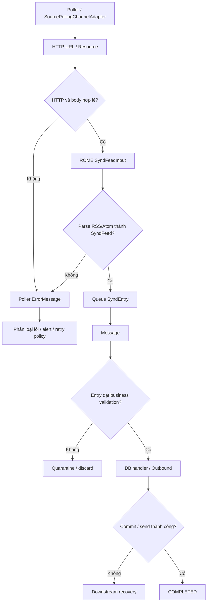
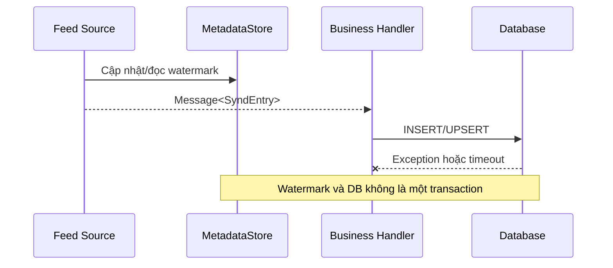
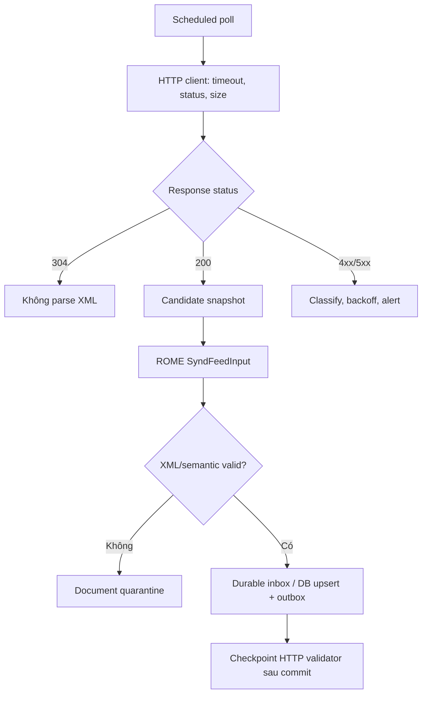

# Xử lý feed lỗi hoặc không hợp lệ trong Spring Integration

## 1. Bài toán và mục tiêu

Một ứng dụng Spring Boot lấy các thông báo mới qua RSS/Atom từ đối tác. Cứ 60 giây, ứng dụng phải tải feed, parse XML bằng ROME, phát `Message<SyndEntry>` qua `MessageChannel` và lưu bài viết vào database. Tuy nhiên, không phải mọi lần poll đều thành công:

- HTTP có thể trả `401/403`, `429`, `503`, timeout hoặc lỗi TLS.
- Server có thể trả `200 OK` kèm trang HTML đăng nhập thay vì RSS.
- XML có thể bị cắt, sai encoding, namespace hoặc chứa cấu trúc không hợp lệ.
- RSS item có thể thiếu GUID/ngày; Atom entry có thể thiếu `id` hoặc `updated`.
- Một bài có URL nguy hiểm, HTML độc hại hoặc content quá lớn.
- Source đã phát message nhưng handler DB lỗi, khiến watermark tiến mà bài chưa commit.
- Sau restart hoặc khi nhiều pod cùng poll, bài cũ có thể được nhận lại.

Bài học **“Xử lý feed lỗi hoặc không hợp lệ”** thuộc chương **Adapter Feed** của module `SPRING_INTEGRATION_ADAPTERS`. Module tập trung vào inbound/outbound adapter, gateway, poller, `MessageChannel`, các luồng file/SFTP/HTTP/JMS/AMQP/Kafka/database, hợp đồng message, xử lý lỗi và vòng đời kết nối. Riêng Feed inbound là **polling source**: một tài liệu RSS/Atom chứa nhiều entry, được ROME parse trước khi adapter phát từng `Message<SyndEntry>`.

Mục tiêu không chỉ là log được exception. Hệ thống phải biết **lỗi xảy ra ở tầng nào**, có thể retry hay cần cách ly dữ liệu, checkpoint nào đã được cập nhật và cách phục hồi mà không mất bài hoặc tạo tác dụng nghiệp vụ trùng.

Sau bài, bạn có thể:

1. Phân loại network/HTTP, XML parser, semantic RSS/Atom, validation của một entry và downstream failure.
2. Cấu hình HTTP timeouts, Java DSL Feed inbound, poller error channel và discard channel.
3. Hiểu vì sao malformed XML không có `Message<SyndEntry>` để lọc và vì sao parsed entry vẫn có thể sai nghiệp vụ.
4. Thiết kế retry/backoff cho 429/503/timeout, đồng thời xử lý 401/403/404 theo hướng không retry vô hạn.
5. Dùng `MetadataStore` và business ledger đúng ranh giới, nhận biết nguy cơ mất bài sau lỗi handler.
6. Lưu document/entry quarantine có kiểm soát, thực hiện reconciliation và replay an toàn.
7. Bảo vệ khỏi XML external entities, XSS, SSRF và tài nguyên đầu vào quá lớn.
8. Viết integration tests với fixture RSS/Atom và mock HTTP server.

## 2. Phân loại lỗi theo ranh giới xử lý



| Tầng | Ví dụ | Đã có `Message<SyndEntry>` chưa? | Hướng xử lý |
|---|---|---|---|
| **Transport** | DNS, TLS, timeout, HTTP 503 | Thường chưa | Error channel, phân loại, backoff |
| **HTTP representation** | 200 nhưng HTML, 204 rỗng, 304 không body | Chưa có entry từ response đó | HTTP validation trước parse nếu dùng custom client |
| **XML parser** | XML thiếu thẻ, namespace sai | Chưa | ROME exception, document quarantine nếu có raw snapshot |
| **Feed semantic** | Atom thiếu trường bắt buộc | Tùy parser: có thể fail cả feed | Validate với RFC và nguồn |
| **Entry validation** | Thiếu ID ổn định, URL nguy hiểm | Có, nếu ROME đã tạo entry | Filter/router, durable quarantine |
| **Business handler** | DB deadlock, side effect timeout | Có | Transaction, idempotency, outbox |
| **Recovery state** | Restart, metadata mất, hai pod cùng quét | Tùy mốc | Reconciliation, DB ledger |

**Ranh giới quan trọng:** một `.filter(SyndEntry.class, ...)` không thể xử lý XML chưa parse thành entry. Nếu ROME không tạo message, không có payload để gửi sang discard channel. Ngược lại, một entry parse thành công nhưng không đạt rule nghiệp vụ không nhất thiết là lỗi HTTP.

## 3. Phân biệt malformed XML, invalid feed và invalid entry

### 3.1. XML không well-formed

Ví dụ một RSS bị cắt dở:

```xml
<?xml version="1.0" encoding="UTF-8"?>
<rss version="2.0">
  <channel>
    <title>Thông báo</title>
    <item>
      <title>Release 4.1</title>
      <guid>release-41</guid>
    <!-- thiếu các thẻ đóng item, channel và rss -->
```

ROME `SyndFeedInput` có thể ném exception ngay trong quá trình load. Không có bảo đảm parser sẽ bỏ riêng item lỗi và tiếp tục phát các item hợp lệ trước nó. Việc parser dung thứ một số lỗi định dạng tùy thuộc phiên bản/cấu hình, **không phải cam kết khôi phục từng entry**.

Một ví dụ khác: chuỗi `R&D` xuất hiện không escape bên trong XML text. Ký tự `&` cần được viết đúng thành `&amp;`. Đừng dùng regex thay thế tất cả dấu `&` vì dễ làm hỏng entity hợp lệ khác.

### 3.2. HTTP 200 nhưng không phải RSS/Atom

```http
HTTP/1.1 200 OK
Content-Type: text/html; charset=UTF-8

<html><body>Please sign in</body></html>
```

Đây có thể là trang đăng nhập, captcha hoặc trang lỗi do proxy cung cấp. HTTP thành công **không chứng minh** payload là feed. Dựa vào Content-Type, cấu trúc XML và parser để phát hiện; không kết luận một poll không có message nghĩa là feed không đổi.

`200` có thể đi cùng `application/xml` hoặc `application/rss+xml`; publisher có thể đặt Content-Type không hoàn hảo, nên chính sách MIME có thể dùng allowlist/mức cảnh báo phù hợp. Nhưng với HTML login hoặc JSON error thì phải coi đó là bất thường, không để nó âm thầm trở thành “zero entries”.

### 3.3. RSS item thiếu metadata

```xml
<item>
  <title>Release 4.2</title>
  <link>https://feeds.example.org/releases/42</link>
  <description>Mô tả bản phát hành</description>
</item>
```

RSS item không có `guid`/`pubDate` chưa chắc là **XML lỗi**. ROME có thể tạo `SyndEntry` với vài trường null. Đối với nghiệp vụ cần chống trùng, phải thỏa thuận cách chọn identity:

- Ưu tiên GUID từ `SyndEntry.getUri()` nếu ổn định.
- Có thể fallback canonical link **nếu** publisher đảm bảo link không đổi và URL đã được validate.
- Nếu không có identity đáng tin, đưa vào quarantine để điều tra, không dựa vào title/message UUID/ngày poll.
- Với `publishedDate` null, kiểm thử source Feed 6.5 thật; không khẳng định mọi item thiếu ngày đều được phát rồi mới tới filter.

### 3.4. Atom thiếu trường bắt buộc

Atom 1.0 theo **RFC 4287** dùng namespace `http://www.w3.org/2005/Atom`. Một `entry` hợp lệ yêu cầu `id`, `title` và `updated`; `published` là **tùy chọn**.

```xml
<entry xmlns="http://www.w3.org/2005/Atom">
  <title>Release 4.3</title>
  <published>2026-11-23T04:00:00Z</published>
  <!-- Thiếu id và updated: không đạt hợp đồng Atom 1.0 -->
</entry>
```

Không giả định ROME tự áp dụng mọi quy tắc RFC ở mức validation nghiệp vụ: parser có thể báo lỗi hoặc tạo model thiếu trường tùy phiên bản. Cần test fixture cho đúng dependency thực tế. Ngược lại, Atom thiếu `published` nhưng có `updated` **không mặc nhiên invalid**; nên phân biệt điều đó với thuật toán watermark theo ngày xuất bản của Feed adapter.

### 3.5. Ngày và link hợp lệ về cú pháp nhưng sai thực tế

```text
publishedAt = 2099-01-01T00:00:00Z
updatedAt   = 2026-11-23T05:00:00Z
link        = http://127.0.0.1/admin
```

Một ngày quá xa tương lai có thể cho thấy publisher lệch đồng hồ. Nếu watermark source tiến tới mốc rất lớn, các bài sau có thể bị coi là cũ tùy thuật toán. Link loopback tuy có cú pháp URL hợp lệ nhưng không được tự fetch trong môi trường production. Cần validate **ngữ nghĩa và chính sách tin cậy**, không chỉ bắt exception parse.

## 4. HTTP errors, conditional request và timeout

| Status/lỗi | Nguyên nhân thường gặp | Retry? | Cách xử lý |
|---|---|---|---|
| DNS/connect timeout | Network, firewall, proxy, host lỗi | Có giới hạn | Backoff, cảnh báo, kiểm tra kết nối |
| Read timeout | Server chậm hoặc gửi body dở | Có giới hạn | Read timeout + deadline tổng |
| TLS handshake/certificate | Truststore, hostname, cert không hợp lệ | Không retry dồn dập | Kiểm tra bảo mật và cấu hình |
| `401` | Credential thiếu/hết hạn | Không retry nhanh | Sửa auth/token theo chính sách |
| `403` | Quyền truy cập bị từ chối | Thường không | Kiểm tra ACL/allowlist |
| `404/410` | URL sai hoặc feed đã gỡ | Không retry nhanh | Đối chiếu publisher |
| `429` | Vượt quota | Theo `Retry-After` | Giảm polling rate toàn cluster |
| `500/502/503/504` | Publisher/proxy tạm lỗi | Có giới hạn | Backoff và jitter |
| `301/302/307/308` | Redirect | Theo policy | Kiểm tra host đích, auth và source identity |
| `200` + HTML/JSON | Không phải RSS/Atom | Không retry vô hạn | Báo lỗi contract |
| `204` | Không có body | Không parse | Thỏa thuận ngữ nghĩa với publisher |
| `304` | Representation không đổi | Không parse | Client phải route 304 trước ROME |

### 4.1. 304 không phải RSS rỗng

Một HTTP client dùng `If-None-Match`/`If-Modified-Since` có thể nhận `304 Not Modified`, **không có XML body**. Chỉ thêm conditional header vào `UrlResource` chưa tạo một conditional-feed pipeline hoàn chỉnh: `FeedEntryMessageSource` đọc một `Resource` rồi đưa vào parser. Nếu cần phân biệt 200/304 và quản lý ETag, hãy có **HTTP layer xử lý status trước ROME**.

Đừng checkpoint ETag ngay khi thấy HTTP 200. Chỉ lưu validator sau khi snapshot mới đã được parse và lưu bền vững; nếu database lỗi nhưng ETag đã cập nhật, lần GET sau có thể nhận 304 và không còn body để replay.

### 4.2. Timeout phải đặt đúng tầng

| Tham số | Bảo vệ | Không thay thế |
|---|---|---|
| Connect timeout | Thời gian tạo HTTP connection | Thời gian parse XML |
| Read timeout | Thời gian chờ socket read | Deadline end-to-end |
| Total request deadline | Tổng thời gian HTTP | DB transaction timeout |
| Poll fixed delay | Lịch gọi source | Connect/read timeout |
| Retry budget | Giới hạn số lần thử | Idempotency |
| Database timeout | Transaction và query | HTTP timeout |

Không dùng `PollerSpec.receiveTimeout` làm HTTP read timeout của Feed URL. Với nguồn HTTP, cần cấu hình timeout của `UrlResource`/HTTP client như phần 6.

## 5. ROME SyndFeedInput và parser security

ROME có `SyndFeedInput` để parse RSS/Atom thành `SyndFeed`, sau đó lấy các `SyndEntry`. Kiểm thử với chuỗi fixture:

```java
import java.io.StringReader;

import com.rometools.rome.feed.synd.SyndFeed;
import com.rometools.rome.io.SyndFeedInput;

String xml = """
    <?xml version="1.0" encoding="UTF-8"?>
    <rss version="2.0">
      <channel>
        <title>Feed Lab</title>
        <link>https://feeds.example.org/</link>
        <description>Fixture hợp lệ</description>
        <item>
          <title>Release 4.1</title>
          <guid isPermaLink="false">release-41</guid>
          <pubDate>Mon, 23 Nov 2026 01:00:00 GMT</pubDate>
        </item>
      </channel>
    </rss>
    """;

SyndFeed feed = new SyndFeedInput().build(new StringReader(xml));
System.out.println(feed.getEntries().size());
```

Ở lab, sửa XML thành malformed để xác minh exception; không viết test assert dựa vào nguyên văn message exception vì parser/version có thể thay đổi. **Parse thành công vẫn cần validation**: entry ID, ngày, URL, content type, title length, category, enclosure và HTML.

Spring Integration 6.5 cho phép truyền `SyndFeedInput` tùy chỉnh. Nhưng **không bật `allowDoctypes` hoặc XML external entities một cách tùy tiện** để “sửa lỗi” feed cũ: điều đó làm tăng rủi ro XXE và truy cập mạng/file nội bộ. Nếu phải tương thích một định dạng có DTD, cần security review và kiểm tra hành vi của đúng phiên bản ROME.

## 6. Java DSL: Feed inbound với error channel và discard channel

Ví dụ dành cho **Spring Boot 3.x + Spring Integration 6.5.x tương thích**. Quản lý dependency bằng BOM phù hợp để các module có phiên bản thống nhất.

### 6.1. Dependencies và properties

**`build.gradle`:**

```gradle
dependencies {
    implementation 'org.springframework.boot:spring-boot-starter-integration'
    implementation 'org.springframework.integration:spring-integration-feed'
}
```

**`application.yml`:**

```yaml
demo:
  feed:
    url: ${FEED_URL:https://feeds.example.org/releases.xml}
    source-key: ${FEED_SOURCE_KEY:partner-releases}
    metadata-key: ${FEED_METADATA_KEY:feed:prod:partner-releases:v1}
    poll-delay-ms: ${FEED_POLL_DELAY_MS:60000}
    max-messages-per-poll: ${FEED_MAX_PER_POLL:10}
    connect-timeout-ms: ${FEED_CONNECT_TIMEOUT_MS:5000}
    read-timeout-ms: ${FEED_READ_TIMEOUT_MS:10000}
```

`feeds.example.org` là domain minh họa. Trong lab dùng mock HTTP server/fixture. Production chỉ truy cập URL đã duyệt; không dùng URL lấy trực tiếp từ request của người dùng để tránh SSRF.

### 6.2. Hai luồng lỗi tách biệt

**`FeedErrorHandlingConfig.java`:**

```java
import java.io.IOException;
import java.net.HttpURLConnection;
import java.net.MalformedURLException;

import com.rometools.rome.feed.synd.SyndEntry;

import org.springframework.beans.factory.annotation.Qualifier;
import org.springframework.beans.factory.annotation.Value;
import org.springframework.context.annotation.Bean;
import org.springframework.context.annotation.Configuration;
import org.springframework.core.io.Resource;
import org.springframework.core.io.UrlResource;
import org.springframework.integration.config.EnableIntegration;
import org.springframework.integration.dsl.IntegrationFlow;
import org.springframework.integration.dsl.Pollers;
import org.springframework.integration.feed.dsl.Feed;
import org.springframework.integration.metadata.MetadataStore;
import org.springframework.integration.metadata.SimpleMetadataStore;

@Configuration
@EnableIntegration
public class FeedErrorHandlingConfig {

    @Bean("feedErrorMetadataStore")
    MetadataStore feedErrorMetadataStore() {
        return new SimpleMetadataStore(); // Chỉ cho lab.
    }

    @Bean("feedErrorResource")
    Resource feedErrorResource(
            @Value("${demo.feed.url}") String url,
            @Value("${demo.feed.connect-timeout-ms}") int connectMs,
            @Value("${demo.feed.read-timeout-ms}") int readMs)
            throws MalformedURLException {

        return new UrlResource(url) {
            @Override
            protected void customizeConnection(HttpURLConnection connection)
                    throws IOException {
                super.customizeConnection(connection);
                connection.setConnectTimeout(connectMs);
                connection.setReadTimeout(readMs);
                connection.setRequestProperty("Accept",
                        "application/rss+xml, application/atom+xml, " +
                        "application/xml;q=0.9");
            }
        };
    }

    @Bean
    IntegrationFlow feedSourceFlow(
            @Qualifier("feedErrorResource") Resource resource,
            @Qualifier("feedErrorMetadataStore") MetadataStore store,
            @Value("${demo.feed.source-key}") String sourceKey,
            @Value("${demo.feed.metadata-key}") String metadataKey,
            @Value("${demo.feed.poll-delay-ms}") long delayMs,
            @Value("${demo.feed.max-messages-per-poll}") int maxPerPoll) {

        if (delayMs <= 0 || maxPerPoll <= 0) {
            throw new IllegalArgumentException(
                    "Poll delay và maxPerPoll phải lớn hơn 0");
        }

        return IntegrationFlow
                .from(Feed.inboundAdapter(resource, metadataKey)
                                .metadataStore(store),
                    endpoint -> endpoint
                            .id("feedErrorInbound")
                            .poller(Pollers.fixedDelay(delayMs)
                                    .maxMessagesPerPoll(maxPerPoll)
                                    .errorChannel("feedPollErrors")))
                .enrichHeaders(h -> h.header("feedSourceKey", sourceKey))
                .filter(SyndEntry.class,
                        entry -> entry.getUri() != null
                                && !entry.getUri().isBlank(),
                        endpoint -> endpoint
                                .discardChannel("feedInvalidEntries"))
                .channel("feedAcceptedEntries")
                .get();
    }

    @Bean
    IntegrationFlow feedBusinessFlow(FeedEntryService service) {
        return IntegrationFlow.from("feedAcceptedEntries")
                .handle(message -> {
                    SyndEntry entry = (SyndEntry) message.getPayload();
                    String source = message.getHeaders()
                            .get("feedSourceKey", String.class);
                    service.ingestIdempotently(source, entry);
                })
                .get();
    }

    @Bean
    IntegrationFlow invalidEntryFlow() {
        return IntegrationFlow.from("feedInvalidEntries")
                .handle(message -> {
                    // Lab: production phải lưu durable quarantine.
                    System.err.println("Feed entry thiếu ID đáng tin");
                })
                .get();
    }

    @Bean
    IntegrationFlow pollErrorFlow() {
        return IntegrationFlow.from("feedPollErrors")
                .handle(message -> {
                    Throwable failure = (Throwable) message.getPayload();
                    System.err.println("Feed poll failed: "
                            + failure.getClass().getSimpleName());
                    // Production: classify, metrics, alert và backoff.
                })
                .get();
    }
}

// Interface nghiệp vụ do dự án triển khai, không thuộc Spring Integration.
interface FeedEntryService {
    void ingestIdempotently(String sourceKey, SyndEntry entry);
}
```

### 6.3. Đọc đúng phạm vi

1. `Feed.inboundAdapter(resource, metadataKey)` dùng ROME parse RSS/Atom, phát từng `SyndEntry`.
2. `UrlResource.customizeConnection(HttpURLConnection)` cấu hình timeout HTTP; không phải deadline toàn bộ flow.
3. `.errorChannel("feedPollErrors")` cấu hình error channel của **polling task**. Exception từ HTTP hoặc parser có thể đi tới `ErrorMessage` ở đây.
4. `.filter(SyndEntry.class, ...)` chỉ chạy **sau khi source đã tạo message**. Nó không thể nhận XML malformed trước parser.
5. `.discardChannel("feedInvalidEntries")` nhận message bị loại theo chính sách, không phải dead-letter queue bền vững.
6. `feedBusinessFlow` gọi service do ứng dụng cung cấp. Production cần validation, unique key, transaction và xử lý revision.
7. Handler `System.err` trong ví dụ **chỉ để quan sát**. Log xong không đồng nghĩa một bản ghi đã được quarantine hoặc có thể replay.
8. Source có watermark dựa trên published date; không đảm bảo một entry bị reject sau filter sẽ được phát lại vào lần sau.

### 6.4. Giới hạn của filter thiếu ID

Filter này giả định mọi entry cần `getUri()` không rỗng. Một RSS thiếu GUID có thể vẫn dùng canonical link nếu publisher cam kết link ổn định. Atom thiếu ID có thể bị ROME từ chối ngay khi parse, không tới filter. Một entry có ID nhưng URL nguy hiểm, timestamp không hợp lý hoặc content quá lớn vẫn cần kiểm tra tiếp trong service.

Đối với nguồn quan trọng, chuyển invalid entry sang **durable quarantine**, thay vì chỉ ghi log. Raw XML chỉ có thể được giữ chắc chắn nếu bạn có HTTP snapshot layer trước ROME; Feed adapter không cam kết ErrorMessage chứa body đầy đủ.

## 7. Error channel khác discard channel và retry

### 7.1. ErrorMessage của polling task

Khi scheduled poller ném exception, Spring Integration có thể bọc lỗi thành `ErrorMessage` gửi tới error channel. Payload của `ErrorMessage` là một `Throwable`. Đường lỗi này phù hợp với lỗi nguồn được phát hiện trong polling task.

Với `DirectChannel` đồng bộ, exception handler có thể ảnh hưởng task hiện tại. Nếu dùng `ExecutorChannel`, queue hoặc broker, một consumer xử lý ở thread khác có thể lỗi **sau khi** poller đã gửi thành công; lúc đó phải thiết kế error path riêng. Không tuyên bố một poller error channel tự bắt mọi downstream failure.

### 7.2. Discard không đồng nghĩa exception

Một `MessageFilter` trả false thường là quyết định nghiệp vụ, không phải exception. Nếu rule là “chỉ nhận bài sau ngày X”, bỏ qua bài cũ có thể là hành vi bình thường. Nếu rule là “entry thiếu ID”, cần quarantine, metric và audit thay vì bỏ thầm lặng.

### 7.3. Error channel không tự retry

```java
.poller(Pollers.fixedDelay(60_000)
        .maxMessagesPerPoll(10)
        .errorChannel("feedPollErrors"))
```

Cấu hình trên **không tự** exponential-backoff HTTP 503, tự đợi `Retry-After` hay tự replay message sau DB failure. Nó chỉ cung cấp đường phát hiện lỗi; retry/backoff/reconciliation là chính sách riêng.

`RequestHandlerRetryAdvice` có thể retry một `MessageHandler`, ví dụ lỗi DB tạm thời. Nhưng advice gắn vào handler **không thể sửa lỗi parse XML khi chưa có message**.

| Vị trí retry | Xử lý được | Không giải quyết |
|---|---|---|
| HTTP/source | Timeout, 503, DNS tạm | DB commit trùng |
| Handler advice | Lỗi xử lý một message | XML chưa parse |
| DB transaction | Deadlock/serialization retry | HTTP nguồn sai định dạng |
| Outbox | Kafka/JMS/HTTP send failure | Feed thiếu ID |
| Reconciliation | Entry đến muộn/bị bỏ sót | Bài đã biến mất khỏi mọi nguồn lịch sử |

### 7.4. Backoff policy

Một chiến lược minh họa:

```text
503 / network:
  failure 1 -> thử lại sau tối thiểu 60s
  failure 2 -> tối thiểu 120s
  failure 3 -> tối thiểu 240s
  failure 4+ -> cap 15 phút + jitter

429 -> theo Retry-After/quota publisher
401/403 -> pause để sửa credential/policy
404/410 -> kiểm tra lại feed URL hoặc ngừng nguồn
XML invalid lặp -> quarantine/alert; chờ publisher sửa
```

Đây không phải default Spring Integration. Nếu trigger vẫn là `fixedDelay(60_000)`, nhận `ErrorMessage` **không tự** tăng khoảng cách poll. Phải áp dụng backoff trước request hoặc qua scheduler/circuit breaker/trigger điều chỉnh được.

## 8. Watermark, restart và lost processing

Theo tài liệu Spring Integration **6.5**, `FeedEntryMessageSource` giảm duplicate dựa trên **ngày xuất bản mới nhất** đã phát, lưu trong `MetadataStore` theo `metadataKey`. Source không biết database đã commit hay chưa.



Nếu entry E đã được source phát nhưng handler chưa commit, lần poll tiếp có thể **không phát lại E** do watermark đã tiến. Ngược lại, restart với `SimpleMetadataStore` trong memory có thể làm mất watermark và phát lại các entry đã commit.

| Store | Đặc điểm | Giới hạn |
|---|---|---|
| `SimpleMetadataStore` | Phù hợp lab, không backend | Mất state qua restart |
| `PropertiesPersistingMetadataStore` | Có thể ghi file metadata | Cần flush/shutdown/persistent volume |
| `JdbcMetadataStore` | Có thể chia sẻ/bền qua DB | Cần schema, transaction, quyền và vận hành |
| Store tương thích khác | Theo hạ tầng | Phải kiểm tra atomicity, persistence, retention |

**Không xóa toàn bộ watermark khi một entry fail.** Có thể làm source phát lại hàng trăm bài và gây một đợt duplicate downstream. Nếu entry thiếu do source đã đánh dấu quá sớm, cần durable inbox/reconciliation hoặc replay có mục tiêu.

Nếu publisher thêm entry GUID mới nhưng published date **cũ hơn** watermark, hoặc sửa một Atom entry giữ nguyên published date, source có thể không phát entry mới/bản sửa. Thêm filter phía sau không lấy lại được thứ source đã bỏ qua. Khi cần đồng bộ đầy đủ, dùng snapshot/historical API hoặc cursor theo updated time và so ID/revision nghiệp vụ.

## 9. Durable quarantine và cách ly dữ liệu lỗi

### 9.1. Document-level và entry-level quarantine

Một hệ thống quan trọng cần lưu bằng chứng đủ để phát lại, thay vì chỉ ghi exception vào console:

| Loại | Khi nào? | Có raw `SyndEntry`? | Cách phục hồi |
|---|---|---|---|
| **Document-level** | HTTP 200 có XML lỗi, parser không tạo feed | **Không** | Sửa nguồn/parse policy, replay snapshot gốc |
| **Entry-level** | Đã parse được entry nhưng thiếu ID, ngày sai hoặc URL không hợp lệ | **Có**, nếu source phát entry | Sửa/điều tra một entry, validate rồi replay |
| **Business failure** | Entry hợp lệ, DB/outbox lỗi | **Có** | Ledger và transactional retry |

Đối với document-level, `FeedEntryMessageSource` mặc định không cam kết đưa body HTTP lỗi vào `ErrorMessage`. Nếu cần replay chính xác XML mà publisher từng trả, dùng **custom HTTP client/fetch layer** lưu snapshot theo quyền và retention rõ ràng rồi mới gọi ROME. Không suy đoán rằng error message luôn giữ full RSS XML.

### 9.2. Dữ liệu lưu tối thiểu

```text
sourceKey        = partner-releases
failureStage     = PARSE | VALIDATION | BUSINESS
errorCategory    = INVALID_XML | MISSING_ID | DB_RETRYABLE
snapshotId       = hash hoặc ID bản chụp
entryKey         = sourceKey + entryId (nếu có)
firstSeenAt      = UTC timestamp
lastSeenAt       = UTC timestamp
attemptCount     = integer
nextRetryAt      = nullable UTC timestamp
quarantineStatus = OPEN | FIXED | REPLAYED | CLOSED
evidenceRef      = dẫn tới object storage được phân quyền
```

Không đưa raw XML/HTML có thể chứa thông tin nhạy cảm vào metric labels hoặc log. Khi phải giữ body để điều tra, mã hóa at rest, giới hạn kích thước, phân quyền truy cập, ghi audit và đặt thời hạn lưu.

### 9.3. Quarantine không tự biến thành retry queue

Một entry thiếu ID có thể không sửa được nếu publisher không cung cấp identity. Việc tự gửi lại nó mỗi phút không giúp ích, lại tạo alert storm. Quy trình:

1. Ghi lý do rõ ràng và identity tài liệu/entry.
2. Cho người vận hành quyết định có sửa metadata/cách fallback ID theo hợp đồng không.
3. Re-validate dữ liệu khi replay.
4. Kiểm tra DB ledger/version hiện hành trước khi ghi.
5. Dùng outbox/idempotency key nếu replay sinh notification.
6. Đóng case có audit thay vì xóa dữ liệu âm thầm.

**Cảnh báo:** một message bị filter sau khi source ghi watermark có thể không xuất hiện lại tự nhiên. Nếu yêu cầu không mất dữ liệu, phải có **đường replay chủ động** từ durable snapshot/inbox, không chỉ chờ lần poll kế.

## 10. Idempotency khi lỗi handler hoặc outbound

### 10.1. Đã phát không đồng nghĩa đã commit

```text
HTTP 200 -> ROME parse -> Feed source phát SyndEntry
  -> DB INSERT/UPSERT
     -> timeout / connection reset
        -> không biết transaction đã commit chưa
```

Nếu retry một lệnh INSERT không có unique constraint, một bài có thể bị lưu hai lần. Nếu bỏ qua retry, bài chưa commit có thể mất. Chọn khóa bền vững:

```text
articleKey = (sourceKey, entryId)
revision = updatedAt hoặc contentSha256 theo hợp đồng publisher
```

Không dùng `MessageHeaders.ID` hoặc ngày poll làm khóa bài: một bài có thể được phát qua nhiều message với UUID khác nhau.

### 10.2. Schema nghiệp vụ minh họa

```sql
CREATE TABLE feed_article_ledger (
    source_key       VARCHAR(128) NOT NULL,
    entry_id         VARCHAR(768) NOT NULL,
    revision_sha256  CHAR(64),
    published_at     TIMESTAMPTZ,
    updated_at       TIMESTAMPTZ,
    processing_state VARCHAR(32) NOT NULL,
    processed_at     TIMESTAMPTZ,
    PRIMARY KEY (source_key, entry_id)
);

CREATE TABLE feed_outbox (
    event_key       VARCHAR(1024) PRIMARY KEY,
    event_type      VARCHAR(64) NOT NULL,
    payload_json    TEXT NOT NULL,
    delivery_state  VARCHAR(32) NOT NULL,
    created_at      TIMESTAMPTZ NOT NULL DEFAULT now()
);
```

Đây là PostgreSQL **minh họa**, không phải schema Spring Integration dựng sẵn. Nếu nghiệp vụ lưu nhiều revision của cùng bài, cần một bảng version/history riêng và chính sách conflict.

| Trạng thái DB | Entry đến | Hành động |
|---|---|---|
| Chưa có key | ID mới | Claim/insert atomically |
| `COMPLETED`, cùng revision | Duplicate | Skip |
| `COMPLETED`, revision mới hơn | Bản sửa hợp lệ | Update/lưu history theo policy |
| `PROCESSING`, claim còn hạn | Worker khác đang làm | Không xử lý song song |
| `PROCESSING` quá hạn | Worker có thể chết | Reconcile rồi claim lại có điều kiện |
| `FAILED_RETRYABLE` | Retry | Dùng transaction và unique key |
| `CONFLICT` | Cùng ID nhưng checksum không khớp policy | Quarantine, không overwrite |
| Article đã commit, outbox pending | Gửi thông báo chưa hoàn tất | Retry outbox, không import lại bài |

**Chống race:** không dùng “SELECT không thấy → INSERT” thiếu unique constraint. Hai pod có thể đồng thời thấy chưa có dữ liệu. Cần primary key, transaction và UPSERT/compare-and-set phù hợp.

### 10.3. Delivery lỗi sau DB commit

Giả sử lưu bài xong rồi gửi Kafka/JMS/AMQP/HTTP, client timeout trước khi có ACK. Đích **có thể đã nhận** thông báo. Nếu phát lại toàn bộ ingestion có thể gửi trùng:

- Ghi record bài và **outbox event** trong một DB transaction.
- Worker outbox gửi lại theo event key ổn định: `sourceKey + entryId + revision + eventType`.
- Bên nhận áp dụng idempotency key/inbox dedup.
- Theo dõi trạng thái delivery độc lập với trạng thái article.

Outbox giúp giảm lỗ hổng giữa commit và gửi; nó không tự biến mạng thành một giao dịch distributed exactly-once.

## 11. Khi nào cần custom HTTP fetch và snapshot?

Feed adapter trực tiếp phù hợp với nguồn tương đối chuẩn, không yêu cầu giữ raw body lỗi và chấp nhận logic watermark ngày xuất bản. Nên cân nhắc nguồn tùy chỉnh khi cần:

- Truy cập HTTP status/headers của `200, 204, 304, 401, 429, 503`.
- Giới hạn kích thước body trước khi parser đọc.
- Lưu raw XML để debug malformed feed.
- Checkpoint ETag/Last-Modified **sau khi** snapshot được nhận bền vững.
- So sánh toàn bộ GUID/Atom ID và revision, phát hiện bài đến muộn/bản sửa.
- Auth, redirect, rate limit, circuit breaker và tenant policy phức tạp.



### 11.1. Pseudocode kiểm soát mốc checkpoint

```java
// PSEUDOCODE: các type/service là do dự án triển khai,
// không phải API Feed của Spring Integration.
void pollFeed() {
    FeedHttpResponse response = httpClient.fetchConditional(
            trustedFeedUrl, validatorStore.load(sourceKey));

    switch (response.status()) {
        case 304 -> metrics.notModified(sourceKey);
        case 200 -> {
            verifyContentTypeAndSize(response);
            try {
                ParsedFeed parsed = romeParser.parse(response.body());
                // Transaction/durable inbox phải bảo vệ mọi entry đã chấp nhận.
                ingestService.saveSnapshotAndCheckpointSafely(
                        sourceKey, parsed, response.validators());
            }
            catch (InvalidFeedException e) {
                documentQuarantine.saveIfPermitted(response, e);
                alerts.invalidFeed(sourceKey);
            }
        }
        case 429, 503 -> retryPolicy.onTransientFailure(response);
        default -> retryPolicy.onOtherStatus(response);
    }
}
```

Các method trong pseudocode **không phải Java DSL của Spring Integration**. Mục tiêu là làm rõ 304 không có XML để parse; 200 phải validate và lưu bền trước checkpoint; HTTP/parse/DB lỗi không được đẩy ETag lên trước kết quả ingest.

Nếu snapshot và validator nằm ở hai backend khác nhau, một method Java không tự tạo atomic transaction. Cần durable inbox với recovery nếu crash xảy ra giữa các lần commit. Nếu publisher chỉ giữ một số bài gần nhất, HTTP polling không thể tạo lại các bài đã biến mất khỏi nguồn; cần historical API/backfill.

## 12. Bảo mật và giới hạn tài nguyên

### 12.1. SSRF và redirect

Một URL feed chưa được kiểm tra có thể trỏ tới `localhost`, IP private, link-local, metadata endpoint cloud hoặc dịch vụ nội bộ. Áp dụng:

1. Chỉ nhận các nguồn do quản trị viên/đối tác đáng tin duyệt.
2. Kiểm tra scheme, host, port, DNS/IP, và **redirect destination**.
3. Không chuyển Authorization/cookie tới host mới tùy tiện.
4. Giới hạn mạng outbound theo least privilege, bảo vệ DNS rebinding.
5. Dùng TLS/certificate trust đúng; không tắt SSL validation để chữa 503.
6. Không log raw URL chứa token/query nhạy cảm.

### 12.2. XXE, XML bomb và body quá lớn

ROME nhận XML bên ngoài, nên phải đánh giá DTD/external entities trong parser; hạn chế external entity resolution. Một body nhỏ khi nén GZIP có thể giải nén rất lớn, vì thế cần giới hạn dung lượng **sau giải nén**, số entry, XML depth và thời gian parse.

`maxMessagesPerPoll(10)` giới hạn số message được phát **mỗi lượt**, **không** hạn chế HTTP response size hay số entry ROME cần parse trong tài liệu.

### 12.3. XSS/unsafe links

`SyndEntry.getDescription()`/`getContents()` có thể chứa HTML/XHTML. Trước khi render ra UI, phải sanitize/escape. Không tự fetch link, enclosure hoặc Atom `content src` ngoài allowlist hoặc không có quota. Các URL nằm trong XML là dữ liệu bên ngoài, không tự trở thành URL tin cậy khi đã qua ROME.

### 12.4. Log và quarantine an toàn

Nếu cần lưu evidence, nên mã hóa, phân quyền, đặt retention, kiểm soát kích thước và ghi audit. Không đưa raw XML, token, cookie hoặc PII vào metric labels, tracing baggage hay log không giới hạn.

## 13. Quan sát hệ thống và runbook vận hành

### 13.1. Metric và event gợi ý

| Chỉ số | Giúp trả lời |
|---|---|
| `feed_http_fetch_total{source,status}` | HTTP có trả lỗi/200/304 không? |
| `feed_http_latency_ms` | Nguồn có chậm không? |
| `feed_http_timeout_total` | Timeout có vượt SLA không? |
| `feed_parse_failure_total{reason}` | XML/ROME có lỗi gì? |
| `feed_source_emitted_total` | Bao nhiêu entry được phát? |
| `feed_invalid_entry_total{reason}` | Bao nhiêu entry bị rule loại? |
| `feed_document_quarantine_open` | Có bao nhiêu tài liệu lỗi cần xử lý? |
| `feed_business_commit_total` | Bao nhiêu entry thực được ghi? |
| `feed_business_duplicate_skip_total` | Bao nhiêu duplicate được chặn? |
| `feed_outbox_pending_total` | Có notification nào chưa giao? |
| `feed_last_http_success_at` | Lần tải HTTP thành công gần nhất? |
| `feed_last_parse_success_at` | Lần parse thành công gần nhất? |
| `feed_last_business_commit_at` | Lần commit gần nhất? |
| `feed_metadata_store_failure_total` | Watermark state có vấn đề? |

Đây là **tên metric gợi ý**, không phải tất cả được framework tạo sẵn. Giữ metric labels có cardinality thấp, ví dụ source alias và error category; tránh GUID hay raw URL từng bài.

Một log định dạng:

```text
event=feed_poll_error
sourceKey=partner-releases
stage=PARSE
category=INVALID_XML
httpStatus=200
attempt=3
errorType=FeedException
action=QUARANTINE_DOCUMENT
```

Trong Feed adapter tiêu chuẩn, error handler có thể **không biết HTTP status hoặc raw body** khi exception đã được bọc trong tầng Resource/ROME. Không tự bịa giá trị khi không có instrument HTTP; ghi `unknown` hoặc bỏ field.

### 13.2. Runbook: feed lỗi liên tục

1. Xác định source key, phiên bản ứng dụng và thời gian lần HTTP/parse/commit thành công gần nhất.
2. Phân loại giai đoạn lỗi: network, HTTP status, XML parser, entry validation hay downstream.
3. Với HTTP, kiểm tra DNS, TLS, redirect, auth, 429 và quota theo chính sách mạng.
4. Với XML, kiểm tra snapshot đã lưu an toàn, namespace, encoding, size và parser diagnostics.
5. Với entry, kiểm tra ID, ngày, title, link/HTML và chính sách business.
6. Với downstream, đối chiếu DB ledger và outbox, tránh reset watermark bừa.
7. Áp dụng backoff/pause khi lỗi lâu dài; theo dõi mốc khôi phục.
8. Khi publisher sửa lỗi, chạy reconciliation/replay đúng nguồn, đúng revision.
9. Xác nhận **không còn khoảng trống dữ liệu** trong DB theo SLA, không chỉ thấy HTTP 200.

## 14. Kiểm thử bằng fixture RSS/Atom và mock HTTP server

### 14.1. RSS fixture tối thiểu

```xml
<?xml version="1.0" encoding="UTF-8"?>
<rss version="2.0">
  <channel>
    <title>Lab Feed</title>
    <link>https://feeds.example.org/</link>
    <description>Thông báo kiểm thử</description>
    <item>
      <title>Release 4.1</title>
      <guid isPermaLink="false">release-41</guid>
      <pubDate>Mon, 23 Nov 2026 01:00:00 GMT</pubDate>
      <description>Bản phát hành thử nghiệm</description>
    </item>
  </channel>
</rss>
```

Đặt `sample-feed.xml` trong **test resources của dự án thực hành**, không ghi thêm file nào khác trong nhiệm vụ viết bài Knowledge này. Để test parse không qua network:

```java
import org.springframework.core.io.ClassPathResource;
import org.springframework.integration.feed.dsl.Feed;

var fixtureSpec = Feed.inboundAdapter(
        new ClassPathResource("sample-feed.xml"),
        "feed:lab:errors:v1");
```

Mock HTTP server là cần thiết khi test status 401/429/503/304, redirect, timeout và response body không đúng. Mỗi test nên có metadata key/store riêng để watermark từ case trước không làm sai kết quả.

### 14.2. Ma trận kiểm thử

| Tình huống | Đầu vào | Kỳ vọng |
|---|---|---|
| RSS hợp lệ | 200 + XML chuẩn | Phát `Message<SyndEntry>` |
| Network timeout | Socket treo quá deadline | Error channel, không tạo entry giả |
| HTTP 503 | Server tạm lỗi | Retry/backoff có hạn |
| 401/403 | Auth sai | Cảnh báo cấu hình, không retry storm |
| 429 | Có `Retry-After` | Giảm nhịp theo quota |
| 200 HTML | Login page | Không coi là RSS hợp lệ |
| 204 | Body rỗng | Không parse |
| 304 | Conditional GET | Không parse, giữ validator |
| RSS XML thiếu thẻ | Malformed document | Parse error, document recovery |
| Atom thiếu id/updated | Semantic invalid | Validation/parser theo version |
| RSS thiếu GUID | Partial entry | Identity policy, quarantine nếu cần |
| RSS thiếu pubDate | Partial entry | Kiểm thử watermark, không suy mặc định |
| XSS/unsafe URL | Entry parse được | Sanitize, link allowlist |
| DB lỗi sau source message | Downstream exception | Reconciliation/retry có idempotency |
| Restart | SimpleMetadataStore mất state | Có thể replay, DB chống duplicate |
| Multi-pod | Hai nguồn cùng feed | Unique key và rate limit chung |

## 15. Bài thực hành theo tình huống

### Lab A — HTTP 503 và error channel

1. Mock server trả RSS hợp lệ, xác nhận flow có message.
2. Chuyển sang HTTP 503 trong hai lượt poll.
3. Quan sát `feedPollErrors`, error type và số lần thất bại.
4. Đảm bảo không tạo message giả hoặc reset metadata khi 503.
5. Khôi phục 200, kiểm tra luồng tiếp tục và không nhập lại bài trùng.

**Kết quả:** phân biệt lỗi nguồn HTTP với không có bài mới.

### Lab B — 200 nhưng body HTML

1. Mock server trả `200 + text/html + login page`.
2. Quan sát ROME/Feed source không thể coi đó là feed mong đợi.
3. Với custom HTTP client, phân loại lỗi Content-Type/body trước parser.
4. Không log token hoặc HTML body nhạy cảm.
5. Khôi phục XML đúng và kiểm tra ingestion.

**Kết quả:** HTTP OK không bảo đảm RSS/Atom đúng.

### Lab C — Malformed XML

1. Bỏ thẻ đóng trong RSS fixture.
2. Test riêng `SyndFeedInput`, ghi exception type thực tế.
3. Cho Feed adapter đọc cùng fixture lỗi.
4. Kiểm tra invalid-entry discard handler **không nhận message** nếu parser fail toàn bộ.
5. Thử custom snapshot quarantine để giữ bằng chứng có kiểm soát.

**Kết quả:** document-level errors phải được xử lý trước entry-level filter.

### Lab D — Atom semantic validation

1. Tạo Atom 1.0 với `id`, `title`, `updated` hợp lệ.
2. Bỏ `id` hoặc `updated`, kiểm tra hành vi parser và validator.
3. Chỉ bỏ `published`, xác minh không tự coi là Atom sai.
4. Xây policy dành cho entry thiếu ngày xuất bản trong Feed 6.5.
5. Đưa dữ liệu không đạt business contract vào quarantine.

**Kết quả:** XML well-formed, RFC Atom và business validation khác nhau.

### Lab E — RSS thiếu GUID

1. Tạo RSS item có title/link nhưng không có GUID.
2. Xem `SyndEntry.getUri()` trả gì trong đúng ROME version.
3. Quan sát nhánh `feedInvalidEntries` nếu parser/source phát entry.
4. Thử canonical-link fallback chỉ với publisher có cam kết URL ổn định.
5. Đo số entry thiếu identity và xử lý quarantine.

**Kết quả:** thiếu GUID không tự động là parse error nhưng có thể ngăn idempotency.

### Lab F — Read timeout và 429

1. Mock server trì hoãn body vượt read timeout.
2. Kiểm tra error category và độ trễ thực tế.
3. Cho server trả `429 Retry-After: 120`.
4. Điều chỉnh scheduler/policy để không tiếp tục gửi request quá quota.
5. Chạy thử hai pod để xem tổng HTTP rate.

**Kết quả:** timeout/poller/backoff là ba cơ chế khác nhau.

### Lab G — DB lỗi sau khi source phát

1. Cho source phát entry có ID và ngày hợp lệ.
2. Mô phỏng DB fail trước commit.
3. Đối chiếu watermark nguồn và ledger DB.
4. Quan sát vì sao entry có thể không tự phát lại.
5. Replay có mục tiêu bằng durable inbox/reconciliation và dùng unique key.

**Kết quả:** watermark không phải xác nhận DB commit.

### Lab H — Commit xong, outbound lỗi

1. Commit article và outbox event trong một transaction.
2. Mô phỏng gửi Kafka/JMS/HTTP timeout sau khi bên nhận có thể đã xử lý.
3. Retry cùng event key từ outbox.
4. Bên nhận dedup theo key, không tạo side effect lần hai.
5. Giữ riêng trạng thái article và delivery.

**Kết quả:** không import lại RSS chỉ vì gửi thông báo thất bại.

### Lab I — Restart và hai instance

1. Poll fixture với `SimpleMetadataStore`, ghi trạng thái DB.
2. Restart context, quan sát khả năng source phát lại.
3. Chuyển sang store bền trong môi trường thử nghiệm.
4. Chạy hai instance cùng feed, đếm request và duplicate.
5. Dùng unique constraint/leader phù hợp, kiểm chứng kết quả.

**Kết quả:** persistent metadata giảm replay nhưng không thay DB idempotency.

### Lab J — Bài đến muộn hoặc được sửa

1. Source ghi watermark tại T3.
2. Publisher thêm GUID mới với published T2 (cũ hơn).
3. Sửa một Atom entry giữ nguyên published nhưng updated T4.
4. Ghi nhận trường hợp source không phát lại.
5. Dùng snapshot/historical API so ID/revision để phục hồi.

**Kết quả:** tăng poll frequency không chữa được mọi giới hạn của watermark.

### Lab K — HTML/link/DTD không tin cậy

1. Tạo entry có description HTML cần sanitize.
2. Đặt enclosure link ngoài allowlist; kiểm tra không tự fetch.
3. Tạo XML có DOCTYPE ở lab cô lập, xác minh parser policy an toàn.
4. Thử response size lớn, giới hạn parse tài nguyên.
5. Kiểm tra log không chứa token/HTML raw nhạy cảm.

**Kết quả:** XML parse được không có nghĩa dữ liệu an toàn để sử dụng.

### Lab L — Quarantine và replay có audit

1. Tạo một RSS entry thiếu ID bền, đưa vào quarantine bền vững.
2. Ghi source, snapshot reference, failure category, attempt và thời gian.
3. Chỉ bổ sung ID qua policy được phê duyệt hoặc sau khi publisher sửa.
4. Replay có kiểm tra DB ledger, version, unique key và outbox.
5. Chuyển case từ `OPEN` sang `REPLAYED/CLOSED` cùng audit.

**Kết quả:** replay có kiểm soát đáng tin hơn log và retry vô hạn.

### Câu hỏi tự kiểm tra

1. Vì sao lỗi XML malformed có thể xảy ra trước khi có `Message<SyndEntry>`?
2. `errorChannel` và `discardChannel` có cùng ý nghĩa không?
3. Vì sao HTTP 200 vẫn có thể không phải feed hợp lệ?
4. HTTP 304 có body XML để ROME parse không?
5. Atom thiếu `published` có luôn invalid không?
6. RSS thiếu GUID có nhất thiết là lỗi XML không?
7. Vì sao `.errorChannel(...)` không tự triển khai backoff?
8. `RequestHandlerRetryAdvice` có xử lý được XML chưa parse không?
9. Khi nào nên lưu document quarantine, khi nào entry quarantine?
10. Vì sao `SimpleMetadataStore` có thể gây replay sau restart?
11. Vì sao source watermark có thể làm mất replay sau DB failure?
12. Nếu DB commit rồi send timeout, bước nào được retry?
13. Có nên xoá mọi metadata key để xử lý một entry lỗi không?
14. Vì sao 429 cần kiểm soát tổng request toàn cluster?

## 16. Những nhầm lẫn thường gặp

| Nhầm lẫn | Cách hiểu đúng |
|---|---|
| HTTP 200 nghĩa là Feed hợp lệ | Có thể là HTML/login, body rỗng hoặc XML lỗi |
| Feed không phát message nghĩa là HTTP lỗi | Có thể không có entry mới hoặc watermark lọc |
| Một `SyndEntry` filter xử lý được mọi parse error | Parser có thể fail trước khi tạo message |
| RSS không có GUID chắc chắn là XML sai | Có thể parse được; vấn đề nằm ở identity |
| Atom không có published là invalid | Atom 1.0 bắt buộc updated, published tùy chọn |
| ROME parse được nghĩa là tất cả business rules đã đạt | Cần validation riêng |
| `errorChannel` tự retry 503 | Phải cấu hình policy retry/backoff |
| `discardChannel` cũng là error channel | Discard là rule rejection, error là exception |
| Ghi log invalid entry là đã quarantine | Log không phải durable inbox/replay |
| Retry handler advice chữa được HTTP parse failure | Handler advice cần có message |
| Retry 401/403 liên tục sẽ sửa auth | Có thể khóa tài khoản; cần sửa config |
| Retry 429 ngay lập tức là phù hợp | Tôn trọng quota và Retry-After |
| Read timeout giới hạn toàn bộ processing flow | Nó chỉ bảo vệ thao tác đọc socket |
| `maxMessagesPerPoll` giới hạn kích thước XML | Nó giới hạn số message mỗi lượt poll |
| `MetadataStore` giữ state qua restart dù dùng SimpleMetadataStore | SimpleMetadataStore chỉ lưu memory |
| Watermark nghĩa là DB đã commit | Source và DB không là một transaction |
| Xóa hết watermark giúp retry đúng một bài | Có thể replay hàng loạt |
| XML lỗi có thể luôn salvage các entry đầu | Không có cam kết parse từng entry từ XML malformed |
| Gắn If-None-Match vào UrlResource là đủ xử lý 304 | Cần route HTTP status trước ROME |
| Shared metadata store bảo đảm exactly-once | Cần unique key, transactions và coordination |
| HTML từ ROME có thể render ngay | Vẫn phải sanitize/escape và kiểm soát URL |
| Kafka/JMS timeout sau commit đòi import lại Feed | Retry outbox, không nhập duplicate |

## 17. Tài liệu tham khảo

- [Spring Integration 6.5 — Feed Adapter](https://docs.spring.io/spring-integration/reference/6.5/feed.html): `FeedEntryMessageSource`, ROME, poller, `MetadataStore`, `UrlResource` timeout.
- [FeedEntryMessageSource API 6.5](https://docs.spring.io/spring-integration/docs/6.5.0/api/org/springframework/integration/feed/inbound/FeedEntryMessageSource.html): constructors URL/Resource, `setSyndFeedInput`, `setMetadataStore`.
- [Spring Integration 6.5 — Error Handling](https://docs.spring.io/spring-integration/reference/6.5/error-handling.html): `ErrorMessage`, error channel, scheduled poller errors.
- [Spring Integration 6.5 — Message Endpoints](https://docs.spring.io/spring-integration/reference/6.5/endpoint.html): polling, trigger, scheduler và advice.
- [Spring Integration 6.5 — Filter](https://docs.spring.io/spring-integration/reference/6.5/filter.html): MessageFilter, discard channel và rejection.
- [Spring Integration 6.5 — Handler Advice](https://docs.spring.io/spring-integration/reference/6.5/handler-advice/classes.html): retry tại handler, backoff và recovery.
- [Spring Integration 6.5 — Metadata Store](https://docs.spring.io/spring-integration/reference/6.5/meta-data-store.html): memory/persistent state, restart.
- [ROME — Feed parsing](https://rome.readthedocs.io/en/stable/rome/technical-docs/feed-parsing/): SyndFeedInput và WireFeed parsers.
- [ROME — Read feed](https://rome.readthedocs.io/en/stable/rome/getting-started/read-feed/): parse RSS/Atom.
- [RFC 4287 — Atom Syndication](https://www.rfc-editor.org/rfc/rfc4287): namespace, id/title/updated, published tùy chọn.
- [RFC 9110 — HTTP Semantics](https://www.rfc-editor.org/rfc/rfc9110): HTTP status, 304, 429, conditional request.

**Ghi nhớ:** khi Feed lỗi, trước hết cần phân biệt **HTTP**, **ROME/XML**, **entry validation** và **downstream processing**. Lỗi parse có thể xảy ra trước khi có `Message<SyndEntry>`; filter không thể nhận một entry chưa được tạo. Error channel giúp quan sát lỗi polling, nhưng không tự retry hay rollback database. Muốn phục hồi an toàn cần timeout/backoff, durable quarantine hoặc inbox khi cần, đối soát watermark, unique key/transaction và outbox để sau sự cố **không bỏ sót bài quan trọng và không tạo tác dụng nghiệp vụ trùng**.
