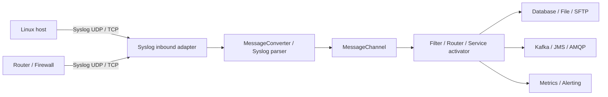
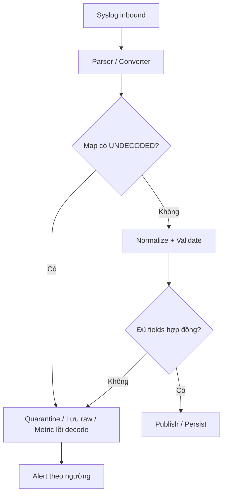

# Syslog inbound channel adapter

## 1. Syslog inbound channel adapter giải quyết bài toán gì?

Trong module **SPRING_INTEGRATION_ADAPTERS**, Spring Integration kết nối hệ thống bên ngoài bằng inbound/outbound adapter, gateway, poller và `MessageChannel`. Với chương **Adapter Syslog**, nguồn dữ liệu không phải request HTTP hay một file được poll, mà là các **bản ghi nhật ký hệ thống** do router, firewall, Linux host, ứng dụng hoặc thiết bị mạng gửi tới một cổng UDP/TCP.

**Syslog inbound channel adapter** biến các bản ghi nhận qua mạng thành Spring Integration `Message<?>` để flow tiếp tục lọc, định tuyến, chuẩn hóa và chuyển tới database, Kafka, AMQP, JMS, file, SFTP hay một HTTP service.

Ví dụ nghiệp vụ: nhóm vận hành muốn nhận cảnh báo đăng nhập thất bại từ nhiều máy chủ, chuẩn hóa trường `host`/`severity`, phân tuyến sự kiện mức nghiêm trọng sang Kafka, đồng thời lưu bản ghi thô để điều tra khi parser gặp dữ liệu lạ.



Sau bài học, bạn sẽ:

1. Phân biệt **Syslog protocol** với Spring Integration `Message`.
2. Hiểu sự khác nhau giữa **UDP** và **TCP** khi nhận Syslog.
3. Cấu hình native `<int-syslog:inbound-channel-adapter>` trên cổng 1514.
4. Đọc payload dạng `Map` và các message headers có prefix `syslog_`.
5. Chọn converter RFC 3164 hoặc RFC 5424 và thiết lập framing RFC 6587 cho TCP.
6. Lắp ghép một cách tương đương bằng Java DSL, sau đó kiểm thử, bảo vệ và vận hành luồng.

**Lưu ý quan trọng:** Syslog inbound là **one-way adapter**. Nó không phải inbound gateway chờ reply nghiệp vụ từ thiết bị gửi log; việc xử lý thành công trong Spring Integration không tự tạo acknowledgment ở mức ứng dụng cho một gói UDP Syslog.

## 2. Syslog, transport và Spring Integration message

### 2.1. Một bản ghi Syslog gồm những gì?

Một ví dụ kiểu **RFC 3164/BSD Syslog**:

```text
<134>Nov 23 09:15:10 gateway-1 app[2048]: Configuration changed
```

Giải thích:

| Phần | Giá trị | Ý nghĩa |
|---|---|---|
| `<134>` | Priority (PRI) | Mã tổng hợp **facility** và **severity**. |
| `Nov 23 09:15:10` | Timestamp | Thời điểm do nguồn phát thông báo; RFC 3164 không có năm hoặc múi giờ tường minh. |
| `gateway-1` | Host | Hostname do nguồn gửi khai báo. |
| `app[2048]` | Tag/process | Thông tin chương trình phát log. |
| `Configuration changed` | Message text | Nội dung log, có thể mang dữ liệu không đáng tin cậy. |

Trong Syslog, `PRI = facility × 8 + severity`. Vì `134 = 16 × 8 + 6`, ví dụ trên là facility `local0` (16), severity `informational` (6).

Thang severity thường gặp:

| Mã | Tên | Ý nghĩa |
|---|---|---|
| 0 | Emergency | Hệ thống không thể sử dụng. |
| 1 | Alert | Cần can thiệp ngay. |
| 2 | Critical | Lỗi nghiêm trọng. |
| 3 | Error | Lỗi. |
| 4 | Warning | Cảnh báo. |
| 5 | Notice | Sự kiện đáng chú ý nhưng không nhất thiết là lỗi. |
| 6 | Informational | Thông tin vận hành. |
| 7 | Debug | Thông tin phục vụ gỡ lỗi. |

**Facility/severity là metadata do phía phát khai báo.** Không xem severity thấp là bằng chứng nội dung vô hại và không xem hostname trong payload là danh tính mạng đã được xác thực.

### 2.2. RFC 3164 so với RFC 5424

**RFC 3164** mô tả định dạng BSD truyền thống. **RFC 5424** dùng cú pháp rõ hơn, bao gồm version, timestamp ISO 8601, app name, process ID, message ID và structured data:

```text
<134>1 2026-11-23T02:15:10Z gateway-1 app 2048 ID47 - Configuration changed
```

Ở đây:

- `<134>` là priority.
- `1` là protocol version.
- `2026-11-23T02:15:10Z` là timestamp có múi giờ UTC.
- `gateway-1`, `app`, `2048`, `ID47` lần lượt là hostname, app name, process ID và message ID.
- `-` biểu diễn không có structured data.
- Phần sau là nội dung message.

Hai định dạng **không thể mặc nhiên dùng chung một parser**. Khi thiết bị chuyển sang RFC 5424, phải cấu hình converter thích hợp; riêng với TCP cần xử lý ranh giới các bản ghi bằng framing.

### 2.3. UDP và TCP ảnh hưởng thế nào?

| Tiêu chí | UDP Syslog | TCP Syslog |
|---|---|---|
| Giao tiếp | Datagram, không thiết lập stream connection | Byte stream theo kết nối |
| Ranh giới bản ghi | Một datagram thường chứa một bản ghi | Phải có framing xác định đâu là cuối bản ghi |
| Bảo đảm giao hàng | Không có ack/retransmission ở tầng UDP | TCP bảo đảm thứ tự byte trên kết nối, **không** bảo đảm dữ liệu đã được xử lý bền vững |
| Khi receiver quá tải | Có thể mất datagram do buffer/packet drop | Có backpressure qua TCP nhưng vẫn có rủi ro disconnect, timeout, mất dữ liệu trong ứng dụng |
| Thời gian thiết lập | Không có TCP handshake | Cần kết nối và quản lý connection lifecycle |
| Bảo mật mặc định | Không có mã hóa hoặc xác thực người gửi | TCP thuần cũng không có mã hóa/xác thực người gửi |
| Use case | Telemetry đơn giản, môi trường kiểm soát mạng | Khi cần stream ổn định, framing và khả năng kiểm soát kết nối |

Cổng **514/UDP** là cổng Syslog truyền thống. Bài dùng **1514** để tránh yêu cầu quyền bind cổng đặc quyền và tránh xung đột với dịch vụ Syslog sẵn có. Một cổng có thể cùng số trên UDP và TCP vì đó là hai giao thức truyền tải khác nhau, nhưng cần kiểm soát listener và firewall riêng.

### 2.4. Adapter có cần poller không?

**Không.** Syslog inbound dựa trên socket listener nhận dữ liệu khi sender gửi tới cổng. Nó là **message-driven inbound adapter**, không phải polling consumer của một queue.

```text
Syslog packet -> Socket listener -> MessageConverter
              -> MessageChannel -> Subscriber
```

Nếu phía sau dùng `QueueChannel` và poller để tách tốc độ xử lý, poller thuộc **đoạn downstream**. Nó không làm thay đổi cơ chế Syslog inbound tiếp nhận gói mạng.

## 3. Các thành phần Spring Integration Syslog

Spring Integration cung cấp dependency `spring-integration-syslog` và tích hợp với Spring Integration IP:

| Thành phần | Trách nhiệm |
|---|---|
| `UdpSyslogReceivingChannelAdapter` | Syslog inbound listener được xây trên UDP inbound adapter. |
| `TcpSyslogReceivingChannelAdapter` | Syslog inbound listener được xây trên TCP connection factory. |
| `SyslogReceivingChannelAdapterSupport` | Lớp hỗ trợ chung cho những adapter Syslog inbound. |
| `org.springframework.integration.syslog.MessageConverter` | Hợp đồng chuyển raw message từ transport thành Syslog integration message. |
| `DefaultMessageConverter` | Mặc định xử lý RFC 3164 bằng `SyslogToMapTransformer`, tạo payload `Map` hoặc raw `byte[]` tùy `asMap`. |
| `RFC5424MessageConverter` | Converter cho Syslog RFC 5424. |
| `RFC6587SyslogDeserializer` | Xử lý TCP Syslog framing cho RFC 5424, gồm octet counting và một kiểu non-transparent framing đã cấu hình. |
| `SyslogToMapTransformer` | Transformer phân tích bản ghi RFC 3164 thành `Map<String, ?>`. |
| `MessageChannel` | Chuyển dữ liệu đã nhận tới filter/router/handler downstream. |

**Phân biệt:** `DefaultMessageConverter` của Syslog **không phải** `HttpMessageConverter`. Nó chuyển bản ghi Syslog nhận qua socket thành Spring Integration message, không đọc request body HTTP.

### 3.1. Payload và headers mặc định

Với `DefaultMessageConverter`, mặc định `asMap=true`:

```text
UDP/TCP raw syslog
    -> DefaultMessageConverter
    -> Message<Map<String, ?>>
         payload: facility, severity, timestamp, host, tag, message...
         headers: các trường phù hợp được thêm với prefix syslog_
```

Các trường được parser phát hiện phụ thuộc format và chất lượng dữ liệu; không giả định mọi bản ghi đều chứa timestamp/hostname hợp lệ. Một trường không parse được có thể biểu diễn khác trường đã parse thành công.

Với `asMap=false`, converter giữ **raw syslog message trong `byte[]`** làm payload, đồng thời có thể chuyển các trường đã decode vào headers. Cấu hình này hữu ích khi cần lưu bản ghi nguyên bản để audit và chỉ sử dụng một số trường header cho routing.

**Riêng RFC 5424:** khi dùng `RFC5424MessageConverter` và `asMap=true`, các trường không tự được sao chép ra message headers như cách diễn giải mặc định cho RFC 3164. Nếu `asMap=false`, raw payload được giữ và các trường được biểu diễn qua headers. Vì vậy **đừng thiết kế router chỉ dựa vào `headers['syslog_severity']` mà chưa kiểm tra converter thực tế**.

### 3.2. Không đồng nhất metadata TCP/UDP với Syslog fields

Message ở ranh giới IP có thể mang thông tin như địa chỉ socket, connection ID hoặc packet address tùy adapter. Những thông tin đó không đồng nghĩa với `HOSTNAME`/`host` do Syslog payload khai báo.

Khi dùng dữ liệu để kiểm tra nguồn:

- Xác định field nào do **nguồn Syslog tự khai báo**, có thể bị giả mạo.
- Xác định field nào do **socket/proxy** quan sát được.
- Chỉ tin danh tính khi có đường truyền/xác thực phù hợp hoặc nguồn IP được kiểm soát ở network boundary.
- Chuẩn hóa cả hai loại metadata và lưu trường gốc để phục vụ điều tra.

## 4. Thực hành 1: Syslog inbound UDP bằng XML namespace

Đây là cách cấu hình **native Syslog inbound channel adapter**, được tài liệu Spring Integration hỗ trợ. Ví dụ dùng Spring Boot có Spring Integration và XML configuration, hoặc Spring application context XML thông thường.

### 4.1. Maven dependencies

Với Maven và Spring Boot dependency management:

```xml
<dependencies>
    <dependency>
        <groupId>org.springframework.boot</groupId>
        <artifactId>spring-boot-starter-integration</artifactId>
    </dependency>
    <dependency>
        <groupId>org.springframework.integration</groupId>
        <artifactId>spring-integration-ip</artifactId>
    </dependency>
    <dependency>
        <groupId>org.springframework.integration</groupId>
        <artifactId>spring-integration-syslog</artifactId>
    </dependency>
</dependencies>
```

`spring-integration-ip` cung cấp nền socket TCP/UDP, còn `spring-integration-syslog` cung cấp converter và các endpoint Syslog. Không cần `spring-boot-starter-web` nếu ứng dụng chỉ lắng nghe Syslog qua UDP/TCP.

### 4.2. Đăng ký cấu hình XML

Đối với Spring Boot sử dụng Java configuration, nạp XML bằng `@ImportResource`:

```java
package example.syslog;

import org.springframework.boot.SpringApplication;
import org.springframework.boot.autoconfigure.SpringBootApplication;
import org.springframework.context.annotation.ImportResource;

@SpringBootApplication
@ImportResource("classpath:syslog-integration.xml")
public class SyslogReceiverApplication {

    public static void main(String[] args) {
        SpringApplication.run(SyslogReceiverApplication.class, args);
    }
}
```

Đặt XML ở `src/main/resources/syslog-integration.xml`; nội dung sau là một cấu hình tối thiểu có endpoint, channel, subscriber và bean handler:

```xml
<?xml version="1.0" encoding="UTF-8"?>
<beans xmlns="http://www.springframework.org/schema/beans"
       xmlns:xsi="http://www.w3.org/2001/XMLSchema-instance"
       xmlns:int="http://www.springframework.org/schema/integration"
       xmlns:int-syslog="http://www.springframework.org/schema/integration/syslog"
       xsi:schemaLocation="
         http://www.springframework.org/schema/beans
         https://www.springframework.org/schema/beans/spring-beans.xsd
         http://www.springframework.org/schema/integration
         https://www.springframework.org/schema/integration/spring-integration.xsd
         http://www.springframework.org/schema/integration/syslog
         https://www.springframework.org/schema/integration/syslog/spring-integration-syslog.xsd">

    <int:channel id="syslogInput"/>

    <int-syslog:inbound-channel-adapter
        id="syslogUdp"
        channel="syslogInput"
        port="1514"/>

    <int:service-activator
        input-channel="syslogInput"
        ref="syslogConsumer"
        method="accept"/>

    <bean id="syslogConsumer"
          class="example.syslog.SyslogConsumer"/>
</beans>
```

Vì `protocol` không được chỉ định, native namespace **mặc định sử dụng UDP**. Listener nhận datagram trên UDP/1514; converter mặc định tạo Syslog message và chuyển đến `syslogInput`.

### 4.3. Consumer nhận payload map

File `SyslogConsumer.java`:

```java
package example.syslog;

import java.util.Map;
import org.slf4j.Logger;
import org.slf4j.LoggerFactory;
import org.springframework.integration.transformer.SyslogToMapTransformer;
import org.springframework.messaging.Message;

public class SyslogConsumer {

    private static final Logger log =
        LoggerFactory.getLogger(SyslogConsumer.class);

    public void accept(Message<Map<String, ?>> message) {
        Map<String, ?> fields = message.getPayload();

        Object facility =
            fields.get(SyslogToMapTransformer.FACILITY);
        Object severity =
            fields.get(SyslogToMapTransformer.SEVERITY);
        Object host =
            fields.get(SyslogToMapTransformer.HOST);
        Object text =
            fields.get(SyslogToMapTransformer.MESSAGE);

        if (fields.containsKey(SyslogToMapTransformer.UNDECODED)) {
            // Ví dụ: đưa tới kênh kiểm tra dữ liệu không parse được.
            log.warn("Received undecoded syslog record");
            return;
        }

        // Minh họa: logging an toàn và có kiểm soát.
        log.info("Syslog event: host={}, facility={}, severity={}",
            host, facility, severity);

        // Production: validate, normalize và gửi bản ghi sang
        // persistent inbox, Kafka, database hoặc search index.
        // Không log raw text nếu có thể chứa secret/PII.
        if (text == null) {
            log.debug("Syslog event without decoded text");
        }
    }
}
```

Các hằng `SyslogToMapTransformer.FACILITY`, `SEVERITY`, `HOST`, `MESSAGE` và `UNDECODED` tránh hardcode tên key do transformer sử dụng.

**Không dùng type cast như `(Integer) fields.get("severity")` trước khi kiểm tra kiểu.** Parser/converter có thể đưa các giá trị theo kiểu khác nhau hoặc trả trường bị thiếu nếu bản ghi không hợp lệ. Trường timestamp có thể được parse thành `Date`, nhưng nếu không parse được có thể còn là `String`.

**Lưu ý về xử lý:** `SyslogConsumer` trong ví dụ chỉ ghi metadata đã chọn; không gửi log trở lại Syslog listener. Nếu trong production cần chuyển tiếp, dùng adapter outbound của giao thức đích và xác định policy về backpressure/retention.

## 5. Test UDP listener bằng một Syslog sender

Một test đơn giản là gửi bản ghi RFC 3164 tới UDP/1514.

### 5.1. Từ Linux với tiện ích logger

Tùy phiên bản `util-linux logger`, có thể dùng:

```bash
logger --udp --server 127.0.0.1 --port 1514 \
  --rfc3164 --priority local0.info \
  --tag demo "Syslog inbound adapter smoke test"
```

Các tùy chọn `logger` có thể khác giữa distro; kiểm tra `logger --help` trên môi trường kiểm thử. Nếu sender chạy trong container khác, dùng hostname/IP của receiver có thể truy cập thay vì luôn `127.0.0.1`.

### 5.2. Gửi gói test bằng Java chuẩn

Khi không có `logger`, đoạn Java độc lập sau gửi một datagram UTF-8:

```java
package example.syslog;

import java.net.DatagramPacket;
import java.net.DatagramSocket;
import java.net.InetAddress;
import java.nio.charset.StandardCharsets;

public class SendUdpSyslog {

    public static void main(String[] args) throws Exception {
        String record =
            "<134>Nov 23 09:15:10 gateway-1 demo[123]: "
            + "Syslog inbound adapter smoke test";

        byte[] bytes = record.getBytes(StandardCharsets.UTF_8);
        InetAddress host = InetAddress.getByName("127.0.0.1");

        try (DatagramSocket socket = new DatagramSocket()) {
            DatagramPacket packet =
                new DatagramPacket(bytes, bytes.length, host, 1514);
            socket.send(packet);
        }
    }
}
```

Bản ghi test cố định timestamp để dễ đọc; trong môi trường thật nên gửi timestamp phù hợp thời gian hiện tại. Nếu message không tới subscriber, kiểm tra ứng dụng đã bind cổng chưa, firewall, UDP/1514, namespace config, consumer registration và bản ghi có đúng format không.

**Không có phản hồi từ `DatagramSocket.send(...)` nghĩa là receiver đã nhận hoặc xử lý thành công.** UDP không xác nhận việc chuyển giao như một protocol acknowledgment.

### 5.3. Điều cần thấy trong message

Với `DefaultMessageConverter` ở chế độ `asMap=true`, consumer nhận map có các trường parse được từ bản ghi. Trong ví dụ, bạn có thể quan sát facility tương ứng `local0`, severity `informational`, host `gateway-1` và message text. Giá trị/kiểu chính xác hãy kiểm tra bằng assertion theo phiên bản framework và format thực tế; đừng dựa vào `toString()` của map để tạo hợp đồng production.

## 6. Cấu hình converter: map hay raw bytes?

Khi cần giữ bản ghi gốc vì lý do audit/forensics, `DefaultMessageConverter` hỗ trợ `asMap=false`. Khi đó payload là `byte[]` thay vì parsed map.

Cấu hình XML mở rộng:

```xml
<bean id="rawSyslogConverter"
      class="org.springframework.integration.syslog.DefaultMessageConverter">
    <property name="asMap" value="false"/>
</bean>

<int:channel id="rawSyslogInput"/>

<int-syslog:inbound-channel-adapter
    id="syslogUdpRaw"
    channel="rawSyslogInput"
    port="1515"
    converter="rawSyslogConverter"/>
```

Đây là **fragment XML** bổ sung vào file đã khai báo namespace ở phần 4; cần thêm subscriber `rawSyslogInput` theo hợp đồng ứng dụng.

Với chế độ raw:

- `Message.payload` chứa toàn bộ bản ghi Syslog ở dạng `byte[]`.
- Các field parse được vẫn có thể xuất hiện trong message headers prefix `syslog_` với `DefaultMessageConverter`.
- Việc giữ raw bytes không bảo đảm dữ liệu không bị biến đổi ở các chặng trước đó (proxy, TCP framing, charset). Nếu cần bằng chứng byte-for-byte, phải thiết kế điểm lưu và checksum phù hợp ngay tại ingestion boundary.
- Cần giới hạn kích thước raw record và retention để không gây đầy bộ nhớ hoặc lưu trữ.

### 6.1. Ví dụ consumer đọc raw bytes

```java
package example.syslog;

import java.nio.charset.StandardCharsets;
import org.springframework.messaging.Message;

public class RawSyslogConsumer {

    public void accept(Message<byte[]> message) {
        byte[] raw = message.getPayload();

        // Minh họa cho dữ liệu UTF-8 đã xác định.
        // Trong production phải biết charset của sender.
        String text = new String(raw, StandardCharsets.UTF_8);

        // Validate length, scrub control characters, xác định
        // chính sách lưu raw và chuẩn hóa trước khi lập chỉ mục.
        if (text.isBlank()) {
            throw new IllegalArgumentException("Empty syslog record");
        }
    }
}
```

Mặc dù UTF-8 rất phổ biến, không phải mọi thiết bị legacy đều dùng UTF-8. Cần xác định encoding theo hợp đồng của nguồn dữ liệu; giải mã sai có thể phá hỏng tiếng Việt hoặc các ký tự Unicode.

## 7. Thực hành 2: nhận Syslog qua TCP

TCP được dùng khi cần stream kết nối. Cấu hình native TCP thường sử dụng `<int-syslog:inbound-channel-adapter protocol="tcp">`.

### 7.1. TCP adapter cơ bản

Fragment XML:

```xml
<int:channel id="tcpSyslogInput"/>

<int-syslog:inbound-channel-adapter
    id="syslogTcp"
    protocol="tcp"
    channel="tcpSyslogInput"
    port="1514"/>
```

Gắn thêm service activator nhận `tcpSyslogInput` như ở phần UDP. Với cổng mặc định, `protocol="tcp"` là yếu tố phân biệt rõ ràng khỏi UDP.

TCP là byte stream, vì vậy **phải thỏa thuận cách phân tách message trên stream**. Không giả định một lần `socket.read` hay một packet TCP bằng đúng một bản ghi Syslog. Với thiết bị dùng RFC 5424, hãy triển khai framing RFC 6587 như phần tiếp theo.

### 7.2. RFC 5424 + TCP framing RFC 6587

RFC 5424 dùng format mở rộng; khi đi qua TCP, RFC 6587 mô tả:

- **Octet counting**: đặt độ dài bản ghi theo **số byte**, theo sau là một dấu cách và bản ghi.
- **Non-transparent framing**: dùng delimiter (thường LF) phân cách các bản ghi, phải xử lý đúng dữ liệu có thể chứa delimiter.

Ví dụ khái niệm cho octet counting:

```text
<length-in-bytes> <134>1 2026-11-23T02:15:10Z gateway-1 app 2048 ID47 - Configuration changed
```

`<length-in-bytes>` là placeholder mô tả cấu trúc, **không phải chuỗi literal** cần gửi. Độ dài tính theo bytes, không phải số ký tự Unicode. Khi sender và receiver hiểu framing khác nhau, parser có thể mất ranh giới bản ghi hoặc treo chờ đủ bytes.

Cấu hình XML tham khảo:

```xml
<bean id="rfc5424Converter"
      class="org.springframework.integration.syslog.RFC5424MessageConverter"/>

<bean id="rfc6587Deserializer"
      class="org.springframework.integration.syslog.inbound.RFC6587SyslogDeserializer"/>

<int-ip:tcp-connection-factory
    id="syslogTcpServerFactory"
    type="server"
    using-nio="true"
    port="1516"
    deserializer="rfc6587Deserializer"/>

<int:channel id="rfc5424SyslogInput"/>

<int-syslog:inbound-channel-adapter
    id="syslogTcpRfc5424"
    protocol="tcp"
    channel="rfc5424SyslogInput"
    connection-factory="syslogTcpServerFactory"
    converter="rfc5424Converter"/>
```

Fragment trên yêu cầu khai báo thêm namespace và schema location cho `int-ip`, ví dụ:

```xml
xmlns:int-ip="http://www.springframework.org/schema/integration/ip"
```

và trong `xsi:schemaLocation`:

```text
http://www.springframework.org/schema/integration/ip
https://www.springframework.org/schema/integration/ip/spring-integration-ip.xsd
```

**Quan trọng:** khi sử dụng external TCP connection factory, factory phải có `type="server"` và **port được khai báo tại connection factory**, không đặt lại trên `int-syslog:inbound-channel-adapter`. Đây là ràng buộc của cấu hình native Syslog adapter.

`RFC6587SyslogDeserializer` mặc định hỗ trợ **octet counting** và **non-transparent framing dùng LF**. Nếu nguồn phát dùng delimiter khác, phải cung cấp deserializer phù hợp. Với `RFC5424MessageConverter` và `asMap=false`, tài liệu Spring Integration yêu cầu cấu hình `retainOriginal` phù hợp trong `RFC6587SyslogDeserializer` để còn bản ghi raw.

### 7.3. RFC 5424 converter không hoàn toàn giống RFC 3164 converter

| Lựa chọn | Format dự kiến | Payload | Headers |
|---|---|---|---|
| `DefaultMessageConverter`, `asMap=true` | RFC 3164 | Parsed `Map` | Các trường được sao chép với prefix `syslog_`, trừ trường message theo quy tắc converter. |
| `DefaultMessageConverter`, `asMap=false` | RFC 3164 | Raw `byte[]` | Các trường decode được có trong headers. |
| `RFC5424MessageConverter`, `asMap=true` | RFC 5424 | Parsed `Map` | Không mặc định copy các trường parsed ra headers. |
| `RFC5424MessageConverter`, `asMap=false` | RFC 5424 | Raw `byte[]` | Các trường decode được có trong headers; cần lưu ý `retainOriginal` với TCP. |

Do đó, một router chạy tốt trên `headers['syslog_severity']` khi dùng RFC 3164 có thể không tương thích nếu đổi converter sang RFC 5424 với `asMap=true`. Hãy chuẩn hóa payload thành DTO hoặc tự enrich header theo contract sau converter.

## 8. Java DSL: kết hợp UDP inbound adapter với Syslog transformer

Native `int-syslog` namespace là cấu hình súc tích cho transport và converter. Trong ứng dụng Java DSL, có thể lắp ghép tương đương cho **RFC 3164 qua UDP** bằng `Udp.inboundAdapter(...)` + `Transformers.syslogToMap()`.

### 8.1. Ví dụ IntegrationFlow

```java
package example.syslog;

import org.springframework.context.annotation.Bean;
import org.springframework.context.annotation.Configuration;
import org.springframework.integration.annotation.EnableIntegration;
import org.springframework.integration.dsl.IntegrationFlow;
import org.springframework.integration.dsl.Transformers;
import org.springframework.integration.ip.dsl.Udp;

@Configuration
@EnableIntegration
public class UdpSyslogFlowConfiguration {

    @Bean
    public IntegrationFlow syslogRfc3164Flow() {
        return IntegrationFlow
            .from(Udp.inboundAdapter(1517))
            .transform(Transformers.syslogToMap())
            .channel("parsedSyslogEvents")
            .get();
    }
}
```

Một subscriber:

```java
package example.syslog;

import java.util.Map;
import org.springframework.integration.annotation.ServiceActivator;
import org.springframework.integration.transformer.SyslogToMapTransformer;
import org.springframework.stereotype.Service;

@Service
public class ParsedSyslogHandler {

    @ServiceActivator(inputChannel = "parsedSyslogEvents")
    public void process(Map<String, ?> fields) {
        Object severity =
            fields.get(SyslogToMapTransformer.SEVERITY);
        Object eventText =
            fields.get(SyslogToMapTransformer.MESSAGE);

        // Áp dụng schema/validation riêng trước khi gửi Kafka/DB.
        if (severity != null && eventText != null) {
            // TODO: publish normalized event.
        }
    }
}
```

**Đây là tổ hợp adapter IP + transformer, không phải chính bean native `UdpSyslogReceivingChannelAdapter`.** Nó giúp nhìn thấy rõ hai bước network receive và Syslog parsing. Nếu ứng dụng cần chính xác cách `DefaultMessageConverter` sao chép fields thành headers `syslog_`, hãy sử dụng native adapter hoặc chủ động enrich headers sau transformer.

Tổ hợp này minh họa RFC 3164; **không dùng `Transformers.syslogToMap()` để giải mã mọi định dạng RFC 5424**. Cần converter `RFC5424MessageConverter` và framing TCP đúng kiểu khi nguồn gửi RFC 5424.

### 8.2. Vì sao không dùng HTTP inbound gateway?

HTTP request–reply và Syslog khác giao thức lẫn hợp đồng:

- `Http.inboundGateway(...)` đợi HTTP request theo path/method và có thể trả HTTP response từ reply message.
- `Udp.inboundAdapter(...)` nhận datagram tại cổng UDP, không có HTTP method, URL, status code hay reply HTTP.
- Syslog converter đọc priority/timestamp/host/message theo format Syslog, không phải JSON DTO qua `HttpMessageConverter`.
- Nếu muốn **đẩy bản ghi Syslog tới một REST API**, đó là **bước HTTP outbound riêng sau message channel** và phải cấu hình timeout, retry, auth và bảo mật riêng.

## 9. Lỗi, malformed records và error channel

Một hệ thống log ingestion phải giả định đầu vào có thể sai format, quá lớn, chậm hoặc cố tình độc hại.

### 9.1. Parser không luôn ném exception

`SyslogToMapTransformer` cho RFC 3164 có trường hợp không decode được: nó trả toàn bộ bản ghi dưới một key **`UNDECODED`** thay vì luôn ném exception. Vì vậy, **không thể chỉ dựa vào `errorChannel` để thu gom mọi bản ghi không hợp lệ**.

Flow nên có nhánh kiểm tra:



Không lưu toàn bộ bản ghi lỗi vào ứng dụng log của chính receiver nếu điều đó tạo vòng lặp Syslog -> receiver -> Syslog. Nên lưu vào một sink được giám sát riêng hoặc giới hạn số log diagnostic.

### 9.2. Lỗi nhận và lỗi downstream khác nhau

| Vị trí | Ví dụ | Gợi ý |
|---|---|---|
| Socket bind/start | Port đã bị chiếm, không đủ quyền | Báo startup failure, kiểm tra listener và quyền. |
| UDP receive | Packet drop, buffer đầy | Metrics drop (nếu OS cung cấp), load test, tăng buffer hợp lý. |
| TCP transport | Client disconnect, framing sai, dữ liệu thiếu | Kiểm tra server factory/deserializer, giới hạn số kết nối. |
| Converter | Syslog sai cú pháp, không decode được | Kiểm tra `UNDECODED`/error handling, lưu raw có giới hạn. |
| `MessageChannel` | Subscriber không có hoặc xử lý quá chậm | Thiết kế channel/buffer và backpressure; theo dõi send failures. |
| Downstream | Kafka/DB/SFTP không khả dụng | Retry giới hạn, lưu bền vững/outbox/DLQ và idempotency. |

Native Syslog namespace có thuộc tính `error-channel` cho lỗi theo cơ chế adapter hỗ trợ. Ví dụ cấu hình nâng cao:

```xml
<int:channel id="syslogInput"/>
<int:channel id="syslogErrors"/>

<int-syslog:inbound-channel-adapter
    id="syslogUdpManaged"
    channel="syslogInput"
    auto-startup="true"
    phase="10000"
    send-timeout="1000"
    error-channel="syslogErrors">
    <int-syslog:udp-attributes
        port="1518"
        lookup-host="false"/>
</int-syslog:inbound-channel-adapter>
```

Đây là **fragment thay thế** cho adapter UDP tối thiểu, không đăng ký song song một adapter trùng ID. Nếu dùng child `udp-attributes`, **port được đặt ở child**, không đặt đồng thời trên element cha. Cần một subscriber cho `syslogInput` và một error handler cho `syslogErrors`; chỉ tạo channel không có subscriber không đảm bảo lỗi đã được xử lý.

Ví dụ error handler tối thiểu:

```java
package example.syslog;

import org.slf4j.Logger;
import org.slf4j.LoggerFactory;
import org.springframework.messaging.support.ErrorMessage;

public class SyslogErrorConsumer {

    private static final Logger log =
        LoggerFactory.getLogger(SyslogErrorConsumer.class);

    public void accept(ErrorMessage error) {
        Throwable cause = error.getPayload();

        // Không log raw payload/credential mặc định.
        log.warn("Syslog receive/processing failure: type={}",
            cause.getClass().getSimpleName());

        // Production: xuất metric và lưu bản ghi thất bại theo
        // chính sách retention/recovery khi còn dữ liệu gốc.
    }
}
```

`syslogErrors` nhận `ErrorMessage` **khi một thành phần thật sự phát lỗi qua channel này**. Các gói UDP bị hệ điều hành bỏ trước khi adapter nhận được sẽ không tự xuất hiện trong error channel. Một bản ghi được parser đánh dấu `UNDECODED` cũng cần **nhánh kiểm tra nghiệp vụ** chứ không chắc ném exception.

### 9.3. Delivery guarantee và chống mất dữ liệu

- UDP không bảo đảm datagram được giao tới listener; sender không có application ack.
- TCP bảo đảm thứ tự byte trong kết nối, nhưng sender không biết message đã được **commit vào database/Kafka** chỉ nhờ write thành công vào socket.
- `DirectChannel` xử lý đồng bộ; handler chậm có thể gây nghẽn socket receive thread.
- `ExecutorChannel` hoặc `QueueChannel` giúp tách tốc độ, nhưng queue trong bộ nhớ có thể mất sau restart hoặc tràn khi quá tải.
- Nếu cần log ingestion bền vững, cân nhắc **rsyslog/syslog-ng/collector có disk queue**, tiếp nhận rồi ghi Kafka hoặc storage có ack và cơ chế retry. Spring Integration có thể nằm ở bước xử lý/chuẩn hóa sau khi đã lưu bền vững.
- Khi retry/replay, cần `eventId`, hash hoặc dedup policy phù hợp. Syslog truyền thống không bảo đảm một ID duy nhất toàn cục cho mỗi bản ghi.

## 10. Bảo mật Syslog ingestion

Syslog truyền thống qua UDP/TCP thường **không có xác thực hoặc mã hóa ở tầng ứng dụng**. Không nên mở cổng receiver trực tiếp ra Internet mà không có bảo vệ.

Các biện pháp cần xem xét:

1. **Giới hạn nguồn gửi:** bind vào interface nội bộ, firewall/ACL và network segmentation để chỉ nhận thiết bị hợp lệ.
2. **Bảo vệ đường truyền:** khi cần bảo mật in transit, dùng một Syslog collector/proxy có TLS/mTLS hoặc kiến trúc TCP TLS được kiểm chứng theo RFC tương ứng. Không giả định adapter TCP plaintext tự mã hóa.
3. **Không tin hostname/timestamp từ payload:** có thể bị giả mạo; nếu có metadata mạng đã xác minh, giữ riêng để đối chiếu.
4. **Giới hạn kích thước và tốc độ:** tránh flood UDP hoặc quá nhiều TCP connection; áp dụng quotas, buffers, queue limits và cảnh báo khi drop.
5. **Chống log injection:** escape control characters/newline trước khi hiển thị, search, alert hoặc forwarding để tránh giả mạo thêm dòng log.
6. **Bảo vệ thông tin nhạy cảm:** log có thể chứa IP, định danh tài khoản, token hoặc dữ liệu vận hành. Redact, phân quyền truy cập, retention và encryption at rest.
7. **Parser hardening:** xác định định dạng RFC 3164/5424, charset, framing, max lengths; quarantine dữ liệu sai format thay vì âm thầm bỏ.
8. **Tách môi trường và tenant:** nguồn gửi production/staging hoặc tenant khác nhau cần policy nhận dữ liệu và phân vùng lưu trữ rõ ràng.

Khi chuyển tiếp Syslog qua HTTP outbound gateway, credential/OAuth2 và TLS của HTTP **không tự bảo vệ** đoạn UDP/TCP trước đó. Mỗi boundary đều cần đánh giá threat model riêng.

## 11. Vòng đời adapter và vận hành

Native Syslog inbound adapter hỗ trợ `SmartLifecycle` với các thuộc tính như `auto-startup` và `phase`:

| Thuộc tính | Ý nghĩa | Rủi ro khi hiểu sai |
|---|---|---|
| `auto-startup` | Có tự khởi động receiver cùng application context không. | Endpoint được tạo nhưng chưa mở listener nếu false. |
| `phase` | Điều phối thứ tự start/stop tương đối giữa các lifecycle beans. | Không bảo đảm downstream DB/Kafka đã thực sự healthy. |
| `port` | Cổng UDP/TCP bind. | Xung đột port, firewall hoặc quyền OS. |
| `protocol` | Chọn UDP hoặc TCP; mặc định UDP trong native namespace. | Sender dùng TCP, receiver lại đang nghe UDP. |
| `converter` | Định dạng Syslog và kiểu payload/header. | Dùng RFC3164 converter cho bản ghi RFC5424. |
| `error-channel` | Nơi nhận lỗi được adapter publish. | Không phải nơi nhìn thấy packet bị drop ở OS. |
| `send-timeout` | Giới hạn việc gửi message vào channel khi operation có thể chặn. | Không phải socket read timeout hay TCP session timeout. |
| `lookup-host` của UDP | Bật/tắt reverse DNS lookup đối với nguồn packet. | Reverse DNS chậm gây chậm pipeline và không xác thực được sender. |

Lưu ý `lookup-host=false` giúp tránh lookup DNS không cần thiết trong môi trường thiếu reverse DNS. Nếu muốn enrichment hostname, nên thực hiện tại một bước kiểm soát thời gian riêng và không dùng DNS như bằng chứng danh tính.

### 11.1. Quan sát cần có

- Số bản ghi nhận/giây theo protocol, listener và nguồn gửi đã chuẩn hóa.
- Tỉ lệ `UNDECODED`, lỗi converter và bản ghi thiếu required fields.
- Queue depth, thời gian chờ, số message gửi vào channel thất bại.
- TCP connections active/reconnect, framing failures; UDP kernel drops nếu môi trường cung cấp.
- Downstream Kafka/DB/SFTP latency, publish failures, retry và DLQ.
- Chênh lệch thời gian nguồn phát – thời gian receiver, lưu ý RFC 3164 không có năm/timezone tường minh.
- Dung lượng storage và retention, tỉ lệ dữ liệu bị redact.
- Alert khi nguồn gửi quan trọng không có bản ghi trong một khoảng thời gian dự kiến.

**Đừng coi “port đang LISTEN” là health check đầy đủ.** Cần một end-to-end probe: gửi bản ghi thử qua đúng protocol và xác minh nó xuất hiện ở channel/persistent sink theo hợp đồng.

## 12. Kiểm thử và xử lý sự cố

### 12.1. Ma trận test

| Kịch bản | Assertion |
|---|---|
| UDP RFC 3164 hợp lệ | Map payload chứa dữ liệu parse được, subscriber được gọi một lần đối với gói nhận được. |
| Sai cổng/protocol | Receiver không nhận; kiểm tra firewall và socket binding. |
| RFC 3164 với ký tự Unicode | Charset được xử lý đúng theo sender; không tạo ký tự lỗi. |
| PRI `<134>` | Facility/severity được phân tích đúng theo quy ước Syslog. |
| Bản ghi sai format | Quan sát `UNDECODED` hoặc lỗi converter theo implementation; không crash ứng dụng. |
| `asMap=false` | Raw `byte[]` được giữ; header parse được theo converter. |
| TCP RFC 5424 + RFC 6587 octet counting | Ranh giới bản ghi đúng khi gửi liên tiếp nhiều message. |
| TCP RFC 5424 + LF framing | Receiver chọn đúng cách framing; không ghép/split sai. |
| RFC 5424 converter asMap=true | Parse map; không mặc định dựa vào headers `syslog_*`. |
| Receiver mất mạng/restart | Xác định packet loss và khả năng replay của sender/collector. |
| Downstream chậm hoặc queue đầy | Đo drop/backpressure, không OOM hoặc chặn vô hạn. |
| Kafka/DB lỗi | Có retry có giới hạn, persistent failure sink và giám sát. |
| Malicious/untrusted log text | Escape/control-char handling, không để log injection. |

### 12.2. Hướng chẩn đoán theo từng lớp

```text
Syslog sender
  -> UDP/TCP socket + firewall + cổng
  -> Framing RFC6587 (nếu TCP/RFC5424)
  -> Syslog parser / converter đúng RFC
  -> Spring Integration Message payload + headers
  -> MessageChannel + subscriber
  -> Filter / Router / Service activator
  -> Kafka / Database / File / SFTP
  -> DLQ / monitoring khi lỗi
```

Nếu **không có message**:

1. Xác nhận sender đang gửi UDP hay TCP, đúng IP/cổng. Trên container/Kubernetes, cổng có được expose theo đúng protocol không?
2. Kiểm tra receiver đã start (auto-startup, phase) và bind cổng hay chưa.
3. Với TCP, kiểm tra framing và converter. Với UDP, kiểm tra kích thước datagram, firewall và packet drop.
4. Kiểm tra có subscriber tới output channel không, message có bị filter bỏ hoặc ném exception không.
5. Kiểm tra downstream queue/storage đã sẵn sàng; message có thể được nhận nhưng không được persist.

Nếu **có message nhưng trường sai**:

1. Kiểm tra Syslog RFC thực tế; đừng chỉ dựa vào tên thiết bị.
2. Xem `DefaultMessageConverter` so với `RFC5424MessageConverter`.
3. Kiểm tra `asMap`, các header `syslog_` và định dạng timestamp/charset.
4. Với record sai cú pháp, kiểm tra `UNDECODED` và chính sách quarantine.
5. Với thông tin host/source, phân biệt hostname do sender tự khai báo với remote IP của socket.

## 13. Tổng kết

**Syslog inbound channel adapter** chuyển bản ghi Syslog qua **UDP/TCP** thành Spring Integration message để flow xử lý. Với **RFC 3164**, `DefaultMessageConverter` mặc định tạo `Map` và bổ sung một số headers prefix `syslog_`; có thể chọn `asMap=false` để giữ raw bytes. Với **RFC 5424**, dùng `RFC5424MessageConverter` và cấu hình **RFC 6587 framing** khi nhận qua TCP.

Có hai cách triển khai phù hợp:

- **Native namespace** `<int-syslog:inbound-channel-adapter>`: cấu hình trực tiếp protocol, port, converter, error channel và lifecycle.
- **Java DSL lắp ghép** `Udp.inboundAdapter(...)` + `Transformers.syslogToMap()`: phù hợp khi cần nhìn rõ bước nhận UDP và parse RFC 3164, nhưng phải tự quản lý các khác biệt về headers/converter.

Nhận Syslog **không có HTTP response**, không mặc định có acknowledgment hoặc đảm bảo lưu bền vững. Khi yêu cầu vận hành nghiêm ngặt, cần network security, chống mất bản ghi, validation, quarantine, monitoring, retention và cơ chế chuyển tiếp an toàn sang database, Kafka, JMS/AMQP hoặc file/SFTP.

### Tài liệu tham khảo chính thức

- [Spring Integration — Syslog Support](https://docs.spring.io/spring-integration/reference/6.5/syslog.html)
- [Spring Integration — UDP Adapters](https://docs.spring.io/spring-integration/reference/6.5/ip/udp-adapters.html)
- [Spring Integration — TCP Connection Factories](https://docs.spring.io/spring-integration/reference/6.5/ip/tcp-connection-factories.html)
- [Spring Integration API — SyslogToMapTransformer](https://docs.spring.io/spring-integration/docs/6.5.0/api/org/springframework/integration/transformer/SyslogToMapTransformer.html)
- [Spring Integration API — Syslog package](https://docs.spring.io/spring-integration/docs/6.5.x/api/org/springframework/integration/syslog/package-summary.html)
- [IETF RFC 3164 — BSD Syslog](https://www.rfc-editor.org/rfc/rfc3164)
- [IETF RFC 5424 — Syslog Protocol](https://www.rfc-editor.org/rfc/rfc5424)
- [IETF RFC 6587 — Transmission of Syslog Messages over TCP](https://www.rfc-editor.org/rfc/rfc6587)
