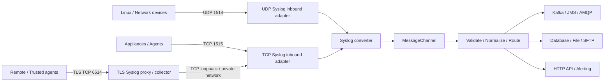
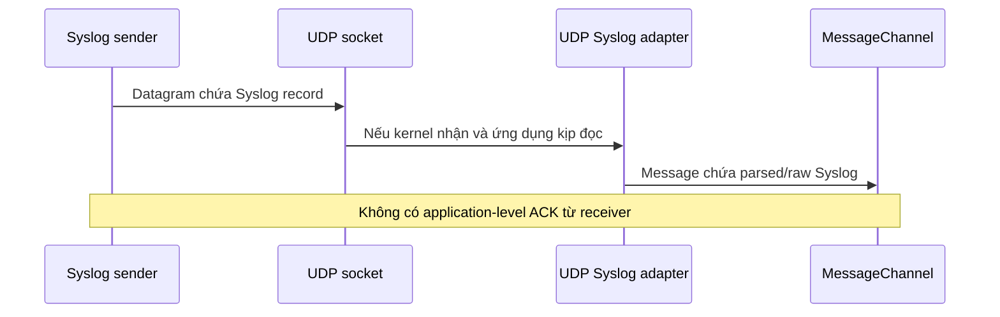
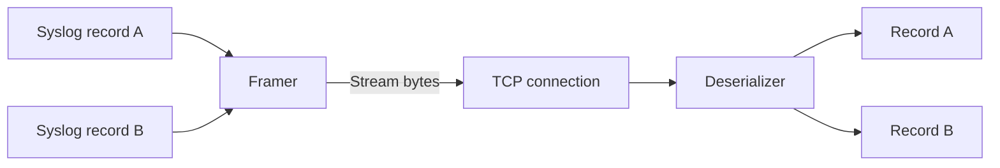
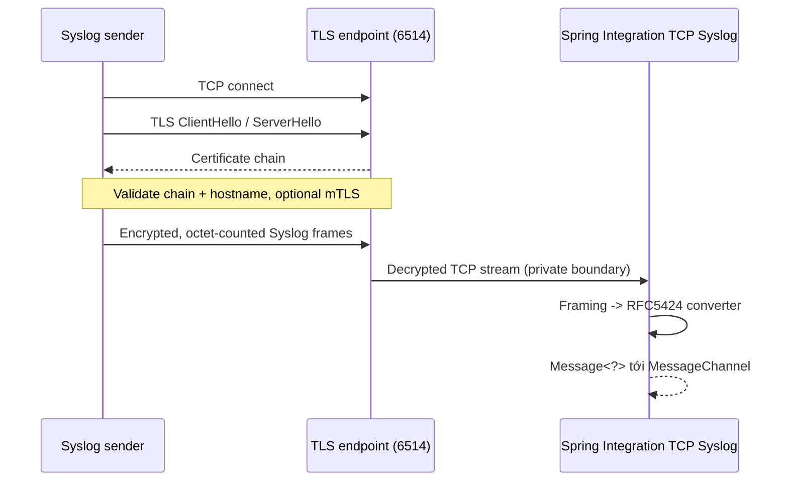
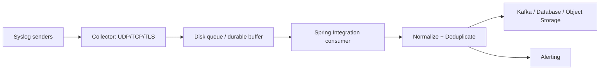

# UDP TCP và TLS transport cho Syslog

## 1. Transport quyết định điều gì trong một luồng Syslog?

Trong chương **Adapter Syslog** của module **SPRING_INTEGRATION_ADAPTERS**, Spring Integration tiếp nhận nhật ký hệ thống từ máy chủ, router, firewall và ứng dụng, rồi biến dữ liệu đó thành `Message<?>` để xử lý qua `MessageChannel`. Kết quả có thể được gửi tới file, SFTP, HTTP, JMS, AMQP, Kafka hoặc cơ sở dữ liệu, giống các luồng inbound/outbound adapter và gateway khác trong module.

Tuy nhiên, trước cả bước parse Syslog, chúng ta cần trả lời **sender đang truyền bản ghi bằng cách nào?** Ba cách thường gặp:

- **UDP:** mỗi datagram mang một bản ghi Syslog; đơn giản, chi phí thấp nhưng có thể mất gói.
- **TCP:** dùng kết nối có thứ tự byte; phải xác định ranh giới từng bản ghi bằng **framing**.
- **TLS trên TCP:** giữ đặc tính luồng TCP, đồng thời mã hóa, kiểm tra certificate và có thể dùng **mutual TLS (mTLS)**. TLS không thay thế framing hoặc lưu bền vững.

Ví dụ kiến trúc điển hình:



**Ý nghĩa:** Syslog inbound channel adapter nhận **message một chiều**; nó không phải HTTP inbound gateway và không trả HTTP status/reply nghiệp vụ cho nguồn gửi log. Nếu flow cần xác nhận lưu trữ chắc chắn, phải thiết kế protocol/collector/queue hoặc application acknowledgment riêng. Việc TCP/TLS handshake thành công **không chứng minh** bản ghi đã được ghi vào Kafka hay database.

### Mục tiêu học tập

Sau bài này, bạn có thể:

1. Chọn UDP, TCP hoặc TLS theo yêu cầu độ tin cậy, tốc độ, bảo mật và đặc tính thiết bị.
2. Phân biệt bản ghi RFC 3164/RFC 5424 với cách truyền RFC 5426/RFC 6587/RFC 5425.
3. Cấu hình Spring Integration Syslog inbound qua UDP và TCP.
4. Giải thích **octet counting**, non-transparent framing và vì sao TCP là byte stream.
5. Thiết kế một ranh giới TLS/mTLS an toàn trước Syslog inbound adapter, tránh giả định TCP thuần đã được mã hóa.
6. Kiểm thử loss, reconnect, malformed frame, TLS handshake, tải cao và lỗi downstream.

## 2. Phân biệt message format với transport

**Syslog format** định nghĩa các trường trong bản ghi. **Transport** định nghĩa bản ghi đi qua mạng và được phân tách ra sao.

| Tiêu chuẩn / cách truyền | Vai trò | Điểm cần nhớ |
|---|---|---|
| **RFC 3164** | Định dạng BSD Syslog truyền thống | Header tương đối lỏng, timestamp thường thiếu năm và múi giờ. |
| **RFC 5424** | Định dạng Syslog chuẩn hóa hơn | Có version, timestamp, hostname, app name, proc ID, msg ID và structured data. |
| **RFC 5426** | Syslog qua UDP | Datagram là đơn vị truyền; không có bảo đảm giao nhận từ UDP. |
| **RFC 6587** | Syslog qua TCP (historical) | Có octet counting và non-transparent framing. |
| **RFC 5425** | Syslog qua TLS trên TCP | Sử dụng TLS và **octet counting** để truyền bản ghi Syslog an toàn. |

Ví dụ **RFC 3164**:

```text
<134>Nov 23 09:15:10 edge-01 sshd[2048]: Failed login
```

Ví dụ **RFC 5424**:

```text
<134>1 2026-11-23T02:15:10Z edge-01 sshd 2048 AUTH01 - Failed login
```

`<134>` là priority (PRI). Công thức:

```text
PRI = facility * 8 + severity

134 = 16 * 8 + 6
facility 16: local0
severity 6: informational
```

**Không nhầm thứ tự:** RFC 5424 là *format bản ghi*; RFC 5425 là *transport TLS*. Một bản ghi RFC 5424 cũng có thể đi qua UDP hoặc TCP thường khi hệ thống hỗ trợ. Việc dùng RFC 5424 không khiến connection tự có TLS.

## 3. So sánh UDP, TCP và TLS

| Tiêu chí | UDP | TCP | TLS trên TCP |
|---|---|---|---|
| Truyền dữ liệu | Datagram độc lập | Byte stream | Byte stream được mã hóa |
| Ranh giới bản ghi | Datagram | Cần framing | Cần framing, với RFC 5425 là octet counting |
| Thiết lập kết nối | Không có TCP handshake | Có TCP handshake | Có TCP và TLS handshake |
| Mất gói trên đường truyền | Có thể mất, không được transport tự phục hồi | TCP retransmit byte trên kết nối còn sống | Kế thừa TCP retransmission |
| Thứ tự | Có thể đảo thứ tự | Bảo đảm thứ tự byte **trong một kết nối** | Bảo đảm thứ tự byte trong kết nối |
| Mã hóa | Không | Không | Có |
| Xác minh server | Không | Không | Certificate chain và hostname theo cấu hình |
| Xác minh client | Không | Không | Có thể yêu cầu mTLS client certificate |
| Bảo đảm đã ghi log bền vững | **Không** | **Không** | **Không** |
| Kiểm soát tải | Hạn chế; drop khi quá tải | TCP flow control/backpressure | TCP flow control, thêm chi phí TLS |
| Cổng thường gặp | UDP/514 | TCP/514 theo deployment | TCP/6514 theo RFC 5425 |

Trong ví dụ học tập, sử dụng **UDP/1514**, **TCP/1515** và **TLS/6514** thay vì bind cổng 514 có thể cần quyền đặc biệt hoặc đã được một collector hệ điều hành chiếm.

### 3.1. Chọn cách truyền nào?

**Chọn UDP** khi thiết bị chỉ hỗ trợ UDP, log có thể mất một phần theo ngân sách rủi ro và receiver nằm trong mạng nội bộ được kiểm soát. Nên dùng collector có queue nếu tỷ lệ mất không chấp nhận được.

**Chọn TCP** khi cần chuyển nhiều bản ghi qua kết nối ổn định, có thể xử lý backpressure và cấu hình framing hai đầu. TCP không phù hợp nếu yêu cầu confidentiality nhưng không có lớp mã hóa bổ sung.

**Chọn TLS/mTLS** khi truyền qua mạng có rủi ro bị nghe lén/giả mạo, có dữ liệu bảo mật hoặc cần xác thực danh tính nguồn gửi. Với yêu cầu audit bắt buộc, TLS vẫn phải đi kèm **lưu bền vững, retry/replay và giám sát**.

## 4. UDP: một datagram cho một bản ghi

### 4.1. Cách UDP Syslog inbound hoạt động



Những đặc tính quan trọng:

- Một datagram mang thông điệp có giới hạn kích thước. Datagram quá lớn có nguy cơ fragmentation, mất mảnh hoặc bị drop trên đường mạng.
- UDP không có session hoặc reconnect; `send()` ở sender trả về không có nghĩa receiver đã nhận.
- Khi receiver quá tải, kernel receive buffer có thể drop packet trước khi Spring Integration nhìn thấy dữ liệu.
- Không thể phát lại dữ liệu đã mất từ `errorChannel` vì không có `ErrorMessage` nào được tạo cho packet chưa bao giờ tới adapter.
- Dùng thống kê từ sender, hệ điều hành, collector và bản ghi kiểm thử end-to-end để ước lượng thất thoát.

### 4.2. XML native adapter UDP

Dependencies Maven khi Spring Boot đã quản lý phiên bản:

```xml
<dependencies>
    <dependency>
        <groupId>org.springframework.boot</groupId>
        <artifactId>spring-boot-starter-integration</artifactId>
    </dependency>
    <dependency>
        <groupId>org.springframework.integration</groupId>
        <artifactId>spring-integration-ip</artifactId>
    </dependency>
    <dependency>
        <groupId>org.springframework.integration</groupId>
        <artifactId>spring-integration-syslog</artifactId>
    </dependency>
</dependencies>
```

Một cấu hình ứng dụng sử dụng XML namespace Syslog:

```xml
<?xml version="1.0" encoding="UTF-8"?>
<beans xmlns="http://www.springframework.org/schema/beans"
       xmlns:xsi="http://www.w3.org/2001/XMLSchema-instance"
       xmlns:int="http://www.springframework.org/schema/integration"
       xmlns:int-syslog="http://www.springframework.org/schema/integration/syslog"
       xsi:schemaLocation="
           http://www.springframework.org/schema/beans
           https://www.springframework.org/schema/beans/spring-beans.xsd
           http://www.springframework.org/schema/integration
           https://www.springframework.org/schema/integration/spring-integration.xsd
           http://www.springframework.org/schema/integration/syslog
           https://www.springframework.org/schema/integration/syslog/spring-integration-syslog.xsd">

    <int:channel id="udpSyslogEvents"/>

    <int-syslog:inbound-channel-adapter
        id="udpSyslogReceiver"
        protocol="udp"
        port="1514"
        channel="udpSyslogEvents"/>

    <int:service-activator
        input-channel="udpSyslogEvents"
        ref="syslogAuditConsumer"
        method="accept"/>

    <bean id="syslogAuditConsumer"
          class="example.syslog.SyslogAuditConsumer"/>
</beans>
```

Dùng `@ImportResource("classpath:syslog-transport.xml")` trong một class `@Configuration` hoặc `@SpringBootApplication` để nạp XML. Đặt file XML trong `src/main/resources`. `protocol="udp"` được khai báo tường minh để người đọc không nhầm với TCP; native Syslog adapter thông thường mặc định chọn UDP nếu không ghi protocol.

### 4.3. Consumer nhận Syslog message

```java
package example.syslog;

import java.util.Map;
import org.slf4j.Logger;
import org.slf4j.LoggerFactory;
import org.springframework.messaging.Message;

public class SyslogAuditConsumer {

    private static final Logger log =
        LoggerFactory.getLogger(SyslogAuditConsumer.class);

    public void accept(Message<?> message) {
        Object payload = message.getPayload();

        if (!(payload instanceof Map<?, ?> parsed)) {
            log.warn("Syslog payload type not expected: {}",
                payload.getClass().getSimpleName());
            return;
        }

        Object host = parsed.get("host");
        Object severity = parsed.get("severity");

        // Minh họa: chỉ log metadata được chọn, không log raw text.
        log.info("Syslog received: host={}, severity={}",
            host, severity);

        // Production: normalize + persist/publish bằng adapter khác.
        // Không xem giá trị host tự khai báo là danh tính xác thực.
    }
}
```

Đoạn code dùng `Map<?, ?>` để tránh ép kiểu cứng khi converter hoặc bản ghi khác định dạng. `DefaultMessageConverter` của Syslog phục vụ các bản ghi RFC 3164 và mặc định có thể tạo payload dạng `Map`; cấu hình `asMap=false` cho phép giữ payload raw `byte[]`. Đối với RFC 5424, dùng `RFC5424MessageConverter` đúng contract, **không giả định parser mặc định sẽ hiểu mọi bản ghi**.

**Chú ý:** tên các key thực tế phụ thuộc converter và dữ liệu đầu vào. Hãy viết test kiểm tra `Map` sinh ra trước khi dựa vào các string key cho routing. Nếu parser đưa dữ liệu chưa giải mã vào trường `UNDECODED`, cần nhánh quarantine thay vì bỏ qua im lặng.

### 4.4. Gửi thử bằng logger

Trên Linux có `logger` hỗ trợ các flag tương ứng:

```bash
logger --udp --server 127.0.0.1 --port 1514 \
  --rfc3164 --priority local0.info --tag demo \
  "UDP syslog transport smoke test"
```

CLI `logger` thay đổi theo bản phân phối; kiểm tra trợ giúp của phiên bản đang dùng. Sender container khác phải gửi tới địa chỉ IP/hostname của receiver, không phải loopback của chính sender.

## 5. TCP: một luồng byte, nhiều bản ghi

### 5.1. Lỗi phổ biến: coi TCP read là một Syslog message

TCP không bảo tồn ranh giới giữa các lần gọi `write()`. Sender gửi hai bản ghi cùng lúc có thể khiến receiver đọc:

- Một phần của bản ghi thứ nhất.
- Hai bản ghi ghép trong một lần đọc.
- Phần còn lại của bản ghi thứ nhất cộng một phần bản ghi thứ hai.

Do đó, với TCP **phải có serializer/deserializer thống nhất framing** giữa sender và receiver. Mọi thao tác xử lý raw socket mà giả định một `read()` bằng một message đều có thể gây lỗi parse, treo hoặc chia cắt bản ghi.



### 5.2. RFC 6587 và hai kiểu framing

**Octet counting** đặt độ dài byte của bản ghi ở phía trước:

```text
<độ-dài-byte> <nội-dung-syslog>
```

Ví dụ khái niệm: phần đầu là một số ở dạng ASCII thập phân, sau đó một dấu cách, rồi đúng số byte bản ghi. Dấu `<...>` trong ví dụ này chỉ là ký hiệu diễn giải, **không phải chuỗi cần đưa vào wire**.

Ưu điểm: framing không phụ thuộc vào việc body có ký tự newline. Độ dài phải được tính theo **UTF-8 bytes / wire bytes**, không phải số ký tự Java, để tránh sai khi message chứa Unicode.

**Non-transparent framing** phân tách bản ghi bằng delimiter, thường là LF. Nó đơn giản nhưng nếu body chứa delimiter mà không có quy ước escape, receiver có thể hiểu nhầm thành hai bản ghi.

| Tiêu chí | Octet counting | Delimiter-based framing |
|---|---|---|
| Ranh giới | Số byte + nội dung | Delimiter sau nội dung |
| Nội dung có newline | Không làm sai ranh giới nếu length đúng | Có nguy cơ chia sai nếu không escape |
| Độ dài | Phải tính chính xác theo byte | Không có prefix length |
| Khả năng liên thông | Cả sender và receiver phải thống nhất octet counting | Cả hai phải thống nhất delimiter |
| Với Syslog over TLS RFC 5425 | **Được quy định** | Không phải framing được RFC 5425 chọn |

### 5.3. XML native TCP listener

Với Syslog TCP cơ bản, native namespace hỗ trợ `protocol="tcp"`:

```xml
<int:channel id="tcpSyslogEvents"/>

<int-syslog:inbound-channel-adapter
    id="tcpSyslogReceiver"
    protocol="tcp"
    port="1515"
    channel="tcpSyslogEvents"/>
```

Đây là **fragment** đặt trong file XML đã khai báo namespace và schema ở phần UDP. Cần thêm subscriber cho `tcpSyslogEvents`; không nên sử dụng chung một `DirectChannel` nếu các subscriber không có chủ đích cạnh tranh nhau. **Framing mặc định của connection factory phải được đối chiếu với cách sender truyền**, đặc biệt khi thiết bị gửi RFC 5424.

### 5.4. TCP RFC 5424 và `RFC6587SyslogDeserializer`

Đối với sender RFC 5424/TCP sử dụng RFC 6587, tạo server connection factory có deserializer phù hợp:

```xml
<bean id="rfc5424Converter"
      class="org.springframework.integration.syslog.RFC5424MessageConverter"/>

<bean id="rfc6587Deserializer"
      class="org.springframework.integration.syslog.inbound.RFC6587SyslogDeserializer"/>

<int-ip:tcp-connection-factory
    id="tcpSyslogServer"
    type="server"
    port="1516"
    using-nio="true"
    deserializer="rfc6587Deserializer"/>

<int:channel id="tcpRfc5424Events"/>

<int-syslog:inbound-channel-adapter
    id="tcpRfc5424Receiver"
    protocol="tcp"
    connection-factory="tcpSyslogServer"
    converter="rfc5424Converter"
    channel="tcpRfc5424Events"/>
```

Để chạy fragment trên, bổ sung XML namespace:

```xml
xmlns:int-ip="http://www.springframework.org/schema/integration/ip"
```

và hai URL schema:

```text
http://www.springframework.org/schema/integration/ip
https://www.springframework.org/schema/integration/ip/spring-integration-ip.xsd
```

**Ràng buộc:** khi cung cấp `connection-factory` ngoài cho Syslog TCP adapter, cổng nằm trên **server connection factory**, không khai báo cùng lúc trên native Syslog adapter. Nếu muốn nhận đồng thời nhiều loại format, dùng listener/port riêng hoặc một converter có cơ chế phân biệt rõ; không đơn giản chuyển `DefaultMessageConverter` cho RFC 3164 sang RFC 5424 mà không kiểm thử.

`RFC6587SyslogDeserializer` giúp xử lý framing kiểu RFC 6587; trong triển khai thật phải xác minh hành vi nhận octet counting và delimiter của bản framework đang chạy. Khi muốn giữ original raw message, cần kiểm tra tùy chọn `retainOriginal` và `asMap` của converter/deserializer. Đây là **cấu hình protocol**, khác với cấu hình an toàn TLS ở phần sau.

## 6. TLS: điều gì thay đổi và điều gì không thay đổi?

### 6.1. Transport chuẩn RFC 5425

**RFC 5425** mô tả Syslog chạy qua **TLS** trên kết nối TCP, thường ở **TCP/6514**. Hai phía:

1. Thiết lập TCP connection.
2. Thực hiện TLS handshake.
3. Receiver xác minh trust/certificate theo chính sách; sender phải xác minh đúng hostname/certificate của receiver. Server có thể yêu cầu client certificate để thực hiện mTLS.
4. Sau khi TLS handshake thành công, sender truyền các bản ghi **theo octet counting** qua encrypted stream.
5. Receiver giải mã TLS stream, tách từng bản ghi rồi chuyển thành message để parse Syslog.



**TLS mã hóa và bảo vệ tính toàn vẹn trong quá trình truyền**, đồng thời hỗ trợ xác thực peer dựa trên chứng chỉ. TLS **không** tự retry record khi ứng dụng mất dữ liệu sau handshake, không tự sinh application ACK và không ngăn receiver bị quá tải.

Đặc biệt, **TLS record không phải Syslog record**. TLS có thể đóng gói, chia hoặc gộp các byte tùy implementation; sau khi giải mã, receiver vẫn cần octet counting để biết ranh giới từng bản ghi.

### 6.2. TLS truststore, keystore và mTLS

| Thành phần | Đặt ở đâu | Dùng để |
|---|---|---|
| Server certificate + private key | Syslog TLS receiver/proxy | Chứng minh danh tính endpoint theo certificate và private key. |
| Truststore/CA bundle của sender | Syslog TLS sender | Xác thực server certificate, chain và hostname theo chính sách. |
| Client certificate + private key (mTLS) | Sender | Chứng minh danh tính nguồn gửi khi receiver yêu cầu. |
| Truststore/CA bundle của receiver | Receiver/proxy | Xác minh chứng chỉ client và áp dụng allowlist/policy. |

**Mutual TLS không tự cung cấp phân quyền nghiệp vụ.** Receiver cần ánh xạ certificate identity (SAN/subject/thumbprint) sang một nguồn được phép và quota riêng; không chỉ kiểm tra certificate được một CA nào đó ký rồi nhận mọi dữ liệu.

Không sử dụng `TrustAll`, `NoopHostnameVerifier`, `verify=false` hoặc `curl -k` như một giải pháp vận hành. Nếu lab dùng CA tự tạo, hãy cài chính xác CA đó vào truststore của môi trường kiểm thử.

### 6.3. TLS trong kiến trúc Spring Integration: chọn ranh giới thực thi

Native `<int-syslog:inbound-channel-adapter protocol="tcp">` **không tự có TLS chỉ vì protocol là TCP**. Một kiến trúc dễ kiểm soát là:

```text
Remote Syslog sender
     |
     | RFC 5425: TLS + octet counting (TCP/6514)
     v
Syslog-aware TLS collector hoặc TCP TLS terminator
     | Verify CA / peer identity, rate limit, log metrics
     | Decrypt TLS, preserve expected framing
     v
Plain TCP over loopback/private protected network
     |
     | RFC 5424 + octet counting (TCP/1516)
     v
Spring Integration TCP Syslog adapter
     | RFC6587SyslogDeserializer + RFC5424MessageConverter
     v
MessageChannel -> Normalize -> Durable queue/storage
```

**Hai lựa chọn triển khai hợp lý:**

- **Collector có hỗ trợ Syslog-over-TLS** (ví dụ rsyslog hoặc syslog-ng được cấu hình đúng): nhận RFC 5425, xác thực certificate, có thể lưu vào disk queue và chuyển tiếp theo format/framing được cấu hình. Nếu collector **parse rồi tái tạo bản ghi**, phải kiểm thử message format và framing khi chuyển sang Spring Integration.
- **TLS terminator truyền byte stream** (ví dụ một TCP TLS proxy đã harden): chỉ giải mã TLS, giữ nguyên các byte sau TLS. Khi đó Syslog TCP adapter phải hiểu framing mà sender đã sử dụng. **Proxy không sửa ranh giới record** và cũng không tự bổ sung durable queue.

Cũng có thể thiết lập kết nối TLS trực tiếp cho Spring Integration IP TCP bằng **SSL/TLS connection support** tương thích với version framework và TCP connection factory được sử dụng. Khi chọn hướng này, phải kiểm tra chính xác API SSL context, hostname/certificate validation, lifecycle, framing và khả năng reload certificate ở phiên bản dự án. Bài chủ động minh họa **TLS terminator/collector** để không giả định một thuộc tính `protocol="tls"` tồn tại trong Syslog namespace.

**Ranh giới an toàn:** Nếu terminate TLS tại proxy nhưng chuyển dữ liệu plaintext qua một mạng không tin cậy, TLS đã không còn bảo vệ đoạn đó. Hãy bind backend vào loopback hoặc mạng private được kiểm soát, giới hạn firewall, và chỉ chấp nhận connection từ proxy. Với container hoặc Kubernetes, `127.0.0.1` là loopback **của từng network namespace/pod**; không tự coi mọi container trong cluster dùng chung loopback.

### 6.4. Test TLS handshake với OpenSSL

Với môi trường kiểm thử có receiver TLS và CA hợp lệ:

```bash
openssl s_client \
  -connect syslog.example.internal:6514 \
  -servername syslog.example.internal \
  -verify_hostname syslog.example.internal \
  -CAfile ./lab-ca.pem \
  -verify_return_error
```

Nếu receiver yêu cầu mTLS, thêm:

```bash
  -cert ./lab-client.crt \
  -key ./lab-client.key
```

Dòng bổ sung phải được ghép vào cùng lệnh `openssl s_client`; đây là minh họa tham số, không phải một câu lệnh shell hoàn chỉnh đứng riêng.

**Kết nối TLS thành công chỉ kiểm tra ranh giới TLS.** Để kiểm tra Syslog end-to-end, cần gửi **đúng octet-counted frame** rồi xác minh bản ghi đã vào Spring Integration channel hoặc persistent sink. Không coi output `Verify return code: 0` là bằng chứng parser RFC 5424 hay downstream Kafka đang hoạt động.

## 7. Thực hành: tạo bản ghi TCP octet counting bằng Java

Bài kiểm thử này giúp hiểu rõ framing RFC 6587 và RFC 5425. Đầu vào là một bản ghi RFC 5424; chương trình tính độ dài bằng **số byte UTF-8** rồi gửi `length + " " + bytes` qua TCP.

### 7.1. TCP sender kiểm thử

```java
package example.syslog;

import java.io.OutputStream;
import java.net.Socket;
import java.nio.charset.StandardCharsets;

public class TcpSyslogSender {

    public static void main(String[] args) throws Exception {
        String record =
            "<134>1 2026-11-23T02:15:10Z edge-01 app 2048 EVT1 - "
            + "Device configuration updated";

        byte[] body = record.getBytes(StandardCharsets.UTF_8);
        byte[] lengthPrefix =
            (body.length + " ").getBytes(StandardCharsets.US_ASCII);

        try (Socket socket = new Socket("127.0.0.1", 1516)) {
            socket.setSoTimeout(5_000);

            OutputStream out = socket.getOutputStream();
            out.write(lengthPrefix);
            out.write(body);
            out.flush();
        }
    }
}
```

Điều cần quan sát:

1. TCP receiver ở `127.0.0.1:1516` đã start và có `RFC6587SyslogDeserializer`.
2. Prefix length được tính từ byte array, không phải `record.length()` của Java.
3. Deserializer lấy đúng một bản ghi, rồi `RFC5424MessageConverter` parse trường phù hợp.
4. Handler downstream nhận message và kiểm tra host/app/severity.
5. Không có application ACK ở chương trình sender. `out.flush()` hoặc `Socket.close()` không có nghĩa bản ghi đã ghi bền vững.

### 7.2. Gửi hai bản ghi liên tiếp để phát hiện lỗi framing

Trong cùng một TCP connection, có thể gửi hai frame mà **không chèn newline** sau frame đầu:

```java
static void writeFrame(OutputStream out, String text)
        throws java.io.IOException {

    byte[] bytes = text.getBytes(StandardCharsets.UTF_8);
    byte[] prefix =
        (bytes.length + " ").getBytes(StandardCharsets.US_ASCII);

    out.write(prefix);
    out.write(bytes);
}
```

Đoạn `writeFrame(...)` là helper để dùng trong sender sau khi import `OutputStream` và `StandardCharsets`. Gọi hai lần:

```java
writeFrame(out, firstRecord);
writeFrame(out, secondRecord);
out.flush();
```

Nếu receiver dùng octet counting đúng, nó sẽ tạo hai messages riêng bất kể TCP chia/gộp các lần đọc socket. Với framing theo LF, sender phải dùng delimiter đúng cấu hình thay vì prefix length.

### 7.3. TLS sender khác TCP sender ở đâu?

Về **Syslog framing**, TLS sender vẫn tạo `length + SP + record bytes`. Điểm khác là gửi bytes qua một socket đã TLS handshake với certificate validation, không qua `Socket` plaintext. Nếu dùng Java JSSE để kiểm thử, cần:

- `SSLSocketFactory`/`SSLContext` được cấu hình trust đúng CA.
- Hostname verification (endpoint identification) cho server.
- Keystore client nếu mTLS bắt buộc.
- TLS protocol/cipher được policy cho phép.
- Không log raw credential và không bỏ qua cert validation.

Trong triển khai thật, ưu tiên syslog agent/collector có RFC 5425 support được kiểm thử thay vì tự viết TLS protocol stack chỉ để gửi log.

## 8. Converter và framing là hai trách nhiệm độc lập

Trước khi chọn converter, xác định:

1. **Sender truyền format nào?** RFC 3164 hay RFC 5424?
2. **Transport là gì?** UDP datagram, TCP stream hay TLS/TCP?
3. **Framing nào?** Octet counting hay delimiter?
4. **Payload mong muốn?** Parsed `Map` hay raw bytes?
5. **Các header dùng cho downstream có ổn định không?**

| Tình huống | Transport/framing | Converter/processing gợi ý |
|---|---|---|
| Thiết bị cũ RFC 3164 UDP | UDP datagram | `DefaultMessageConverter` / `SyslogToMapTransformer`. |
| Agent RFC 5424 UDP | UDP datagram | `RFC5424MessageConverter` với cấu hình phù hợp. |
| RFC 5424 TCP plain | RFC 6587 framing đã thống nhất | `RFC6587SyslogDeserializer` + `RFC5424MessageConverter`. |
| RFC 5424 qua TLS | RFC 5425 TLS + octet counting | TLS receiver/terminator + framer và RFC 5424 parser. |
| Cần forensic raw bytes | Giữ original payload theo converter/decoder hỗ trợ | Lưu raw với metadata và checksum, tránh chỉ lưu bản đã normalize. |

**Framer không phải parser.** Một deserializer tách đúng số byte chỉ tạo ra một bản ghi thô; nó không biết trường severity, facility hay structured data có hợp lệ. Ngược lại, converter RFC 5424 không tự xử lý tình huống TCP stream bị gộp hoặc đứt frame nếu chưa có tầng framing phù hợp.

### 8.1. Giữ original message và chuẩn hóa

Spring Integration Syslog có thể tạo payload `Map` hoặc raw bytes theo cấu hình converter. Với parser RFC 3164, một bản ghi không decode được có thể được đưa vào trường `UNDECODED` thay vì ném exception. Chú ý:

- Không mặc định `errorChannel` sẽ nhận mọi bản ghi malformed.
- Không chuyển raw bytes thành `String` bằng charset tùy ý mà không biết encoding.
- Một giá trị hostname do sender khai báo không phải địa chỉ IP đã được xác thực.
- Chuẩn hóa timestamp thành UTC và lưu timestamp nhận tại receiver để kiểm tra độ trễ; RFC 3164 thường thiếu múi giờ/năm.
- Khi dùng `asMap=false` hoặc converter RFC 5424, các header `syslog_*` có thể khác nhau theo converter, cần kiểm thử trước khi route theo header.

## 9. Chọn chính sách delivery, backpressure và dữ liệu bền vững

Không transport nào trong ba lựa chọn tự tạo giao dịch end-to-end tới Kafka hoặc database:

```text
Sender
 -> Network delivery
 -> Socket received bytes
 -> Message converter parsed record
 -> MessageChannel accepted message
 -> Downstream publish/commit succeeded
 -> Data is durably recoverable
```

Mỗi mũi tên là một bước có thể thất bại. Đặc biệt:

| Ranh giới | Điều được xác nhận | Điều chưa được xác nhận |
|---|---|---|
| UDP sender gửi datagram | OS nhận lệnh gửi | Receiver có nhận hay không. |
| TCP write thành công | Byte được ghi vào buffer theo hợp đồng API | Spring Integration đã parse/commit hay chưa. |
| TLS handshake thành công | Hai đầu thống nhất kết nối bảo mật theo policy | Syslog message hợp lệ hay đã lưu vào sink. |
| Spring Integration channel `send` thành công | Message được giao theo semantics của channel | Database/Kafka đã commit hay chưa (tùy flow). |
| Kafka/DB ack/commit | Sink đã xác nhận theo chế độ cấu hình | Consumer sau đó đã xử lý hay chưa. |

### 9.1. Backpressure theo transport

**UDP:** nếu consumer hoặc channel chậm, socket buffer đầy và mất datagram. Dùng nguồn có local spool/disk queue khi cần chống mất. Dùng ingress metrics và alert khi nguồn trọng yếu im lặng.

**TCP:** TCP flow control có thể làm sender chậm lại, nhưng nếu ứng dụng đọc nhanh vào một queue không giới hạn, tải vẫn dồn vào heap. Dùng queue bounded, pool/concurrency limit, timeout và persist durable trước khi nhận thêm.

**TLS:** thêm CPU cho handshake/mã hóa và công việc certificate validation. Thiết lập giới hạn connections, connection lifetime, timeout và giữ connection hợp lý thay vì tạo handshake cho mỗi log record.

### 9.2. Kiến trúc collector có disk queue

Với hệ thống log quan trọng, một cách thiết kế là:



Collector phải có policy disk quota, retry, fsync/ack, retention và behavior khi ổ cứng đầy. Không chỉ thêm một `QueueChannel` mặc định trong JVM rồi gọi đó là durable queue. Nếu sender yêu cầu delivery guarantee cao, thiết kế phải có cơ chế **lưu bền vững, xác nhận và phát lại**, dù Syslog transport thuần không cung cấp application ack.

### 9.3. Duplicates và ordering

TCP bảo toàn byte order **trong từng kết nối**, không xác định thứ tự toàn cục giữa nhiều sender hoặc nhiều TCP connections. Collector gửi lại sau sự cố có thể tạo duplicate. Syslog không bảo đảm mỗi bản ghi luôn có event ID toàn cục.

Nếu cần dedup:

- Ưu tiên ID sự kiện do nguồn phát cung cấp.
- Có thể dùng fingerprint kết hợp source, timestamp, facility/severity và payload như một heuristic, nhưng chấp nhận nguy cơ trùng giả và mất sự kiện hợp lệ.
- Lưu thời gian nhận và định danh receiver.
- Với Kafka, chọn key/partition theo nguồn nếu cần giữ thứ tự cục bộ; không suy ra có global ordering.
- Xác định mốc ack/commit giữa nguồn, collector, Spring Integration và sink.

## 10. Bảo mật, mã hóa và quyền hạn

### 10.1. Rủi ro theo transport

| Rủi ro | UDP/TCP plaintext | TLS/mTLS |
|---|---|---|
| Đọc lén log trên mạng | Có thể | TLS giúp bảo vệ confidentiality trên đoạn TLS. |
| Sửa gói trên đường truyền | Không được bảo vệ bằng TLS | TLS có integrity cho traffic qua session. |
| Giả mạo sender | Dễ hơn nếu không có xác thực ở tầng khác | mTLS có thể xác thực client certificate theo policy. |
| Flood/DoS | Vẫn có | Vẫn có; TLS handshake có thể tăng chi phí. |
| Receiver lỗi parser | Có | Vẫn có; TLS không sửa input malformed. |
| Log injection/PII | Có | Vẫn có; TLS không lọc nội dung. |

Biện pháp vận hành:

1. Bind listener vào network interface được phép, cấu hình firewall/security groups theo IP sender và protocol/cổng riêng.
2. Dùng TLS/mTLS khi yêu cầu bí mật hoặc xác minh nguồn. Kiểm tra CA chain, certificate expiry, SAN/hostname và policy thu hồi nếu có.
3. Giới hạn số kết nối, rate, kích thước frame/datagram, thời gian chờ của client và tổng bộ nhớ queue.
4. Không tin field `HOSTNAME` hoặc `APP-NAME` từ payload như danh tính đã xác thực. Nếu dùng mTLS, liên kết certificate identity với nguồn sender trong metadata đã kiểm soát.
5. Escape newline/control characters khi hiển thị log hoặc chuyển tiếp sang một hệ thống log khác để tránh **log injection**.
6. Redact token, mật khẩu, khóa API và dữ liệu cá nhân; mã hóa khi lưu và thiết lập retention.
7. Tránh vòng lặp log: receiver ghi log ra một Syslog daemon lại đẩy bản ghi trở về chính receiver.
8. Có quy trình rotation certificate, restart/reload và canary test trước ngày hết hạn.

### 10.2. TLS termination và zero-trust

Nếu TLS terminator đặt trên máy khác, đoạn giữa terminator và Spring Integration cần có **network access control, mTLS nội bộ hoặc cơ chế truyền bảo mật khác**. Không tin header/metadata do kết nối backend không được xác thực cung cấp. Nếu dùng Kubernetes, cân nhắc egress/ingress network policy và tách namespace phù hợp.

## 11. Lỗi và error channel theo từng tầng

| Sự cố | Nơi quan sát | Error channel có nhìn thấy không? |
|---|---|---|
| UDP packet bị drop ở router/kernel | Network/kernel/collector metrics | **Không**, vì adapter chưa nhận. |
| TCP connection refused | Sender, OS listener | **Không chắc**; connection chưa đến Spring Integration. |
| TLS handshake thất bại | TLS proxy/SSL connection support log | Thường **không** vào business `MessageChannel`. |
| Octet count sai, frame quá lớn | Deserializer/framing layer | Tùy thành phần có phát `ErrorMessage` hay chỉ đóng connection. |
| Syslog malformed RFC 3164 | Converter/`UNDECODED` field | Không nhất thiết ném exception. |
| Không có subscriber hoặc downstream handler ném lỗi | Spring Integration message flow | Có thể tới `errorChannel` theo adapter/error handling và channel semantics. |
| Kafka/DB không khả dụng | Downstream adapter | Error flow, retry/DLQ theo cấu hình; không tự rollback bản ghi đã nhận qua mạng. |

Native Syslog inbound adapter có thể cấu hình `error-channel` để thu các lỗi mà adapter hỗ trợ phát. **Đừng coi đây là số liệu duy nhất về mất dữ liệu**: các gói bị mất trước listener, TLS handshake reject hoặc lỗi tại proxy nằm ngoài phạm vi ấy.

Để tránh mất log khi parser thất bại:

- Kiểm tra `UNDECODED`, kiểu payload và required fields.
- Lưu raw record hoặc metadata tối thiểu vào nơi quarantine **có giới hạn dung lượng**.
- Đo malformed-rate theo sender, version, transport và thời gian.
- Cảnh báo khi tỷ lệ đột ngột tăng, nhưng tránh ghi raw payload tràn log hệ thống.
- Với retry downstream, cần event ID/idempotency hoặc replay protocol riêng.

## 12. Kiểm thử transport và vận hành

### 12.1. Ma trận kiểm thử

| Kịch bản | Kết quả cần xác minh |
|---|---|
| UDP RFC 3164 tới cổng 1514 | Adapter nhận datagram và tạo một message cho gói hợp lệ. |
| UDP gửi nhầm cổng TCP | Receiver không nhận; không kết luận parser lỗi. |
| UDP payload lớn/flood | Theo dõi packet drop/buffer và khả năng phục hồi. |
| TCP RFC 5424 với octet counting | Deserializer tách được nhiều bản ghi trong cùng connection. |
| Hai TCP frame liên tiếp không có newline | Có hai messages, không bị ghép/chia sai. |
| TCP prefix length sai | Frame bị từ chối/connection lỗi theo implementation; không OOM. |
| TCP sender đóng giữa frame | Ghi nhận connection/decoder error và không lưu record chưa hoàn chỉnh. |
| TCP LF framing nhưng receiver chờ octet counting | Test thất bại có kiểm soát, chẩn đoán mismatch. |
| TLS server certificate hợp lệ | Handshake thành công với hostname/CA khớp. |
| TLS certificate hết hạn/hostname sai | Handshake từ chối; không vô hiệu hóa validation. |
| mTLS thiếu client certificate | Receiver không chấp nhận khi policy bắt buộc. |
| RFC 5425 TLS với octet counting | Bản ghi đến đúng channel sau decrypt/framing/parse. |
| Backend giữa TLS proxy và SI không truy cập được | Có log/alert và policy buffering rõ. |
| Downstream Kafka/DB lỗi | Retry giới hạn và nơi lưu lỗi bền vững. |
| App restart/collector restart | Xác minh mất/khôi phục record theo delivery contract. |
| Log có control chars/PII | Được escape/redact trước khi hiển thị/forward. |

### 12.2. Checklist chẩn đoán khi không thấy bản ghi

```text
Sender format (RFC 3164 hay 5424)
 -> Destination IP, port và UDP/TCP/TLS
 -> Firewall / DNS / network route
 -> TCP/TLS handshake (nếu có)
 -> TLS trust / client cert (nếu mTLS)
 -> Framing: octet counting hay delimiter
 -> Syslog converter (RFC 3164 / 5424)
 -> Integration MessageChannel và subscriber
 -> Downstream filter / router / persistence
 -> Queue / DLQ / monitoring
```

Làm theo thứ tự từ **network tới message**, đừng bắt đầu bằng sửa converter khi sender đang gửi UDP tới port chỉ mở TCP.

Nếu **connect được nhưng không có message**: nghi ngờ framing sai, frame chưa đủ byte, converter không khớp format, filter/drop downstream hoặc adapter chưa được start.

Nếu **TLS handshake thất bại**: kiểm tra certificate chain, SAN/hostname, đồng hồ máy, mTLS policy, CA truststore, TLS version/cipher và certificate rotation; không sửa bằng cách tắt xác minh.

Nếu **message đến nhưng thiếu fields**: kiểm tra parser RFC, trạng thái `asMap`, charset, timestamp, structured data và chính sách converter. Nếu **message bị mất lúc tải cao**: xem kernel UDP drops, TCP connection/queue pressure, disk collector, downstream acknowledgment và metrics.

## 13. Vòng đời và triển khai thực tế

Syslog listener được quản lý trong Spring application context. Khi triển khai cần chú ý:

- **`auto-startup` và `phase`:** thứ tự start/stop listener so với consumer; start không bảo đảm mọi downstream đã healthy.
- **Bind address/port:** cổng 514 thường cần quyền và có thể bị syslog daemon hệ điều hành chiếm; nên dùng reverse proxy/collector hoặc cổng không đặc quyền khi thích hợp.
- **Protocol mismatch:** UDP, TCP và TLS có thể dùng cùng cổng số ở những cấu hình khác nhau nhưng không thể hoán đổi tùy tiện.
- **TCP connection factory:** server lifecycle, framing, read timeout, backlog và connection limits phải phù hợp sender.
- **TLS renewal:** thay đổi certificate file không nhất thiết làm SSLContext/connection đang chạy tự reload; kiểm tra khả năng hot-reload hoặc rollout/restart có kiểm soát.
- **Graceful shutdown:** ngừng nhận kết nối mới, để worker hoàn thành hoặc lưu bền vững dữ liệu đang xử lý, rồi giải phóng socket và TLS resources.
- **Network/container readiness:** không chỉ kiểm tra port đang mở; cần probe bản ghi thử từ sender qua đúng transport tới persistent sink.
- **Telemetry:** thu số bản ghi/giây, parser errors, TLS handshake failures, TCP reconnects, UDP drop counts, queue depth, disk queue age và downstream publish latency.

Trong một cụm nhiều instance, **không mặc định mọi node cùng bind một IP/port Syslog**. Cần load balancer/proxy phù hợp với UDP/TCP/TLS và hiểu rằng kết nối TCP là stateful. Với RFC 5425 mTLS, load balancer phải bảo toàn hoặc tự thực hiện certificate verification theo kiến trúc đã được thống nhất.

## 14. Tổng kết

Ba transport phục vụ ba nhu cầu khác nhau:

- **UDP**: mỗi datagram là đơn vị nhận, cấu hình đơn giản nhưng **không có delivery acknowledgment** và có thể mất gói.
- **TCP**: bảo đảm thứ tự byte trên kết nối, cần **framing đúng**; không tự bảo đảm bản ghi đã được ứng dụng lưu bền vững.
- **TLS/TCP**: bổ sung confidentiality, integrity và xác minh chứng chỉ; **RFC 5425 quy định octet counting**, nhưng TLS vẫn không thay cho queue bền vững hay error recovery.

Với Spring Integration, dùng Syslog inbound adapter để tiếp nhận qua UDP/TCP, chọn converter theo RFC 3164 hay RFC 5424, và đặt `RFC6587SyslogDeserializer` hoặc một framing implementation phù hợp cho TCP. Khi cần TLS/mTLS, triển khai **TLS-enabled TCP connection support** đã được kiểm thử cho version dự án hoặc dùng **Syslog-aware TLS collector/terminator** trước TCP Syslog adapter; **không nhầm `protocol="tcp"` với `protocol="tls"`**.

Thiết kế ổn định cần nối liền network transport, framing, converter, `MessageChannel`, retry, durable storage và bảo mật. Chọn được TLS hay TCP mới chỉ hoàn tất bước truyền; hợp đồng giao nhận/log persistence của hệ thống phía sau vẫn phải được kiểm chứng end-to-end.

### Tài liệu tham khảo chính thức

- [Spring Integration — Syslog Support](https://docs.spring.io/spring-integration/reference/syslog.html)
- [Spring Integration — TCP Connection Factories](https://docs.spring.io/spring-integration/reference/ip/tcp-connection-factories.html)
- [Spring Integration — UDP Adapters](https://docs.spring.io/spring-integration/reference/ip/udp-adapters.html)
- [IETF RFC 3164 — The BSD Syslog Protocol](https://www.rfc-editor.org/rfc/rfc3164)
- [IETF RFC 5424 — The Syslog Protocol](https://www.rfc-editor.org/rfc/rfc5424)
- [IETF RFC 5425 — Transport Layer Security for Syslog](https://www.rfc-editor.org/rfc/rfc5425)
- [IETF RFC 5426 — Transmission of Syslog Messages over UDP](https://www.rfc-editor.org/rfc/rfc5426)
- [IETF RFC 6587 — Transmission of Syslog Messages over TCP](https://www.rfc-editor.org/rfc/rfc6587)
