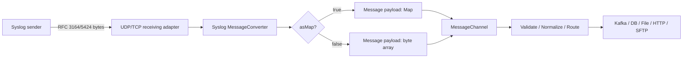
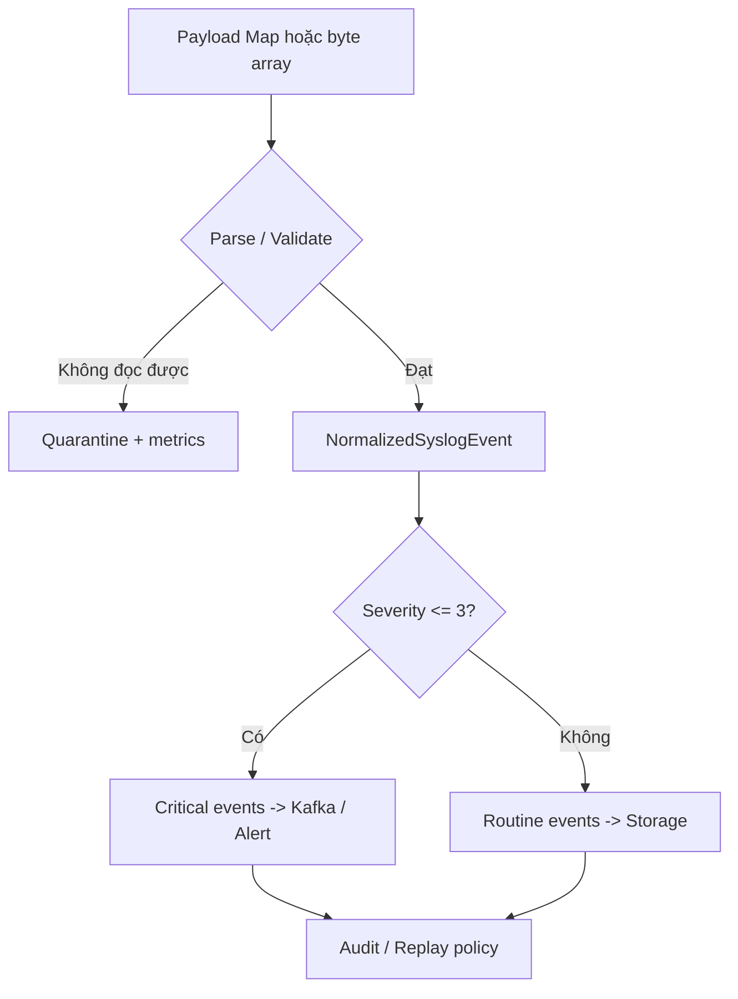

# Syslog message payload

## 1. Syslog payload là gì trong Spring Integration?

Trong chương **Adapter Syslog** của module **SPRING_INTEGRATION_ADAPTERS**, dữ liệu từ máy chủ Linux, firewall, router, load balancer hay ứng dụng đi vào một **Syslog inbound channel adapter** qua UDP hoặc TCP. Adapter chuyển dữ liệu thành Spring Integration `Message<?>`, đưa lên `MessageChannel` để filter, router, transformer hoặc service activator tiếp tục xử lý.

Hệ thống sau đó có thể ghi nhật ký vào file/SFTP, đưa sự kiện tới JMS, AMQP, Kafka, lưu database hoặc gọi HTTP API. Cũng như các adapter và gateway khác của module, **hợp đồng payload, header, xử lý lỗi và vòng đời kết nối** phải được xác định rõ.

Cần phân biệt ba lớp:

1. **Syslog record trên wire**: một chuỗi byte tuân theo format RFC 3164 hoặc RFC 5424, được vận chuyển qua UDP/TCP/TLS.
2. **Payload của Spring Integration message**: đối tượng Java do `MessageConverter` tạo ra, thường là `Map<String, ?>` hoặc `byte[]`.
3. **Message headers**: metadata Spring Integration, có thể chứa các trường Syslog được ánh xạ với prefix `syslog_` và thông tin transport. Header không phải bản ghi Syslog nguyên văn.



Trong bài này, bạn sẽ học cách:

- Đọc đúng các trường facility, severity, timestamp, hostname, tag và nội dung bản ghi.
- Hiểu vì sao converter RFC 3164 khác converter RFC 5424.
- Lựa chọn payload `Map` so với payload raw `byte[]`.
- Dùng các hằng `SyslogToMapTransformer` và `SyslogHeaders` thay vì đoán tên trường.
- Chuẩn hóa payload thành schema nghiệp vụ ổn định, phát hiện record không decode được.
- Viết ví dụ XML, Java, kiểm thử hợp đồng message và xử lý dữ liệu không đáng tin cậy.

**Quan trọng:** Syslog inbound là **one-way adapter**, không phải HTTP request–reply gateway. Một message được tạo và gửi vào channel không đồng nghĩa bản ghi đã được commit bền vững ở database hay Kafka.

## 2. Từ Syslog record tới payload Java

### 2.1. RFC 3164: các trường cơ bản

Ví dụ bản ghi kiểu BSD Syslog:

```text
<134>Nov 23 09:15:10 edge-01 sshd[2048]: Failed password for invalid user demo
```

| Phần trên wire | Ví dụ | Trường dữ liệu |
|---|---|---|
| `<134>` | PRI = 134 | Facility và severity được suy ra từ PRI. |
| `Nov 23 09:15:10` | Timestamp | Thời gian do nguồn phát khai báo; format truyền thống thiếu năm/múi giờ. |
| `edge-01` | Hostname | Tên máy do nguồn phát ghi trong bản tin. |
| `sshd[2048]` | Tag / process | Tên tiến trình và thông tin bổ sung tùy dạng bản tin. |
| `Failed password ...` | Message text | Nội dung log nghiệp vụ/kỹ thuật; có thể mang dữ liệu nhạy cảm. |

Priority được chia bằng công thức:

```text
PRI      = facility * 8 + severity
facility = PRI / 8  (chia nguyên)
severity = PRI % 8

PRI 134 -> facility 16 (local0), severity 6 (informational)
```

Severity dùng thang `0` đến `7`:

| Code | Mức | Ý nghĩa thường gặp |
|---|---|---|
| 0 | Emergency | Hệ thống không thể sử dụng. |
| 1 | Alert | Cần xử lý khẩn cấp. |
| 2 | Critical | Lỗi nghiêm trọng. |
| 3 | Error | Lỗi. |
| 4 | Warning | Cảnh báo. |
| 5 | Notice | Đáng chú ý. |
| 6 | Informational | Thông tin. |
| 7 | Debug | Gỡ lỗi. |

**Đừng coi severity là mức tin cậy bảo mật.** Một sender không được xác thực có thể tự đặt PRI bất kỳ, kể cả emergency. Cần chính sách rate limit và ưu tiên theo **nguồn đã xác minh**, không chỉ theo severity trong payload.

### 2.2. Map payload của RFC 3164

`SyslogToMapTransformer` phân tích RFC 3164 thành một `Map<String, ?>`. Các hằng định danh key được công bố trong lớp:

```java
org.springframework.integration.transformer.SyslogToMapTransformer
    .FACILITY
    .SEVERITY
    .TIMESTAMP
    .HOST
    .TAG
    .MESSAGE
    .UNDECODED
```

Một minh họa của bản ghi trên, **không phải JSON serialization của framework**, có dạng:

```text
payload = Map {
  FACILITY-key  -> 16
  SEVERITY-key  -> 6
  TIMESTAMP-key -> Date hoặc String
  HOST-key      -> "edge-01"
  TAG-key       -> "sshd"
  MESSAGE-key   -> "[2048]: Failed password for invalid user demo"
}
```

Sử dụng nhãn `FACILITY-key` trong khung trên để nhấn mạnh **mã Java nên truy cập bằng hằng** `SyslogToMapTransformer.FACILITY`. Không dựa vào ký tự hiển thị, thứ tự duyệt `Map` hoặc đầu ra `toString()` làm schema downstream.

Dữ liệu thực tế có những biến thể:

- `FACILITY` và `SEVERITY` thường là số nguyên sau khi parse hợp lệ.
- `TIMESTAMP` có thể là `java.util.Date` nếu parser giải mã được; nếu không, nó có thể là `String`. Vì RFC 3164 thường thiếu năm/timezone, ngay cả `Date` cũng cần được diễn giải theo policy thời gian của hệ thống.
- `HOST`, `TAG` hoặc `MESSAGE` có thể thiếu hay có cấu trúc khác tùy nguồn.
- Nếu cả bản ghi không giải mã được, transformer trả nội dung chưa parse dưới key **`UNDECODED`**, thay vì luôn ném exception.

Điểm cuối rất quan trọng: **record malformed không nhất thiết xuất hiện ở `errorChannel`**. Nó có thể là một **message payload map chứa trường `UNDECODED`**, đòi hỏi một nhánh validation/quarantine chủ động.

### 2.3. RFC 5424: format nhiều trường hơn

RFC 5424 dùng cấu trúc rõ hơn:

```text
<134>1 2026-11-23T02:15:10Z edge-01 sshd 2048 AUTH42 [exampleSDID@32473 user="demo" outcome="failure"] Failed password
```

| Trường RFC 5424 | Giá trị trong ví dụ | Vai trò |
|---|---|---|
| `PRI` | `134` | Facility và severity. |
| `VERSION` | `1` | Phiên bản protocol format. |
| `TIMESTAMP` | `2026-11-23T02:15:10Z` | Timestamp có timezone. |
| `HOSTNAME` | `edge-01` | Host được nguồn ghi nhận. |
| `APP-NAME` | `sshd` | Tên ứng dụng phát bản tin. |
| `PROCID` | `2048` | Định danh tiến trình. |
| `MSGID` | `AUTH42` | Mã loại thông điệp. |
| `STRUCTURED-DATA` | `[exampleSDID@32473 ...]` | Các trường có cấu trúc theo SD-ID. |
| `MSG` | `Failed password` | Nội dung văn bản hoặc dữ liệu theo quy tắc RFC. |

Một số trường trong RFC 5424 có thể dùng `-` (NILVALUE). Không được tự suy rằng `-` luôn là chuỗi nghiệp vụ có ý nghĩa. Với structured data, giá trị tham số có quy tắc escape đối với dấu `"`, dấu `]` và dấu `\`; cần dùng parser tương thích RFC thay vì tách bằng `String.split(" ")` hoặc regex tùy tiện.

**RFC 5424 là định dạng bản ghi, không phải tên transport.** Khi nhận RFC 5424 qua TCP, ranh giới bản ghi cần được xác định bằng framing như RFC 6587; qua TLS theo RFC 5425, dùng octet counting. Framing xảy ra **trước** bước chuyển bản ghi thành payload `Map`.

## 3. `DefaultMessageConverter` và `RFC5424MessageConverter`

Spring Integration có các thành phần quan trọng:

| Thành phần | Trách nhiệm |
|---|---|
| `org.springframework.integration.syslog.MessageConverter` | Interface chuyển raw transport message thành Syslog integration message. |
| `DefaultMessageConverter` | Mặc định dùng `SyslogToMapTransformer` cho RFC 3164 và áp dụng cách dựng payload/headers. |
| `RFC5424MessageConverter` | Dùng parser RFC 5424; có cách ánh xạ headers riêng. |
| `SyslogToMapTransformer` | Parse RFC 3164 thành `Map`; có `UNDECODED` cho bản ghi không parse được. |
| `SyslogHeaders` | Các hằng tên header Syslog, giúp tránh phụ thuộc vào chuỗi hardcode. |
| `RFC6587SyslogDeserializer` | Với RFC 5424 qua TCP, tách stream thành từng bản ghi theo framing trước converter. |

### 3.1. Bảng hành vi `asMap`

| Converter | `asMap` | Payload message | Cách đặt các trường đã decode vào headers |
|---|---|---|---|
| `DefaultMessageConverter` (RFC 3164) | **true**, mặc định | `Map<String, ?>` | Các trường, **trừ message text**, được sao chép vào message headers có prefix `syslog_`. |
| `DefaultMessageConverter` (RFC 3164) | **false** | Raw `byte[]` toàn bản ghi | Các trường đã decode vẫn được đưa vào headers. |
| `RFC5424MessageConverter` | **true**, mặc định | `Map` các trường RFC 5424 | **Không tự copy** các trường đã decode ra message headers. |
| `RFC5424MessageConverter` | **false** | Raw `byte[]` toàn bản ghi | Các trường đã decode được đưa vào headers theo converter. |

Bảng trên mô tả hành vi do Spring Integration công bố; **các trường thực sự xuất hiện và kiểu Java** phụ thuộc thông điệp và converter. Không mặc định hai định dạng RFC có cấu trúc map giống hệt nhau.

### 3.2. Vì sao `asMap=true` thường phù hợp?

Chọn payload `Map` khi flow cần:

- Lọc theo severity/facility.
- Định tuyến hostname hoặc ứng dụng tới từng nhóm xử lý.
- Phân tích timestamp, structured data hoặc message ID.
- Chuẩn hóa thành một DTO sự kiện cho Kafka/database/search index.
- Phát hiện lỗi cú pháp, trường thiếu hoặc giá trị ngoài miền cho phép.

Ưu điểm là giảm thao tác parse ở downstream. Nhược điểm: dữ liệu gốc có thể không còn được giữ byte-for-byte nếu chỉ lưu map. Đừng giả định có thể dựng lại chính xác bản tin gốc từ một map đã parse.

### 3.3. Vì sao `asMap=false` có ích?

Chọn `asMap=false` khi cần:

- Lưu bản ghi nguyên bản phục vụ forensic/audit.
- Chuyển tiếp tới một parser/collector khác.
- Có chính sách normalize riêng cho nhiều nhà sản xuất thiết bị.
- Giữ raw bytes trước khi quyết định codec/charset và mức độ tin cậy của parser.

Trong chế độ raw, payload là `byte[]`. Nên kết hợp:

- Kiểm tra kích thước byte array trước khi lưu/forward.
- Giới hạn retention và khả năng truy cập vì log có thể chứa PII/secret.
- Hash/checksum hoặc ID record nếu cần phát hiện thay đổi.
- Một bản chuẩn hóa riêng để tìm kiếm và định tuyến.
- Chính sách rõ cho encoding và line ending.

Với **RFC 5424 qua TCP** và `RFC5424MessageConverter.asMap=false`, tài liệu Spring Integration yêu cầu cấu hình `retainOriginal` phù hợp trên `RFC6587SyslogDeserializer`. Nếu deserializer đã tiêu thụ/biến đổi bản ghi, converter không thể tự khôi phục các byte ban đầu mà không được giữ lại từ tầng framing.

## 4. Payload và message headers: không phải cùng một bản sao

Một Spring Integration message có cấu trúc:

```text
Message<?> {
  payload = Map hoặc byte[]
  headers = {
    id, timestamp, ...
    syslog_facility, syslog_severity, syslog_host, ...
    các IP/transport headers nếu adapter gốc cung cấp
  }
}
```

Đoạn này là sơ đồ khái niệm, **không bảo đảm mọi header đều có mặt trong mọi cấu hình**.

### 4.1. Hằng `SyslogHeaders`

Lớp `org.springframework.integration.syslog.SyslogHeaders` công bố những hằng như:

```java
SyslogHeaders.PREFIX
SyslogHeaders.FACILITY
SyslogHeaders.SEVERITY
SyslogHeaders.TIMESTAMP
SyslogHeaders.HOST
SyslogHeaders.TAG
SyslogHeaders.MESSAGE
SyslogHeaders.APP_NAME
SyslogHeaders.PROCID
SyslogHeaders.MSGID
SyslogHeaders.STRUCTURED_DATA
SyslogHeaders.UNDECODED
```

Tùy phiên bản, còn có các hằng cho source, decode errors, severity text và version. Khi truy cập header, **dùng hằng `SyslogHeaders.SEVERITY`** thay vì đoán giá trị chuỗi từ tên cột của payload.

Ví dụ đọc header ở consumer:

```java
import org.springframework.integration.syslog.SyslogHeaders;
import org.springframework.messaging.Message;

public void inspectSyslogHeaders(Message<?> message) {
    Object severity = message.getHeaders()
        .get(SyslogHeaders.SEVERITY);
    Object host = message.getHeaders()
        .get(SyslogHeaders.HOST);

    // Giá trị có thể null; tùy converter và asMap.
}
```

Nếu flow đang dùng **`RFC5424MessageConverter` với `asMap=true`**, các header đã decode **không tự được copy** như RFC 3164. Cùng một router chỉ đọc `SyslogHeaders.SEVERITY` có thể hoạt động với một converter nhưng không có dữ liệu sau khi đổi converter. Hãy normalize payload và tự enrich header riêng theo hợp đồng chung của ứng dụng.

### 4.2. Đừng nhầm header Syslog và header transport

Một IP adapter có thể bổ sung địa chỉ nguồn gửi, connection ID hoặc metadata mạng tùy cấu hình. Trong khi đó, Syslog `HOSTNAME`/`HOST` là **giá trị do sender khai báo trong bản ghi**.

| Thông tin | Nguồn | Mức tin cậy |
|---|---|---|
| Host trong Syslog payload | Sender ghi vào text | Có thể bị giả mạo, cần kiểm soát. |
| Socket source IP / connection metadata | Tầng transport quan sát | Hữu ích để đối chiếu, nhưng NAT/proxy có thể làm khác host thật. |
| TLS client identity (khi triển khai mTLS) | Xác minh certificate ở TLS boundary | Có thể đáng tin theo CA/SAN/policy đã cấu hình. |
| `MessageHeaders.ID` / timestamp nội bộ | Spring Messaging tạo | Xác định message trong JVM, không phải ID duy nhất toàn cục của sự kiện Syslog. |

Tuyệt đối không cho quyền truy cập dữ liệu/tenant chỉ vì Syslog payload chứa `host=trusted-server` hoặc `severity=0`.

## 5. Ví dụ cấu hình Syslog inbound với payload Map

### 5.1. Dependencies

Với ứng dụng Spring Boot đã quản lý versions của Spring Integration, Maven có thể khai báo:

```xml
<dependencies>
    <dependency>
        <groupId>org.springframework.boot</groupId>
        <artifactId>spring-boot-starter-integration</artifactId>
    </dependency>
    <dependency>
        <groupId>org.springframework.integration</groupId>
        <artifactId>spring-integration-ip</artifactId>
    </dependency>
    <dependency>
        <groupId>org.springframework.integration</groupId>
        <artifactId>spring-integration-syslog</artifactId>
    </dependency>
</dependencies>
```

`spring-integration-ip` phục vụ socket UDP/TCP; `spring-integration-syslog` cung cấp converter, transformer và Syslog inbound adapter. Không cần `spring-boot-starter-web` nếu ứng dụng chỉ nhận Syslog, không public HTTP endpoint.

### 5.2. Cấu hình XML dùng converter mặc định

Tạo file `src/main/resources/syslog-payload.xml`:

```xml
<?xml version="1.0" encoding="UTF-8"?>
<beans xmlns="http://www.springframework.org/schema/beans"
       xmlns:xsi="http://www.w3.org/2001/XMLSchema-instance"
       xmlns:int="http://www.springframework.org/schema/integration"
       xmlns:int-syslog="http://www.springframework.org/schema/integration/syslog"
       xsi:schemaLocation="
           http://www.springframework.org/schema/beans
           https://www.springframework.org/schema/beans/spring-beans.xsd
           http://www.springframework.org/schema/integration
           https://www.springframework.org/schema/integration/spring-integration.xsd
           http://www.springframework.org/schema/integration/syslog
           https://www.springframework.org/schema/integration/syslog/spring-integration-syslog.xsd">

    <int:channel id="parsedSyslog"/>

    <int-syslog:inbound-channel-adapter
        id="syslogUdpMap"
        protocol="udp"
        port="1514"
        channel="parsedSyslog"/>

    <int:service-activator
        input-channel="parsedSyslog"
        ref="syslogPayloadConsumer"
        method="accept"/>

    <bean id="syslogPayloadConsumer"
          class="example.syslog.SyslogPayloadConsumer"/>
</beans>
```

Adapter lắng nghe UDP/1514 và sử dụng `DefaultMessageConverter` với `asMap=true` theo mặc định. Khi một datagram chứa RFC 3164 hợp lệ được nhận, converter tạo `Message<?>` có payload map, rồi gửi vào `parsedSyslog`. `@Poller` không cần thiết vì socket listener nhận dữ liệu chủ động; channel có subscriber service activator.

Để Spring Boot đọc XML, dùng:

```java
package example.syslog;

import org.springframework.boot.SpringApplication;
import org.springframework.boot.autoconfigure.SpringBootApplication;
import org.springframework.context.annotation.ImportResource;

@SpringBootApplication
@ImportResource("classpath:syslog-payload.xml")
public class SyslogPayloadApplication {

    public static void main(String[] args) {
        SpringApplication.run(SyslogPayloadApplication.class, args);
    }
}
```

### 5.3. Consumer đọc payload và kiểm tra dạng dữ liệu

Tạo file `SyslogPayloadConsumer.java`:

```java
package example.syslog;

import java.util.Date;
import java.util.Map;

import org.slf4j.Logger;
import org.slf4j.LoggerFactory;
import org.springframework.integration.transformer.SyslogToMapTransformer;
import org.springframework.messaging.Message;

public class SyslogPayloadConsumer {

    private static final Logger log =
        LoggerFactory.getLogger(SyslogPayloadConsumer.class);

    public void accept(Message<?> message) {
        Object payload = message.getPayload();

        if (!(payload instanceof Map<?, ?> fields)) {
            log.warn("Unexpected Syslog payload type: {}",
                payload.getClass().getSimpleName());
            return;
        }

        Object undecoded =
            fields.get(SyslogToMapTransformer.UNDECODED);

        if (undecoded != null) {
            // Chuyển tới quarantine/persistent sink theo thiết kế.
            log.warn("Undecoded Syslog record received");
            return;
        }

        Object facility =
            fields.get(SyslogToMapTransformer.FACILITY);
        Object severity =
            fields.get(SyslogToMapTransformer.SEVERITY);
        Object host =
            fields.get(SyslogToMapTransformer.HOST);
        Object timestamp =
            fields.get(SyslogToMapTransformer.TIMESTAMP);
        Object text =
            fields.get(SyslogToMapTransformer.MESSAGE);

        if (!(facility instanceof Number facilityNumber)
                || !(severity instanceof Number severityNumber)
                || severityNumber.intValue() < 0
                || severityNumber.intValue() > 7) {
            log.warn("Syslog record with invalid PRI fields");
            return;
        }

        // Date hay String phụ thuộc khả năng parser đọc timestamp.
        if (timestamp instanceof Date parsedDate) {
            // Có thể chuyển sang Instant; cần policy timezone/năm.
            parsedDate.toInstant();
        } else if (timestamp instanceof String rawTimestamp) {
            // Giữ giá trị này để xử lý bổ sung theo định dạng nguồn.
            rawTimestamp.length();
        }

        // Đừng log trực tiếp text/host nếu chưa sanitize.
        log.info("Syslog accepted: facility={}, severity={}",
            facilityNumber.intValue(),
            severityNumber.intValue());

        // Production: chuyển fields thành DTO, validate và persist.
        // host/text là dữ liệu do sender cung cấp, không đáng tin cậy.
    }
}
```

Đoạn code sử dụng **hằng tên key** và kiểm tra kiểu thay vì ép thẳng `(Integer)`. Khi triển khai thực, bạn có thể xây một `NormalizedSyslogEvent` thay vì đưa raw `Map` tiếp tục qua Kafka/JMS/DB.

**Không coi `Date.toInstant()` là bằng chứng timestamp đúng tuyệt đối:** RFC 3164 thường thiếu năm và timezone. Cần định nghĩa cách bổ sung bối cảnh thời gian hoặc lưu song song `receivedAt` của collector.

## 6. Chế độ raw byte[]: giữ nguyên bản ghi gốc

Chuyển `DefaultMessageConverter` sang `asMap=false` bằng bean:

```xml
<bean id="rawSyslogConverter"
      class="org.springframework.integration.syslog.DefaultMessageConverter">
    <property name="asMap" value="false"/>
</bean>

<int:channel id="rawSyslog"/>

<int-syslog:inbound-channel-adapter
    id="syslogUdpRaw"
    protocol="udp"
    port="1515"
    channel="rawSyslog"
    converter="rawSyslogConverter"/>

<int:service-activator
    input-channel="rawSyslog"
    ref="rawSyslogConsumer"
    method="accept"/>

<bean id="rawSyslogConsumer"
      class="example.syslog.RawSyslogConsumer"/>
```

Đây là **fragment XML bổ sung** cho cấu hình namespace đã khai báo ở mục 5; dùng UDP/1515 để không tranh cổng với listener Map ở UDP/1514.

Tạo `RawSyslogConsumer.java`:

```java
package example.syslog;

import java.nio.charset.StandardCharsets;
import java.security.MessageDigest;

import org.slf4j.Logger;
import org.slf4j.LoggerFactory;
import org.springframework.integration.syslog.SyslogHeaders;
import org.springframework.messaging.Message;

public class RawSyslogConsumer {

    private static final Logger log =
        LoggerFactory.getLogger(RawSyslogConsumer.class);

    public void accept(Message<?> message) throws Exception {
        if (!(message.getPayload() instanceof byte[] raw)) {
            throw new IllegalArgumentException(
                "Expected a raw Syslog byte[]");
        }
        if (raw.length == 0 || raw.length > 16 * 1024) {
            throw new IllegalArgumentException(
                "Syslog record length outside lab policy");
        }

        byte[] digest =
            MessageDigest.getInstance("SHA-256").digest(raw);

        Object severity =
            message.getHeaders().get(SyslogHeaders.SEVERITY);

        // Không in raw bytes hoặc payload nhạy cảm ra log.
        log.info("Raw syslog received: bytes={}, severity={}, hashLength={}",
            raw.length, severity, digest.length);

        // Production: lưu raw bytes có kiểm soát truy cập,
        // tạo checksum và record ID, rồi enqueue việc normalize.
        // Chỉ decode text sau khi xác định charset của sender.
    }
}
```

Trong ví dụ, ngưỡng `16 KiB` là **chính sách minh họa**, không phải giới hạn bắt buộc của RFC hay Spring Integration. Khi gửi tới Kafka/AMQP/JMS, lưu raw bytes có thể tốn băng thông và bộ nhớ; nếu bản ghi lớn, cân nhắc lưu vào storage bền vững và chỉ gửi reference/event ID.

### 6.1. Raw không có nghĩa luôn tái tạo được toàn bộ sự kiện gốc

Nếu log đã đi qua một collector, proxy, transformer hoặc TCP deserializer trước khi đến converter, các byte ở receiver có thể khác bản ban đầu. Ngoài ra, khi muốn dùng raw payload làm bằng chứng:

- Ghi thời điểm nhận (`receivedAt`) riêng.
- Lưu nguồn transport đã xác thực, không chỉ hostname do payload khai báo.
- Có checksum/signature, encryption at rest và retention.
- Đảm bảo bytes không bị đổi khi serialize qua hệ thống khác.
- Lưu parser version hoặc schema version nếu về sau cần tái phân tích.

## 7. RFC 5424 payload: thay converter và cẩn thận header

Khi nguồn gửi RFC 5424, không dùng `DefaultMessageConverter` của RFC 3164 rồi kỳ vọng mọi field `APP-NAME`, `PROCID` và structured data được hiểu chính xác.

### 7.1. UDP RFC 5424 với converter riêng

Fragment XML:

```xml
<bean id="rfc5424Converter"
      class="org.springframework.integration.syslog.RFC5424MessageConverter"/>

<int:channel id="rfc5424Events"/>

<int-syslog:inbound-channel-adapter
    id="syslogUdpRfc5424"
    protocol="udp"
    port="1516"
    channel="rfc5424Events"
    converter="rfc5424Converter"/>
```

Consumer của `rfc5424Events` nên đọc **payload `Map`** ở chế độ mặc định, xác nhận trường nào thực sự có trước khi chuyển vào DTO. Không dựa vào `SyslogHeaders.SEVERITY` khi đang dùng `RFC5424MessageConverter.asMap=true` bởi các trường decoded **không được mặc định copy ra headers**.

### 7.2. TCP RFC 5424 phải có framing

Với TCP, phải cấu hình `RFC6587SyslogDeserializer` trước converter:

```xml
<bean id="rfc6587Deserializer"
      class="org.springframework.integration.syslog.inbound.RFC6587SyslogDeserializer"/>

<int-ip:tcp-connection-factory
    id="syslogTcpServer"
    type="server"
    using-nio="true"
    port="1517"
    deserializer="rfc6587Deserializer"/>

<int:channel id="rfc5424TcpEvents"/>

<int-syslog:inbound-channel-adapter
    id="syslogTcpRfc5424"
    protocol="tcp"
    connection-factory="syslogTcpServer"
    channel="rfc5424TcpEvents"
    converter="rfc5424Converter"/>
```

Fragment cần namespace:

```xml
xmlns:int-ip="http://www.springframework.org/schema/integration/ip"
```

và schema location:

```text
http://www.springframework.org/schema/integration/ip
https://www.springframework.org/schema/integration/ip/spring-integration-ip.xsd
```

`RFC6587SyslogDeserializer` nhận **octet counting** và một kiểu **non-transparent framing** dùng LF mặc định. Một TCP `read` không có nghĩa trọn vẹn một bản ghi, vì TCP là byte stream. Nếu dùng raw mode `asMap=false` cho RFC 5424 qua TCP, cần áp dụng `retainOriginal` theo hướng dẫn của Spring Integration.

**Nhắc lại:** payload type/headers do converter quyết định, còn cách cắt frame do transport/deserializer quyết định. Thay parser không khắc phục được framing sai và ngược lại.

## 8. Chuẩn hóa payload thành schema ổn định

Chuyển tiếp trực tiếp `Map` của Syslog parser sang Kafka/DB có thể tạo phụ thuộc chặt vào phiên bản converter. Khi có nhiều nguồn (RFC 3164 và RFC 5424, nhiều vendor, nhiều transport), nên chuyển về **DTO nghiệp vụ chung**.

Ví dụ schema sự kiện:

```java
package example.syslog;

import java.time.Instant;
import java.util.Map;

public record NormalizedSyslogEvent(
    String eventId,
    String sourceId,
    String claimedHost,
    Integer facility,
    Integer severity,
    String application,
    String message,
    Instant receivedAt,
    Instant sourceTimestamp,
    Map<String, String> attributes,
    String parserVersion) {
}
```

Ý nghĩa:

| Field | Nguồn | Lưu ý |
|---|---|---|
| `eventId` | Hệ thống nhận tạo | Dùng để correlation/replay; message ID nội bộ chưa chắc unique toàn cục. |
| `sourceId` | TLS identity, collector mapping hoặc inventory | Không lấy nguyên host name chưa được xác minh. |
| `claimedHost` | Trường hostname trong Syslog | Có thể khác IP socket/NAT/proxy. |
| `facility`/`severity` | PRI đã parse | Kiểm tra miền hợp lệ; severity 0–7. |
| `application` | RFC3164 tag hoặc RFC5424 app-name | Có thể rỗng hoặc khác format. |
| `message` | Nội dung được chuẩn hóa theo policy | Giới hạn kích thước, escape control chars khi hiển thị. |
| `receivedAt` | Receiver clock | Lưu để kiểm tra độ trễ và khi source timestamp không hợp lệ. |
| `sourceTimestamp` | Timestamp từ Syslog | Chỉ điền khi parse đáng tin; RFC3164 cần policy năm/múi giờ. |
| `attributes` | RFC5424 structured data hay metadata bổ sung | Cho phép danh sách key có kiểm soát; tránh PII/secret. |
| `parserVersion` | Version logic normalize | Hữu ích khi phát lại raw record. |

Một service normalize có thể đi theo quy tắc:

1. Kiểm tra payload thuộc `Map` hay `byte[]`.
2. Nếu map chứa `UNDECODED`, chuyển sang **quarantine** chứ không serialize như sự kiện hợp lệ.
3. Validate facility, severity, source, timestamp và text length.
4. Ánh xạ format-specific fields sang DTO trên, bổ sung `receivedAt`.
5. Gắn `eventId`/`sourceId` từ receiver policy.
6. Đưa event normalized vào output channel và lưu original bytes riêng nếu cần audit.

### 8.1. Router trên sự kiện đã chuẩn hóa



Router này minh họa phân nhóm kỹ thuật: `severity <= 3` bao gồm emergency, alert, critical và error. Cần kiểm tra severity là số nằm trong 0–7 trước khi so sánh. Các sự kiện security quan trọng vẫn có thể xuất hiện ở severity 5–7; **chỉ severity không đủ làm quy tắc detection**.

### 8.2. Header enrichment khi dùng RFC 5424 Map

Vì header mapping của `RFC5424MessageConverter` khác `DefaultMessageConverter`, một chiến lược là **chuẩn hóa payload trước**, rồi tự thêm các header nghiệp vụ **do ứng dụng định nghĩa**:

```text
raw source record
   -> RFC3164/RFC5424 converter
   -> normalized event
   -> header enricher:
        eventType = "syslog"
        sourceId = trustedSourceId
        severity = validatedSeverity
   -> router / Kafka adapter / database adapter
```

Làm vậy sẽ tránh phụ thuộc downstream vào sự tồn tại của `syslog_severity` trong từng converter. Khi cần chuyển headers qua Kafka/JMS/AMQP, đặt rõ allowlist và mapping, vì integration headers nội bộ như `replyChannel` hoặc `errorChannel` không phải hợp đồng serialization xuyên hệ thống.

## 9. Bản ghi sai định dạng: `UNDECODED` và các lỗi khác

### 9.1. Ví dụ record không decode được

`SyslogToMapTransformer` có thể trả:

```text
payload = {
  UNDECODED-key -> "&134>Nov 23 09:15:10 bad format"
}
```

Khi PRI không có dấu `<` hợp lệ hoặc bản ghi không khớp pattern, parser không thể trích xuất đầy đủ các trường. Không nên:

```java
// Không an toàn: field có thể null hoặc sai kiểu.
int severity = (Integer) fields.get(
    SyslogToMapTransformer.SEVERITY);
```

Hãy kiểm tra `UNDECODED` trước, rồi validate kiểu và giá trị từng trường.

### 9.2. Khi nào dùng error channel?

| Sự cố | Hành vi có thể xảy ra | Hướng xử lý |
|---|---|---|
| Syslog RFC3164 malformed | Map có `UNDECODED` | Nhánh filter/quarantine trong flow. |
| Converter ném exception | Lỗi trong receiving adapter / converter | Error channel nếu thành phần có cấu hình phát lỗi vào channel. |
| UDP packet bị drop trước listener | Không có message để parse | OS/network metrics; không chờ `ErrorMessage`. |
| TCP frame sai / kết nối đóng | Deserializer hoặc IP connection error | Theo dõi transport logs/error handling, không quy về sai map. |
| Subscriber downstream lỗi | Exception từ `MessageChannel`/handler | Theo cơ chế DirectChannel vs ExecutorChannel/poller và error flow. |
| Kafka/database không khả dụng | Publish/commit thất bại | Retry giới hạn, DLQ/outbox và idempotency. |

`errorChannel` **không tự biến bản ghi Syslog sai cú pháp thành lỗi**, và cũng không bảo đảm lưu bền vững. Nếu muốn không mất dữ liệu vì parser lỗi, cần một quarantine store hoặc durable queue với policy dung lượng, retry và retention rõ ràng.

## 10. Kiểm thử payload và header

### 10.1. Gửi một bản ghi RFC 3164 qua UDP

Có thể dùng `logger` của Linux với tùy chọn thích hợp:

```bash
logger --udp --server 127.0.0.1 --port 1514 \
  --rfc3164 --priority local0.info --tag demo \
  "Syslog payload contract test"
```

Lệnh `logger` có thể khác tùy phiên bản. Khi chạy trên container khác, `127.0.0.1` trỏ về chính container đó, không phải receiver. Hãy dùng địa chỉ mà sender thật sự truy cập được.

Hoặc gửi một datagram bằng Java:

```java
package example.syslog;

import java.net.DatagramPacket;
import java.net.DatagramSocket;
import java.net.InetAddress;
import java.nio.charset.StandardCharsets;

public final class SyslogUdpSender {

    public static void main(String[] args) throws Exception {
        String record =
            "<134>Nov 23 09:15:10 edge-01 demo[17]: "
            + "Syslog payload contract test";

        byte[] bytes = record.getBytes(StandardCharsets.UTF_8);

        try (DatagramSocket socket = new DatagramSocket()) {
            DatagramPacket datagram = new DatagramPacket(
                bytes, bytes.length,
                InetAddress.getByName("127.0.0.1"), 1514);
            socket.send(datagram);
        }
    }
}
```

### 10.2. Các assertion quan trọng

Với `DefaultMessageConverter.asMap=true` và một record RFC3164 hợp lệ:

- Payload là `Map`.
- `FACILITY` tương ứng `16` và `SEVERITY` tương ứng `6` khi PRI `134`.
- `TIMESTAMP` có thể là `Date` hoặc `String`.
- `HOST` tương ứng `edge-01` khi bản ghi được parse thành công.
- `MESSAGE` chứa nội dung phù hợp với parser; có thể kèm phần process ID theo cách tách tag.
- Message headers có những trường mapped với prefix `syslog_`, nhưng **không copy message text** theo mặc định.
- Kiểm tra cụ thể `SyslogHeaders.SEVERITY`/`HOST` thay vì duyệt tất cả headers.

Với `DefaultMessageConverter.asMap=false`:

- Payload là `byte[]`; so sánh byte array với raw input theo chính sách encoding và transport.
- Các trường decode được vẫn có thể đọc từ `SyslogHeaders`.

Với `RFC5424MessageConverter.asMap=true`:

- Payload là map RFC5424 có các trường tương ứng với record.
- **Không** kỳ vọng các decoded fields tự có mặt trong `SyslogHeaders`.
- Kiểm tra parse `APP-NAME`, `PROCID`, `MSGID` và structured data theo dữ liệu test.
- Với TCP, cần kiểm thử **RFC6587 framing** tách nhiều record trong cùng stream.

Với malformed input:

- Kiểm tra `UNDECODED` và nhánh quarantine; không giả định converter luôn ném exception.
- Giới hạn độ dài chuỗi raw và số record malformed được ghi log.
- Test timestamp lỗi, PRI không hợp lệ, thiếu tag, Unicode, control characters và dữ liệu kích thước lớn.

### 10.3. Ma trận payload contract

| Test | Payload mong đợi | Headers / kết quả |
|---|---|---|
| RFC3164 default, `asMap=true` | Map với facility, severity, host... | Có các `syslog_*` trừ message theo quy tắc converter. |
| RFC3164 `asMap=false` | Raw `byte[]` | Các trường parse được xuất hiện ở headers. |
| RFC5424 default, `asMap=true` | Map RFC5424 | Không tự nhân bản decoded fields thành headers. |
| RFC5424 `asMap=false` | Raw `byte[]` | Decoded fields ở headers; với TCP cần `retainOriginal`. |
| Malformed RFC3164 | Map có `UNDECODED` | Quarantine; không coi là record chuẩn. |
| Timestamp không parse được | Map có timestamp dạng `String` hoặc trường thiếu | Lưu raw và receivedAt, không ép thành UTC sai. |
| Message thiếu tag | Map không có key tag | Consumer xử lý tùy chọn, không NPE. |
| PRI ngoài miền | Parse lỗi hoặc record bị đánh dấu chưa decode | Không route dựa trên severity chưa validate. |
| UDP packet mất tại kernel | Không có message | Network metrics và giám sát nguồn. |
| Kafka/DB downstream lỗi | Đã có payload nhưng chưa lưu thành công | Retry/outbox/DLQ, không suy ra đã commit. |

## 11. Bảo mật và quản trị dữ liệu payload

Syslog thường mang dữ liệu vận hành nhạy cảm: IP, username, tên máy, đường dẫn hệ thống, request path, stack trace và đôi khi cả secret vô tình bị log. Khi chuyển payload qua message flow:

1. **Không tin dữ liệu do sender khai báo:** facility, severity, timestamp, hostname và app name không phải danh tính đã được xác thực.
2. **Áp dụng network trust:** giới hạn cổng UDP/TCP, firewall, sender allowlist hoặc TLS/mTLS ở collector khi cần.
3. **Chống log injection:** escape newline/control characters khi hiển thị hoặc chuyển sang hệ thống log khác; tránh để nội dung log trở thành lệnh/query.
4. **Giới hạn kích thước:** raw byte array, message text, structured data và số attributes phải có upper bounds.
5. **Redact/transform PII:** kiểm soát access, retention và encryption at rest; không ghi raw payload vào application log một cách mặc định.
6. **Đảm bảo parser an toàn:** định nghĩa rõ RFC3164/RFC5424, charset, timestamp policy, framing và hành vi khi gặp dữ liệu sai.
7. **Đặt metadata tin cậy bên ngoài payload:** source identity đã xác minh, thời điểm nhận, event ID và parser version phải do receiver/collector tạo.
8. **Tránh vòng lặp:** receiver ghi log vào một Syslog sink tự đẩy ngược về receiver có thể tạo vòng phản hồi và làm sập hệ thống.

Với dữ liệu raw giữ lâu để forensic, phải định nghĩa rõ ai được giải mã và ai có quyền truy cập. Với dữ liệu chuẩn hóa cho phân tích, đảm bảo schema evolution để downstream không phụ thuộc vào map-specific keys của converter.

## 12. Vận hành, bảo đảm giao nhận và vòng đời

Một Syslog message đã vào `MessageChannel` **không tự** đảm bảo downstream thành công:

```text
UDP/TCP socket received
  -> frame decoded (nếu TCP)
  -> Syslog converter
  -> Spring Integration Message
  -> channel subscriber
  -> persistent storage/broker ack
  -> downstream consumer processing
```

Mỗi chặng có failure mode khác nhau:

- **UDP:** datagram có thể mất trước khi converter chạy.
- **TCP:** stream có thứ tự, nhưng không có acknowledgment ứng dụng cho việc đã commit record; stream framing sai có thể chặn parser.
- **ExecutorChannel/QueueChannel:** giúp tách tốc độ xử lý nhưng queue mặc định trong bộ nhớ không thay thế durable queue.
- **Kafka/JMS/AMQP:** cần semantics ack, retry, dead-letter và idempotency riêng.
- **Database/File/SFTP:** cần atomic write hoặc cách ghi/rename và recovery phù hợp.
- **HTTP outbound:** cần timeout, retry/backoff, TLS, credential và circuit breaker khi dùng bản ghi Syslog để gọi alerting API.

Những chỉ số nên có:

| Metric | Công dụng |
|---|---|
| Received events/sec theo listener/protocol | Sức tải ingestion. |
| `UNDECODED` count/rate | Tỷ lệ record không parse được. |
| Missing field / invalid severity count | Chất lượng payload. |
| Timestamp lag (receivedAt - sourceTimestamp) | Đồng bộ đồng hồ, backlog; chú ý RFC3164 thiếu TZ/năm. |
| Queue depth và thời gian tồn đọng | Backpressure và nguy cơ mất dữ liệu. |
| Outbound publish success/failure/retry | Đã thật sự ghi sang sink hay chưa. |
| Dropped UDP datagrams / TCP reconnect | Độ tin cậy transport. |
| Quarantine/DLQ backlog | Lỗi còn cần xử lý. |
| Raw storage size / retention compliance | Quản trị dữ liệu và chi phí. |

Chỉ xem “listener đang chạy” chưa đủ. Nên có end-to-end test gửi record từ một sender thật, kiểm tra payload/header sau converter và xác nhận dữ liệu đã tới durable sink theo hợp đồng.

## 13. Ghi nhớ

- **Syslog record là bytes trên wire**; **Spring Integration message payload** là đối tượng do `MessageConverter` tạo, thường là `Map` hoặc raw `byte[]`.
- **`DefaultMessageConverter`** dùng RFC3164, `asMap=true` tạo map và đưa các trường trừ message text vào headers `syslog_*`; `asMap=false` giữ raw bytes.
- **`RFC5424MessageConverter`** dùng cho RFC5424; với `asMap=true` không mặc định copy decoded fields ra message headers; với `asMap=false` cần chú ý `retainOriginal` khi qua TCP.
- **`SyslogToMapTransformer`** cung cấp hằng key; record không parse được có thể tạo map chứa `UNDECODED` thay vì ném exception.
- **Map payload không phải schema public ổn định**. Nên normalize thành DTO, validate severity/facility/time, lưu `receivedAt` và trusted `sourceId`, giữ raw record theo policy.
- **Header Syslog và header IP transport khác nhau**; host do sender khai báo không phải danh tính đã xác thực.
- **Message đã được nhận không đồng nghĩa dữ liệu đã được lưu bền vững**. Cần queue/ack/retry/idempotency và observability xuyên toàn bộ flow.

### Tài liệu tham khảo chính thức

- [Spring Integration — Syslog Support: MessageConverter và asMap](https://docs.spring.io/spring-integration/reference/syslog.html)
- [Spring Integration API — SyslogToMapTransformer](https://docs.spring.io/spring-integration/docs/6.5.0/api/org/springframework/integration/transformer/SyslogToMapTransformer.html)
- [Spring Integration API — DefaultMessageConverter](https://docs.spring.io/spring-integration/docs/6.5.0/api/org/springframework/integration/syslog/DefaultMessageConverter.html)
- [Spring Integration API — RFC5424MessageConverter](https://docs.spring.io/spring-integration/docs/6.5.0/api/org/springframework/integration/syslog/RFC5424MessageConverter.html)
- [Spring Integration API — SyslogHeaders](https://docs.spring.io/spring-integration/docs/6.5.0/api/org/springframework/integration/syslog/SyslogHeaders.html)
- [IETF RFC 3164 — BSD Syslog Protocol](https://www.rfc-editor.org/rfc/rfc3164)
- [IETF RFC 5424 — Syslog Protocol](https://www.rfc-editor.org/rfc/rfc5424)
- [IETF RFC 6587 — Syslog over TCP](https://www.rfc-editor.org/rfc/rfc6587)
