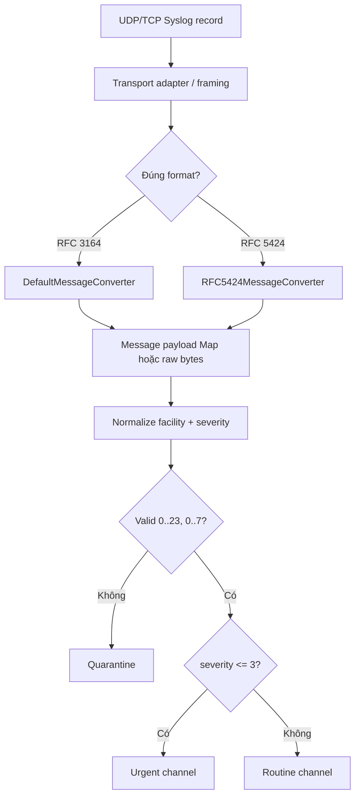

# Facility severity và priority

## 1. Facility, severity và priority giải quyết vấn đề gì?

Trong chương **Adapter Syslog** thuộc module **SPRING_INTEGRATION_ADAPTERS**, Spring Integration nhận nhật ký từ Linux host, firewall, router, ứng dụng hoặc collector qua **Syslog inbound channel adapter** và chuyển chúng thành `Message<?>` trên `MessageChannel`. Flow tiếp tục lọc, định tuyến, lưu vào database/file/SFTP hoặc gửi đến HTTP, JMS, AMQP, Kafka theo hợp đồng message. Việc chọn adapter, poller hay gateway ở những phần khác của module không làm thay đổi ý nghĩa các trường Syslog này.

Mỗi bản ghi Syslog có một **PRI (priority value)** mã hóa đồng thời hai thành phần:

- **Facility**: bản ghi thuộc **nhóm nguồn/chức năng** nào, ví dụ kernel, mail, security/authentication hay `local0`.
- **Severity**: bản ghi tự công bố **mức độ nghiêm trọng**, từ `0 = Emergency` đến `7 = Debug`.
- **Priority/PRI**: một số nguyên biểu diễn **cặp facility + severity**, không phải một thang điểm ưu tiên đơn lẻ cho mọi bản ghi.

Ví dụ:

```text
<134>Nov 23 09:15:10 edge-01 app[2048]: Configuration changed
^^^^^
 PRI
```

Trong ví dụ, `PRI = 134` có nghĩa **facility = 16 (`local0`)** và **severity = 6 (`Informational`)**. Giá trị 134 **không** có nghĩa đây là “mức cảnh báo 134”; nó là một mã kết hợp.

Bài học sẽ giúp bạn:

1. Tính `PRI` từ facility và severity, cũng như tách hai thành phần từ PRI.
2. Hiểu bảng facility `0..23` và severity `0..7` trong Syslog.
3. Phân biệt mã thô trong RFC 3164/RFC 5424 và payload do Spring Integration converter tạo.
4. Định tuyến bản ghi theo severity/facility đúng cách thay vì so sánh nguyên PRI.
5. Xây ví dụ Syslog inbound → parse/validate → normalized message → critical/routine channel.
6. Kiểm thử các giá trị biên, dữ liệu lỗi, vấn đề trust, timestamp và reliability.

## 2. PRI được mã hóa trong Syslog record thế nào?

### 2.1. Cú pháp trên wire

Ở đầu bản ghi RFC 3164 hoặc RFC 5424, PRI xuất hiện dưới dạng **số thập phân trong dấu `<` và `>`**:

```text
<PRI>HEADER MSG
```

Với RFC 5424, sau PRI là protocol version, ví dụ:

```text
<134>1 2026-11-23T02:15:10Z edge-01 app 2048 EVT42 - Configuration changed
```

Ở đó:

- `<134>` là PRI.
- `1` liền sau dấu `>` là **VERSION** của RFC 5424; nó **không** phải severity.
- `2026-11-23T02:15:10Z` là timestamp.
- `edge-01` là HOSTNAME, được nguồn phát ghi trong bản tin.
- `app`, `2048`, `EVT42` lần lượt là APP-NAME, PROCID và MSGID.
- `-` biểu thị STRUCTURED-DATA không có giá trị trong ví dụ.
- Phần còn lại là MSG.

**Thông tin PRI ở đầu message độc lập với cách truyền**. Bản ghi có thể đi qua UDP, TCP (phải có framing) hoặc TLS/TCP. Việc bật TLS không thay đổi công thức facility/severity.

### 2.2. Công thức chuyển đổi hai chiều

```text
PRI = facility * 8 + severity

facility = PRI / 8      (chia lấy phần nguyên)
severity = PRI % 8      (phần dư)
```

Miền giá trị theo hệ facility chuẩn của Syslog:

| Biến | Miền hợp lệ | Lý do |
|---|---|---|
| `facility` | `0..23` | 24 nhóm facility chuẩn. |
| `severity` | `0..7` | 8 mức severity. |
| `PRI` | `0..191` | `23 × 8 + 7 = 191`. |

Trong Java, toán tử `/` với số nguyên không âm chia lấy phần nguyên và toán tử `%` lấy số dư.

Ví dụ tính tay:

```text
facility = 16 (local0)
severity = 6  (informational)

PRI = 16 * 8 + 6 = 134

Giải mã:
facility = 134 / 8 = 16
severity = 134 % 8 = 6
```

Một số thiết bị sử dụng nhãn `info`, `warn`, `err` trong cấu hình, nhưng **mã số** mới là phần nhất quán trong PRI. Tên hiển thị/alias có thể khác giữa daemon và thư viện.

### 2.3. Cạm bẫy quan trọng: số PRI lớn không có nghĩa lỗi nặng hơn

Xét hai bản ghi:

```text
<27>Nov 23 09:20:00 host-a daemon: Database connection failed
<134>Nov 23 09:20:01 host-b app: Scheduled job started
```

- `PRI 27` → facility `3` (system daemons), severity `3` (Error).
- `PRI 134` → facility `16` (`local0`), severity `6` (Informational).

Nếu so sánh `134 > 27` rồi kết luận dòng thứ hai nghiêm trọng hơn thì **sai**: phần lớn chênh lệch đến từ facility. Muốn phân loại khẩn cấp theo Syslog severity, hãy **tách severity trước**, rồi so sánh `severity <= 3` cho các mức Error/Critical/Alert/Emergency.

Ngay cả vậy, severity là **giá trị tự khai báo**, không phải một đánh giá bảo mật đã được xác minh. Sự kiện bảo mật cần xem cả nguồn, nội dung, loại hành động và các quy tắc phát hiện riêng.

## 3. Bảng 24 facility chuẩn

Facility cho biết **loại ứng dụng/hệ thống** phát thông báo hoặc nhóm do cấu hình sender chỉ định.

| Mã | Tên/nhóm thường gặp | Ghi chú |
|---:|---|---|
| 0 | `kern` | Kernel messages. |
| 1 | `user` | User-level messages. |
| 2 | `mail` | Mail system. |
| 3 | `daemon` | System daemons. |
| 4 | `auth` | Security/authorization messages. |
| 5 | `syslog` | Thông báo do chính Syslog daemon tạo. |
| 6 | `lpr` | Line printer subsystem. |
| 7 | `news` | Network news subsystem. |
| 8 | `uucp` | UUCP subsystem. |
| 9 | `cron` / clock daemon | Nhãn triển khai có thể khác; RFC gắn với clock daemon. |
| 10 | `authpriv` | Security/authorization messages, thường dùng trong chính sách log có kiểm soát quyền. |
| 11 | `ftp` | FTP daemon. |
| 12 | `ntp` | NTP subsystem. |
| 13 | `audit` | Log audit. |
| 14 | `alert` | Log alert. |
| 15 | `clock` / `cron` (biến thể) | Clock daemon theo bảng chuẩn; alias tùy hệ thống. |
| 16 | `local0` | Local use 0. |
| 17 | `local1` | Local use 1. |
| 18 | `local2` | Local use 2. |
| 19 | `local3` | Local use 3. |
| 20 | `local4` | Local use 4. |
| 21 | `local5` | Local use 5. |
| 22 | `local6` | Local use 6. |
| 23 | `local7` | Local use 7. |

Hai điều cần nhớ:

1. **Facility không phải địa chỉ hoặc danh tính xác thực của sender.** Một router có thể được cấu hình gửi `local4` và một ứng dụng cũng có thể gửi `local4`. Muốn nhận diện thiết bị, phải dùng metadata đã được xác minh ở collector/TLS/network boundary và inventory.
2. **Facility không quyết định severity.** `local0.emerg` và `local0.debug` cùng facility 16 nhưng khác hoàn toàn mức nghiêm trọng.

### 3.1. Nhóm `local0` đến `local7`

Tám facility local thường được đội vận hành dùng để phân nguồn hoặc luồng xử lý:

| Facility | Giá trị | Ví dụ chính sách nội bộ |
|---|---:|---|
| `local0` | 16 | Nhật ký ứng dụng dịch vụ A. |
| `local1` | 17 | Router hoặc network agent. |
| `local2` | 18 | Hệ thống thu thập batch. |
| `local3` | 19 | Reverse proxy. |
| `local4` | 20 | Dịch vụ nghiệp vụ B. |
| `local5` | 21 | Agent kiểm tra sức khỏe. |
| `local6` | 22 | Tool vận hành nội bộ. |
| `local7` | 23 | Kênh thử nghiệm được kiểm soát. |

Đây là **ví dụ ánh xạ do doanh nghiệp tự lựa chọn**, không phải ý nghĩa bắt buộc của mỗi `localN` trong RFC. Nếu hai nhóm tự dùng chung `local4` cho hai nguồn không liên quan, facility một mình không đủ phân loại.

### 3.2. Cảnh giác với nhãn facility trong từng hệ điều hành

Một số hệ điều hành hoặc công cụ gửi log đặt tên facility bằng `security`, `auth`, `authpriv`, `cron` hoặc `clock` hơi khác nhau. Nên giữ **facility code nguyên số** trong schema chuẩn hóa và dùng bảng tên chỉ để hiển thị/giám sát.

Nếu yêu cầu audit hoặc truy vết quyền truy cập, **`authpriv` không tự bảo mật dữ liệu**: đây chỉ là facility code. Cần quyền file, ACL, TLS/mTLS, retention và policy cho những sự kiện thực sự nhạy cảm.

## 4. Bảng severity 0–7

Severity là **mức độ nghiêm trọng do nguồn Syslog khai báo**, khác với mức độ ưu tiên xử lý của đội vận hành.

| Mã | Tên chuẩn | Alias thường gặp | Ví dụ |
|---:|---|---|---|
| 0 | Emergency | `emerg` / `panic` | Hệ thống không thể hoạt động. |
| 1 | Alert | `alert` | Cần hành động ngay. |
| 2 | Critical | `crit` | Thành phần trọng yếu thất bại. |
| 3 | Error | `err` / `error` | Một thao tác quan trọng thất bại. |
| 4 | Warning | `warning` / `warn` | Nguy cơ hoặc điều kiện bất thường. |
| 5 | Notice | `notice` | Sự kiện đáng chú ý. |
| 6 | Informational | `info` | Trạng thái hoạt động thông thường. |
| 7 | Debug | `debug` | Chi tiết chẩn đoán. |

**Mã số nhỏ hơn thường chỉ mức nghiêm trọng cao hơn.** Vì vậy:

```java
boolean urgent = severity <= 3;  // 0, 1, 2, 3
boolean warningOrWorse = severity <= 4;
boolean informational = severity == 6;
boolean debug = severity == 7;
```

Các biểu thức này chỉ hợp lệ **sau khi đã kiểm tra `severity` nằm trong `0..7`**. Không được coi `severity == -1` hoặc `null` là “khẩn cấp” vì phép so sánh `-1 <= 3` vô tình trả `true`.

### 4.1. Quy ước severity không phải một bản đồ incident hoàn chỉnh

Dùng severity để ưu tiên triage là hữu ích, nhưng còn phải xem:

- Dịch vụ/thiết bị nào gửi sự kiện?
- Sự kiện có ảnh hưởng SLA, dữ liệu hoặc bảo mật không?
- Mật độ sự kiện tăng bất thường hay chỉ là một cảnh báo đơn lẻ?
- Đã có alert khác hoặc maintenance window liên quan?
- Log có thể bị giả mạo, forward hoặc gán nhãn sai không?

Ví dụ, một chuỗi thất bại đăng nhập có thể được sender đánh dấu `notice` hay `info` nhưng vẫn cần alert an ninh. Ngược lại, lỗi `error` của một task thử nghiệm không nhất thiết yêu cầu on-call production.

### 4.2. Chọn ngưỡng trong định tuyến

Một policy thực hành dễ hiểu:

| Điều kiện | Quyết định |
|---|---|
| `severity ∈ {0,1,2,3}` | Gửi kênh `urgentSyslog` sau khi validate nguồn. |
| `severity ∈ {4,5}` | Gửi kênh `routineSyslog` và đánh dấu cần theo dõi. |
| `severity ∈ {6,7}` | Lưu ở mức retention/rate limit phù hợp. |
| Severity không hợp lệ hoặc thiếu | Gửi `quarantineSyslog`, không tự đoán severity. |
| Facility nằm trong nhóm cần audit | Giữ dữ liệu theo chính sách riêng, bất kể severity. |

Không nên dùng quy tắc `severity <= 3` như một lý do **loại bỏ** mọi bản ghi còn lại: log information/debug có thể quan trọng khi điều tra và đôi khi chứa dấu hiệu tấn công.

## 5. Ví dụ tính PRI và giải mã bằng Java

Đây là hàm Java thuần để minh họa công thức, không phụ thuộc Spring Integration.

### 5.1. Một value object không cho phép PRI ngoài miền

```java
package example.syslog;

public record SyslogPriority(
        int pri,
        int facility,
        int severity) {

    public static SyslogPriority decode(int pri) {
        if (pri < 0 || pri > 191) {
            throw new IllegalArgumentException(
                "Syslog PRI must be between 0 and 191");
        }

        return new SyslogPriority(
            pri,
            pri / 8,
            pri % 8);
    }

    public static SyslogPriority encode(
            int facility,
            int severity) {

        if (facility < 0 || facility > 23) {
            throw new IllegalArgumentException(
                "facility must be between 0 and 23");
        }
        if (severity < 0 || severity > 7) {
            throw new IllegalArgumentException(
                "severity must be between 0 and 7");
        }

        int pri = facility * 8 + severity;
        return new SyslogPriority(pri, facility, severity);
    }

    public boolean isUrgent() {
        return severity <= 3;
    }
}
```

Sử dụng:

```java
SyslogPriority info = SyslogPriority.decode(134);
System.out.println(info.facility()); // 16
System.out.println(info.severity()); // 6
System.out.println(info.isUrgent()); // false

SyslogPriority error = SyslogPriority.encode(16, 3);
System.out.println(error.pri()); // 131
System.out.println(error.isUrgent()); // true
```

Chỉ nhận PRI trong miền 0–191 tránh chấp nhận dữ liệu sai tiêu chuẩn hoặc sinh facility không thuộc bảng chuẩn. Trường hợp một thiết bị dùng quy ước mở rộng riêng phải được xử lý như một **ngoại lệ hợp đồng có kiểm thử**, không âm thầm đưa vào đường chuẩn.

### 5.2. Trích PRI prefix từ bản ghi để kiểm thử

Spring Integration đã có Syslog converter; **không cần tự viết parser RFC 3164/RFC 5424 trong production**. Tuy nhiên, một helper nhỏ giúp unit test công thức:

```java
package example.syslog;

import java.util.regex.Matcher;
import java.util.regex.Pattern;

public final class SyslogPriPrefix {

    private static final Pattern PRI_PREFIX =
        Pattern.compile("^<([0-9]{1,3})>");

    private SyslogPriPrefix() {}

    public static SyslogPriority parse(String record) {
        if (record == null) {
            throw new IllegalArgumentException("record is null");
        }

        Matcher matcher = PRI_PREFIX.matcher(record);
        if (!matcher.find()) {
            throw new IllegalArgumentException(
                "Missing or malformed PRI prefix");
        }

        int pri = Integer.parseInt(matcher.group(1));
        return SyslogPriority.decode(pri);
    }
}
```

Ví dụ:

```java
SyslogPriority p = SyslogPriPrefix.parse(
    "<131>Nov 23 09:20:00 host-a daemon: Failure");

// p.facility() == 16; p.severity() == 3.
```

Helper chỉ tách prefix từ một **String đã được giải mã** và chưa xác thực toàn bộ Syslog record. Không dùng nó thay cho converter RFC hoặc tách RFC 5424 structured data bằng regex. Với dữ liệu raw `byte[]`, cần xác định encoding phù hợp trước khi biến body thành `String`.

### 5.3. Bảng ví dụ tính tay

| Label khái niệm | Facility | Severity | Công thức | PRI |
|---|---:|---:|---|---:|
| `kern.emerg` | 0 | 0 | `0×8+0` | 0 |
| `daemon.err` | 3 | 3 | `3×8+3` | 27 |
| `authpriv.warning` | 10 | 4 | `10×8+4` | 84 |
| `local0.info` | 16 | 6 | `16×8+6` | 134 |
| `local0.err` | 16 | 3 | `16×8+3` | 131 |
| `local4.notice` | 20 | 5 | `20×8+5` | 165 |
| `local7.debug` | 23 | 7 | `23×8+7` | 191 |

Từ bảng này có thể thấy `local7.debug` có **PRI cao nhất 191** nhưng severity chỉ là Debug; `kern.emerg` có **PRI thấp nhất 0** nhưng severity là Emergency.

## 6. PRI trong RFC 3164 và RFC 5424 có khác nhau không?

Công thức **không thay đổi**: cả RFC 3164 và RFC 5424 đều biểu diễn PRI ở đầu bản ghi, gồm facility và severity. Điều khác nhau đáng kể nằm ở **những trường còn lại** và cách converter parse chúng.

| Khía cạnh | RFC 3164 | RFC 5424 |
|---|---|---|
| PRI | `<134>` ở đầu record | `<134>` ở đầu record |
| Tính PRI | `facility × 8 + severity` | Giống RFC 3164 |
| Timestamp | Thường không chứa năm/timezone | Có format rõ ràng, hỗ trợ `-` khi thiếu |
| App/process | Thường dưới dạng tag trong MSG/header | APP-NAME, PROCID, MSGID riêng |
| Structured data | Không có cấu trúc chuẩn như RFC 5424 | Có STRUCTURED-DATA |
| Parser Spring Integration | `DefaultMessageConverter` / `SyslogToMapTransformer` | `RFC5424MessageConverter` |
| TCP framing | Phụ thuộc sender/receiver | Cần thống nhất framing RFC 6587; khi qua TLS RFC 5425 dùng octet counting |

Ví dụ cùng PRI trên hai format:

```text
RFC 3164:
<134>Nov 23 09:15:10 edge-01 app[2048]: Job started

RFC 5424:
<134>1 2026-11-23T02:15:10Z edge-01 app 2048 JOB1 - Job started
```

Trong cả hai, facility là 16 và severity là 6. Nhưng **không ép toàn bộ bản ghi RFC 5424 đi qua parser RFC 3164** chỉ vì PRI giống nhau; các trường timestamp, app name, MSGID và structured data có thể bị diễn giải sai.

## 7. Mapping sang Spring Integration payload và headers

### 7.1. Luồng chuyển đổi



Trong Spring Integration:

- `DefaultMessageConverter` dùng để nhận Syslog theo RFC 3164. Chế độ mặc định `asMap=true` tạo payload dạng `Map` với các trường đã parse; các trường (trừ nội dung message) có thể được đưa vào message headers prefix `syslog_`.
- `asMap=false` cho phép giữ raw `byte[]` làm payload, các metadata decode được vẫn có thể xuất hiện trong headers theo converter.
- `RFC5424MessageConverter` xử lý bản ghi RFC 5424. Với `asMap=true`, các trường được parse vào payload map **không tự sao chép hết sang headers** như converter RFC 3164.
- `SyslogToMapTransformer` có các hằng `FACILITY`, `SEVERITY`, `HOST`, `TIMESTAMP`, `MESSAGE` và `UNDECODED` để tránh hardcode tên key.
- Với bản ghi không thể parse, một số trường hợp converter trả map có `UNDECODED` thay vì ném exception.

**Không xem kiểu runtime của từng field là bất biến giữa mọi converter/phiên bản.** Nên đọc `Object`, kiểm tra `Number` hoặc chuỗi số theo contract, chuẩn hóa thành một DTO rồi mới route; nếu nguồn cung cấp label `INFO` thay vì số, cần bảng ánh xạ được thiết kế rõ thay vì ép kiểu bừa.

### 7.2. Phân biệt `facility` và `syslog_facility`

Ví dụ khái niệm:

```text
Spring Integration Message {
  payload: {
    facility: 16,
    severity: 6,
    host: "edge-01",
    message: "Job started"
  },
  headers: {
    id: ...,
    timestamp: ...,
    syslog_facility: 16,
    syslog_severity: 6,
    syslog_host: "edge-01"
  }
}
```

Đây là **sơ đồ khái niệm**, không khẳng định tên key, kiểu giá trị hoặc mọi header đều có mặt. Dùng các hằng do framework công bố thay vì đoán trường:

```java
Object facility = fields.get(
    SyslogToMapTransformer.FACILITY);
Object severity = fields.get(
    SyslogToMapTransformer.SEVERITY);
```

Khi đọc header, dùng `SyslogHeaders.FACILITY` hoặc `SyslogHeaders.SEVERITY` tương ứng với converter đã cấu hình. **Với RFC 5424 converter ở `asMap=true`, đừng mặc định các header decoded luôn có.**

### 7.3. Vì sao không route chỉ theo `MessageHeaders.ID` hoặc timestamp?

`MessageHeaders.ID` định danh message trong Spring Messaging, không phải ID vĩnh viễn của bản ghi ở mọi hệ thống. `MessageHeaders.TIMESTAMP` thường thể hiện thời điểm tạo message nội bộ, khác timestamp do sender Syslog khai báo.

Để audit, lưu riêng:

- `sourceTimestamp` từ bản ghi, sau khi kiểm tra ý nghĩa năm/timezone.
- `receivedAt` do receiver tạo.
- `sourceId` từ network/TLS/collector đã xác thực.
- `claimedHost` từ Syslog record (không đáng tin tuyệt đối).
- `facilityCode` và `severityCode` nguyên số.
- `eventId` do hệ thống sinh hoặc nguồn cung cấp theo chính sách, phục vụ correlation/replay.

## 8. Ví dụ Spring Integration: định tuyến theo facility/severity

Ta tạo một Syslog UDP receiver và phân loại những bản ghi có severity `0..3` sang `urgentSyslog`, bản ghi còn lại sang `routineSyslog`, trường hợp parse/validation sai sang `quarantineSyslog`.

**Giả định:** Java 17+, Spring Boot có Spring Integration, `spring-integration-ip` và `spring-integration-syslog`. Ví dụ chạy UDP/1514 và dùng `DefaultMessageConverter` cho RFC 3164. Đây là **luồng xử lý message nội bộ**, không tạo HTTP response.

### 8.1. Dependencies Maven

Với Spring Boot dependency management:

```xml
<dependencies>
    <dependency>
        <groupId>org.springframework.boot</groupId>
        <artifactId>spring-boot-starter-integration</artifactId>
    </dependency>
    <dependency>
        <groupId>org.springframework.integration</groupId>
        <artifactId>spring-integration-ip</artifactId>
    </dependency>
    <dependency>
        <groupId>org.springframework.integration</groupId>
        <artifactId>spring-integration-syslog</artifactId>
    </dependency>
</dependencies>
```

`spring-boot-starter-web` không bắt buộc nếu ứng dụng chỉ nghe UDP/TCP Syslog.

### 8.2. Native Syslog inbound XML

File `src/main/resources/syslog-priority.xml`:

```xml
<?xml version="1.0" encoding="UTF-8"?>
<beans xmlns="http://www.springframework.org/schema/beans"
       xmlns:xsi="http://www.w3.org/2001/XMLSchema-instance"
       xmlns:int="http://www.springframework.org/schema/integration"
       xmlns:int-syslog="http://www.springframework.org/schema/integration/syslog"
       xsi:schemaLocation="
         http://www.springframework.org/schema/beans
         https://www.springframework.org/schema/beans/spring-beans.xsd
         http://www.springframework.org/schema/integration
         https://www.springframework.org/schema/integration/spring-integration.xsd
         http://www.springframework.org/schema/integration/syslog
         https://www.springframework.org/schema/integration/syslog/spring-integration-syslog.xsd">

    <int:channel id="syslogInput"/>

    <int-syslog:inbound-channel-adapter
        id="prioritySyslogReceiver"
        channel="syslogInput"
        protocol="udp"
        port="1514"/>
</beans>
```

Ứng dụng Spring Boot nạp XML bằng `@ImportResource`:

```java
package example.syslog;

import org.springframework.boot.SpringApplication;
import org.springframework.boot.autoconfigure.SpringBootApplication;
import org.springframework.context.annotation.ImportResource;

@SpringBootApplication
@ImportResource("classpath:syslog-priority.xml")
public class SyslogPriorityApplication {

    public static void main(String[] args) {
        SpringApplication.run(SyslogPriorityApplication.class, args);
    }
}
```

Ở đây adapter nhận datagram, giải mã bằng converter RFC 3164 mặc định và gửi message tới `syslogInput`. Không cần poller ở đầu vào vì adapter UDP là **message-driven**.

### 8.3. Khai báo ba channel đích

File `SyslogPriorityChannels.java`:

```java
package example.syslog;

import org.springframework.context.annotation.Bean;
import org.springframework.context.annotation.Configuration;
import org.springframework.integration.channel.DirectChannel;
import org.springframework.messaging.MessageChannel;

@Configuration
public class SyslogPriorityChannels {

    @Bean
    public MessageChannel urgentSyslog() {
        return new DirectChannel();
    }

    @Bean
    public MessageChannel routineSyslog() {
        return new DirectChannel();
    }

    @Bean
    public MessageChannel quarantineSyslog() {
        return new DirectChannel();
    }
}
```

`DirectChannel` gọi subscriber trên thread gửi message. Nếu downstream đẩy Kafka/DB chậm, socket receiver có thể bị chặn; khi cần tách tải hoặc lưu bền vững phải thiết kế thêm persistent queue/collector thay vì giả định `DirectChannel` tự có backpressure phù hợp.

### 8.4. DTO cho sự kiện đã chuẩn hóa

File `ClassifiedSyslogEvent.java`:

```java
package example.syslog;

import java.time.Instant;

public record ClassifiedSyslogEvent(
    int facility,
    int severity,
    String claimedHost,
    String text,
    Instant receivedAt) {
}
```

File `RejectedSyslogEvent.java`:

```java
package example.syslog;

import java.time.Instant;

public record RejectedSyslogEvent(
    String reason,
    Instant receivedAt) {
}
```

Đây là contract nội bộ tối giản để học. Production nên bổ sung `sourceId` đã xác minh, trace/event ID, timestamp nguồn, schema version, nguồn nhận và cơ chế lưu raw có phân quyền. Không tự chuyển toàn bộ `MessageHeaders` gốc ra broker vì có thể chứa header nội bộ hoặc dữ liệu không cần thiết.

### 8.5. Service activator phân loại sau khi parse

File `SyslogPriorityClassifier.java`:

```java
package example.syslog;

import java.time.Instant;
import java.util.Map;

import org.springframework.beans.factory.annotation.Qualifier;
import org.springframework.integration.annotation.ServiceActivator;
import org.springframework.integration.transformer.SyslogToMapTransformer;
import org.springframework.messaging.Message;
import org.springframework.messaging.MessageChannel;
import org.springframework.messaging.support.MessageBuilder;
import org.springframework.stereotype.Service;

@Service
public class SyslogPriorityClassifier {

    private final MessageChannel urgent;
    private final MessageChannel routine;
    private final MessageChannel quarantine;

    public SyslogPriorityClassifier(
            @Qualifier("urgentSyslog") MessageChannel urgent,
            @Qualifier("routineSyslog") MessageChannel routine,
            @Qualifier("quarantineSyslog") MessageChannel quarantine) {
        this.urgent = urgent;
        this.routine = routine;
        this.quarantine = quarantine;
    }

    @ServiceActivator(inputChannel = "syslogInput")
    public void accept(Message<?> incoming) {
        Instant receivedAt = Instant.now();
        Object payload = incoming.getPayload();

        if (!(payload instanceof Map<?, ?> fields)) {
            reject("UNEXPECTED_PAYLOAD_TYPE", receivedAt);
            return;
        }

        if (fields.containsKey(SyslogToMapTransformer.UNDECODED)) {
            reject("UNDECODED_SYSLOG", receivedAt);
            return;
        }

        Integer facility = numeric(
            fields.get(SyslogToMapTransformer.FACILITY));
        Integer severity = numeric(
            fields.get(SyslogToMapTransformer.SEVERITY));

        if (facility == null || facility < 0 || facility > 23
                || severity == null || severity < 0
                || severity > 7) {
            reject("INVALID_FACILITY_OR_SEVERITY", receivedAt);
            return;
        }

        String claimedHost = safeString(
            fields.get(SyslogToMapTransformer.HOST));
        String text = safeString(
            fields.get(SyslogToMapTransformer.MESSAGE));

        ClassifiedSyslogEvent event = new ClassifiedSyslogEvent(
            facility, severity, claimedHost, text, receivedAt);

        MessageChannel destination =
            severity <= 3 ? urgent : routine;

        sendChecked(destination, event);
    }

    private void reject(String reason, Instant receivedAt) {
        // Raw message, nếu cần, phải lưu riêng với access control.
        sendChecked(quarantine,
            new RejectedSyslogEvent(reason, receivedAt));
    }

    private static Integer numeric(Object value) {
        if (value instanceof Number number) {
            double v = number.doubleValue();
            if (Double.isFinite(v)
                    && v == Math.rint(v)
                    && v >= Integer.MIN_VALUE
                    && v <= Integer.MAX_VALUE) {
                return (int) v;
            }
            return null;
        }
        if (value instanceof String text
                && text.matches("[0-9]{1,3}")) {
            return Integer.valueOf(text);
        }
        return null;
    }

    private static String safeString(Object value) {
        return value == null ? "" : String.valueOf(value);
    }

    private static void sendChecked(
            MessageChannel destination,
            Object payload) {

        boolean accepted = destination.send(
            MessageBuilder.withPayload(payload).build());

        if (!accepted) {
            throw new IllegalStateException(
                "Syslog output channel did not accept message");
        }
    }
}
```

Tại đây:

1. `UNDECODED` được kiểm tra trước khi dùng facility/severity.
2. Code không ép kiểu mù quáng; chấp nhận `Number` hoặc chuỗi chữ số ngắn, sau đó giới hạn miền hợp lệ.
3. Chỉ khi severity hợp lệ mới xét `severity <= 3`.
4. `claimedHost` và `text` là dữ liệu sender khai báo, **không phải nguồn danh tính tin cậy**.
5. Message mới được tạo chỉ chứa DTO đã chuẩn hóa; không sao chép toàn bộ headers có thể chứa metadata nội bộ.
6. `sendChecked` kiểm tra kết quả gửi message vào channel. Kết quả `true` chỉ có ý nghĩa theo semantics của channel, **không tự chứng minh bản ghi đã được lưu bền vững**.

**Giới hạn của ví dụ:** bộ chuyển `numeric` không nhận chuỗi nhãn như `"INFO"`; nếu converter của môi trường cung cấp nhãn thay số, cần bổ sung mapping nhãn được kiểm thử. Code cũng chỉ chấp nhận các giá trị số hữu hạn, nguyên và nằm trong miền `int`, rồi mới kiểm tra facility/severity ở `accept`. Các value với cấu trúc tùy vendor cần normalization riêng thay vì mặc nhiên ép kiểu.

### 8.6. Subscriber cho ba channel

File `SyslogPrioritySink.java`:

```java
package example.syslog;

import org.slf4j.Logger;
import org.slf4j.LoggerFactory;
import org.springframework.integration.annotation.ServiceActivator;
import org.springframework.stereotype.Service;

@Service
public class SyslogPrioritySink {

    private static final Logger log =
        LoggerFactory.getLogger(SyslogPrioritySink.class);

    @ServiceActivator(inputChannel = "urgentSyslog")
    public void urgent(ClassifiedSyslogEvent event) {
        // Production: gửi persistent queue/Kafka và alert theo policy.
        log.warn("Urgent Syslog event: facility={}, severity={}",
            event.facility(), event.severity());
    }

    @ServiceActivator(inputChannel = "routineSyslog")
    public void routine(ClassifiedSyslogEvent event) {
        // Production: lưu batch/index hoặc durable topic.
        log.info("Routine Syslog event: facility={}, severity={}",
            event.facility(), event.severity());
    }

    @ServiceActivator(inputChannel = "quarantineSyslog")
    public void rejected(RejectedSyslogEvent event) {
        // Production: quarantine bền vững, alert theo tỷ lệ.
        log.warn("Rejected Syslog event: reason={}", event.reason());
    }
}
```

Đây là ví dụ tập trung vào **facility/severity routing**, chưa có storage thật. Chỉ ghi vào application log không phải durable sink, và có nguy cơ vòng lặp nếu application log được cấu hình chuyển về cùng Syslog receiver.

## 9. Test bằng Syslog sender và kiểm tra routing

### 9.1. Gửi nhiều severity trong cùng facility

Trên Linux có `logger` hỗ trợ các tùy chọn tương ứng:

```bash
logger --udp --server 127.0.0.1 --port 1514 \
  --rfc3164 --priority local0.info \
  --tag demo "Application started"

logger --udp --server 127.0.0.1 --port 1514 \
  --rfc3164 --priority local0.err \
  --tag demo "Dependency failed"
```

Dự kiến:

- `local0.info` → facility 16, severity 6, PRI 134 → `routineSyslog`.
- `local0.err` → facility 16, severity 3, PRI 131 → `urgentSyslog`.

Các tùy chọn của `logger` có thể khác theo bản phân phối; kiểm tra `logger --help`. Nếu sender chạy trong container khác, `127.0.0.1` là loopback của sender chứ không phải receiver.

### 9.2. Gửi trực tiếp bằng Java UDP để kiểm soát PRI

File `SendPrioritySyslog.java`:

```java
package example.syslog;

import java.net.DatagramPacket;
import java.net.DatagramSocket;
import java.net.InetAddress;
import java.nio.charset.StandardCharsets;

public class SendPrioritySyslog {

    private static void send(
            DatagramSocket socket,
            String text) throws Exception {

        byte[] bytes = text.getBytes(StandardCharsets.UTF_8);
        DatagramPacket packet = new DatagramPacket(
            bytes, bytes.length,
            InetAddress.getByName("127.0.0.1"), 1514);
        socket.send(packet);
    }

    public static void main(String[] args) throws Exception {
        try (DatagramSocket socket = new DatagramSocket()) {
            send(socket, "<134>Nov 23 09:15:10 edge-01 app: Job started");
            send(socket, "<131>Nov 23 09:15:11 edge-01 app: Job failed");
            send(socket, "<84>Nov 23 09:15:12 edge-01 auth: Warning");
        }
    }
}
```

Đối với `<84>`, `facility = 84/8 = 10` và `severity = 84%8 = 4` nên theo policy demo sẽ vào `routineSyslog`, dù facility `authpriv` có thể cần retention bảo mật riêng.

**UDP không có application acknowledgment.** `DatagramSocket.send(...)` kết thúc chỉ cho biết Java/OS tiếp nhận thao tác gửi; cần kiểm tra receiver và downstream sink thực sự có bản ghi.

### 9.3. Unit test công thức PRI

Với JUnit Jupiter:

```java
package example.syslog;

import static org.junit.jupiter.api.Assertions.*;

import org.junit.jupiter.api.Test;

class SyslogPriorityTest {

    @Test
    void decodesFacilityAndSeverity() {
        SyslogPriority p = SyslogPriority.decode(134);

        assertEquals(16, p.facility());
        assertEquals(6, p.severity());
        assertFalse(p.isUrgent());
    }

    @Test
    void encodesFacilityAndSeverity() {
        SyslogPriority p = SyslogPriority.encode(16, 3);

        assertEquals(131, p.pri());
        assertTrue(p.isUrgent());
    }

    @Test
    void checksBoundaries() {
        assertEquals(0, SyslogPriority.decode(0).severity());
        assertEquals(23, SyslogPriority.decode(191).facility());
        assertEquals(7, SyslogPriority.decode(191).severity());

        assertThrows(IllegalArgumentException.class,
            () -> SyslogPriority.decode(-1));
        assertThrows(IllegalArgumentException.class,
            () -> SyslogPriority.decode(192));
        assertThrows(IllegalArgumentException.class,
            () -> SyslogPriority.encode(24, 0));
        assertThrows(IllegalArgumentException.class,
            () -> SyslogPriority.encode(16, 8));
    }

    @Test
    void readsPrefix() {
        SyslogPriority p = SyslogPriPrefix.parse(
            "<27>Nov 23 09:20:00 host daemon: Failure");

        assertEquals(3, p.facility());
        assertEquals(3, p.severity());
    }
}
```

Với Spring Boot, test dependency thường là `spring-boot-starter-test`. Đây là **bộ test cho phép tính**; test Spring Integration thực tế còn phải gửi datagram và assert message đến channel đúng, bao gồm bản ghi có field thiếu hoặc sai format.

## 10. Hợp đồng phân loại nhiều nguồn Syslog

Khi hệ thống có nhiều sender, một policy production nên kết hợp ít nhất:

```text
validated / trusted source identity
        + facility code
        + severity code
        + normalized event attributes
        + tenant/environment
        + rate / frequency / time window
        -> routing, alerting, retention
```

| Quy tắc | Hợp lý khi | Cạm bẫy |
|---|---|---|
| `severity <= 3` | Phân tuyến lỗi nặng trên nguồn đã kiểm soát | Sender có thể gắn severity sai hoặc cố tình gửi flood. |
| `facility == 10` | Dữ liệu authpriv cần lưu riêng | Không tự bảo mật, có thể bị spoof. |
| `facility >= 16` | Nhóm local facility do tổ chức tự quy ước | Mỗi đơn vị có thể đặt ý nghĩa local khác nhau. |
| `sourceId + facility + severity` | Áp policy riêng theo thiết bị/tenant | SourceId phải lấy từ inventory/trust boundary. |
| Frequency/window anomaly | Phát hiện đợt lỗi lặp hoặc tấn công | Phải có dedup/throttling để tránh bão cảnh báo. |
| `severity == 7` | Giảm tải lưu trữ debug | Có thể bỏ chứng cứ quan trọng nếu policy quá đơn giản. |

### 10.1. Retention và phân loại thông tin nhạy cảm

Facility `auth`/`authpriv` thường chứa thông tin đăng nhập và bảo mật, nhưng nhiều ứng dụng ghi token hoặc dữ liệu cá nhân ở facility `local0`. Vì vậy retention/redaction **không được chỉ dựa vào facility**.

Chính sách nên quy định:

- Những loại sự kiện nào cần lưu raw và trong bao lâu.
- Ai được truy cập thông tin auth/audit.
- Mức độ sanitize nội dung message và structured data.
- Có cần mã hóa dữ liệu lưu trữ, kiểm tra integrity hoặc audit trail không.
- Khi alert severity cao, thông tin nào được gửi ra hệ thống bên ngoài mà không lộ secret.

### 10.2. Timestamp và thứ tự

PRI không chứa thời gian. Với RFC 3164, timestamp trong record thường không có năm/timezone; với RFC 5424, timestamp có thể có timezone hoặc NILVALUE theo format.

Nếu làm event ordering:

- Dùng `receivedAt` của collector để biết thời điểm ingress.
- Giữ `sourceTimestamp` riêng; tránh tự suy mọi log từ cùng host đều đúng giờ.
- UDP có thể đảo thứ tự/mất packet; TCP chỉ bảo đảm thứ tự byte **trong từng kết nối**, không có global order.
- Khi gửi sang Kafka, chọn partition key theo `trustedSourceId` nếu cần thứ tự cục bộ, không dựa vào PRI.

## 11. Lỗi và bảo mật ở ranh giới Syslog

### 11.1. Bản ghi có PRI ngoài miền hoặc không decode được

Ví dụ input không hợp lệ:

```text
<192>Nov 23 09:15:10 edge-01 app: Out of range
<abc>Nov 23 09:15:10 edge-01 app: Bad prefix
Nov 23 09:15:10 edge-01 app: Missing PRI
```

Kỳ vọng đúng:

1. Parser/validation từ chối hoặc tạo trạng thái không decode được theo implementation.
2. Không tự động gán `severity=0` để tránh gửi cảnh báo khẩn giả.
3. Không gửi raw dữ liệu lỗi lên log không giới hạn.
4. Tăng metric malformed-rate và lưu bản ghi raw có giới hạn nếu hợp đồng điều tra yêu cầu.
5. Khi nhiều thiết bị cùng lỗi format, kiểm tra cấu hình format RFC 3164/RFC 5424 và framing trước khi sửa routing.

`UNDECODED` là **dữ liệu lỗi trong payload** ở một số trường hợp, không nhất thiết là Java exception. `errorChannel` chỉ nhận lỗi khi adapter/poller/handler thật sự phát `ErrorMessage`; bản ghi Syslog đã bị kernel drop trước listener sẽ không xuất hiện ở đó.

### 11.2. Facility/severity không phải thông tin xác thực

Syslog UDP/TCP thuần không có xác thực ứng dụng. Một sender có thể tự ghi `<0>` (kern.emerg) hoặc `<84>` (authpriv.warning), thậm chí giả hostname.

Để tránh bị lợi dụng:

- Chỉ mở listener trên mạng tin cậy/allowlist, có firewall và giới hạn nguồn gửi.
- Khi cần confidentiality và xác thực peer, dùng syslog-over-TLS/mTLS với collector hoặc TLS-enabled transport phù hợp. Không mặc định `protocol="tcp"` tự bảo mật.
- Gắn `trustedSourceId` dựa trên danh tính mạng/TLS đã được xác minh, không chỉ tin `HOSTNAME` trong payload.
- Rate limit và chống flood cho severe alerts; áp dụng quota theo nguồn.
- Escape control characters/newline để tránh log injection khi hiển thị hoặc forward.
- Không để severity cao tự động chạy command, gọi endpoint nhạy cảm hoặc cấp quyền truy cập.

### 11.3. Đừng nhầm error channel với độ bền dữ liệu

Một chuỗi ingest có thể thất bại tại mỗi bước:

```text
Network UDP/TCP
  -> listener / decoder
  -> Syslog Message payload
  -> validation + routing
  -> MessageChannel
  -> Kafka / JMS / AMQP / DB / File / SFTP
  -> commit / ack từ destination
```

- UDP có thể mất gói trước listener.
- TCP bảo đảm byte stream có thứ tự trong kết nối, nhưng không bảo đảm database commit.
- `DirectChannel` có thể block/throw khi subscriber lỗi.
- `QueueChannel` mặc định là bộ nhớ, không tự là durable queue.
- Retry có thể tạo duplicate sau timeout/mất response. Syslog thường không có ID toàn cục đáng tin, nên cần source ID + event ID/fingerprint và chính sách dedup.
- Với sink Kafka/JMS/AMQP hoặc DB, chỉ coi đã lưu thành công khi đạt đúng mốc ack/commit theo contract.

Một thiết kế yêu cầu không mất log nên có collector/buffer bền vững, retention, replay và giám sát riêng, thay vì chỉ tăng priority hoặc gửi mọi record severity 0 vào channel.

## 12. Quan sát và kiểm thử end-to-end

### 12.1. Ma trận kiểm thử

| Input | Facility | Severity | Kết quả kỳ vọng |
|---|---:|---:|---|
| `<0>` | 0 | 0 | Hợp lệ, urgent. |
| `<27>` | 3 | 3 | Hợp lệ, urgent. |
| `<84>` | 10 | 4 | Hợp lệ, routine theo ngưỡng demo. |
| `<131>` | 16 | 3 | Hợp lệ, urgent. |
| `<134>` | 16 | 6 | Hợp lệ, routine. |
| `<165>` | 20 | 5 | Hợp lệ, routine. |
| `<191>` | 23 | 7 | Hợp lệ, routine. |
| `<192>` | — | — | Không hợp lệ, quarantine. |
| `<-1>` / `<abc>` | — | — | Không hợp lệ, quarantine. |
| Thiếu PRI | — | — | Không dùng severity mặc định; quarantine. |
| Map có `UNDECODED` | — | — | Quarantine, không route bình thường. |
| Map thiếu severity hoặc sai type | Có thể có | — | Quarantine và metric schema error. |
| RFC 5424 đi vào parser RFC 3164 | Không bảo đảm | Không bảo đảm | Phát hiện parser/config mismatch, không suy đoán fields. |

### 12.2. Những metric cần quan sát

| Metric | Ý nghĩa |
|---|---|
| `syslog_received_total` theo protocol/source | Lượng bản ghi ingress. |
| `syslog_events_total` theo facility/severity | Phân bố mã Syslog. |
| `syslog_undecoded_total` | Số record parser không decode được. |
| `syslog_invalid_pri_total` | Số giá trị PRI/facility/severity không hợp lệ. |
| `syslog_urgent_total` | Số message vào kênh ưu tiên khẩn. |
| `syslog_quarantine_total` | Lượng dữ liệu cần kiểm tra/replay. |
| `syslog_sink_write_failures_total` | Lỗi publish/commit downstream. |
| UDP drop/TCP reconnect/queue depth | Sức khỏe vận chuyển và backpressure. |

Khi thiết kế nhãn metric, hạn chế nhãn có cardinality cao như raw hostname tùy ý, message text, user ID hoặc tên file. Dùng source ID chuẩn hóa và endpoint group, không đưa raw payload nhạy cảm vào metrics.

### 12.3. Cách chẩn đoán khi severity bị phân loại sai

```text
Sender facility/severity config
  -> PRI in raw record (số trong <...>)
  -> UDP/TCP/TLS transport và framing
  -> RFC3164 hoặc RFC5424 converter
  -> payload map / raw byte[]
  -> validate field type/range
  -> normalize facility/severity
  -> router threshold và policy theo nguồn
  -> output channel / storage
```

Nếu **PRI đúng nhưng severity sai**, kiểm tra parser và kiểu giá trị map. Nếu **severity đúng nhưng route sai**, kiểm tra ngưỡng (`<=3`, không phải `>=3`) và policy facility/source. Nếu **không có message**, kiểm tra port/protocol/framing, queue và network trước khi sửa Java router.

## 13. Tổng kết

**Facility** là nhóm nguồn/chức năng Syslog (`0..23`), **severity** là mức nghiêm trọng (`0..7`, số càng nhỏ càng khẩn), và **PRI** là mã kết hợp theo công thức:

```text
PRI = facility * 8 + severity
facility = PRI / 8
severity = PRI % 8
```

Đối với **Spring Integration Syslog inbound**:

- Chọn converter RFC 3164 hay RFC 5424 phù hợp format của sender.
- Đọc payload map và các header `syslog_*` theo đúng cấu hình converter; không đoán chúng luôn đồng nhất.
- Chuẩn hóa và validate facility/severity trước khi lọc/định tuyến, xử lý `UNDECODED` bằng nhánh riêng.
- Khi cần ưu tiên sự kiện lỗi nặng, so sánh **severity đã tách**, **không so sánh nguyên PRI** giữa các facility.
- Không dùng facility/severity như thông tin xác thực, phân quyền hoặc bảo đảm đã persist.
- Kết hợp trusted source, idempotency/dedup, timeout, backpressure, monitoring và durable sink khi chuyển tiếp sang Kafka, JMS, AMQP, HTTP, file/SFTP hoặc database.

### Tài liệu tham khảo chính thức

- [Spring Integration — Syslog Support](https://docs.spring.io/spring-integration/reference/syslog.html)
- [Spring Integration — SyslogToMapTransformer API](https://docs.spring.io/spring-integration/api/org/springframework/integration/transformer/SyslogToMapTransformer.html)
- [Spring Integration — SyslogHeaders API](https://docs.spring.io/spring-integration/api/org/springframework/integration/syslog/SyslogHeaders.html)
- [IETF RFC 3164 — The BSD Syslog Protocol](https://www.rfc-editor.org/rfc/rfc3164)
- [IETF RFC 5424 — The Syslog Protocol](https://www.rfc-editor.org/rfc/rfc5424)
- [IETF RFC 5425 — Syslog over TLS](https://www.rfc-editor.org/rfc/rfc5425)
- [IETF RFC 6587 — Transmission of Syslog Messages over TCP](https://www.rfc-editor.org/rfc/rfc6587)
