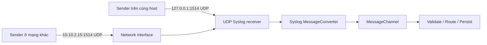
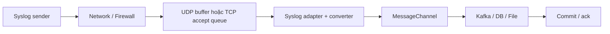

# Port lắng nghe và bind address

## 1. Bối cảnh: Syslog adapter phải lắng nghe ở đâu?

Trong chương **Adapter Syslog** của module **SPRING_INTEGRATION_ADAPTERS**, một Syslog inbound channel adapter tiếp nhận bản ghi từ router, firewall, Linux host, ứng dụng hoặc collector. Dữ liệu đi qua UDP/TCP, được converter chuyển thành Spring Integration `Message<?>` và gửi vào `MessageChannel`. Sau đó các flow có thể lọc, định tuyến, lưu database, file/SFTP, đẩy JMS/AMQP/Kafka hoặc gọi HTTP API. Tính đúng đắn của toàn chuỗi phụ thuộc vào việc **socket listener được mở trên đúng cổng và đúng địa chỉ mạng**.

Hai khái niệm của bài:

- **Listening port**: số cổng của **socket cục bộ** mà Syslog inbound adapter hoặc TCP server connection factory sử dụng để nhận dữ liệu, ví dụ UDP/1514 hoặc TCP/1515.
- **Bind address** (thường tương ứng thuộc tính Spring Integration `local-address`): địa chỉ IP **cục bộ trên máy/container receiver** dùng để bind listener, ví dụ `127.0.0.1`, `192.0.2.10` hoặc wildcard `0.0.0.0`.

Đây là hai thông số **độc lập**: cùng cổng 1514 nhưng bind `127.0.0.1` và `0.0.0.0` có phạm vi nhận kết nối/datagram rất khác nhau.



Nếu receiver chỉ bind `127.0.0.1`, đường từ sender bên ngoài tới interface `10.10.2.15` **không** vào listener đó. Nếu receiver bind wildcard và firewall cho phép, cả hai đường có thể tới socket. Với TCP, còn phải thiết lập kết nối và có framing; với UDP, dữ liệu là datagram một chiều, không có application-level ACK.

Mục tiêu của bài:

1. Phân biệt **port, bind address, sender address, destination address** và `HOSTNAME` trong payload Syslog.
2. Biết khi nào dùng loopback, một IP cụ thể hoặc wildcard.
3. Cấu hình UDP bằng `<int-syslog:udp-attributes local-address="...">`.
4. Cấu hình TCP bằng server `<int-ip:tcp-connection-factory local-address="...">`.
5. Kiểm tra port 514/1514/6514, quyền hệ điều hành, port conflict, Docker/Kubernetes, firewall và TLS.
6. Kiểm thử end-to-end bằng Syslog sender thực và quan sát listener/recovery.

> **Nguyên tắc:** Mở được socket chỉ chứng minh listener đang lắng nghe. Nó **không** chứng minh bản ghi đã parse đúng, đi qua channel hay được ghi bền vững vào Kafka/database.

## 2. Địa chỉ IP, port và transport tạo thành endpoint

Một địa chỉ socket ở tầng mạng có thể viết là:

```text
(protocol, local IP, local port)

(UDP, 127.0.0.1, 1514)
(TCP, 10.10.2.15, 1515)
(TCP + TLS, 10.10.2.15, 6514)
```

**UDP/1514 và TCP/1514 không phải cùng một listener.** UDP và TCP có không gian socket riêng; cùng số cổng có thể được sử dụng cho hai transport trong những điều kiện phù hợp, nhưng receiver chỉ nghe UDP sẽ không nhận byte stream TCP và ngược lại.

### 2.1. Các địa chỉ bind thường dùng

| Bind address | Phạm vi | Phù hợp khi | Cần thận trọng |
|---|---|---|---|
| `127.0.0.1` | IPv4 loopback của network namespace hiện tại | Thử nghiệm local, collector proxy cùng namespace | Sender từ host/container khác không tới listener qua IP bên ngoài. |
| `::1` | IPv6 loopback | Kiểm thử hoặc kết nối IPv6 local | Không đồng nghĩa với `127.0.0.1`. |
| `10.10.2.15` | IP cụ thể thuộc interface receiver | Chỉ mở trên mạng nội bộ đã chọn | IP phải tồn tại trên host/pod khi bind; IP thay đổi sẽ làm startup lỗi. |
| `0.0.0.0` | Wildcard IPv4: tất cả local IPv4 interfaces | Container, nhiều interface, service được bảo vệ bởi firewall | Có thể tăng bề mặt truy cập; phải kiểm soát inbound traffic. |
| `::` | Wildcard IPv6 | Server cần tiếp nhận trên IPv6 | Dual-stack IPv4/IPv6 phụ thuộc OS và `IPV6_V6ONLY`/socket implementation. |

**Nếu không cấu hình `local-address`**, nhiều Spring Integration IP inbound endpoints sử dụng bind mặc định của socket để lắng nghe trên các interface sẵn có. Với môi trường đa mạng, hãy cấu hình rõ local address hoặc firewall thay vì dựa vào mặc định khi yêu cầu giới hạn phạm vi nhận dữ liệu.

Địa chỉ bind phải là **địa chỉ của receiver**, không phải IP của một sender. Nếu receiver có IP `10.10.2.15` mà sender là `10.10.3.20`, cấu hình `local-address="10.10.3.20"` trên receiver thường làm bind thất bại vì IP này không thuộc máy receiver.

### 2.2. Phân biệt IP trong cấu hình và trong bản ghi

```text
Sender source IP:             10.10.3.20
Receiver local bind address:  10.10.2.15
Receiver listening port:      1514/UDP
Syslog payload HOSTNAME:      edge-01
Spring Integration channel:   syslogEvents
```

Các giá trị có nguồn khác nhau:

| Giá trị | Lấy từ đâu? | Dùng để |
|---|---|---|
| Receiver `local-address` | Cấu hình adapter/connection factory | Chọn interface/IP để nhận. |
| Receiver `port` | Cấu hình socket listener | Chọn số cổng nguồn gửi phải trỏ tới. |
| Packet source IP | Tầng IP/UDP/TCP | Đối chiếu nguồn kết nối, quan sát NAT/proxy. |
| `HOSTNAME`/`HOST` trong Syslog | Text do sender đưa vào record | Metadata log, **có thể bị giả mạo**. |
| `MessageHeaders.ID` | Spring Messaging | Theo dõi message nội bộ, không phải định danh thiết bị. |

Đừng dùng `local-address` để “chỉ cho phép sender 10.10.3.20”; thuộc tính này chọn **địa chỉ nhận cục bộ**, không lọc remote peers. Muốn giới hạn sender, dùng firewall/ACL, network policy, TLS/mTLS proxy hoặc kiểm tra danh tính nguồn đã xác thực.

## 3. Chọn port: 514, 1514 và 6514

### 3.1. Port Syslog phổ biến

| Port/transport | Mục đích thông thường | Lưu ý |
|---|---|---|
| **UDP/514** | Syslog truyền thống qua UDP | Có thể đã bị syslog daemon OS chiếm; trên Unix bind port thấp có thể cần quyền đặc biệt. |
| **TCP/514** | Syslog qua TCP theo cấu hình collector/agent | Không tự mã hóa; cần thống nhất framing. |
| **UDP/1514** | Port phi đặc quyền cho lab hoặc ingress được ánh xạ | Đây là ví dụ học tập, không phải cổng chuẩn bắt buộc. |
| **TCP/1515** | Port phi đặc quyền cho Syslog TCP của ứng dụng | Sender và server phải thống nhất transport/framing. |
| **TCP/6514** | Syslog over TLS theo RFC 5425 | Chỉ thực sự có TLS khi endpoint/proxy được cấu hình TLS; **số cổng không bật TLS**. |

Không nên chạy toàn bộ ứng dụng Spring với quyền root chỉ để bind UDP/514. Thay vào đó cân nhắc:

- Cho ứng dụng nghe `1514`, để firewall, host proxy hoặc collector nhận `514` rồi chuyển tiếp.
- Cấp capability tối thiểu (ví dụ `CAP_NET_BIND_SERVICE` trên Linux) nếu thật sự phải bind cổng thấp.
- Tách listener Syslog khỏi dịch vụ HTTP/nghiệp vụ có nhiều quyền truy cập.

Quy định quyền cho low port có thể khác giữa OS, container và cấu hình hệ thống; tránh khẳng định mọi Unix hiện đại luôn yêu cầu root cho một cổng cụ thể.

### 3.2. Port 0 dành cho kiểm thử

Một số IP server components có thể được cấu hình `port="0"` để hệ điều hành cấp **ephemeral port** khi khởi động. Spring Integration có các sự kiện như `UdpServerListeningEvent` và `TcpConnectionServerListeningEvent` để cho phép phát hiện listener đã sẵn sàng và cổng được cấp.

Điều này hữu ích cho **integration test chạy song song**, tránh hardcode cùng một port. Nhưng production sender cần một endpoint ổn định; nếu dùng port động phải có service discovery hoặc cách công bố cổng tương ứng.

**Không sử dụng `port=0` cho thiết bị Syslog cố định mà không có cơ chế thông báo cổng thật.**

## 4. Syslog UDP inbound: bind trên loopback

### 4.1. Dependency

Với dự án Spring Boot có dependency management, hai module liên quan là `spring-integration-syslog` và `spring-integration-ip`:

```xml
<dependencies>
    <dependency>
        <groupId>org.springframework.boot</groupId>
        <artifactId>spring-boot-starter-integration</artifactId>
    </dependency>
    <dependency>
        <groupId>org.springframework.integration</groupId>
        <artifactId>spring-integration-ip</artifactId>
    </dependency>
    <dependency>
        <groupId>org.springframework.integration</groupId>
        <artifactId>spring-integration-syslog</artifactId>
    </dependency>
</dependencies>
```

Ví dụ sau dùng Syslog **RFC 3164** qua UDP, converter mặc định và `MessageChannel`. Không cần Spring MVC/HTTP server nếu chỉ nhận Syslog.

### 4.2. XML cấu hình hoàn chỉnh cho UDP/1514

Tạo `src/main/resources/syslog-listener.xml`:

```xml
<?xml version="1.0" encoding="UTF-8"?>
<beans xmlns="http://www.springframework.org/schema/beans"
       xmlns:xsi="http://www.w3.org/2001/XMLSchema-instance"
       xmlns:int="http://www.springframework.org/schema/integration"
       xmlns:int-syslog="http://www.springframework.org/schema/integration/syslog"
       xsi:schemaLocation="
         http://www.springframework.org/schema/beans
         https://www.springframework.org/schema/beans/spring-beans.xsd
         http://www.springframework.org/schema/integration
         https://www.springframework.org/schema/integration/spring-integration.xsd
         http://www.springframework.org/schema/integration/syslog
         https://www.springframework.org/schema/integration/syslog/spring-integration-syslog.xsd">

    <int:channel id="syslogUdpEvents"/>

    <int-syslog:inbound-channel-adapter
        id="udpSyslogReceiver"
        channel="syslogUdpEvents"
        auto-startup="true">

        <int-syslog:udp-attributes
            port="1514"
            local-address="127.0.0.1"
            lookup-host="false"/>
    </int-syslog:inbound-channel-adapter>

    <int:service-activator
        input-channel="syslogUdpEvents"
        ref="syslogEventConsumer"
        method="accept"/>

    <bean id="syslogEventConsumer"
          class="example.syslog.SyslogEventConsumer"/>
</beans>
```

**Hai điều quan trọng trong XML:**

1. Khi dùng child `<int-syslog:udp-attributes>`, thuộc tính **`port` đặt trong child**, **không** khai báo thêm `port` trên element `inbound-channel-adapter`.
2. `local-address="127.0.0.1"` ràng buộc UDP socket vào loopback. Sender trên host/network namespace khác không gửi thẳng qua IP ngoài vào listener này.

`lookup-host="false"` tắt reverse DNS lookup để tránh độ trễ không cần thiết; điều này **không phải** một cơ chế xác thực sender. Không tự bật `lookup-host=true` rồi coi hostname qua DNS là đáng tin.

Nếu chỉ cần cấu hình port và chấp nhận mặc định bind address, có thể dùng native adapter ngắn gọn:

```xml
<int-syslog:inbound-channel-adapter
    id="udpSyslogAny"
    channel="syslogUdpEvents"
    port="1514"/>
```

Đây là **cấu hình thay thế**, không được khởi tạo đồng thời với `udpSyslogReceiver` trên cùng IP và UDP/1514. Khi chạy, phải chọn đúng một listener tương ứng.

### 4.3. Java application nạp XML

```java
package example.syslog;

import org.springframework.boot.SpringApplication;
import org.springframework.boot.autoconfigure.SpringBootApplication;
import org.springframework.context.annotation.ImportResource;

@SpringBootApplication
@ImportResource("classpath:syslog-listener.xml")
public class SyslogListeningApplication {

    public static void main(String[] args) {
        SpringApplication.run(SyslogListeningApplication.class, args);
    }
}
```

Ví dụ consumer nhận Syslog payload được converter tạo:

```java
package example.syslog;

import java.util.Map;
import org.slf4j.Logger;
import org.slf4j.LoggerFactory;
import org.springframework.messaging.Message;

public class SyslogEventConsumer {

    private static final Logger log =
        LoggerFactory.getLogger(SyslogEventConsumer.class);

    public void accept(Message<?> message) {
        if (!(message.getPayload() instanceof Map<?, ?> payload)) {
            log.warn("Unexpected Syslog payload type");
            return;
        }

        // Chỉ log metadata thô đã chọn; không log raw MSG chứa PII.
        Object severity = payload.get("severity");
        log.info("Syslog message arrived; severity={}", severity);

        // Production: normalize/validate và persist hoặc publish.
    }
}
```

`DefaultMessageConverter` mặc định tạo payload dạng `Map` từ RFC 3164. Key thực tế do `SyslogToMapTransformer` định nghĩa; production nên dùng hằng như `SyslogToMapTransformer.SEVERITY`, kiểm tra kiểu dữ liệu và xử lý trường `UNDECODED`, thay vì phụ thuộc vào chuỗi key một cách mù quáng.

### 4.4. Muốn nhận UDP từ mạng ngoài phải thay đổi gì?

Với receiver có local IP `10.10.2.15` và sender ở `10.10.3.20`:

```xml
<int-syslog:udp-attributes
    port="1514"
    local-address="10.10.2.15"
    lookup-host="false"/>
```

Yêu cầu:

- IP `10.10.2.15` thật sự được gán cho receiver và có thể bind.
- Firewall/ACL cho phép sender đi tới **UDP/1514** trên IP đó.
- Sender trỏ tới `10.10.2.15:1514`, không trỏ nhầm `localhost`.
- Có tuyến mạng qua router/VPN/NAT cần thiết và không có process khác chiếm socket không tương thích.
- Producer gửi đúng Syslog record format, ở đây giả định RFC 3164.

Nếu IP của receiver thường thay đổi, có thể dùng wildcard bind `0.0.0.0` và **giới hạn nguồn ở firewall/service layer**, hoặc cấu hình bind address theo deployment. Cần kiểm thử thực tế sau khi thay đổi, vì wildcard và IPv4/IPv6 có khác biệt theo OS.

## 5. UDP bind và socket buffer: tại sao port mở mà vẫn mất bản ghi?

UDP không có kết nối hoặc application acknowledgment. Có ba nguyên nhân thường bị nhầm:

1. **Không nhận vì địa chỉ/cổng sai:** datagram không đến socket (sender trỏ sai IP, protocol, firewall hoặc bind address).
2. **Đã đến máy nhưng bị drop:** kernel receive buffer đầy, datagram quá lớn, CPU/consumer quá chậm.
3. **Đã tới adapter nhưng flow thất bại:** converter không parse, không có subscriber, downstream lỗi.

Các thuộc tính quan trọng:

| Thuộc tính UDP | Tác dụng | Không thay thế |
|---|---|---|
| `port` | Lắng nghe UDP port nào. | Không giới hạn nguồn gửi. |
| `local-address` | Bind vào interface/IP cục bộ nào. | Không phải sender allowlist. |
| `receive-buffer-size` | Bộ đệm dùng để đọc datagram; đặt quá nhỏ có thể truncation. | Không phải durable queue. |
| `so-receive-buffer-size` | Yêu cầu kích thước socket receive buffer của OS. | OS có thể giới hạn; không bảo đảm không drop. |
| `lookup-host` | Có reverse DNS lookup địa chỉ nguồn không. | Không có tính xác thực. |
| `error-channel` | Nhận các lỗi mà adapter phát qua messaging error flow. | Không thu được packet bị drop trước listener. |
| `send-timeout` | Giới hạn gửi message vào channel có thể block. | Không phải thời gian socket bind/UDP network timeout. |

Một ví dụ child configuration có buffer (tùy version/OS):

```xml
<int-syslog:udp-attributes
    port="1514"
    local-address="10.10.2.15"
    receive-buffer-size="8192"
    so-receive-buffer-size="262144"
    lookup-host="false"/>
```

Đây là giá trị minh họa, **không phải thông số tối ưu áp dụng cho mọi thiết bị**. Nếu datagram có kích thước lớn, kiểm tra khả năng phân mảnh IP, khả năng nhận tối đa, tốc độ và cấu hình buffer thực nhận trên OS. Nếu cần chống mất log, dùng agent/collector có disk queue và cơ chế chuyển tiếp lại, thay vì chỉ tăng UDP socket buffer.

## 6. Syslog TCP inbound: bind trong server connection factory

### 6.1. TCP dùng server factory, không phải địa chỉ của sender

Với TCP, Spring Integration sử dụng `TcpConnectionFactory` cho việc quản lý socket và kết nối. **Server connection factory** là nơi khai báo listening port và local bind address.

Một cấu hình TCP native đơn giản:

```xml
<int-syslog:inbound-channel-adapter
    id="tcpSyslogSimple"
    protocol="tcp"
    channel="syslogTcpEvents"
    port="1515"/>
```

Nếu cần bind vào interface cụ thể, không nên đoán một thuộc tính `local-address` trên Syslog inbound adapter cấp cha. Cách rõ ràng là khai báo **external server `<int-ip:tcp-connection-factory>`**:

```xml
<int-ip:tcp-connection-factory
    id="tcpSyslogServerFactory"
    type="server"
    local-address="127.0.0.1"
    port="1515"
    using-nio="true"/>

<int-syslog:inbound-channel-adapter
    id="tcpSyslogReceiver"
    protocol="tcp"
    channel="syslogTcpEvents"
    connection-factory="tcpSyslogServerFactory"/>
```

Đây là **fragment thay thế**, không chạy đồng thời với `tcpSyslogSimple` nếu hai factory muốn chiếm cùng TCP/1515. File XML phải khai báo thêm namespace:

```xml
xmlns:int-ip="http://www.springframework.org/schema/integration/ip"
```

và phần tương ứng trong `xsi:schemaLocation`:

```text
http://www.springframework.org/schema/integration/ip
https://www.springframework.org/schema/integration/ip/spring-integration-ip.xsd
```

Hai quy tắc bắt buộc:

1. `connection-factory` được Syslog TCP inbound adapter tham chiếu phải là **`type="server"`**.
2. Khi dùng **external connection factory**, đặt `port` và `local-address` trên **factory**, không đặt lại `port` trên `int-syslog:inbound-channel-adapter`.

Các thuộc tính khác như `backlog`, socket keepalive, TCP/NIO settings và serializer/deserializer thuộc cấu hình factory. Chúng không biến Syslog into HTTP và không tạo message reply như TCP inbound gateway.

### 6.2. Port bind đúng nhưng TCP chưa parse được: kiểm tra framing

TCP là **byte stream**. Một lần `Socket.write(...)` không đồng nghĩa một bản ghi Syslog. Sender và receiver phải thống nhất ranh giới bản ghi:

- RFC 6587 **octet counting**: prefix độ dài byte, một dấu cách, rồi bản ghi.
- RFC 6587 **non-transparent framing**: dùng delimiter theo thỏa thuận, thường LF.
- Syslog over TLS RFC 5425: dùng TCP+TLS và **octet counting**.

Ví dụ TCP receiver cho **RFC 5424 + RFC 6587**:

```xml
<bean id="rfc5424Converter"
      class="org.springframework.integration.syslog.RFC5424MessageConverter"/>

<bean id="rfc6587Deserializer"
      class="org.springframework.integration.syslog.inbound.RFC6587SyslogDeserializer"/>

<int-ip:tcp-connection-factory
    id="rfc5424Server"
    type="server"
    local-address="127.0.0.1"
    port="1516"
    using-nio="true"
    deserializer="rfc6587Deserializer"/>

<int-syslog:inbound-channel-adapter
    id="rfc5424TcpReceiver"
    protocol="tcp"
    connection-factory="rfc5424Server"
    converter="rfc5424Converter"
    channel="syslogTcpEvents"/>
```

Fragment trên cần namespace `int-ip` như đã mô tả và một subscriber cho `syslogTcpEvents`. Nếu dùng `RFC5424MessageConverter.asMap=false` qua TCP, cần kiểm tra `retainOriginal` của `RFC6587SyslogDeserializer`.

**Không dùng sai lý do chẩn đoán:** một TCP listener có thể `LISTEN` thành công nhưng không phát message vì deserializer chờ độ dài/delimiter không đúng format sender gửi. Đó là lỗi **framing**, không phải bind.

### 6.3. `backlog` và số kết nối

Với TCP server factory, `backlog` ảnh hưởng đến hàng đợi kết nối đang chờ accept ở socket/server implementation. Nó **không phải** hàng đợi message Syslog và không bảo đảm một bản ghi được xử lý.

Ngoài backlog, hệ thống cần giới hạn/quan sát:

- Số TCP connections đồng thời và thời gian idle.
- Tốc độ mở/đóng connection, số reconnect.
- Read timeout và kích thước frame tối đa.
- Executor threads, queue length, socket receive buffers.
- Thời gian handler downstream block khi Kafka/DB chậm.
- Hành vi khi sender gửi quá nhanh, đóng giữa frame hoặc reset connection.

## 7. Java configuration: bind UDP socket trước khi đưa message vào flow

Ngoài XML Syslog namespace, ta có thể lắp ghép **Spring Integration IP UDP inbound adapter** và Syslog transformer. Cách này minh họa cụ thể nơi đặt `setLocalAddress(...)` trong Java. Nó **không phải cùng bean native `UdpSyslogReceivingChannelAdapter`**, nên trách nhiệm parse và tạo headers cần được cấu hình rõ.

### 7.1. Java bean UDP receiver

```java
package example.syslog;

import org.springframework.context.annotation.Bean;
import org.springframework.context.annotation.Configuration;
import org.springframework.integration.annotation.EnableIntegration;
import org.springframework.integration.ip.udp.UnicastReceivingChannelAdapter;

@Configuration
@EnableIntegration
public class UdpBindConfiguration {

    @Bean
    public UnicastReceivingChannelAdapter udpReceiver() {
        UnicastReceivingChannelAdapter adapter =
            new UnicastReceivingChannelAdapter(1517);

        // Chỉ nhận datagram đến IPv4 loopback của process.
        adapter.setLocalAddress("127.0.0.1");
        adapter.setOutputChannelName("udpSyslogRaw");
        return adapter;
    }
}
```

`UnicastReceivingChannelAdapter` nhận UDP/IP messages, thường payload `byte[]`. Hãy kiểm tra receiver được start và output channel có consumer. Khi dùng raw IP adapter thay cho Syslog native adapter, cần thêm transformer để chuyển raw bytes thành Syslog fields.

### 7.2. Nối Syslog transformer bằng Java DSL

```java
package example.syslog;

import org.springframework.context.annotation.Bean;
import org.springframework.context.annotation.Configuration;
import org.springframework.integration.dsl.IntegrationFlow;
import org.springframework.integration.dsl.Transformers;

@Configuration
public class UdpParseConfiguration {

    @Bean
    public IntegrationFlow parseUdpSyslog() {
        return IntegrationFlow
            .from("udpSyslogRaw")
            .transform(Transformers.syslogToMap())
            .channel("parsedSyslog")
            .get();
    }
}
```

Với RFC 3164, `Transformers.syslogToMap()` giúp tạo map payload. Bổ sung `@ServiceActivator(inputChannel="parsedSyslog")` để tiêu thụ dữ liệu. **Không dùng transformer RFC 3164 để parse RFC 5424** chỉ vì sender dùng cùng port.

Một điểm thiết kế: cài đặt Java này và cấu hình XML ở các phần trên là **những phương án thay thế trên các port khác nhau**. Trong một ứng dụng thật, chọn đúng listener phù hợp để tránh trùng cổng, tránh nhiều consumer cạnh tranh bất ngờ.

## 8. Port binding trong Docker

Khi Syslog receiver chạy trong container, có **ít nhất hai lớp địa chỉ**:

1. **Bind trong network namespace của container**: địa chỉ socket mà JVM thực sự mở.
2. **Port publishing ở host/container runtime**: mapping từ host IP/port tới container IP/port.

Ví dụ:

```text
Sender on host
   -> 127.0.0.1:1514/udp (host-published)
   -> Docker NAT / port mapping
   -> container-IP:1514/udp
   -> JVM socket listening on 0.0.0.0:1514/udp
```

Nếu ứng dụng **bên trong container bind `127.0.0.1:1514`**, Docker host publishing thường chuyển packet tới **container network IP**, không tới loopback của container. Vì vậy, dù đã `-p`, sender host vẫn không nhận được kết quả mong đợi.

Một cách lab an toàn là:

- **Trong container**: bind `0.0.0.0` trên UDP/1514.
- **Trên host**: chỉ publish tới host loopback.

Ví dụ lệnh Docker khi đã build image `syslog-receiver:lab`:

```bash
docker run --rm \
  -p 127.0.0.1:1514:1514/udp \
  syslog-receiver:lab
```

Ứng dụng trong container phải thật sự nghe UDP/1514 trên interface container có thể truy cập. `-p` chỉ ánh xạ transport, **không tự chuyển UDP thành TCP**. Nếu cần TCP/1515:

```bash
docker run --rm \
  -p 127.0.0.1:1515:1515/tcp \
  syslog-receiver:lab
```

Đây là hai lệnh minh họa cho **hai deployment khác nhau**, không chạy đồng thời cùng một image nếu ứng dụng chưa cấu hình đúng listener bên trong. Khi triển khai trên host công cộng, không publish wildcard ra Internet mà thiếu firewall và xác thực.

### 8.1. `localhost` của từng namespace không giống nhau

`127.0.0.1` luôn là loopback của network namespace nơi lệnh chạy:

- Trên máy host: host loopback.
- Trong một container bridge: loopback **của container đó**, không phải host.
- Trong một Kubernetes Pod: các container **cùng Pod** thường chia sẻ network namespace, có thể gọi nhau qua loopback; hai Pod khác nhau không dùng chung loopback.

Nếu collector và Spring Integration ở hai container hoặc Pod khác nhau, phải chọn network route/service hợp lệ; không suy đoán `localhost` tự trỏ tới ứng dụng ở container còn lại.

## 9. Port binding trong Kubernetes

Kubernetes làm rõ sự khác nhau giữa **cổng ứng dụng bind**, **Service port**, **targetPort** và **protocol**:

```text
Remote/Pod sender
   -> Service:1514/UDP
   -> selected PodIP:1514/UDP
   -> Spring Integration UDP listener
```

Ví dụ Service nội bộ:

```yaml
apiVersion: v1
kind: Service
metadata:
  name: syslog-udp
spec:
  type: ClusterIP
  selector:
    app: syslog-receiver
  ports:
    - name: syslog-udp
      port: 1514
      targetPort: 1514
      protocol: UDP
```

**Phải đặt `protocol: UDP`** nếu muốn gửi Syslog qua UDP; Kubernetes Service port mặc định là **TCP** nếu không chỉ định. Với TCP, tạo port riêng có `protocol: TCP` và bind TCP listener đúng port.

Lưu ý:

- `containerPort` ở Pod manifest mô tả cổng mà container dự kiến sử dụng; nó **không tự buộc JVM mở socket**.
- Ứng dụng trong Pod nên bind wildcard hoặc **Pod IP hiện có** nếu nhận traffic từ Service. Bind `127.0.0.1` thường không nhận được traffic từ Service qua PodIP.
- `Service.port` là cổng client truy cập, `targetPort` là cổng trong Pod. Chúng có thể khác nhau nếu ánh xạ rõ.
- `NetworkPolicy`/firewall, service mesh/sidecar, load balancer và ingress controller có thể giới hạn hoặc thay đổi đường đi. Không mặc định HTTP Ingress xử lý raw Syslog UDP/TCP.
- Kiểm tra readiness thực tế; một Pod `Running` chưa chắc Syslog listener đã bind thành công.
- Mỗi Pod có network namespace riêng. Nếu Pod restart/thay IP mà ứng dụng bind cứng IP cũ, listener có thể fail startup.

Với Syslog over TLS ở TCP/6514, phải có TLS-capable endpoint thực sự; Kubernetes Service khai báo TCP/6514 **không tự mã hóa** dữ liệu.

## 10. Firewall, bind address và security boundary

Bind address và network ACL là **hai lớp khác nhau**:

| Kiểm soát | Trả lời câu hỏi | Ví dụ |
|---|---|---|
| `local-address` | Socket nhận tại local interface/IP nào? | `127.0.0.1` hoặc `10.10.2.15`. |
| Host firewall/security group | Remote nào có thể gửi tới cổng nào? | Chỉ cho `10.10.3.0/24` tới UDP/1514. |
| NetworkPolicy/VPC policy | Luồng mạng giữa Pod/subnet nào được phép? | Chỉ collector namespace tới receiver. |
| TLS/mTLS | Connection đã được mã hóa/xác thực peer hay chưa? | Syslog-over-TLS TCP/6514. |
| Application/parser validation | Record có đúng format/schema và nguồn logic không? | RFC 3164/5424, facility/severity range. |
| Downstream ACL/IAM | Ai được lưu/đọc dữ liệu đã nhận? | Kafka topic/DB table/bucket policy. |

Nếu dùng bind `0.0.0.0` và chỉ dựa vào cổng lạ `1514` để bảo mật, một máy trong mạng có thể vẫn gửi bản ghi giả. Syslog UDP/TCP plaintext thường không xác minh danh tính sender. Hostname trong record có thể bị spoof, và reverse DNS không thay thế authentication.

### 10.1. TLS với Syslog TCP

**TCP/6514** thường dùng cho Syslog-over-TLS theo RFC 5425. Native `<int-syslog:inbound-channel-adapter protocol="tcp">` **không tự bật TLS** chỉ vì port 6514 hay giao thức TCP.

Hai kiến trúc thường dùng:

1. TLS/mTLS collector hoặc TCP proxy nhận `6514`, xác thực certificate rồi forward bản ghi theo đúng framing tới Spring Integration TCP listener trên loopback/private network.
2. Dùng Spring Integration IP TCP connection factory với SSL/TLS support phù hợp phiên bản, cấu hình trust/key material, peer validation và framing. Phải kiểm tra API thực tế và lifecycle certificate.

Với proxy nằm trên **cùng host/namespace**, backend có thể bind `127.0.0.1:1515`; nếu proxy nằm trên host/Pod khác, backend không thể dùng loopback để nhận trực tiếp từ proxy, mà phải có một private interface được bảo vệ.

**TLS termination không làm mất yêu cầu kiểm soát đoạn plaintext phía sau proxy.** Bảo vệ private network, firewall, mTLS hop nội bộ hoặc thiết kế collector phù hợp.

## 11. Kiểm tra listener trên Linux và Windows

Trước khi debug converter hay routing, hãy xác nhận đúng socket thực tế.

### 11.1. Linux

Kiểm tra UDP sockets:

```bash
ss -lunp | grep ':1514'
```

Kiểm tra TCP listeners:

```bash
ss -ltnp | grep ':1515'
```

Giải thích: `-l` chỉ sockets ở trạng thái lắng nghe, `-u` UDP, `-t` TCP, `-n` hiển thị địa chỉ/cổng số, `-p` tiến trình nếu OS cho phép.

Ví dụ output có thể là:

```text
UNCONN ... 127.0.0.1:1514 ...
LISTEN ... 127.0.0.1:1515 ...
```

Nếu kết quả là `0.0.0.0:1514`, socket lắng nghe trên wildcard IPv4; không có nghĩa Internet chắc chắn truy cập được, vì còn firewall/NAT và routing.

Nếu không thấy socket:

- Ứng dụng không start hoặc adapter có `auto-startup="false"`.
- Cổng đã bị process khác chiếm, startup có lỗi `BindException`.
- IP cấu hình không thuộc interface receiver.
- Container/pod chưa sẵn sàng hoặc bind bị từ chối bởi quyền OS.
- TCP factory chưa được sử dụng/khởi động bởi inbound adapter.

### 11.2. Windows PowerShell

Kiểm tra UDP:

```powershell
Get-NetUDPEndpoint |
    Where-Object { $_.LocalPort -eq 1514 } |
    Select-Object LocalAddress, LocalPort, OwningProcess
```

Kiểm tra TCP:

```powershell
Get-NetTCPConnection -State Listen |
    Where-Object { $_.LocalPort -eq 1515 } |
    Select-Object LocalAddress, LocalPort, OwningProcess
```

`Test-NetConnection -ComputerName 127.0.0.1 -Port 1515` có thể kiểm tra khả năng kết nối **TCP**; nó **không xác nhận UDP/1514**. Với UDP, cần gửi datagram và kiểm tra receiver nhận được bản ghi thực.

**PowerShell và Linux commands ở đây chỉ dùng để quan sát**. Không cần chạy Gradle/Python hoặc sửa cấu hình ngoài bài học để hiểu cách kiểm tra.

## 12. Kiểm thử bằng sender độc lập

### 12.1. Sender UDP RFC 3164

Một chương trình Java gửi datagram tới receiver loopback:

```java
package example.syslog;

import java.net.DatagramPacket;
import java.net.DatagramSocket;
import java.net.InetAddress;
import java.nio.charset.StandardCharsets;

public final class UdpSyslogSender {

    public static void main(String[] args) throws Exception {
        String record =
            "<134>Nov 23 09:15:10 local-host app[123]: "
            + "Syslog UDP bind smoke test";

        byte[] bytes = record.getBytes(StandardCharsets.UTF_8);
        InetAddress destination =
            InetAddress.getByName("127.0.0.1");

        try (DatagramSocket socket = new DatagramSocket()) {
            DatagramPacket packet =
                new DatagramPacket(
                    bytes, bytes.length, destination, 1514);
            socket.send(packet);
        }
    }
}
```

Trước khi chạy sender, start ứng dụng có UDP adapter `127.0.0.1:1514`. Với `DefaultMessageConverter` RFC 3164, handler có thể nhận map payload với facility 16 (`local0`), severity 6 (`informational`) và text tương ứng.

`DatagramSocket.send(...)` thành công **không đồng nghĩa receiver đã nhận/parse/persist message**. Cần assertion tại consumer hoặc storage. Để thử một sender ở máy khác, dùng IP thực của receiver, chỉnh bind address và firewall tương ứng.

### 12.2. Sender TCP RFC 5424 có octet counting

Chỉ dùng đoạn dưới với receiver TCP/1516 đã cấu hình `RFC6587SyslogDeserializer` + `RFC5424MessageConverter` như mục 6.2:

```java
package example.syslog;

import java.io.OutputStream;
import java.net.Socket;
import java.nio.charset.StandardCharsets;

public final class TcpSyslogSender {

    public static void main(String[] args) throws Exception {
        String record =
            "<134>1 2026-11-23T02:15:10Z local-host app 123 EVT1 - "
            + "Syslog TCP bind smoke test";

        byte[] body = record.getBytes(StandardCharsets.UTF_8);
        byte[] prefix =
            (body.length + " ").getBytes(StandardCharsets.US_ASCII);

        try (Socket socket = new Socket("127.0.0.1", 1516)) {
            socket.setSoTimeout(5_000);
            OutputStream out = socket.getOutputStream();
            out.write(prefix);
            out.write(body);
            out.flush();
        }
    }
}
```

Độ dài prefix tính theo **số byte**, không theo `String.length()`. TCP `write/flush` thành công không xác nhận bản ghi đã được chuyển tiếp bền vững. Nếu sender kết nối được nhưng không thấy message, hãy kiểm tra framing và converter trước khi thay đổi bind address.

### 12.3. Bộ kiểm thử binding có chủ đích

| Receiver | Sender | Kết quả mong đợi |
|---|---|---|
| UDP bind `127.0.0.1:1514` | Local UDP tới `127.0.0.1:1514` | Nhận datagram nếu listener/flow sẵn sàng. |
| UDP bind `127.0.0.1:1514` | Remote UDP tới `10.10.2.15:1514` | Không tới listener loopback này. |
| UDP bind `10.10.2.15:1514` | Remote UDP tới đúng IP/port, firewall cho phép | Nhận nếu route, buffer và parser phù hợp. |
| UDP bind `0.0.0.0:1514` | Local và remote UDP đúng interface, firewall cho phép | Có thể nhận từ nhiều IPv4 interfaces. |
| TCP bind `127.0.0.1:1516` | Local TCP với framing đúng | Kết nối và phân tích record. |
| TCP bind `127.0.0.1:1516` | Remote TCP tới IP ngoài | Thường không thể kết nối tới listener loopback. |
| Chỉ UDP/1514 mở | Sender TCP/1514 | Không nhận; sai transport. |
| TCP/1516 mở nhưng framing sai | Sender TCP kết nối được | Không có message hợp lệ hoặc parser báo lỗi. |
| Port bị process khác bind | Start adapter cùng IP/protocol/port | Có thể gặp `Address already in use`. |
| Bind một IP không tồn tại trên receiver | Start adapter | Có thể gặp `Cannot assign requested address`. |
| Pod receiver bind loopback, traffic đến từ Service PodIP | Kubernetes Service | Traffic không đến loopback listener như mong đợi. |
| TLS sender kết nối TCP plaintext trên 1516 | Receiver không dùng TLS | TLS handshake thất bại; không phải lỗi PRI. |

**Lưu ý:** hành vi bind cùng port trên các IP khác nhau hoặc khi có socket reuse phụ thuộc OS/socket options. Đừng dựa vào khác biệt đó để tạo HA production nếu chưa có cấu hình và test được kiểm soát.

## 13. Port conflict, lifecycle và khả năng khởi động lại

### 13.1. `BindException` và cổng đang được sử dụng

Ví dụ lỗi:

```text
java.net.BindException: Address already in use
```

Các khả năng:

- Một Syslog daemon/collector khác đang nghe cùng local IP, protocol và port.
- Hai Spring application instances cùng cố dùng port đó.
- Cấu hình import XML/Java tạo hai listeners trùng.
- Với TCP, connection factory/lifecycle bean chưa đóng đúng khi ứng dụng restart.
- Port publishing từ container runtime không khớp port listener thật.

Cách xử lý:

1. Kiểm tra process/socket bằng `ss` hoặc PowerShell.
2. Xác định listener nào được phép sở hữu port.
3. Chọn một owner duy nhất, đổi port hoặc đưa load balancer/collector phía trước.
4. Với multi-instance HA, dùng chiến lược phân phối phù hợp UDP/TCP và stateful connections.
5. Test startup/shutdown lặp lại; không tắt kiểm tra bind hoặc sửa quyền máy một cách không kiểm soát.

### 13.2. Bind IP chưa tồn tại

Ví dụ:

```text
java.net.BindException: Cannot assign requested address
```

Nguyên nhân thường là `local-address="10.10.2.15"` nhưng máy/container không sở hữu IP đó ở thời điểm bind. Trong môi trường cloud/Kubernetes có IP thay đổi, cân nhắc wildcard bind kết hợp NetworkPolicy, thay vì hardcode Pod IP cũ.

### 13.3. `auto-startup` và `phase`

Syslog adapter là một lifecycle-managed endpoint. Hai thuộc tính thường gặp:

```xml
<int-syslog:inbound-channel-adapter
    id="udpSyslogReceiver"
    channel="syslogUdpEvents"
    auto-startup="true"
    phase="10000">
    <int-syslog:udp-attributes
        port="1514"
        local-address="127.0.0.1"/>
</int-syslog:inbound-channel-adapter>
```

- `auto-startup="true"`: endpoint được khởi động theo application context.
- `auto-startup="false"`: cần start bằng lifecycle management phù hợp trước khi sender có thể giao dữ liệu.
- `phase`: điều phối thứ tự start/stop tương đối giữa các thành phần.

Một component ở trạng thái started **không chứng minh downstream Kafka/database đã healthy**. Với yêu cầu log ingestion không mất dữ liệu, cần readiness dựa trên receiver và durable sink, đồng thời thiết kế buffer, backpressure và shutdown.

### 13.4. Giám sát sự kiện lắng nghe

Spring Integration IP phát những sự kiện hữu ích cho server/UDP listeners, như `UdpServerListeningEvent` và `TcpConnectionServerListeningEvent`. Chúng giúp:

- Biết listener đã hoàn tất bước start/bind.
- Phát hiện cổng được OS cấp khi dùng `port=0`.
- Liên kết startup diagnostics với lifecycle components.

Tuy nhiên, sự kiện listener **không phải** health proof của converter/parser hay người tiêu thụ downstream. Kiểm thử đầy đủ phải gửi Syslog thực qua mạng rồi xác minh bản ghi tới sink theo contract.

## 14. Vấn đề hiệu năng và khả năng mất dữ liệu

Một receiver có thể bind chính xác mà vẫn không tiếp nhận ổn định khi tải tăng:



Các mốc quan trọng:

| Mốc | Có thể thất bại thế nào? | Cần quan sát |
|---|---|---|
| Sender → network | Route sai, firewall drop, gói bị mất | Network metrics, sender counters. |
| Socket receive | UDP buffer tràn, TCP backlog đầy | Kernel drops, connection failures. |
| Converter | Sai RFC 3164/5424, framing, charset | `UNDECODED`, parse failure counts. |
| MessageChannel | Không subscriber, handler block/reject | Send failures, queue depth, thread usage. |
| Durable sink | Broker/DB không sẵn sàng | Retry, DLQ, outbox, commit latency. |
| Shutdown/restart | Queue memory mất hoặc dữ liệu đang xử lý chưa xong | Recovery/replay, duplicate detection. |

**UDP không có application-level delivery acknowledgment**, nên ngay cả message sender đã gửi cũng có thể mất trước socket. **TCP** bảo đảm thứ tự byte trong kết nối còn sống nhưng **không** bảo đảm dữ liệu đã ghi bền vững sang downstream. **TLS** bảo vệ đường truyền nhưng không làm thay đổi hai sự thật trên.

Nếu yêu cầu bảo toàn log rất cao, dùng collector có **disk queue, retry và replay**, kết hợp hệ thống lưu trữ có ack/commit. Spring Integration có thể xử lý chuẩn hóa và đẩy ra Kafka/JMS/AMQP/DB sau bước lưu bền vững. `QueueChannel` trong JVM mặc định không phải durable queue.

### 14.1. Metrics nên có

- UDP packets/records nhận mỗi giây theo listener.
- TCP connections active, accepted, failed, reconnect count.
- Số bind/startup failures, thời gian listener sẵn sàng.
- UDP kernel drop counter và datagram truncation.
- Parser `UNDECODED` / malformed RFC counts.
- Queue size, channel send latency và subscriber failures.
- Kafka/DB publish success, retries, outbox/DLQ backlog.
- Tỷ lệ source im lặng quá ngưỡng; lưu ý Syslog không bảo đảm sender gửi liên tục.

Không dùng raw hostname hoặc message text tùy ý làm nhãn metrics có cardinality cao. Không log token/PII/secret khi bật debug transport.

## 15. Checklist triển khai

Một checklist hữu ích trước khi đưa Syslog inbound adapter vào production:

1. **Chọn giao thức đúng**: UDP, TCP hay TLS/TCP; không nhầm ba loại.
2. **Chọn cổng ổn định**: 514/1514/6514 theo collector và chính sách OS.
3. **Chọn bind address**: loopback cho local proxy; private IP hoặc wildcard + firewall khi nhận từ mạng.
4. **Đặt cấu hình đúng thành phần**: `udp-attributes.port/local-address` với UDP, `tcp-connection-factory.port/local-address` với TCP external factory.
5. **Không đặt trùng port** ở parent và child khi đã dùng `udp-attributes` hoặc external TCP factory.
6. **Xác nhận IP tồn tại**, tên interface, IPv4/IPv6 và đúng network namespace của ứng dụng.
7. **Kiểm tra ACL/firewall/NAT** và sender destination IP/port, không dùng bind address thay cho allowlist.
8. **Docker/Kubernetes**: xác nhận container bind, host publish/Service targetPort/protocol và PodIP.
9. **TCP framing**: xác nhận RFC 6587 octet counting/delimiter; với RFC 5425 cần TLS+octet counting.
10. **Bảo mật**: không public UDP/TCP plaintext không cần thiết; khi dùng TLS/mTLS phải xác thực chứng chỉ.
11. **Vòng đời**: startup, reload certificate, listener readiness, shutdown và port conflict.
12. **Kiểm thử end-to-end**: gửi Syslog bản ghi thật, xác minh payload/header và commit ở persistent sink.

## 16. Tổng kết

**Port** chọn cổng nhận Syslog, còn **bind address** chọn địa chỉ **cục bộ** của receiver để gắn socket. Không nhầm chúng với remote sender IP hoặc hostname do bản ghi Syslog tự khai báo.

Với Spring Integration:

- **UDP**: native `<int-syslog:inbound-channel-adapter>` có thể dùng `<int-syslog:udp-attributes port="1514" local-address="127.0.0.1" />`.
- **TCP**: khi cần bind cụ thể, khai báo **server** `<int-ip:tcp-connection-factory type="server" local-address="..." port="...">` rồi tham chiếu từ Syslog inbound adapter; không đặt lại port trên adapter.
- **Wildcard `0.0.0.0`** phù hợp nhiều môi trường container nhưng phải kèm firewall/NetworkPolicy; **loopback `127.0.0.1`** chỉ dùng cho sender trong cùng network namespace.
- **Docker/Kubernetes port mappings** và firewall có thể khiến sender không đến được listener dù Java application đã start.
- **UDP/TCP/TLS** khác semantics; việc port mở không chứng minh converter, framing hoặc downstream đã xử lý thành công.

Vì module kết nối nhiều hệ thống ngoài, hãy thiết kế **contract message, bảo mật, lỗi, lifecycle và durability** xuyên toàn bộ luồng Syslog → MessageChannel → Kafka/AMQP/JMS, HTTP, file/SFTP hoặc database, thay vì chỉ dừng ở kiểm tra lệnh `ss` hiển thị một socket đang mở.

### Tài liệu tham khảo chính thức

- [Spring Integration — Syslog Support](https://docs.spring.io/spring-integration/reference/syslog.html)
- [Spring Integration — IP Configuration Attributes (`local-address`, `port`)](https://docs.spring.io/spring-integration/reference/ip/endpoint-reference.html)
- [Spring Integration — UDP Adapters](https://docs.spring.io/spring-integration/reference/ip/udp-adapters.html)
- [Spring Integration — TCP Connection Factories](https://docs.spring.io/spring-integration/reference/ip/tcp-connection-factories.html)
- [Spring Integration — TCP Adapters](https://docs.spring.io/spring-integration/reference/ip/tcp-adapters.html)
- [IETF RFC 3164 — BSD Syslog](https://www.rfc-editor.org/rfc/rfc3164)
- [IETF RFC 5424 — Syslog Protocol](https://www.rfc-editor.org/rfc/rfc5424)
- [IETF RFC 5425 — Syslog over TLS](https://www.rfc-editor.org/rfc/rfc5425)
- [IETF RFC 6587 — Syslog over TCP](https://www.rfc-editor.org/rfc/rfc6587)
