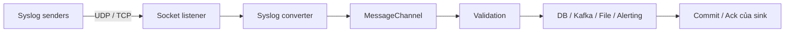
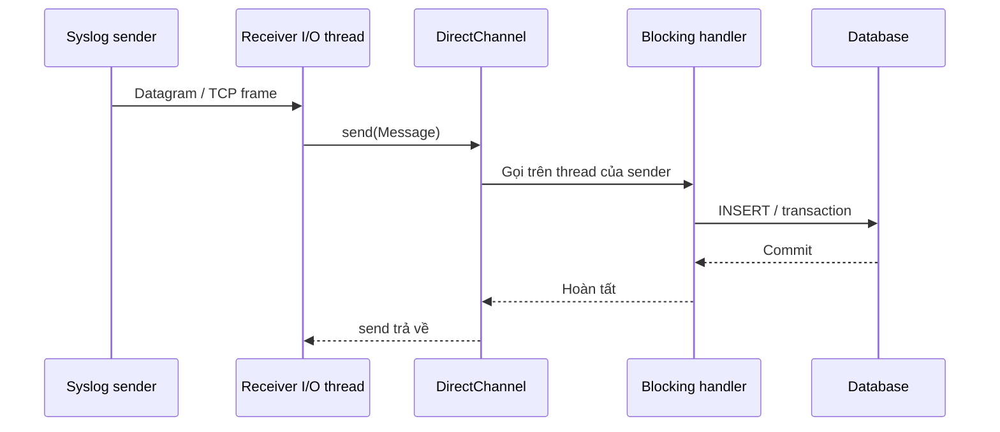
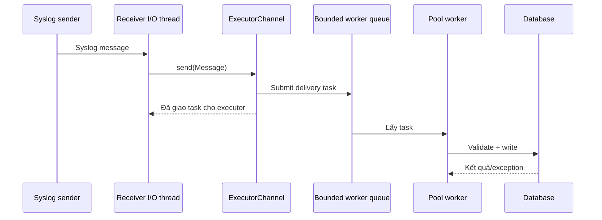
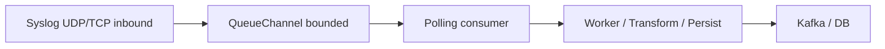
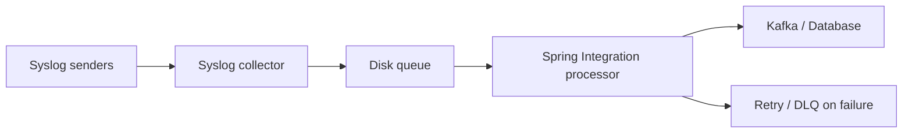

# Thread pool cho syslog receiver

## 1. Vì sao Syslog receiver cần quan tâm đến thread pool?

Trong chương **Adapter Syslog** của module **SPRING_INTEGRATION_ADAPTERS**, Syslog inbound channel adapter tiếp nhận log qua UDP/TCP, dùng converter tạo Spring Integration `Message<?>` rồi chuyển đến `MessageChannel`. Downstream có thể lọc/chuẩn hóa log, ghi database, chuyển file hoặc SFTP, gửi JMS/AMQP/Kafka hoặc gọi HTTP service. Tương tự các inbound/outbound adapter, gateway và poller khác, mỗi khâu phải có hợp đồng message, xử lý lỗi và vòng đời kết nối rõ ràng.

Một vấn đề rất thực tế: thiết bị gửi log hàng nghìn bản ghi mỗi giây, còn thao tác lưu database hoặc gọi HTTP API có thể mất nhiều mili giây, thậm chí vài giây. Nếu nhận socket và xử lý nghiệp vụ bị ràng buộc quá chặt, **worker chậm có thể làm chậm đường nhận hoặc khiến buffer đầy**, dẫn đến mất UDP datagram, tăng độ trễ hoặc gây áp lực lên các TCP connections.



**Thread pool** là tập worker threads dùng lại để xử lý các tác vụ; cấu hình đúng giúp giới hạn concurrency và phân tách xử lý nặng khỏi đường nhận log. Nhưng cần phân biệt:

- **I/O threads của socket listener**: nhận datagram, đọc stream TCP hoặc thực hiện framing/decoding theo cách Spring Integration IP adapter triển khai.
- **Executor threads của message flow**: chạy filter, router, transformer, service activator hoặc các thao tác blocking downstream sau khi message được dispatch.
- **Poller threads**: kéo message từ `QueueChannel` hoặc nguồn polling, khác với Syslog socket listener message-driven.
- **Threads của HTTP client/Kafka/DB pools**: tùy thư viện, có thể tạo các giới hạn/queue và thời gian chờ khác.

Đặt một `ExecutorChannel` sau Syslog adapter giúp **offload downstream processing**; nó **không tự động cấu hình lại task executor nội bộ của UDP/TCP adapter**, không tăng dung lượng kernel receive buffer và không tự tạo queue bền vững.

### Bạn sẽ học được gì?

1. Hiểu mối liên hệ giữa UDP/TCP listener, message channels, executor, queue và poller.
2. Chọn khi nào dùng `DirectChannel`, `ExecutorChannel` hoặc `QueueChannel`.
3. Cấu hình **`ThreadPoolTaskExecutor` có giới hạn** cho Syslog processing.
4. Tạo flow Syslog inbound → `ExecutorChannel` → worker service activator → error channel.
5. Tính toán ban đầu cho số worker, queue capacity và điểm quá tải.
6. Xử lý rejection, lỗi bất đồng bộ, shutdown, ordering và giao nhận log.
7. Kiểm thử concurrency, overload, TCP/UDP loss và downstream failure.

## 2. Cần tách “receiver thread” khỏi “worker thread”

### 2.1. Luồng đồng bộ mặc định với DirectChannel

Một Syslog inbound adapter có thể xuất message tới `DirectChannel`. Với kênh trực tiếp, subscriber thường chạy trên **chính thread gọi `send()`**:



Lợi ích: pipeline đơn giản, dễ truy lỗi đồng bộ, không tạo hàng đợi worker riêng. Đổi lại, nếu database chậm, handler giữ thread đang dispatch; tùy implementation và bố trí adapter, tình trạng này có thể làm chậm nhận dữ liệu mới.

**Lưu ý chính xác:** không phải mọi cấu hình Syslog receiver dùng duy nhất một thread socket hay mọi TCP connection dùng một thread. Mô hình phụ thuộc UDP/TCP, blocking/NIO và connection factory. Điều chắc chắn của `DirectChannel` là **handler đồng bộ trên thread gọi channel**, chứ không phải một khẳng định cố định về số I/O threads.

### 2.2. Luồng có ExecutorChannel



Cách này cho phép đường nhận dữ liệu **không phải đợi mỗi thao tác DB/HTTP hoàn tất** trong điều kiện executor còn khả năng nhận task. Tuy nhiên:

- `send()` thành công chỉ có nghĩa task được chấp nhận theo hợp đồng dispatch, **không phải đã ghi log bền vững**.
- Task có thể phải chờ trong queue trước khi worker chạy.
- Khi pool/queue đã đầy, executor có thể từ chối task hoặc áp dụng chính sách khác; áp lực sẽ quay về thread đang gửi message.
- Exception xảy ra trên worker thread không còn tự ném về call stack ban đầu của receiver như với `DirectChannel`.
- Concurrency có thể khiến thứ tự xử lý và hoàn tất **khác thứ tự nhận**.

### 2.3. Phân biệt DirectChannel, ExecutorChannel và QueueChannel

| Channel | Thread xử lý subscriber | Bộ đệm | Lỗi và áp lực tải |
|---|---|---|---|
| `DirectChannel` | Thường là caller thread | Không có task queue riêng trong channel | Subscriber block/throw trở về caller. |
| `ExecutorChannel` | Worker của `Executor`/`TaskExecutor` | Tùy executor: pool queue có thể bounded/unbounded | Exception ở worker thường theo error publishing; task có thể bị rejected khi quá tải. |
| `QueueChannel` | Consumer/poller thread | Queue message (có thể bounded) | Producer gửi vào queue, poller đọc sau; mặc định không phải durable queue. |
| `PublishSubscribeChannel` | Đồng bộ hoặc bất đồng bộ tùy executor | Phụ thuộc cấu hình | Broadcast tới nhiều subscriber; cần cân nhắc failure/retry và thứ tự. |

Một **bounded `ThreadPoolTaskExecutor` + `ExecutorChannel`** là giải pháp tốt để giới hạn xử lý đồng thời trong JVM, nhưng không thay thế durable broker, persistent message store hoặc disk queue của Syslog collector.

## 3. Đặc thù UDP và TCP khi worker chậm

### 3.1. UDP: packet loss xảy ra trước khi worker kịp xử lý

UDP dùng datagram và không có application acknowledgment:

```text
Sender -> Network -> OS UDP receive buffer
       -> Syslog adapter -> Executor queue -> Worker -> Storage
```

Các điểm có thể mất dữ liệu:

1. Datagram bị rơi trên đường truyền hoặc do firewall/route.
2. Kernel receive buffer đầy trước khi ứng dụng đọc.
3. Adapter/converter không nhận hoặc parse được dữ liệu.
4. Task dispatch bị từ chối khi executor queue/pool đầy.
5. Worker gặp lỗi, JVM dừng hoặc shutdown khi message đang ở queue trong bộ nhớ.
6. Destination chưa commit mặc dù message đã được nhận.

**Không có `ErrorMessage` cho packet đã bị kernel/network drop trước khi adapter nhận.** Vì vậy metrics `errorChannel` không thể đại diện cho tổng số Syslog records đã mất.

Một pool rất lớn có thể giúp giảm backlog ngắn hạn, nhưng nếu downstream chỉ ghi được 500 log/giây còn incoming 2.000 log/giây, tăng worker không bảo đảm loại bỏ bottleneck. Giải pháp cần đo đúng giới hạn DB/Kafka, batch, queue, rate limit và storage bền vững.

### 3.2. TCP: flow control nhưng không có acknowledgment nghiệp vụ

TCP bảo đảm thứ tự byte trên một kết nối còn sống, nhưng **không** bảo đảm bản ghi đã được chuyển vào `MessageChannel` hoặc commit tới sink.

Khi worker chậm, ứng dụng có thể tích backlog. TCP flow control có thể làm sender chậm lại nếu tầng nhận/buffer của receiver không tiếp tục rút dữ liệu; tuy nhiên, nếu adapter đọc nhanh rồi enqueue vào queue lớn, **áp lực có thể chỉ bị chuyển từ socket sang heap**, không được giải quyết.

Với TCP cần theo dõi:

- Số kết nối đồng thời, backlog chờ accept và số lần reconnect.
- Blocking/NIO mode, framing và deserializer.
- Độ lớn frame, thời gian read/idle và connection lifecycle.
- Queue/pool utilization của flow downstream.
- Mức độ giữ thứ tự theo từng source/connection khi dùng nhiều workers.

Với RFC 5424 qua TCP, cần framing kiểu RFC 6587; với Syslog-over-TLS RFC 5425, cần TLS và octet counting. **Thread pool không khắc phục lỗi framing hoặc TLS handshake**.

## 4. Lập kế hoạch tài nguyên trước khi viết cấu hình

### 4.1. Một mô hình throughput đơn giản

Giả sử:

- Incoming rate: `800 records/second`.
- Mỗi thao tác blocking downstream trung bình chiếm `20 ms = 0,02 second`.
- Chưa tính queueing, contention, network jitter và khoảng tăng đột biến.

Số tác vụ đồng thời lý thuyết để theo kịp tải trung bình xấp xỉ:

```text
Required concurrency ≈ arrival_rate × average_service_time

800 records/s × 0.02 s = 16 concurrently executing tasks
```

Đây chỉ là **ước lượng điểm xuất phát** theo logic Little's Law, không phải công thức tự động chọn số thread production. Nếu nhiều records được xử lý trong batch hoặc thao tác là CPU-bound, mô hình cần đổi. Với downstream I/O blocking, số workers có thể lớn hơn CPU cores nhưng phải giới hạn concurrency thực tế của HTTP/DB connection pools. Với CPU-bound parser, tăng worker quá số core thường không cải thiện throughput, thậm chí gây context switching.

### 4.2. Queue capacity và thời gian đầy

Một executor có `queueCapacity=600`, incoming `800/s` nhưng worker xử lý tối đa `500/s` thì backlog tăng khoảng:

```text
backlog_growth = 800 - 500 = 300 tasks/s
time_to_fill   ≈ 600 / 300 = 2 seconds
```

Tính toán bỏ qua tasks đang chạy, burst, GC và biến động latency, nhưng cho thấy **queue hữu hạn chỉ hấp thụ burst ngắn**, không chữa được mất cân bằng tải kéo dài.

Queue quá lớn cũng nguy hiểm:

- Tăng thời gian chờ và heap usage.
- Làm dữ liệu giám sát đến muộn.
- Khi JVM restart, queue trong bộ nhớ bị mất.
- Có thể che giấu downstream outage cho tới khi tài nguyên cạn.

Hãy lựa chọn queue capacity dựa trên **burst duration cho phép, độ trễ tối đa và giới hạn bộ nhớ**, không chỉ dùng một con số lớn tùy ý.

### 4.3. Một số nguyên tắc sizing

| Thành phần | Quy tắc bắt đầu | Tác hại nếu đặt sai |
|---|---|---|
| `corePoolSize` | Dựa trên concurrency cần cho tải ổn định | Quá thấp gây backlog; quá cao tốn threads. |
| `maxPoolSize` | Giới hạn tăng trưởng khi burst có kiểm soát | Quá lớn khiến DB/HTTP broker quá tải và tăng context switching. |
| `queueCapacity` | Giới hạn bộ đệm ngắn hạn | Quá nhỏ reject sớm; quá lớn tăng latency/memory risk. |
| Rejection policy | Quyết định khi pool/queue đầy | Im lặng bỏ message hoặc chặn receiver quá lâu đều nguy hiểm. |
| Downstream connection pool | Phù hợp số worker được phép block | Nhiều worker cùng chờ pool khiến tăng latency mà không tăng throughput. |
| HTTP/DB timeout | Giới hạn thời gian chờ | Handler kẹt vô hạn giữ hết worker slots. |
| Shutdown wait | Phù hợp deadline và xử lý bền vững | Chờ mãi hoặc dừng đột ngột làm mất việc trong queue. |

`ThreadPoolTaskExecutor` thường dựa trên `ThreadPoolExecutor`. Với queue có dung lượng dương, executor dùng core threads, sau đó ưu tiên **xếp queue** trước khi tăng thêm workers trên core (theo thuật toán thực thi tương ứng); `maxPoolSize` có thể chỉ phát huy khi queue đầy. Vì vậy đặt `core=4, max=32, queue=100.000` **không có nghĩa** sẽ tăng nhanh lên 32 workers khi tải bắt đầu tăng.

## 5. Ví dụ hoàn chỉnh: Syslog UDP → ExecutorChannel → worker

Ví dụ sử dụng:

- **Java 17+** và Spring Boot với Spring Integration Syslog/IP.
- Syslog **RFC 3164** nhận qua **UDP/1514**.
- Native Syslog inbound adapter trong XML; chuyển qua channel nội bộ.
- Java configuration tạo **`ThreadPoolTaskExecutor` bounded** và **`ExecutorChannel`**.
- `@ServiceActivator` xử lý payload trên workers.
- Error channel được đặt **trước ranh giới async** để báo lỗi downstream.

Đây là **ví dụ giáo dục về thread pool**, không tích hợp persistence/broker thật. Trong production, cần lưu bền vững trước khi coi bản ghi đã được tiếp nhận chắc chắn.

### 5.1. Dependencies

Với Spring Boot dependency management:

```xml
<dependencies>
    <dependency>
        <groupId>org.springframework.boot</groupId>
        <artifactId>spring-boot-starter-integration</artifactId>
    </dependency>
    <dependency>
        <groupId>org.springframework.integration</groupId>
        <artifactId>spring-integration-ip</artifactId>
    </dependency>
    <dependency>
        <groupId>org.springframework.integration</groupId>
        <artifactId>spring-integration-syslog</artifactId>
    </dependency>
</dependencies>
```

`spring-integration-ip` cung cấp UDP/TCP receiving endpoints. `spring-integration-syslog` cung cấp native Syslog inbound adapter và converter. Không cần HTTP server nếu ứng dụng chỉ nhận Syslog.

### 5.2. Native Syslog receiver và ingress channel

Tạo `src/main/resources/syslog-receiver.xml`:

```xml
<?xml version="1.0" encoding="UTF-8"?>
<beans xmlns="http://www.springframework.org/schema/beans"
       xmlns:xsi="http://www.w3.org/2001/XMLSchema-instance"
       xmlns:int="http://www.springframework.org/schema/integration"
       xmlns:int-syslog="http://www.springframework.org/schema/integration/syslog"
       xsi:schemaLocation="
         http://www.springframework.org/schema/beans
         https://www.springframework.org/schema/beans/spring-beans.xsd
         http://www.springframework.org/schema/integration
         https://www.springframework.org/schema/integration/spring-integration.xsd
         http://www.springframework.org/schema/integration/syslog
         https://www.springframework.org/schema/integration/syslog/spring-integration-syslog.xsd">

    <int:channel id="syslogIngress"/>

    <int-syslog:inbound-channel-adapter
        id="udpSyslogReceiver"
        channel="syslogIngress"
        auto-startup="true">
        <int-syslog:udp-attributes
            port="1514"
            local-address="127.0.0.1"
            lookup-host="false"/>
    </int-syslog:inbound-channel-adapter>
</beans>
```

Adapter bind UDP socket trên loopback `127.0.0.1:1514` của network namespace hiện tại. Sender từ host khác **không thể dùng IP ngoài để đến listener loopback này**. Trong Docker/Kubernetes muốn nhận từ bên ngoài, phải chọn bind address, firewall, Service và port publishing phù hợp. Đoạn XML chỉ tạo ingress channel; các bean Java ở phần sau sẽ nối channel này tới worker pool.

Không đưa `task-executor` trực tiếp lên Syslog namespace khi chưa kiểm tra tính hỗ trợ của phiên bản framework. Trong bài này, **điểm điều chỉnh concurrency là executor của `ExecutorChannel`**, một hợp đồng rõ ràng và có thể đo được.

### 5.3. Application nạp XML

```java
package example.syslog;

import org.springframework.boot.SpringApplication;
import org.springframework.boot.autoconfigure.SpringBootApplication;
import org.springframework.context.annotation.ImportResource;

@SpringBootApplication
@ImportResource("classpath:syslog-receiver.xml")
public class SyslogPoolApplication {

    public static void main(String[] args) {
        SpringApplication.run(SyslogPoolApplication.class, args);
    }
}
```

Đặt các Java classes tiếp theo trong package `example.syslog` hoặc package con để Spring Boot component scan có thể tìm thấy.

### 5.4. Cấu hình bounded ThreadPoolTaskExecutor

Tạo `SyslogExecutorConfiguration.java`:

```java
package example.syslog;

import java.util.concurrent.ThreadPoolExecutor;

import org.springframework.context.annotation.Bean;
import org.springframework.context.annotation.Configuration;
import org.springframework.integration.channel.DirectChannel;
import org.springframework.integration.channel.ExecutorChannel;
import org.springframework.messaging.MessageChannel;
import org.springframework.scheduling.concurrent.ThreadPoolTaskExecutor;

@Configuration
public class SyslogExecutorConfiguration {

    @Bean("syslogWorkerExecutor")
    public ThreadPoolTaskExecutor syslogWorkerExecutor() {
        ThreadPoolTaskExecutor executor =
            new ThreadPoolTaskExecutor();

        executor.setCorePoolSize(4);
        executor.setMaxPoolSize(8);
        executor.setQueueCapacity(200);
        executor.setThreadNamePrefix("syslog-worker-");

        // Không im lặng bỏ task khi hết khả năng nhận.
        executor.setRejectedExecutionHandler(
            new ThreadPoolExecutor.AbortPolicy());

        // Dành thời gian có giới hạn để các worker hoàn tất khi stop.
        executor.setWaitForTasksToCompleteOnShutdown(true);
        executor.setAwaitTerminationSeconds(20);

        // Bean được Spring quản lý và initialize theo lifecycle.
        return executor;
    }

    @Bean("syslogWorkers")
    public MessageChannel syslogWorkers(
            ThreadPoolTaskExecutor syslogWorkerExecutor) {
        return new ExecutorChannel(syslogWorkerExecutor);
    }

    @Bean("syslogWorkErrors")
    public MessageChannel syslogWorkErrors() {
        return new DirectChannel();
    }
}
```

Ý nghĩa:

- `corePoolSize=4`: số worker cơ sở.
- `maxPoolSize=8`: giới hạn tăng trưởng khi queue và core threads không đủ.
- `queueCapacity=200`: số task chờ tối đa trong hàng đợi của executor, **không phải số bản ghi đã persist**.
- `AbortPolicy`: khi hết chỗ, executor từ chối task bằng exception, thay vì âm thầm bỏ qua.
- `ThreadNamePrefix`: dễ phân biệt worker khi xem thread dump/log.
- `waitForTasks...` và `awaitTerminationSeconds`: có thời gian chờ khi shutdown, nhưng **không bảo đảm công việc dở dang được lưu bền vững** nếu process chết hoặc hết timeout.

**Quan trọng:** `AbortPolicy` chỉ khiến sự cố hiện ra, không tự tạo retry hay dead-letter queue. Nếu upstream là UDP, sender không nhận application ack để phát lại record. Production cần chiến lược overflow/fallback có storage và cơ chế giám sát riêng.

### 5.5. Java DSL nối ingress sang executor channel

Tạo `SyslogDispatchFlowConfiguration.java`:

```java
package example.syslog;

import org.springframework.context.annotation.Bean;
import org.springframework.context.annotation.Configuration;
import org.springframework.integration.annotation.EnableIntegration;
import org.springframework.integration.dsl.IntegrationFlow;
import org.springframework.messaging.MessageHeaders;

@Configuration
@EnableIntegration
public class SyslogDispatchFlowConfiguration {

    @Bean
    public IntegrationFlow syslogDispatchFlow() {
        return IntegrationFlow.from("syslogIngress")
            // Cho phép worker-side error publisher tìm được channel.
            .enrichHeaders(headers -> headers.header(
                MessageHeaders.ERROR_CHANNEL, "syslogWorkErrors"))
            .channel("syslogWorkers")
            .get();
    }
}
```

Chú ý:

1. `syslogIngress` là channel được XML khai báo. `IntegrationFlow.from("syslogIngress")` nối subscriber vào channel đó.
2. `enrichHeaders(...)` gắn **internal Spring Messaging header** `errorChannel`, không phải Syslog facility/header hay một HTTP header.
3. `channel("syslogWorkers")` chuyển message sang `ExecutorChannel`, submit task vào bounded `ThreadPoolTaskExecutor`.
4. Mọi handler đăng ký `@ServiceActivator(inputChannel="syslogWorkers")` chạy trên worker thread khi task thực sự được executor thực thi.
5. Error channel header giúp cơ chế xử lý lỗi bất đồng bộ **khi được Spring Integration publisher sử dụng** gửi `ErrorMessage` tới `syslogWorkErrors`. Điều này không có nghĩa mọi lỗi network, converter hay rejection đều được route qua đây.

**Ranh giới đáng lưu ý:** lỗi trước `ExecutorChannel` có thể xảy ra đồng bộ trên receiver thread và dùng đường xử lý khác. Rejection khi submit task có thể xảy ra ngay trên thread gọi `send()`, nên không được giả định error flow của worker luôn nhận được mọi sự cố.

### 5.6. Worker service activator

Tạo `SyslogProcessingService.java`:

```java
package example.syslog;

import java.util.Map;

import org.slf4j.Logger;
import org.slf4j.LoggerFactory;
import org.springframework.integration.annotation.ServiceActivator;
import org.springframework.integration.transformer.SyslogToMapTransformer;
import org.springframework.messaging.Message;
import org.springframework.stereotype.Service;

@Service
public class SyslogProcessingService {

    private static final Logger log =
        LoggerFactory.getLogger(SyslogProcessingService.class);

    @ServiceActivator(inputChannel = "syslogWorkers")
    public void handle(Message<?> message) {
        Object payload = message.getPayload();

        if (!(payload instanceof Map<?, ?> fields)) {
            throw new IllegalArgumentException(
                "Expected parsed RFC3164 Syslog Map");
        }

        if (fields.containsKey(SyslogToMapTransformer.UNDECODED)) {
            // Trong production: gửi raw message tới quarantine store
            // theo retention và quyền truy cập được kiểm soát.
            throw new IllegalArgumentException(
                "Undecoded Syslog record");
        }

        Object facility =
            fields.get(SyslogToMapTransformer.FACILITY);
        Object severity =
            fields.get(SyslogToMapTransformer.SEVERITY);

        if (!(facility instanceof Number)
                || !(severity instanceof Number)) {
            throw new IllegalArgumentException(
                "Missing facility/severity");
        }

        int facilityCode = ((Number) facility).intValue();
        int severityCode = ((Number) severity).intValue();

        if (facilityCode < 0 || facilityCode > 23
                || severityCode < 0 || severityCode > 7) {
            throw new IllegalArgumentException(
                "Invalid facility/severity");
        }

        // Worker thread: ví dụ bước normalize và xử lý.
        log.info("Processed syslog: thread={}, facility={}, severity={}",
            Thread.currentThread().getName(),
            facilityCode, severityCode);

        // Production: có thể batch/persist/publish sang DB hoặc
        // Kafka/JMS/AMQP. Chỉ coi thành công sau commit/ack thật.
        // Không dùng Thread.sleep(...) để mô phỏng xử lý production.
    }
}
```

Ví dụ này cố ý không ghi nội dung MSG thô vào log vì Syslog có thể mang token, IP, username hoặc dữ liệu nhạy cảm. Worker cần kiểm soát khả năng chạy đồng thời đối với shared state; nếu muốn gọi một `EntityManager`/transaction hoặc JDBC connection, hãy tuân theo thread-safety và transaction scope của công nghệ được dùng.

**Không đánh đồng `@ServiceActivator` với HTTP endpoint.** Nó tiêu thụ message nội bộ; không tự trả HTTP status cho một Syslog sender UDP/TCP.

### 5.7. Lỗi worker trên thread bất đồng bộ

Tạo `SyslogWorkerErrorHandler.java`:

```java
package example.syslog;

import org.slf4j.Logger;
import org.slf4j.LoggerFactory;
import org.springframework.integration.annotation.ServiceActivator;
import org.springframework.messaging.Message;
import org.springframework.messaging.MessagingException;
import org.springframework.messaging.support.ErrorMessage;
import org.springframework.stereotype.Service;

@Service
public class SyslogWorkerErrorHandler {

    private static final Logger log =
        LoggerFactory.getLogger(SyslogWorkerErrorHandler.class);

    @ServiceActivator(inputChannel = "syslogWorkErrors")
    public void handle(ErrorMessage error) {
        Throwable failure = error.getPayload();
        Message<?> failed = error.getOriginalMessage();

        if (failed == null && failure instanceof MessagingException ex) {
            failed = ex.getFailedMessage();
        }

        String type = failure.getClass().getSimpleName();
        Object correlationId = failed == null
            ? "unavailable"
            : failed.getHeaders()
                .getOrDefault("correlationId", "unavailable");

        // Chỉ log metadata an toàn, không in exception.toString()
        // hoặc raw payload/headers chứa secret.
        log.error("Syslog worker failed: type={}, correlationId={}",
            type, correlationId);

        // Production: ghi lỗi + message gốc (sau redaction)
        // vào storage/DLQ bền vững, hoặc chuyển sang recovery flow.
    }
}
```

`ErrorMessage` có `Throwable` làm payload; nó khác với **một message nghiệp vụ mang trường error**. Trên đường xử lý `ExecutorChannel`, Spring Integration có cơ chế error publishing cho exception từ worker; message header `errorChannel` hoặc global error channel có thể được dùng tùy thành phần và cách cấu hình.

Nhưng error handler trên **mới chỉ ghi log**; nó **không cứu được bản ghi sau khi JVM chết**, và một original message cũng không được bảo đảm có mặt trong mọi loại exception. Với dữ liệu Syslog quan trọng, phải sử dụng persistent failure sink và monitor cả trường hợp error handler/DLQ writer bị lỗi.

### 5.8. Kỳ vọng ở log thread name

Nếu nhận một record hợp lệ khi pool hoạt động, log minh họa có dạng:

```text
Processed syslog: thread=syslog-worker-1, facility=16, severity=6
```

Sự xuất hiện của prefix `syslog-worker-` là bằng chứng handler đã chạy trên executor pool được cấu hình. Tuy nhiên:

- Không đảm bảo chỉ có một worker.
- Không đảm bảo output xuất hiện theo đúng thứ tự nhận nếu có nhiều workers.
- Không đảm bảo message đã được persist.
- Không chứng minh UDP không mất gói, vì các gói bị mất sẽ không tạo log.

## 6. Tại sao pool, queue và rejection policy phải thiết kế cùng nhau?

### 6.1. Hành vi khi pool quá tải

Giả sử executor đang có:

- `corePoolSize = 4`.
- `maxPoolSize = 8`.
- `queueCapacity = 200`.
- Worker đang block do database quá chậm.

Diễn tiến điển hình:

```text
4 core workers busy
    -> các task mới xếp vào queue (tối đa 200)
    -> khi queue đầy: executor tạo thêm worker (tối đa 8)
    -> pool/queue cùng đầy: reject task mới
```

Thứ tự cụ thể phụ thuộc executor implementation và các cấu hình cho phép thay đổi khi chạy, nhưng đây là mô hình thường gặp của `ThreadPoolExecutor` với bounded queue. Vì vậy, **maxPoolSize không có tác dụng ngay khi core threads đang bận nhưng queue vẫn còn chỗ**.

Khi overload:

- `ExecutorChannel.send(...)` có thể gặp task rejection. Nó không tự động chuyển dữ liệu thành durable queue.
- Nếu logic retry gửi lại ngay mà không có limit, hệ thống có thể tạo retry storm.
- Với UDP, sender thường không biết record đã bị rejection tại application.
- Với TCP, tác động còn tùy upstream socket/connection factory và cách exception propagation.

### 6.2. Các rejection policies thông dụng

| Policy | Hành vi khi đầy | Rủi ro với Syslog |
|---|---|---|
| **AbortPolicy** | Từ chối task bằng exception | Không mất âm thầm ở điểm submit, nhưng phải có đường lưu lỗi/báo động; UDP sender thường không tự retry. |
| **CallerRunsPolicy** | Cho caller thread chạy task, nếu executor chưa shutdown | Có thể kéo blocking handler quay về receiver thread, làm tăng UDP drop hoặc TCP latency. |
| **DiscardPolicy** | Bỏ task mà không báo | **Không nên dùng** nếu bản ghi quan trọng; mất dữ liệu âm thầm. |
| **DiscardOldestPolicy** | Bỏ task cũ trong queue và retry enqueue | Có thể mất/đổi thứ tự record; đặc biệt nguy hiểm cho audit. |

**Không chọn `CallerRunsPolicy` chỉ vì nghe giống backpressure:** với UDP, chạy handler nặng trên receiver thread có thể khiến kernel receive buffer tràn và gây packet loss trước khi adapter quan sát. Với TCP, đó có thể là một cơ chế làm chậm nguồn nhưng vẫn cần giới hạn kết nối, timeout và hợp đồng lỗi.

### 6.3. Rejection khác worker exception

| Loại lỗi | Xảy ra khi | Khả năng quan sát |
|---|---|---|
| **Task rejection** | Executor không nhận thêm việc | Thường trên thread submit; cần catch/monitor tại điểm dispatch/adapter. |
| **Worker exception** | Task đã chạy, handler ném exception | Error publishing của `ExecutorChannel` và header/global `errorChannel` theo cấu hình. |
| **UDP drop** | Datagrams bị mất trước receiver | OS/kernel/network counters, không có Spring Integration message. |
| **TCP framing error** | Stream bị tách message sai, frame incomplete | Deserializer/connection event/log, không phải pool size. |
| **Downstream timeout** | Worker block ở HTTP/DB/Kafka | Timeout của client/driver, metrics slow-call và queue backlog. |
| **JVM crash** | Process dừng khi queue chưa bền vững | Chỉ có thể khôi phục khi có disk queue/persistent store. |

Hãy theo dõi **cả rejection count và worker failure count**. Một error channel chỉ có subscriber ghi log không thay thế cơ chế nhận lại dữ liệu nguồn khi overload.

## 7. QueueChannel + poller: kiến trúc thay thế

Khi muốn tách receiver và worker bằng **queue message** thay vì queue task của executor, có thể dùng `QueueChannel` rồi cho poller chủ động tiêu thụ:



Khác biệt quan trọng:

- Với **`ExecutorChannel`**, submit task chạy subscriber trực tiếp trên executor khi được lập lịch; queue nội bộ chứa *tasks*.
- Với **`QueueChannel`**, queue chứa *Spring Integration messages*; poller quyết định tần suất và mức kéo.
- Poller có thể dùng `TaskExecutor` để chạy các tác vụ song song khi được hỗ trợ/cấu hình đúng, nhưng **cấu hình poller executor không phải cấu hình I/O executor của Syslog receiver**.
- `QueueChannel` mặc định dùng queue trong bộ nhớ; muốn durable phải dùng persistent message store hoặc chuyển qua broker/collector hỗ trợ persistence.

Một cấu hình khái niệm:

```text
UDP Syslog receiver
  -> QueueChannel(capacity = 500)
  -> PollingConsumer(maxMessagesPerPoll / poll interval)
  -> Service activator
  -> durable sink
```

Nếu queue đầy, sender vào `QueueChannel` có thể block hoặc thất bại theo `sendTimeout`; với UDP điều đó có thể gây mất datagram ở tầng socket. Không nên hiểu một bounded memory queue như bảo đảm “không mất log”.

### 7.1. Khi nào chọn ExecutorChannel, khi nào chọn QueueChannel?

| Nhu cầu | Hướng phù hợp |
|---|---|
| Muốn offload handler đơn giản khỏi thread dispatch | `ExecutorChannel` + bounded `ThreadPoolTaskExecutor`. |
| Muốn pull theo batch/tần suất được kiểm soát | `QueueChannel` + poller. |
| Muốn tách receiver và downstream giữa nhiều JVM | Broker/collector bền vững, không chỉ in-memory channel. |
| Muốn retry và dead-letter có thể replay sau restart | Persistent queue, database outbox hoặc message broker có DLQ. |
| Muốn đảm bảo thứ tự theo source | Partitioned processing/consistent routing theo trusted source, không chỉ dùng pool lớn. |

## 8. TCP listener có thread pool riêng không?

**Có những tài nguyên thread ở tầng Spring Integration IP**, nhưng vị trí cấu hình không giống worker pool trong `ExecutorChannel`.

Với TCP native Syslog:

```xml
<int-ip:tcp-connection-factory
    id="tcpSyslogServerFactory"
    type="server"
    using-nio="true"
    port="1516"
    deserializer="rfc6587Deserializer"/>

<int-syslog:inbound-channel-adapter
    id="tcpSyslogReceiver"
    protocol="tcp"
    connection-factory="tcpSyslogServerFactory"
    converter="rfc5424Converter"
    channel="syslogIngress"/>
```

Fragment trên cần các bean converter/deserializer, namespace `int-ip` và schema tương ứng:

```xml
<bean id="rfc5424Converter"
      class="org.springframework.integration.syslog.RFC5424MessageConverter"/>

<bean id="rfc6587Deserializer"
      class="org.springframework.integration.syslog.inbound.RFC6587SyslogDeserializer"/>
```

`using-nio="true"` cho phép dùng NIO cho kết nối TCP theo khả năng Spring Integration IP. Nhưng **không có nghĩa** socket handling và downstream handler đều tự động chuyển sang cùng `syslogWorkerExecutor`. Để cấu hình task executor ở tầng IP adapter/connection factory, phải xem chính xác API/XML attributes của **phiên bản Spring Integration đang dùng**; tránh bịa `task-executor` trên bất kỳ element nào chỉ vì tên có vẻ hợp lý.

Phân biệt:

| Tài nguyên | Thuộc lớp nào? | Dùng để |
|---|---|---|
| TCP server connection factory | Spring Integration IP | Bind/accept connections, framing/serialize, quản lý socket lifecycle. |
| Transport task executors | Spring Integration IP implementation | Chạy I/O tasks theo blocking/NIO design của phiên bản. |
| `ExecutorChannel` + `ThreadPoolTaskExecutor` | Spring Integration messaging flow | Chạy message subscribers/handlers downstream. |
| Kafka/HTTP/DB connection pools | Client libraries | Quản lý số request/connections đến sink. |

### 8.1. Thread safety và thứ tự với nhiều TCP connections

Nếu nhiều TCP connections cùng đẩy dữ liệu vào một `ExecutorChannel` có nhiều workers, thứ tự completion có thể khác thứ tự ban đầu. Ngay trong **một** connection, nếu nhận hai messages A rồi B nhưng dispatch sang nhiều workers, B có thể hoàn thành trước A.

Ví dụ:

```text
Connection X:  A -> B -> C
Executor:      W1(A)  W2(B)  W3(C)
Complete:      B -> C -> A  (có thể xảy ra)
```

Nếu nghiệp vụ cần bảo toàn thứ tự theo thiết bị:

1. Xác định **trusted source ID** (mTLS/collector/inventory, không tin mỗi `HOSTNAME` do sender khai báo).
2. Route về partition cố định theo source.
3. Dùng một consumer tuần tự cho mỗi partition/key hoặc một hệ thống bảo toàn thứ tự theo key.
4. Tránh một message được xử lý lại bởi hai workers không có dedup/idempotency.
5. Dùng Kafka partition key hoặc phân vùng queue khi chuyển tiếp nếu cần ordering cục bộ.

Thứ tự toàn cục giữa tất cả thiết bị **không được Syslog/TCP hoặc thread pool bảo đảm**.

## 9. Lỗi bất đồng bộ, giao nhận và dữ liệu bền vững

Một Syslog record có thể đi qua nhiều mốc:

```text
Socket receives bytes
  -> Syslog converter produces Message
  -> Executor accepts task
  -> Worker starts
  -> Business validation succeeds
  -> Database/Kafka/File adapter writes
  -> Durable commit/ack is confirmed
```

Các mốc này **không tương đương**. Nếu JVM dừng sau khi executor đã chấp nhận task nhưng trước khi Kafka commit, nguồn UDP không có cách tự biết phải gửi lại bản ghi.

### 9.1. ErrorMessage và errorChannel

Trong Spring Integration:

- `ErrorMessage` có payload là `Throwable`.
- `MessageHeaders.ERROR_CHANNEL` có thể chỉ định đích publish lỗi khi thành phần phát `ErrorMessage` sử dụng header.
- `MessagingException` có thể chứa `failedMessage` nhưng không phải lúc nào cũng có.
- `ExecutorChannel` có đường xử lý exception bất đồng bộ khác với `DirectChannel`.
- Global `errorChannel` không phải automatically durable DLQ.

**Không tự động gửi mọi malformed Syslog record vào error channel**: parser RFC 3164 có thể tạo map chứa `SyslogToMapTransformer.UNDECODED` thay vì ném exception. Cần nhánh validate/quarantine chủ động.

### 9.2. Recovery cần durable sink

Nếu không thể mất log quan trọng, các lựa chọn tốt hơn memory executor queue là:

- Syslog collector (rsyslog/syslog-ng hoặc sản phẩm tương đương) có **disk queue**, giới hạn dung lượng, retry và replay.
- Kafka/JMS/AMQP broker có cơ chế acknowledge/retention/retry và DLQ.
- Database inbox/outbox với transaction, unique key và job retry.
- Persistent `MessageStore`/queue khi phù hợp với yêu cầu Spring Integration.

Một thiết kế thực dụng:



Ngay cả với disk queue, cần hiểu chính xác lúc collector coi record đã được nhận, lúc ack/commit xảy ra và khả năng duplicate khi replay. Không gọi chung chung “exactly once” nếu chưa chứng minh được toàn bộ protocol boundary.

### 9.3. Transaction context khi vượt qua async boundary

`ExecutorChannel` chuyển xử lý sang thread khác; transaction context gắn với caller thread **không tự động được truyền sang worker**. Nếu muốn transaction cho database write, đặt transaction boundary tại worker hoặc cấu hình theo công nghệ dùng thực tế.

Tránh tình huống:

```text
Caller transaction starts
  -> ExecutorChannel accepts async task
  -> Caller transaction commits
  -> Worker starts (outside original transaction)
  -> Database write fails
```

Một mô hình async phù hợp có thể là: incoming Syslog được lưu vào inbox/durable queue có transaction/ack rõ ràng, rồi worker bắt đầu transaction của chính nó để normalize và publish. Việc dùng thread pool không tạo distributed transaction giữa UDP, database và Kafka.

## 10. Shutdown, restart và thay đổi cấu hình thread pool

### 10.1. Shutdown có kiểm soát

`ThreadPoolTaskExecutor` hỗ trợ một số thiết lập shutdown/await termination, nhưng cần hiểu:

1. Đầu tiên phải **ngừng nhận việc mới** hoặc điều phối traffic ra khỏi instance; nếu receiver vẫn nhận log và executor đang dừng, có thể xuất hiện task rejection.
2. Chờ worker hoàn tất trong một khoảng thời gian hữu hạn.
3. Nếu tồn tại message chưa hoàn tất trong queue memory, cần có chiến lược replay/durable persistence; không có cơ chế thần kỳ chuyển task queue thành disk.
4. Đóng TCP connections, giải phóng UDP socket, HTTP clients, Kafka producers và DB resources phù hợp.
5. Log/alert khi số in-flight tasks không về 0 trước deadline shutdown.

Khi ứng dụng bị `SIGKILL`, mất điện hoặc JVM crash, shutdown hook không được bảo đảm chạy. **Không dựa vào `waitForTasksToCompleteOnShutdown(true)` để bảo đảm không mất log**.

### 10.2. Thay đổi cấu hình khi tải biến động

Một số thuộc tính `ThreadPoolTaskExecutor` có thể quan sát/điều chỉnh trong runtime tùy framework và quản trị, nhưng điều đó không thay thế:

- Stress test với burst rate và downstream outage.
- Tính toán queue memory và latency.
- Limit DB/Kafka/HTTP connections đồng bộ.
- Đo số rejected tasks và UDP drops.
- Định nghĩa ngưỡng cảnh báo trước khi SLA bị phá vỡ.

Không tăng số worker theo cách tự động vô hạn khi downstream chậm, vì có thể làm dependency càng quá tải và tăng áp lực connection pool.

## 11. Kiểm thử thread pool và độ tin cậy

### 11.1. Gửi Syslog RFC 3164 qua UDP

Một sender Java đơn giản:

```java
package example.syslog;

import java.net.DatagramPacket;
import java.net.DatagramSocket;
import java.net.InetAddress;
import java.nio.charset.StandardCharsets;

public final class SyslogUdpSender {

    public static void main(String[] args) throws Exception {
        try (DatagramSocket socket = new DatagramSocket()) {
            for (int i = 0; i < 10; i++) {
                String record =
                    "<134>Nov 23 09:15:10 app-host demo[42]: "
                    + "Syslog worker pool test " + i;

                byte[] bytes =
                    record.getBytes(StandardCharsets.UTF_8);

                DatagramPacket packet = new DatagramPacket(
                    bytes, bytes.length,
                    InetAddress.getByName("127.0.0.1"),
                    1514);
                socket.send(packet);
            }
        }
    }
}
```

Kiểm tra ứng dụng đã start UDP/1514 trên cùng network namespace trước khi gửi. Nếu sender ở container khác, `127.0.0.1` sẽ trỏ về container của sender.

Để xác minh concurrency có kiểm soát, có thể ghi lại tên worker thread và đếm số message **đã thực sự xử lý**. Đừng coi `DatagramSocket.send()` thành công là bằng chứng 10/10 messages được ingest; UDP không có application ack.

### 11.2. Test matrix

| Tình huống | Điều cần kiểm tra |
|---|---|
| Một bản ghi hợp lệ | Handler chạy trên `syslog-worker-*`, không trên receiver dispatch thread. |
| 10 bản ghi tải nhẹ | Worker xử lý các message đã nhận, không ném exception. |
| Handler chậm ngắn hạn | Queue tăng có giới hạn rồi giảm về 0 khi downstream phục hồi. |
| Burst vượt pool/queue | Rejection được đếm/cảnh báo; không silently discard. |
| Downstream DB timeout | Worker không block vô hạn; exception tới đúng error flow khi applicable. |
| RFC 3164 malformed | `UNDECODED`/validation path được xử lý; không coi là bản ghi bình thường. |
| ThreadPoolTaskExecutor shutdown | Không chấp nhận task mới sau stop; vận hành có lộ trình drain/replay. |
| JVM restart khi queue còn task | Nếu chỉ dùng memory queue, có thể mất; test để xác nhận rủi ro. |
| UDP kernel buffer quá tải | Quan sát packet drops ngoài Spring error channel. |
| TCP gửi nhiều frames một connection | Framing đúng; test thêm ordering khi xử lý song song. |
| Các message từ cùng source cần thứ tự | Không dùng pool chung đa luồng nếu chưa có partitioning/affinity. |
| Pool 8 workers nhưng DB chỉ có 2 connections | Giám sát connection waits và latency; không kỳ vọng throughput tăng tỷ lệ thuận. |
| Handler ném exception và error handler cũng lỗi | Có alert/đường fallback; tránh lặp lỗi vô hạn. |
| Dữ liệu chứa token/PII/control chars | Không log raw payload, có redaction và log injection safeguards. |

### 11.3. Test executor rejection theo cách có thể lặp lại

Khi cần kiểm tra bounded executor, hãy dùng unit test riêng cho pool với `CountDownLatch` thay vì tạo tải UDP thiếu kiểm soát. Ý tưởng:

1. Tạo executor với `core=1, max=1, queueCapacity=1`.
2. Dùng latch giữ task đầu đang chạy.
3. Submit task thứ hai để chiếm queue.
4. Submit task thứ ba, xác minh executor **từ chối** theo `AbortPolicy`.
5. Release latch và shutdown executor, không để test treo.
6. Test integration riêng để xác minh đường rejection ở `ExecutorChannel` không làm mất lỗi âm thầm.

Test này kiểm tra **executor capacity**, không kiểm chứng Syslog UDP transport hoặc Kafka commit. Cần tách các lớp test để xác định rõ nơi gây lỗi.

### 11.4. Khi throughput không tăng sau khi tăng pool

```text
UDP/TCP receiver
 -> Syslog parser
 -> MessageChannel dispatch
 -> executor queue / active workers
 -> DB/HTTP/Kafka connection pool
 -> remote server / disk write / broker ack
```

Kiểm tra theo thứ tự:

- Nếu **socket nhận ít hơn sender gửi**: network, bind address, UDP buffer, firewall, CPU receive path.
- Nếu **executor queue tăng, workers đều bận**: handler latency hoặc dependency chậm.
- Nếu **workers bận nhưng connection pool exhausted**: tăng workers có thể làm tệ hơn; giới hạn calls/cấu hình pool.
- Nếu **CPU 100% và context switches cao**: parse/transform CPU-bound, giảm số worker hoặc tối ưu batch/format.
- Nếu **Kafka/DB commit chậm**: cần tối ưu sink/partition/batch hoặc durable buffer, không chỉ tăng thread pool.
- Nếu **rejection tăng**: tải vượt giới hạn; cần load shedding có báo động và recovery rõ ràng.

## 12. Monitoring và runbook

Các metric/log nên quan sát:

| Metric | Mục tiêu |
|---|---|
| Executor active thread count | Biết có bao nhiêu workers đang chạy. |
| Executor pool size / max pool size | Kiểm tra mức sử dụng năng lực xử lý. |
| Executor queue size / remaining capacity | Phát hiện backlog, ước lượng time-to-fill. |
| Task rejection count | Không bỏ sót áp lực tải khi pool bão hòa. |
| Processing latency / queue wait time | Phân biệt chậm do chờ worker hay do handler. |
| Syslog received/parsed/undecoded counts | Đo ingestion và chất lượng bản ghi. |
| UDP kernel drops / TCP reconnects | Phát hiện lỗi ngoài Spring message/error channels. |
| Worker exception + error channel delivery | Biết những task nào thất bại. |
| DB/Kafka/HTTP connection pool saturation | Tìm bottleneck downstream. |
| Persistent queue / DLQ backlog | Khả năng recovery khi xảy ra sự cố. |

Một runbook xử lý outage:

1. Xác nhận listener UDP/TCP vẫn bind đúng IP/cổng và ứng dụng đã start.
2. Kiểm tra incoming rate, dropped datagrams, TCP connection events.
3. Kiểm tra active worker count, queue backlog và rejection rate.
4. Xác định loại lỗi từ worker; phân biệt malformed input với downstream outage.
5. Nếu downstream mất kết nối, bật chính sách giảm tải/circuit breaker hoặc chuyển vào durable collector/queue đã thiết kế.
6. Tránh tăng queue vô hạn hoặc retry ngay lập tức với số lượng lớn.
7. Sau khi phục hồi, replay bản ghi đã lưu từ durable queue/DLQ, áp dụng dedup/idempotency và giám sát backlog drain.
8. Sau incident, đánh giá loss window và cập nhật capacity/burst budget.

**Bảo mật:** Syslog record có thể chứa dữ liệu nhạy cảm. Đừng đưa raw message text, token, password, arbitrary hostname hay user ID vào metric labels hoặc logs của error handler. Sử dụng trusted source ID và trace/event ID có kiểm soát.

## 13. Những điều dễ hiểu nhầm

| Nhận định sai | Cách hiểu đúng |
|---|---|
| “Thêm ExecutorChannel là tăng thread nhận socket.” | ExecutorChannel offload **handler downstream**; I/O threads do adapter/connection factory quản lý riêng. |
| “Có 8 workers thì luôn xử lý 8 messages đồng thời.” | Concurrency phụ thuộc core size, queue, scheduling, bottleneck và lượng message đến. |
| “queueCapacity=200 là lưu được 200 bản ghi sau restart.” | Đó là queue task **trong bộ nhớ**, không phải disk/persistent queue. |
| “Gửi thành công vào ExecutorChannel nghĩa là Kafka đã lưu.” | Send chỉ thể hiện acceptance/dispatch, chưa có commit ở sink. |
| “AbortPolicy tự retry message.” | Nó báo rejection; replay là trách nhiệm cơ chế khác. |
| “CallerRunsPolicy luôn an toàn hơn.” | Có thể block receiver và làm mất UDP datagram. |
| “errorChannel bắt mọi packet bị mất.” | Packet drop trước adapter không tạo Spring Integration ErrorMessage. |
| “TCP bảo đảm từng Syslog record đã commit.” | TCP bảo đảm byte stream trên kết nối, không có application-level durable ack. |
| “Pool càng lớn càng nhanh.” | Khi CPU/DB/Kafka/HTTP là bottleneck, thêm workers có thể giảm throughput. |
| “Giữ nguyên thứ tự log với ExecutorChannel.” | Async workers có thể hoàn tất khác thứ tự; cần partitioning theo source nếu ordering là bắt buộc. |

## 14. Tổng kết

**Thread pool cho Syslog receiver** là bài toán phân tách nhận dữ liệu mạng khỏi xử lý nghiệp vụ và giới hạn số tác vụ đồng thời. Với Spring Integration Syslog:

- **UDP/TCP inbound adapter** nhận bản ghi và dùng converter tạo message.
- **`DirectChannel`** xử lý subscriber đồng bộ; handler chậm có thể kéo dài đường dispatch.
- **`ExecutorChannel` + bounded `ThreadPoolTaskExecutor`** offload downstream handlers, giới hạn pool/queue và buộc phải có overload/rejection policy.
- **`QueueChannel` + poller** là lựa chọn khác khi cần buffer message và chủ động kéo, nhưng mặc định không bền vững.
- **I/O executor của TCP/UDP connection factory khác executor của message flow**; phải cấu hình đúng lớp theo phiên bản, không đoán XML attributes.
- **Error channel, metrics và durable sink** mới là những phần bổ sung cần thiết để phát hiện và xử lý thất bại; executor không tự giải quyết packet loss, ordering, transaction hay exactly-once.
- Khi chuyển tiếp sang database, Kafka/JMS/AMQP, HTTP, file hoặc SFTP, cần kiểm tra commit/ack, giới hạn kết nối, timeout, idempotency và vòng đời shutdown.

**Công thức thực hành:** chọn worker pool vừa đủ cho bottleneck đã đo, queue hữu hạn theo burst budget, rejection hiện rõ, monitoring đầy đủ và storage bền vững trước khi đưa log quan trọng sang processing bất đồng bộ.

### Tài liệu tham khảo chính thức

- [Spring Integration — Syslog Support](https://docs.spring.io/spring-integration/reference/syslog.html)
- [Spring Integration — Message Channels](https://docs.spring.io/spring-integration/reference/channel.html)
- [Spring Integration — ExecutorChannel](https://docs.spring.io/spring-integration/reference/channel/implementations.html)
- [Spring Integration — Error Handling](https://docs.spring.io/spring-integration/reference/error-handling.html)
- [Spring Integration — Polling Consumer](https://docs.spring.io/spring-integration/reference/endpoint.html)
- [Spring Integration — TCP Connection Factories](https://docs.spring.io/spring-integration/reference/ip/tcp-connection-factories.html)
- [Spring Framework — Task Execution and Scheduling](https://docs.spring.io/spring-framework/reference/integration/scheduling.html)
- [Spring Framework API — ThreadPoolTaskExecutor](https://docs.spring.io/spring-framework/docs/current/javadoc-api/org/springframework/scheduling/concurrent/ThreadPoolTaskExecutor.html)
- [IETF RFC 3164 — BSD Syslog](https://www.rfc-editor.org/rfc/rfc3164)
- [IETF RFC 5424 — Syslog Protocol](https://www.rfc-editor.org/rfc/rfc5424)
- [IETF RFC 6587 — Syslog over TCP](https://www.rfc-editor.org/rfc/rfc6587)
