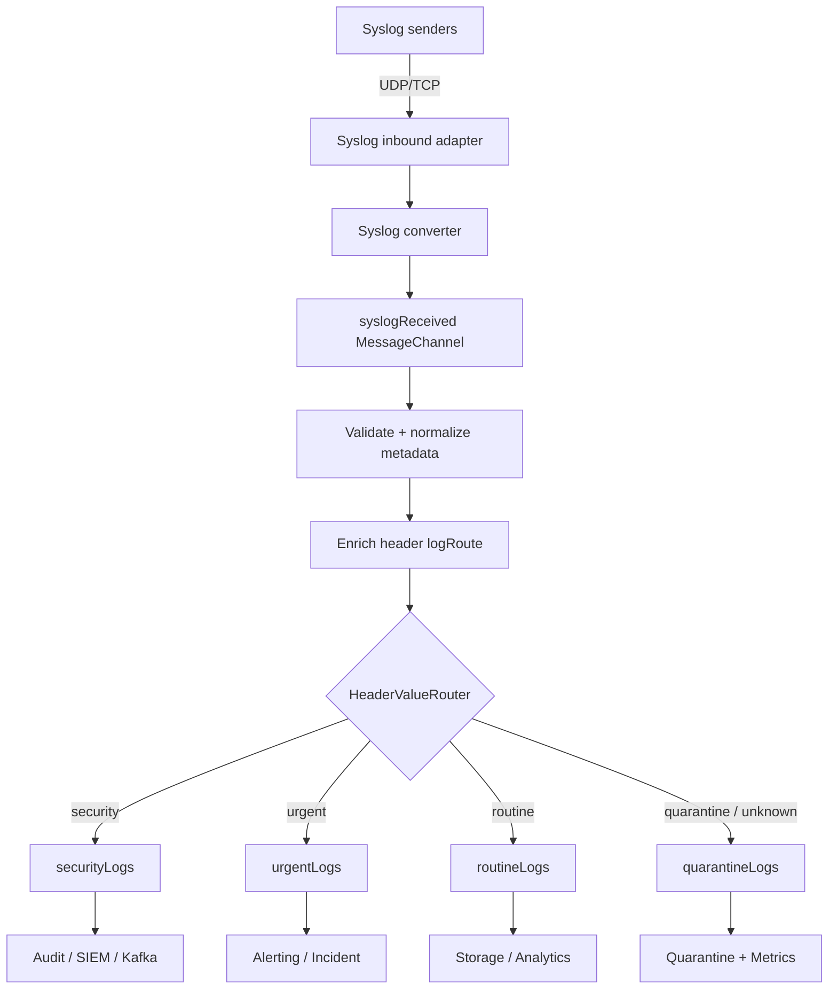
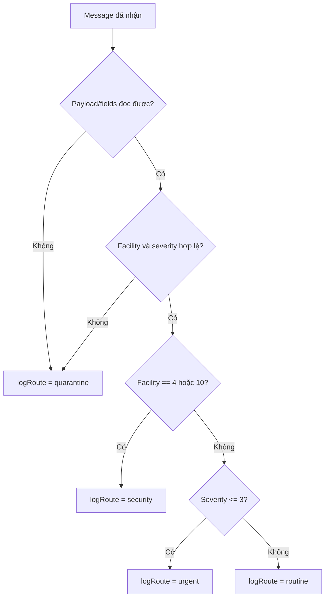

# Định tuyến log theo header

## 1. Bài toán: cùng một luồng Syslog, nhiều đích xử lý

Trong module **SPRING_INTEGRATION_ADAPTERS**, Spring Integration kết nối các hệ thống bên ngoài bằng inbound/outbound adapter, gateway, poller và `MessageChannel`. Chương **Adapter Syslog** tập trung vào việc nhận bản ghi nhật ký hệ thống qua UDP/TCP, chuyển thành Spring Integration message, rồi xử lý hoặc phân phối sang file, SFTP, HTTP, JMS, AMQP, Kafka hay database.

Giả sử một ứng dụng nhận Syslog từ máy chủ, router và firewall. Các bản ghi **không nên luôn đi chung một đích**:

- Sự kiện liên quan đến đăng nhập/xác thực cần đi tới **security audit sink**.
- Bản ghi có severity `0..3` có thể được đưa vào **kênh xử lý khẩn cấp**.
- Sự kiện vận hành thường lệ có thể đưa vào **Kafka topic hoặc storage** tối ưu cho truy vấn.
- Dữ liệu không giải mã được hoặc thiếu metadata cần đi tới **quarantine**, không âm thầm bỏ.

Một cách xây dựng flow là **định tuyến theo message header**: trích xuất các trường Syslog, kiểm tra chúng, tạo header điều khiển nội bộ ổn định rồi dùng `HeaderValueRouter` để chọn channel đích.



**Mục tiêu của bài**:

1. Phân biệt **Syslog record fields**, `Message.payload` và `Message.headers`.
2. Hiểu ý nghĩa các header `syslog_*` và tại sao không phải converter nào cũng tạo giống nhau.
3. Thiết kế rule định tuyến theo **facility, severity** và nguồn đã được xác thực.
4. Cấu hình **`HeaderValueRouter`** trong Spring Integration XML namespace.
5. Dùng Java `@Transformer` để chuẩn hóa và bổ sung một header `logRoute` ổn định.
6. Viết subscriber, unit test và integration test cho các tuyến.
7. Xử lý trường hợp header thiếu/sai, nguồn giả mạo, error channel, backpressure và khả năng lưu bền vững.

> **Điểm cốt lõi:** header dùng để *ra quyết định định tuyến* không đồng nghĩa với dữ liệu *đáng tin*. Một header có thể phản ánh trường Syslog do thiết bị tự khai báo. Hãy xác minh nguồn và chuẩn hóa các giá trị trước khi cho phép chúng ảnh hưởng đến quyền truy cập, ưu tiên xử lý hoặc retention.

## 2. Trường Syslog nào thường được dùng để route?

### 2.1. Từ PRI tới facility và severity

Ví dụ một bản ghi RFC 3164:

```text
<134>Nov 23 09:15:10 edge-01 app[2048]: Background job started
```

Mã `134` ở đầu bản ghi là **PRI**, được tạo bởi:

```text
PRI = facility * 8 + severity

facility = PRI / 8    (chia nguyên)
severity = PRI % 8
```

Trong ví dụ:

- `134 / 8 = 16`: facility `local0`.
- `134 % 8 = 6`: severity `Informational`.

Các miền chuẩn thường dùng:

| Trường | Miền | Ý nghĩa |
|---|---|---|
| `facility` | `0..23` | Nhóm nguồn/chức năng của bản ghi: kernel, auth, daemon, local0–local7... |
| `severity` | `0..7` | Mức nghiêm trọng: 0 Emergency, 1 Alert, 2 Critical, 3 Error, 4 Warning, 5 Notice, 6 Informational, 7 Debug. |
| `PRI` | `0..191` | Một số kết hợp facility/severity, **không** phải thang đo khẩn cấp tuyến tính. |

Bảng ví dụ:

| PRI | Facility | Severity | Rule minh họa |
|---:|---|---|---|
| 27 | 3, `daemon` | 3, Error | `urgent` |
| 84 | 10, `authpriv` | 4, Warning | `security` |
| 131 | 16, `local0` | 3, Error | `urgent` |
| 134 | 16, `local0` | 6, Informational | `routine` |
| 191 | 23, `local7` | 7, Debug | `routine` |

**Không so sánh nguyên PRI để xác định độ nghiêm trọng.** `191` là `local7.debug`, trong khi `0` là `kern.emerg`; nếu so sánh số lớn hơn như mức ưu tiên cao hơn, hệ thống sẽ đưa log vào sai tuyến.

### 2.2. Những trường khác có thể định tuyến

Ngoài facility và severity, một số chính sách cần:

| Trường | Có thể dùng để | Điều phải xác minh |
|---|---|---|
| `HOST`/`HOSTNAME` | Chọn policy theo thiết bị | Giá trị do sender khai báo có thể giả mạo. |
| `TAG` hoặc `APP-NAME` | Phân loại ứng dụng, subsystem | Không nên tự cho phép truy cập một topic chỉ từ tên ứng dụng. |
| `MSGID` trong RFC 5424 | Phân tuyến loại sự kiện theo hợp đồng thiết bị | Phải parse và validate, không tự suy từ nội dung text. |
| `STRUCTURED-DATA` | Lấy event type, tenant code hoặc correlation field | Có thể chứa input độc hại hoặc dữ liệu nhạy cảm. |
| IP hoặc connection metadata của adapter | Đối chiếu nguồn gửi | Proxy/NAT có thể làm source IP khác thiết bị gốc. |
| Danh tính mTLS tại collector | Xác định trusted source | Chỉ đáng tin nếu certificate chain, mapping và policy thực sự được kiểm tra. |
| Header ứng dụng `logRoute` | Chọn channel nội bộ | Phải được **receiver/normalizer** tạo lại sau validation, không tin giá trị do caller gửi vào. |

**Facility `auth` (4) hay `authpriv` (10) không tự xác thực người gửi.** Đây là mã nội dung do sender chọn. Ví dụ chọn mọi `authpriv` vào kênh `security` chỉ là **quy tắc lưu giữ/định tuyến**, không phải authorization policy cho tài nguyên nhạy cảm.

## 3. Payload và header trong Spring Integration Syslog

### 3.1. Một Syslog record trở thành Spring Integration message

```text
UDP datagram hoặc TCP frame
    -> Syslog receiving adapter
    -> MessageConverter
    -> Message<?> {
         payload: Map<String, ?> hoặc byte[],
         headers: id, timestamp, syslog_... tùy converter
       }
    -> MessageChannel
```

**Payload** là dữ liệu chính của message. **Headers** là metadata gắn với message, có thể được router, filter hoặc handler đọc mà không cần decode lại toàn bộ payload.

Spring Integration Syslog có hai converter phổ biến:

- `DefaultMessageConverter` cho **RFC 3164**, mặc định `asMap=true` và dùng `SyslogToMapTransformer`.
- `RFC5424MessageConverter` cho **RFC 5424**, có tập trường và cách ánh xạ headers khác.

### 3.2. Bảng quan trọng: converter quyết định header có tồn tại hay không

| Converter | `asMap` | Payload | Headers chứa trường decoded? |
|---|---|---|---|
| `DefaultMessageConverter`, RFC 3164 | `true` (mặc định) | Parsed `Map` | Những trường đã decode, **ngoại trừ message text**, được thêm vào headers dạng `syslog_*`. |
| `DefaultMessageConverter`, RFC 3164 | `false` | Raw `byte[]` | Những trường đã decode vẫn có thể nằm trong headers `syslog_*`. |
| `RFC5424MessageConverter` | `true` (mặc định) | Parsed `Map` | Các trường decoded **không tự động được copy ra headers** như ở converter RFC 3164. |
| `RFC5424MessageConverter` | `false` | Raw `byte[]` | Những trường đã decode được đưa vào headers theo quy tắc converter; khi dùng TCP cần lưu ý cấu hình giữ original data. |

**Hệ quả:** một router đọc thẳng header `syslog_severity` có thể hoạt động khi receiver dùng `DefaultMessageConverter` nhưng không nhận được giá trị mong đợi sau khi đổi sang `RFC5424MessageConverter` với `asMap=true`. Đây là lỗi **hợp đồng message**, không nhất thiết là lỗi socket hoặc router.

Trong bài, chúng ta tạo một **header nội bộ `logRoute`** sau khi chuẩn hóa. Downstream luôn nhìn thấy một chuỗi hợp lệ từ tập giá trị đã định nghĩa, bất kể cách decoder đưa dữ liệu ban đầu vào payload hay headers.

### 3.3. Các hằng nên sử dụng

Với RFC 3164, tránh đoán tên key của `Map`:

```java
import org.springframework.integration.transformer.SyslogToMapTransformer;

Object facility = fields.get(SyslogToMapTransformer.FACILITY);
Object severity = fields.get(SyslogToMapTransformer.SEVERITY);
Object host = fields.get(SyslogToMapTransformer.HOST);
Object messageText = fields.get(SyslogToMapTransformer.MESSAGE);
boolean malformed =
    fields.containsKey(SyslogToMapTransformer.UNDECODED);
```

Nếu cần đọc các trường đã được converter đưa lên headers, sử dụng `SyslogHeaders`:

```java
import org.springframework.integration.syslog.SyslogHeaders;
import org.springframework.messaging.Message;

Object facility =
    message.getHeaders().get(SyslogHeaders.FACILITY);
Object severity =
    message.getHeaders().get(SyslogHeaders.SEVERITY);
```

Các hằng trong `SyslogToMapTransformer` đại diện **tên key trong map**, còn `SyslogHeaders` đại diện **tên message header**. Không giả định hai hằng có cùng giá trị chuỗi.

Với một message mang payload `byte[]` nhưng có metadata `syslog_*`, router có thể khai thác các headers mà không phải parse text thêm lần nữa. Tuy nhiên, điều đó chỉ an toàn nếu bạn đã xác định rõ converter và cách nó tạo header.

### 3.4. Header Syslog, header transport và header nghiệp vụ

| Nhóm header | Ví dụ | Nguồn gốc |
|---|---|---|
| Spring Messaging | `id`, `timestamp` | Framework tạo; không phải Syslog source timestamp. |
| Spring Integration nội bộ | `errorChannel`, `replyChannel` | Điều phối message/error; không nên chuyển mù quáng qua broker. |
| Syslog metadata | `SyslogHeaders.SEVERITY`, `FACILITY`, `HOST` | Converter ánh xạ từ bản ghi Syslog. |
| IP transport metadata | Source address, connection ID (nếu có) | Adapter IP/connection factory; phụ thuộc transport và cấu hình. |
| Header chuẩn hóa của ứng dụng | `logRoute`, `logSeverity`, `logFacility`, `trustedSourceId` | Ứng dụng kiểm tra rồi tự đặt, có hợp đồng riêng. |

Một header có tên `syslog_host` không đồng nghĩa với địa chỉ IP được socket xác minh. Một `trustedSourceId` cũng chỉ đáng tin nếu được tạo từ nguồn đã xác thực: ví dụ thông tin kết nối mTLS được TLS terminator kiểm tra và gửi qua một boundary được bảo vệ.

## 4. Chọn một chính sách định tuyến rõ ràng

Trước khi cấu hình router, cần xác định thứ tự ưu tiên giữa các rule.

Bài này dùng **policy minh họa**:

1. Nếu bản ghi không giải mã được, thiếu facility/severity hoặc giá trị ngoài miền → `quarantine`.
2. Nếu facility thuộc nhóm `auth` (4) hoặc `authpriv` (10) → `security`, **bất kể severity**.
3. Nếu severity đã validate nằm trong `0..3` → `urgent`.
4. Còn lại → `routine`.



Vì kiểm tra facility trước severity, một bản ghi `authpriv.error` sẽ vào `security`, không phải `urgent`. Trong production, security sink có thể tiếp tục **phân tuyến theo severity bên trong**, hoặc dùng `RecipientListRouter` để gửi bản ghi đến **nhiều đích cùng lúc** khi yêu cầu audit và alert đều cần nhận. Đừng tình cờ tạo hai subscriber trên một `DirectChannel` rồi nghĩ rằng cả hai sẽ nhận tất cả messages.

### 4.1. Tại sao nên dùng header `logRoute`?

Khi router nhận header đã được chuẩn hóa:

- Không cần nhân đôi logic parse PRI ở nhiều handler.
- Mọi giá trị route đều thuộc tập cho phép: `security`, `urgent`, `routine`, `quarantine`.
- Hợp đồng hoạt động nhất quán khi đầu vào đổi giữa dạng `Map` và `byte[]` nếu normalization hỗ trợ.
- Có thể kiểm thử classifier độc lập với Syslog network transport.
- Có thể thay cách route sang `@Router` hoặc Java DSL mà không làm lại toàn bộ parser.

**Lưu ý:** tạo header mới **không làm dữ liệu đáng tin hơn một cách tự động**. Header `logRoute` vẫn có nguồn gốc từ các trường sender tự khai báo; normalizer phải kiểm tra kiểu, miền giá trị và policy nguồn.

## 5. Kiến trúc thực hành và dependencies

Bài thực hành dùng:

- Java 17+, Spring Boot 3.x và Spring Integration tương thích với Spring Boot.
- Spring Integration Syslog native inbound XML nhận **RFC 3164 qua UDP/1514**.
- `DefaultMessageConverter` mặc định tạo payload dạng `Map`.
- Java `@Transformer` đọc payload/headers, kiểm tra và bổ sung `logRoute`.
- XML `<int:header-value-router>` chuyển tiếp theo `logRoute`.
- `@ServiceActivator` làm subscribers cho các kênh đích.

Trong dự án Maven có Spring Boot dependency management:

```xml
<dependencies>
    <dependency>
        <groupId>org.springframework.boot</groupId>
        <artifactId>spring-boot-starter-integration</artifactId>
    </dependency>
    <dependency>
        <groupId>org.springframework.integration</groupId>
        <artifactId>spring-integration-ip</artifactId>
    </dependency>
    <dependency>
        <groupId>org.springframework.integration</groupId>
        <artifactId>spring-integration-syslog</artifactId>
    </dependency>
</dependencies>
```

`spring-integration-ip` cung cấp các endpoint TCP/UDP, `spring-integration-syslog` cung cấp adapter/converter Syslog. Không cần HTTP server cho riêng phần ingest Syslog, trừ khi ứng dụng còn có inbound/outbound HTTP flow khác.

### 5.1. Sơ đồ message flow chạy trong ứng dụng

```text
UDP 127.0.0.1:1514
  -> native Syslog inbound adapter
  -> syslogReceived
  -> @Transformer SyslogHeaderClassifier
  -> syslogClassified
  -> HeaderValueRouter(logRoute)
       security -> securityLogs -> security sink
       urgent   -> urgentLogs   -> incident sink
       routine  -> routineLogs  -> storage sink
       unknown  -> quarantineLogs -> quarantine sink
```

`HeaderValueRouter` là **router một đích** theo giá trị header, không tự sao chép message cho mọi subscriber. Nếu cần broadcast, dùng `RecipientListRouter` hoặc `PublishSubscribeChannel` theo chủ đích.

## 6. Cấu hình native Syslog inbound và HeaderValueRouter bằng XML

Tạo file `src/main/resources/syslog-routing.xml`:

```xml
<?xml version="1.0" encoding="UTF-8"?>
<beans xmlns="http://www.springframework.org/schema/beans"
       xmlns:xsi="http://www.w3.org/2001/XMLSchema-instance"
       xmlns:int="http://www.springframework.org/schema/integration"
       xmlns:int-syslog="http://www.springframework.org/schema/integration/syslog"
       xsi:schemaLocation="
          http://www.springframework.org/schema/beans
          https://www.springframework.org/schema/beans/spring-beans.xsd
          http://www.springframework.org/schema/integration
          https://www.springframework.org/schema/integration/spring-integration.xsd
          http://www.springframework.org/schema/integration/syslog
          https://www.springframework.org/schema/integration/syslog/spring-integration-syslog.xsd">

    <!-- Channel nhận dữ liệu sau Syslog converter. -->
    <int:channel id="syslogReceived"/>

    <!-- Channel sau khi classifier bổ sung header logRoute. -->
    <int:channel id="syslogClassified"/>

    <!-- Các đích của HeaderValueRouter. -->
    <int:channel id="securityLogs"/>
    <int:channel id="urgentLogs"/>
    <int:channel id="routineLogs"/>
    <int:channel id="quarantineLogs"/>

    <!-- RFC 3164, UDP, chỉ bind vào local loopback trong lab. -->
    <int-syslog:inbound-channel-adapter
        id="syslogUdpInbound"
        channel="syslogReceived"
        auto-startup="true">
        <int-syslog:udp-attributes
            port="1514"
            local-address="127.0.0.1"
            lookup-host="false"/>
    </int-syslog:inbound-channel-adapter>

    <!-- Router chỉ đọc header nội bộ đã được chuẩn hóa. -->
    <int:header-value-router
        input-channel="syslogClassified"
        header-name="logRoute"
        default-output-channel="quarantineLogs"
        resolution-required="false">
        <int:mapping value="security" channel="securityLogs"/>
        <int:mapping value="urgent" channel="urgentLogs"/>
        <int:mapping value="routine" channel="routineLogs"/>
        <int:mapping value="quarantine" channel="quarantineLogs"/>
    </int:header-value-router>
</beans>
```

Các điểm đáng chú ý:

1. `syslogReceived` và `syslogClassified` là hai channel **khác nhau**. Một Java transformer sẽ nối chúng ở mục tiếp theo.
2. `local-address="127.0.0.1"` chỉ nhận UDP trên loopback của process. Để nhận từ mạng khác, cấu hình local IP/interface thích hợp và bảo vệ bằng firewall/ACL.
3. Vì dùng child `udp-attributes`, **port đặt trong child**, không đặt trùng trên element Syslog inbound cha.
4. `HeaderValueRouter` chỉ nhìn **giá trị header `logRoute`**. Không cần nó biết payload chứa Map hay raw bytes.
5. `default-output-channel="quarantineLogs"` đưa một giá trị route chưa được ánh xạ vào kênh dự phòng, thay vì lẳng lặng đánh rơi.
6. `resolution-required="false"` cho phép xử lý thông qua default output channel khi không resolve được route phù hợp. Không dùng việc này để che giấu lỗi cấu hình: tăng metric với tuyến không mong đợi.

**Chọn một router duy nhất cho mỗi input channel.** Nếu bạn đăng ký thêm một `@Router(inputChannel="syslogClassified")` song song với XML router trên cùng `DirectChannel`, các subscribers có thể cạnh tranh nhận message và gây kết quả khó dự đoán.

### 6.1. Khởi chạy cấu hình XML trong Spring Boot

```java
package example.syslog;

import org.springframework.boot.SpringApplication;
import org.springframework.boot.autoconfigure.SpringBootApplication;
import org.springframework.context.annotation.ImportResource;
import org.springframework.integration.annotation.EnableIntegration;

@SpringBootApplication
@EnableIntegration
@ImportResource("classpath:syslog-routing.xml")
public class SyslogRoutingApplication {

    public static void main(String[] args) {
        SpringApplication.run(SyslogRoutingApplication.class, args);
    }
}
```

Các `@Component` dùng trong ví dụ nên nằm trong package `example.syslog` hoặc package con để Spring Boot component scanning có thể tìm thấy.

## 7. Java @Transformer: đọc header, kiểm tra và đặt logRoute

### 7.1. Nguyên tắc của classifier

Vì đang dùng Syslog RFC 3164 mặc định, converter có thể cung cấp cả:

- `SyslogHeaders.FACILITY` / `SyslogHeaders.SEVERITY` ở headers.
- `SyslogToMapTransformer.FACILITY` / `SEVERITY` trong payload Map.

Ví dụ dưới đây ưu tiên đọc **headers** (đúng trọng tâm bài), rồi dự phòng bằng trường payload khi header vắng mặt. Nếu cả hai cùng hiện diện nhưng **mâu thuẫn**, message được đưa vào `quarantine` thay vì tự chọn một bên.

Classifier còn:

- Phát hiện `UNDECODED`, payload sai type.
- Chỉ chấp nhận facility `0..23`, severity `0..7`.
- Không cho phép một header `logRoute` có sẵn trên incoming message quyết định routing: luôn ghi đè.
- Gắn thêm `logFacility` và `logSeverity` kiểu `Integer` khi hợp lệ để downstream có hợp đồng nhất quán.

### 7.2. Code đầy đủ

Tạo `SyslogHeaderClassifier.java`:

```java
package example.syslog;

import java.util.Map;

import org.springframework.integration.annotation.Transformer;
import org.springframework.integration.syslog.SyslogHeaders;
import org.springframework.integration.transformer.SyslogToMapTransformer;
import org.springframework.messaging.Message;
import org.springframework.messaging.support.MessageBuilder;
import org.springframework.stereotype.Component;

@Component
public class SyslogHeaderClassifier {

    public static final String ROUTE = "logRoute";
    public static final String FACILITY = "logFacility";
    public static final String SEVERITY = "logSeverity";

    @Transformer(
        inputChannel = "syslogReceived",
        outputChannel = "syslogClassified")
    public Message<?> classify(Message<?> source) {

        Object payload = source.getPayload();
        if (!(payload instanceof Map<?, ?> fields)) {
            // Demo đang dùng DefaultMessageConverter.asMap=true.
            return quarantine(source, "UNEXPECTED_PAYLOAD_TYPE");
        }

        if (fields.containsKey(SyslogToMapTransformer.UNDECODED)) {
            return quarantine(source, "UNDECODED_SYSLOG");
        }

        Object headerFacility =
            source.getHeaders().get(SyslogHeaders.FACILITY);
        Object headerSeverity =
            source.getHeaders().get(SyslogHeaders.SEVERITY);

        Object mapFacility =
            fields.get(SyslogToMapTransformer.FACILITY);
        Object mapSeverity =
            fields.get(SyslogToMapTransformer.SEVERITY);

        Integer hFacility = toInteger(headerFacility);
        Integer hSeverity = toInteger(headerSeverity);
        Integer pFacility = toInteger(mapFacility);
        Integer pSeverity = toInteger(mapSeverity);

        // Header đã có mặt nhưng không parse được: fail closed.
        boolean invalidHeader =
            (headerFacility != null && hFacility == null)
            || (headerSeverity != null && hSeverity == null);

        // Header và payload cùng có giá trị nhưng không khớp:
        // không tin một bên một cách âm thầm.
        boolean conflict =
            (hFacility != null && pFacility != null
                && !hFacility.equals(pFacility))
            || (hSeverity != null && pSeverity != null
                && !hSeverity.equals(pSeverity));

        if (invalidHeader || conflict) {
            return quarantine(source, "INCONSISTENT_SYSLOG_FIELDS");
        }

        Integer facility =
            hFacility != null ? hFacility : pFacility;
        Integer severity =
            hSeverity != null ? hSeverity : pSeverity;

        if (facility == null || facility < 0 || facility > 23
                || severity == null || severity < 0
                || severity > 7) {
            return quarantine(source, "INVALID_FACILITY_SEVERITY");
        }

        String route;
        if (facility == 4 || facility == 10) {
            route = "security";
        } else if (severity <= 3) {
            route = "urgent";
        } else {
            route = "routine";
        }

        return MessageBuilder.fromMessage(source)
            .setHeader(ROUTE, route)
            .setHeader(FACILITY, facility)
            .setHeader(SEVERITY, severity)
            .removeHeader("logRejectReason")
            .build();
    }

    private Message<?> quarantine(
            Message<?> source, String reason) {
        return MessageBuilder.fromMessage(source)
            .setHeader(ROUTE, "quarantine")
            .setHeader("logRejectReason", reason)
            .removeHeader(FACILITY)
            .removeHeader(SEVERITY)
            .build();
    }

    private static Integer toInteger(Object value) {
        if (value == null) {
            return null;
        }

        if (value instanceof Number number) {
            double d = number.doubleValue();
            if (Double.isFinite(d)
                    && d == Math.rint(d)
                    && d >= Integer.MIN_VALUE
                    && d <= Integer.MAX_VALUE) {
                return (int) d;
            }
            return null;
        }

        if (value instanceof String text
                && text.matches("[0-9]{1,3}")) {
            try {
                return Integer.valueOf(text);
            } catch (NumberFormatException ex) {
                return null;
            }
        }

        return null;
    }
}
```

Giải thích những lựa chọn quan trọng:

1. Phương thức `@Transformer` nhận nguyên `Message<?>` để có thể đọc **payload và headers**, rồi trả một message có headers mới.
2. `MessageBuilder.fromMessage(source)` giữ payload và những headers có sẵn, nhưng **ghi đè `logRoute`** để không tin điều khiển định tuyến từ incoming message.
3. Với record malformed, classifier **không ném exception** mà đặt `logRoute=quarantine` và `logRejectReason`. Đây là quyết định chính sách; một số lỗi hạ tầng vẫn phải đi error channel.
4. `toInteger(...)` tránh ép kiểu mù quáng và từ chối số thực có phần thập phân, số không hữu hạn hoặc số ngoài miền `int`.
5. `security` được xét **trước** `urgent`. Kết quả phản ánh thứ tự chính sách đã định nghĩa, không phải mức ưu tiên mặc định của Spring.
6. Header `logFacility` / `logSeverity` là **hợp đồng nội bộ**. Không tự giả định khi serialize message qua Kafka/JMS, mọi header nội bộ sẽ được chuyển tiếp an toàn.

**Giới hạn:** code áp dụng cho **DefaultMessageConverter RFC 3164, `asMap=true`**. Nếu dùng raw `byte[]` hoặc `RFC5424MessageConverter`, phải sửa bước chuẩn hóa để hiểu payload/headers tương ứng. Không chỉ đổi converter trong XML rồi giữ nguyên classifier mà không có test.

### 7.3. Khi nào không nên copy mọi header?

`MessageBuilder.fromMessage(...)` hợp lý cho routing nội bộ, nhưng khi chuyển message ra Kafka, JMS, AMQP hoặc HTTP, **không map tất cả headers mặc định**. Một message có thể chứa `errorChannel`, `replyChannel`, transport metadata hoặc dữ liệu nhạy cảm.

Tại outbound adapter, cấu hình header mapper/allowlist cụ thể. Chỉ chuyển các metadata thực sự cần, chẳng hạn `eventId`, `trustedSourceId`, `logFacility`, `logSeverity`, `schemaVersion`; không forward `Authorization` hoặc secret từ các bước khác trong flow.

## 8. Subscribers: nhận đúng channel và thực thi nghiệp vụ

Tạo `SyslogRouteConsumers.java`:

```java
package example.syslog;

import org.slf4j.Logger;
import org.slf4j.LoggerFactory;
import org.springframework.integration.annotation.ServiceActivator;
import org.springframework.messaging.Message;
import org.springframework.stereotype.Component;

@Component
public class SyslogRouteConsumers {

    private static final Logger log =
        LoggerFactory.getLogger(SyslogRouteConsumers.class);

    @ServiceActivator(inputChannel = "securityLogs")
    public void security(Message<?> message) {
        // Production: lưu security events vào protected SIEM/audit sink.
        // Không đồng nghĩa facility=authpriv là sender được xác thực.
        log.info("Security syslog: facility={}, severity={}",
            message.getHeaders().get("logFacility"),
            message.getHeaders().get("logSeverity"));
    }

    @ServiceActivator(inputChannel = "urgentLogs")
    public void urgent(Message<?> message) {
        // Production: alert + durable queue/topic có rate limit.
        log.warn("Urgent syslog: facility={}, severity={}",
            message.getHeaders().get("logFacility"),
            message.getHeaders().get("logSeverity"));
    }

    @ServiceActivator(inputChannel = "routineLogs")
    public void routine(Message<?> message) {
        // Production: lưu/inbox hoặc batch sang Kafka/DB.
        log.debug("Routine syslog: facility={}, severity={}",
            message.getHeaders().get("logFacility"),
            message.getHeaders().get("logSeverity"));
    }

    @ServiceActivator(inputChannel = "quarantineLogs")
    public void quarantine(Message<?> message) {
        // Production: lưu bản ghi lỗi/metadata vào quarantine store
        // có retention và quyền truy cập; không log raw payload.
        log.warn("Quarantined syslog: reason={}",
            message.getHeaders().get("logRejectReason"));
    }
}
```

Trong bài thực hành, mỗi channel có một subscriber và chỉ log **metadata được chọn**. Những handler này **chưa phải storage bền vững**. Khi triển khai thật:

- `securityLogs` có thể nối với audit storage hoặc SIEM có phân quyền.
- `urgentLogs` có thể publish sang một topic riêng và hệ thống cảnh báo, nhưng cần chống bão sự kiện.
- `routineLogs` có thể dùng batch/retention tối ưu chi phí.
- `quarantineLogs` cần lưu **an toàn** message lỗi có giới hạn và khả năng replay có kiểm soát.

### 8.1. Nếu một sự kiện cần tới hai đích?

`HeaderValueRouter` mặc định chọn **một channel** theo giá trị header. Ví dụ sự kiện `authpriv.critical` có thể vừa cần audit vừa cần alert.

Những lựa chọn:

1. Đưa tất cả security events vào security channel; **trong security flow** phát tiếp alert khi severity phù hợp.
2. Dùng **`RecipientListRouter`** để chọn nhiều đích với predicates, bảo đảm rule không trùng/không gửi sai.
3. Dùng **`PublishSubscribeChannel`** khi muốn mọi subscriber đều nhận một message, lưu ý error handling và giao nhận của từng subscriber.

**Không** đăng ký hai service activator trên cùng `DirectChannel` rồi tin rằng cả hai đều nhận message. `DirectChannel` có cơ chế dispatch tới subscriber; broadcast là trách nhiệm của publish-subscribe.

## 9. Cách khác: Java @Router dựa vào header

Nếu không muốn khai báo `HeaderValueRouter` trong XML, có thể thay bằng một Java method:

```java
package example.syslog;

import java.util.Set;

import org.springframework.integration.annotation.Router;
import org.springframework.messaging.Message;
import org.springframework.stereotype.Component;

@Component
public class SyslogRouteMethod {

    private static final Set<String> ALLOWED = Set.of(
        "security", "urgent", "routine", "quarantine");

    @Router(inputChannel = "syslogClassified")
    public String destination(Message<?> message) {
        Object route = message.getHeaders().get("logRoute");

        if (!(route instanceof String name)
                || !ALLOWED.contains(name)) {
            return "quarantineLogs";
        }

        return switch (name) {
            case "security" -> "securityLogs";
            case "urgent" -> "urgentLogs";
            case "routine" -> "routineLogs";
            default -> "quarantineLogs";
        };
    }
}
```

Đây là **phương án thay thế**, không triển khai đồng thời với XML header-value-router trên cùng `syslogClassified`. Nếu chọn Java `@Router`:

- **Xóa hoặc không khai báo** XML `<int:header-value-router>`.
- Giữ nguyên các output channels và `@ServiceActivator` tương ứng.
- Kiểm thử route trả về tồn tại; method cần chọn destination rõ ràng thay vì trả tên channel tùy ý từ input.
- Chỉ tin `logRoute` sau normalizer, không lấy trực tiếp từ raw Syslog body hay một remote HTTP header không xác thực.

**So sánh nhanh:**

| Cách route | Điểm mạnh | Hạn chế |
|---|---|---|
| XML `HeaderValueRouter` | Cấu hình rõ mapping, dễ đọc contract channel. | Không giải quyết validation; phải có bước chuẩn hóa trước. |
| Java `@Router` | Dễ viết predicate/logic phức tạp và unit test. | Có nguy cơ trộn policy với framework code nếu không tách trách nhiệm. |
| `RecipientListRouter` | Hỗ trợ chọn nhiều đích một cách chủ động. | Phải kiểm soát duplicate, error handling và semantics broadcast. |
| `PublishSubscribeChannel` | Phù hợp broadcast cố định cho nhiều subscribers. | Không phải rule-based routing theo facility/severity. |

## 10. RFC 5424 và raw bytes: điều gì phải thay đổi?

### 10.1. Với RFC 5424 qua UDP

Một bản ghi RFC 5424 có dạng:

```text
<134>1 2026-11-23T02:15:10Z edge-01 app 2048 EVT1 - Background job started
```

Khi dùng `RFC5424MessageConverter.asMap=true`, các trường nằm ở **payload Map**, nhưng **không mặc định được sao chép sang headers** như RFC 3164. Do đó:

1. Cấu hình `RFC5424MessageConverter` tương ứng với sender.
2. Viết normalizer đọc đúng key/parser contract của RFC 5424.
3. Ánh xạ facility/severity sang `logFacility`/`logSeverity` và policy `logRoute`.
4. Giữ nguyên `HeaderValueRouter` ở phía sau, vì nó chỉ phụ thuộc `logRoute`.

Ví dụ cấu hình converter (fragment thay thế cho receiver mặc định):

```xml
<bean id="rfc5424Converter"
      class="org.springframework.integration.syslog.RFC5424MessageConverter"/>

<int-syslog:inbound-channel-adapter
    id="syslogUdpRfc5424"
    channel="syslogReceived"
    protocol="udp"
    port="1515"
    converter="rfc5424Converter"/>
```

Đừng khởi tạo song song hai receivers cùng ID/cổng. RFC 5424 và RFC 3164 có syntax khác nhau; khi thiết bị có nhiều formats, cần xác định rõ listener/converter tương ứng.

### 10.2. Với RFC 5424 qua TCP

TCP là **byte stream**, không giữ ranh giới record. Với RFC 5424 cần framing nhất quán, ví dụ `RFC6587SyslogDeserializer` cho octet counting hoặc delimiter-based framing đã thỏa thuận.

```text
TCP socket
 -> RFC6587 frame decoder
 -> RFC5424MessageConverter
 -> Map/raw bytes
 -> Normalizer
 -> logRoute header
 -> HeaderValueRouter
```

TLS over TCP theo RFC 5425 còn yêu cầu certificate validation và octet counting. **Không nhầm TLS transport với việc tự phát sinh header `logRoute`**; transport chỉ xác định cách và độ tin cậy của việc nhận bytes.

### 10.3. Với `asMap=false`

Khi converter giữ raw `byte[]`:

- Header `syslog_*` có thể chứa trường đã decode theo quy tắc converter.
- Classifier ví dụ `Map` ở mục 7 **sẽ quarantine mọi raw message** do nó yêu cầu payload `Map`.
- Nếu muốn hỗ trợ raw, thiết kế normalizer tách logic: đọc metadata đáng tin từ converter headers, kiểm tra trạng thái decode và tạo `logRoute`.
- Giữ raw bytes trong lưu trữ có kiểm soát nếu yêu cầu forensic, không in ra logs hoặc đưa tùy tiện vào message headers.
- Đặc biệt với RFC 5424 qua TCP, xem tùy chọn `retainOriginal` của framing deserializer nếu muốn bảo toàn bản ghi raw.

**Quy tắc kiến trúc:** router dựa trên header chuẩn hóa nên tương đối ổn định; parser/normalizer ở **trước router** là nơi thích nghi với RFC, vendor, payload type và version framework.

## 11. Unit test logic định tuyến

Có thể kiểm thử `SyslogHeaderClassifier` bằng JUnit Jupiter mà không cần bind UDP socket. Bộ test này kiểm tra **rule và header contract**, còn Syslog receiver phải được test integration riêng.

Ví dụ `SyslogHeaderClassifierTest.java`:

```java
package example.syslog;

import static org.junit.jupiter.api.Assertions.assertEquals;

import java.util.HashMap;
import java.util.Map;

import org.junit.jupiter.api.Test;
import org.springframework.integration.syslog.SyslogHeaders;
import org.springframework.integration.transformer.SyslogToMapTransformer;
import org.springframework.messaging.Message;
import org.springframework.messaging.support.MessageBuilder;

class SyslogHeaderClassifierTest {

    private final SyslogHeaderClassifier classifier =
        new SyslogHeaderClassifier();

    private Message<?> record(int facility, int severity) {
        Map<String, Object> fields = new HashMap<>();
        fields.put(SyslogToMapTransformer.FACILITY, facility);
        fields.put(SyslogToMapTransformer.SEVERITY, severity);

        return MessageBuilder.withPayload(fields)
            .setHeader(SyslogHeaders.FACILITY, facility)
            .setHeader(SyslogHeaders.SEVERITY, severity)
            .build();
    }

    @Test
    void routesAuthprivRegardlessOfSeverity() {
        Message<?> result = classifier.classify(record(10, 6));

        assertEquals("security",
            result.getHeaders().get("logRoute"));
        assertEquals(10,
            result.getHeaders().get("logFacility"));
    }

    @Test
    void routesHighSeverityToUrgent() {
        Message<?> result = classifier.classify(record(16, 3));

        assertEquals("urgent",
            result.getHeaders().get("logRoute"));
        assertEquals(3,
            result.getHeaders().get("logSeverity"));
    }

    @Test
    void routesNormalEventToRoutine() {
        Message<?> result = classifier.classify(record(16, 6));

        assertEquals("routine",
            result.getHeaders().get("logRoute"));
    }

    @Test
    void quarantinesInvalidSeverity() {
        Message<?> result = classifier.classify(record(16, 8));

        assertEquals("quarantine",
            result.getHeaders().get("logRoute"));
        assertEquals("INVALID_FACILITY_SEVERITY",
            result.getHeaders().get("logRejectReason"));
    }

    @Test
    void quarantinesConflictingHeaderAndPayload() {
        Map<String, Object> fields = Map.of(
            SyslogToMapTransformer.FACILITY, 16,
            SyslogToMapTransformer.SEVERITY, 6);

        Message<?> input = MessageBuilder.withPayload(fields)
            .setHeader(SyslogHeaders.FACILITY, 16)
            .setHeader(SyslogHeaders.SEVERITY, 3)
            .build();

        Message<?> result = classifier.classify(input);

        assertEquals("quarantine",
            result.getHeaders().get("logRoute"));
        assertEquals("INCONSISTENT_SYSLOG_FIELDS",
            result.getHeaders().get("logRejectReason"));
    }

    @Test
    void rejectsUndecodedMessage() {
        Map<String, Object> fields = Map.of(
            SyslogToMapTransformer.UNDECODED,
            "not a valid Syslog record");

        Message<?> input =
            MessageBuilder.withPayload(fields).build();

        Message<?> result = classifier.classify(input);

        assertEquals("quarantine",
            result.getHeaders().get("logRoute"));
        assertEquals("UNDECODED_SYSLOG",
            result.getHeaders().get("logRejectReason"));
    }

    @Test
    void overwritesUntrustedRouteHeader() {
        Message<?> input = MessageBuilder
            .fromMessage(record(16, 6))
            .setHeader("logRoute", "security")
            .build();

        Message<?> result = classifier.classify(input);

        assertEquals("routine",
            result.getHeaders().get("logRoute"));
    }
}
```

Các assertion trên xác nhận:

- Thứ tự policy: auth facility đi security trước khi xét severity.
- Giá trị route là **header nội bộ**, không dựa vào phép so sánh nguyên PRI.
- Payload/header không nhất quán bị đưa vào quarantine.
- Incoming `logRoute` bị ghi đè.
- `UNDECODED` không bị định tuyến như một log hợp lệ.

Đây chỉ là **mã ví dụ test**. Bước kiểm thử build/run cần được thực hiện trong quy trình phát triển phù hợp với version Spring Integration và JUnit của dự án; bài Markdown không tự chứng minh các snippet đã được compile.

## 12. Integration test bằng Syslog UDP sender

### 12.1. Gửi những mức severity khác nhau

Khi ứng dụng đang nghe UDP/1514 trên loopback, dùng `logger` của Linux nếu phiên bản hỗ trợ:

```bash
logger --udp --server 127.0.0.1 --port 1514 \
  --rfc3164 --priority local0.info \
  --tag demo "Background job started"

logger --udp --server 127.0.0.1 --port 1514 \
  --rfc3164 --priority local0.err \
  --tag demo "Background job failed"

logger --udp --server 127.0.0.1 --port 1514 \
  --rfc3164 --priority authpriv.info \
  --tag demo "Authentication event"
```

Kết quả kỳ vọng:

| Sender facility/severity | PRI | `logRoute` | Output channel |
|---|---:|---|---|
| `local0.info` | 134 | `routine` | `routineLogs` |
| `local0.err` | 131 | `urgent` | `urgentLogs` |
| `authpriv.info` | 86 | `security` | `securityLogs` |

Tùy phiên bản `logger` và thiết bị, option/format có thể khác; đối chiếu `logger --help` trước khi dùng. Nếu sender và receiver nằm trong hai container khác nhau, `127.0.0.1` là loopback của từng container, không tự kết nối tới container còn lại.

### 12.2. Gửi từ Java để kiểm soát PRI

```java
package example.syslog;

import java.net.DatagramPacket;
import java.net.DatagramSocket;
import java.net.InetAddress;
import java.nio.charset.StandardCharsets;

public final class TestSyslogSender {

    private static void send(
            DatagramSocket socket, String record) throws Exception {

        byte[] bytes = record.getBytes(StandardCharsets.UTF_8);

        DatagramPacket packet = new DatagramPacket(
            bytes, bytes.length,
            InetAddress.getByName("127.0.0.1"),
            1514);

        socket.send(packet);
    }

    public static void main(String[] args) throws Exception {
        try (DatagramSocket socket = new DatagramSocket()) {
            send(socket,
                "<134>Nov 23 09:15:10 edge-01 app: Job started");
            send(socket,
                "<131>Nov 23 09:15:11 edge-01 app: Job failed");
            send(socket,
                "<86>Nov 23 09:15:12 edge-01 auth: Login event");
        }
    }
}
```

`86 = 10 × 8 + 6`, tức `authpriv.info`. Lưu ý **UDP không có application-level acknowledgment**: `DatagramSocket.send()` trả về không đảm bảo receiver đã nhận hoặc route xong. Muốn assert kết quả, dùng test sink/counter ở từng channel hoặc persistent sink sau khi processing hoàn tất.

### 12.3. Ma trận test end-to-end

| Test | Kỳ vọng |
|---|---|
| RFC 3164 đúng facility/severity | Tạo `logRoute` tương ứng, đúng một output channel. |
| `authpriv.info` | Vào `security` dù severity = 6. |
| `local0.err` | Vào `urgent`. |
| `local0.info` | Vào `routine`. |
| Map có `UNDECODED` | Vào `quarantine`, không rơi vào routine. |
| Map thiếu severity | Vào `quarantine`. |
| Header và payload severity xung đột | Vào `quarantine`. |
| Header `logRoute` sẵn có nhưng sai | Bị classifier ghi đè. |
| Converter RFC 5424 `asMap=true` | Normalizer riêng đọc được payload trước khi route; không phụ thuộc `syslog_*`. |
| Raw `byte[]` mode | Không dùng nguyên classifier Map; phải có raw normalizer tương ứng. |
| Không có route mapping | Default output channel nhận message, có metric cảnh báo. |
| UDP packet bị drop trước adapter | Không có message; phải dùng network/OS metrics, không chờ error flow. |
| Worker/Kafka/DB downstream lỗi | Error channel và durable recovery theo cấu hình, không được coi route thành công là persist thành công. |

## 13. Bảo mật: routing theo header có thể bị lợi dụng ra sao?

### 13.1. Log source có thể giả mạo facility, severity và hostname

Syslog truyền thống qua UDP/TCP plaintext không tự xác thực sender. Một nguồn độc hại có thể gửi:

```text
<80>Nov 23 09:15:10 trusted-host app: Pretend to be authpriv
```

`80 = 10 × 8 + 0` nghĩa là `authpriv.emergency` theo PRI. Nếu hệ thống chỉ nhìn facility/severity và hostname rồi cho phép thực hiện một hành động đặc quyền, attacker có thể kích hoạt routing không phù hợp.

Do đó:

1. Giới hạn nguồn UDP/TCP bằng firewall/ACL, rate limit và network policy.
2. Khi cần xác thực thiết bị, dùng Syslog-over-TLS/mTLS hoặc collector có identity mapping đã được kiểm thử.
3. Không tin `HOSTNAME` trong bản tin là danh tính đã xác thực.
4. Tạo `trustedSourceId` từ một boundary được kiểm soát, không từ arbitrary header/raw text.
5. Tách **quyết định lưu trữ/định tuyến** khỏi **quyết định cấp quyền truy cập hoặc chạy lệnh**.
6. Giới hạn kích thước bản ghi, số lượng attributes và cardinality của metrics.

### 13.2. Không đưa raw message vào header tùy ý

Một số bản ghi có thể chứa token, username, IP, cookie, request body hoặc bí mật do ứng dụng vô tình ghi log. Những dữ liệu này phải được xử lý theo policy riêng:

- Không tạo header `logRoute` từ nguyên văn `MESSAGE` mà chưa normalize/validate.
- Không ghi toàn bộ `MessageHeaders` hoặc `ErrorMessage.failedMessage` ra log.
- Không forward `errorChannel`/`replyChannel` và raw payload nhạy cảm sang broker bằng một mapper mở toàn bộ.
- Escape newline/control characters trong UI/log output để chống log injection.
- Đặt retention, encryption at rest và quyền đọc phù hợp với loại log.
- Không dùng raw hostname/user ID làm metric labels có cardinality không giới hạn.

### 13.3. Chống routing loop và route tới đích ngoài ý muốn

Nếu tên output channel được lấy trực tiếp từ header không đáng tin:

```text
untrusted header -> arbitrary channel name -> unauthorized sink
```

Ứng dụng có nguy cơ gửi message vào channel sai hoặc tạo vòng lặp. Biện pháp:

- Dùng **allowlist** giá trị route: `security`, `urgent`, `routine`, `quarantine`.
- Normalizer ghi đè route header.
- XML `HeaderValueRouter` map rõ ràng sang những channels đã được khai báo.
- Dùng default output channel cho giá trị không nhận diện và cảnh báo.
- Tránh dynamic channel resolution tùy tiện từ arbitrary `String` mà không có kiểm tra.
- Kiểm thử các message có header bị thiếu, null, sai kiểu hoặc giả mạo.

## 14. Error channel, backpressure và bảo đảm dữ liệu

**Routing và error handling là hai nhiệm vụ khác nhau**:

- Router quyết định message nên đi tới channel nào.
- Error channel xử lý exception khi một thành phần thực sự publish `ErrorMessage`.
- Quarantine nhận message **không đáp ứng validation**, kể cả khi không hề có exception.
- Persistent queue/DLQ là cơ chế khôi phục thất bại sau khi downstream không xử lý được.

### 14.1. `UNDECODED` không tự phát `ErrorMessage`

Với parser RFC 3164, record không decode được có thể trở thành `Map` chứa `SyslogToMapTransformer.UNDECODED`. Vì vậy code classifier chủ động đặt `logRoute=quarantine`.

Ngược lại, lỗi socket, framing hoặc downstream handler có thể ném exception. Khi đó cần cấu hình error channel phù hợp ở adapter, executor hoặc poller tùy chỗ phát lỗi; **không mặc định mọi ngoại lệ tự đến global `errorChannel`**.

### 14.2. Dispatch đồng bộ và bất đồng bộ

Ví dụ đang dùng những channel đơn giản kiểu `DirectChannel`. Nếu subscriber `securityLogs` ghi database chậm, nó có thể giữ thread dispatch; tùy transport/implementation, điều này làm giảm khả năng tiếp nhận log mới.

Có thể dùng `ExecutorChannel` hoặc `QueueChannel` + poller để tách processing, nhưng:

- `ExecutorChannel` có worker pool và task queue trong bộ nhớ theo executor; có thể reject khi quá tải.
- `QueueChannel` mặc định là queue trong bộ nhớ; không tự bền vững sau restart.
- UDP có thể mất datagram trước khi tạo message, không có application ack.
- TCP bảo đảm thứ tự byte trên connection nhưng không chứng minh durable commit.
- Với nhiều workers, thứ tự completion có thể khác thứ tự nhận theo từng thiết bị.
- Retry downstream có thể sinh duplicate nếu chưa có event ID và dedup policy.

Với log audit quan trọng, nên đặt **collector có disk queue** hoặc một **persistent inbox/broker** ở ranh giới phù hợp trước những xử lý chậm và có thể thất bại. Cần xác nhận mốc ack/commit của mỗi hệ thống bên ngoài.

### 14.3. Một bản ghi có thể cần nhiều đích bền vững

Nếu security events vừa cần Kafka vừa cần database, làm rõ:

```text
Syslog -> security route
   -> durable event queue/topic
   -> independent Kafka/DB consumers
   -> acknowledgement / retry / DLQ riêng
```

Đừng mặc định `PublishSubscribeChannel` đồng bộ sang hai DB/Kafka handlers tạo một giao dịch nguyên tử. Các remote destinations không tự tham gia một transaction thống nhất chỉ vì cùng được gọi từ một Spring Integration flow.

## 15. Quan sát và khắc phục sự cố định tuyến

### 15.1. Các metric nên thu thập

| Metric | Ý nghĩa |
|---|---|
| `syslog_received_total` | Số bản ghi adapter đưa vào flow. |
| `syslog_route_total{route}` | Số message vào `security`, `urgent`, `routine`, `quarantine`. |
| `syslog_invalid_fields_total` | Lỗi facility/severity/header không hợp lệ. |
| `syslog_undecoded_total` | Tỉ lệ parser không decode được bản ghi. |
| `syslog_header_conflict_total` | Payload và header không nhất quán. |
| `syslog_route_default_total` | Router nhận route ngoài allowlist hoặc thiếu. |
| `syslog_downstream_failure_total` | Handler đích báo lỗi. |
| Queue depth / rejected tasks | Backpressure và overload downstream. |
| UDP packet drops / TCP reconnects | Rủi ro mất dữ liệu ở transport layer. |
| Durable sink commit latency | Thời gian để bản ghi thực sự được lưu. |

Không đưa raw message text hoặc unbounded hostname do sender tự khai báo vào metrics labels. Có thể dùng tên route/facility/severity (miền hữu hạn) và trusted source group đã chuẩn hóa.

### 15.2. Lỗi thường gặp

| Hiện tượng | Nguyên nhân có thể | Hướng xử lý |
|---|---|---|
| Không có message ở bất kỳ channel nào | Sai UDP/TCP port, bind IP, firewall, adapter chưa start | Kiểm tra socket và gửi bản ghi Syslog end-to-end. |
| Payload Map nhưng thiếu `syslog_severity` header | Converter khác hoặc config `asMap` khác | Kiểm tra converter, đọc payload theo contract, enrich header nội bộ. |
| Log RFC 5424 bị route sai | Dùng parser RFC 3164 hoặc thiếu normalization | Dùng `RFC5424MessageConverter` và mapping tương ứng. |
| Mọi message vào `quarantine` | Classifier không nhận đúng payload type hoặc key | Assert payload/header thực tế trên test, tránh hardcode key. |
| Log `authpriv.info` vào routine | Rule severity được xét trước facility | Thực hiện policy precedence rõ ràng. |
| Routing trả tên channel nhưng không có consumer | Channel chưa khai báo hoặc subscriber chưa đăng ký | Kiểm tra bean registration và message flow. |
| Một event tới nhiều đích ngẫu nhiên | Hai subscribers cạnh tranh trên `DirectChannel` | Dùng đúng một router hoặc cơ chế recipient/broadcast. |
| Router không nhận `logRoute` | Transformer chưa nối đúng input/output channel | Kiểm tra tên channel và bean scanning. |
| Route đúng nhưng mất dữ liệu khi JVM restart | Queue memory, thiếu durable sink | Bổ sung storage/collector có replay. |
| Route đúng nhưng worker exception không có response | Syslog one-way và lỗi bất đồng bộ | Dùng error channel, alert và recovery; không chờ HTTP reply. |

### 15.3. Runbook kiểm tra theo thứ tự

```text
Sender format/PRI
  -> UDP/TCP/TLS transport và cổng
  -> Syslog receiver lifecycle
  -> MessageConverter đúng RFC
  -> payload Map/raw + SyslogHeaders
  -> classifier validation + logRoute
  -> HeaderValueRouter mapping/default
  -> đúng output channel/subscriber
  -> persist/ack ở Kafka/DB/File
  -> error channel/DLQ/monitoring
```

Nếu **đã nhận message nhưng mọi record vào quarantine**, cần kiểm tra đầu tiên **kiểu payload và key thực tế của converter**. Nếu **sự kiện đúng route nhưng không thấy trong Kafka/DB**, hãy kiểm tra subscriber, connection pool và mốc commit/ack, thay vì sửa facility/severity parser.

## 16. Checklist triển khai production

1. Chốt định dạng Syslog RFC 3164 hoặc RFC 5424, transport UDP/TCP/TLS và converter.
2. Xác định payload type và tập headers thực tế theo `asMap`; có regression test khi nâng phiên bản.
3. Dùng hằng `SyslogToMapTransformer`/`SyslogHeaders`, không hardcode tên field từ suy đoán.
4. Validate facility `0..23` và severity `0..7` trước khi route.
5. Chuẩn hóa thành header nội bộ `logRoute` với allowlist và policy precedence đã được công bố.
6. Luôn có route mặc định `quarantine` hoặc đường xử lý tương đương, không silently drop.
7. Không dùng hostname/facility/severity tự khai báo để quyết định quyền truy cập.
8. Với nhiều đích, phân biệt **router một đích** và **broadcast/recipient list** theo hợp đồng.
9. Chặn log injection, redact secrets và giới hạn raw payload/header forwarding.
10. Giới hạn threads, queues, kích thước message và tỷ lệ alert; theo dõi backpressure.
11. Bảo đảm durable storage, retry, DLQ/replay và idempotency phù hợp với sink.
12. Test unit classifier, test XML router, test UDP/TCP sender thật, test malformed record, overload và restart.
13. Theo dõi route counts, unknown header, parser failures, transport drops và downstream commit.
14. Kiểm tra TLS/mTLS và trusted source identity nếu định tuyến ảnh hưởng đến chính sách audit/bảo mật.

## 17. Tổng kết

**Định tuyến log theo header** trong Spring Integration Syslog là quá trình đọc **metadata của Spring Integration message**, áp dụng chính sách và chuyển message sang channel phù hợp.

- `DefaultMessageConverter` RFC 3164 có thể sinh các header `syslog_*` từ dữ liệu đã parse; `RFC5424MessageConverter` ở `asMap=true` có cách ánh xạ khác, nên không được giả định luôn có cùng headers.
- **`HeaderValueRouter`** chọn channel theo giá trị một header. Ví dụ dùng header ứng dụng `logRoute` thay vì cho router tự diễn giải raw severity/facility.
- **`@Transformer`** trước router kiểm tra dữ liệu, đối chiếu payload/header và chuẩn hóa route theo thứ tự: `quarantine` → `security` → `urgent` → `routine`.
- Khi cần **nhiều đích**, hãy dùng `RecipientListRouter` hoặc publish-subscribe theo chủ đích; `DirectChannel` không phải broadcast.
- **Routing thành công không tương đương durable commit**. Message từ Syslog inbound có thể tiếp tục tới Kafka, JMS, AMQP, HTTP, database hay file/SFTP, và từng destination cần error handling, timeout, retry, ack, retention cùng bảo mật riêng.

### Tài liệu tham khảo chính thức

- [Spring Integration — Syslog Support](https://docs.spring.io/spring-integration/reference/syslog.html)
- [Spring Integration — Router Implementations](https://docs.spring.io/spring-integration/reference/router/implementations.html)
- [Spring Integration — Header Value Router](https://docs.spring.io/spring-integration/reference/router/implementations.html)
- [Spring Integration — Message Headers](https://docs.spring.io/spring-integration/reference/message.html)
- [Spring Integration — Message Channels](https://docs.spring.io/spring-integration/reference/channel.html)
- [Spring Integration — Error Handling](https://docs.spring.io/spring-integration/reference/error-handling.html)
- [Spring Integration API — SyslogToMapTransformer](https://docs.spring.io/spring-integration/api/org/springframework/integration/transformer/SyslogToMapTransformer.html)
- [Spring Integration API — SyslogHeaders](https://docs.spring.io/spring-integration/api/org/springframework/integration/syslog/SyslogHeaders.html)
- [IETF RFC 3164 — BSD Syslog Protocol](https://www.rfc-editor.org/rfc/rfc3164)
- [IETF RFC 5424 — The Syslog Protocol](https://www.rfc-editor.org/rfc/rfc5424)
- [IETF RFC 6587 — Syslog over TCP](https://www.rfc-editor.org/rfc/rfc6587)
