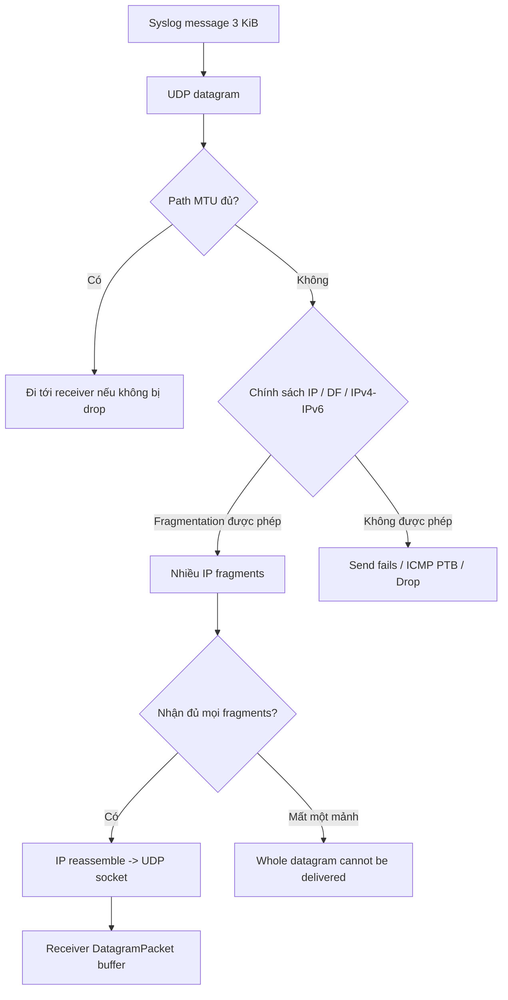
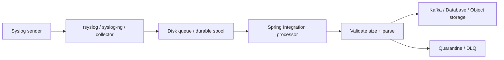

# Giới hạn kích thước datagram

## 1. Tại sao kích thước UDP datagram quan trọng với Syslog?

Trong module **SPRING_INTEGRATION_ADAPTERS**, Spring Integration kết nối các hệ thống ngoài bằng inbound/outbound adapter, gateway, poller và `MessageChannel`. Chương **Adapter Syslog** tập trung vào các bản ghi nhật ký được thiết bị mạng, máy chủ hoặc ứng dụng đẩy tới socket UDP/TCP rồi chuyển thành message để lọc, chuẩn hóa, định tuyến và lưu vào file, SFTP, HTTP, JMS, AMQP, Kafka hoặc database.

Với **Syslog qua UDP**, kích thước của **một bản ghi trên wire** tác động trực tiếp tới khả năng nhận và xử lý thành công:

- Nếu message quá lớn so với **path MTU**, IP có thể phải phân mảnh hoặc không gửi được datagram.
- Nếu buffer dùng nhận `DatagramPacket` quá nhỏ, **dữ liệu có thể bị cắt** trước khi Syslog converter đọc.
- Nếu socket receive buffer của hệ điều hành đầy vì tốc độ gửi cao, **cả datagram có thể bị mất**.
- Nếu parser chỉ nhận phần đầu của bản ghi, record có thể sai cú pháp, thiếu phần message hoặc trông vẫn hợp lệ nhưng đã mất đuôi.
- Nếu dữ liệu đã nhận quá lớn so với **chính sách nghiệp vụ**, receiver cần reject/quarantine có kiểm soát, không âm thầm chuyển một message khổng lồ sang Kafka/DB.

```mermaid
flowchart LR
    S[Syslog sender] --> P[Create message bytes]
    P --> U[UDP datagram]
    U --> N[Network MTU / IP fragmentation]
    N --> O[Kernel UDP socket queue]
    O --> B[DatagramPacket receive buffer]
    B --> C[Syslog MessageConverter]
    C --> M[MessageChannel]
    M --> V[Size policy / Validation]
    V --> D[Kafka / DB / File / SFTP]
```



Mỗi ranh giới có **một loại giới hạn khác nhau**. Tăng buffer ở tầng Java không sửa được packet đã bị mất ở mạng; tăng socket receive buffer ở OS không tự làm decoder hiểu bản ghi đã bị cắt; và tăng số worker không thay đổi giới hạn kích thước của một datagram.

### Mục tiêu học tập

Sau bài này, bạn sẽ:

1. Hiểu **một Syslog message trên một UDP datagram** và các con số từ RFC 5426.
2. Phân biệt `IP MTU`, `UDP payload`, `receive-buffer-size`, `so-receive-buffer-size` và giới hạn nghiệp vụ.
3. Giải thích **IP fragmentation**, **UDP drop**, **datagram truncation** và **malformed Syslog**.
4. Cấu hình Spring Integration Syslog UDP receiver để có receive buffer phù hợp.
5. Xử lý bản ghi vượt ngưỡng **sau khi đã nhận** và cách kiểm thử các giá trị biên.
6. Hiểu giới hạn của `check-length` với **Syslog chuẩn**, cùng các lựa chọn TCP/TLS và collector có disk queue.
7. Thiết lập metrics, cảnh báo, bảo mật và runbook cho log dài.

> **Thông điệp chính:** “UDP hỗ trợ datagram lớn” không đồng nghĩa “gửi Syslog lớn qua Internet là an toàn”. Với Syslog, chính sách kích thước phải được thống nhất từ **sender → mạng → socket → parser → durable sink**.

## 2. Đơn vị đo: octet, byte, ký tự và datagram

RFC 5426 dùng thuật ngữ **octet**, nghĩa là **8 bit**. Trong Java, một byte là đơn vị chứa 8 bit và `String` không cho biết trực tiếp số byte cần truyền sau khi mã hóa UTF-8.

Ví dụ:

```java
import java.nio.charset.StandardCharsets;

String ascii = "INFO";
String unicode = "Đăng nhập thất bại";

int asciiChars = ascii.length();
int asciiBytes = ascii.getBytes(StandardCharsets.UTF_8).length;

int unicodeChars = unicode.length();
int unicodeBytes = unicode.getBytes(StandardCharsets.UTF_8).length;
```

Với ký tự Unicode, `unicodeBytes` có thể lớn hơn `unicodeChars`. Nếu sender giới hạn một message dựa vào `String.length()` thay vì **byte array cuối cùng sẽ truyền**, có thể vượt ngân sách UDP mà không phát hiện.

### 2.1. Những gì được tính vào giới hạn

Một Syslog datagram chuẩn qua UDP có dạng khái niệm:

```text
IP header
  UDP header (8 bytes)
    UDP payload = Syslog message:
      PRI + HEADER + STRUCTURED-DATA (nếu có) + MSG
```

**Toàn bộ bytes của Syslog message** thuộc ngân sách UDP payload, bao gồm:

- `<PRI>` và phần header.
- Timestamp, hostname, app name, process ID, message ID.
- Structured data ở RFC 5424 (nếu có).
- Message text, dấu cách, BOM UTF-8 hoặc encoding markers nếu sender đưa lên wire.

Không được chỉ đếm `MSG` rồi bỏ qua PRI/header/structured data.

### 2.2. Một datagram không phải một stream

RFC 5426 quy định **một datagram UDP chứa một Syslog message**; không ghép nhiều bản ghi Syslog độc lập vào một datagram. Bản ghi có thể bị sender cắt theo quy tắc format; nhưng điều đó có nghĩa nội dung đã mất, không phải receiver tự ghép lại từ datagram sau.

Đối chiếu:

| Transport | Ranh giới bản ghi | Khái niệm giới hạn quan trọng |
|---|---|---|
| **Syslog UDP** | Mỗi datagram là một message | UDP payload, MTU, receive packet buffer, UDP socket queue. |
| **Syslog TCP** | Byte stream; phải có framing | Chiều dài frame, deserializer limit, connection timeout/backpressure. |
| **Syslog over TLS** | Encrypted TCP stream, RFC 5425 dùng octet counting | TLS record không phải Syslog record; vẫn phải giới hạn độ dài frame. |

Không nên giải quyết log quá dài bằng cách “chia thành nhiều UDP datagrams và mong parser ghép lại”. Syslog UDP chuẩn **không cung cấp cơ chế phân mảnh ứng dụng và ghép bản ghi**. IP fragmentation ở tầng mạng là chuyện khác và không đem lại đảm bảo ứng dụng.

## 3. Các con số trong RFC 5426

RFC 5426, mục **3.2 Message Size**, đưa ra những mốc interoperability quan trọng:

| Đối tượng | Kích thước Syslog message | Mức yêu cầu |
|---|---:|---|
| Receiver Syslog trên **IPv4** | **480 octets** | **MUST** hỗ trợ nhận tới và gồm mức này. |
| Receiver Syslog trên **IPv6** | **1.180 octets** | **MUST** hỗ trợ nhận tới và gồm mức này. |
| Receiver Syslog trên **IPv4/IPv6** | **2.048 octets** | **SHOULD** hỗ trợ nhận tới và gồm mức này. |
| Message lớn hơn | Tùy receiver/đường truyền | Khuyến khích hỗ trợ nhưng không có bảo đảm liên thông. |

**MUST** và **SHOULD** là các mức yêu cầu của tiêu chuẩn, không phải ngưỡng mà framework chắc chắn áp đặt mặc định.

### 3.1. Vì sao có 480 byte với IPv4?

RFC chọn mức 480 octets để phù hợp trường hợp mạng có giới hạn MTU thấp, giúp giảm khả năng cần IP fragmentation. Với IPv4, MTU tối thiểu truyền thống là 576 bytes; header IP/UDP và các biến thể IP/options tạo ra overhead.

Khi không biết đường đi mạng thực tế, **480 bytes cho IPv4** và **1.180 bytes cho IPv6** là những mốc sender có cơ hội liên thông cao hơn, theo hướng dẫn của RFC 5426.

Điều này **không có nghĩa** packet 481 bytes chắc chắn thất bại hoặc packet 480 bytes chắc chắn được giao: UDP không có delivery guarantee, packet có thể bị firewall/drop hoặc receiver quá tải.

### 3.2. IPv6 và mốc 1.180 byte

IPv6 yêu cầu hỗ trợ MTU 1.280 bytes ở tầng IP theo nền tảng liên quan. RFC 5426 lấy **1.180 octets** làm ngưỡng receiver phải hỗ trợ, có khoảng dự phòng cho headers và overhead.

Trong mạng IPv6 thực tế, extension headers, tunnel/encapsulation hoặc chính sách firewall có thể làm **effective path MTU** khác giả định đơn giản. Vì vậy không lấy 1.180 làm “kích thước lý tưởng” cho mọi mạng mà không đo.

### 3.3. Vì sao 2.048 byte không đồng nghĩa “không fragmentation”?

RFC nói receiver **SHOULD** hỗ trợ tới **2.048 octets**, nhưng một Syslog message 2 KiB qua UDP có thể lớn hơn path MTU ở mạng Ethernet 1.500 bytes. Nó vẫn có thể bị phân mảnh, hoặc không được gửi theo cấu hình đường truyền và hành vi IP stack.

**Khả năng receiver parse được 2 KiB** và **khả năng mạng chuyển một datagram 2 KiB không mất mảnh** là hai vấn đề độc lập.

### 3.4. Giới hạn UDP lý thuyết không phải ngân sách an toàn

Với IPv4 header tối thiểu 20 bytes và UDP header 8 bytes:

```text
IPv4 total-length field max   = 65,535 bytes
IPv4 header (minimum)        =     20 bytes
UDP header                   =      8 bytes
Max UDP payload (IPv4 basic) = 65,507 bytes
```

Giới hạn có thể thấp hơn nếu có IPv4 options hoặc các điều kiện mạng khác. Với IPv6, trường payload length của header IPv6 thông thường cũng đặt giới hạn riêng và các extension headers làm giảm phần còn lại cho UDP payload; không nên lấy “65 KB” làm chính sách cho log. Một số cơ chế jumbogram là trường hợp đặc biệt ngoài phạm vi triển khai Syslog UDP thông thường.

**Tóm tắt:** `65.507` là **một giới hạn từ cấu trúc header IPv4**, không phải “kích thước Syslog được bảo đảm” hoặc giá trị đề xuất cho `receive-buffer-size`.

## 4. Path MTU và fragmentation

### 4.1. MTU là gì?

**MTU (Maximum Transmission Unit)** thường biểu thị kích thước IP packet lớn nhất mà một hop/interface có thể vận chuyển mà không cần fragmentation ở tầng IP.

Ví dụ một đường đi Ethernet có MTU 1.500 bytes:

```text
IPv4: 1500 - 20 (IPv4 header) - 8 (UDP header)
    = 1472 bytes UDP payload, khi không có IPv4 options

IPv6: 1500 - 40 (base IPv6 header) - 8 (UDP header)
    = 1452 bytes UDP payload, khi không có extension headers
```

Đây là **giới hạn đơn giản cho một đoạn mạng có MTU 1.500**, không phải bảo đảm path MTU end-to-end. VPN, IPsec, VXLAN, GRE, service mesh hoặc network tunneling có thể thêm overhead, khiến phần payload hữu dụng giảm.

### 4.2. Điều gì xảy ra khi datagram lớn hơn path MTU?



Với **IPv4**, router hoặc source có thể tạo IP fragments trong các điều kiện cho phép, nhưng cơ chế DF/PMTUD hay firewall có thể làm packet bị từ chối/thông báo cần giảm kích thước.

Với **IPv6**, router không phân mảnh packet trên đường đi như IPv4; nguồn gửi phải điều chỉnh theo Path MTU và dùng cơ chế fragmentation header khi thích hợp. Một mảnh bị mất khiến receiver không thể ghép lại UDP datagram.

### 4.3. Tăng xác suất mất packet khi có nhiều fragments

Nếu một message phải tách thành nhiều fragments, chỉ cần **mất một fragment** thì toàn bộ datagram có thể không được đưa tới UDP socket. Vì thế, mặc dù đường truyền có thể chở message lớn, **xác suất giao thành công có thể thấp hơn** khi tăng số fragments.

Không khẳng định một tỷ lệ mất cố định: xác suất thực tế phụ thuộc mạng, packet loss, fragment filtering, MTU, tải và hành vi OS.

### 4.4. Trường hợp datagram bị drop không tạo Spring Integration error

Nếu packet không đi qua IP reassembly hoặc bị kernel UDP queue drop:

```text
Sender -> IP fragments -> [missing fragment] -> NO UDP datagram
                                      |
                                      X
                              Spring Integration
```

Không có `Message<?>`, không có `ErrorMessage` và không có message payload để đưa vào quarantine. Vì vậy cần network/kernel counters và khả năng đo ở sender/collector, **không chỉ đọc global `errorChannel`**.

## 5. Ba loại buffer thường bị nhầm

### 5.1. Tổng quan

Trong Spring Integration IP UDP, có ít nhất hai buffer khác nhau:

1. **`receive-buffer-size`**: kích thước bộ đệm **dùng cho mỗi `DatagramPacket` lúc adapter đọc dữ liệu**.
2. **`so-receive-buffer-size`**: yêu cầu dung lượng **socket receive buffer** của OS (tương ứng `SO_RCVBUF`).

Thêm một giới hạn nữa thường do ứng dụng tự đặt:

3. **`maxAllowedSyslogBytes`**: **chính sách nghiệp vụ** giới hạn số byte Syslog mà flow chấp nhận sau khi đã nhận.

```text
OS socket receive queue (SO_RCVBUF)
   -> receive DatagramPacket(byte[receive-buffer-size])
   -> Syslog converter
   -> byte[] / Map payload
   -> application maxAllowedSyslogBytes validation
   -> accepted or rejected
```

### 5.2. So sánh

| Giới hạn | Thuộc tầng | Khi quá nhỏ | Có bảo vệ khỏi mất packet? |
|---|---|---|---|
| **Path MTU** | Network | Packet phải fragment/giảm kích thước hoặc fail | Giữ message trong MTU giúp hạn chế fragment risk, không đảm bảo delivery. |
| **`receive-buffer-size`** | Java/IP receiving adapter | Một datagram lớn có thể bị **truncated** trước converter | Không sửa được packet mất ngoài mạng; tăng có thể tránh truncation cục bộ. |
| **`so-receive-buffer-size`** | OS UDP socket queue | Khi burst, queue đầy và **cả datagram bị drop** | Tăng giúp hấp thụ burst, không sửa truncation do per-packet buffer. |
| **Application max bytes** | Validation/normalization | Reject hoặc quarantine message vượt policy | Có tác dụng **sau khi đã nhận đủ bytes**; không thể phát hiện chính xác dữ liệu bị cắt trước đó. |
| **Executor/QueueChannel capacity** | Downstream messaging | Worker queue đầy, reject/block | Không thay thế network/socket buffers hoặc durable queue. |
| **Broker max record size** | Kafka/JMS/AMQP/DB/File sink | Publish/serialize/store thất bại | Cần policy riêng tại destination. |

Ví dụ, đặt `receive-buffer-size=1024` và `so-receive-buffer-size=262144` **không** làm receiver đọc nguyên vẹn datagram 3.000 bytes. Buffer lớn của OS chỉ có thể giữ nhiều dữ liệu đang chờ; buffer per-packet 1.024 bytes vẫn có nguy cơ cắt bản ghi.

Ngược lại, đặt `receive-buffer-size=8192` nhưng `SO_RCVBUF` nhỏ, cộng với handler chậm, vẫn có thể mất cả datagram khi burst.

### 5.3. Dữ liệu bị cắt ở `DatagramSocket.receive`

Theo Java `DatagramSocket.receive(DatagramPacket)`, nếu message lớn hơn **độ dài buffer cho phép nhận của packet**, datagram có thể bị **truncated**; `DatagramPacket.getLength()` sau receive chỉ phản ánh **số byte đã nhận được**, không phải độ dài ban đầu.

Ví dụ độc lập giúp hiểu:

```java
import java.net.DatagramPacket;
import java.net.DatagramSocket;

public final class TinyUdpReceiver {

    public static void main(String[] args) throws Exception {
        byte[] target = new byte[256];

        try (DatagramSocket socket = new DatagramSocket(1519)) {
            DatagramPacket packet =
                new DatagramPacket(target, target.length);

            socket.receive(packet);

            // Nếu sender gửi > 256 bytes, dữ liệu có thể đã
            // bị cắt trước khi chương trình xử lý.
            System.out.println("Observed bytes: " +
                packet.getLength());
        }
    }
}
```

**Không thể suy ra** “packet vốn dài đúng 256 bytes” chỉ vì `getLength()==256`. Nó cũng có thể là packet dài hơn nhưng bị cắt xuống 256. Nếu protocol không mang chiều dài gốc đáng tin hoặc không có telemetry khác, receiver có thể không phân biệt chắc chắn hai trường hợp.

## 6. Ví dụ cấu hình Spring Integration Syslog UDP

### 6.1. Dependencies

Giả định Java 17+, Spring Boot 3.x và Spring Integration 6.x tương thích với BOM của Spring Boot. Với Maven dependency management:

```xml
<dependencies>
    <dependency>
        <groupId>org.springframework.boot</groupId>
        <artifactId>spring-boot-starter-integration</artifactId>
    </dependency>
    <dependency>
        <groupId>org.springframework.integration</groupId>
        <artifactId>spring-integration-ip</artifactId>
    </dependency>
    <dependency>
        <groupId>org.springframework.integration</groupId>
        <artifactId>spring-integration-syslog</artifactId>
    </dependency>
</dependencies>
```

Không cần `spring-boot-starter-web` nếu ứng dụng chỉ nhận Syslog, không cung cấp HTTP endpoint. Đây là **one-way UDP inbound adapter**, không có HTTP status hoặc response body cho sender.

### 6.2. Cấu hình XML với buffer có chủ đích

File `src/main/resources/syslog-datagram.xml`:

```xml
<?xml version="1.0" encoding="UTF-8"?>
<beans xmlns="http://www.springframework.org/schema/beans"
       xmlns:xsi="http://www.w3.org/2001/XMLSchema-instance"
       xmlns:int="http://www.springframework.org/schema/integration"
       xmlns:int-syslog="http://www.springframework.org/schema/integration/syslog"
       xsi:schemaLocation="
         http://www.springframework.org/schema/beans
         https://www.springframework.org/schema/beans/spring-beans.xsd
         http://www.springframework.org/schema/integration
         https://www.springframework.org/schema/integration/spring-integration.xsd
         http://www.springframework.org/schema/integration/syslog
         https://www.springframework.org/schema/integration/syslog/spring-integration-syslog.xsd">

    <int:channel id="rawSyslogInput"/>

    <bean id="rawSyslogConverter"
          class="org.springframework.integration.syslog.DefaultMessageConverter">
        <property name="asMap" value="false"/>
    </bean>

    <int-syslog:inbound-channel-adapter
        id="udpSyslog"
        channel="rawSyslogInput"
        converter="rawSyslogConverter"
        auto-startup="true">

        <int-syslog:udp-attributes
            port="1514"
            local-address="127.0.0.1"
            receive-buffer-size="8192"
            so-receive-buffer-size="262144"
            lookup-host="false"/>
    </int-syslog:inbound-channel-adapter>

</beans>
```

Phân tích:

- `port="1514"`: cổng UDP thực tế receiver bind. Sender bên ngoài container/host khác cần đúng địa chỉ, routing và firewall; lab ở đây chỉ bind loopback.
- `receive-buffer-size="8192"`: dành chỗ nhận **một datagram tới 8 KiB** trong bộ đệm của adapter ở tình huống lý tưởng. Nó **không làm đường truyền hỗ trợ 8 KiB mà không fragmentation**.
- `so-receive-buffer-size="262144"`: **yêu cầu** OS cấp receive socket buffer khoảng 256 KiB để hấp thụ burst. OS có thể điều chỉnh/giới hạn giá trị thực; không phải một reservation bền vững.
- `asMap=false`: giữ raw Syslog record dưới dạng `byte[]`, giúp **kiểm tra số byte quan sát được sau receive** trước khi chuẩn hóa.
- `lookup-host=false`: tránh reverse DNS lookup không cần thiết; không phải cơ chế xác thực nguồn.
- Không bật `check-length` cho chuẩn Syslog UDP từ thiết bị thông thường, vì tính năng đó dùng framing riêng của Spring Integration IP (xem mục 8).

**Vì sao buffer 8 KiB lớn hơn policy 2 KiB?** Trong demo, receiver cần có cơ hội đọc **đủ** một datagram 3 KiB hoặc 4 KiB để chủ động từ chối theo policy, thay vì cắt nó xuống 2 KiB trước validation. Tuy nhiên, message dài hơn 8 KiB vẫn có thể bị cắt, và dù đọc đủ 4 KiB, đường mạng vẫn có thể mất fragments.

Với child `udp-attributes`, đặt `port` trên **child**, không đặt lại trên element `inbound-channel-adapter` cha.

### 6.3. Nạp XML vào Spring Boot

```java
package example.syslog;

import org.springframework.boot.SpringApplication;
import org.springframework.boot.autoconfigure.SpringBootApplication;
import org.springframework.context.annotation.ImportResource;

@SpringBootApplication
@ImportResource("classpath:syslog-datagram.xml")
public class SyslogDatagramApplication {

    public static void main(String[] args) {
        SpringApplication.run(SyslogDatagramApplication.class, args);
    }
}
```

Sau khi app chạy, Syslog adapter nhận các UDP datagrams trên `127.0.0.1:1514` rồi chuyển thành Spring Integration messages trên `rawSyslogInput`.

**Giới hạn ví dụ:** converter RFC 3164 vẫn có thể cần xử lý dữ liệu đầu vào theo implementation của nó. `asMap=false` là contract payload raw, **không phải** một lời hứa rằng mọi malformed record đều bypass được parser mà không có exception. Khi cần lưu **mọi datagram kể cả malformed** trước khi parse, cân nhắc sử dụng IP UDP adapter raw và chỉ parse sau khi persist theo policy.

## 7. Validation kích thước sau khi nhận

### 7.1. Một chính sách minh họa

Đặt:

```text
RECEIVE_PACKET_BUFFER = 8192 bytes
MAX_ALLOWED_SYSLOG    = 2048 bytes
UDP PORT              = 1514
```

Trong ví dụ:

- Bản ghi từ 1 đến 2.048 bytes có thể được accept sau khi kiểm tra các điều kiện khác.
- Bản ghi lớn hơn 2.048 bytes **mà receiver nhận đủ** sẽ bị reject/quarantine.
- Message lớn hơn bộ đệm 8.192 bytes có rủi ro bị cắt trước khi guard chạy, nên **không thể khẳng định** code ứng dụng luôn phát hiện oversized message.
- Packet đã mất trên mạng hoặc kernel không xuất hiện ở guard, dù upstream có gửi.

Đây là **policy của ứng dụng**, không phải mốc RFC bắt buộc mọi sender phải tuân thủ. Trong mạng path MTU nhỏ, chính sách sender có thể cần ngưỡng **thấp hơn nhiều** so với 2.048.

### 7.2. DTO cho kết quả xử lý

File `SyslogSizeResult.java`:

```java
package example.syslog;

public final class SyslogSizeResult {
    private SyslogSizeResult() {}

    public record Accepted(byte[] raw, int bytes) {}

    public record Rejected(
        String reason, int observedBytes) {}
}
```

Ở đây `Accepted` mang raw bytes phục vụ demo, không phải format lý tưởng để đưa trực tiếp tới Kafka trên quy mô lớn. Production có thể lưu raw vào object storage/inbox trước rồi chỉ đưa event ID hoặc reference vào broker.

### 7.3. Service activator kiểm tra raw bytes

File `SyslogDatagramSizeGuard.java`:

```java
package example.syslog;

import java.util.Arrays;

import org.springframework.beans.factory.annotation.Qualifier;
import org.springframework.integration.annotation.ServiceActivator;
import org.springframework.messaging.Message;
import org.springframework.messaging.MessageChannel;
import org.springframework.messaging.support.MessageBuilder;
import org.springframework.stereotype.Component;

@Component
public class SyslogDatagramSizeGuard {

    static final int MAX_ALLOWED_BYTES = 2048;

    private final MessageChannel accepted;
    private final MessageChannel rejected;

    public SyslogDatagramSizeGuard(
            @Qualifier("acceptedSyslog") MessageChannel accepted,
            @Qualifier("rejectedSyslog") MessageChannel rejected) {
        this.accepted = accepted;
        this.rejected = rejected;
    }

    @ServiceActivator(inputChannel = "rawSyslogInput")
    public void inspect(Message<?> received) {
        if (!(received.getPayload() instanceof byte[] raw)) {
            sendOrThrow(rejected,
                new SyslogSizeResult.Rejected(
                    "WRONG_PAYLOAD_TYPE", -1));
            return;
        }

        int observed = raw.length;

        if (observed == 0) {
            sendOrThrow(rejected,
                new SyslogSizeResult.Rejected(
                    "EMPTY_DATAGRAM", observed));
            return;
        }

        if (observed > MAX_ALLOWED_BYTES) {
            sendOrThrow(rejected,
                new SyslogSizeResult.Rejected(
                    "OVERSIZED_SYSLOG", observed));
            return;
        }

        // Sao chép để tránh bên khác vô tình sửa array gốc.
        byte[] safeCopy = Arrays.copyOf(raw, raw.length);

        sendOrThrow(accepted,
            new SyslogSizeResult.Accepted(safeCopy, observed));
    }

    private static void sendOrThrow(
            MessageChannel channel, Object value) {

        boolean sent = channel.send(
            MessageBuilder.withPayload(value).build());

        if (!sent) {
            throw new IllegalStateException(
                "Syslog routing channel did not accept message");
        }
    }
}
```

**Giải thích giới hạn an toàn:**

- `observed` là **số bytes đã tới payload sau nhận**, không nhất thiết là độ dài datagram ban đầu nếu đã bị cắt ở tầng socket/decoder.
- Nếu buffer 8 KiB nhưng sender đưa hơn 8 KiB, receiver có thể nhận một bản ghi cắt còn 8 KiB; guard sẽ thấy 8 KiB và reject theo policy 2 KiB, nhưng **không thể suy ra độ dài gốc**.
- Nếu một cấu hình nguy hiểm đặt receive buffer **nhỏ hơn ngưỡng policy**, ví dụ 1.024 bytes nhưng `MAX_ALLOWED_BYTES=2048`, một datagram dài hơn 2 KiB có thể bị cắt xuống 1.024 bytes rồi **bị accept nhầm**. Do đó phải cấu hình buffer và policy nhất quán.
- `Accepted` chỉ thể hiện “qua size guard”, chưa bảo đảm Syslog format hợp lệ hoặc record đã được persist. Cần parser/validator theo RFC ở downstream.
- Reject ở đây được chuyển thành một **message nghiệp vụ**. Nó không phải `ErrorMessage<Throwable>` và không tự tạo UDP acknowledgment.

### 7.4. Channels và subscribers cho demo

File `SyslogSizeChannels.java`:

```java
package example.syslog;

import org.springframework.context.annotation.Bean;
import org.springframework.context.annotation.Configuration;
import org.springframework.integration.channel.DirectChannel;
import org.springframework.messaging.MessageChannel;

@Configuration
public class SyslogSizeChannels {

    @Bean("acceptedSyslog")
    public MessageChannel acceptedSyslog() {
        return new DirectChannel();
    }

    @Bean("rejectedSyslog")
    public MessageChannel rejectedSyslog() {
        return new DirectChannel();
    }
}
```

File `SyslogSizeConsumers.java`:

```java
package example.syslog;

import org.slf4j.Logger;
import org.slf4j.LoggerFactory;
import org.springframework.integration.annotation.ServiceActivator;
import org.springframework.stereotype.Component;

@Component
public class SyslogSizeConsumers {

    private static final Logger log =
        LoggerFactory.getLogger(SyslogSizeConsumers.class);

    @ServiceActivator(inputChannel = "acceptedSyslog")
    public void accept(SyslogSizeResult.Accepted event) {
        log.info("Syslog size accepted: bytes={}", event.bytes());

        // Production: parse/validate, persist hoặc enqueue vào
        // durable sink. Không log raw bytes chứa dữ liệu nhạy cảm.
    }

    @ServiceActivator(inputChannel = "rejectedSyslog")
    public void reject(SyslogSizeResult.Rejected event) {
        log.warn("Syslog record rejected: reason={}, observedBytes={}",
            event.reason(), event.observedBytes());

        // Production: metric + quarantine metadata; lưu raw
        // có giới hạn và phân quyền nếu chính sách cho phép.
    }
}
```

Ví dụ chỉ ghi **metadata được chọn**, không ghi toàn bộ raw record. Khi một bản ghi cần lưu để điều tra, hãy thiết kế access control, encryption at rest, retention và ngưỡng dung lượng riêng.

**Điểm quan trọng:** `DirectChannel` dispatch subscriber đồng bộ trên thread gửi message. Nếu sink phía sau chậm, UDP receiver có thể bị nghẽn. Có thể chèn broker/persistent queue hoặc collector có disk queue; chỉ thêm `ExecutorChannel` memory queue **không tạo đảm bảo chống mất log**.

## 8. `check-length` của Spring Integration IP có dùng cho Syslog chuẩn không?

### 8.1. Cơ chế `check-length`

Spring Integration **IP UDP adapter** hỗ trợ chế độ `check-length=true` khi **cả sender và receiver đều do những thành phần hiểu cùng format riêng này** quản lý. Khi bật ở outbound IP UDP adapter, nó thêm **4 bytes độ dài ở network byte order trước dữ liệu**. Inbound IP UDP adapter tương ứng dùng prefix đó để kiểm tra có bị cắt khi nhận hay không.

```text
Proprietary Spring Integration UDP envelope:
[4-byte network-order length][message body]
```

Nếu sender và receiver cùng thỏa thuận envelope này, receiver có thể so sánh độ dài kỳ vọng và số bytes đã đọc để nhận ra một số trường hợp truncation.

### 8.2. Tại sao không bật bừa với Syslog RFC 5426?

**Syslog UDP chuẩn** yêu cầu một datagram chứa **Syslog message**, thường bắt đầu từ `<PRI>`:

```text
RFC 5426 Syslog UDP payload:
<134>1 2026-11-23T02:15:10Z edge-01 app 123 EVT1 - Device changed
```

Nếu chèn thêm 4 bytes độ dài kiểu Spring Integration IP trước `<134>`, payload trên wire **không còn là một Syslog message bắt đầu tại byte đầu** theo format chuẩn. Thiết bị Syslog thông thường hoặc một receiver chỉ hiểu RFC 5426 có thể parse sai.

| Kịch bản | `check-length` | Kết luận |
|---|---|---|
| Thiết bị/router gửi Syslog UDP RFC 3164/5424 chuẩn | **Không tự bật** | Sender không thêm prefix 4 bytes của Spring IP. |
| Hai Spring Integration **IP UDP adapters** do bạn kiểm soát, dùng envelope riêng | Có thể bật **cả hai đầu** | Đây là giao thức riêng được thỏa thuận; không gọi nó là Syslog UDP chuẩn trên wire. |
| Cần đảm bảo mọi Syslog record không bị mất | `check-length` **không đủ** | Chỉ giúp phát hiện một số packet truncation sau khi nhận; không sửa packet đã mất ở mạng/kernel. |
| Nguồn Syslog có thể gửi message lớn | Quản lý size ở sender và receiver | Nếu quá path MTU, cân nhắc TCP/TLS hoặc collector. |

Không đưa `check-length="true"` vào ví dụ Syslog XML ở mục 6 khi sender chỉ là một router/Linux `logger` thông thường. Nếu muốn phát triển một protocol riêng có length prefix, hãy đặt **IP UDP adapter thuần** tại cả hai đầu và lập tài liệu wire contract rõ ràng.

### 8.3. Có thể phát hiện truncation chuẩn Syslog bằng parser không?

Một parser có thể nhận biết **một số trường hợp**:

- Mất dấu đóng ngoặc `]` của RFC 5424 structured data.
- Header bị cắt giữa các trường.
- Chuỗi encoding bị cắt sai.
- Bản ghi sai PRI/timestamp hoặc không parse được.

Nhưng parser **không thể bảo đảm phát hiện mọi trường hợp**. Ví dụ log text bị cắt mất đoạn cuối nhưng phần đầu vẫn là một message RFC 3164 hợp lệ. Nếu không có length/checksum/application sequence từ nguồn đáng tin, receiver không biết có bao nhiêu bytes bị mất.

**Không xem “parse thành công” là bằng chứng datagram nguyên vẹn.**

## 9. Kiểm thử sender theo kích thước byte chính xác

### 9.1. Tạo Syslog RFC 3164 đúng `N` bytes

Một Java sender kiểm soát **tổng số bytes của message**, bao gồm header, dùng ký tự ASCII `x` để mỗi ký tự tương ứng một byte UTF-8.

File `SyslogDatagramSender.java`:

```java
package example.syslog;

import java.net.DatagramPacket;
import java.net.DatagramSocket;
import java.net.InetAddress;
import java.nio.charset.StandardCharsets;

public final class SyslogDatagramSender {

    private static byte[] syslogOfSize(int targetBytes) {
        String prefix =
            "<134>Nov 23 09:15:10 sender-01 app: ";

        int prefixBytes =
            prefix.getBytes(StandardCharsets.UTF_8).length;

        if (targetBytes < prefixBytes) {
            throw new IllegalArgumentException(
                "Requested size is smaller than Syslog header");
        }

        String message =
            prefix + "x".repeat(targetBytes - prefixBytes);

        byte[] result =
            message.getBytes(StandardCharsets.UTF_8);

        if (result.length != targetBytes) {
            throw new IllegalStateException(
                "Wrong number of encoded bytes");
        }

        return result;
    }

    public static void main(String[] args) throws Exception {
        int[] sizes = {
            479, 480, 481,
            1179, 1180, 1181,
            2047, 2048, 2049,
            4096, 4097
        };

        InetAddress receiver =
            InetAddress.getByName("127.0.0.1");

        try (DatagramSocket socket = new DatagramSocket()) {
            for (int size : sizes) {
                byte[] raw = syslogOfSize(size);

                DatagramPacket packet = new DatagramPacket(
                    raw, raw.length, receiver, 1514);

                socket.send(packet);

                System.out.println(
                    "Sent UDP Syslog bytes=" + raw.length);
            }
        }
    }
}
```

**Ý nghĩa các mốc**:

- `479/480/481`: kiểm tra quanh mốc IPv4 MUST support.
- `1179/1180/1181`: quanh mốc IPv6 MUST support (mặc dù sender demo đang gửi IPv4 loopback; cần cấu hình IPv6 thật nếu muốn test hành vi IPv6).
- `2047/2048/2049`: quanh mốc SHOULD support và chính sách demo.
- `4096/4097`: thử datagram lớn hơn policy, nhưng vẫn nhỏ hơn receive packet buffer 8 KiB.

**Lưu ý quan trọng:** Mọi message trong sender đều đi qua **IPv4 loopback**. Chạy test trên loopback giúp kiểm tra kích thước/pipeline, **không** chứng minh khả năng giao nhận trên VPN, Wi-Fi, Kubernetes hoặc Internet với path MTU nhỏ hơn. Không giả định 4.097 bytes chắc chắn tới receiver nếu chạy qua đường mạng thật.

### 9.2. Kỳ vọng của size guard 2.048 bytes

Khi datagram được nhận đầy đủ, hành vi logic mong đợi:

| Kích thước gửi | Vượt policy 2.048? | Route trong demo |
|---:|---|---|
| 479 | Không | `acceptedSyslog` |
| 480 | Không | `acceptedSyslog` |
| 481 | Không | `acceptedSyslog` |
| 1.179 | Không | `acceptedSyslog` |
| 1.180 | Không | `acceptedSyslog` |
| 1.181 | Không | `acceptedSyslog` |
| 2.047 | Không | `acceptedSyslog` |
| 2.048 | Không | `acceptedSyslog` |
| 2.049 | Có | `rejectedSyslog` |
| 4.096 | Có | `rejectedSyslog` |
| 4.097 | Có | `rejectedSyslog` |

Bảng là **kỳ vọng của logic validation khi payload đến đủ bytes**, không phải lời hứa UDP giao mọi datagram. Nếu network/kernel drop hoặc converter không tạo message, guard sẽ không được gọi.

### 9.3. Khi receiver buffer nhỏ hơn message

Thử một cấu hình **cố tình không an toàn** trong môi trường lab:

```xml
<int-syslog:udp-attributes
    port="1514"
    local-address="127.0.0.1"
    receive-buffer-size="512"
    so-receive-buffer-size="262144"
    lookup-host="false"/>
```

Nếu sender gửi một message 2.048 bytes:

- IP/UDP có thể giao đầy đủ datagram tới socket.
- `DatagramPacket` có buffer chỉ 512 bytes; nội dung được chuyển tiếp có thể bị cắt xuống 512.
- Parser có thể trả `UNDECODED`, ném exception hoặc tạo message có nội dung thiếu tùy format/converter.
- `so-receive-buffer-size=262144` **không sửa** chuyện per-packet buffer 512 bytes.
- Receiver khó xác định chính xác chiều dài ban đầu nếu không có một trường độ dài đáng tin ở protocol/application.

**Không giữ cấu hình 512 bytes để nhận Syslog production nếu sender có thể phát bản ghi dài hơn.** Ví dụ chỉ minh họa failure mode.

### 9.4. Kiểm thử Unicode và structured data

Tạo thêm test sender với nội dung như:

```text
<134>Nov 23 09:15:10 edge-01 app: Đăng nhập thất bại — người dùng thử
```

Đếm bytes bằng `getBytes(StandardCharsets.UTF_8).length`. Không dùng `String.length()` làm kiểm tra size khi text chứa tiếng Việt, emoji hoặc ký tự không thuộc ASCII. Với RFC 5424, cần tính cả bytes của structured data và phần escaping theo format.

Một bản ghi có `MSG` ngắn nhưng nhiều attributes/structured data có thể vẫn vượt budget.

## 10. Kiểm thử ở tầng network và OS

### 10.1. Quan sát socket listener

Trên Linux:

```bash
ss -lunp | grep ':1514'
```

Kết quả chỉ xác minh listener UDP/1514 tồn tại; **không nói rằng message dài 2 KiB/4 KiB được nhận nguyên vẹn**.

Có thể dùng network capture trong môi trường thử nghiệm được phép:

```bash
sudo tcpdump -n -s 0 -i lo 'udp port 1514'
```

Tùy OS, interface loopback có thể mang tên khác. `-s 0` yêu cầu capture toàn bộ phần dữ liệu khả dụng trong packet thay vì giới hạn snapshot length quá nhỏ. Cần bảo vệ PCAP vì Syslog có thể chứa IP, tài khoản hoặc secret.

### 10.2. Đọc thống kê UDP drop

Một số hệ Linux cung cấp:

```bash
netstat -su
```

hoặc:

```bash
nstat -az
```

Các counter như UDP receive errors, packet receive errors hoặc buffer errors phụ thuộc kernel/distribution và quyền truy cập. Chúng thường là **thống kê OS**, có thể gộp nhiều socket. Nếu cần đo riêng ứng dụng, kết hợp socket telemetry, collector metrics và test end-to-end.

### 10.3. Phân biệt ba vị trí mất dữ liệu

| Vị trí | Dấu hiệu | Hướng điều tra |
|---|---|---|
| **Network fragmentation/drop** | Sender có gửi, receiver không thấy datagram | Path MTU, tunnel overhead, firewall, IPv4 DF/IPv6 PMTUD, packet capture. |
| **Kernel socket queue drop** | Traffic vào host nhưng Java không nhận đủ số messages | `SO_RCVBUF`, CPU, receiver thread/blocking handlers, OS counters. |
| **Per-packet buffer truncation** | Receiver có message nhưng nội dung ngắn/thiếu đuôi | `receive-buffer-size`, observed bytes, raw mode, test với packet known-length. |
| **Parser format mismatch** | Raw bytes đủ nhưng không parse được | RFC 3164/5424 converter, charset, framing với TCP. |
| **Downstream reject** | Message qua parser nhưng không được persist | MessageChannel subscriber, queue capacity, Kafka/DB limits, error/retry/DLQ. |

Đừng tăng `SO_RCVBUF` khi nguyên nhân là parser sai RFC; đừng sửa converter khi sender chưa tới đúng port; đừng chỉ tăng Java packet buffer khi path MTU bị giới hạn.

## 11. Chiến lược sender khi bản ghi dài

### 11.1. Ưu tiên giảm kích thước trước khi truyền

Khi sender có thể điều chỉnh:

1. **Tránh log payload vô hạn** như full HTTP body, stack trace nhiều MB, blob base64 hoặc dữ liệu binary.
2. **Giới hạn trường động**: query string, user agent, arbitrary headers, structured data.
3. **Giữ context quan trọng**: error code, event ID, source, timestamp và summary; không cắt mất thông tin định danh cần cho điều tra.
4. **Tính byte size sau encoding** và sau khi tạo PRI/header/structured data.
5. **Ưu tiên khai báo policy rõ ràng**: drop, truncate có dấu hiệu, split thành sự kiện riêng có ID hoặc chuyển transport khác.
6. **Không tự chia một Syslog message thành nhiều UDP chunks** rồi kỳ vọng Syslog receiver tự ghép.
7. **Không đưa secret/PII vào log**; truncation không phải phương thức redaction đáng tin cậy.

### 11.2. Truncate có kiểm soát khi nào?

Nếu phải truncate để tuân thủ giới hạn, sender cần chính sách nhất quán:

- Tránh cắt giữa chuỗi UTF-8 multibyte.
- Không phá hỏng cấu trúc RFC 5424 header/structured data.
- Nếu có thể, đánh dấu bản ghi **đã bị cắt** bằng metadata riêng hoặc dấu hiệu do hệ thống định nghĩa, không giả tạo một message tưởng như nguyên vẹn.
- Giữ event ID/source ID để có thể tra cứu bản đầy đủ trong nơi lưu riêng.
- Không cắt nội dung bắt buộc phục vụ audit/compliance một cách im lặng.
- Dùng bounded formatter để tránh memory pressure trước khi gửi UDP.

Với yêu cầu **đầy đủ bản ghi dài**, chuyển sang **Syslog TCP/TLS**, collector có disk queue hoặc một kiến trúc lưu bền vững phù hợp thường tốt hơn việc cố đẩy tối đa UDP datagram.

### 11.3. Kích thước hợp lý khi chưa biết path MTU

Gợi ý khởi đầu:

| Bối cảnh | Hướng thiết kế |
|---|---|
| Thiết bị chỉ hỗ trợ RFC 5426/UDP qua mạng không biết MTU | Cân nhắc mức sender **≤480 bytes IPv4** hoặc **≤1.180 bytes IPv6** nếu mục tiêu là khả năng liên thông rộng. |
| Receiver quản lý tập trung và mạng được đo | Có thể hỗ trợ 2.048 bytes hoặc lớn hơn, nhưng kiểm thử fragment risk, loss và limits. |
| Cần giữ JSON/stack trace rất dài | Giảm kích thước log, lưu chi tiết riêng hoặc dùng TCP/TLS/collector. |
| Cần audit không mất khi restart/outage | Có durable collector/queue, replay, ack và dedup; UDP thuần không đủ. |

Không lấy 480 bytes làm một “hard maximum của RFC”: đó là mốc receiver IPv4 **MUST hỗ trợ**, còn khả năng hỗ trợ lớn hơn vẫn hợp lệ.

## 12. Khi nào chuyển sang TCP hoặc TLS?

Nếu logs thường vượt vài KB, có yêu cầu mã hóa/xác thực hoặc cần giảm IP fragmentation, hãy xem xét Syslog TCP/TLS.

### 12.1. TCP giảm phụ thuộc datagram nhưng tạo trách nhiệm mới

```text
Syslog sender -> TCP connection -> framing
              -> Spring Integration TCP Syslog inbound
              -> MessageConverter -> MessageChannel
```

TCP làm việc với **byte stream**. Dữ liệu có thể được gửi thành nhiều TCP segments mà application không phải gửi một Syslog record trong đúng một UDP datagram. Tuy nhiên:

- Receiver phải cấu hình đúng **framing** (RFC 6587 octet counting hoặc delimiter).
- Phải giới hạn **maximum frame length** để tránh memory exhaustion.
- Cần read timeout, connection limits và xử lý client chậm/đứt giữa frame.
- TCP write thành công **chưa xác nhận** Syslog record được Kafka/database commit.
- Khi retry/replay sau mất kết nối, cần event ID/dedup policy.

### 12.2. TLS không tự tăng giới hạn message

RFC 5425 định nghĩa Syslog-over-TLS sử dụng TCP và **octet counting**. TLS mã hóa/xác thực theo certificate policy; TLS record size và TCP segmentation **không** là giới hạn kích thước Syslog message ở application.

Muốn chấp nhận frame lớn, vẫn phải cấu hình **frame size limit, timeout, buffer, memory và downstream quota**. Đừng dùng TLS/6514 như lời giải không giới hạn cho mọi payload.

### 12.3. Collector có disk queue

Một thiết kế đáng cân nhắc:



Collector có thể thực hiện:

- Giới hạn kích thước message theo nguồn.
- Lưu bản ghi trước khi đưa vào processor.
- Retry/replay khi Spring Integration hoặc downstream gặp sự cố.
- Áp TLS/mTLS, access control và rate limit.
- Đo dropped/oversized/truncated counts.

Nhưng ngay cả disk queue cũng cần hiểu rõ **mốc ack và fsync**, chính sách khi disk đầy và khả năng duplicate sau replay. Không tự gọi toàn bộ chuỗi là exactly-once.

## 13. Error channel và record malformed

### 13.1. Bản ghi vượt ngưỡng nghiệp vụ

Trong demo ở mục 7, một message **đã nhận đủ** và dài hơn 2.048 bytes được chuyển thành:

```text
SyslogSizeResult.Rejected {
    reason = "OVERSIZED_SYSLOG",
    observedBytes = 4096
}
```

Đây là message **phân loại nghiệp vụ** được gửi tới `rejectedSyslog`. Nó **không phải** `ErrorMessage` chứa `Throwable`.

Ưu điểm:

- Có thể tăng metric theo reason.
- Có thể đưa vào quarantine với retention riêng.
- Không cần gây exception cho một điều kiện đã được dự kiến.
- Không làm lộ raw payload trong log.

### 13.2. Truncation hoặc parser exception

Nếu adapter/converter ném exception, Spring Integration có thể báo lỗi qua cơ chế `error-channel` được cấu hình. Nhưng:

- Không phải mọi record malformed đều ném exception: RFC 3164 parser có trường hợp đưa raw dữ liệu không decode được vào `UNDECODED`.
- `errorChannel` không thấy packet đã bị network/kernel drop.
- Error message có thể thiếu bản gốc khi lỗi xảy ra rất sớm.
- Một error channel trong JVM **không tự là DLQ bền vững**.
- Nếu error handler chỉ ghi log, hệ thống vẫn có thể mất bản ghi cần điều tra.

Nếu yêu cầu lưu mọi record, cần một ingress buffer/persistent store **trước** bước parse trong phạm vi được phép, hoặc collector có khả năng nhận raw và replay.

### 13.3. Không tự động retry UDP sender

Với Syslog UDP truyền thống, sender không có application acknowledgment. Nó thường không biết receiver có bị reject bởi size guard, parser hay DB failure không.

Nếu sender cần biết record đã đến storage, phải định nghĩa **một giao thức/collector khác có ack và replay**. Không mặc định một header `errorChannel` hoặc `check-length` trong Spring Integration sẽ tạo ack cho router gửi Syslog RFC 5426.

## 14. Bảo mật và bảo vệ tài nguyên

Datagram quá lớn không chỉ là lỗi cấu hình; nó có thể là một cách gây tải cho receiver:

- **IP fragmentation** có thể buộc kernel giữ nhiều fragments khi chờ reassembly.
- **UDP flooding** có thể làm đầy socket queue và tăng CPU parse.
- **Raw log text** có thể chứa token, tài khoản, IP và dữ liệu cá nhân.
- **Unexpected binary/control chars** có thể tạo log injection khi downstream hiển thị.
- **Structured data quá nhiều** có thể làm parser tốn CPU/bộ nhớ nếu không giới hạn.
- **Giữ payload raw quá lâu** có thể làm đầy database, Kafka topic hoặc disk queue.

Các biện pháp phù hợp:

1. Giới hạn sender bằng firewall/network ACL; khi cần xác thực/mã hóa dùng Syslog over TLS/mTLS qua collector đáng tin.
2. Áp quota/rate limit theo nguồn đã xác minh, không chỉ `HOSTNAME` do sender tự khai báo.
3. Xác định kích thước tối đa ở **sender, network ingress, receiver và downstream sink**.
4. Đặt `receive-buffer-size` đủ lớn cho message hợp lệ và đủ khoảng dự phòng để reject message vượt policy; không nâng vô hạn.
5. Giới hạn number of active connections/threads/queues và message sizes trước khi giải mã hoặc lưu.
6. Không log toàn bộ raw bytes khi reject; chỉ ghi reason, observed size và trusted source group nếu được phép.
7. Escape/normalize control characters trước khi lưu/chuyển tiếp sang UI hoặc hệ thống logging khác.
8. Redact secrets, cấu hình retention và access controls cho raw payload.
9. Theo dõi memory, socket errors, UDP drops, parser failures, rejected oversized records và DLQ.
10. Có policy chống vòng lặp nếu log receiver tự gửi application logs trở lại cùng Syslog listener.

**Không coi TLS là một bộ lọc kích thước hoặc bảo vệ chống DoS toàn diện.** TLS bảo vệ đường truyền, nhưng receiver vẫn phải xử lý bytes và giới hạn tài nguyên.

## 15. Monitoring và capacity planning

### 15.1. Các metric nên có

| Metric | Cho biết |
|---|---|
| `syslog_datagrams_received_total` | Số datagram tới pipeline, không phải tổng số datagram sender cố gửi. |
| `syslog_record_observed_bytes` histogram | Phân bố kích thước payload quan sát được. |
| `syslog_oversized_rejected_total` | Số message nhận đủ và vượt policy theo guard. |
| `syslog_undecoded_total` | Parser không decode được message. |
| UDP socket/kernel receive errors | Nguy cơ datagram drop trước adapter. |
| IP fragmentation/reassembly failures | Packet lớn gặp vấn đề ở network stack. |
| `syslog_downstream_publish_failures_total` | Đã nhận Syslog nhưng không persist thành công. |
| Queue depth và oldest message age | Backpressure của processor/broker. |
| JVM heap/GC và listener CPU | Tải hệ thống, nguy cơ OOM/latency. |
| Sender/collector dropped/truncated counters | Mất dữ liệu phía trước receiver. |

Với histogram, có thể dùng **byte size buckets** gần các ngưỡng `480`, `1180`, `2048`, `4096`, `8192` để nhìn rõ phân bố; không đưa raw message text hoặc unbounded hostname làm metrics labels.

### 15.2. Ước tính throughput

Giả sử sender đưa vào:

```text
Rate              = 2,000 records/second
Average bytes      = 1,000 bytes/record
Approx. body rate  = 2,000,000 bytes/second
                   ≈ 2 MB/s payload
```

Đây là **payload bandwidth chưa tính** IP/UDP headers, link overhead, encryption/encapsulation, retry, fragmentation hay downstream serialization. Nếu log tăng lên trung bình 4 KiB, phần payload bandwidth cũng tăng tương ứng, và rủi ro fragmentation có thể tăng mạnh hơn mức tăng byte đơn thuần.

Tính throughput cần quan sát:

- Average, p95, p99 **message size**.
- Peak events/second và burst duration.
- Path MTU và network packet loss.
- Tốc độ parse/converter/validation.
- DB/Kafka record size limit và publish latency.
- Queue retention, retry/replay và thời gian chấp nhận mất log.

### 15.3. Cảnh báo cần ưu tiên

- Tỷ lệ oversized records tăng đột biến.
- CPU/reassembly errors cao cùng lúc khi message sizes lớn.
- Socket receive errors/drops tăng trong đợt burst.
- `UNDECODED` hoặc parser failure tăng sau thay đổi cấu hình sender.
- Sender count cao nhưng receiver count giảm bất thường.
- Kafka/DB downstream failures tăng và DLQ backlog đầy.
- Mức p99 nhận/commit latency vượt SLA.

Đừng chỉ alert khi size guard reject nhiều: packet quá lớn có thể **mất trước khi tạo message** nên không tăng counter ấy.

## 16. Ma trận kiểm thử end-to-end

| Kịch bản | Điều cần xác nhận |
|---|---|
| Syslog IPv4 480 bytes | Receiver được cấu hình phù hợp và nhận/parse theo contract; mốc RFC MUST. |
| Syslog IPv6 1180 bytes | Test thực qua IPv6 với bind/network tương ứng; mốc RFC MUST. |
| Syslog 2048 bytes | Receiver có thể hỗ trợ theo SHOULD; kiểm tra cả đường truyền và parser. |
| Sender 2049 bytes, receiver buffer 8192, app max 2048 | Nếu đến đủ, guard reject đúng `OVERSIZED_SYSLOG`. |
| Sender 4096 bytes | Nếu đến đủ, guard reject; theo dõi fragmentation khi qua network thật. |
| Sender >8192 bytes | Có thể bị truncate trước guard; không coi observed bytes là độ dài gốc. |
| `receive-buffer-size=512` | Dễ làm message dài bị cắt; test có kiểm soát, không dùng production. |
| `so-receive-buffer-size` lớn nhưng per-packet buffer nhỏ | Vẫn có truncation do per-packet buffer. |
| UDP high-rate burst | Theo dõi OS drops/receive errors và backlog, không chỉ application counters. |
| IPv4 + DF + packet lớn hơn PMTU | Có thể không gửi được hoặc cần giảm size; xử lý path MTU theo OS. |
| IPv6 qua tunnel MTU nhỏ | Kiểm tra packet-too-big/reassembly/drop và policy sender. |
| Raw bytes có tiếng Việt/emoji | Tính số bytes UTF-8, không dùng `String.length()`. |
| RFC 5424 structured data dài | Tính toàn bộ header/SD/MSG, không chỉ MSG text. |
| `check-length=true` với sender `logger` chuẩn | Không bật vì format length prefix riêng không tương thích. |
| Parser nhận record truncated nhưng cú pháp vẫn hợp lệ | Không coi “parse thành công” là bằng chứng đủ dữ liệu. |
| Kafka/DB giới hạn record size | Adapter outbound có error/recovery policy, không âm thầm mất dữ liệu. |
| JVM restart khi memory queue còn tasks | Có thể mất; cần durable queue/replay. |

### 16.1. Runbook điều tra khi log bị thiếu hoặc ngắn

```text
Sender generated full record?
  -> UTF-8 byte length / sender-side truncation?
  -> UDP datagram size vs path MTU?
  -> IP fragmentation / DF / firewall?
  -> Kernel socket UDP drops?
  -> Spring receive-buffer-size vs SO_RCVBUF?
  -> Syslog converter / UNDECODED / format?
  -> App size policy (accept / reject)?
  -> MessageChannel subscriber/backpressure?
  -> Kafka / DB / File commit acknowledged?
  -> DLQ / replay / retention?
```

Nếu **không có message ở receiver**, ưu tiên kiểm tra bind IP, UDP port, firewall, packet capture, IP reassembly/drop. Nếu **message có nhưng ngắn**, kiểm tra sender-side truncation và `receive-buffer-size`. Nếu **message nguyên vẹn nhưng không lưu**, kiểm tra downstream adapter, broker limit và commit/ack.

## 17. Checklist trước production

1. **Khảo sát sender:** Syslog RFC 3164/5424, UDP port, encoding, message-size distribution và chính sách truncate.
2. **Chốt budget theo bytes:** có tính PRI, timestamp, structured data, message text và UTF-8 encoding.
3. **Kiểm tra network:** path MTU, tunnels/VPN, fragmentation policy và drop counters.
4. **Phân biệt buffer:** `receive-buffer-size` per datagram khác `so-receive-buffer-size` của socket queue.
5. **Chọn receive buffer đủ lớn:** không đặt nhỏ hơn maximum message hợp lệ; nếu muốn reject oversized sau nhận, cần thêm headroom phù hợp.
6. **Đặt application size limit:** tách “received bytes” khỏi “declared original size”, không hứa phát hiện mọi truncation.
7. **Không bật SI `check-length` cho sender Syslog chuẩn** nếu không có wire-format agreement rõ ràng.
8. **Xử lý malformed và `UNDECODED`:** validation/quarantine riêng, không chờ exception.
9. **Không dựa vào UDP ACK:** thêm collector/durable queue nếu cần replay hoặc delivery guarantee.
10. **Chuẩn hóa và bảo mật:** TLS/mTLS khi thích hợp, firewall/allowlist, rate limit, redact/escape logs, retention.
11. **Kiểm thử các giá trị biên:** 480, 1180, 2048 bytes và ngưỡng policy.
12. **Test thực trên network deployment:** localhost không thay thế kiểm thử qua VPN/Kubernetes/thiết bị thật.
13. **Theo dõi cả OS và application:** network drops, reassembly failures, receiver sizes, rejected counts, queue depth, downstream commits.
14. **Thiết kế failure recovery:** oversized/quarantine store có quota, retry/DLQ và chính sách xử lý dữ liệu dài.
15. **Không coi “socket nhận được” là “đã lưu bền vững”**: xác định mốc commit/ack ở từng adapter downstream.

## 18. Tổng kết

**Giới hạn kích thước datagram** của Syslog UDP không phải một con số duy nhất. Phải phân biệt:

- **RFC 5426:** receiver IPv4 **MUST** nhận tới 480 octets, receiver IPv6 **MUST** nhận tới 1.180 octets, receiver nói chung **SHOULD** nhận tới 2.048 octets.
- **IP/path MTU:** datagram lớn có thể bị fragmentation hoặc drop trước khi tới receiver; không được lẫn với sức chứa Java buffer.
- **`receive-buffer-size`:** buffer để đọc **một `DatagramPacket`**; quá nhỏ có thể truncate dữ liệu.
- **`so-receive-buffer-size`:** OS socket receive queue; giúp hấp thụ burst nhưng không sửa datagram đã bị cắt.
- **Application max bytes:** chỉ có thể reject khi message đã đến đủ; số bytes quan sát được không nhất thiết là độ dài gốc.
- **`check-length` Spring Integration IP:** dùng prefix 4 bytes của giao thức riêng; **không tự bật cho Syslog UDP RFC 5426**.
- **TCP/TLS:** phù hợp khi bản ghi dài hoặc cần bảo mật, nhưng vẫn phải giới hạn frame, timeout, memory và downstream capacity.

Trong **SPRING_INTEGRATION_ADAPTERS**, hãy thiết kế trọn chuỗi **sender → UDP/IP → Syslog inbound adapter → converter → MessageChannel → Kafka/JMS/AMQP, file/SFTP, HTTP hoặc database**, xác định ranh giới lỗi, bảo mật, backpressure, retention và durable commit. Cấu hình một buffer lớn mới chỉ giải quyết được **một phần** của bài toán độ tin cậy.

### Tài liệu tham khảo chính thức

- [IETF RFC 5426 — Transmission of Syslog Messages over UDP](https://www.rfc-editor.org/rfc/rfc5426)
- [IETF RFC 5424 — The Syslog Protocol](https://www.rfc-editor.org/rfc/rfc5424)
- [IETF RFC 3164 — The BSD Syslog Protocol](https://www.rfc-editor.org/rfc/rfc3164)
- [IETF RFC 768 — User Datagram Protocol](https://www.rfc-editor.org/rfc/rfc768)
- [IETF RFC 8200 — Internet Protocol, Version 6](https://www.rfc-editor.org/rfc/rfc8200)
- [Spring Integration — Syslog Support](https://docs.spring.io/spring-integration/reference/syslog.html)
- [Spring Integration — UDP Adapters, `check-length`](https://docs.spring.io/spring-integration/reference/ip/udp-adapters.html)
- [Spring Integration — IP Configuration Attributes, receive buffers](https://docs.spring.io/spring-integration/reference/ip/endpoint-reference.html)
- [Java SE — DatagramSocket](https://docs.oracle.com/en/java/javase/21/docs/api/java.base/java/net/DatagramSocket.html)
- [Java SE — DatagramPacket](https://docs.oracle.com/en/java/javase/21/docs/api/java.base/java/net/DatagramPacket.html)
- [Spring Integration — Error Handling](https://docs.spring.io/spring-integration/reference/error-handling.html)
