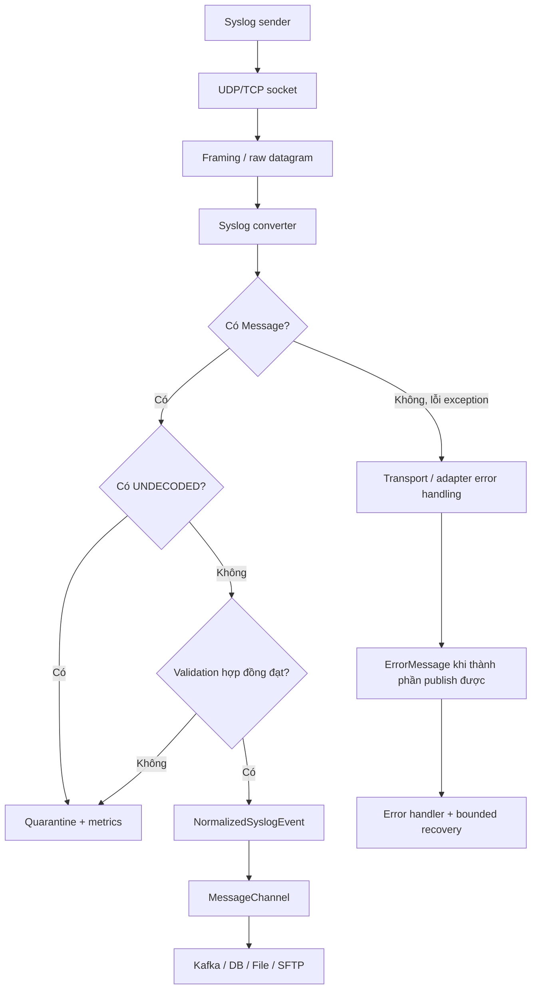
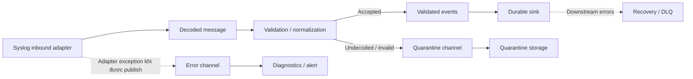
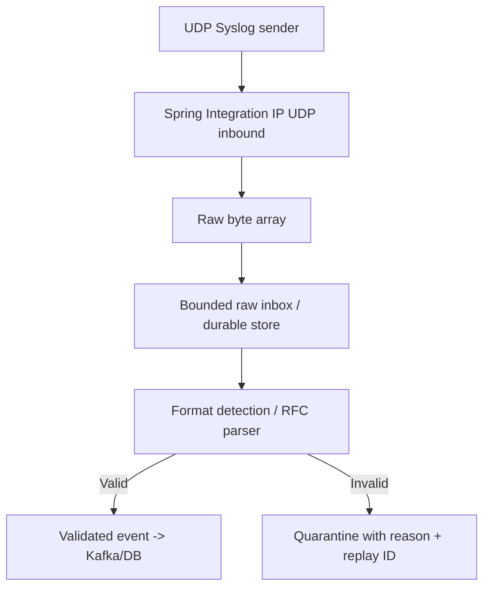

# Xử lý malformed syslog message

## 1. Bối cảnh: nhận được Syslog không có nghĩa bản ghi hợp lệ

Trong **SPRING_INTEGRATION_ADAPTERS**, Spring Integration kết nối các hệ thống bên ngoài bằng inbound/outbound adapter, gateway, poller và `MessageChannel`. Chương **Adapter Syslog** xử lý thông điệp nhật ký do router, firewall, ứng dụng, Linux host và collector gửi qua UDP hoặc TCP. Sau khi nhận, flow có thể định tuyến, lọc, ghi database/file/SFTP, gửi Kafka, JMS, AMQP hoặc gọi HTTP API theo hợp đồng message, lỗi và vòng đời kết nối.

Ở ranh giới này, dữ liệu đầu vào **không đáng tin cậy mặc định**. Một Syslog message có thể:

- Không có PRI hoặc ghi PRI sai cú pháp.
- Có facility/severity không hợp lệ, thiếu hostname, timestamp hay tag cần cho hợp đồng nghiệp vụ.
- Mang bản ghi **RFC 5424** nhưng receiver lại dùng converter **RFC 3164**, hoặc ngược lại.
- Có TCP framing sai, length prefix không đúng, hoặc bị cắt giữa các lần nhận.
- Có dữ liệu bị truncate do UDP receive buffer, IP fragmentation hoặc sender đã cắt trước khi gửi.
- Chứa escape sequence sai, ký tự điều khiển, Unicode không hợp lệ theo charset đã thỏa thuận.
- Parse được ở mức cú pháp nhưng **vi phạm schema, policy nguồn hoặc quy định bảo mật**.

Không phải mọi trường hợp đều dẫn tới Java exception. Đặc biệt, `SyslogToMapTransformer` của Spring Integration dành cho **RFC 3164** có thể trả về `Map` chứa key **`UNDECODED`** khi không giải mã được toàn bộ bản ghi. Trong khi đó, một số lỗi ở TCP deserializer, converter hoặc downstream handler có thể đi qua cơ chế exception và `ErrorMessage`.



**Mục tiêu bài học**:

1. Phân biệt **malformed syntax**, **invalid semantics**, lỗi **transport/framing** và lỗi **downstream**.
2. Nhận biết `SyslogToMapTransformer.UNDECODED`, payload `Map` và header `syslog_*`.
3. Hiểu giới hạn khác nhau của `DefaultMessageConverter` và `RFC5424MessageConverter`.
4. Cấu hình Syslog inbound adapter cùng **hai đường xử lý độc lập**: quarantine record lỗi và error channel cho exception.
5. Viết Java service activator kiểm tra dữ liệu trước khi định tuyến sang hệ thống ngoài.
6. Tổ chức lưu raw/replay, đo tỷ lệ lỗi, giới hạn kích thước và bảo vệ khỏi log injection.
7. Xây unit test và integration test cho bản ghi hợp lệ, thiếu trường, sai PRI, sai format và framing.

> **Nguyên tắc:** “Parser không ném exception” không có nghĩa “record hợp lệ”; “error channel không có lỗi” cũng không chứng minh sender không mất gói.

## 2. Thế nào là malformed Syslog?

### 2.1. Lỗi cú pháp ở RFC 3164

Một bản ghi dạng BSD Syslog thường thấy:

```text
<134>Nov 23 09:15:10 edge-01 sshd[42]: Login failed
```

`<134>` biểu diễn `PRI`, với:

```text
PRI = facility * 8 + severity
facility = PRI / 8      // phép chia nguyên
severity = PRI % 8
```

Với `134`: facility = `16` (`local0`), severity = `6` (`Informational`). Theo bảng facility chuẩn, facility nằm trong `0..23` và severity trong `0..7`, vì vậy PRI nằm trong `0..191`.

Các đầu vào cần kiểm tra:

```text
<134>Nov 23 09:15:10 edge-01 app: OK
<abc>Nov 23 09:15:10 edge-01 app: Bad PRI digits
<192>Nov 23 09:15:10 edge-01 app: PRI out of range
Nov 23 09:15:10 edge-01 app: Missing PRI
<134>broken-header
```

Hai dòng cuối không được mặc định là “thiếu header nên chắc chắn `UNDECODED`”: kết quả cụ thể phụ thuộc parser, phiên bản thư viện và cách converter xử lý định dạng RFC 3164 vốn khá linh hoạt.

**Lưu ý thực tế:** RFC 3164 là format legacy, chứa nhiều biến thể vendor, timestamp thiếu năm/timezone. Một bộ regex quá chặt có thể từ chối log hợp lệ của thiết bị cũ. Cần định nghĩa hợp đồng từng nguồn và test bằng những bản ghi thực đã được làm sạch dữ liệu nhạy cảm.

### 2.2. Lỗi cú pháp ở RFC 5424

RFC 5424 có cấu trúc chặt chẽ hơn:

```text
<134>1 2026-11-23T02:15:10Z edge-01 app 42 AUTH1 - Login failed
```

Các trường cơ bản theo thứ tự:

```text
<PRI>VERSION TIMESTAMP HOSTNAME APP-NAME PROCID MSGID STRUCTURED-DATA MSG
```

Một vài tình huống sai hoặc đáng nghi:

```text
<134>1 2026-11-23T02:15:10Z edge-01 app 42 AUTH1 [id@32473 x="unclosed] failed
<134>1 BAD-TIME edge-01 app 42 AUTH1 - failed
<134>1 2026-11-23T02:15:10Z edge-01 app 42 AUTH1
```

Dòng đầu có `STRUCTURED-DATA` không hoàn chỉnh. Dòng thứ hai có timestamp đáng nghi và cần đối chiếu quy tắc RFC/implementation. Dòng thứ ba thiếu `STRUCTURED-DATA` bắt buộc; `MSG` có thể trống/không có theo format nhưng không được bỏ trường trước đó.

RFC 5424 dùng `-` (NILVALUE) cho một số trường không có dữ liệu. **Không đồng nhất NILVALUE hợp lệ với trường bị mất do bản ghi đã bị cắt**. Đồng thời, `STRUCTURED-DATA` có quy tắc escape cho dấu nháy kép, dấu gạch chéo ngược và dấu đóng ngoặc vuông; dùng `split(" ")` để parse toàn bộ RFC 5424 là không an toàn.

### 2.3. Lỗi “đọc được nhưng không đạt hợp đồng”

Không phải mọi record sai nghiệp vụ đều là malformed ở mức RFC. Ví dụ:

- Severity `6` hợp lệ nhưng nguồn không được phép gửi vào kênh audit nhạy cảm.
- Facility `local0` hợp lệ nhưng ứng dụng yêu cầu `local4` cho một loại sự kiện đã ký kết.
- Hostname trong payload khác inventory nguồn đã xác thực.
- Timestamp có format hợp lệ nhưng lệch hàng giờ hoặc nhiều ngày so với `receivedAt`.
- Trường `MSGID` hoặc structured data thiếu giá trị mà downstream bắt buộc.
- Nội dung log vượt size policy, chứa control characters hoặc có nguy cơ log injection.
- Event ID trùng lặp khi collector replay.

Đó là **validation/policy failures**, cần được phân loại riêng khỏi **syntax parsing failures** để tránh đánh đồng nguyên nhân.

## 3. Nhận diện lỗi ở đúng tầng

| Tầng | Ví dụ | Spring Integration có nhận được `Message<?>` không? | Hướng xử lý |
|---|---|---|---|
| Network UDP | Packet bị firewall hoặc kernel drop | **Không**, nếu packet không vào adapter | Network/OS metrics, sender/collector counters. |
| UDP packet buffer | Datagram dài bị cắt | Có thể có message **bị thiếu bytes** | Test kích thước, buffer và raw capture; không mặc định parser nhận ra. |
| TCP connection | Connection reset, timeout, dừng giữa frame | Có thể không | Connection events, deserializer diagnostics. |
| TCP framing | Sai RFC 6587 octet count/delimiter | Có thể không hoặc record sai ranh giới | Kiểm tra framing trước converter. |
| Converter RFC 3164 | Không decode toàn record | **Có thể có Map với `UNDECODED`** | Quarantine qua validation. |
| Converter RFC 5424 | Record không khớp parser | Tùy implementation: lỗi hoặc không tạo record chuẩn | Phân biệt parse failure và exception. |
| Contract validation | Thiếu facility, severity hoặc source identity | **Có message nhưng bị reject** | Quarantine với reason code. |
| MessageChannel/handler | Subscriber exception, channel rejected | Có message ở một phần flow | Error handling theo sync/async semantics. |
| Sink | Kafka/DB/HTTP/File thất bại | Message đã đi sâu vào flow | Retry/backoff, bounded recovery, DLQ/inbox. |

**Không dùng một counter `syslog_errors_total` duy nhất cho tất cả.** Nên tách `undecoded`, `invalid_fields`, `framing_errors`, `transport_drops` và `downstream_failures`, vì phương án khắc phục của chúng khác nhau.

### 3.1. Khi lỗi nằm trước adapter

UDP không có acknowledgment nghiệp vụ. Packet bị mất trước receiver không thể được tái tạo bằng một Spring Integration `ErrorMessage`. Tương tự, nếu TCP receiver từ chối connection vì TLS handshake thất bại ở proxy thì không nhất thiết có Syslog business message.

Với yêu cầu lưu log quan trọng, hãy dùng collector hỗ trợ disk queue/replay và giám sát cả phía sender lẫn receiver; không suy luận số packet thất lạc từ số `UNDECODED`.

### 3.2. Khi lỗi nằm sau adapter

Một record có thể đã đi qua converter và channel nhưng thất bại khi:

- Chuyển thành DTO vì facility/severity không đúng kiểu.
- Ghi database mất kết nối hoặc vi phạm unique constraint.
- Publish sang Kafka/JMS/AMQP bị timeout.
- Gọi HTTP outbound gateway bị 4xx/5xx.
- Lưu file/SFTP không có quyền hoặc hết dung lượng.

Đây không phải lỗi cú pháp Syslog. Chúng cần được đưa tới **downstream recovery flow** phù hợp và gắn correlation/event ID để replay, thay vì thay đổi parser hoặc loại bỏ bản ghi gốc.

## 4. `SyslogToMapTransformer.UNDECODED`

### 4.1. Hành vi quan trọng của RFC 3164 transformer

Tài liệu API Spring Integration mô tả `SyslogToMapTransformer`: với Syslog RFC 3164 **không decode được**, toàn bộ packet được trả về ở dạng chuỗi trong `Map` dưới key `UNDECODED`. Ví dụ minh họa:

```text
Message<?> {
  payload: {
    UNDECODED-key: "<abc>Nov 23 09:15:10 edge-01 app: Bad PRI"
  },
  headers: {
    id: ...,
    timestamp: ...
  }
}
```

Đây là **sơ đồ khái niệm**, không cam kết tên literal của key hoặc những headers đi kèm. Mã ứng dụng nên dùng:

```java
import org.springframework.integration.transformer.SyslogToMapTransformer;

boolean undecoded =
    fields.containsKey(SyslogToMapTransformer.UNDECODED);
```

**Điểm dễ sai:** `UNDECODED` là **trường của payload `Map`**, không mặc nhiên là một exception; do đó chỉ lắng nghe `errorChannel` sẽ bỏ sót nhánh này.

### 4.2. Không giả định mọi record sai đều tạo `UNDECODED`

Có ba khả năng khác cần xét:

1. Parser tạo map **một phần**: có facility/severity nhưng thiếu timestamp, host hoặc tag.
2. Parser trả trường có **kiểu khác mong đợi**: timestamp có thể là `Date` hoặc `String`; một số giá trị có thể thiếu.
3. Converter/deserializer ném exception hoặc không tạo business message khi dữ liệu quá sai.

Vì vậy, validation phải có **ít nhất hai bước**:

```text
Map contains UNDECODED?
    -> Có: quarantine MALFORMED_RFC3164
    -> Không: validate required fields / type / range / source policy
           -> Đạt: normalized event
           -> Sai: quarantine INVALID_FIELDS
```

Không dùng:

```java
// Không an toàn: field có thể không tồn tại hoặc không phải Integer.
int severity =
    (Integer) fields.get(SyslogToMapTransformer.SEVERITY);
```

Một `ClassCastException` hoặc `NullPointerException` ở đây là lỗi ứng dụng có thể tránh, không phải phương pháp tốt để phân loại malformed Syslog.

## 5. Converter nào sẽ được dùng?

Spring Integration Syslog có hai hướng phổ biến:

| Converter | Format dự kiến | Payload mặc định | Đặc điểm cần lưu ý |
|---|---|---|---|
| `DefaultMessageConverter` | **RFC 3164** | `Map` do `SyslogToMapTransformer` tạo | Các trường decode được, trừ message text, được copy vào headers `syslog_*`. |
| `DefaultMessageConverter` với `asMap=false` | RFC 3164 | Raw `byte[]` | Có thể giữ bản ghi raw và các header decode được; vẫn phải kiểm soát việc parser có lỗi. |
| `RFC5424MessageConverter` | **RFC 5424** | Parsed `Map` | Không mặc định copy các trường decoded ra headers ở `asMap=true`. |
| `RFC5424MessageConverter` với `asMap=false` | RFC 5424 | Raw `byte[]` | Decoded fields ở headers; với TCP cần cấu hình giữ raw ở deserializer. |

Đừng giả định:

- RFC 5424 record được parse hợp lệ bằng `DefaultMessageConverter`.
- Router đọc `SyslogHeaders.SEVERITY` sẽ luôn chạy giống nhau ở cả hai converter.
- `asMap=false` bỏ qua mọi bước parse và tự bảo toàn bất kỳ malformed datagram nào.
- Có exception từ converter đồng nghĩa error channel luôn nhận được raw original message.

**Tách hợp đồng:** transport/framing → converter → validation/normalization → route. Khi thiết bị đổi từ RFC 3164 sang RFC 5424, cần thay đúng parser và regression test, không chỉ thay tên trường trong downstream.

## 6. Lựa chọn xử lý record lỗi

Một hệ thống ingest cần quyết định rõ **lỗi nào phải lưu, lỗi nào có thể bỏ, lỗi nào cần gửi cảnh báo**.

### 6.1. Bốn kết quả phân loại khuyến nghị

| Kết quả | Khi nào | Hành động |
|---|---|---|
| **ACCEPTED** | Parser hợp lệ, required fields đạt validation | Chuyển sang normalized flow và durable sink. |
| **UNDECODED** | RFC 3164 transformer trả `UNDECODED` | Quarantine raw/metadata theo policy, tăng metric. |
| **INVALID_FIELDS** | Thiếu/sai kiểu facility/severity, source policy, kích thước hoặc timestamp | Quarantine/return to review; không sửa âm thầm. |
| **PROCESSING_FAILURE** | Exception khi convert, route, persist hoặc kết nối | Error flow, retry hợp lý, DLQ/persistent recovery khi có dữ liệu gốc. |

Ngoài bốn kết quả, cần đo **TRANSPORT_DROPPED/FRAMING_FAILED** bằng telemetry ở network/receiver. Những tình huống đó có thể không tạo message để phân loại.

### 6.2. Reason code phải ổn định

Ví dụ tập mã nội bộ:

```text
UNDECODED_RFC3164
UNEXPECTED_PAYLOAD_TYPE
MISSING_FACILITY
MISSING_SEVERITY
INVALID_FACILITY
INVALID_SEVERITY
UNTRUSTED_SOURCE
TIMESTAMP_POLICY_VIOLATION
OVERSIZED_RECORD
DECODE_EXCEPTION
TCP_FRAMING_FAILURE
DOWNSTREAM_WRITE_FAILURE
```

Lợi ích: metrics, alert và quy trình replay có thể phân tích theo nhóm mà không phải đọc raw payload nhạy cảm. **Không nhét raw exception message/record vào label metrics** vì có thể làm lộ secret và tăng cardinality.

### 6.3. Quarantine không phải global errorChannel

**Quarantine** là kênh nghiệp vụ nhận message đã xác định không đạt kiểm tra, có thể không ném exception. **Error channel** là kênh thông báo lỗi do các thành phần Spring Integration publish dưới dạng `ErrorMessage`.

Một hệ thống production thường cần cả hai:



Không tự xem một `QueueChannel` trong JVM là nơi lưu trữ quarantine bền vững. Nếu muốn replay sau restart, dùng persistent message store, database inbox, object storage hoặc broker/collector có retention/ack thật.

## 7. Thực hành: Syslog UDP RFC 3164 → validate → quarantine

Ví dụ sử dụng **Java 17+**, Spring Boot với Spring Integration phù hợp phiên bản, Syslog native UDP inbound adapter trên **127.0.0.1:1514**, Java service activator kiểm tra payload `Map`, hai output channels cho `accepted` và `quarantine`, cộng một **error channel** riêng cho lỗi được adapter publish.

Bài thực hành tập trung vào việc **phân loại dữ liệu và tránh mất dấu lỗi**, không triển khai database/Kafka thật. Các sink minh họa chỉ log metadata; bản ghi quan trọng cần durable persistence trong hệ thống thực.

### 7.1. Dependencies Maven

Khi Spring Boot BOM đang quản lý versions:

```xml
<dependencies>
    <dependency>
        <groupId>org.springframework.boot</groupId>
        <artifactId>spring-boot-starter-integration</artifactId>
    </dependency>
    <dependency>
        <groupId>org.springframework.integration</groupId>
        <artifactId>spring-integration-ip</artifactId>
    </dependency>
    <dependency>
        <groupId>org.springframework.integration</groupId>
        <artifactId>spring-integration-syslog</artifactId>
    </dependency>
</dependencies>
```

`spring-integration-ip` cung cấp nền UDP/TCP; `spring-integration-syslog` cung cấp Syslog converter và inbound adapter. Không cần `spring-boot-starter-web` nếu ứng dụng chỉ nhận Syslog và không mở HTTP endpoint.

### 7.2. XML cấu hình Syslog inbound và error channel

Tạo `src/main/resources/syslog-malformed.xml`:

```xml
<?xml version="1.0" encoding="UTF-8"?>
<beans xmlns="http://www.springframework.org/schema/beans"
       xmlns:xsi="http://www.w3.org/2001/XMLSchema-instance"
       xmlns:int="http://www.springframework.org/schema/integration"
       xmlns:int-syslog="http://www.springframework.org/schema/integration/syslog"
       xsi:schemaLocation="
          http://www.springframework.org/schema/beans
          https://www.springframework.org/schema/beans/spring-beans.xsd
          http://www.springframework.org/schema/integration
          https://www.springframework.org/schema/integration/spring-integration.xsd
          http://www.springframework.org/schema/integration/syslog
          https://www.springframework.org/schema/integration/syslog/spring-integration-syslog.xsd">

    <int:channel id="decodedSyslog"/>
    <int:channel id="syslogAdapterErrors"/>

    <int-syslog:inbound-channel-adapter
        id="syslogUdpReceiver"
        channel="decodedSyslog"
        error-channel="syslogAdapterErrors"
        auto-startup="true">

        <int-syslog:udp-attributes
            port="1514"
            local-address="127.0.0.1"
            receive-buffer-size="8192"
            lookup-host="false"/>
    </int-syslog:inbound-channel-adapter>
</beans>
```

**Giải thích:**

- `decodedSyslog` chứa messages mà Syslog converter đã chuyển đổi.
- `syslogAdapterErrors` nhận những `ErrorMessage` được adapter phát ra qua cơ chế `error-channel` trong tình huống lỗi tương ứng.
- `receive-buffer-size=8192` là lựa chọn minh họa; không bảo đảm nhận mọi datagram lớn hoặc chống UDP packet loss.
- `local-address=127.0.0.1` chỉ nhận từ loopback của network namespace hiện tại.
- `lookup-host=false` tránh reverse DNS lookup không cần thiết; không phải cơ chế xác thực sender.
- Vì dùng child `udp-attributes`, `port` đặt trong child, không khai báo đồng thời ở element cha.

**Quan trọng:** `syslogAdapterErrors` không tự nhận những bản ghi có `UNDECODED` nếu converter đã trả về một message bình thường. Đồng thời, một packet UDP bị mất trước receiver không đi tới cả `decodedSyslog` lẫn `syslogAdapterErrors`.

### 7.3. Application khởi chạy XML

```java
package example.syslog;

import org.springframework.boot.SpringApplication;
import org.springframework.boot.autoconfigure.SpringBootApplication;
import org.springframework.context.annotation.ImportResource;
import org.springframework.integration.annotation.EnableIntegration;

@SpringBootApplication
@EnableIntegration
@ImportResource("classpath:syslog-malformed.xml")
public class SyslogMalformedApplication {

    public static void main(String[] args) {
        SpringApplication.run(SyslogMalformedApplication.class, args);
    }
}
```

Các classes ở phần sau nằm trong package `example.syslog` để được Spring Boot component scan.

### 7.4. DTO cho sự kiện hợp lệ và sự kiện bị từ chối

File `SyslogEvents.java`:

```java
package example.syslog;

import java.time.Instant;

public final class SyslogEvents {

    private SyslogEvents() {}

    public record Accepted(
        String eventId,
        int facility,
        int severity,
        String claimedHost,
        Instant receivedAt,
        Instant sourceTimestamp) {
    }

    public record Rejected(
        String reason,
        Instant receivedAt,
        String ingressId,
        int observedCharacters) {
    }
}
```

Thiết kế minh họa:

- `eventId` do receiver sinh để correlation; nó **không** phải ID duy nhất có thể deduplicate chắc chắn một bản ghi được gửi lại sau restart.
- `claimedHost` là hostname do sender khai báo, chưa được xác minh.
- `receivedAt` do ứng dụng lấy tại thời điểm xử lý.
- `sourceTimestamp` có thể `null` với RFC 3164 nếu chưa có đủ context năm/timezone.
- `observedCharacters` chỉ là số ký tự quan sát được ở trường chưa decode, **không phải độ dài gốc của UDP datagram theo byte**.
- Không đưa raw log text vào DTO này. Nếu nghiệp vụ phải lưu message text, bổ sung bước redaction và policy rõ; đừng tự coi thông điệp nào đến cũng an toàn để log hoặc chuyển ra SIEM.

### 7.5. Channel beans

File `SyslogTriageChannels.java`:

```java
package example.syslog;

import org.springframework.context.annotation.Bean;
import org.springframework.context.annotation.Configuration;
import org.springframework.integration.channel.DirectChannel;
import org.springframework.messaging.MessageChannel;

@Configuration
public class SyslogTriageChannels {

    @Bean("acceptedSyslog")
    public MessageChannel acceptedSyslog() {
        return new DirectChannel();
    }

    @Bean("quarantinedSyslog")
    public MessageChannel quarantinedSyslog() {
        return new DirectChannel();
    }
}
```

`DirectChannel` gửi message tới subscriber đồng bộ. Nếu sink chậm, sender thread của channel bị giữ cho đến khi handler xong hoặc lỗi. Đối với UDP, khi receiver bị block lâu, datagrams có thể mất trước khi ứng dụng đọc.

Khi thực sự cần một queue/broker bền vững, hãy cấu hình **ở tầng lưu trữ** chứ không chỉ thay `DirectChannel` bằng `QueueChannel` trong bộ nhớ.

### 7.6. Validator/triage service activator

File `SyslogTriageService.java`:

```java
package example.syslog;

import java.time.Instant;
import java.util.Date;
import java.util.Map;
import java.util.UUID;

import org.springframework.beans.factory.annotation.Qualifier;
import org.springframework.integration.annotation.ServiceActivator;
import org.springframework.integration.transformer.SyslogToMapTransformer;
import org.springframework.messaging.Message;
import org.springframework.messaging.MessageChannel;
import org.springframework.messaging.support.MessageBuilder;
import org.springframework.stereotype.Component;

@Component
public class SyslogTriageService {

    private final MessageChannel accepted;
    private final MessageChannel quarantined;

    public SyslogTriageService(
            @Qualifier("acceptedSyslog") MessageChannel accepted,
            @Qualifier("quarantinedSyslog") MessageChannel quarantined) {
        this.accepted = accepted;
        this.quarantined = quarantined;
    }

    @ServiceActivator(inputChannel = "decodedSyslog")
    public void inspect(Message<?> message) {
        Instant receivedAt = Instant.now();
        Object payload = message.getPayload();

        if (!(payload instanceof Map<?, ?> fields)) {
            reject("UNEXPECTED_PAYLOAD_TYPE", receivedAt, -1);
            return;
        }

        Object undecoded =
            fields.get(SyslogToMapTransformer.UNDECODED);

        if (fields.containsKey(SyslogToMapTransformer.UNDECODED)) {
            // Chỉ đếm ký tự, không ghi raw string lên application log.
            int chars = undecoded instanceof String text
                ? text.length() : -1;

            reject("UNDECODED_RFC3164", receivedAt, chars);
            return;
        }

        Integer facility =
            integerValue(fields.get(SyslogToMapTransformer.FACILITY));
        Integer severity =
            integerValue(fields.get(SyslogToMapTransformer.SEVERITY));

        if (facility == null) {
            reject("MISSING_OR_INVALID_FACILITY", receivedAt, -1);
            return;
        }

        if (severity == null) {
            reject("MISSING_OR_INVALID_SEVERITY", receivedAt, -1);
            return;
        }

        if (facility < 0 || facility > 23) {
            reject("INVALID_FACILITY", receivedAt, -1);
            return;
        }

        if (severity < 0 || severity > 7) {
            reject("INVALID_SEVERITY", receivedAt, -1);
            return;
        }

        Object host = fields.get(SyslogToMapTransformer.HOST);
        String claimedHost = host == null
            ? "unknown" : String.valueOf(host);

        // Không dùng claimedHost như identity đáng tin.
        // Không log raw message text hoặc tự cấp quyền từ hostname.
        if (claimedHost.length() > 255) {
            reject("HOST_TOO_LONG", receivedAt, -1);
            return;
        }

        Instant sourceTime =
            sourceTime(fields.get(SyslogToMapTransformer.TIMESTAMP));

        SyslogEvents.Accepted event = new SyslogEvents.Accepted(
            UUID.randomUUID().toString(),
            facility,
            severity,
            claimedHost,
            receivedAt,
            sourceTime);

        sendOrThrow(accepted, event);
    }

    private void reject(
            String reason, Instant receivedAt, int chars) {

        SyslogEvents.Rejected rejected =
            new SyslogEvents.Rejected(
                reason, receivedAt, "udp-listener-1514", chars);

        sendOrThrow(quarantined, rejected);
    }

    private static Integer integerValue(Object value) {
        if (value instanceof Number number) {
            double n = number.doubleValue();
            if (Double.isFinite(n)
                    && n == Math.rint(n)
                    && n >= Integer.MIN_VALUE
                    && n <= Integer.MAX_VALUE) {
                return (int) n;
            }
            return null;
        }

        if (value instanceof String text
                && text.matches("[0-9]{1,3}")) {
            try {
                return Integer.valueOf(text);
            } catch (NumberFormatException ex) {
                return null;
            }
        }

        return null;
    }

    private static Instant sourceTime(Object value) {
        if (value instanceof Date date) {
            return date.toInstant();
        }
        if (value instanceof Instant instant) {
            return instant;
        }

        // RFC 3164 timestamp thường thiếu năm/timezone.
        // Cần policy nguồn trước khi diễn giải String thành Instant.
        return null;
    }

    private static void sendOrThrow(
            MessageChannel channel, Object value) {

        boolean delivered = channel.send(
            MessageBuilder.withPayload(value).build());

        if (!delivered) {
            throw new IllegalStateException(
                "Syslog result channel rejected message");
        }
    }
}
```

**Giải thích chính:**

1. Validator kiểm tra **`UNDECODED` trước** khi đọc facility/severity.
2. `Map` không có khóa `UNDECODED` **vẫn phải validate** trường required, type và range.
3. Mã cố ý không gọi `Integer.parseInt(...)` trên chuỗi tùy ý và không ép `(Integer)` mù quáng.
4. `sourceTime` chỉ điền khi converter đã trả kiểu thời gian được nhận diện; timestamp RFC 3164 có thể thiếu bối cảnh để quyết định UTC chính xác.
5. `claimedHost` chỉ được dùng làm metadata log; identity được xác thực phải có nguồn riêng từ TLS/collector/network boundary.
6. Kênh lỗi nghiệp vụ `quarantinedSyslog` nhận một `Rejected` với reason code, **không phải `ErrorMessage`**.
7. `sendOrThrow` kiểm tra kết quả dispatch, nhưng `true` không bảo đảm lưu dữ liệu bền vững vào Kafka/database.
8. Trường `observedCharacters` không được xem là số bytes ban đầu. Nếu bị truncate tại UDP socket, parser có thể không biết độ dài gốc.

**Giới hạn mẫu code:** ví dụ chấp nhận record có đủ facility/severity và hostname không quá dài. Một sản phẩm thực tế có thể bắt buộc APP-NAME/TAG, MSGID, source identity, timestamp policy, message size và cấu trúc event ID. Định nghĩa hợp đồng **theo nguồn và mục đích ingest** trước khi reject tất cả các biến thể legacy Syslog.

### 7.7. Subscriber cho dữ liệu đã phân loại

File `SyslogTriageConsumers.java`:

```java
package example.syslog;

import org.slf4j.Logger;
import org.slf4j.LoggerFactory;
import org.springframework.integration.annotation.ServiceActivator;
import org.springframework.stereotype.Component;

@Component
public class SyslogTriageConsumers {

    private static final Logger log =
        LoggerFactory.getLogger(SyslogTriageConsumers.class);

    @ServiceActivator(inputChannel = "acceptedSyslog")
    public void accept(SyslogEvents.Accepted event) {
        log.info("Syslog accepted: facility={}, severity={}, eventId={}",
            event.facility(), event.severity(), event.eventId());

        // Production: normalize thêm + publish/persist tới durable sink.
        // Không log raw MSG hoặc chuyển toàn bộ headers tùy ý.
    }

    @ServiceActivator(inputChannel = "quarantinedSyslog")
    public void quarantine(SyslogEvents.Rejected event) {
        log.warn("Syslog quarantined: reason={}, observedChars={}",
            event.reason(), event.observedCharacters());

        // Production: lưu metadata vào quarantine storage có quota,
        // alert tỷ lệ lỗi; muốn replay cần lưu raw có kiểm soát.
    }
}
```

Ví dụ này đủ cho bài học về **routing malformed records**, nhưng chỉ ghi log metadata. **Chưa có Kafka/DB/quarantine storage bền vững**; không được gọi đây là giải pháp production đã đảm bảo không mất dữ liệu.

## 8. Bắt exception bằng `ErrorMessage`

### 8.1. Error channel khác nhánh quarantine ở đâu?

`SyslogTriageService` chủ động gửi `Rejected` khi payload không đúng hợp đồng. Trong khi đó, lỗi có thể được adapter publish qua `error-channel="syslogAdapterErrors"`, và những lỗi như converter exception/downstream handler exception có đường xử lý phụ thuộc sync/async boundary.

Trong Spring Integration:

- `ErrorMessage.getPayload()` là một `Throwable`.
- `ErrorMessage.getOriginalMessage()` có thể tham chiếu message được xử lý khi lỗi xảy ra, **nếu thành phần/error strategy đã lưu**.
- `MessagingException.getFailedMessage()` có thể cung cấp failed message.
- Message header `MessageHeaders.ERROR_CHANNEL` được sử dụng bởi các cơ chế publish lỗi bất đồng bộ khi có context tương ứng.
- Global `errorChannel` không phải durable queue và không nhất thiết nhìn thấy mọi exception trên `DirectChannel` đồng bộ.

### 8.2. Service activator xử lý lỗi adapter

File `SyslogAdapterErrorConsumer.java`:

```java
package example.syslog;

import org.slf4j.Logger;
import org.slf4j.LoggerFactory;
import org.springframework.integration.annotation.ServiceActivator;
import org.springframework.messaging.Message;
import org.springframework.messaging.MessagingException;
import org.springframework.messaging.support.ErrorMessage;
import org.springframework.stereotype.Component;

@Component
public class SyslogAdapterErrorConsumer {

    private static final Logger log =
        LoggerFactory.getLogger(SyslogAdapterErrorConsumer.class);

    @ServiceActivator(inputChannel = "syslogAdapterErrors")
    public void onError(ErrorMessage error) {
        Throwable failure = error.getPayload();
        Message<?> failed = error.getOriginalMessage();

        if (failed == null && failure instanceof MessagingException ex) {
            failed = ex.getFailedMessage();
        }

        String failureType = failure.getClass().getSimpleName();
        boolean hasOriginalMessage = failed != null;

        log.error(
            "Syslog adapter error: type={}, hasOriginalMessage={}",
            failureType, hasOriginalMessage);

        // Production: exception counter/alert, bounded recovery store.
        // Không log raw failedMessage hay Throwable.toString()
        // mặc định vì exception có thể chứa dữ liệu người gửi.
    }
}
```

**Không giả định** `failed != null`: lỗi có thể xảy ra ở socket/framing/converter trước khi một business message được tạo.

**Không giả định** cứ có `error-channel` là mọi lỗi tự đến đó. Các thành phần phải thực sự sử dụng cơ chế publish `ErrorMessage`. Một ngoại lệ trên `DirectChannel` đồng bộ có thể lan về caller hoặc bị adapter xử lý; một worker trên `ExecutorChannel`/poller có semantics khác.

### 8.3. Exception trong flow bất đồng bộ

Nếu sau validation, bạn chuyển message qua `ExecutorChannel`:

```text
Syslog adapter
 -> decodedSyslog
 -> validation
 -> ExecutorChannel
 -> downstream handler
       throws exception
 -> ErrorMessage tới header errorChannel hoặc global errorChannel,
    nếu message error publisher của executor được dùng
```

Khi cần gắn error channel riêng cho đoạn worker, dùng một bước **header enricher** (như `MessageHeaders.ERROR_CHANNEL`) trước async boundary và đăng ký error handler trên channel tương ứng. Khi retry, dùng backoff, số lần tối đa và persistent recovery; không gửi lại vô hạn những bản ghi malformed có lỗi deterministic.

`UNDECODED` là dữ liệu validation failure, không nên ép ném exception chỉ để nó đi vào `ErrorMessage` nếu phân loại/quarantine có thể xử lý bình thường.

## 9. Khi cần giữ raw bytes để điều tra malformed records

### 9.1. Vì sao parsed Map không luôn đủ?

Một record bị decode sai có thể cần kiểm tra:

- Byte sequence thực tế của PRI/header.
- Charset/encoding, BOM, control characters hoặc dấu xuống dòng.
- Truncation trước converter hoặc size limit không nhất quán.
- RFC 5424 structured data escape và TCP framing.
- Phiên bản parser/converter đã xử lý.
- Source identity và thời điểm receive.

Sau khi dữ liệu đã thành `Map`, việc dựng lại **chính xác bytes gốc** không được bảo đảm.

Với `DefaultMessageConverter`, `asMap=false` giữ raw `byte[]` làm payload nhưng converter có thể vẫn cần parse các trường để tạo headers. Vì vậy **không nên mặc định chỉ bật `asMap=false` là mọi invalid datagram sẽ đi tới business flow**.

### 9.2. Kiến trúc raw-first phù hợp khi cần audit

Một kiến trúc khác là nhận raw datagram bằng **IP UDP adapter** trước, lưu có kiểm soát rồi mới parse:



Ví dụ Java DSL nhận raw UDP ở **1515** để **không tranh cổng 1514** của native Syslog adapter:

```java
package example.syslog;

import org.springframework.context.annotation.Bean;
import org.springframework.context.annotation.Configuration;
import org.springframework.integration.annotation.EnableIntegration;
import org.springframework.integration.dsl.IntegrationFlow;
import org.springframework.integration.ip.dsl.Udp;

@Configuration
@EnableIntegration
public class RawUdpSyslogConfiguration {

    @Bean
    public IntegrationFlow rawUdpSyslogFlow() {
        return IntegrationFlow.from(Udp.inboundAdapter(1515))
            .channel("rawSyslogDatagrams")
            .get();
    }
}
```

Một service activator có thể kiểm tra kiểu raw:

```java
package example.syslog;

import org.springframework.integration.annotation.ServiceActivator;
import org.springframework.messaging.Message;
import org.springframework.stereotype.Component;

@Component
public class RawSyslogIngress {

    @ServiceActivator(inputChannel = "rawSyslogDatagrams")
    public void receive(Message<?> message) {
        if (!(message.getPayload() instanceof byte[] raw)) {
            throw new IllegalArgumentException(
                "Expected raw UDP bytes");
        }

        if (raw.length == 0 || raw.length > 8192) {
            // Tăng metric và áp chính sách rejection/quarantine.
            return;
        }

        // Production: persist raw + trusted receive metadata
        // trong một bounded store có access control trước parser.
        // Sau đó parse/replay theo format của nguồn.
    }
}
```

**Giới hạn quan trọng:** `raw.length` là số bytes **adapter đã nhận được**, không chứng minh packet không bị truncate trước đó. Raw UDP adapter **không tự bền vững**, còn `return` trong ví dụ chỉ minh họa size guard chứ không thực sự ghi rejection. Khi cần chống mất dữ liệu, phải thiết kế storage/retry trước khi coi bản ghi đã được tiếp nhận chắc chắn.

Nếu triển khai **cả native Syslog 1514 và raw IP 1515**, chúng là **hai nguồn độc lập trên hai cổng**. Đừng giả định một datagram gửi tới 1514 tự xuất hiện trên 1515; nếu muốn vừa raw vừa parsed trên cùng traffic, thiết kế **một ingress duy nhất** nhận raw rồi dispatch tiếp sau khi persist.

### 9.3. Không lưu raw vô hạn

Raw log có thể chứa IP, username, token, đường dẫn hoặc dữ liệu cá nhân. Một quarantine store cần có:

- Quota dung lượng và giới hạn kích thước từng record.
- Encryption at rest, ACL/IAM và retention.
- Trusted ingress ID, timestamps, parser version và hash/checksum nếu cần audit.
- Reason code, retry count, review status, expiry.
- Chính sách replay có kiểm soát và idempotency/dedup.
- Redaction khi hiển thị trên UI hoặc xuất báo cáo.

**Không in toàn bộ failed message hay raw bytes ra application logs** để chẩn đoán. Điều đó có thể gây lộ thông tin hoặc vòng lặp nếu application logs lại được forward tới cùng Syslog receiver.

## 10. RFC 5424, TCP framing và những lỗi dễ nhầm với malformed

### 10.1. RFC 5424 phải dùng converter phù hợp

Một bản ghi RFC 5424 ví dụ:

```text
<134>1 2026-11-23T02:15:10Z edge-01 app 123 EVT1 - Configuration changed
```

Đối với Syslog RFC 5424, cấu hình `RFC5424MessageConverter` thay cho parser RFC 3164. Ví dụ fragment XML:

```xml
<bean id="rfc5424Converter"
      class="org.springframework.integration.syslog.RFC5424MessageConverter"/>

<int:channel id="rfc5424Events"/>

<int-syslog:inbound-channel-adapter
    id="rfc5424UdpReceiver"
    channel="rfc5424Events"
    protocol="udp"
    port="1516"
    converter="rfc5424Converter"/>
```

Đoạn này là **phương án bổ sung trên cổng khác**, cần subscriber `rfc5424Events` và logic validation riêng cho payload của converter RFC 5424. Không dùng nguyên `SyslogTriageService` đã viết cho RFC 3164 nếu chưa kiểm tra các key Map tương ứng.

### 10.2. TCP cần framing RFC 6587

```text
TCP bytes -> frame decoder -> complete Syslog record
          -> RFC5424MessageConverter -> Message<?> -> validation
```

Một `Socket.read` hoặc một TCP segment **không phải** một Syslog message. Với Syslog RFC 5424 qua TCP, Spring Integration hướng dẫn dùng `RFC6587SyslogDeserializer`:

```xml
<bean id="rfc6587Deserializer"
      class="org.springframework.integration.syslog.inbound.RFC6587SyslogDeserializer"/>

<int-ip:tcp-connection-factory
    id="rfc5424TcpServer"
    type="server"
    using-nio="true"
    port="1517"
    deserializer="rfc6587Deserializer"/>

<int-syslog:inbound-channel-adapter
    id="rfc5424TcpReceiver"
    protocol="tcp"
    connection-factory="rfc5424TcpServer"
    converter="rfc5424Converter"
    channel="rfc5424Events"/>
```

Fragment cần namespace:

```xml
xmlns:int-ip="http://www.springframework.org/schema/integration/ip"
```

và schema location:

```text
http://www.springframework.org/schema/integration/ip
https://www.springframework.org/schema/integration/ip/spring-integration-ip.xsd
```

`RFC6587SyslogDeserializer` hỗ trợ octet counting và non-transparent framing dùng LF mặc định. Sender và receiver phải thống nhất framing:

- **Octet counting**: `<length-in-bytes> SP <syslog-record>`, length là số bytes, không phải `String.length()`.
- **Non-transparent framing**: delimiter, thường là LF.
- RFC 5425 (Syslog over TLS): TLS + TCP và octet counting; TLS record boundaries không phải Syslog record boundaries.

Một prefix length sai, frame quá lớn, thiếu bytes hoặc delimiter mismatch có thể gây lỗi ở **transport/framer trước converter**, không phải trường `UNDECODED` của RFC 3164.

### 10.3. Khi nào cần giữ original khi dùng RFC 5424 raw?

Theo tài liệu Spring Integration, khi `RFC5424MessageConverter.asMap=false` và TCP RFC 6587, cần đặt tùy chọn `retainOriginal` phù hợp trên `RFC6587SyslogDeserializer` để converter có original record. Đây là cấu hình ở **framing layer**, không phải business validation.

### 10.4. Malformed do truncation: bài toán khó chứng minh

UDP receive buffer quá nhỏ có thể cắt datagram **trước** khi converter đọc; mất đuôi message text nhưng giữ nguyên PRI/header khiến record **vẫn parse được**. Vì vậy:

- `UNDECODED` không có nghĩa tất cả dữ liệu nhận được đều đầy đủ.
- Parser trả record hợp lệ không chứng minh bản ghi nguyên vẹn.
- Cần test sender với **byte length biết trước**, theo dõi receive-buffer-size và OS receive errors.
- Khi cần kiểm tra dữ liệu đầy đủ, dùng transport/collector có framing, size contract, persistence và replay được thiết kế rõ.
- `check-length` 4-byte prefix của Spring Integration IP UDP là **wire protocol bổ sung**, không tương thích mặc nhiên với sender Syslog chuẩn RFC 5426.

## 11. Validation nâng cao: timestamp, charset, kích thước và cấu trúc

### 11.1. Timestamp policy

Với RFC 3164, timestamp có thể thiếu năm/timezone; converter có thể trả `Date` nếu giải mã được hoặc `String` nếu không. Không nên ép mọi timestamp thành `Instant` rồi coi đó là thời gian nguồn chính xác.

Một chiến lược an toàn:

1. Luôn lưu `receivedAt` do receiver đặt.
2. Lưu `sourceTimestampRaw` ở nơi có access control nếu cần audit.
3. Chỉ đặt `sourceTimestamp` sau khi parse theo timezone/năm/clock skew policy của nguồn.
4. Ghi reason riêng cho timestamp không đủ context hoặc lệch ngưỡng.
5. Không đánh dấu log là malformed chỉ vì một thiết bị legacy dùng timestamp đúng với contract đã thống nhất nhưng khác định dạng lý tưởng.

### 11.2. Charset và Unicode

Đối với nội dung dùng UTF-8 theo một **hợp đồng cụ thể**, một `CharsetDecoder` với `CodingErrorAction.REPORT` có thể phát hiện byte sequences không hợp lệ:

```java
import java.nio.ByteBuffer;
import java.nio.charset.CharacterCodingException;
import java.nio.charset.CodingErrorAction;
import java.nio.charset.StandardCharsets;

public final class Utf8Policy {

    public static void validate(byte[] raw)
            throws CharacterCodingException {

        StandardCharsets.UTF_8.newDecoder()
            .onMalformedInput(CodingErrorAction.REPORT)
            .onUnmappableCharacter(CodingErrorAction.REPORT)
            .decode(ByteBuffer.wrap(raw));
    }
}
```

Đây là **validation encoding theo policy**, không phải một parser Syslog. RFC 5424 có quy tắc riêng cho phần MSG và UTF-8/BOM; không áp dụng quy tắc “mọi Syslog bytes đều phải là UTF-8” cho mọi sender legacy mà chưa có thỏa thuận.

Nếu converter đã thay invalid bytes bằng replacement characters, một bước sau đó có thể không phát hiện được thông tin gốc đã mất. Muốn phân tích byte-level, cần giữ raw bytes **trước conversion**.

### 11.3. Size limit và dữ liệu có cấu trúc

- Giới hạn **toàn bộ Syslog record**, không chỉ `MSG`.
- RFC 5424 structured data có thể dài dù text ngắn.
- UDP datagram có thể bị IP fragmentation hoặc socket truncation.
- Đừng dùng `String.length()` làm byte size limit cho UTF-8 có tiếng Việt/emoji.
- Giới hạn số key/attributes và maximum nesting/length nếu có bước chuyển sang JSON.
- Đối với log cực dài, cân nhắc TCP/TLS hoặc collector với disk queue thay vì nâng vô hạn UDP buffer.
- Các `Map` malformed hoặc raw bytes rất lớn cần được xử lý trong **bounded memory**.

### 11.4. Log injection và dữ liệu nhạy cảm

Một record có thể chứa newline, carriage return hoặc escape sequence để đánh lừa UI/logging. Khi ghi nội dung ra nơi khác:

- Escape control characters và sử dụng structured logging đúng cách.
- Không lấy message text làm template string, lệnh shell hoặc SQL.
- Không đưa raw message vào metric labels.
- Redact token, password, cookie, API key và dữ liệu cá nhân theo policy.
- Không coi hostname, facility hay severity do sender tự khai báo là identity đã xác thực.
- Bảo vệ quarantine storage khỏi truy cập không cần thiết.

## 12. Kiểm thử parser và validation mà không cần mở socket

Trước integration test UDP/TCP, nên có **unit test cho triage policy**, không phụ thuộc packet loss.

### 12.1. Test dùng QueueChannel thu kết quả

Với JUnit Jupiter, tạo `SyslogTriageServiceTest.java`:

```java
package example.syslog;

import static org.junit.jupiter.api.Assertions.*;

import java.util.HashMap;
import java.util.Map;

import org.junit.jupiter.api.Test;
import org.springframework.integration.channel.QueueChannel;
import org.springframework.integration.transformer.SyslogToMapTransformer;
import org.springframework.messaging.Message;
import org.springframework.messaging.support.MessageBuilder;

class SyslogTriageServiceTest {

    @Test
    void routesUndecodedToQuarantine() {
        QueueChannel accepted = new QueueChannel(2);
        QueueChannel rejected = new QueueChannel(2);
        SyslogTriageService triage =
            new SyslogTriageService(accepted, rejected);

        Map<String, Object> fields = Map.of(
            SyslogToMapTransformer.UNDECODED,
            "<abc>Nov 23 09:15:10 invalid");

        Message<?> incoming =
            MessageBuilder.withPayload(fields).build();

        triage.inspect(incoming);

        Message<?> result = rejected.receive(1000);
        assertNotNull(result);
        assertInstanceOf(
            SyslogEvents.Rejected.class, result.getPayload());

        SyslogEvents.Rejected event =
            (SyslogEvents.Rejected) result.getPayload();

        assertEquals("UNDECODED_RFC3164", event.reason());
        assertNull(accepted.receive(0));
    }

    @Test
    void routesInvalidSeverityToQuarantine() {
        QueueChannel accepted = new QueueChannel(2);
        QueueChannel rejected = new QueueChannel(2);
        SyslogTriageService triage =
            new SyslogTriageService(accepted, rejected);

        Map<String, Object> fields = new HashMap<>();
        fields.put(SyslogToMapTransformer.FACILITY, 16);
        fields.put(SyslogToMapTransformer.SEVERITY, 9);

        triage.inspect(MessageBuilder
            .withPayload(fields).build());

        Message<?> result = rejected.receive(1000);
        assertNotNull(result);

        SyslogEvents.Rejected event =
            (SyslogEvents.Rejected) result.getPayload();

        assertEquals("INVALID_SEVERITY", event.reason());
        assertNull(accepted.receive(0));
    }

    @Test
    void acceptsValidFields() {
        QueueChannel accepted = new QueueChannel(2);
        QueueChannel rejected = new QueueChannel(2);
        SyslogTriageService triage =
            new SyslogTriageService(accepted, rejected);

        Map<String, Object> fields = new HashMap<>();
        fields.put(SyslogToMapTransformer.FACILITY, 16);
        fields.put(SyslogToMapTransformer.SEVERITY, 6);
        fields.put(SyslogToMapTransformer.HOST, "edge-01");

        triage.inspect(MessageBuilder
            .withPayload(fields).build());

        Message<?> result = accepted.receive(1000);
        assertNotNull(result);

        SyslogEvents.Accepted event =
            (SyslogEvents.Accepted) result.getPayload();

        assertEquals(16, event.facility());
        assertEquals(6, event.severity());
        assertEquals("edge-01", event.claimedHost());
        assertNull(rejected.receive(0));
    }

    @Test
    void rejectsUnexpectedPayloadType() {
        QueueChannel accepted = new QueueChannel(2);
        QueueChannel rejected = new QueueChannel(2);
        SyslogTriageService triage =
            new SyslogTriageService(accepted, rejected);

        triage.inspect(MessageBuilder
            .withPayload(new byte[]{1, 2, 3}).build());

        Message<?> result = rejected.receive(1000);
        assertNotNull(result);

        SyslogEvents.Rejected event =
            (SyslogEvents.Rejected) result.getPayload();

        assertEquals("UNEXPECTED_PAYLOAD_TYPE", event.reason());
        assertNull(accepted.receive(0));
    }
}
```

Các test này xác minh **business validation**, không kiểm thử trực tiếp tính đúng đắn của parser RFC 3164. Đặc biệt, test tạo Map có `UNDECODED` là **mô phỏng đầu ra transformer**, không chứng minh mọi chuỗi malformed cụ thể sẽ được converter hiện tại đưa vào cùng nhánh.

### 12.2. Unit test trực tiếp transformer

Có thể bổ sung test parser thực tế theo phiên bản Spring Integration đã pin, dùng `SyslogToMapTransformer` với các bản ghi RFC 3164 mẫu và khẳng định những trường converter tạo ra.

Tối thiểu cần test các nhóm:

- RFC 3164 hợp lệ với PRI `<134>`, hostname, tag và message.
- Thiếu/biến thể timestamp của thiết bị thực.
- PRI có chữ, thiếu dấu `>` hoặc nằm ngoài miền.
- Bytes khác UTF-8 theo contract nguồn.
- Log có newline/control chars, đủ và quá giới hạn.
- Bản ghi parse được nhưng thiếu một required field của ứng dụng.

**Không viết assertion rằng mọi malformed input chắc chắn ném exception**; hãy kiểm tra hành vi `UNDECODED`/message/error tương ứng của version framework thực tế.

## 13. Integration test với UDP sender

### 13.1. Gửi bản ghi hợp lệ và malformed

Khi ứng dụng đang lắng nghe UDP/1514 trên loopback, dùng Java gửi vài datagrams:

```java
package example.syslog;

import java.net.DatagramPacket;
import java.net.DatagramSocket;
import java.net.InetAddress;
import java.nio.charset.StandardCharsets;

public final class MalformedSyslogSender {

    private static void send(
            DatagramSocket socket,
            InetAddress target,
            String record) throws Exception {

        byte[] bytes = record.getBytes(StandardCharsets.UTF_8);
        DatagramPacket packet = new DatagramPacket(
            bytes, bytes.length, target, 1514);
        socket.send(packet);
    }

    public static void main(String[] args) throws Exception {
        InetAddress target =
            InetAddress.getByName("127.0.0.1");

        try (DatagramSocket socket = new DatagramSocket()) {
            send(socket, target,
                "<134>Nov 23 09:15:10 edge-01 app: Job started");

            send(socket, target,
                "<abc>Nov 23 09:15:10 edge-01 app: Bad PRI");

            send(socket, target,
                "<192>Nov 23 09:15:10 edge-01 app: PRI out of range");

            send(socket, target,
                "Missing PRI and malformed record");

            send(socket, target,
                "<134>broken-header");
        }
    }
}
```

Lệnh `socket.send(...)` thành công **không chứng minh UDP receiver đã nhận hết**. Vì vậy, test end-to-end phải thu metrics từ receiver và kết quả lưu/route, thay vì so sánh số calls `send` với số processed messages như một bảo đảm không mất gói.

### 13.2. Quan sát những outcome nào?

Với mỗi input, ghi nhận **thực tế**:

1. Adapter có nhận datagram không?
2. Converter có tạo `Message<?>` hay xuất exception?
3. Payload có `UNDECODED` không?
4. Required fields có đủ và đúng kiểu không?
5. Message đi `acceptedSyslog` hay `quarantinedSyslog`?
6. Có `ErrorMessage` ở `syslogAdapterErrors` không?
7. Một record accepted có thật sự được commit vào sink không?

Ví dụ bảng test:

| Test case | Tầng kiểm thử | Kết quả cần kiểm tra |
|---|---|---|
| RFC 3164 hợp lệ | Converter + validator | Fields hợp lệ → accepted. |
| PRI `<abc>` | Converter | `UNDECODED` hoặc lỗi theo parser thực tế; không vào accepted nếu PRI sai. |
| PRI `<192>` | Converter/validator | Reject hoặc parse failure; không chấp nhận facility ngoài miền. |
| Thiếu PRI | Converter | Không âm thầm sinh facility/severity mặc định. |
| Message thiếu TAG | Policy validation | Chỉ reject nếu hợp đồng nguồn bắt buộc TAG. |
| Timestamp không parse được | Parser/policy | Giữ raw/receivedAt, xử lý theo policy, không tự đoán UTC. |
| Trường severity có kiểu sai | Validator | Quarantine với reason ổn định. |
| Payload `byte[]` khi validator chờ Map | Validator | `UNEXPECTED_PAYLOAD_TYPE`. |
| RFC 5424 vào converter RFC 3164 | Converter | Phát hiện format mismatch bằng test, không giả định fields chuẩn. |
| TCP RFC 5424 sai octet count | Framing/transport | Theo dõi deserializer error, không chờ `UNDECODED`. |
| UDP datagram quá lớn | Network/receive buffer | Đo truncation/drop; không suy từ parser exception. |
| Worker/database exception | Downstream | Error handling + retry/DLQ phù hợp. |
| App restart khi queue memory còn message | Durability | Cần có nguồn replay; memory queue không bảo đảm. |

### 13.3. Không ép tất cả case vào một kết quả

Một bản ghi thiếu TAG nhưng vẫn đúng format legacy có thể được parser chấp nhận; một record sai timestamp có thể để lại raw string; một RFC 5424 malformed có thể bị parser từ chối ngay trước khi tạo Spring message. **Test phải khóa hợp đồng theo version và sender**, không phải dựa vào mong muốn một exception thống nhất.

## 14. Reliability: malformed không chỉ là vấn đề parser

Một pipeline Syslog end-to-end:

```text
Syslog sender
 -> network delivery
 -> UDP socket / TCP connection
 -> frame extraction
 -> Syslog converter
 -> validation / quarantine
 -> MessageChannel
 -> durable sink
 -> commit / ack
 -> downstream consumer
```

Mỗi bước có failure mode và mốc xác nhận riêng.

### 14.1. UDP không có application acknowledgment

Syslog UDP một chiều không có ACK nghiệp vụ. Sender không tự biết receiver đã:

- Nhận datagram.
- Parse thành công.
- Đưa vào channel.
- Quarantine vì malformed.
- Commit vào Kafka/database.

Nếu cần phát lại record đã mất, phải thiết kế sender/collector có disk queue và protocol/ack riêng. `errorChannel` ở Spring Integration không biến Syslog UDP thành reliable delivery protocol.

### 14.2. TCP cũng không có durable commit acknowledgment

TCP đảm bảo thứ tự byte trong connection còn sống nhưng không xác nhận record đã được **lưu bền vững**. Khi TCP stream framing sai, một sender có thể kết nối được nhưng receiver không tách được message đúng.

RFC 5425 TLS giúp confidentiality/integrity và xác minh peer certificate theo policy; **không tự sửa** malformed content hoặc đảm bảo Kafka commit.

### 14.3. Retry phải phù hợp loại lỗi

| Lỗi | Nên retry tự động? | Giải thích |
|---|---|---|
| PRI sai format / `UNDECODED` | **Không retry nguyên xi liên tục** | Lỗi deterministic, cần quarantine/sửa nguồn hoặc parser. |
| RFC 5424 parser mismatch | **Không retry vô hạn** | Cần đúng converter/config/version. |
| TCP framing mismatch | **Không retry cùng sai framing** | Phải sửa sender/deserializer; retry chỉ tạo thêm lỗi. |
| Kafka/DB timeout tạm thời | Có thể, với backoff/limit | Cần idempotency và persistent failure storage. |
| Certificate expired / mTLS reject | Không retry dồn dập | Cần sửa trust/certificate/policy. |
| UDP packet drop trước receiver | Retry chỉ khi sender/collector hỗ trợ | Application không biết packet nào đã mất. |
| Quarantine storage unavailable | Có recovery riêng | Không bỏ âm thầm bản ghi lỗi cần audit. |

### 14.4. Idempotency và replay

Syslog truyền thống không đảm bảo event ID toàn cục. Nếu collector replay và receiver sinh `UUID` mới mỗi lần, dedup dựa trên UUID tại receiver **không** nhận ra bản ghi lặp.

Các lựa chọn:

- Ưu tiên event ID do nguồn phát có hợp đồng cung cấp.
- Gắn `trustedSourceId`, `sourceTimestamp` và checksum/fingerprint nội dung khi phù hợp.
- Xác định cửa sổ dedup và rủi ro trùng giả.
- Không dùng hostname từ payload làm sole source identity.
- Phân loại records malformed có thể replay sau khi thay parser, nhưng không phát lại tới tất cả destinations nếu không có kiểm soát.

## 15. Bảo mật và chống tấn công qua malformed Syslog

Một hệ thống tiếp nhận log là điểm ingest dữ liệu từ nhiều nguồn. Một sender độc hại có thể lợi dụng record sai format để gây CPU/memory pressure hoặc làm nhiễm dữ liệu điều tra.

### 15.1. Những rủi ro phổ biến

| Nguy cơ | Ví dụ | Biện pháp |
|---|---|---|
| Log injection | MSG chứa CR/LF để giả thêm dòng log | Escape/structure output, không log raw input. |
| Parser abuse | Input rất lớn, structured data nhiều tham số | Giới hạn bytes, field count, timeouts. |
| Header spoofing | Sender tự ghi hostname/facility khẩn cấp | Dùng trusted identity từ TLS/collector, validate riêng. |
| Sensitive data exposure | Raw log chứa token/PII | Quarantine có ACL, redaction, encryption, retention. |
| Alert flood | Một nguồn gửi nhiều `severity=0` | Rate limit và policy theo verified source. |
| Infinite retry | Deterministic parse failure được retry mãi | Quarantine với giới hạn, không retry vô hạn. |
| Dead-letter overflow | Lỗi parser tăng mạnh trong sự cố triển khai | Bounded DLQ, quota, alert, spill/recovery policy. |
| Looping logs | Receiver log ra Syslog daemon rồi quay lại receiver | Tách internal diagnostics khỏi cùng ingress route. |

### 15.2. Tin cậy theo nguồn

Syslog UDP/TCP plaintext không tự xác thực sender. `HOSTNAME`, `APP-NAME`, `facility` và `severity` trong payload có thể bị giả mạo.

- Giới hạn IP/port bằng firewall và network segmentation.
- Khi cần xác thực và mã hóa, dùng Syslog over TLS/mTLS hoặc collector/proxy phù hợp.
- Liên kết client certificate identity với inventory hoặc tenant policy đã được kiểm tra.
- Không dùng raw IP nguồn qua proxy như bằng chứng duy nhất về thiết bị gốc.
- Không cho phép message malformed kích hoạt command, webhook đặc quyền hoặc truy cập tài nguyên theo giá trị tự khai báo.

### 15.3. Quarantine UI cũng cần phòng vệ

Nếu một nhân viên mở bản ghi lỗi trong web console hoặc SIEM:

- Dùng output escaping thay vì render raw HTML/ANSI control sequences.
- Không tự động thực thi link, shell command hoặc expression có trong log.
- Có giới hạn quyền export/download raw bytes.
- Áp retention và audit trail khi truy cập bản ghi nhạy cảm.
- Hiển thị trạng thái “truncated/undecoded/untrusted” rõ ràng, không tô đẹp một record thiếu dữ liệu thành “valid”.

## 16. Quan sát, cảnh báo và runbook

### 16.1. Metrics nên có

| Metric | Ý nghĩa |
|---|---|
| `syslog_received_total` | Số records mà listener đưa vào pipeline. |
| `syslog_undecoded_total` | Số records RFC 3164 có `UNDECODED`. |
| `syslog_invalid_fields_total{reason}` | Thiếu/sai kiểu/range; reason có allowlist. |
| `syslog_converter_errors_total` | Exceptions từ converter/adapter theo nơi có instrumentation. |
| `syslog_tcp_framing_errors_total` | Sai frame length/delimiter, theo transport telemetry. |
| `syslog_udp_kernel_drops_total` | Dữ liệu OS/kernel nếu có. |
| `syslog_quarantine_write_failures_total` | Lỗi ở nơi lưu records bị từ chối. |
| `syslog_quarantine_backlog` | Số records chờ triage/replay. |
| `syslog_downstream_failures_total` | Lỗi sink Kafka/DB/HTTP/File. |
| `syslog_persist_latency_seconds` | Độ trễ tới mốc commit/ack. |

Không dùng raw message text, user ID hay arbitrary hostname làm labels; dùng nhóm nguồn đã chuẩn hóa, version parser, reason code và protocol.

### 16.2. Alert nên phân biệt kiểu lỗi

- `UNDECODED` tăng sau khi sender đổi firmware/config → kiểm tra format RFC 3164/RFC 5424.
- Framing errors tăng với TCP → kiểm tra RFC 6587 octet counting/delimiter, byte length và connection resets.
- Invalid severity/facility tăng nhưng không có parse exception → kiểm tra validation và kiểu map.
- UDP drop/reassembly errors tăng → kiểm tra MTU, network loss, receive buffer và CPU.
- Quarantine backlog tăng nhanh → giảm tải/limit, mở rộng persistent quarantine đúng kế hoạch.
- Error channel không có event nhưng sender count cao hơn receiver → điều tra transport drops; **không kết luận pipeline khỏe**.

### 16.3. Quy trình xử lý sự cố

```text
1. Xác minh sender destination IP / UDP-TCP-TLS port
2. Xác minh listener bind, firewall, packet/connection counters
3. Nếu TCP: kiểm tra RFC6587 framing trước parser
4. Xác định record RFC3164 hay RFC5424
5. Đối chiếu converter và asMap/raw payload contract
6. Kiểm tra Map.UNDECODED và required fields
7. Kiểm tra quarantine reason và write success
8. Kiểm tra adapter error channel/transport exceptions
9. Kiểm tra downstream Kafka/DB/File commit/ack
10. Phục hồi từ durable queue khi có, áp idempotency và metrics
```

### 16.4. Những câu hỏi khi hậu kiểm

1. Bản ghi đã tới kernel/receiver chưa, hay mất từ network?
2. Lỗi xảy ra ở framing, converter, validation hay sink?
3. Có raw record và parser version để tái xử lý không?
4. Trường hợp nào parser trả `UNDECODED` nhưng không ném exception?
5. Error handler có ghi được recovery event hay chỉ ghi log?
6. Retry có vô tình gửi mãi một payload không thể parse?
7. Có nguy cơ lộ PII/secret trong DLQ, diagnostics hoặc metrics không?
8. Có sự kiện hợp lệ bị reject nhầm khi siết validation không?
9. Sau khi fix parser, replay có gây duplicate hoặc sai thứ tự không?
10. Có thể lượng hóa khoảng mất dữ liệu khi UDP sender không có ACK không?

## 17. Ma trận kiểm thử hoàn chỉnh

| Nhóm | Test | Kết quả cần xác minh |
|---|---|---|
| Parser RFC 3164 | PRI `<134>` hợp lệ | Map chứa facility/severity; pass validation. |
| Parser RFC 3164 | PRI có chữ, thiếu dấu đóng | `UNDECODED` hoặc parse failure theo version; không pass sai. |
| Parser RFC 3164 | PRI lớn hơn 191 | Không được đưa facility ngoài miền sang normalized event. |
| Parser RFC 3164 | Không có header hợp lệ | Quarantine/parse failure, không dùng giá trị mặc định nguy hiểm. |
| Legacy format | Timestamp kiểu String | Policy giữ raw/receivedAt, không tự giả thời gian UTC. |
| RFC 5424 | Record hợp lệ với structured data | RFC5424 converter parse đúng key/schema. |
| RFC 5424 | Escape structured data sai | Parser/validator từ chối có kiểm soát. |
| Transport TCP | RFC6587 octet count đúng | Mỗi frame tạo một message riêng. |
| Transport TCP | Prefix length sai/đứt giữa frame | Quan sát framing error/timeout, không chờ `UNDECODED`. |
| Transport UDP | Payload lớn hơn packet buffer | Có thể truncate; test raw byte length/metrics. |
| Transport UDP | Packet mất trước adapter | Không có message, quan sát OS/sender counters. |
| Validation | Payload Map có `UNDECODED` | `quarantinedSyslog` nhận `UNDECODED_RFC3164`. |
| Validation | Payload sai type | `quarantinedSyslog` nhận `UNEXPECTED_PAYLOAD_TYPE`. |
| Validation | Facility thiếu hoặc sai kiểu | Quarantine với reason tương ứng. |
| Validation | Severity bằng 8 | Quarantine `INVALID_SEVERITY`. |
| Validation | Hostname quá dài | Quarantine `HOST_TOO_LONG`. |
| Security | Record chứa newline/control chars | Không tạo log injection, không lộ raw bytes. |
| Security | Sender giả hostname/facility | Không cấp quyền từ field tự khai báo. |
| Recovery | Quarantine storage offline | Error/alert và chính sách retry có giới hạn. |
| Recovery | Downstream DB/Kafka timeout | Bounded retry/DLQ, không coi dispatch là commit. |
| Recovery | App restart với memory queue còn message | Có nguy cơ mất, xác minh persistent replay design. |
| Regression | Nâng framework/converter | Test lại payload Map, headers, UNDECODED và parsing. |

## 18. Checklist triển khai production

1. **Xác định nguồn:** RFC 3164 hay 5424, UDP/TCP/TLS, framing và charset của từng sender.
2. **Tách nguyên nhân:** transport loss, parse exception, `UNDECODED`, invalid fields và downstream errors.
3. **Kiểm tra dữ liệu ngay sau converter:** không dùng facility/severity/hostname trước khi validate.
4. **Có nhánh quarantine:** xử lý invalid payload mà không cần ném exception.
5. **Có nhánh `ErrorMessage`:** theo dõi exception thật và original/failed message khi có.
6. **Không coi error channel là đủ:** OS packet drops và parser `UNDECODED` có thể không phát exception.
7. **Giới hạn kích thước:** network/receive buffer, record size, structured data và quarantine storage.
8. **Không tin raw headers:** giữ identity đã xác thực tách khỏi Syslog hostname.
9. **Bảo vệ dữ liệu:** redact/escape, ACL, encryption at rest và retention.
10. **Lưu raw có chủ đích:** trước parser nếu cần forensic, nhưng chỉ trong bounded durable store.
11. **Retry có chọn lọc:** không replay vô hạn malformed record deterministic.
12. **Thiết kế idempotency:** event ID/source ID và dedup policy cho collector replay.
13. **Quan sát nhiều tầng:** network/OS, converter, validation, channel, downstream commit.
14. **Test bằng sender thật và vectors:** RFC 3164/5424, malformed PRI, framing, Unicode, truncation.
15. **Đặt parser version trong metadata:** để replay và audit sau khi nâng cấp.
16. **Không coi đã nhận message là đã lưu bền vững:** cần commit/ack đúng hợp đồng đích.

## 19. Tổng kết

**Xử lý malformed Syslog message** đòi hỏi phân biệt **những gì bị hỏng** và **hỏng ở tầng nào**:

- `SyslogToMapTransformer` của RFC 3164 có thể trả payload `Map` chứa `UNDECODED` khi không parse được. Đó là **validation branch**, không nhất thiết là exception.
- `DefaultMessageConverter` và `RFC5424MessageConverter` có format và header contract khác nhau. Đừng trộn parser cho mọi sender.
- Với RFC 5424/TCP, `RFC6587SyslogDeserializer` phải tách đúng frame; framing failure xảy ra trước khi parser xử lý record.
- Hãy kiểm tra required fields, type, range, timestamp, size và source policy trước khi route.
- **Quarantine channel** dành cho dữ liệu không đạt hợp đồng, còn **errorChannel** dành cho lỗi được framework publish thành `ErrorMessage`.
- Đối với log quan trọng, raw persistence, durable queue, retry/DLQ, security và monitoring phải được thiết kế tách biệt. UDP và TCP không tự xác nhận database/Kafka đã commit.
- Khi chuyển dữ liệu sang Kafka, JMS, AMQP, HTTP, file/SFTP hoặc database, kiểm tra mốc ack/commit và khả năng replay thay vì chỉ tin trạng thái Spring Integration channel.

**Cách nghĩ thực hành:** nhận → tách frame → parse → kiểm tra `UNDECODED` → validate → chấp nhận/quarantine → commit → quan sát/replay. Không thể làm tốt bước cuối nếu những bước đầu đã mất dữ liệu nhưng không để lại telemetry.

### Tài liệu tham khảo chính thức

- [Spring Integration — Syslog Support](https://docs.spring.io/spring-integration/reference/syslog.html)
- [Spring Integration — SyslogToMapTransformer API](https://docs.spring.io/spring-integration/docs/6.5.0/api/org/springframework/integration/transformer/SyslogToMapTransformer.html)
- [Spring Integration — DefaultMessageConverter API](https://docs.spring.io/spring-integration/docs/6.5.x/api/org/springframework/integration/syslog/DefaultMessageConverter.html)
- [Spring Integration — RFC5424MessageConverter API](https://docs.spring.io/spring-integration/docs/6.5.x/api/org/springframework/integration/syslog/RFC5424MessageConverter.html)
- [Spring Integration — Error Handling](https://docs.spring.io/spring-integration/reference/error-handling.html)
- [Spring Integration — UDP Adapters](https://docs.spring.io/spring-integration/reference/ip/udp-adapters.html)
- [Spring Integration — TCP Connection Factories](https://docs.spring.io/spring-integration/reference/ip/tcp-connection-factories.html)
- [IETF RFC 3164 — The BSD Syslog Protocol](https://www.rfc-editor.org/rfc/rfc3164)
- [IETF RFC 5424 — The Syslog Protocol](https://www.rfc-editor.org/rfc/rfc5424)
- [IETF RFC 5426 — Syslog over UDP](https://www.rfc-editor.org/rfc/rfc5426)
- [IETF RFC 6587 — Syslog over TCP](https://www.rfc-editor.org/rfc/rfc6587)
