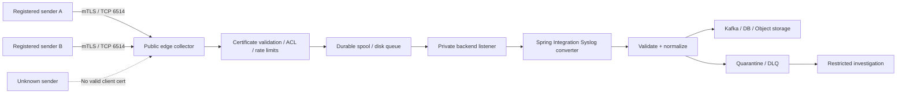
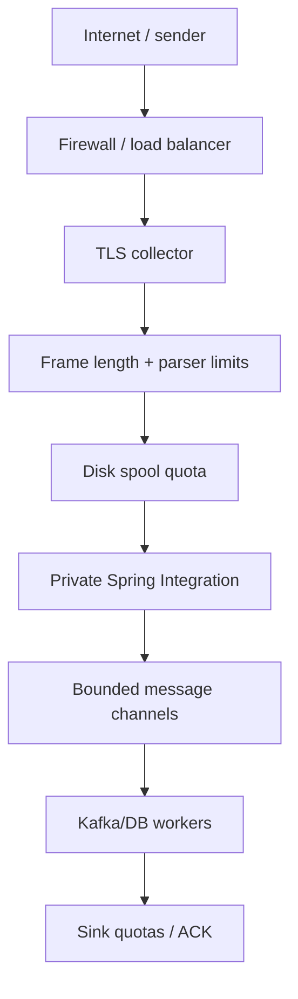

# Đảm bảo an toàn khi nhận log công khai

## 1. Vì sao một Syslog receiver công khai là bề mặt tấn công?

Trong **SPRING_INTEGRATION_ADAPTERS**, Spring Integration nhận dữ liệu từ hệ thống bên ngoài bằng inbound/outbound adapter, gateway, poller và `MessageChannel`. Chương **Adapter Syslog** cho phép nhận nhật ký từ máy chủ, firewall, router, ứng dụng và collector qua UDP/TCP, sau đó chuyển thành `Message<?>` để lọc, chuẩn hóa, định tuyến và ghi tới file/SFTP, HTTP, JMS, AMQP, Kafka hoặc cơ sở dữ liệu.

Khi listener có thể truy cập từ mạng không đáng tin — đặc biệt Internet — mọi Syslog record phải được xem là **input do bên ngoài kiểm soát**, không phải bằng chứng đáng tin. Kẻ gửi có thể giả facility, severity, hostname, thời gian, text; gửi message lớn hoặc malformed; thử làm nghẽn CPU/socket queue; hoặc tìm cách đưa dữ liệu độc hại vào pipeline quan sát và lưu trữ.

Một receiver “chạy được, parse được, log được” **chưa chắc an toàn**. Thiết kế phải đặt ra các câu hỏi:

1. Ai được phép kết nối/gửi log?
2. Kênh truyền có được mã hóa và xác minh peer không?
3. Sau TLS termination, Spring Integration có biết **đúng danh tính nguồn** hay không?
4. Đầu vào bị giới hạn kích thước, tốc độ, framing và chi phí parser như thế nào?
5. Khi parser gặp dữ liệu lỗi hoặc downstream chậm, dữ liệu sẽ đi đâu?
6. Bản ghi có chứa token, PII hoặc chuỗi log injection không?
7. Có thể chứng minh một record đã được **lưu bền vững** hay chưa?

Bài này tập trung vào **an toàn khi tiếp nhận Syslog từ phía ngoài**, không chỉ việc viết một validator sau parser. Các lớp bảo vệ phải được sắp xếp **trước và sau** Spring Integration adapter.

### Mục tiêu học tập

Sau bài này bạn có thể:

- Lập threat model cho Syslog UDP, TCP plaintext và TLS/mTLS.
- Chọn thiết kế không phơi bày trực tiếp Spring Integration listener ra Internet khi không cần thiết.
- Cấu hình listener chỉ ở loopback/private interface, kết hợp firewall/ACL và collector.
- Hiểu RFC 5425, certificate validation, mTLS, trust boundary và octet counting.
- Phân biệt Syslog `HOSTNAME` tự khai báo với **authenticated transport identity**.
- Giới hạn kích thước bản ghi, tốc độ gửi, kết nối, queue và công việc parsing.
- Xử lý `UNDECODED`, malformed input, log injection, PII, error channel và quarantine.
- Viết ví dụ cấu hình XML/Java, kiểm thử bảo mật, vận hành và phản ứng sự cố.

## 2. “Công khai” có thể mang nhiều nghĩa

| Kiểu triển khai | Ranh giới tin cậy | Hướng ưu tiên |
|---|---|---|
| Chỉ cùng process/host | Loopback hoặc Unix-local collector | Listener nội bộ, giới hạn quyền hệ điều hành. |
| Mạng nội bộ kiểm soát | VLAN/subnet, VPN, ACL | IP allowlist, segmentation; TLS khi dữ liệu nhạy cảm. |
| Đối tác bên ngoài qua mạng riêng | WAN/VPN/private connectivity | TLS/mTLS, danh tính nguồn và quota riêng. |
| Internet nhưng sender đã đăng ký | Public-facing controlled ingress | TLS/mTLS gateway hoặc collector; private backend; rate limit. |
| Internet và người bất kỳ đều gửi được | Không xác thực | **Không nên dùng** cho security/audit logs; thiếu nguồn tin cậy và dễ bị abuse. |

Một địa chỉ IP public hoặc port mở không có nghĩa ứng dụng phải chấp nhận mọi người gửi. Khái niệm **public-facing** nên chỉ nói rằng một **điểm biên được bảo vệ** có thể truy cập từ bên ngoài; phần xử lý Spring Integration và storage nên ở vùng mạng riêng.

Với thiết bị legacy chỉ hỗ trợ UDP/514, hãy giảm bề mặt bằng VPN/private network, ingress relay có allowlist và disk queue. Nếu buộc phải nhận UDP qua Internet, phải chấp nhận rủi ro mất gói/giả mạo còn tồn tại và **không dùng dữ liệu ấy làm bằng chứng xác thực danh tính**.

## 3. Threat model: những gì attacker kiểm soát

### 3.1. Bảng mối đe dọa

| Mối đe dọa | Đường tấn công | Hậu quả | Kiểm soát phù hợp |
|---|---|---|---|
| Giả mạo nguồn | UDP source IP/`HOSTNAME`/facility tùy ý | Audit sai, đánh lừa cảnh báo, trộn tenant | TLS/mTLS, network ACL, trusted source mapping. |
| Nghe lén | Syslog UDP/TCP plaintext qua đường mạng không tin cậy | Lộ IP, username, cấu hình, secret | TLS 1.2+/1.3 theo policy, VPN/IPsec khi thích hợp. |
| Sửa message | Không có integrity protection ở UDP/TCP plaintext | Nhật ký bị thay đổi trên đường truyền | TLS ở mỗi hop, bảo vệ storage và provenance. |
| Flood/DoS | UDP datagrams rất nhiều, TCP connections/handshakes dồn dập | Cạn CPU, queue, socket buffers, disk | Rate limit, firewall, connection quotas, bounded queues. |
| Malformed parser input | PRI sai, RFC5424 structured data lỗi, framing sai | Exceptions, CPU/memory pressure, loss | Frame/size limits trước parse, strict validation, quarantine. |
| Log injection | `MSG` chứa CR/LF, ANSI/HTML/control chars | Giả log, tấn công người xem log | Structured storage, output escaping, không in raw. |
| Cardinality explosion | Arbitrary host/user/tenant trong metrics | Hệ monitoring quá tải | Label allowlist; không dùng raw MSG/hostname. |
| Data exfiltration | Forward raw logs ra HTTP/SFTP/Kafka không kiểm soát | Rò rỉ PII/token | Outbound ACL, header allowlist, redaction, IAM. |
| Disk exhaustion | Quarantine/DLQ hoặc raw logs tăng vô hạn | Mất khả năng nhận log hợp lệ | Quota, retention, alert, bounded recovery. |
| Replay/duplicate | Collector gửi lại sau outage, thiếu event ID | Alert trùng, sai thống kê | Dedup/idempotency theo hợp đồng, durable inbox. |
| Pivot qua receiver | App có quyền quá rộng hoặc egress mở | Tấn công lan tới DB/cluster | Service account tối thiểu, egress policy, hardening. |

### 3.2. Ba điều không thể giải quyết chỉ bằng code parser

**Một:** UDP packet bị rơi trước Java receiver sẽ **không tạo** `Message<?>` hay `ErrorMessage`. Parser không thể phục hồi message nó chưa thấy.

**Hai:** `HOSTNAME`, `APP-NAME`, PRI, facility và severity là thông tin **bên gửi tự khai báo**. Parser có thể xác nhận chúng đúng cú pháp nhưng **không** xác thực ai đã gửi.

**Ba:** `MessageChannel.send(...)` thành công **không đồng nghĩa** log đã commit tới Kafka/database hoặc sẽ sống sót sau JVM restart. Bảo đảm lưu dữ liệu phải được thiết kế riêng bằng durable collector/queue, ack và retry/replay.

## 4. Chọn transport trước khi mở port

### 4.1. UDP, TCP và TLS

| Đặc tính | UDP/514 | TCP plaintext | TLS/TCP/6514 |
|---|---|---|---|
| Connection | Không | Có | TCP + TLS handshake |
| Transport authentication | Không | Không | Certificate-based, có thể mTLS |
| Confidentiality/integrity | Không | Không | Có trên từng TLS hop |
| Ranh giới message | Một datagram/một Syslog record | Cần framing | RFC 5425 dùng octet counting |
| Delivery acknowledgment cấp ứng dụng | Không | Không | Không |
| Hỗ trợ rate limit theo connection | Hạn chế | Có thể | Có thể theo client identity |
| Nên public trực tiếp? | **Tránh** | **Tránh** | Chỉ tại ingress đã harden, có auth/limits |

RFC 5426 khuyến cáo **không sử dụng Syslog UDP trên mạng không được bảo vệ** vì không có xác thực sender mạnh và có nguy cơ giả mạo, thay đổi/mất dữ liệu, DoS.

RFC 5425 mô tả Syslog-over-TLS và cổng mặc định **TCP/6514**. TLS mã hóa, kiểm tra tính toàn vẹn trong quá trình truyền và hỗ trợ xác minh peer. Nhưng **TLS không tự xác nhận nội dung Syslog là đúng**, không xác minh rằng `HOSTNAME` thuộc về certificate identity và cũng không cấp acknowledgment cho việc đã lưu ở ứng dụng.

### 4.2. TCP/6514 không tự động bật TLS

Không cấu hình như sau rồi gọi đó là Syslog bảo mật:

```xml
<!-- ĐÂY CHỈ LÀ TCP PLAINTEXT, DÙ CỔNG LÀ 6514. -->
<int-syslog:inbound-channel-adapter
    id="notReallyTls"
    protocol="tcp"
    port="6514"
    channel="syslogEvents"/>
```

Native `protocol="tcp"` chỉ lựa chọn TCP. Muốn TLS phải có **TLS-enabled connection support** tương thích với Spring Integration IP version hoặc **TLS collector/terminator thực sự** ở phía trước. Không tự bịa `protocol="tls"` trên Syslog namespace.

### 4.3. Các cổng mang tính quy ước, không phải cơ chế bảo mật

- `UDP/514`: thường dành cho Syslog UDP truyền thống.
- `TCP/514`: một cách triển khai Syslog TCP plain ở môi trường cụ thể.
- `TCP/6514`: mặc định của Syslog-over-TLS theo RFC 5425.
- `TCP/1516` hoặc `UDP/1514`: cổng nội bộ/lab tùy ứng dụng, **không phải cổng chuẩn bắt buộc**.

Đổi cổng từ 514 sang 1514 không làm dữ liệu tự có xác thực hay encryption. Cũng không chạy JVM với quyền root chỉ để bind low port khi có thể dùng collector/port forwarding hoặc capability tối thiểu.

## 5. Kiến trúc đề xuất: TLS collector tại biên, Spring Integration ở private zone

### 5.1. Sơ đồ tham khảo



Các lớp bảo vệ theo thứ tự:

1. **Edge ingress** chỉ mở transport/cổng cần thiết (ưu tiên TLS TCP/6514). Chặn hoặc giới hạn traffic trước parser.
2. **Mutual TLS** xác minh certificate sender, kiểm tra trust chain/SAN/identity policy; cho phép tắt/thay certificate của từng sender.
3. **Per-source quotas** và giới hạn connection/handshake/frame size. Tách nhóm sender hoặc tenant có nguy cơ khác nhau.
4. **Collector có disk queue** nếu cần chống outage, retry/replay có kiểm soát và giới hạn dung lượng.
5. **Backend listener của Spring Integration chỉ private/loopback**, không public NodePort hoặc host port tùy tiện.
6. **Validation + quarantine** xử lý dữ liệu sai định dạng mà không tự log raw.
7. **Durable sink** như broker/storage với ACL/IAM và mốc ack/commit rõ ràng.

Một collector **không nhất thiết** vừa làm mọi chức năng vừa tự có persistence. Phải kiểm tra cấu hình thực tế: TLS terminator chỉ giải mã/forward stream khác với Syslog-aware collector có parser, source policy và disk queue.

### 5.2. Mỗi hop phải có hợp đồng riêng

```text
Sender
  -(authenticated TLS, RFC5425 frames)->
Edge collector
  -(durable spool / replay contract)->
Private Syslog TCP backend
  -(Spring MessageChannel)->
Normalized event
  -(Kafka/DB commit/ack)->
Storage
```

**Hợp đồng cần trả lời:** khi collector báo đã nhận, nó đã flush dữ liệu vào disk queue hay mới nhận trong bộ nhớ? Khi backend báo xử lý, đã commit storage hay chưa? Khi timeout, phần nào có thể bị duplicate? Không gọi luồng là “exactly once” nếu chưa có chứng minh qua mọi boundary.

### 5.3. Đường fallback khi thiết bị chỉ hỗ trợ UDP

```text
Legacy device --UDP/514--> private VPN / restricted collector
                                |
                                v
                           durable spool
                                |
                                v
                     authenticated private transport
                                |
                                v
                       Spring Integration processor
```

Không biến một Syslog UDP listener công khai thành trusted authentication service. IP allowlist giúp giảm tiếp xúc nhưng không phải xác thực mạnh, đặc biệt khi IP bị NAT/chia sẻ hoặc packet spoofing có thể xảy ra. Với thiết bị không hỗ trợ TLS, VPN/IPsec/private connection có thể cải thiện an toàn đường truyền; cần thêm kiểm soát nguồn thực tế ở tunnel/collector.

## 6. TLS/mTLS đúng cách cho Syslog công khai

### 6.1. Quy trình TLS của RFC 5425

1. Sender (TLS client) kết nối tới receiver/collector (TLS server), thường ở **TCP/6514**.
2. Hai phía thực hiện TLS handshake và xác minh certificate theo policy.
3. Sender **phải** kiểm tra server identity (trust chain và tên mong đợi); khi dùng **mTLS**, server cũng kiểm tra client certificate và ánh xạ với một sender đã đăng ký.
4. Sender truyền Syslog records trong encrypted TLS stream bằng **octet counting**.
5. Collector giải mã TLS, tách frame, thực thi limits rồi chuyển tiếp theo hợp đồng backend.

Cú pháp frame RFC 5425:

```text
<decimal-byte-length> SP <RFC5424-SYSLOG-MSG>
```

Các dấu `<...>` ở dòng này chỉ giải thích cấu trúc, không phải bytes literal cần gửi. Prefix length là **số octets của Syslog message**, không phải số ký tự Java. Một TLS record có thể chứa nhiều Syslog frames hoặc chỉ một phần của một Syslog frame, nên không dùng TLS record boundary làm message boundary.

### 6.2. Các thành phần certificate

| Thành phần | Vị trí | Chức năng |
|---|---|---|
| Server certificate + private key | Edge TLS receiver | Chứng minh endpoint server. |
| CA/trust anchors phía sender | Sender/agent | Kiểm tra certificate của receiver. |
| Client certificate + private key | Sender (mTLS) | Cho phép receiver xác minh client. |
| Trust anchors phía receiver | Edge collector | Kiểm tra chain của client certificate. |
| Allowlist/authorization mapping | Collector hoặc hệ nhận đã kiểm soát | Ánh xạ cert identity → sender/tenant/quota. |
| Revocation/rotation policy | PKI và vận hành | Loại certificate bị thu hồi, thay trước khi hết hạn. |

**Không bật** chế độ bỏ qua certificate validation (ví dụ trust-all, skip hostname verification). Dùng CA dành riêng và certificate có SAN đúng cho môi trường. Hỗ trợ TLS 1.2/1.3, cipher suites phù hợp baseline an toàn hiện hành của tổ chức; không coi việc RFC cũ từng nhắc một bộ mã là lý do phải bật một cipher đã bị policy hiện đại vô hiệu hóa.

### 6.3. Danh tính TLS và HOSTNAME trong Syslog không phải một

RFC 5425 lưu ý rằng **identity của transport sender không nhất thiết liên quan tới trường `HOSTNAME` của Syslog message**.

Ví dụ:

```text
TLS peer identity:  device-742@organization.example
Syslog HOSTNAME:    edge-01
Syslog APP-NAME:    sshd
Syslog severity:    0
```

Nếu `HOSTNAME` ghi `finance-db-prod`, nó chỉ là **giá trị do bên gửi khai báo**, không phải bằng chứng rằng sender có quyền gửi log cho máy đó.

Chính sách nên:

- Dùng danh tính certificate đã xác minh để tạo `trustedSenderId` hoặc `tenantId`.
- So sánh `HOSTNAME` với inventory/allowlist của sender nếu cần xác định provenance.
- Khi không khớp, đánh dấu `IDENTITY_MISMATCH`, quarantine hoặc áp policy riêng.
- Không cấp quyền tenant, gửi webhook đặc quyền hoặc xóa dữ liệu theo giá trị `HOSTNAME`/`APP-NAME` hay `severity`.
- Không tự tin một client cert hợp lệ thuộc tenant A có thể ghi log đại diện tenant B.

### 6.4. Identity sau TLS termination có thể bị mất

Nếu TLS terminator chỉ forward **bytes Syslog** tới Spring Integration, backend **không tự biết** certificate nào đã được xác minh ở phía edge. Trường `HOSTNAME` không khắc phục khoảng trống này.

Các phương án truyền provenance hợp lý:

1. **Tách ingress/backend theo sender group**: collector biết cert nào được phép đi vào một backend/topic/port riêng, backend áp source group theo cổng/tuyến được bảo vệ.
2. **Authenticated metadata envelope** giữa collector và processor: thông tin `trustedSenderId` được gắn bằng một protocol đáng tin có tính toàn vẹn, **không đơn giản nhét vào raw Syslog text**.
3. **Collector parse/normalize + publish tới durable broker** với principal/ACL, source identity và message headers do chính collector tạo.
4. Nếu dùng proxy protocol/header nội bộ, phải đảm bảo cả hai đầu hiểu đúng protocol và chỉ nhận từ proxy đáng tin; **native Syslog adapter không tự tin tưởng một arbitrary forwarded header**.

Đừng chỉ thêm prefix `trustedSenderId=...` vào `MSG` rồi giả định Spring Integration có thể xác thực người gửi. Kẻ gửi có thể cố đặt cùng giá trị trước TLS termination nếu collector không ký/khóa metadata.

### 6.5. Kiểm tra TLS handshake

Trong lab có CA và receiver TLS hợp lệ:

```bash
openssl s_client \
  -connect syslog.example.internal:6514 \
  -servername syslog.example.internal \
  -verify_hostname syslog.example.internal \
  -CAfile ./trusted-ca.pem \
  -verify_return_error
```

Nếu receiver bắt buộc mTLS, thêm tham số `-cert ./client.crt -key ./client.key` vào **cùng lệnh**. File khóa riêng phải được bảo vệ bằng ACL và tuyệt đối không đưa vào repository/log.

Handshake thành công **chỉ kiểm tra TLS**, không chứng minh collector parse được RFC 5424 hay đã publish sang Kafka/DB. Muốn test end-to-end phải gửi **octet-counted Syslog frame** và xác minh record ở sink, đồng thời kiểm thử thiếu client certificate, sai CA, sai hostname và certificate hết hạn bị **từ chối**.

## 7. Hạn chế bề mặt mạng: bind address và firewall

### 7.1. Loopback, private IP và wildcard

| Bind address | Tác dụng | Lưu ý an toàn |
|---|---|---|
| `127.0.0.1` | IPv4 loopback trong network namespace hiện tại | Phù hợp khi collector/proxy nằm cùng host/namespace. |
| `10.x.x.x` hoặc private interface cụ thể | Chỉ nhận trên interface được chọn | IP phải thuộc receiver; thêm firewall/NetworkPolicy. |
| `0.0.0.0` | Tất cả IPv4 local interfaces | **Không mặc định an toàn**; có thể bị phơi ra ngoài nếu ACL sai. |
| `::1` / `::` | Loopback/wildcard IPv6 | Kiểm tra policy IPv6 riêng, dual-stack và firewall. |

`local-address` của adapter chọn **địa chỉ cục bộ để bind**, không phải remote sender allowlist. Nếu receiver bind `127.0.0.1:1516`, proxy ở máy/Pod khác không thể gửi vào loopback này; phải dùng private network đã kiểm soát hoặc triển khai cùng network namespace.

### 7.2. Cấu hình firewall cần khớp protocol

Ví dụ ma trận rule mong muốn, không phải lệnh firewall áp dụng cho mọi OS:

| Ranh giới | Cho phép | Từ chối |
|---|---|---|
| Public edge | TCP/6514 từ client group được phép (kèm mTLS) | Port Syslog khác chưa được phê duyệt. |
| Private collector → backend | TCP/1516 từ đúng collector identity/subnet | Mọi nguồn khác tới backend port. |
| Storage | Chỉ broker/DB cần thiết từ service account/backend | Kết nối quản trị hoặc egress tùy ý. |
| Legacy UDP | UDP/514 chỉ từ VPN/private collector/sender allowlist | UDP/514 mở toàn Internet nếu không có lý do đặc biệt. |

**Network allowlist không thay thế mTLS**: IP có thể bị NAT hoặc thay đổi, còn một compromised host bên trong mạng vẫn có thể gửi dữ liệu giả. Nhưng mTLS cũng không thay thế network segmentation hoặc rate limit.

### 7.3. Docker/Kubernetes: hai lớp port

Khi JVM trong container bind `127.0.0.1`, host port publishing thường chuyển traffic tới container IP, không tới loopback bên trong container. Vì vậy:

- Collector cùng Pod/network namespace: có thể gọi backend qua `127.0.0.1`.
- Collector khác Pod: backend cần bind private Pod IP hoặc wildcard phù hợp, kèm NetworkPolicy.
- Container `-p 1516:1516/tcp` hoặc Kubernetes Service **không tự bật TLS**.
- `containerPort` chỉ mô tả cổng dự kiến; không buộc ứng dụng mở socket.
- Không dùng HTTP Ingress thông thường để mặc định proxy raw Syslog UDP/TCP.
- Kiểm tra cả IPv6 nếu hệ thống có dual-stack.

## 8. Cấu hình Spring Integration backend an toàn sau collector

Ví dụ thực hành dùng **RFC 5424 qua TCP** trên **loopback TCP/1516**, nhận bytes **đã được TLS collector giải mã**. Collector phía trước phải thực sự xác minh client certificate và gửi đúng RFC 6587 **octet counting** đến backend. File XML sau **không** có nhiệm vụ TLS termination.

### 8.1. Dependencies

Với Spring Boot BOM quản lý phiên bản:

```xml
<dependencies>
    <dependency>
        <groupId>org.springframework.boot</groupId>
        <artifactId>spring-boot-starter-integration</artifactId>
    </dependency>
    <dependency>
        <groupId>org.springframework.integration</groupId>
        <artifactId>spring-integration-ip</artifactId>
    </dependency>
    <dependency>
        <groupId>org.springframework.integration</groupId>
        <artifactId>spring-integration-syslog</artifactId>
    </dependency>
</dependencies>
```

Không cần Spring MVC/HTTP endpoint chỉ để nhận Syslog. Ngược lại, cấu hình HTTP `SecurityFilterChain` của Spring Security **không tự bảo vệ TCP/UDP Syslog listener**, vì đây là socket transport khác.

### 8.2. XML native Syslog inbound

Tạo `src/main/resources/secure-syslog-backend.xml`:

```xml
<?xml version="1.0" encoding="UTF-8"?>
<beans xmlns="http://www.springframework.org/schema/beans"
       xmlns:xsi="http://www.w3.org/2001/XMLSchema-instance"
       xmlns:int="http://www.springframework.org/schema/integration"
       xmlns:int-ip="http://www.springframework.org/schema/integration/ip"
       xmlns:int-syslog="http://www.springframework.org/schema/integration/syslog"
       xsi:schemaLocation="
          http://www.springframework.org/schema/beans
          https://www.springframework.org/schema/beans/spring-beans.xsd
          http://www.springframework.org/schema/integration
          https://www.springframework.org/schema/integration/spring-integration.xsd
          http://www.springframework.org/schema/integration/ip
          https://www.springframework.org/schema/integration/ip/spring-integration-ip.xsd
          http://www.springframework.org/schema/integration/syslog
          https://www.springframework.org/schema/integration/syslog/spring-integration-syslog.xsd">

    <int:channel id="syslogParsed"/>
    <int:channel id="syslogAdapterErrors"/>

    <bean id="rfc5424Converter"
          class="org.springframework.integration.syslog.RFC5424MessageConverter"/>

    <bean id="rfc6587Deserializer"
          class="org.springframework.integration.syslog.inbound.RFC6587SyslogDeserializer"/>

    <!-- Chỉ localhost: TLS collector PHẢI ở cùng namespace/host. -->
    <int-ip:tcp-connection-factory
        id="syslogBackendServer"
        type="server"
        local-address="127.0.0.1"
        port="1516"
        using-nio="true"
        deserializer="rfc6587Deserializer"/>

    <int-syslog:inbound-channel-adapter
        id="privateSyslogInbound"
        protocol="tcp"
        connection-factory="syslogBackendServer"
        converter="rfc5424Converter"
        channel="syslogParsed"
        error-channel="syslogAdapterErrors"
        auto-startup="true"/>
</beans>
```

**Giải thích các ranh giới:**

- `local-address="127.0.0.1"` đảm bảo listener chỉ bind loopback IPv4 của process (trong điều kiện không có port forwarding/proxy tạo đường khác).
- `port="1516"` nằm ở **server connection factory** vì adapter dùng `connection-factory` bên ngoài.
- `RFC6587SyslogDeserializer` tách đúng frames TCP theo framing đã thống nhất trước khi `RFC5424MessageConverter` parse message.
- `RFC5424MessageConverter` không mặc định map decoded fields ra Syslog headers khi `asMap=true`; downstream phải hiểu đúng payload của converter.
- `syslogAdapterErrors` chỉ nhận những lỗi mà adapter/related infrastructure thật sự phát thành `ErrorMessage`; nó **không** thu các network drops hoặc mọi malformed record.
- XML này **không tự xác minh certificate của sender**; điều đó thuộc TLS edge collector đã nêu. Cần bảo vệ kết nối proxy→backend và chính sách provenance.

**Không công khai TCP/1516** ra Internet; nếu edge collector nằm trên host khác, thiết kế cần private IP, firewall/mTLS nội bộ và khả năng map nguồn tin cậy thay cho loopback.

### 8.3. Java application đọc XML

```java
package example.syslog;

import org.springframework.boot.SpringApplication;
import org.springframework.boot.autoconfigure.SpringBootApplication;
import org.springframework.context.annotation.ImportResource;
import org.springframework.integration.annotation.EnableIntegration;

@SpringBootApplication
@EnableIntegration
@ImportResource("classpath:secure-syslog-backend.xml")
public class SecureSyslogApplication {

    public static void main(String[] args) {
        SpringApplication.run(SecureSyslogApplication.class, args);
    }
}
```

Trong một triển khai thật, backend phải có subscriber cho `syslogParsed` và `syslogAdapterErrors`; nếu không, message có thể bị dispatch thất bại. Ta bổ sung các bean này ở phần tiếp theo.

## 9. Bảo vệ parser, payload và hợp đồng nghiệp vụ

### 9.1. Đừng đặt tất cả giới hạn sau parser

Một validator Java chạy **sau** `RFC5424MessageConverter` không thể ngăn parser phải xử lý một frame quá lớn trước đó. Thứ tự phòng vệ:

1. **Edge** giới hạn connection rate, message/frame size, input bandwidth và số clients.
2. **TCP framer** giới hạn chiều dài/timeout theo phiên bản và cấu hình thực tế; tránh cấp phát bộ nhớ tùy ý theo một length prefix do attacker kiểm soát.
3. **Converter** parse RFC 5424 hoặc RFC 3164 đúng format nguồn.
4. **Application validator** kiểm tra trường, size/cost và policy nguồn/tenant.
5. **Downstream adapter** giới hạn payload/headers, batch, queue, retries và sink capacity.

Với UDP legacy: giới hạn datagram size/burst ở collector, `receive-buffer-size` đủ cho record hợp lệ; `so-receive-buffer-size` chỉ liên quan OS socket queue, không tự sửa datagram bị cắt. Một UDP packet bị mất trước listener không thể tạo `ErrorMessage`.

### 9.2. PRI, facility, severity và malformed messages

Công thức Syslog:

```text
PRI = facility * 8 + severity
facility = PRI / 8
severity = PRI % 8

0 <= facility <= 23
0 <= severity <= 7
0 <= PRI <= 191
```

Ví dụ:

```text
<134>1 2026-11-23T02:15:10Z edge-01 app 42 EVT1 - System ready
<192>1 2026-11-23T02:15:10Z edge-01 app 42 EVT1 - Invalid PRI
```

Phải từ chối hoặc quarantine những bản ghi ngoài miền hợp đồng; không gán mặc định severity 0 để tránh tạo alert khẩn giả. **Không dùng PRI nguyên số để so mức độ nghiêm trọng giữa facility khác nhau**.

Với RFC 3164, `SyslogToMapTransformer` có thể trả payload `Map` chứa `UNDECODED` cho record không parse được. Đây là **message cần quarantine**, không nhất thiết là exception.

Với RFC 5424, cần dùng `RFC5424MessageConverter`; structured data có quy tắc escape và `NILVALUE`. Đừng dùng `String.split(" ")` hoặc regex đơn giản thay parser tương thích RFC.

### 9.3. Payload/header không được tin tuyệt đối

| Dữ liệu | Nguồn | Chính sách |
|---|---|---|
| `HOSTNAME`/`APP-NAME` | Do sender ghi trong record | Validate length/format, không dùng làm principal. |
| `facility`/`severity` | PRI do sender ghi | Validate range, không dùng như quyền ưu tiên tuyệt đối. |
| `sourceTimestamp` | Clock của sender | So sánh `receivedAt`, hỗ trợ clock skew và NILVALUE. |
| `MessageHeaders.ID` | Spring Messaging | Correlation nội bộ; không phải event ID duy nhất toàn cục. |
| `syslog_*` | Do converter map từ Syslog | Phụ thuộc converter/`asMap`; chưa được xác thực nội dung. |
| `trustedSenderId` | Được tạo sau chứng thực tại collector | Chỉ tin nếu đường chuyển tới backend có integrity/access control. |
| Error/reply channels | Spring Integration nội bộ | Không forward tùy tiện qua Kafka/JMS/HTTP. |

Một record `<0>` (kern.emergency) chưa chắc đến từ kernel thật. Không để một message severity 0 tự kích hoạt webhook chứa secret, thao tác restart service hay lệnh quản trị.

## 10. Java validation sau parser và quarantine an toàn

Để minh họa một flow đầy đủ, ta sử dụng `@ServiceActivator` xử lý payload đã parse. Trong cấu hình backend RFC 5424 của mục 8, các key trong `Map` phụ thuộc `RFC5424MessageConverter`. Vì vậy trước khi đưa vào production phải test đúng những key và kiểu do phiên bản converter phát ra.

Ví dụ sau chọn chính sách **fail-closed ở tầng nghiệp vụ**: chỉ những map có facility/severity số hợp lệ mới đi vào kênh chấp nhận. Các message khác đi vào quarantine; riêng lỗi transport/adapter có error handler tách biệt.

### 10.1. DTO không mang raw log text

Tạo `SecureSyslogEvents.java`:

```java
package example.syslog;

import java.time.Instant;

public final class SecureSyslogEvents {

    private SecureSyslogEvents() {}

    public record Accepted(
        String eventId,
        String ingressId,
        int facility,
        int severity,
        Instant receivedAt) {
    }

    public record Rejected(
        String ingressId,
        String reason,
        Instant receivedAt,
        int observedFields) {
    }
}
```

Trong demo, `ingressId` là **định danh của listener nội bộ**, không phải certificate-verified sender identity. Để có `trustedSenderId` thực sự, cần tích hợp metadata đã xác thực từ collector theo boundary mục 6.4.

### 10.2. Channel beans

Tạo `SecureSyslogChannels.java`:

```java
package example.syslog;

import org.springframework.context.annotation.Bean;
import org.springframework.context.annotation.Configuration;
import org.springframework.integration.channel.DirectChannel;
import org.springframework.messaging.MessageChannel;

@Configuration
public class SecureSyslogChannels {

    @Bean("acceptedSyslog")
    public MessageChannel acceptedSyslog() {
        return new DirectChannel();
    }

    @Bean("quarantinedSyslog")
    public MessageChannel quarantinedSyslog() {
        return new DirectChannel();
    }
}
```

`DirectChannel` là synchronous dispatch; subscriber chậm có thể block thread gửi message. Khi tách bằng `ExecutorChannel`, phải dùng bounded executor và recovery policy. Trong cả hai trường hợp, channel mặc định **không tự lưu bền vững**.

### 10.3. Service activator validation

Tạo `SecureSyslogValidator.java`:

```java
package example.syslog;

import java.time.Instant;
import java.util.Map;
import java.util.UUID;

import org.springframework.beans.factory.annotation.Qualifier;
import org.springframework.integration.annotation.ServiceActivator;
import org.springframework.messaging.Message;
import org.springframework.messaging.MessageChannel;
import org.springframework.messaging.support.MessageBuilder;
import org.springframework.stereotype.Component;

@Component
public class SecureSyslogValidator {

    private static final int MAX_FIELDS = 64;

    private final MessageChannel accepted;
    private final MessageChannel quarantined;

    public SecureSyslogValidator(
            @Qualifier("acceptedSyslog") MessageChannel accepted,
            @Qualifier("quarantinedSyslog") MessageChannel quarantined) {
        this.accepted = accepted;
        this.quarantined = quarantined;
    }

    @ServiceActivator(inputChannel = "syslogParsed")
    public void inspect(Message<?> incoming) {
        Instant receivedAt = Instant.now();
        Object payload = incoming.getPayload();

        if (!(payload instanceof Map<?, ?> fields)) {
            reject("UNEXPECTED_PAYLOAD_TYPE", 0, receivedAt);
            return;
        }

        if (fields.size() > MAX_FIELDS) {
            reject("TOO_MANY_FIELDS", fields.size(), receivedAt);
            return;
        }

        // RFC5424MessageConverter: xác nhận key thực tế bằng
        // contract test của framework/version đang sử dụng.
        Object facilityValue = fields.get("facility");
        Object severityValue = fields.get("severity");

        Integer facility = strictInteger(facilityValue);
        Integer severity = strictInteger(severityValue);

        if (facility == null || facility < 0 || facility > 23
                || severity == null || severity < 0
                || severity > 7) {
            reject("INVALID_PRI_FIELDS", fields.size(), receivedAt);
            return;
        }

        // Một UUID mới phục vụ correlation nội bộ; nó không phải
        // khóa dedup bền vững cho record được collector replay.
        SecureSyslogEvents.Accepted event =
            new SecureSyslogEvents.Accepted(
                UUID.randomUUID().toString(),
                "private-tcp-1516",
                facility,
                severity,
                receivedAt);

        sendChecked(accepted, event);
    }

    private void reject(
            String reason, int count, Instant receivedAt) {
        sendChecked(quarantined,
            new SecureSyslogEvents.Rejected(
                "private-tcp-1516", reason, receivedAt, count));
    }

    private static Integer strictInteger(Object value) {
        if (value instanceof Number number) {
            double n = number.doubleValue();
            if (Double.isFinite(n)
                    && n == Math.rint(n)
                    && n >= Integer.MIN_VALUE
                    && n <= Integer.MAX_VALUE) {
                return (int) n;
            }
            return null;
        }

        if (value instanceof String str
                && str.matches("[0-9]{1,3}")) {
            try {
                return Integer.parseInt(str);
            } catch (NumberFormatException ex) {
                return null;
            }
        }

        return null;
    }

    private static void sendChecked(
            MessageChannel channel, Object payload) {
        boolean sent = channel.send(
            MessageBuilder.withPayload(payload).build());

        if (!sent) {
            throw new IllegalStateException(
                "Syslog output channel rejected message");
        }
    }
}
```

**Điều quan trọng về đoạn code:**

- Key `"facility"` và `"severity"` ở đây chỉ là **giả định schema minh họa**, **không** được coi là API contract của `RFC5424MessageConverter`. Với triển khai thật, thay bằng key/hằng chính xác đã được kiểm tra bằng test trên version Spring Integration sử dụng. Cách khác là tạo **normalizer riêng cho RFC 5424** trước bước này, biến mọi input thành một DTO ổn định có `facilityCode`/`severityCode`.
- `MAX_FIELDS=64` là **application guard sau parse**, không thể ngăn parser xử lý một frame quá lớn; phải giới hạn sớm ở collector/framer.
- Ví dụ không chuyển `MSG` hoặc `STRUCTURED-DATA` raw tới output, nhờ vậy hạn chế nguy cơ vô tình làm lộ secrets trong demo. Production cần schema/redaction policy để giữ đủ sự kiện theo nhu cầu.
- `UUID.randomUUID()` chỉ giúp correlation, **không** dedup được những lần collector replay cùng raw record.
- `sendChecked` kiểm tra channel dispatch, **không xác nhận** database/Kafka đã commit.

Đối với sender RFC 3164, dùng `DefaultMessageConverter` và `SyslogToMapTransformer.FACILITY`/`SEVERITY`/`UNDECODED`. Đừng giữ nguyên đoạn code map-key ví dụ của RFC 5424 rồi đổi converter mà không có regression tests.

### 10.4. Consumers chỉ log metadata được chọn

Tạo `SecureSyslogConsumers.java`:

```java
package example.syslog;

import org.slf4j.Logger;
import org.slf4j.LoggerFactory;
import org.springframework.integration.annotation.ServiceActivator;
import org.springframework.stereotype.Component;

@Component
public class SecureSyslogConsumers {

    private static final Logger log =
        LoggerFactory.getLogger(SecureSyslogConsumers.class);

    @ServiceActivator(inputChannel = "acceptedSyslog")
    public void accept(SecureSyslogEvents.Accepted event) {
        log.info("Syslog accepted: ingress={}, facility={}, severity={}",
            event.ingressId(), event.facility(), event.severity());

        // Production: persist / publish với IAM, quota, ack rõ
        // ràng. Không forward toàn bộ message headers.
    }

    @ServiceActivator(inputChannel = "quarantinedSyslog")
    public void quarantine(SecureSyslogEvents.Rejected event) {
        log.warn("Syslog quarantined: ingress={}, reason={}",
            event.ingressId(), event.reason());

        // Production: bounded persistent quarantine, access
        // control, retention, alerts và retry/replay có policy.
    }
}
```

Đây là **mã thực hành chưa có durable sink**. Việc log thành công không chứng minh bản ghi Syslog đã được giữ an toàn trong storage. Không dùng application logs để lưu raw data điều tra, đặc biệt nếu logs lại được forward vào cùng receiver và tạo vòng lặp.

## 11. Exception, `ErrorMessage` và quota cho quarantine

### 11.1. Hai loại lỗi khác nhau

- **Lỗi hợp đồng**: record parse được nhưng facility/severity thiếu, quá nhiều trường, nguồn sai policy → tạo `Rejected` và đưa `quarantinedSyslog`.
- **Exception khi nhận hoặc xử lý**: socket, deserializer, converter, subscriber, broker/DB failures → phải quan sát qua error handling tùy component, có thể tạo `ErrorMessage`.

Với Syslog RFC 3164, một bản ghi không parse được có thể xuất hiện trong `Map` dưới `SyslogToMapTransformer.UNDECODED` chứ không ném exception. Vì vậy **không chỉ** nghe `errorChannel` để nhận malformed records.

### 11.2. Consumer cho error channel

Tạo `SecureSyslogErrorConsumer.java`:

```java
package example.syslog;

import org.slf4j.Logger;
import org.slf4j.LoggerFactory;
import org.springframework.integration.annotation.ServiceActivator;
import org.springframework.messaging.Message;
import org.springframework.messaging.MessagingException;
import org.springframework.messaging.support.ErrorMessage;
import org.springframework.stereotype.Component;

@Component
public class SecureSyslogErrorConsumer {

    private static final Logger log =
        LoggerFactory.getLogger(SecureSyslogErrorConsumer.class);

    @ServiceActivator(inputChannel = "syslogAdapterErrors")
    public void handle(ErrorMessage error) {
        Throwable cause = error.getPayload();
        Message<?> original = error.getOriginalMessage();

        if (original == null && cause instanceof MessagingException ex) {
            original = ex.getFailedMessage();
        }

        log.error("Syslog ingest error: type={}, originalPresent={}",
            cause.getClass().getSimpleName(),
            original != null);

        // Production: phân loại exception, metric và recovery
        // an toàn. Không log Throwable.toString(), stack trace
        // chứa raw payload hay toàn bộ failedMessage mặc định.
    }
}
```

**Không cam kết** một error channel bắt được mọi network/transport failure. UDP drop trước socket, TLS handshake reject tại proxy hoặc TCP failure trước khi có business message thường nằm ngoài business error flow. Subscriber đồng bộ trên `DirectChannel` có thể ném exception trực tiếp; worker trên `ExecutorChannel` có cơ chế publish error bất đồng bộ riêng.

### 11.3. Quarantine cũng có thể bị DoS

Nếu ai đó gửi hàng triệu bản ghi sai, một quarantine “lưu tất cả mãi mãi” có thể làm đầy disk và khiến sự kiện hợp lệ bị mất.

Chính sách cần:

1. Giới hạn **bytes/record**, số record/nguồn và dung lượng tổng.
2. Có quotas theo trusted sender/tenant và retention/TTL.
3. Không log raw input mặc định; chỉ reason, bytes, authenticated source group và correlation ID được kiểm soát.
4. Khi quota đầy, có **policy rõ**: tạm ngừng/giảm tải nguồn, chỉ giữ mẫu, chuyển sang isolated durable tier hoặc bỏ với metric/alert. Không âm thầm giả rằng mọi record đã được lưu.
5. Có quy trình duyệt/replay và quyền truy cập riêng cho raw data nhạy cảm.
6. Không retry vô hạn một record malformed deterministic; chỉ retry lỗi storage/network tạm thời với backoff và giới hạn.

## 12. Chống DoS bằng limits nhiều tầng

### 12.1. Đặt giới hạn ở đâu?



| Lớp | Limit nên có | Điều không giải quyết |
|---|---|---|
| Firewall/edge ACL | Source networks, ports, bandwidth | Không tự xác minh Syslog content. |
| TLS termination | Connections, handshakes/second, timeouts, certificate policies | Không tự bảo đảm record đã commit. |
| Syslog framing | Maximum frame bytes, read timeout, malformed length behavior | Không tự lọc PII/secret. |
| Parser/normalizer | Record bytes, field count, charset, processing budget | Không cứu được UDP packet bị drop. |
| `ExecutorChannel` | Bounded pool/queue, rejection policy | Không phải durable queue. |
| Collector disk queue | Capacity, retention, retry, fsync/ack semantics | Không tạo exactly-once across all sinks. |
| Kafka/JMS/AMQP/DB | Message/batch quota, timeout, IAM, retry limits | Không bảo vệ edge khỏi flooding trước đó. |

**Ví dụ định hướng:** nếu mỗi input frame tối đa 8 KiB và một client có thể mở hàng nghìn connections, buffer/connection và connection lifetime vẫn có thể tiêu tốn nhiều bộ nhớ. Không chọn mỗi “8 KiB” rồi coi hệ thống đã chống DoS.

### 12.2. CPU-bound khác với I/O-bound

- **Parser/regex/structured-data** có thể CPU-bound: nhiều worker hơn số CPU cores không nhất thiết tăng throughput.
- **Kafka/DB/HTTP write** có thể I/O-bound: giới hạn connection pool, timeout và maximum in-flight calls.
- **TLS handshake** tăng chi phí crypto và certificate validation: connection reuse, handshake rate limit và client quotas quan trọng.
- **Queue không giới hạn** che giấu overload rồi gây OOM hoặc latency kéo dài.
- **Backpressure TCP** có thể làm sender chậm lại nhưng không xác nhận application đã lưu; với UDP thường là drop khi vượt khả năng nhận.

### 12.3. Không dùng `CallerRunsPolicy` một cách máy móc

Khi worker pool đầy, `CallerRunsPolicy` có thể chạy handler chậm trên receiver thread. Với UDP, điều này có thể làm socket receive buffer đầy và drop datagrams trước khi Spring Integration nhận được message. `DiscardPolicy` có thể mất task âm thầm; `AbortPolicy` làm lỗi lộ ra nhưng không tự lưu message. Chọn policy theo **mốc durability, telemetry và failure contract**, không chỉ để “hết exception”.

## 13. Tính toàn vẹn và bảo mật dữ liệu sau khi nhận

### 13.1. Mã hóa trên từng hop

TLS bảo vệ dữ liệu **giữa hai endpoints của session TLS**. Nếu collector terminate TLS rồi forward plaintext qua mạng không tin cậy, đoạn backend không còn được bảo vệ bởi session đầu tiên.

Các lựa chọn:

- Edge và Spring Integration cùng namespace: backend có thể bind loopback.
- Edge và backend khác máy: private network có firewall, hoặc **mTLS cho hop nội bộ**.
- Edge xuất sang Kafka: dùng TLS/SASL/ACL theo broker policy; không tự tin rằng TLS từ sender đã bao trùm hop tới Kafka.
- Raw/quarantine storage: encryption at rest, IAM, access audit và retention.
- Alerting HTTP: HTTPS, credential quản lý bằng secret store, outbound allowlist và redaction.

### 13.2. Tránh header forwarding và log injection

Không tự chuyển toàn bộ Spring `MessageHeaders` sang hệ thống ngoài. Một message có thể chứa:

- `replyChannel`, `errorChannel` — internal framework references.
- Transport metadata, thông tin debug hoặc header không nên xuất bản.
- Trường text do sender kiểm soát có thể chứa control characters/newline hoặc token.

Áp dụng outbound header allowlist và tách payload đã normalize ra khỏi original raw. Nếu hiển thị `MSG` trong UI/SIEM, dùng escaping theo output context (HTML, terminal, JSON), không nối raw text vào log line hay SQL query. Dùng parameterized query và structured logging.

### 13.3. Không biến lỗi log thành lệnh điều khiển

Đây là anti-pattern:

```text
if severity == 0:
    execute privileged remediation command
```

Bất kỳ sender có thể tự khai báo severity 0 nếu không có trust boundary. Ngay cả với mTLS, action có tác động lớn vẫn cần policy dựa trên **trusted sender + event type + allowlist + approval/guard rails**, không kích hoạt chỉ từ raw Syslog text.

### 13.4. Multi-tenant isolation

Nếu receiver phục vụ nhiều đơn vị:

- Ánh xạ certificate identity tới tenant bởi collector được kiểm soát.
- Dùng queue/topic/storage namespace riêng hoặc ACL theo tenant.
- Đặt quotas riêng về bytes/second, connections, retention và DLQ.
- Không tin `tenantId` do sender nhét vào `MSG` hoặc `STRUCTURED-DATA` mà chưa kiểm tra.
- Không gộp toàn bộ raw messages thành shared quarantine cho mọi tenant có quyền đọc.
- Có audit trail khi người vận hành truy xuất dữ liệu nhạy cảm.

## 14. Kiểm thử an toàn theo lớp

### 14.1. TLS/mTLS negative tests

| Case | Kỳ vọng |
|---|---|
| Client có certificate hợp lệ và được allowlist | Collector nhận TLS session, áp quota đúng sender. |
| Không có client certificate khi mTLS bắt buộc | Bị từ chối trước pipeline Syslog backend. |
| Cert do CA không được tin cậy | Bị từ chối. |
| Cert hết hạn/thu hồi theo policy | Bị từ chối/thu hồi quyền. |
| Sender kiểm tra hostname sai | TLS client từ chối server không đúng danh tính. |
| TLS handshake thành công nhưng gửi non-Syslog bytes | Framing/parser từ chối, không làm backend crash. |
| TLS hợp lệ nhưng `HOSTNAME` trong record giả một máy khác | Không chuyển thành trustedSourceId; mismatch được gắn cờ. |
| Client vượt connection/handshake quota | Edge throttles/rejects có metrics, không OOM. |

**Không dùng** trust-all hoặc bỏ qua hostname verification để “test tạm” và mang cấu hình ấy vào production.

### 14.2. Input validation tests

| Input | Hành vi mong đợi |
|---|---|
| RFC 5424 hợp lệ với PRI 134 | Parse, validate facility=16/severity=6, xử lý theo policy. |
| PRI có ký tự không phải số | Parse failure/quarantine; không tạo severity giả. |
| PRI 192 | Không chấp nhận facility ngoài miền chuẩn. |
| Structured data thiếu quote/bracket | Parser từ chối hoặc phân loại malformed. |
| Record chứa nhiều fields hơn limit | Quarantine/limit, không cấp phát vô hạn. |
| TCP octet-count prefix sai | Deserializer phát hiện/đóng connection theo policy, không treo. |
| TCP frame length rất lớn | Chặn ở framer/edge trước cấp phát lớn. |
| UTF-8 lỗi theo source policy | Quarantine raw có kiểm soát; không in raw bytes. |
| `MSG` chứa newline/ANSI control | Không hiển thị như nhiều bản ghi giả; escape output. |
| Payload chứa token/PII | Redaction và access control ở sink/quarantine. |
| RFC 3164 map có `UNDECODED` | Quarantine; không nhất thiết có `ErrorMessage`. |
| UDP mất packet trước adapter | Network counters cảnh báo; không có business message. |
| Kafka/DB tạm lỗi | Bounded retry, durable DLQ/inbox, không coi channel send là commit. |

### 14.3. Kiểm thử buffer và backpressure

Giả lập downstream chậm trong môi trường kiểm thử cô lập để quan sát:

1. Queue depth và độ trễ từ receiver tới sink.
2. Active workers, executor rejection count.
3. UDP kernel drops / TCP flow control và reconnects.
4. TLS handshake failures và connection limits.
5. Disk spool fill percentage, oldest queued message age.
6. Recovery/replay sau restart và duplicate count.
7. Điều kiện shutdown khi vẫn có in-flight messages.

Mục tiêu là **kiểm chứng giới hạn tài nguyên và mốc commit**, không tạo tải gây ảnh hưởng tới hệ thống dùng chung.

## 15. Unit test validation không cần mở public port

Vì sample `SecureSyslogValidator` chỉ dùng `Message<?>`, ta có thể kiểm tra policy bằng `QueueChannel` trong một unit test. Điều này **không kiểm tra** TLS handshake, Kafka commit hoặc parser RFC 5424 thực tế; các lớp đó cần integration test riêng.

```java
package example.syslog;

import static org.junit.jupiter.api.Assertions.*;

import java.util.HashMap;
import java.util.Map;
import org.junit.jupiter.api.Test;
import org.springframework.integration.channel.QueueChannel;
import org.springframework.messaging.Message;
import org.springframework.messaging.support.MessageBuilder;

class SecureSyslogValidatorTest {

    @Test
    void rejectsInvalidSeverity() {
        QueueChannel accepted = new QueueChannel(2);
        QueueChannel rejected = new QueueChannel(2);
        SecureSyslogValidator validator =
            new SecureSyslogValidator(accepted, rejected);

        Map<String, Object> fields = new HashMap<>();
        fields.put("facility", 16);
        fields.put("severity", 9);

        validator.inspect(
            MessageBuilder.withPayload(fields).build());

        Message<?> result = rejected.receive(1000);
        assertNotNull(result);

        SecureSyslogEvents.Rejected event =
            (SecureSyslogEvents.Rejected) result.getPayload();

        assertEquals("INVALID_PRI_FIELDS", event.reason());
        assertNull(accepted.receive(0));
    }

    @Test
    void acceptsValidNormalizedFields() {
        QueueChannel accepted = new QueueChannel(2);
        QueueChannel rejected = new QueueChannel(2);
        SecureSyslogValidator validator =
            new SecureSyslogValidator(accepted, rejected);

        Map<String, Object> fields = Map.of(
            "facility", 16,
            "severity", 6);

        validator.inspect(
            MessageBuilder.withPayload(fields).build());

        Message<?> result = accepted.receive(1000);
        assertNotNull(result);

        SecureSyslogEvents.Accepted event =
            (SecureSyslogEvents.Accepted) result.getPayload();

        assertEquals(16, event.facility());
        assertEquals(6, event.severity());
        assertNull(rejected.receive(0));
    }

    @Test
    void rejectsUnexpectedPayloadType() {
        QueueChannel accepted = new QueueChannel(2);
        QueueChannel rejected = new QueueChannel(2);
        SecureSyslogValidator validator =
            new SecureSyslogValidator(accepted, rejected);

        validator.inspect(
            MessageBuilder.withPayload(new byte[]{1, 2, 3})
                .build());

        Message<?> result = rejected.receive(1000);
        assertNotNull(result);

        SecureSyslogEvents.Rejected event =
            (SecureSyslogEvents.Rejected) result.getPayload();

        assertEquals("UNEXPECTED_PAYLOAD_TYPE", event.reason());
        assertNull(accepted.receive(0));
    }

    @Test
    void rejectsExcessiveFields() {
        QueueChannel accepted = new QueueChannel(2);
        QueueChannel rejected = new QueueChannel(2);
        SecureSyslogValidator validator =
            new SecureSyslogValidator(accepted, rejected);

        Map<String, Object> fields = new HashMap<>();
        for (int i = 0; i < 65; i++) {
            fields.put("custom" + i, "x");
        }

        validator.inspect(
            MessageBuilder.withPayload(fields).build());

        Message<?> result = rejected.receive(1000);
        assertNotNull(result);

        SecureSyslogEvents.Rejected event =
            (SecureSyslogEvents.Rejected) result.getPayload();

        assertEquals("TOO_MANY_FIELDS", event.reason());
        assertNull(accepted.receive(0));
    }
}
```

Các test này dùng schema map **minh họa của validator**, không thay thế contract test cho `RFC5424MessageConverter`. Trong dự án thật, tạo test gọi converter bằng record RFC 5424 hợp lệ rồi xác nhận Map keys/Java types, sau đó mới truyền sang normalizer tương ứng.

## 16. Metrics và cảnh báo vận hành

### 16.1. Những gì cần quan sát

| Metric | Tác dụng |
|---|---|
| TLS handshakes accepted/rejected | Xác minh chính sách peer identity. |
| Active TCP connections và handshake rate | Phát hiện connection flood/burst. |
| Traffic bytes/second, frames/second theo source group | Đo năng lực ingress và quota. |
| Malformed/frame-size rejects | Phát hiện protocol mismatch và input abuse. |
| `UNDECODED` count/rate | Chất lượng RFC 3164 payload. |
| Invalid PRI/required field count | Lỗi validation. |
| Quarantine/DLQ backlog, disk fill ratio | Nguy cơ hết tài nguyên lưu lỗi. |
| UDP kernel drops/reassembly failures | Mất dữ liệu trước message adapter. |
| Executor active/queue/rejections | Backpressure trong Spring Integration. |
| Kafka/DB commit latency/failures | Độ bền dữ liệu sau khi route. |
| Certificate expiry và failed rotations | Ngăn gián đoạn mTLS. |

Không tạo metrics label theo raw hostname, message text, arbitrary user ID, certificate subject không chuẩn hóa hoặc path tự do. Dùng source group/tenant ID có miền kiểm soát để tránh cardinality explosion.

### 16.2. Một vài alert rules theo hành vi

- TLS client certificate failures đột ngột tăng từ cùng source group.
- Unknown/unauthorized senders liên tục thử kết nối.
- Handshake/connection rate tăng nhưng hợp lệ Syslog frames giảm.
- Frame size rejects hoặc malformed ratio vượt baseline.
- Quarantine disk gần hết, persistent queue oldest message age tăng.
- Kafka/DB write failures tăng trong khi incoming rate không giảm.
- Không có dữ liệu từ thiết bị trọng yếu quá ngưỡng dự kiến.
- Một tenant sử dụng quota vượt thỏa thuận và ảnh hưởng tenant khác.

Hạn chế alert storm: cần aggregation, cooldown và quota theo trusted identity, không chỉ dựa vào severity 0 do sender tự khai báo.

## 17. Runbook ứng phó khi public Syslog ingress bị tấn công

### 17.1. Khi thấy lượng log tăng đột biến

1. Xác định sự cố xuất hiện ở **TLS ingress, framing, parser, validation, quarantine hay sink**.
2. Kiểm tra certificate identities và source groups trước khi tin `HOSTNAME` trong Syslog.
3. Đo connection rate, bytes/sec, malformed ratio, queue/backlog và storage commit latency.
4. Nếu cần, giảm quota hoặc tạm chặn nguồn vi phạm tại edge theo chính sách vận hành.
5. Đảm bảo critical senders hợp lệ vẫn có đường tiếp nhận ưu tiên; không drop bừa toàn bộ log audit.
6. Giới hạn persistent spool/quarantine theo capacity budget, bật cảnh báo khi gần đầy.
7. Lưu evidence tối thiểu được phép (timestamp, verified sender, reason, hashes) mà không phát tán PII.
8. Sau ổn định, replay có kiểm soát với dedup/idempotency; đánh giá loss window dựa trên sender/collector counters.

### 17.2. Khi certificate rotation làm sender không gửi được

1. Xác định server cert/client cert/trust CA nào đã đổi.
2. Kiểm tra expiry, SAN/hostname, chain, truststore và client authorization mapping.
3. Xác định TLS version/ciphers/certificate policy tương thích.
4. Rollback/reissue cert đúng quy trình; **không tắt xác minh certificate**.
5. Kiểm thử handshake âm tính và gửi Syslog frame hợp lệ.
6. Theo dõi backlog của collector và drain sau phục hồi.
7. Kiểm tra log gap và replay duplicates ở downstream.

### 17.3. Khi backend thấy Syslog hợp lệ nhưng sai danh tính

1. Kiểm tra TLS collector identity map, cấu hình tenant/source và đường forward backend.
2. Xác định provenance có bị mất sau TLS termination không.
3. So `HOSTNAME` do sender khai báo với inventory, không tin hostname một cách tự động.
4. Quarantine/cô lập source khi phát hiện mismatch theo policy.
5. Không sửa source identity bằng cách ghi đè raw Syslog mà không giữ audit trail.
6. Kiểm tra các sink bị ảnh hưởng và khả năng dữ liệu chéo tenant.

## 18. Checklist hardening trước production

| Nhóm | Câu hỏi kiểm tra |
|---|---|
| Exposure | Có thật sự phải nhận Syslog trên Internet không? Đã dùng edge collector thay vì public JVM trực tiếp? |
| Protocol | Đã chọn TLS/TCP 6514 khi có thể? UDP legacy có được giới hạn trong VPN/private network? |
| Authentication | mTLS có validate chain, SAN/identity, authorization mapping và revocation/rotation không? |
| Backend isolation | Spring Integration chỉ bind loopback/private IP và được firewall/NetworkPolicy bảo vệ? |
| Provenance | `trustedSenderId` có thực sự bắt nguồn từ boundary xác thực và được giữ nguyên integrity sau termination? |
| Frame/size limits | Đã giới hạn maximum message/frame, handshake, connection lifetime và parser resources trước khi cấp phát nhiều bộ nhớ? |
| Format | Sender dùng đúng RFC 3164/5424? TCP dùng RFC 6587 framing; TLS dùng RFC 5425 octet counting? |
| Validation | Facility/severity/required fields, charset/structured data, `UNDECODED` và timestamp đã có policy? |
| Error flow | Có phân biệt lỗi exception, malformed/quarantine, network drop và downstream write failure? |
| Resilience | Có bounded queues, durable spool, retry/backoff, DLQ, idempotency, quotas và backpressure metrics? |
| Storage | Kafka/DB/File/SFTP/HTTP outbound có TLS/IAM/ACL, encryption at rest, retention và header allowlist? |
| Privacy | Không log raw secrets, có redaction/escaping, giới hạn quyền đọc quarantine? |
| Multi-tenant | Có quota/storage/ACL tách riêng tenant theo authenticated identity không? |
| Lifecycle | Có readiness test, certificate renewal, graceful drain/shutdown và incident runbook? |
| Test | Đã test mTLS fail-closed, source spoof, malformed/oversized frames, flooding kiểm soát và replay? |
| Observability | Metrics từ edge/network, framework, queue và durable sink có đầy đủ, không chứa PII/high-cardinality labels? |

## 19. Tổng kết

Để **đảm bảo an toàn khi nhận log công khai**, cần bảo vệ **toàn bộ chuỗi ingest**, không chỉ một Syslog adapter:

- **Ưu tiên một TLS/mTLS collector ở biên mạng** thay vì phơi trực tiếp listener Spring Integration; dùng firewall/ACL, source quotas và timeout.
- **RFC 5425** dùng Syslog over TLS ở TCP/6514 với **octet counting**; số port 6514 hoặc `protocol="tcp"` **không tự tạo TLS**.
- **Danh tính TLS transport khác trường HOSTNAME do sender tự khai báo**. Sau termination phải chuyển trusted identity sang backend bằng kênh được xác thực hoặc phân tuyến cô lập.
- **Chặn dữ liệu nguy hiểm sớm** bằng frame/message length, connection/rate limits, bounded buffers và đúng parser RFC 3164/5424.
- **Quarantine và error channel là hai trách nhiệm khác nhau**: malformed message có thể là `UNDECODED` trong payload Map mà không có exception.
- **Không cho raw Syslog điều khiển quyền truy cập hoặc hành động đặc quyền**; escape log injection, redact PII, hạn chế outbound headers và egress.
- **Bảo đảm dữ liệu** đòi hỏi spool/queue bền vững, ack/commit, retry, DLQ và idempotency có hợp đồng; UDP/TCP/TLS không tự xác nhận record đã ghi vào Kafka/database.

Khi kết nối tiếp sang file, SFTP, HTTP, JMS, AMQP, Kafka hay cơ sở dữ liệu trong **SPRING_INTEGRATION_ADAPTERS**, mỗi adapter downstream cần timeout, xác thực, mã hóa, kiểm soát tài nguyên và chính sách lỗi của riêng nó. **An toàn của Syslog không kết thúc ở port nhận log; nó chỉ hoàn tất khi dữ liệu đến đúng đích, đúng quyền và có thể kiểm chứng.**

### Tài liệu tham khảo

- [Spring Integration — Syslog Support](https://docs.spring.io/spring-integration/reference/syslog.html)
- [Spring Integration — IP TCP Connection Factories](https://docs.spring.io/spring-integration/reference/ip/tcp-connection-factories.html)
- [Spring Integration — Error Handling](https://docs.spring.io/spring-integration/reference/error-handling.html)
- [Spring Integration — Message Channels](https://docs.spring.io/spring-integration/reference/channel.html)
- [Spring Framework — Task Execution and Scheduling](https://docs.spring.io/spring-framework/reference/integration/scheduling.html)
- [RFC 5424 — The Syslog Protocol](https://www.rfc-editor.org/rfc/rfc5424)
- [RFC 5425 — Transport Layer Security (TLS) Transport Mapping for Syslog](https://www.rfc-editor.org/rfc/rfc5425)
- [RFC 5426 — Transmission of Syslog Messages over UDP](https://www.rfc-editor.org/rfc/rfc5426)
- [RFC 6587 — Transmission of Syslog Messages over TCP](https://www.rfc-editor.org/rfc/rfc6587)
- [OWASP — Logging Cheat Sheet](https://cheatsheetseries.owasp.org/cheatsheets/Logging_Cheat_Sheet.html)
