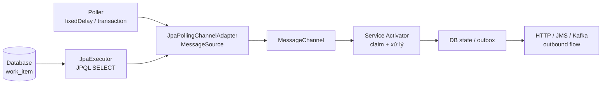
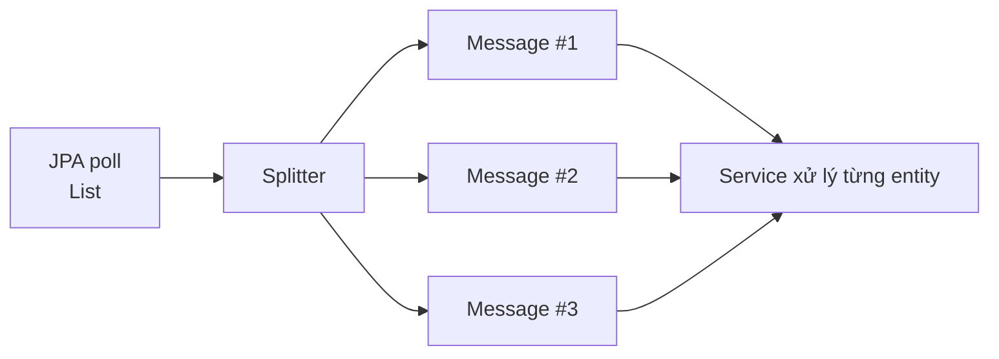
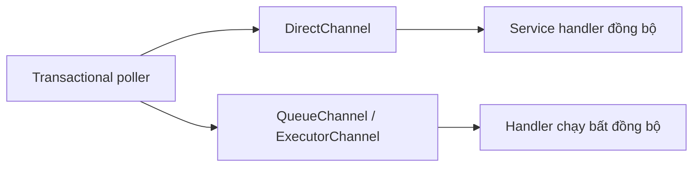
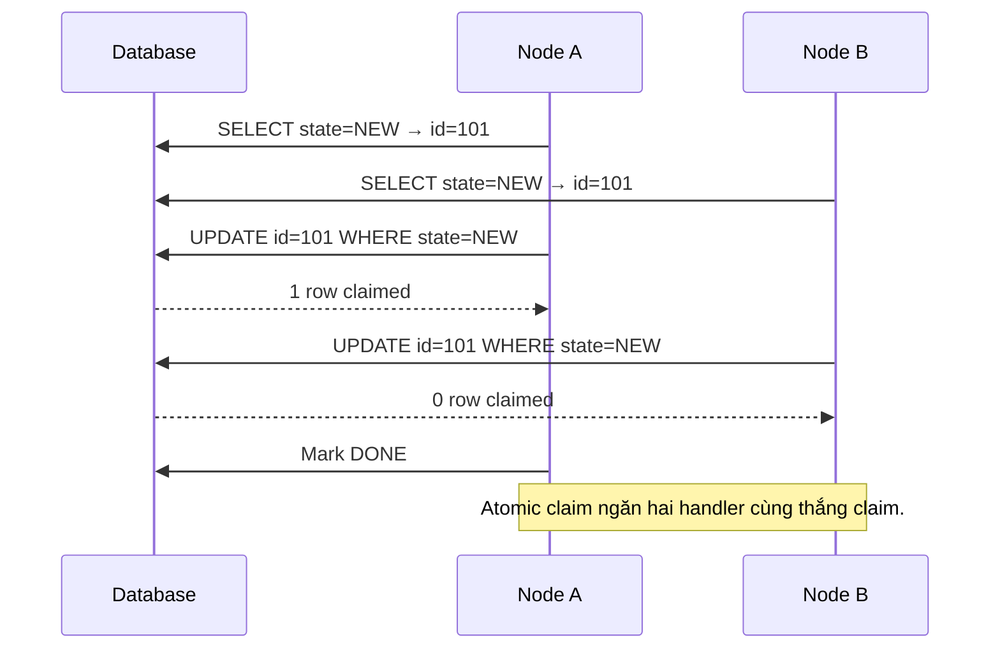

# JPA inbound channel adapter

## 1. Bối cảnh và mục tiêu

Trong module **SPRING_INTEGRATION_ADAPTERS**, các hệ thống ngoài được đưa vào Spring Integration bằng inbound/outbound adapter, gateway, poller và `MessageChannel`. Sau các adapter hướng file, SFTP, HTTP, JMS, AMQP hoặc Kafka, nhóm adapter cơ sở dữ liệu cho phép hệ thống **lấy dữ liệu đang được lưu trữ để khởi động một Integration Flow**.

Bài **JPA inbound channel adapter**, thuộc chương **Adapter JPA**, tập trung vào **đọc dữ liệu từ database theo chu kỳ thông qua Jakarta Persistence (JPA)** và đưa kết quả thành Spring Message để xử lý ở các bước tiếp theo.

Sau khi học, bạn có thể:

- Giải thích vai trò của `JpaPollingChannelAdapter`, `JpaExecutor`, `MessageSource`, `SourcePollingChannelAdapter` và `MessageChannel`.
- Phân biệt **polling bằng JPA** với đọc theo sự kiện, JPA outbound adapter/gateway và CDC (Change Data Capture).
- Cấu hình JPQL để lấy một entity hoặc danh sách entity; hiểu `expectSingleResult`, `maxResults` và ảnh hưởng của poller.
- Xây ứng dụng Spring Boot 3.x + Spring Integration 6.x sử dụng `@InboundChannelAdapter` và `@Poller`.
- Xử lý việc các hàng chưa đổi có thể được đọc lại ở những lần poll sau.
- Áp dụng transaction, idempotency, atomic claim và quản lý lỗi cho nguồn dữ liệu nhiều worker/nhiều node.
- Kiểm soát phân trang, lazy loading, số lượng bản ghi, backlog, độ trễ và đo lường vận hành.
- Thiết kế kiểm thử chứng minh dữ liệu được nhận đúng, không xử lý trùng ngoài ý muốn và không mất dữ liệu khi downstream lỗi.

> **Trọng tâm:** JPA inbound adapter là **polling consumer** để *truy vấn dữ liệu*, không phải trình lắng nghe sự kiện database theo thời gian thực. Nó không tự hiểu hàng nào đã được xử lý, không tự bảo đảm exactly-once, và không thay thế một chiến lược phối hợp giao dịch phù hợp.

## 2. JPA inbound adapter là gì?

JPA inbound channel adapter thực hiện một phép truy vấn JPA (thường là JPQL `SELECT`) tại những thời điểm do **poller** quyết định. Kết quả truy vấn được đặt vào **payload** của một Spring `Message<?>`, rồi gửi tới `MessageChannel` để các thành phần tiếp theo xử lý.

Hình dung bảng `work_item` lưu các yêu cầu chưa hoàn tất:

| id | state | body |
| ---: | --- | --- |
| 101 | NEW | `{"orderId":"ORD-101"}` |
| 102 | NEW | `{"orderId":"ORD-102"}` |
| 103 | DONE | `{"orderId":"ORD-103"}` |

Một query:

```sql
select w from WorkItem w
where w.state = 'NEW'
order by w.id
```

sẽ chọn những entity có trạng thái `NEW`. Adapter đặt một `List<WorkItem>` vào message (nếu cấu hình mặc định trả kết quả danh sách), để service phía sau quyết định xử lý.

### Sơ đồ dữ liệu



Tên gọi dễ nhầm:

- **`JpaExecutor`**: khai báo và thực hiện thao tác JPA cần thiết như query, pagination, delete/update sau khi poll nếu được cấu hình.
- **`JpaPollingChannelAdapter`**: một `MessageSource` sử dụng `JpaExecutor` để lấy dữ liệu và dựng Spring Message.
- **`@InboundChannelAdapter` / endpoint polling**: tạo lịch gọi `MessageSource.receive()` và đẩy message vào channel.
- **`MessageChannel`**: ranh giới giữa nguồn dữ liệu và bước xử lý tích hợp.
- **`@ServiceActivator`**: xử lý payload, gọi service nghiệp vụ và chuyển tiếp khi cần.

JPA được thực thi bởi persistence provider như Hibernate thông qua `EntityManagerFactory` và `EntityManager`. Bản thân Spring Integration **không phải** JPA provider.

## 3. Phân biệt JPA inbound, outbound và những cách lấy dữ liệu khác

| Thành phần/cách làm | Tác nhân khởi động | Dùng khi |
| --- | --- | --- |
| **JPA inbound channel adapter** | Poller chạy theo lịch, không có request message vào | Định kỳ lấy entity từ database rồi tạo message |
| **JPA outbound channel adapter** | Một message đi đến endpoint | Persist/merge/delete entity, thường là điểm cuối một nhánh |
| **JPA retrieving outbound gateway** | Một request message chứa điều kiện truy vấn | Lấy dữ liệu **theo yêu cầu** ở giữa flow rồi tiếp tục xử lý |
| **JPA updating outbound gateway** | Một request message yêu cầu thay đổi dữ liệu | Update/persist rồi tiếp tục flow với reply |
| **JDBC inbound channel adapter** | Poller và truy vấn SQL | Làm việc trực tiếp với SQL/`RowMapper` mà không cần JPA entity |
| **CDC / Debezium / database log stream** | Thay đổi transaction log của DB | Cần theo dõi thay đổi gần thời gian thực, giảm polling |
| **Repository + `@Scheduled` tự viết** | Scheduler của application | Cần workflow riêng ngoài các cấu hình tích hợp sẵn |

**Không đồng nhất polling với CDC:** nếu người dùng cập nhật DB giữa hai lần poll, JPA inbound adapter chỉ thấy trạng thái thỏa query tại lần truy vấn tiếp theo. Nó không tự phát hiện mọi phiên bản trung gian của cùng một hàng đã thay đổi liên tục.

**Không dùng outbound gateway thay inbound khi chỉ cần một nguồn theo lịch:** retrieving gateway phù hợp khi đã có message kích hoạt truy vấn. Inbound adapter tự tạo message nhờ poller.

## 4. Hợp đồng message: một entity hay một danh sách?

Một kết quả của JPA query có thể tạo:

```java
// expectSingleResult = false (thường là mặc định)
Message<List<WorkItem>>

// expectSingleResult = true, khi chỉ một row được chọn
Message<WorkItem>
```

Đây là mô tả **kiểu payload khái niệm**, không phải kiểu tĩnh mà handler luôn nhận được từ framework. `Message<?>` tại runtime chứa payload cụ thể tùy query, converter/adapter và cấu hình.

| Cấu hình | Ý nghĩa | Điều cần chú ý |
| --- | --- | --- |
| `expectSingleResult(false)` | Để kết quả dưới dạng danh sách | Một Spring Message có thể chứa nhiều entity |
| `expectSingleResult(true)` | Lấy một entity làm payload | Nếu query thực sự trả nhiều entity, có thể phát sinh `MessagingException` |
| `maxResults(25)` / `setMaxNumberOfResults(25)` | Giới hạn số row truy vấn ở mỗi lần gọi | **Không** có nghĩa poller chạy 25 lần |
| `maxMessagesPerPoll = 1` | Giới hạn số lần nhận message trong một đợt poll | Không giới hạn mỗi message chỉ chứa một row |
| `deleteAfterPoll(true)` | Cho adapter xóa những entity được đọc theo cấu hình | Hành động phá hủy dữ liệu; phải xem xét transaction và failure semantics |

Nếu muốn mỗi entity đi qua các bước xử lý riêng, có thể dùng **Splitter** sau inbound channel:



Spring Integration `split()` thường có thể tách collection thành các message riêng. Nhưng để bảo vệ tính toàn vẹn, cần quyết định **xử lý lỗi từng phần**: một bản ghi hỏng có chặn cả batch hay không, batch có retry, và entity nào được coi là DONE.

### Không có row thì sao?

Khi query không tìm được dữ liệu, `JpaPollingChannelAdapter.doReceive()` trả `null` nếu kết quả từ `JpaExecutor.poll()` rỗng (theo API Spring Integration 6.x), vì vậy polling endpoint **không phát một message chứa list rỗng** chỉ để báo “không có dữ liệu”. Handler vẫn nên kiểm tra collection rỗng khi nhận message từ những nguồn khác hoặc khi hợp đồng flow thay đổi. Không giả định mỗi nhịp poll tương ứng với một Spring Message.

## 5. Poller: nhịp của inbound adapter

`JpaPollingChannelAdapter` không chủ động mở một thread vô hạn để truy vấn. Nó là một `MessageSource`; Spring Integration **polling endpoint** gọi nó theo một trigger.

Ví dụ Java annotation:

```java
@InboundChannelAdapter(
    channel = "workItemsChannel",
    poller = @Poller(fixedDelay = "2000", maxMessagesPerPoll = "1"))
public MessageSource<?> jpaSource() {
    return new JpaPollingChannelAdapter(jpaExecutor);
}
```

Trong đó:

- `fixedDelay = "2000"`: đợi khoảng 2.000 ms sau khi hoàn tất đợt poll trước để bắt đầu đợt kế tiếp (theo lịch của trigger).
- `maxMessagesPerPoll = "1"`: mỗi đợt chỉ thực hiện tối đa một lượt nhận từ `MessageSource`, nhưng lượt nhận đó có thể chứa **`List` nhiều entity**.
- `fixedRate`: lên lịch theo chu kỳ kể từ lần bắt đầu dự kiến; có những khác biệt về nhịp và tải khi truy vấn kéo dài.
- `cron`: phù hợp khi cần thực hiện vào các mốc thời gian cụ thể.
- **Task executor**: ảnh hưởng concurrency, tải DB và thứ tự xử lý; cần chủ động cấu hình nếu dùng.

Không nên đặt poll interval ngắn chỉ vì muốn “realtime”. Nếu query cần 10 giây và poller chạy mỗi 100 ms, bạn có nguy cơ tạo áp lực không cần thiết lên connection pool và database, đặc biệt khi nhiều instance cùng poll.

### Poller không tự đánh dấu đã đọc

Với query `where w.state = 'NEW'`, nếu không cập nhật `state` hoặc xóa bản ghi thì lần poll sau **vẫn chọn cùng hàng**. Đây không phải bug của poller: đó là kết quả đúng theo điều kiện query.

Quyết định **đánh dấu, claim, xóa hoặc lưu watermark** phải xuất phát từ hợp đồng nghiệp vụ và cách xử lý lỗi.

## 6. Ví dụ Spring Boot hoàn chỉnh: đọc bảng work_item theo chu kỳ

Ví dụ xây một ứng dụng nhỏ:

1. Seed ba bản ghi demo có state `NEW`.
2. Adapter JPA poll mỗi 2 giây, lấy tối đa 25 entity `NEW`.
3. Inbound đặt `List<WorkItem>` lên `workItemsChannel`.
4. Handler duyệt danh sách và gọi một service `@Transactional`.
5. Service dùng **atomic claim** (`UPDATE ... WHERE state = 'NEW'`) để tránh hai worker cùng nhận quyền xử lý một hàng.
6. Ví dụ chỉ cập nhật database từ `NEW → PROCESSING → DONE` trong transaction; không có side effect ngoài DB.
7. Các poll sau sẽ không đọc lại entity đã chuyển `DONE`.

Ví dụ dùng **Java 17+, Spring Boot 3.x, Spring Integration 6.x và Jakarta Persistence**. Dùng H2 trong bộ nhớ **chỉ để học và kiểm thử**.

### 6.1. Maven dependencies

```xml
<dependencies>
    <dependency>
        <groupId>org.springframework.boot</groupId>
        <artifactId>spring-boot-starter</artifactId>
    </dependency>
    <dependency>
        <groupId>org.springframework.boot</groupId>
        <artifactId>spring-boot-starter-data-jpa</artifactId>
    </dependency>
    <dependency>
        <groupId>org.springframework.boot</groupId>
        <artifactId>spring-boot-starter-integration</artifactId>
    </dependency>
    <dependency>
        <groupId>org.springframework.integration</groupId>
        <artifactId>spring-integration-jpa</artifactId>
    </dependency>
    <dependency>
        <groupId>com.h2database</groupId>
        <artifactId>h2</artifactId>
        <scope>runtime</scope>
    </dependency>
    <dependency>
        <groupId>org.springframework.boot</groupId>
        <artifactId>spring-boot-starter-test</artifactId>
        <scope>test</scope>
    </dependency>
</dependencies>
```

- `spring-boot-starter-data-jpa` đem lại Spring Data JPA, transaction manager, Hibernate (trong cấu hình thông dụng).
- `spring-integration-jpa` chứa `JpaExecutor` và `JpaPollingChannelAdapter`; không đủ nếu bạn không có JPA provider/EntityManagerFactory.
- `spring-boot-starter-integration` cung cấp nền tảng Spring Integration.
- H2 cung cấp database demo; production nên dùng PostgreSQL, MySQL hoặc DB phù hợp, migration schema và pool connection được kiểm soát.
- Với Spring Boot 3.x/Spring Framework 6.x, package JPA chuẩn là **`jakarta.persistence`**, không phải `javax.persistence` ở những bản Spring cũ.

Nên dùng BOM của Spring Boot để quản lý phiên bản, tránh tự ghép các phiên bản Spring Integration/Hibernate/JPA không tương thích.

### 6.2. Entity WorkItem

File `WorkItem.java`:

```java
package com.example.jpainbound;

import jakarta.persistence.Column;
import jakarta.persistence.Entity;
import jakarta.persistence.GeneratedValue;
import jakarta.persistence.GenerationType;
import jakarta.persistence.Id;
import jakarta.persistence.Table;

@Entity
@Table(name = "work_item")
public class WorkItem {

    @Id
    @GeneratedValue(strategy = GenerationType.IDENTITY)
    private Long id;

    @Column(nullable = false, length = 32)
    private String state;

    @Column(nullable = false, length = 512)
    private String body;

    protected WorkItem() {
        // JPA cần constructor không tham số.
    }

    public WorkItem(String body) {
        this.body = body;
        this.state = "NEW";
    }

    public Long getId() {
        return id;
    }

    public String getState() {
        return state;
    }

    public String getBody() {
        return body;
    }

    public void setState(String state) {
        this.state = state;
    }
}
```

JPA query dùng **tên entity Java `WorkItem` và field `state`**, không phải tên bảng `work_item` và cột SQL tùy ý. Đây là điểm khác biệt giữa **JPQL** và **native SQL**.

Các state trong bài:

```text
NEW        : chờ đọc
PROCESSING : đã claim trong transaction đang xử lý
DONE       : xử lý DB demo thành công
```

Trong code mẫu, `PROCESSING` và `DONE` được ghi trong **cùng transaction**, nên ứng dụng khác thường không nhìn thấy trạng thái trung gian `PROCESSING` đã commit. Nếu production cần giữ lease `PROCESSING` lâu hơn để xử lý async, phải bổ sung cơ chế claim/lease/timeout phù hợp.

### 6.3. Spring Data repository có atomic claim

File `WorkItemRepository.java`:

```java
package com.example.jpainbound;

import org.springframework.data.jpa.repository.JpaRepository;
import org.springframework.data.jpa.repository.Modifying;
import org.springframework.data.jpa.repository.Query;
import org.springframework.data.repository.query.Param;

public interface WorkItemRepository
        extends JpaRepository<WorkItem, Long> {

    @Modifying
    @Query("""
            update WorkItem w
               set w.state = 'PROCESSING'
             where w.id = :id
               and w.state = 'NEW'
            """)
    int claimIfNew(@Param("id") Long id);
}
```

Đây là một **điều kiện claim nguyên tử ở database**:

- Nếu row còn `NEW`, `UPDATE` thay đổi state và trả `1`.
- Nếu worker khác đã claim/hoàn thành, điều kiện không khớp, trả `0`.
- Với nhiều worker cùng claim, DB chịu trách nhiệm khóa/đồng bộ update tương ứng với transaction isolation.
- `@Modifying` yêu cầu phương thức thực hiện một update query trong transaction; service `@Transactional` bên dưới cung cấp transaction đó.

**Đây là phòng vệ chống xử lý trùng ở bước claim**, không tự bảo đảm một side effect ngoài DB (gửi email, Kafka, HTTP) chỉ xảy ra đúng một lần. Nếu muốn bảo đảm giao event, cần kết hợp outbox, idempotency và retry theo hợp đồng.

### 6.4. Service xử lý có transaction

File `WorkItemProcessor.java`:

```java
package com.example.jpainbound;

import org.springframework.stereotype.Service;
import org.springframework.transaction.annotation.Transactional;

@Service
public class WorkItemProcessor {

    private final WorkItemRepository repository;

    public WorkItemProcessor(WorkItemRepository repository) {
        this.repository = repository;
    }

    @Transactional
    public void process(Long id) {
        // Một worker thắng claim; worker còn lại bỏ qua.
        if (repository.claimIfNew(id) != 1) {
            return;
        }

        WorkItem item = repository.findById(id)
                .orElseThrow();

        // Demo chỉ cập nhật DB. Không gửi Kafka/HTTP tại đây,
        // vì các side effect đó không nằm trong cùng DB transaction.
        System.out.println("Processing id=" + item.getId()
                + ", payload=" + item.getBody());

        item.setState("DONE");
        // JPA dirty checking ghi state DONE khi transaction commit.
    }
}
```

Cách này hữu ích vì:

1. Transaction bao quanh claim, đọc lại entity và cập nhật trạng thái.
2. Query bulk update giúp claim chỉ một worker thắng.
3. Các poll tiếp theo chỉ lấy row còn `NEW`.
4. Handler không sửa trực tiếp entity nhận từ message, tránh phụ thuộc vào entity còn attached/detached trong persistence context của lần poll.

**Quan trọng:** nếu service ném exception trước commit, transaction rollback và row có thể lại trở về `NEW`. Nếu một side effect ngoài DB xảy ra trước rollback, retry có thể khiến side effect xảy ra nhiều lần. Giải pháp production thường là transactional outbox, consumer idempotent và trạng thái retry.

### 6.5. Cấu hình JPA inbound channel adapter

File `JpaInboundConfiguration.java`:

```java
package com.example.jpainbound;

import java.util.List;

import jakarta.persistence.EntityManagerFactory;

import org.springframework.context.annotation.Bean;
import org.springframework.context.annotation.Configuration;
import org.springframework.integration.annotation.InboundChannelAdapter;
import org.springframework.integration.annotation.Poller;
import org.springframework.integration.annotation.ServiceActivator;
import org.springframework.integration.config.EnableIntegration;
import org.springframework.integration.jpa.core.JpaExecutor;
import org.springframework.integration.jpa.inbound.JpaPollingChannelAdapter;
import org.springframework.integration.core.MessageSource;
import org.springframework.messaging.MessageHandler;
import org.springframework.messaging.MessagingException;

@Configuration
@EnableIntegration
public class JpaInboundConfiguration {

    @Bean
    public JpaExecutor workItemJpaExecutor(
            EntityManagerFactory entityManagerFactory) {

        JpaExecutor executor =
                new JpaExecutor(entityManagerFactory);

        executor.setJpaQuery("""
                select w from WorkItem w
                where w.state = 'NEW'
                order by w.id
                """);

        executor.setMaxNumberOfResults(25);
        executor.setExpectSingleResult(false);
        executor.setDeleteAfterPoll(false);

        return executor;
    }

    @Bean
    @InboundChannelAdapter(
            channel = "workItemsChannel",
            poller = @Poller(
                    fixedDelay = "2000",
                    maxMessagesPerPoll = "1"))
    public MessageSource<?> workItemSource(
            JpaExecutor workItemJpaExecutor) {

        return new JpaPollingChannelAdapter(workItemJpaExecutor);
    }

    @Bean
    @ServiceActivator(inputChannel = "workItemsChannel")
    public MessageHandler processPolledRows(
            WorkItemProcessor processor) {

        return message -> {
            if (!(message.getPayload() instanceof List<?> rows)) {
                throw new MessagingException(
                        message, "Expected List<WorkItem> payload");
            }

            for (Object row : rows) {
                if (!(row instanceof WorkItem workItem)) {
                    throw new MessagingException(
                            message, "Unexpected entity type");
                }

                processor.process(workItem.getId());
            }
        };
    }
}
```

**Điểm cần hiểu trong đoạn mã:**

1. `JpaExecutor(entityManagerFactory)` được Spring Integration giao thao tác truy vấn. Dùng factory thay vì chia sẻ một `EntityManager` thô giữa nhiều thread.
2. `setJpaQuery(...)` nhận **JPQL** với entity/field Java, không phải SQL tên bảng.
3. `setMaxNumberOfResults(25)` giới hạn tối đa 25 entity mỗi lần query.
4. `setExpectSingleResult(false)` để payload là một `List`; handler chịu trách nhiệm duyệt.
5. `setDeleteAfterPoll(false)` giữ row lại; logic đánh dấu DONE nằm trong service nghiệp vụ.
6. `@InboundChannelAdapter` tạo polling endpoint và đưa output vào channel `workItemsChannel`.
7. `@Poller(maxMessagesPerPoll = "1")` không hạn chế payload chỉ chứa một entity.
8. `@ServiceActivator` là downstream consumer; vì đây là một channel direct mặc định cho endpoint xử lý đồng bộ, cần cân nhắc thời gian xử lý và error handling để không giữ polling thread quá lâu.
9. Service `process(id)` tự quản lý transaction, không giả định entity của adapter còn attached.
10. `@EnableIntegration` được khai báo tường minh; Spring Boot starter có thể cũng cấu hình Integration khi phù hợp.

**Lưu ý phạm vi:** đoạn mã minh họa bảo vệ claim ở DB. Nó chưa có retry/lease/backoff cho lỗi ngoài DB, chưa có cơ chế phát Kafka hay bảo đảm exactly-once end-to-end.

### 6.6. Khởi chạy và thêm dữ liệu demo

File `JpaInboundApplication.java`:

```java
package com.example.jpainbound;

import java.util.List;
import org.springframework.boot.CommandLineRunner;
import org.springframework.boot.SpringApplication;
import org.springframework.boot.autoconfigure.SpringBootApplication;
import org.springframework.context.annotation.Bean;

@SpringBootApplication
public class JpaInboundApplication {

    public static void main(String[] args) {
        SpringApplication.run(JpaInboundApplication.class, args);
    }

    @Bean
    CommandLineRunner sampleRows(WorkItemRepository repository) {
        return args -> {
            if (repository.count() == 0) {
                repository.saveAll(List.of(
                        new WorkItem("{\"orderId\":\"ORD-101\"}"),
                        new WorkItem("{\"orderId\":\"ORD-102\"}"),
                        new WorkItem("{\"orderId\":\"ORD-103\"}")
                ));
            }
        };
    }
}
```

File `application.properties` cho **môi trường demo**:

```properties
spring.datasource.url=jdbc:h2:mem:jpa_inbound_demo;DB_CLOSE_DELAY=-1
spring.datasource.driver-class-name=org.h2.Driver
spring.datasource.username=sa
spring.datasource.password=

spring.jpa.hibernate.ddl-auto=create-drop
spring.jpa.open-in-view=false
logging.level.org.springframework.integration=INFO
```

Với H2 in-memory và `create-drop`, dữ liệu sẽ bị xóa khi restart. Đây là lựa chọn giúp học tập, **không áp dụng** cho production. Production cần migration qua Flyway/Liquibase, backup, pool sizing và quyền database phù hợp.

Chạy ứng dụng, bạn sẽ thấy các bản ghi `NEW` được chọn rồi xử lý và chuyển thành `DONE`. Sau khi không còn `NEW`, những lần poll tiếp theo không tạo thêm công việc xử lý. Nếu thêm một `WorkItem` mới, poller sẽ chọn nó ở lượt tiếp theo.

**Tình huống khởi động:** `CommandLineRunner` chạy sau quá trình tạo application context, nên một lượt poll sớm có thể xảy ra khi chưa seed xong; đó không phải lỗi. Để có kịch bản startup chặt chẽ hơn, hãy kiểm soát thứ tự start endpoint, dữ liệu seed và readiness.

## 7. Ba phong cách cấu hình: Java annotation, Java DSL và XML

Bài đã sử dụng **Java annotation**. Spring Integration còn có Java DSL và XML namespace để mô tả cùng cơ chế. **Chỉ chọn một cách cho một endpoint thực tế**, nếu cấu hình cả ba cùng lúc bạn sẽ tạo nhiều poller đọc một nguồn.

### 7.1. Java DSL

Đoạn sau **thay thế** `@InboundChannelAdapter` và handler annotation trong mục 6.5, không chạy song song với chúng:

```java
import jakarta.persistence.EntityManagerFactory;
import java.time.Duration;
import org.springframework.context.annotation.Bean;
import org.springframework.integration.dsl.IntegrationFlow;
import org.springframework.integration.dsl.Pollers;
import org.springframework.integration.jpa.dsl.Jpa;

@Bean
IntegrationFlow jpaPollingFlow(
        EntityManagerFactory entityManagerFactory,
        WorkItemProcessor processor) {

    return IntegrationFlow
            .from(
                    Jpa.inboundAdapter(entityManagerFactory)
                            .jpaQuery("""
                                    select w from WorkItem w
                                    where w.state = 'NEW'
                                    order by w.id
                                    """)
                            .maxResults(25),
                    endpoint -> endpoint.poller(
                            Pollers.fixedDelay(Duration.ofSeconds(2))))
            .split()
            .handle((payload, headers) -> {
                WorkItem row = (WorkItem) payload;
                processor.process(row.getId());
                return null;
            })
            .get();
}
```

- `Jpa.inboundAdapter(entityManagerFactory)` tạo spec bọc `JpaPollingChannelAdapter`.
- `jpaQuery(...)` và `maxResults(25)` áp vào JPA source.
- `Pollers.fixedDelay(Duration.ofSeconds(2))` điều khiển lịch lấy dữ liệu.
- `split()` biến `List<WorkItem>` thành những message riêng để handler thao tác trên từng entity.
- `handle(...)` trả `null` để kết thúc flow minh họa sau khi xử lý; không tạo reply message.

Nếu muốn downstream còn tiếp tục sang Kafka/JMS/HTTP, hãy thiết kế message output/transformer tiếp theo thay vì luôn kết thúc ở `null`.

### 7.2. XML namespace

Một cấu hình XML minh họa cùng ý tưởng polling:

```xml
<int-jpa:inbound-channel-adapter
        id="workItemJpaInbound"
        channel="workItemsChannel"
        entity-manager-factory="entityManagerFactory"
        jpa-query="select w from WorkItem w where w.state = 'NEW' order by w.id"
        max-results="25"
        expect-single-result="false"
        delete-after-poll="false">

    <int:poller fixed-delay="2000"
                max-messages-per-poll="1"/>
</int-jpa:inbound-channel-adapter>
```

Giả định bạn đã khai báo namespace `int`/`int-jpa`, schema và bean `entityManagerFactory` tương ứng trong Spring XML context. Đây là **đoạn XML cho phần endpoint**, không phải một XML file độc lập có root/namespaces đầy đủ.

**Chọn query source:** Java DSL/XML cho phép `entityClass`, `jpaQuery`, `namedQuery` hoặc `nativeQuery` theo các tổ hợp được hỗ trợ; không khai đồng thời những lựa chọn xung đột. Nếu query có tham số, hãy dùng `ParameterSource`/JPA parameters được cấu hình an toàn, **không nối chuỗi dữ liệu client vào JPQL**.

### 7.3. Khi nào dùng expectSingleResult?

Nếu mỗi poll chỉ lấy một entity:

```java
executor.setJpaQuery("""
        select w from WorkItem w
        where w.state = 'NEW'
        order by w.id
        """);

executor.setMaxNumberOfResults(1);
executor.setExpectSingleResult(true);
```

Khi đó handler nhận **`WorkItem`** thay vì `List<WorkItem>`. Cần thay handler cho đúng kiểu payload.

**Đừng chỉ đặt `expectSingleResult(true)` mà bỏ giới hạn query nếu có nhiều hàng:** adapter có thể ném exception khi kết quả có nhiều entity. `expectSingleResult` không phải lệnh tự động chia list hoặc tự động claim một hàng trong DB.

## 8. Transaction: phạm vi nào thực sự được bảo đảm?

### 8.1. Poll transaction và business transaction

Các hoạt động JPA sửa dữ liệu (update/delete) phải chạy trong transaction. Trong bài mẫu, `JpaExecutor` chỉ query, còn `WorkItemProcessor.process(...)` có `@Transactional` để claim và cập nhật state.

Nếu adapter cấu hình `deleteAfterPoll(true)` hoặc thực hiện update liên quan tới chính lần poll, cần **transaction cho polling endpoint** phù hợp. Spring Integration hỗ trợ poller transactional advice, ví dụ XML:

```xml
<int-jpa:inbound-channel-adapter
        channel="workItemsChannel"
        entity-manager-factory="entityManagerFactory"
        jpa-query="select w from WorkItem w where w.state = 'NEW'"
        delete-after-poll="true">
    <int:poller fixed-delay="2000">
        <int:transactional propagation="REQUIRED"
                           transaction-manager="transactionManager"/>
    </int:poller>
</int-jpa:inbound-channel-adapter>
```

Đây là **ví dụ transaction semantics**, không nên áp vào bảng nghiệp vụ thật chỉ để tránh đọc trùng. `deleteAfterPoll(true)` có thể xóa dữ liệu **trước khi toàn bộ xử lý downstream thật sự hoàn tất** (đặc biệt khi có channel bất đồng bộ), và khi transaction commit thì không thể tự suy diễn rằng Kafka/HTTP consumer đã nhận thành công.

### 8.2. Ranh giới DirectChannel và QueueChannel



- `DirectChannel` thường gọi handler trong **thread của sender**; một transaction advice bao quanh poll có thể bao gồm phần downstream đồng bộ trong phạm vi lời gọi.
- `QueueChannel` hoặc `ExecutorChannel` chuyển giao công việc qua ranh giới bất đồng bộ; transaction của poller **không tự kéo dài** tới consumer sau đó.
- `@Transactional` trên service được Spring proxy gọi từ bean khác là một cách rõ ràng để tạo transaction cho từng lần xử lý DB.
- Nếu dùng transaction mang nghĩa rollback toàn flow, cần kiểm tra chính xác channel boundaries, exception propagation và chính sách retry.

**Không có transaction mặc định trải qua DB, Kafka, HTTP và WebSocket chỉ vì tất cả thành phần nằm trong một Integration Flow.** Hãy định nghĩa rõ từng giao dịch và cơ chế phối hợp.

### 8.3. Vì sao delete-after-poll nguy hiểm?

Giả sử adapter đọc 10 bản ghi rồi xóa chúng trong một transaction, sau đó gửi một `List` sang queue để worker khác xử lý. Worker downstream crash trước khi xử lý xong. Nếu transaction xóa đã commit, bản ghi có thể đã biến mất khỏi nguồn.

Chỉ dùng `deleteAfterPoll` nếu dữ liệu thật sự có thể bị xóa theo nghiệp vụ, việc xử lý nằm trong transaction/đường đi phù hợp, và bạn đã kiểm chứng lỗi cũng như khả năng phục hồi. Với workflow quan trọng, **state machine + claim + outbox** thường có thể quan sát và khôi phục rõ hơn.

## 9. Đọc lặp, nhiều worker và đảm bảo xử lý

### 9.1. Poll lặp là hành vi bình thường

JPQL `where state = 'NEW'` không biết row nào đã được xử lý ở downstream. Nếu service không cập nhật row, lần poll tiếp theo vẫn trả cùng một `WorkItem`.

Để ngăn lặp ngoài ý muốn, có thể chọn:

- Cập nhật `state` sau khi xử lý thành công.
- Atomic claim bằng `UPDATE ... WHERE state='NEW'`.
- Thêm `@Version`/optimistic locking cho các domain entity phù hợp.
- Dùng bảng outbox/inbox và idempotency key.
- Dùng một consumer/partition ownership rõ ràng, hoặc DB locking khi thật sự cần.

### 9.2. Hai node cùng polling

Giả sử Spring Node A và Node B cùng đọc một bảng:



**Cẩn thận về transaction:** ví dụ trên là luồng logic. Khi hai transaction cùng cập nhật row, một transaction có thể phải chờ lock; kết quả claim phụ thuộc isolation và DB. Bạn cần integration test trên chính database production để xác minh behavior và kiểm tra deadlock/timeout.

**Nếu không có claim**, cả A và B có thể cùng thực hiện side effect trước khi bất kỳ row nào chuyển `DONE`.

### 9.3. Xử lý lỗi giữa chừng và lease

Nếu claim sang `PROCESSING` rồi **commit trước** khi gọi một dịch vụ ngoài, crash có thể khiến row mắc kẹt ở `PROCESSING`. Nếu giữ transaction mở trong khi gọi HTTP/Kafka chậm, dễ tăng thời gian giữ lock và gây nghẽn DB.

Production thường cần thêm:

| Trường | Mục đích |
| --- | --- |
| `state` | `NEW`, `PROCESSING`, `DONE`, `FAILED` |
| `claimed_by` | Instance/worker đang xử lý |
| `claimed_until` hoặc `lease_until` | Thời điểm hết lease, cho phép thu hồi việc bị treo |
| `attempt_count` | Số lần thử để giới hạn retry |
| `next_attempt_at` | Lịch retry/backoff |
| `event_id` hoặc `idempotency_key` | Chống side effect trùng ở downstream |
| `last_error_code` | Quan sát nguyên nhân lỗi mà không lưu secrets |

Thiết kế claim/lease phụ thuộc database: có thể dùng native SQL `SELECT ... FOR UPDATE SKIP LOCKED` ở DB hỗ trợ, hoặc atomic update cùng version/lease. JPQL thuần không có một cú pháp portable cho mọi tính năng khóa hàng nâng cao; cần cân nhắc tính tương thích.

### 9.4. Outbox cho event quan trọng

Nếu mục tiêu là “đọc order mới và gửi Kafka event”, không nên kết luận Kafka đã nhận khi DB commit thành công.

Một cách:

1. Trong transaction DB, ghi/đổi state của entity và thêm **outbox event** với `eventId` duy nhất.
2. Polling adapter/worker khác đọc outbox đủ điều kiện và publish tới Kafka/JMS.
3. Khi broker xác nhận theo hợp đồng, đánh dấu outbox `SENT`.
4. Nếu crash trước đánh dấu, event có thể publish lại; consumer phải **idempotent** theo `eventId`.
5. Dùng retries có backoff, dead-letter handling và alert cho backlog quá lớn.

Đây thường là **at-least-once delivery + idempotency**, không tự động exactly-once từ database tới hệ thống khác.

## 10. Điều chỉnh truy vấn và tài nguyên

### 10.1. maxResults không phải pagination đầy đủ

`setMaxNumberOfResults(25)` chỉ giới hạn số entity mỗi lần query. Nếu có 100.000 row NEW, adapter sẽ chọn tối đa 25 row ở mỗi lần poll. Nó không tự bảo đảm mọi row được chọn nếu bạn luôn đọc lại 25 hàng đầu mà **không thay đổi trạng thái**.

Đặt `order by` với khóa ổn định như `id` để giảm bất định ở mỗi batch. Nhưng `order by` không tự bảo đảm fairness khi có nhiều worker và update đồng thời.

Tránh dùng `firstResult`/OFFSET tăng dần một cách máy móc trong một tập đang thay đổi: khi rows chuyển sang DONE giữa các lần poll, offset có thể bỏ qua hoặc đọc lặp bản ghi. **State-based polling** và keyset/watermark phù hợp thường dễ kiểm soát hơn.

### 10.2. Lazy loading và entity detached

Sau khi JPA adapter hoàn tất query, entity có thể không còn gắn với persistence context ở nơi downstream chạy. Nếu handler bất đồng bộ truy cập quan hệ `LAZY`, bạn có thể gặp `LazyInitializationException`.

Giải pháp:

- Chỉ truyền **ID/DTO immutable** sang các channel bất đồng bộ.
- Dùng fetch join/entity graph có kiểm soát nếu phải lấy thông tin liên quan.
- Trong service `@Transactional`, đọc lại entity theo ID khi cần.
- Không đặt toàn bộ entity graph lên Kafka/JMS/JSON một cách tùy tiện.
- Với dữ liệu lớn, projection/câu truy vấn chỉ lấy trường cần thiết giúp giảm tải.

Bài mẫu nhận entity nhưng **chỉ đọc `id`** rồi service lấy lại row trong transaction. Đây là một lựa chọn đơn giản để tránh dựa vào trạng thái attached của entity được poll.

### 10.3. Index và database connection pool

JPQL:

```sql
select w from WorkItem w
where w.state = 'NEW'
order by w.id
```

nên được đánh giá bằng execution plan và index trên database thật. Tùy engine, index kết hợp `(state, id)` có thể giúp lọc và sắp xếp. Đừng tạo index chỉ vì query trông đơn giản; cần đo write overhead và selectivity của `state`.

Nếu 10 node mỗi node poll 10 lần/giây, load DB có thể lớn dù chưa có row mới. Cân nhắc:

- Fixed delay phù hợp, tăng interval khi không có công việc.
- Batch size hợp lý và index đúng.
- Connection pool max size, query timeout và DB resource limits.
- Backoff/jitter để các instance không query cùng một thời điểm.
- Không tạo vô hạn poller thread hoặc executor.
- CDC/outbox/log streaming nếu yêu cầu event rate cao và độ trễ rất thấp.

### 10.4. Poller và Service Activator không mặc định có backpressure end-to-end

`DirectChannel` xử lý đồng bộ nên downstream chậm có thể kéo dài poll; điều này đôi khi là một dạng giới hạn tự nhiên. Nếu chèn `ExecutorChannel`/`QueueChannel`, poller có thể tiếp tục nạp khi consumer bị chậm, khiến queue tăng. Cần đặt capacity, overflow/rejection policy và metrics rõ ràng.

Nếu dữ liệu lớn hoặc có nhiều job lâu, nên thiết kế job queue/outbox chuyên dụng hơn là chỉ tăng `maxMessagesPerPoll`.

## 11. Error handling và retry

### 11.1. Những loại lỗi thường gặp

| Lỗi | Ví dụ | Hướng xử lý |
| --- | --- | --- |
| Kết nối DB thất bại | Database restart, hết connection pool | Backoff/retry với giới hạn, health alert |
| JPQL sai | Sai tên entity/field hoặc syntax | Sửa cấu hình, không retry vô hạn |
| Query trả quá nhiều rows | Bỏ `maxResults` hoặc query không chọn lọc | Giới hạn batch, tối ưu index/query |
| Mapping entity lỗi | Schema DB không tương thích | Migration, kiểm thử database |
| Lazy loading lỗi | Handler async truy cập proxy detached | DTO/ID hoặc transaction/fetch phù hợp |
| Multiple results khi đòi single | `expectSingleResult(true)` nhưng query trả nhiều | Đặt `maxResults(1)` hoặc sửa contract |
| Claim cạnh tranh | Hai node cùng chọn row | Atomic update/lock và idempotency |
| Business service ném lỗi | Validate thất bại, downstream unavailable | Transaction rollback, retry/FAILED state |
| Dữ liệu độc hại | Payload JSON sai, nội dung vượt size | Schema validation, giới hạn kích thước |
| Đọc lại không ngừng | Row vẫn `NEW` sau thành công | Mark DONE/claim; kiểm tra transaction commit |

### 11.2. Polling error channel không tự xử lý nghiệp vụ

Trong Spring Integration, lỗi đồng bộ của poller/handler có thể đi qua cơ chế error handling/error channel tùy cấu hình endpoint và task scheduler. **Không giả định** có một cơ chế retry vô hạn an toàn hoặc row tự chuyển `FAILED` khi exception xuất hiện.

Một chiến lược rõ ràng:

1. Phân loại lỗi **tạm thời** (DB/network timeout) và lỗi **không thể sửa bằng retry** (schema/validation).
2. Ghi `eventId`/`rowId`, attempt count, error code; tránh log PII/token.
3. Khi lỗi DB transaction, để rollback và chỉ retry sau khoảng chờ có backoff.
4. Với record hỏng lặp lại, chuyển sang `FAILED`/quarantine sau N lần để tránh một row chặn mọi batch.
5. Giám sát tuổi bản ghi chờ, backlog và độ trễ xử lý.
6. Với tác động ngoài DB, dùng outbox/idempotency để tránh lặp side effect.

Không xử lý `catch (Exception e) { }` rồi cập nhật `DONE`; như vậy có thể **mất dữ liệu âm thầm**.

## 12. Kiểm thử JPA inbound adapter

### 12.1. Unit test atomic claim

Kiểm thử repository ở tầng JPA với database test:

```java
package com.example.jpainbound;

import static org.assertj.core.api.Assertions.assertThat;

import org.junit.jupiter.api.Test;
import org.springframework.beans.factory.annotation.Autowired;
import org.springframework.boot.test.autoconfigure.orm.jpa.DataJpaTest;

@DataJpaTest
class WorkItemRepositoryTest {

    @Autowired
    WorkItemRepository repository;

    @Test
    void claimOnlyOnce() {
        WorkItem row = repository.saveAndFlush(
                new WorkItem("{\"orderId\":\"ORD-T01\"}"));

        int first = repository.claimIfNew(row.getId());
        int second = repository.claimIfNew(row.getId());

        assertThat(first).isEqualTo(1);
        assertThat(second).isZero();
    }
}
```

`@DataJpaTest` thường chạy test trong transaction và tự rollback. Đoạn test chứng minh **claim không thể thắng hai lần liên tiếp trong cùng DB state**, chưa phải test race giữa hai transaction thực. Một test concurrency thật cần hai transaction/connection độc lập trên database mục tiêu.

### 12.2. Integration test poller

Một integration test có ý nghĩa nên:

1. Khởi động Spring context với H2/PostgreSQL test database.
2. Seed hai hàng `NEW` và một hàng `DONE`.
3. Chờ poller chạy (dùng Awaitility hoặc một latch/event kiểm thử có timeout), không ngủ cố định tùy tiện.
4. Xác minh hai hàng `NEW` được xử lý và chuyển `DONE`, hàng đã DONE không bị xử lý lại.
5. Thêm hàng mới khi application đang chạy; xác minh poller chọn ở chu kỳ sau.
6. Tạo nhiều hơn `maxResults` và kiểm tra batch kế tiếp vẫn xử lý phần còn lại.
7. Cho một row gây exception; xác minh transaction rollback và policy retry/FAILED.
8. Thử hai instance cùng poll để phát hiện cạnh tranh; đây cần DB thực hoặc test environment sát production.
9. Thử làm chậm downstream và đo tác động lên lịch poll.
10. Kiểm tra metric/log, lifecycle stop/start và shutdown khi app đang poll.

Chỉ assert log `Processing ...` không đủ để khẳng định DB state đã commit. Kiểm tra row trong một transaction/connection riêng khi cần.

### 12.3. Kiểm thử với database thực

H2 có thể khác PostgreSQL/MySQL về SQL dialect, kiểu dữ liệu, transaction isolation, locking, index, timeouts và `SKIP LOCKED`. Dùng Testcontainers hoặc môi trường tích hợp với database thực tế cho bài toán multiworker, claim và retry.

**Đặc biệt:** test khả năng crash đúng thời điểm (sau claim, trước commit, sau publish, trước mark SENT) mới giúp hiểu nguy cơ mất/trùng sự kiện. Nếu không có các ca đó, đừng ghi “exactly-once” trong SLA.

## 13. Quan sát và vận hành

Các chỉ số hữu ích:

| Chỉ số | Ý nghĩa |
| --- | --- |
| `jpa_poll_duration_seconds` | Thời gian mỗi lần truy vấn/poll |
| `jpa_poll_results_count` | Số row lấy được trong một lần |
| `jpa_poll_errors_total` | Số lỗi query/connection/transaction |
| `work_items_new_count` | Backlog chưa được claim |
| `work_items_processing_count` | Row đang xử lý hoặc có lease |
| `work_items_oldest_age_seconds` | Tuổi bản ghi chờ lâu nhất |
| `work_item_claim_conflicts_total` | Số lần atomic claim trả 0 |
| `work_item_retry_total` | Số lần retry theo error category |
| `db_connection_pool_active` | Áp lực lên pool |
| `outbox_unsent_events` | Event đã ghi nhưng chưa publish thành công |

Không dùng từng `rowId` hoặc `eventId` làm label của một metric vì cardinality lớn. Có thể đặt ID trong trace/log theo chính sách bảo vệ dữ liệu.

### Checklist trước khi triển khai

- [ ] JPQL dùng đúng entity/field và có index theo workload.
- [ ] `maxResults`, poll interval và timeout phù hợp.
- [ ] Có cơ chế đánh dấu row đã xử lý; không poll lặp vô hạn.
- [ ] Dùng transaction đúng phạm vi; không giả định transaction xuyên queue/HTTP/Kafka.
- [ ] Multiworker có atomic claim/idempotency hoặc cơ chế phân công tương đương.
- [ ] Có retry/backoff/FAILED state cho record lỗi; tránh poison row làm nghẽn.
- [ ] Downstream chậm có queue/buffer hữu hạn và policy overflow.
- [ ] Lazy entity không bị truy cập ngoài persistence context.
- [ ] Có metrics cho backlog, claim conflicts, errors và tuổi row.
- [ ] Có test với database tương đồng production, kể cả reconnect/restart/crash.

## 14. Bài tập thực hành

### Bài A — single entity và List

Sửa adapter để mỗi poll chỉ lấy một `WorkItem` bằng `setMaxNumberOfResults(1)` và `setExpectSingleResult(true)`. Viết handler nhận `WorkItem` thay vì `List<WorkItem>`. Sau đó bỏ `maxResults(1)` nhưng giữ `expectSingleResult(true)` trong bảng có nhiều row `NEW`; quan sát lỗi và giải thích nguyên nhân.

### Bài B — hiệu ứng của poller

So sánh `fixedDelay`, `fixedRate` và `maxMessagesPerPoll` trong tình huống query 300 ms, handler 1.500 ms, có 1.000 row NEW. Giải thích vì sao `maxMessagesPerPoll=1` không giới hạn batch chỉ một row.

### Bài C — transaction và delete-after-poll

Tạo bảng dữ liệu demo có thể xóa, cấu hình `deleteAfterPoll(true)` và poller transactional. Thử chèn `QueueChannel` trước consumer; cố ý cho consumer lỗi. Ghi nhận ranh giới transaction và giải thích vì sao delete-after-poll có thể gây mất công việc nếu dùng sai.

### Bài D — hai worker cùng polling

Chạy hai instance cùng database. Nếu bỏ `claimIfNew`, quan sát khả năng cả hai cùng xử lý một row. Thêm atomic claim, đo số lần claim trả 0 và viết concurrency test với hai connection/transaction độc lập.

### Bài E — outbox sang Kafka/JMS

Thay phần xử lý đơn giản bằng transaction ghi `WorkItem` và `OutboxEvent`. Tạo publisher đọc outbox bằng adapter phù hợp rồi gửi Kafka/JMS, đánh dấu SENT khi broker xác nhận. Thiết kế `eventId`, retry, idempotency và cách xử lý nếu crash sau publish nhưng trước mark SENT.

### Bài F — tối ưu truy vấn và backlog

Tạo 100.000 `WorkItem`, đặt `maxResults(100)` và index phù hợp. Đo query latency, backlog age, connection pool utilization và tốc độ xử lý. So sánh khi polling liên tục và khi tăng delay; đề xuất khi nào nên chuyển sang CDC hoặc event-based integration.

**Tiêu chí hoàn thành:** bạn có thể cấu hình source JPA tạo message theo poller, phân biệt message theo row/batch, ngăn poll lặp bằng state/claim, quản lý transaction và giải thích vì sao JPA polling không tự bảo đảm exactly-once giữa database và broker ngoài.

## 15. Tổng kết

- **JPA inbound channel adapter** là `JpaPollingChannelAdapter` sử dụng `JpaExecutor` để đọc dữ liệu JPA định kỳ và tạo message cho `MessageChannel`.
- `@InboundChannelAdapter`/poller xác định thời điểm truy vấn; `maxMessagesPerPoll` không phải số row của query.
- `expectSingleResult` quyết định payload entity đơn hay danh sách; `maxResults` giới hạn số row từ DB.
- Nếu query luôn chọn `NEW` mà không chuyển state, cùng row có thể xuất hiện ở nhiều lần poll.
- `deleteAfterPoll` cần thận trọng: xóa dữ liệu không đồng nghĩa downstream đã thành công, nhất là khi có async channel.
- Transaction chỉ có hiệu lực trong phạm vi đã cấu hình; không tự kéo dài qua Kafka, JMS, HTTP hoặc WebSocket.
- Multi-node cần **atomic claim, lease/locking hoặc phân công partition**, đồng thời có idempotency.
- Entity JPA có thể detached ở downstream; truyền ID/DTO hoặc tải lại trong transaction là lựa chọn an toàn.
- Độ bền của event quan trọng cần outbox, retry, error handling và quan sát backlog.
- Khi cần nắm mọi thay đổi của DB với độ trễ nhỏ, hãy đánh giá CDC thay vì cố giảm poll interval vô hạn.

## Tài liệu tham khảo

- [Spring Integration Reference — JPA Support](https://docs.spring.io/spring-integration/reference/jpa.html)
- [Spring Integration Reference — JPA Inbound Channel Adapter](https://docs.spring.io/spring-integration/reference/jpa/inbound-channel-adapter.html)
- [Spring Integration Reference — JPA Namespace and Transactions](https://docs.spring.io/spring-integration/reference/jpa/namespace-support.html)
- [Spring Integration API — JpaExecutor](https://docs.spring.io/spring-integration/docs/6.4.2/api/org/springframework/integration/jpa/core/JpaExecutor.html)
- [Spring Integration API — JpaPollingChannelAdapter](https://docs.spring.io/spring-integration/docs/latest-ga/api/org/springframework/integration/jpa/inbound/JpaPollingChannelAdapter.html)
- [Spring Integration API — JpaInboundChannelAdapterSpec](https://docs.spring.io/spring-integration/docs/6.1.x/api/org/springframework/integration/jpa/dsl/JpaInboundChannelAdapterSpec.html)
- [Spring Integration Reference — Polling Consumer](https://docs.spring.io/spring-integration/reference/endpoint.html)
- [Spring Framework Reference — Transaction Management](https://docs.spring.io/spring-framework/reference/data-access/transaction.html)
- [Spring Data JPA Reference — JPA Query Methods](https://docs.spring.io/spring-data/jpa/reference/jpa/query-methods.html)
