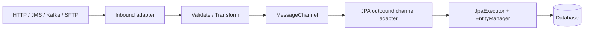
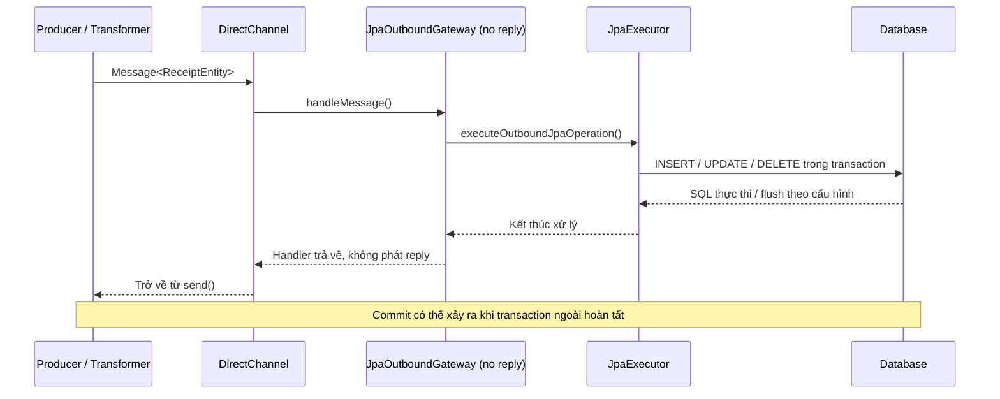
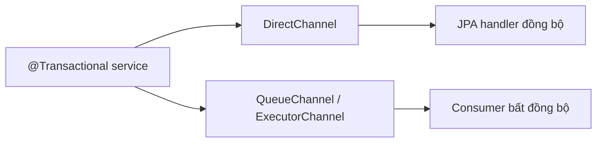
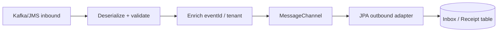
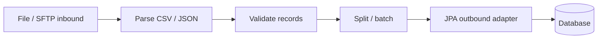

# JPA outbound channel adapter

## 1. Bối cảnh và mục tiêu

Trong module **SPRING_INTEGRATION_ADAPTERS**, dữ liệu được trao đổi với những hệ thống bên ngoài bằng inbound/outbound adapter, gateway, poller và `MessageChannel`. Một sự kiện có thể đến từ file, SFTP, HTTP, JMS, AMQP hoặc Kafka, sau đó được làm sạch, xác thực và cuối cùng **ghi vào cơ sở dữ liệu** bằng một endpoint Spring Integration.

Bài **JPA outbound channel adapter**, thuộc chương **Adapter JPA**, giải thích cách đưa một Spring Message vào tầng persistence thông qua **Jakarta Persistence (JPA)**. Đây là hướng dữ liệu ngược với JPA inbound adapter: thay vì poll database để tạo message, outbound adapter **nhận message để thực hiện thao tác ghi hoặc cập nhật database**.

Sau bài học, bạn có thể:

- Giải thích đường đi `MessageChannel → JpaOutboundGateway → JpaExecutor → EntityManager → database`.
- Phân biệt **JPA outbound channel adapter** với **JPA updating outbound gateway**, retrieving gateway và inbound polling adapter.
- Chọn đúng `PersistMode.PERSIST`, `PersistMode.MERGE` hoặc `PersistMode.DELETE` cho các tình huống nghiệp vụ.
- Cấu hình Java annotation, Java DSL và XML namespace cho một endpoint ghi JPA.
- Dùng entity trực tiếp hoặc JPQL `UPDATE`/`DELETE` với tham số lấy từ message payload/headers.
- Xây một ví dụ Spring Boot 3.x + Spring Integration 6.x + Jakarta Persistence, có transaction và kiểm thử.
- Hiểu chính xác khác biệt giữa **flush**, **commit**, kết quả `MessageChannel.send(...)` và ACK của hệ thống nguồn.
- Xử lý bản ghi trùng, transaction rollback, lỗi DB, lô `Iterable`, batch flush, optimistic locking và idempotency.
- Nhận diện khi nào cần outbox/inbox, retry, DLQ hoặc cơ chế đảm bảo delivery giữa database với JMS/Kafka/HTTP.

> **Phạm vi:** outbound channel adapter là **message handler theo sự kiện**, không tự truy vấn định kỳ. **Poller** chỉ cần nếu luồng trước adapter lấy dữ liệu từ một nguồn polling hoặc nếu bạn chủ ý đặt một `QueueChannel` giữa các bước.

## 2. JPA outbound channel adapter hoạt động như thế nào?

Một luồng điển hình:



Có hai trường hợp chính:

1. Payload **là entity hoặc `Iterable` các entity**. Adapter yêu cầu JPA thực hiện `persist`, `merge` hoặc `delete` tùy `PersistMode`.
2. Payload/header **chứa tham số truy vấn**. Adapter thực hiện JPQL hoặc native SQL đã được cấu hình, thường để cập nhật/xóa nhiều bản ghi.

Cách đặt tên có thể gây nhầm:

- **`JpaExecutor`** là lớp thực thi trung tâm, quản lý cấu hình entity/query, chế độ persist, flush và parameter binding.
- **`JpaOutboundGateway`** là message handler JPA của Spring Integration. Khi đặt **`setProducesReply(false)`**, handler này hoạt động như **outbound channel adapter một chiều**, không phát reply.
- **`@ServiceActivator`** (hoặc `.handle(...)` trong Java DSL) gắn handler vào input channel.
- **`EntityManagerFactory`** tạo/cho phép lấy `EntityManager` phù hợp với transaction; persistence provider, thường là Hibernate, thực sự làm việc với database.
- **`MessageChannel`** là ranh giới của pipeline; nó không tự lưu dữ liệu nếu chưa gắn JPA handler.

Trong cách cấu hình Java, **không cần một class có tên `JpaOutboundChannelAdapter`**. Một cấu hình outbound channel adapter phổ biến chính là `JpaOutboundGateway` được đặt ở chế độ không có reply. Java DSL có factory rõ nghĩa `Jpa.outboundAdapter(...)`.

### Dòng thời gian xử lý



**Quan trọng:** nếu transaction được mở tại service gọi `channel.send(...)`, việc commit có thể xảy ra **sau khi lệnh send trở về**, khi phương thức `@Transactional` kết thúc. Do đó, chỉ dựa vào `send() == true` không thể khẳng định hàng đã được commit.

## 3. Chọn đúng thành phần JPA

| Thành phần | Có đầu vào? | Tạo reply? | Mục đích |
| --- | --- | --- | --- |
| **JPA inbound channel adapter** | Không có request message từ luồng trước | Phát message từ kết quả poll | Đọc DB theo lịch để mở đầu flow |
| **JPA outbound channel adapter** | Nhận Spring Message | **Không** | Ghi/sửa/xóa như endpoint cuối nhánh |
| **JPA updating outbound gateway** | Nhận Spring Message | **Có** | Persist/merge/delete hoặc query update rồi trả kết quả để flow tiếp tục |
| **JPA retrieving outbound gateway** | Nhận Spring Message | **Có** | SELECT theo yêu cầu rồi trả entity/list |
| **Spring Data repository** | Lời gọi Java method | Theo method | Service CRUD trực tiếp; có thể dùng bên trong Integration Flow |
| **JDBC outbound adapter** | Nhận Spring Message | Không | Ghi bằng SQL/JDBC, không cần JPA entity |

Ví dụ quyết định:

- **Kafka event → parse thành `OrderReceipt` → ghi bảng → kết thúc:** JPA outbound channel adapter.
- **HTTP command → cập nhật database → cần trả số row bị ảnh hưởng:** JPA updating outbound gateway.
- **Message chứa order ID → cần đọc order rồi gửi tiếp:** retrieving outbound gateway.
- **Định kỳ tìm đơn hàng chưa gửi:** JPA inbound channel adapter + poller, hoặc CDC/outbox tùy yêu cầu.

Đừng dùng một outbound adapter để chạy `SELECT` khi bạn cần đọc kết quả: theo hợp đồng, adapter **không gửi kết quả SELECT** ra downstream. Khi cần reply, hãy dùng retrieving/updating gateway.

## 4. PersistMode: PERSIST, MERGE, DELETE

Spring Integration cung cấp enum `org.springframework.integration.jpa.support.PersistMode` với ba giá trị:

| Chế độ | Ý nghĩa JPA | Tình huống thường dùng | Cần lưu ý |
| --- | --- | --- | --- |
| **`PERSIST`** | Đưa entity mới vào persistence context và lập kế hoạch INSERT | Lưu sự kiện/receipt mới | ID trùng có thể gây lỗi ở persist/flush/commit |
| **`MERGE`** | Sao chép state của entity được cung cấp sang một entity managed và trả entity managed | Cập nhật trạng thái từ snapshot hợp lệ | Có thể tạo row mới tùy trạng thái entity; không phải “UPDATE-only” tuyệt đối |
| **`DELETE`** | Loại entity khỏi database | Xóa entity theo nghiệp vụ | Phải xác định đúng entity/ID và quan hệ cascade; không xóa tùy ý theo dữ liệu client |

**Mặc định là `MERGE`**, không phải `PERSIST`. Nếu nghiệp vụ chỉ cho phép insert một receipt chưa có, nên đặt tường minh:

```java
executor.setPersistMode(PersistMode.PERSIST);
```

### 4.1. PERSIST: lưu entity mới

```java
OrderReceipt receipt =
        new OrderReceipt("evt-1001", "ORD-42", "ACCEPTED");

// Handler sẽ dùng EntityManager.persist(receipt)
// khi executor có PersistMode.PERSIST.
receiptWritesChannel.send(
        MessageBuilder.withPayload(receipt).build());
```

Ví dụ giả định `receiptWritesChannel` được inject từ bean `MessageChannel` và lệnh gọi nằm trong **transaction phù hợp**. Nếu `eventId` là khóa chính, gửi lại cùng event ID có thể gây constraint violation — **PERSIST không tự deduplicate thành công**.

### 4.2. MERGE: cập nhật trạng thái

```java
JpaExecutor executor = new JpaExecutor(entityManagerFactory);
executor.setEntityClass(OrderReceipt.class);
executor.setPersistMode(PersistMode.MERGE);
```

Điểm quan trọng của JPA `merge`: entity truyền vào **không nhất thiết trở thành managed**. JPA có thể trả một **managed instance khác** mang state đã sao chép. Nếu cần đối tượng được merge/ID hoặc version sau cập nhật, hãy cân nhắc **updating outbound gateway** có reply, hoặc xử lý trong một `@Transactional` service/JPA repository.

Không coi `merge` là cách xử lý mọi update đồng thời. Dùng `@Version`/optimistic locking, điều kiện version, unique constraints và quy tắc nghiệp vụ để chống ghi đè dữ liệu mới.

### 4.3. DELETE: thao tác phá hủy

```java
executor.setPersistMode(PersistMode.DELETE);
```

Chỉ dùng khi flow đã xác thực quyền xóa, xác định bản ghi đích và điều kiện xóa an toàn. Với entity detach, việc xóa có thể cần tìm hoặc gắn entity vào persistence context theo cách implementation hỗ trợ. Nếu cần xóa có điều kiện/kiểm tra số row bị ảnh hưởng, một JPQL `DELETE WHERE ...` hoặc updating gateway rõ ràng thường dễ kiểm chứng hơn.

### 4.4. Iterable payload

Từ lâu Spring Integration đã hỗ trợ `Iterable` các entity cho `PERSIST` và `MERGE`. Các giá trị null trong iterator được bỏ qua. Các phiên bản Spring Integration 5.5.4+ còn hỗ trợ `Iterable` với `DELETE` theo hành vi của `JpaExecutor`/`JpaOutboundGateway`.

```java
List<OrderReceipt> receipts = List.of(
        new OrderReceipt("evt-1001", "ORD-42", "ACCEPTED"),
        new OrderReceipt("evt-1002", "ORD-43", "ACCEPTED")
);

receiptWritesChannel.send(
        MessageBuilder.withPayload(receipts).build());
```

Payload là **một Spring Message** chứa danh sách entity, không phải hai message riêng. Nếu muốn transaction/retry theo từng entity, cân nhắc `Splitter` trước adapter hoặc chọn batch policy rõ ràng.

## 5. Hợp đồng Spring Message và ranh giới tin cậy

Một `Message<OrderReceipt>` gồm:

| Phần | Ví dụ | Lưu ý |
| --- | --- | --- |
| `payload` | `OrderReceipt` hoặc `List<OrderReceipt>` | Trong entity mode, đây là đối tượng JPA sẽ được persist/merge/delete |
| `headers["eventId"]` | `evt-1001` | Hỗ trợ correlation, log, idempotency |
| `headers["tenantId"]` | `tenant-7` | Phải kiểm tra quyền ở service; không cho phép client tự cấp quyền |
| `headers["sourceSystem"]` | `kafka-orders` | Phục vụ audit/diagnostics, không mặc định là nguồn xác thực |
| `MessageHeaders.ID` | UUID của Spring Message | Không phải primary key của entity |
| `replyChannel` | Channel nhận reply nếu có | Adapter một chiều không phát reply |
| `errorChannel` | Kênh xử lý lỗi theo flow | Không tự bảo đảm retry hoặc rollback đúng nghĩa |

Ví dụ:

```java
Message<OrderReceipt> message =
        MessageBuilder
                .withPayload(new OrderReceipt(
                        "evt-1001", "ORD-42", "ACCEPTED"))
                .setHeader("sourceSystem", "kafka-orders")
                .setHeader("traceId", "trace-301")
                .build();
```

**Không dùng trực tiếp `MessageHeaders.ID` làm khóa chống trùng của event nghiệp vụ.** Nếu Kafka/JMS phát lại cùng một sự kiện, Spring có thể tạo message mới với ID khác. Khóa bền vững nên là `eventId`/idempotency key được định nghĩa trong hợp đồng nguồn.

Khi dùng query mode, headers/payload còn có thể làm **nguồn tham số**. Điều này không có nghĩa mọi header đều an toàn. Một cập nhật liên quan `tenantId` hoặc `orderId` phải được validate/authorize trước khi dùng.

## 6. Ví dụ hoàn chỉnh: ghi OrderReceipt từ Integration Flow

Bài mẫu sử dụng **Java 17+, Spring Boot 3.x, Spring Integration 6.x, Spring Data JPA/Jakarta Persistence và H2**. Dữ liệu đầu vào là một `OrderReceipt` có event ID do hệ thống tin cậy cấp. Adapter sẽ thực hiện **PERSIST** rồi kết thúc nhánh.

Tại sao dùng ID chuỗi do nguồn định danh thay vì ID tự tăng? Vì một event từ Kafka/JMS có thể bị phát lại; ID nghiệp vụ duy nhất cho phép DB constraint phát hiện trùng. Việc **xử lý trùng thành công/idempotent** vẫn cần service/consumer policy riêng; ví dụ minh họa dưới đây chủ động để lỗi trùng lộ ra thay vì âm thầm ghi hai hàng.

### 6.1. Maven dependencies

```xml
<dependencies>
    <dependency>
        <groupId>org.springframework.boot</groupId>
        <artifactId>spring-boot-starter</artifactId>
    </dependency>
    <dependency>
        <groupId>org.springframework.boot</groupId>
        <artifactId>spring-boot-starter-data-jpa</artifactId>
    </dependency>
    <dependency>
        <groupId>org.springframework.boot</groupId>
        <artifactId>spring-boot-starter-integration</artifactId>
    </dependency>
    <dependency>
        <groupId>org.springframework.integration</groupId>
        <artifactId>spring-integration-jpa</artifactId>
    </dependency>
    <dependency>
        <groupId>com.h2database</groupId>
        <artifactId>h2</artifactId>
        <scope>runtime</scope>
    </dependency>
    <dependency>
        <groupId>org.springframework.boot</groupId>
        <artifactId>spring-boot-starter-test</artifactId>
        <scope>test</scope>
    </dependency>
</dependencies>
```

`spring-boot-starter-data-jpa` cung cấp Jakarta Persistence, Spring transaction support và Hibernate ORM theo cấu hình Boot thông dụng. `spring-integration-jpa` cung cấp `JpaExecutor` và `JpaOutboundGateway`; `spring-boot-starter-integration` cung cấp runtime Integration. Spring Boot BOM nên quản lý phiên bản tương thích; không tự ghép ngẫu nhiên các bản Spring/Hibernate.

H2 in-memory chỉ để học và test. Với database thật, hãy dùng migration (Flyway/Liquibase), quyền DB và pool connection phù hợp.

### 6.2. Entity OrderReceipt

File `OrderReceipt.java`:

```java
package com.example.jpaoutbound;

import jakarta.persistence.Column;
import jakarta.persistence.Entity;
import jakarta.persistence.Id;
import jakarta.persistence.Table;

@Entity
@Table(name = "order_receipt")
public class OrderReceipt {

    @Id
    @Column(name = "event_id", nullable = false, length = 80)
    private String eventId;

    @Column(name = "order_id", nullable = false, length = 80)
    private String orderId;

    @Column(nullable = false, length = 32)
    private String status;

    protected OrderReceipt() {
        // JPA yêu cầu constructor không tham số.
    }

    public OrderReceipt(String eventId, String orderId, String status) {
        if (eventId == null || eventId.isBlank()
                || orderId == null || orderId.isBlank()
                || status == null || status.isBlank()) {
            throw new IllegalArgumentException("Invalid receipt");
        }
        this.eventId = eventId;
        this.orderId = orderId;
        this.status = status;
    }

    public String getEventId() {
        return eventId;
    }

    public String getOrderId() {
        return orderId;
    }

    public String getStatus() {
        return status;
    }
}
```

Entity này dùng `eventId` làm **primary key**. Một lần insert `evt-1001` sau đó insert lại `evt-1001` phải gặp database uniqueness/primary-key constraint nếu không có chính sách chống trùng khác.

Không đặt một enum/chuỗi status lấy trực tiếp từ client vào DB mà thiếu validation. Trong bài `status` được hard-code từ service demo để đơn giản hóa hợp đồng.

### 6.3. Repository để đọc kiểm tra kết quả

File `OrderReceiptRepository.java`:

```java
package com.example.jpaoutbound;

import org.springframework.data.jpa.repository.JpaRepository;

public interface OrderReceiptRepository
        extends JpaRepository<OrderReceipt, String> {
}
```

Repository dùng để **xác minh kết quả** và có thể làm việc với service nghiệp vụ. Việc ghi trong flow bên dưới vẫn do **JPA outbound channel adapter** thực hiện, không phải lời gọi `repository.save(...)`.

### 6.4. Cấu hình MessageChannel và JPA outbound adapter

File `JpaOutboundConfiguration.java`:

```java
package com.example.jpaoutbound;

import jakarta.persistence.EntityManagerFactory;

import org.springframework.context.annotation.Bean;
import org.springframework.context.annotation.Configuration;
import org.springframework.integration.annotation.ServiceActivator;
import org.springframework.integration.channel.DirectChannel;
import org.springframework.integration.config.EnableIntegration;
import org.springframework.integration.jpa.core.JpaExecutor;
import org.springframework.integration.jpa.outbound.JpaOutboundGateway;
import org.springframework.integration.jpa.support.PersistMode;
import org.springframework.messaging.MessageChannel;
import org.springframework.messaging.MessageHandler;

@Configuration
@EnableIntegration
public class JpaOutboundConfiguration {

    @Bean
    public MessageChannel receiptWritesChannel() {
        return new DirectChannel();
    }

    @Bean
    public JpaExecutor receiptJpaExecutor(
            EntityManagerFactory entityManagerFactory) {

        JpaExecutor executor =
                new JpaExecutor(entityManagerFactory);

        executor.setEntityClass(OrderReceipt.class);
        executor.setPersistMode(PersistMode.PERSIST);

        // Flush giúp lỗi SQL/constraint xuất hiện sớm
        // trong transaction hiện hành, KHÔNG phải commit.
        executor.setFlush(true);

        return executor;
    }

    @Bean
    @ServiceActivator(inputChannel = "receiptWritesChannel")
    public MessageHandler receiptJpaOutbound(
            JpaExecutor receiptJpaExecutor) {

        JpaOutboundGateway handler =
                new JpaOutboundGateway(receiptJpaExecutor);

        // Chính lựa chọn này biến gateway handler
        // thành outbound channel adapter một chiều.
        handler.setProducesReply(false);
        return handler;
    }
}
```

**Giải thích các API quan trọng:**

- `new JpaExecutor(entityManagerFactory)` lấy JPA executor trên cấu hình persistence thực tế.
- `setEntityClass(OrderReceipt.class)` xác định entity mà adapter chấp nhận.
- `setPersistMode(PERSIST)` yêu cầu insert entity mới; mặc định của adapter là `MERGE` nếu không đặt.
- `setFlush(true)` yêu cầu `EntityManager.flush()` sau thao tác theo cấu hình, **không xác nhận DB transaction đã commit**.
- `new JpaOutboundGateway(executor)` xây message handler JPA.
- `setProducesReply(false)` làm handler không phát result message.
- `@ServiceActivator(inputChannel=...)` tiêu thụ Spring Message từ `receiptWritesChannel`.
- **Không có poller ở đoạn này**: cứ có message vào channel, handler được gọi.

### 6.5. Service gửi message trong transaction

File `ReceiptWriter.java`:

```java
package com.example.jpaoutbound;

import org.springframework.beans.factory.annotation.Qualifier;
import org.springframework.messaging.MessageChannel;
import org.springframework.messaging.support.MessageBuilder;
import org.springframework.stereotype.Service;
import org.springframework.transaction.annotation.Transactional;

@Service
public class ReceiptWriter {

    private final MessageChannel receiptWritesChannel;

    public ReceiptWriter(
            @Qualifier("receiptWritesChannel") MessageChannel channel) {
        this.receiptWritesChannel = channel;
    }

    @Transactional
    public void record(OrderReceipt receipt) {
        // DirectChannel gọi JPA handler đồng bộ,
        // trong transaction của phương thức này.
        boolean accepted = receiptWritesChannel.send(
                MessageBuilder.withPayload(receipt)
                        .setHeader("eventId", receipt.getEventId())
                        .build());

        if (!accepted) {
            throw new IllegalStateException(
                    "JPA channel không tiếp nhận message");
        }
        // Transaction commit khi proxy @Transactional kết thúc.
        // Commit có thể vẫn ném exception sau khi send() trả true.
    }
}
```

`@Transactional` được đặt trên **public service method** để Spring proxy có thể mở transaction. Bước gửi vào `DirectChannel` và handler JPA chạy đồng bộ trên cùng thread; do đó chúng dùng được transaction hiện tại. Nếu thay `DirectChannel` bằng `QueueChannel` hoặc `ExecutorChannel`, transaction của `record(...)` **không tự truyền** tới handler bất đồng bộ. Khi đó phải đặt transaction ở **consumer endpoint** phù hợp.

Nên xác định transaction boundary tại một nơi rõ ràng (service, integration endpoint advice hoặc gateway) thay vì cho rằng mọi message tự có transaction.

### 6.6. Khởi động ứng dụng và gửi sự kiện

File `JpaOutboundApplication.java`:

```java
package com.example.jpaoutbound;

import org.springframework.boot.CommandLineRunner;
import org.springframework.boot.SpringApplication;
import org.springframework.boot.autoconfigure.SpringBootApplication;
import org.springframework.context.annotation.Bean;

@SpringBootApplication
public class JpaOutboundApplication {

    public static void main(String[] args) {
        SpringApplication.run(JpaOutboundApplication.class, args);
    }

    @Bean
    CommandLineRunner demo(ReceiptWriter writer,
                           OrderReceiptRepository repository) {
        return args -> {
            writer.record(new OrderReceipt(
                    "evt-1001", "ORD-42", "ACCEPTED"));

            repository.findById("evt-1001").ifPresent(row -> {
                System.out.println("Persisted: "
                        + row.getEventId() + ", "
                        + row.getOrderId() + ", "
                        + row.getStatus());
            });
        };
    }
}
```

File `application.properties` dành riêng cho môi trường thực hành:

```properties
spring.main.web-application-type=none
spring.datasource.url=jdbc:h2:mem:jpa_outbound_demo;DB_CLOSE_DELAY=-1
spring.datasource.driver-class-name=org.h2.Driver
spring.datasource.username=sa
spring.datasource.password=

spring.jpa.hibernate.ddl-auto=create-drop
spring.jpa.open-in-view=false
logging.level.org.springframework.integration=INFO
```

Với `spring.jpa.hibernate.ddl-auto=create-drop` và H2 in-memory, dữ liệu chỉ tồn tại trong lần chạy demo. Không dùng `create-drop` trên database chứa dữ liệu quan trọng.

Khi chạy, bạn sẽ thấy một row `order_receipt` được tạo. Gửi lại **cùng `eventId`** (ví dụ chạy `writer.record(...)` lần hai trong cùng application context) sẽ gây lỗi khóa chính/constraint ở flush hoặc commit. Điều này là **hành vi cần kiểm soát**, không phải bằng chứng ứng dụng đã thực hiện idempotency đầy đủ.

## 7. Viết cùng flow bằng Java DSL hoặc XML

Có ba phong cách cấu hình. **Không bật chúng đồng thời trên cùng channel** nếu không chủ động thiết kế nhiều consumer, vì có thể làm một message được xử lý khác kỳ vọng.

### 7.1. Java DSL

Thay thế phần `@ServiceActivator` trong mục 6.4 bằng một `IntegrationFlow`:

```java
package com.example.jpaoutbound;

import jakarta.persistence.EntityManagerFactory;
import org.springframework.context.annotation.Bean;
import org.springframework.context.annotation.Configuration;
import org.springframework.integration.dsl.IntegrationFlow;
import org.springframework.integration.jpa.dsl.Jpa;
import org.springframework.integration.jpa.support.PersistMode;

@Configuration
public class JpaOutboundDslConfiguration {

    @Bean
    IntegrationFlow receiptPersistenceFlow(
            EntityManagerFactory entityManagerFactory) {

        return IntegrationFlow.from("receiptWritesChannel")
                .handle(
                        Jpa.outboundAdapter(entityManagerFactory)
                                .entityClass(OrderReceipt.class)
                                .persistMode(PersistMode.PERSIST)
                                .flush(true),
                        endpoint -> endpoint.transactional())
                .get();
    }
}
```

Giải thích:

1. `IntegrationFlow.from("receiptWritesChannel")` tiêu thụ message từ channel.
2. `Jpa.outboundAdapter(entityManagerFactory)` tạo JPA outbound adapter spec.
3. `entityClass(...).persistMode(PERSIST)` xác định thao tác.
4. `flush(true)` yêu cầu flush sau persistence operation.
5. `endpoint.transactional()` là transaction advice của integration consumer; đoạn DSL tương đương cách cấu hình endpoint transactional. Khi producer đã có `@Transactional` đồng bộ, bạn cần thống nhất propagation và transaction manager.
6. Vì đây là outbound adapter, flow **kết thúc** ở JPA handler, không có JPA reply message cho bước kế tiếp.

**Thay thế, không bổ sung:** nếu giữ bean `receiptJpaOutbound` từ mục 6.4 và thêm flow DSL đọc cùng channel, hai consumer có thể cạnh tranh nhận message trên `DirectChannel`, gây kết quả khó dự đoán.

### 7.2. XML namespace

Một cấu hình XML minh họa tương tự:

```xml
<int-jpa:outbound-channel-adapter
        id="receiptJpaOutbound"
        channel="receiptWritesChannel"
        entity-manager-factory="entityManagerFactory"
        entity-class="com.example.jpaoutbound.OrderReceipt"
        persist-mode="PERSIST"
        flush="true">

    <int-jpa:transactional
            transaction-manager="transactionManager"/>
</int-jpa:outbound-channel-adapter>
```

Đoạn này giả định ứng dụng đã khai báo namespace `int-jpa`, schema, bean `entityManagerFactory`, `transactionManager` và channel phù hợp; đây không phải một XML file đầy đủ. Transaction khai báo trong adapter chỉ là **một** cách xác định ranh giới; nếu dùng `@Transactional` từ service ngoài, cần kiểm tra propagation để tránh cấu hình trùng lặp không chủ đích.

### 7.3. Khi nào không cần một outbound adapter?

Nếu service chỉ có một thao tác đơn giản `repository.save(...)` và không cần các lợi ích Integration Flow, gọi Spring Data JPA trực tiếp có thể dễ hiểu hơn. JPA outbound adapter có ích nhất khi **thao tác DB là một endpoint trong pipeline message**, cần kết nối với channel, router, transformer, filter, error flow, metrics và các adapter khác.

Không dùng JPA chỉ vì đã dùng Spring Integration: nếu nghiệp vụ cần SQL phức tạp hoặc thao tác bulk thiên về relational, JDBC adapter hoặc repository/native query có thể phù hợp hơn.

## 8. Dùng JPQL, named query và native SQL thay entity

JPA outbound adapter không chỉ ghi entity. Nó còn có thể chạy **JPQL UPDATE/DELETE** hoặc native SQL với các tham số lấy từ message.

### 8.1. JPQL UPDATE có tham số

Giả sử cần chuyển receipt từ `PENDING` sang `SENT`, nhưng chỉ cho phép thay đúng event ID và trạng thái cũ. Đây là một đoạn XML endpoint **thay thế** cấu hình entity persist phía trên:

```xml
<int-jpa:outbound-channel-adapter
        id="markReceiptSent"
        channel="markReceiptSentChannel"
        entity-manager-factory="entityManagerFactory"
        jpa-query="update OrderReceipt r
                   set r.status = :newStatus
                   where r.eventId = :eventId
                   and r.status = :expectedStatus">

    <int-jpa:parameter
            name="newStatus"
            expression="payload['newStatus']"/>
    <int-jpa:parameter
            name="eventId"
            expression="payload['eventId']"/>
    <int-jpa:parameter
            name="expectedStatus"
            value="PENDING"/>

    <int-jpa:transactional
            transaction-manager="transactionManager"/>
</int-jpa:outbound-channel-adapter>
```

Payload có thể là Map:

```java
Map<String, String> values = Map.of(
        "eventId", "evt-1001",
        "newStatus", "SENT");

Message<Map<String, String>> message =
        MessageBuilder.withPayload(values).build();
```

**Giới hạn:** vì endpoint này là **outbound adapter một chiều**, nó không trả số hàng `UPDATE` bị ảnh hưởng. Nếu ứng dụng phải biết `0` hay `1` row được cập nhật để quyết định bước tiếp theo, hãy chọn **JPA updating outbound gateway**, repository method hoặc DAO có result.

Lưu ý `payload['newStatus']` là **biểu thức tham số**, không phải phép nối chuỗi SQL tùy ý. Dữ liệu không tin cậy cần được validate trước khi truyền vào query; khi có tenant/resource permission, điều kiện cập nhật cần bao gồm đủ ranh giới quyền.

### 8.2. Dùng headers làm parameter source

Nếu một query cần dùng `headers.tenantId` hoặc `headers.traceId`, Spring Integration hỗ trợ cấu hình parameter với SpEL expression hoặc `ParameterSourceFactory`. Tùy `use-payload-as-parameter-source`, nguồn tham số mặc định có thể là payload bean properties hoặc **toàn bộ Spring Message**.

Ví dụ biểu thức lấy từ header:

```xml
<int-jpa:parameter
        name="tenantId"
        expression="headers['tenantId']"/>
```

Không tự tin rằng `tenantId` từ client là quyền đã được cấp: server phải xác định/kiểm tra tenant trước khi cho phép query. Dùng parameters có binding phù hợp giúp tránh ghép trực tiếp dữ liệu người dùng vào query string.

### 8.3. Named query

Có thể định nghĩa `@NamedQuery` trên entity hoặc trong `orm.xml` rồi đặt `named-query="..."` trên JPA adapter. Cách này hữu ích khi một query được sử dụng lại và muốn tách định nghĩa query khỏi Integration Flow.

Chú ý:

- Named query phải tồn tại với tên đúng, có tham số tương ứng.
- Cần chọn giữa `jpa-query`, `named-query`, `native-query` và entity mode theo các tổ hợp hợp lệ.
- `PersistMode` áp dụng cho **entity operations**; nó bị bỏ qua khi thực thi query JPQL/native/named được chỉ định.

### 8.4. Native SQL

Native SQL cho phép thao tác riêng của DB như INSERT phức tạp hoặc cú pháp vendor-specific. Đánh đổi là tính portable giữa database thấp hơn. Với native query, hỗ trợ named parameters khác nhau theo persistence provider; khi cần portable hãy kiểm tra positional binding theo chuẩn JPA và test trên DB mục tiêu.

**Không dùng một JPQL `SELECT` trong outbound adapter để cố lấy danh sách row.** Dù query có thể hợp lệ, adapter không phát kết quả; hãy dùng **retrieving outbound gateway**.

## 9. Transaction, flush, commit và điều xảy ra khi lỗi

### 9.1. JPA operation cần transaction

`EntityManager.persist`, `merge`, `remove` và JPQL update/delete thông thường cần transaction. Các hình thức:

- Đặt `@Transactional` trên **service** gửi message vào `DirectChannel`, ví dụ `ReceiptWriter.record(...)`.
- Đặt transaction advice trên integration endpoint, ví dụ `e -> e.transactional()` trong DSL.
- Dùng `<int-jpa:transactional>` khi cấu hình XML.
- Dùng `@Transactional` tại service/repository thao tác DB trực tiếp trong một flow.

Lựa chọn transaction manager (`JpaTransactionManager` trong một ứng dụng Spring Data JPA thông thường) và propagation/isolation phải phù hợp các thao tác thực tế. Không giả định mọi nguồn JMS/Kafka/HTTP chia sẻ transaction với database.

### 9.2. Flush không phải commit

| Hành động | Ý nghĩa | Không chứng minh |
| --- | --- | --- |
| `persist(entity)` | Đưa entity mới vào persistence context, lên lịch ghi | SQL đã chạy và commit |
| `flush()` | Đồng bộ những thay đổi pending với DB trong transaction | Transaction đã commit bền vững |
| `commit()` | Hoàn tất DB transaction nếu thành công | Kafka/JMS/HTTP/WebSocket đã xử lý sự kiện |
| `channel.send(...) == true` | Channel đã tiếp nhận message theo hợp đồng | Transaction sau cùng thành công |
| JPA outbound adapter hoàn tất handler | Handler JPA kết thúc không tạo reply | Mọi side effect ngoài DB đã thành công |
| Kafka/JMS ACK/offset | Nguồn đã hoàn thành bước acknowledgment tương ứng | Database bên nhận chắc chắn không cần retry |

**Ví dụ lỗi:** adapter đã `flush()` và không có exception, nhưng lúc commit database phát hiện deadlock, mất connection hoặc transaction bị rollback vì một lỗi khác. Row không được coi là persisted thành công. Do đó không publish một business ACK cuối cùng chỉ dựa vào `flush()`.

### 9.3. DirectChannel và async boundary



- Với `DirectChannel`, service proxy gọi `send()` và JPA handler chạy **trong thread hiện tại**. Transaction có thể bao quanh cả thao tác.
- Với `QueueChannel` hoặc `ExecutorChannel`, transaction context thường **không tự vượt qua ranh giới thread/queue**.
- Nếu cần DB transaction tại consumer async, gắn transactional advice hoặc service `@Transactional` ở **phía consumer**.
- Nếu một retry làm message chạy lại, cần khóa nghiệp vụ để tránh duplicate.
- Với source Kafka/JMS, cần xác định thời điểm **ACK nguồn** so với DB commit, không mặc định framework tạo một distributed transaction.

### 9.4. Ranh giới database và side effect khác

Một flow:

```text
Kafka inbound → validate → JPA outbound → HTTP outbound
```

không có nghĩa JPA commit và HTTP call thuộc một transaction chung. Nếu JPA đã commit nhưng HTTP call lỗi, retry toàn flow có thể ghi DB lần nữa. Nếu HTTP thành công mà DB rollback, có thể xuất hiện một side effect ngoài DB không được ghi nhận.

Giải pháp phổ biến khi cần độ bền:

1. Ghi dữ liệu nghiệp vụ và **outbox event** trong **cùng DB transaction**.
2. Một publisher riêng lấy outbox và gửi Kafka/JMS/HTTP theo hợp đồng.
3. Khi phát được xác nhận, đánh dấu outbox đã gửi.
4. Nếu crash sau gửi nhưng trước cập nhật trạng thái, event có thể gửi lại.
5. Consumer dùng `eventId`/idempotency key để xử lý lặp an toàn.

Đây thường là **at-least-once + idempotency**, không phải exactly-once toàn bộ hệ thống.

## 10. Batch và flush-size: tối ưu nhưng cần kiểm soát

Với `Iterable` payload, `JpaExecutor` hỗ trợ những thuộc tính:

| Thuộc tính | Ý nghĩa | Cần chú ý |
| --- | --- | --- |
| `setFlush(true)` | Yêu cầu flush sau thao tác | Có thể làm tăng roundtrip/chi phí |
| `setFlushSize(50)` | Flush sau mỗi 50 entity khi xử lý batch, và flush phần còn lại | Không tự thay đổi cách ID generation/JDBC batching hoạt động |
| `setClearOnFlush(true)` | Clear persistence context sau flush | Entity có thể detached; đừng dựa vào lazy state sau clear |
| `setDeleteInBatch(true)` | Tối ưu xóa tập entity theo implementation | Cần kiểm tra cascade/callback và DB semantics |
| `Iterable` payload | Một message chứa nhiều entity | Quyết định commit/retry cả batch hay từng entity |

Ví dụ cấu hình cho lô nhỏ:

```java
JpaExecutor executor = new JpaExecutor(entityManagerFactory);
executor.setEntityClass(OrderReceipt.class);
executor.setPersistMode(PersistMode.PERSIST);
executor.setFlushSize(50);
executor.setClearOnFlush(true);
```

Không đặt cả `setFlush(true)` và `setFlushSize(50)` mà mặc định mọi thứ cộng dồn; tài liệu Spring Integration quy định `flush-size > 0` có ưu tiên so với flag `flush`. Dùng `flush-size` có chủ đích và kiểm tra cách batch chia lô theo `Iterable`.

### Tối ưu JPA batch có nhiều tầng

`setFlushSize` **không đồng nghĩa Hibernate JDBC batching tự bật**. Nếu cần JDBC batching thật, phải xét cấu hình provider (ví dụ `hibernate.jdbc.batch_size`), ID generation strategy, transaction và database driver. `GenerationType.IDENTITY` có thể ảnh hưởng khả năng batch insert của Hibernate.

Với 10.000 entity, không nhất thiết nên đưa toàn bộ vào một Spring Message:

- Một transaction lớn có thể giữ lock lâu, rollback tốn kém.
- Persistence context lớn gây tốn heap.
- Một record invalid có thể rollback cả batch.
- Retry một batch có thể gây nhiều lần đụng khóa duy nhất.
- Outbound message quá lớn làm tăng áp lực serializer/channel.

Chọn batch size theo đo đạc thực tế và hợp đồng xử lý lỗi.

## 11. Idempotency, trùng lặp và cập nhật đồng thời

### 11.1. Vì sao event có thể đến lại?

Các nguồn có cơ chế retry khác nhau:

- Kafka có thể giao lại message sau rebalance hoặc consumer restart trước commit offset.
- JMS/AMQP có thể redeliver message sau rollback/nack hoặc mất ACK.
- HTTP client có thể retry khi response bị timeout dù server đã ghi thành công.
- SFTP/file poller có thể đọc lại file nếu metadata/filter/ack bị reset.
- Một Integration Flow có thể retry handler khi DB connection lỗi tạm thời.

Do đó, JPA outbound adapter **không tự bảo đảm không có duplicate business operations**.

### 11.2. Chọn idempotency key bền vững

Trong ví dụ `OrderReceipt.eventId` là primary key. Khi retry `PERSIST` cùng event ID, database sẽ từ chối một bản ghi mới trùng key.

Đây mới là **phát hiện duplicate**. Để hành vi thật sự idempotent, service phải biết:

1. Bản ghi tồn tại vì sự kiện **đã được xử lý thành công**, hay do một dữ liệu không tương đương cố dùng cùng ID?
2. Có thể an toàn trả kết quả “already processed” hay phải báo conflict?
3. Có transaction nào chưa commit hoặc đang chạy đồng thời?
4. Source message có thể ACK khi phát hiện duplicate không?
5. Các side effect khác có thể đã xảy ra trước lỗi không?

Ví dụ hai Kafka delivery cùng event ID nhưng nội dung khác nhau phải được xem là **xung đột dữ liệu**, không âm thầm nuốt duplicate. Có thể lưu payload hash và trạng thái xử lý để đối chiếu.

### 11.3. MERGE không phải upsert “an toàn cho mọi case”

`MERGE` có thể insert khi entity chưa tồn tại; cũng có thể ghi đè dữ liệu cập nhật mới hơn nếu thiếu version/điều kiện. Khi nhiều worker cập nhật cùng entity, dùng:

- `@Version` và optimistic locking.
- JPQL `UPDATE ... WHERE version = :expectedVersion` rồi kiểm tra affected rows qua **updating gateway**.
- Lock pessimistic khi thực sự cần, xem xét transaction/throughput.
- Kiểm tra trạng thái hợp lệ, ví dụ không được chuyển `SHIPPED → NEW`.
- Unique constraints và idempotency key ở database.

**Đừng đồng nhất PERSIST/MERGE với cú pháp database-specific UPSERT** như `ON CONFLICT DO NOTHING` hoặc `ON DUPLICATE KEY UPDATE`. Nếu nghiệp vụ cần những semantics đó, hãy chọn JPA/repository/native SQL tương ứng và kiểm thử trên DB đích.

### 11.4. DELETE và audit

Một message `DELETE` có thể bị giao lại sau lần xóa thành công. Lần thứ hai không nhất thiết còn entity tương ứng, tùy JPA implementation và cách tìm entity. Nếu cần “xóa đúng 1 row nếu còn quyền”, JPQL `DELETE ... WHERE id=:id AND tenantId=:tenantId` với kết quả affected rows (qua gateway) sẽ giúp phát hiện rõ hơn.

Với dữ liệu quan trọng, cân nhắc **soft delete** (`deletedAt`, `state`) và audit log thay vì xóa vật lý, đặc biệt khi có yêu cầu tuân thủ hoặc phục hồi dữ liệu.

## 12. Error handling và retry

| Loại lỗi | Ví dụ | Hướng xử lý |
| --- | --- | --- |
| Entity không hợp lệ | Thiếu khóa chính/trường bắt buộc | Validate trước adapter, không retry vô hạn |
| Duplicate key | Hai event cùng `eventId` | Phân loại already-processed và conflict, không nuốt mọi lỗi |
| Optimistic lock | Update với version cũ | Re-read/reconcile hoặc báo conflict |
| Constraint violation | FK/NOT NULL/UNIQUE không thỏa | Sửa dữ liệu/flow, quarantine record |
| Deadlock / lock timeout | Nhiều transaction cạnh tranh | Retry có backoff/jitter và giới hạn |
| Database unavailable | Mất kết nối, hết pool | Circuit breaker/retry có giới hạn, alert |
| JPQL sai | Sai tên entity/field, thiếu parameter | Sửa cấu hình; không retry tự động mãi |
| Persistence context lớn | Batch quá nhiều entity | Giảm lô, flush/clear có kiểm soát |
| Message payload sai kiểu | DTO đưa thẳng vào entity-mode adapter | Thêm transformer/validator |
| Downstream ngoài DB lỗi | Ghi DB xong nhưng gọi HTTP/Kafka thất bại | Outbox, compensation/idempotency |

### Đồng bộ hay bất đồng bộ quyết định nơi quan sát lỗi

Với `DirectChannel` và handler JPA đồng bộ, exception có thể lan về producer; nếu transaction bị rollback, source adapter/gateway cần quyết định ACK/retry theo hợp đồng. Với `ExecutorChannel`, lỗi xảy ra ở worker thread; producer có thể đã trả về trước. Khi đó phải cấu hình error channel, retry advice, backoff và cơ chế giao lại/khôi phục.

**Không làm:**

```java
try {
    receiptWritesChannel.send(message);
} catch (Exception ignored) {
    // Sai: nuốt lỗi rồi ACK nguồn là thành công.
}
```

Một exception có thể là tín hiệu DB chưa commit. Nuốt lỗi sẽ làm mất event hoặc khiến hệ thống báo thành công sai.

### Error channel không tự tạo DLQ

Spring Integration hỗ trợ `errorChannel` và `ErrorMessage` theo ngữ cảnh xử lý; điều này **không đồng nghĩa** một message đã được lưu vào dead-letter queue hoặc retry hữu hạn. Cần khai báo chính sách thật: retry được bao nhiêu lần, lỗi nào có thể sửa, record nào chuyển FAILED, ai xử lý DLQ và phải giữ metadata nào.

## 13. Kiến trúc thực tế với những adapter khác

### 13.1. Kafka/JMS → JPA outbound



Nếu đang xử lý sự kiện từ broker, xác định:

- **Thời điểm ACK/offset commit:** sau DB transaction commit hay trước?
- **Khả năng redelivery:** nguồn có gửi lại khi app crash không?
- **Idempotency:** dùng event ID duy nhất trong database.
- **Tham số được tin cậy:** tenant/permission phải được xác thực từ nguồn và service.
- **Lỗi không phục hồi:** poison message có DLQ/quarantine, không khóa consumer mãi.
- **Backpressure:** lưu lượng nguồn không được vượt khả năng ghi DB và connection pool.

Một Kafka offset commit **không phải** commit database; JDBC/JPA transaction **không phải** broker acknowledgment. Cần chọn semantics cụ thể, tránh nói “exactly-once” khi chưa có cơ chế phối hợp phù hợp.

### 13.2. HTTP → JPA outbound → trả response

```text
HTTP request → validate → JPA persistence → HTTP response
```

Nếu chỉ có một JPA outbound channel adapter, nó **không phát reply**. Để dựng HTTP response sau khi lưu, có thể:

1. Dùng **JPA updating outbound gateway** có reply (entity managed hoặc affected row count tùy operation).
2. Dùng transactional application service gọi luồng persistence đồng bộ, rồi trả kết quả sau commit.
3. Tổ chức request–reply gateway ở tầng cao hơn và bảo đảm exception/transaction được xử lý đúng.

Không cố gắn một `replyChannel` vào message rồi mong JPA outbound adapter tự gửi response. Đây là sự khác biệt quan trọng giữa **adapter** và **gateway**.

### 13.3. File/SFTP import hàng loạt



Với file lớn, phải quyết định transaction per row hay per batch, quarantine record xấu, idempotency theo file checksum + row identity và cách resume khi import bị gián đoạn. **Không đưa một file vài GB thành một `Iterable`** nếu không có giới hạn bộ nhớ và batch strategy.

### 13.4. JPA outbound và poller trong cùng hệ thống

Inbound adapter có thể dùng poller để chọn những row `NEW`, sau đó transformer gửi chúng sang một database khác thông qua JPA outbound adapter. Nhưng khi đó có hai transaction và có thể hai database; update nguồn + insert đích **không tự atomic**. Cân nhắc CDC, outbox, saga hoặc reconciliation.

## 14. Kiểm thử JPA outbound adapter

### 14.1. Unit test entity contract

`OrderReceipt` nên được kiểm thử validation và ID stability:

```java
package com.example.jpaoutbound;

import static org.junit.jupiter.api.Assertions.*;
import org.junit.jupiter.api.Test;

class OrderReceiptTest {

    @Test
    void requiresStableEventId() {
        assertThrows(IllegalArgumentException.class,
                () -> new OrderReceipt(
                        " ", "ORD-42", "ACCEPTED"));
    }

    @Test
    void storesValidFields() {
        OrderReceipt receipt =
                new OrderReceipt("evt-001", "ORD-42", "ACCEPTED");

        assertEquals("evt-001", receipt.getEventId());
        assertEquals("ORD-42", receipt.getOrderId());
    }
}
```

Unit test này **không** chứng minh adapter ghi được DB. Cần integration test với `EntityManagerFactory` và transaction.

### 14.2. Integration test với H2

File `JpaOutboundIntegrationTest.java`:

```java
package com.example.jpaoutbound;

import java.util.UUID;
import org.junit.jupiter.api.Test;
import org.springframework.beans.factory.annotation.Autowired;
import org.springframework.boot.test.context.SpringBootTest;

import static org.assertj.core.api.Assertions.*;

@SpringBootTest
class JpaOutboundIntegrationTest {

    @Autowired
    private ReceiptWriter writer;

    @Autowired
    private OrderReceiptRepository repository;

    @Test
    void persistsThroughChannelAdapter() {
        String id = "test-" + UUID.randomUUID();

        writer.record(new OrderReceipt(
                id, "ORD-TEST", "ACCEPTED"));

        // record() đã kết thúc @Transactional; commit thành công
        // nên dữ liệu có thể đọc lại từ transaction khác.
        assertThat(repository.findById(id))
                .isPresent()
                .get()
                .extracting(OrderReceipt::getOrderId)
                .isEqualTo("ORD-TEST");
    }

    @Test
    void doesNotSilentlyInsertSameIdTwice() {
        String id = "test-" + UUID.randomUUID();

        writer.record(new OrderReceipt(
                id, "ORD-TEST", "ACCEPTED"));

        assertThatThrownBy(() -> writer.record(
                new OrderReceipt(id, "ORD-OTHER", "ACCEPTED")))
                .isInstanceOf(RuntimeException.class);

        assertThat(repository.findById(id))
                .isPresent()
                .get()
                .extracting(OrderReceipt::getOrderId)
                .isEqualTo("ORD-TEST");
    }
}
```

`@SpringBootTest` khởi tạo toàn bộ flow, database H2 và transaction. Dùng ID duy nhất cho từng test để tránh phụ thuộc thứ tự chạy. Test duplicate khẳng định **database không âm thầm insert cùng khóa lần nữa**. Nó chưa kiểm thử cơ chế “already processed” được ứng dụng định nghĩa; đó là bài tập bổ sung.

Nếu test transaction đã bao quanh method test bằng `@Transactional` và tự rollback, cần chú ý kết quả có thể khác vì **service transaction nhập vào transaction test**. Bài này cố ý không thêm `@Transactional` ở lớp test để quan sát commit của service.

### 14.3. Những integration test quan trọng khác

| Kịch bản | Điều cần xác nhận |
| --- | --- |
| Gửi entity hợp lệ | Row xuất hiện sau transaction commit |
| Gửi entity trùng primary key | Có lỗi/cơ chế idempotency đúng, không tạo row sai |
| Gửi DTO không phải entity | Validation/transformer từ chối trước adapter |
| JPA constraint violation | Transaction rollback, source không ACK thành công giả |
| `MERGE` với version cũ | Optimistic locking/conflict theo policy |
| `DELETE` không có quyền | Không xóa dữ liệu; có audit |
| Batch `Iterable` 100 entities | Flush/batch theo giới hạn đã cấu hình |
| Một item batch lỗi | Transaction rollback/partial semantics rõ ràng |
| JPQL UPDATE match 0 row | Nếu cần biết count phải dùng updating gateway |
| Database tạm ngắt | Retry/backoff không làm mất event |
| Thay DirectChannel bằng async | Transaction/error propagation được định nghĩa lại |
| Nhiều worker cùng event ID | Unique constraint + idempotency tránh ghi trùng |
| Kafka source redelivery | DB state đúng và ACK nguồn chỉ sau điều kiện đã chọn |

Với PostgreSQL/MySQL và lock/isolation thực tế, nên dùng Testcontainers hoặc environment tương đương. H2 không phải bằng chứng đầy đủ cho concurrency, SQL dialect, transaction isolation hay unique constraint timing của database production.

## 15. Vận hành, bảo mật và quan sát

### 15.1. Tối ưu hiệu năng

- Đo DB write latency và connection pool utilization.
- Dùng batch size/flush size hợp lý, không gửi một `Iterable` không giới hạn.
- Kiểm tra index/unique constraint phù hợp với `eventId`, `orderId` và query mode.
- Tránh `MERGE` entity graph lớn không cần thiết; dùng DTO/projection hoặc JPQL update khi phù hợp.
- Không giữ transaction mở trong lúc gọi HTTP rất chậm hoặc chờ người dùng.
- Giới hạn concurrency khi nhiều Kafka/JMS consumers cùng ghi.
- Đo deadlocks, lock wait, serialization failure và retry.
- Dùng outbox nếu cần phát sự kiện sau một DB commit đáng tin cậy.

### 15.2. Quyền và dữ liệu nhạy cảm

Entity mode chỉ nhận entity do application đã kiểm soát. Khi dữ liệu đến từ HTTP/JSON hoặc broker không tin cậy:

1. Parse thành DTO/hợp đồng rõ ràng.
2. Xác thực nguồn và Principal/tenant.
3. Kiểm tra schema, độ dài, kiểu và quyền trên resource.
4. Mapping những field được phép vào entity mới.
5. Không để client tự cấp `role`, `tenantId` hoặc khóa nghiệp vụ của người khác.
6. Không ghép thông số đầu vào vào JPQL string; dùng parameter binding.
7. Không log nguyên payload chứa token/PII.
8. Phân quyền database tối thiểu: chỉ quyền SELECT/INSERT/UPDATE/DELETE thật sự cần.

Với JPQL bulk UPDATE/DELETE, kiểm tra điều kiện tenant/resource ngay trong query hoặc một service transaction có quyền hợp lệ. Không coi việc query có `where id=:id` là đã đủ phân quyền.

### 15.3. Metrics

| Metric đề xuất | Câu hỏi cần trả lời |
| --- | --- |
| `jpa_outbound_messages_total` | Có bao nhiêu message tới JPA handler? |
| `jpa_outbound_writes_total` | Bao nhiêu lần thao tác ghi được chấp nhận/xác minh? |
| `jpa_outbound_failures_total` | Lỗi loại nào, có tăng đột biến không? |
| `jpa_transaction_commit_duration_seconds` | Commit DB có chậm không? |
| `jpa_batch_size` | Batch thực tế lớn bao nhiêu? |
| `jpa_duplicate_event_total` | Có bao nhiêu event ID được nhận lại? |
| `jpa_constraint_violations_total` | Lỗi ràng buộc schema/khóa có tăng không? |
| `db_connection_pool_active` | Hết connection pool hay không? |
| `outbox_pending_events` | Có backlog sự kiện cần publish không? |
| `event_processing_lag_seconds` | Độ trễ từ nhận event tới DB commit là bao nhiêu? |

Không dùng `eventId`, `orderId` hoặc raw payload làm metric tag (cardinality lớn, có thể nhạy cảm). Đưa chúng vào log/trace được kiểm soát nếu cần điều tra.

### 15.4. Checklist production

- [ ] `PersistMode` được chọn có chủ đích, không vô tình dùng mặc định `MERGE`.
- [ ] Entity/JPQL parameter đúng hợp đồng, được validate/authorize.
- [ ] Có transaction thực sự bao quanh thao tác DB.
- [ ] Phân biệt `flush` với `commit`; không ACK sai khi commit lỗi.
- [ ] Có primary key/unique constraint và idempotency policy khi redelivery.
- [ ] Không phát reply từ adapter một chiều; dùng gateway nếu cần kết quả.
- [ ] Không kéo transaction qua async channel nếu chưa thiết kế consumer transaction.
- [ ] Batch/flush-size/clear-on-flush đã được test với DB thực tế.
- [ ] Có retry/backoff/DLQ đúng với source protocol.
- [ ] Có outbox/reconciliation nếu nguồn và database không chia sẻ transaction.
- [ ] Có test lỗi DB, duplicate ID, optimistic lock và shutdown/restart.
- [ ] Có metrics, tracing và alert cho backlog/commit errors.

## 16. Bài tập thực hành

### Bài A — PERSIST so với MERGE

Bắt đầu với adapter `PersistMode.PERSIST`, gửi một `OrderReceipt` mới rồi thử gửi lại cùng `eventId`. Quan sát lỗi constraint. Chuyển sang `MERGE` trong môi trường test và khảo sát khả năng update/insert; giải thích vì sao `MERGE` không phải giải pháp idempotency hoàn chỉnh.

### Bài B — tạo một updating gateway

Thay JPA outbound adapter bằng `Jpa.updatingGateway(...)` hoặc `JpaOutboundGateway` có `producesReply(true)`. Thực hiện JPQL `UPDATE` với điều kiện `eventId` và `status='PENDING'`. Trả affected row count cho bước downstream, kiểm tra trường hợp count bằng 0.

### Bài C — transaction và async channel

Giữ `@Transactional` trên `ReceiptWriter.record(...)`, thay `DirectChannel` bằng `ExecutorChannel` hoặc `QueueChannel`. Tạo lỗi DB cố ý. Chứng minh transaction và exception không còn lan truyền như khi handler chạy đồng bộ; đề xuất đặt transaction advice ở consumer và chính sách retry.

### Bài D — import Iterable nhiều entity

Gửi một `List<OrderReceipt>` gồm 100 entity, đặt `flushSize(25)` và `clearOnFlush(true)`. Gây lỗi ở một entity gần cuối. Kiểm tra có rollback toàn lô hay có commit từng phần dựa theo transaction boundary, đồng thời đo memory/throughput.

### Bài E — Kafka/JMS và idempotency

Một event `evt-1001` được giao hai lần do consumer crash sau DB commit nhưng trước ACK nguồn. Thiết kế bảng inbox/receipt và policy “already processed” dựa trên event ID + payload hash. Phân biệt duplicate hợp lệ với hai payload khác nhau dùng cùng ID.

### Bài F — transactional outbox

Thiết kế transaction ghi `OrderReceipt` và `OutboxEvent` vào cùng database, sau đó poll outbox để gửi Kafka/HTTP. Giả lập crash sau publish nhưng trước mark SENT. Đề xuất consumer idempotent, backoff, DLQ và metrics backlog.

**Tiêu chí hoàn thành:** bạn chứng minh được một Spring Message đi qua JPA outbound channel adapter để thực hiện thao tác DB trong transaction, phân biệt chính xác `PERSIST`/`MERGE`/`DELETE`, biết lúc nào cần reply gateway và có thiết kế an toàn cho retry/redelivery.

## 17. Tổng kết

- **JPA outbound channel adapter** nhận Spring Message và dùng `JpaExecutor` để persist, merge, delete hoặc chạy JPQL/native/named query.
- Ở Java configuration, `JpaOutboundGateway` với `setProducesReply(false)` là cách triển khai outbound **không tạo reply**; Java DSL dùng `Jpa.outboundAdapter(...)`.
- `PersistMode` mặc định là `MERGE`. Chọn `PERSIST` khi chỉ tạo entity mới; `DELETE` cần kiểm tra quyền và failure semantics.
- Entity mode có thể nhận `Iterable`; `flushSize` và `clearOnFlush` giúp quản lý persistence context nhưng cần transaction và đo đạc.
- JPQL `UPDATE`/`DELETE` có thể dùng parameter từ payload/headers; nếu cần affected row count hoặc trả entity, chọn **updating outbound gateway**.
- `flush()` không phải `commit()`; `MessageChannel.send(...)` thành công không đồng nghĩa dữ liệu đã commit.
- `DirectChannel` có thể giữ transaction của caller; `QueueChannel`/`ExecutorChannel` tạo ranh giới async cần transaction riêng.
- Database constraint phát hiện trùng nhưng không tự tạo idempotency đúng nghiệp vụ.
- Với Kafka/JMS/HTTP/SFTP, cần quyết định ACK/retry, event ID và outbox/inbox khi có giao dịch giữa các hệ thống.
- Không triển khai production nếu chưa kiểm thử duplicate, rollback, concurrency, batch, permissions và dữ liệu nhạy cảm.

## Tài liệu tham khảo

- [Spring Integration 6.5 — JPA Support](https://docs.spring.io/spring-integration/reference/6.5/jpa.html)
- [Spring Integration 6.5 — JPA Outbound Channel Adapter](https://docs.spring.io/spring-integration/reference/6.5/jpa/outbound-channel-adapter.html)
- [Spring Integration 6.5 — JPA Outbound Gateways](https://docs.spring.io/spring-integration/reference/6.5/jpa/outbound-gateways.html)
- [Spring Integration 6.5 — JPA Java Implementation](https://docs.spring.io/spring-integration/reference/6.5/jpa/java-implementation.html)
- [Spring Integration API — JpaExecutor](https://docs.spring.io/spring-integration/docs/6.5.0/api/org/springframework/integration/jpa/core/JpaExecutor.html)
- [Spring Integration API — JpaOutboundGateway](https://docs.spring.io/spring-integration/docs/6.5.0/api/org/springframework/integration/jpa/outbound/JpaOutboundGateway.html)
- [Spring Integration API — PersistMode](https://docs.spring.io/spring-integration/docs/6.5.0/api/org/springframework/integration/jpa/support/PersistMode.html)
- [Spring Integration API — JpaUpdatingOutboundEndpointSpec](https://docs.spring.io/spring-integration/docs/6.5.0/api/org/springframework/integration/jpa/dsl/JpaUpdatingOutboundEndpointSpec.html)
- [Spring Framework Reference — Transaction Management](https://docs.spring.io/spring-framework/reference/data-access/transaction.html)
- [Spring Data JPA Reference — Entity Persistence](https://docs.spring.io/spring-data/jpa/reference/jpa/entity-persistence.html)
