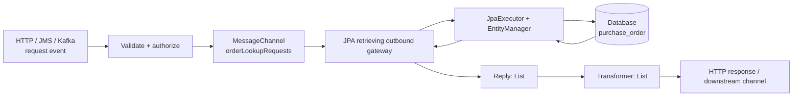
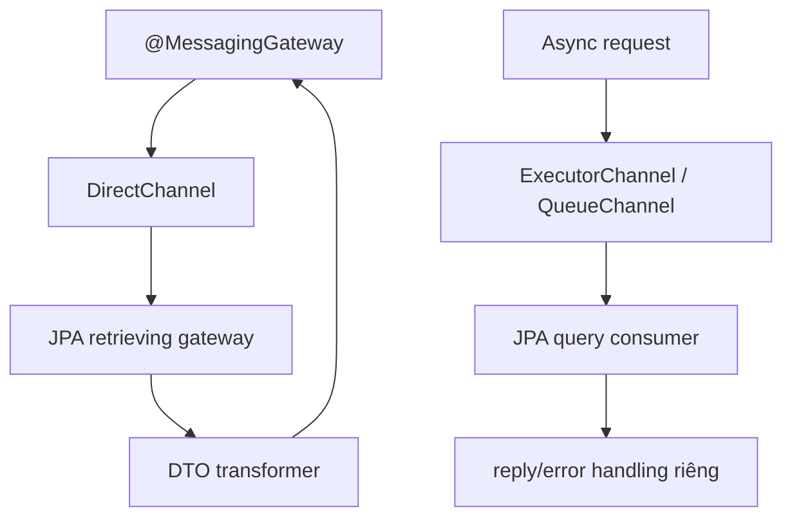

# JPA retrieving outbound gateway

## 1. Bối cảnh và mục tiêu

Trong module **SPRING_INTEGRATION_ADAPTERS**, Spring Integration kết nối những hệ thống bên ngoài bằng inbound/outbound adapter, gateway, poller và `MessageChannel`. Một message có thể đến từ HTTP, file, SFTP, JMS, AMQP hoặc Kafka, sau đó flow cần **truy vấn dữ liệu đang nằm trong cơ sở dữ liệu** để quyết định bước xử lý tiếp theo.

**JPA retrieving outbound gateway** là thành phần phù hợp cho trường hợp đó: nhận **một request message**, thực hiện truy vấn Jakarta Persistence (JPA), rồi đưa **kết quả truy vấn** vào reply message để flow tiếp tục. Bài này thuộc chương **Adapter JPA**.

Sau khi học, bạn có thể:

- Phân biệt retrieving outbound gateway với JPA inbound channel adapter, outbound channel adapter và updating outbound gateway.
- Giải thích hợp đồng `requestChannel → JpaOutboundGateway → JpaExecutor → EntityManager → replyChannel`.
- Cấu hình truy vấn `JPQL SELECT`, named query, native SQL hoặc tra entity bằng primary key.
- Truyền tham số từ `payload` và `headers` theo cách có binding, không ghép chuỗi SQL.
- Chọn `expectSingleResult`, `maxResults`, `firstResult`, `idExpression` và xử lý kết quả rỗng.
- Xây ví dụ chạy trên **Java 17+, Spring Boot 3.x, Spring Integration 6.x** với `@MessagingGateway`, Java DSL và JPA.
- Biến entity thành DTO trước khi trả về phía HTTP/Kafka/JMS hoặc luồng bất đồng bộ.
- Kiểm soát transaction, lazy loading, phân trang, multi-tenant authorization, giới hạn số kết quả và hiệu năng.
- Thiết kế kiểm thử cho trường hợp 0/1/nhiều hàng, lỗi database, quyền truy cập và timeout.

> **Ý chính:** retrieving gateway được kích hoạt **khi có request message**, không tự poll database theo lịch. Vì đây là **gateway request–reply**, dữ liệu được truy vấn không dừng ở adapter mà trở thành input của bước tiếp theo.

## 2. Vị trí của retrieving gateway trong một Integration Flow

Ví dụ hệ thống đặt hàng: một message chứa `customerId` đi qua Integration Flow để lấy tối đa 50 đơn hàng của khách đó. Kết quả được chuyển thành DTO, có thể trả qua HTTP hoặc gửi sang một adapter ngoài.



Tùy thiết kế, request–reply có thể là đồng bộ trong cùng thread hoặc được điều phối qua những channel khác. Thành phần retrieval chỉ đọc những dữ liệu được cho phép; các side effect khác (gửi Kafka, cập nhật JPA, gọi HTTP) nằm ở bước tiếp theo.

### Các class/API cốt lõi

| Thành phần | Vai trò |
| --- | --- |
| `JpaExecutor` | Thực thi JPA SELECT/find với query, parameter source, result-limit và entity manager |
| `JpaOutboundGateway` | Message handler dùng `JpaExecutor` để xử lý request |
| `OutboundGatewayType.RETRIEVING` | Chọn chế độ truy xuất thay vì cập nhật |
| `Jpa.retrievingGateway(...)` | Factory/spec thuận tiện cho Java DSL |
| `MessageChannel` | Chuyển request/reply giữa các component |
| `@MessagingGateway` | Interface request–reply giúp code ứng dụng gọi Integration Flow như một service |
| `@ServiceActivator` | Gắn `JpaOutboundGateway` vào input channel khi cấu hình Java |
| `@Transformer` / `.transform(...)` | Đưa entity/list thành DTO để tránh rò rỉ JPA graph |
| `EntityManagerFactory` | Hạ tầng JPA tạo entity manager phù hợp với transaction |

**Không nên tìm một class tên `JpaRetrievingOutboundGateway`.** Spring Integration dùng `JpaOutboundGateway` và đặt `OutboundGatewayType.RETRIEVING`; Java DSL dùng `Jpa.retrievingGateway(...)`.

## 3. So sánh với các adapter/gateway JPA khác

| Thành phần | Có request đầu vào? | Hoạt động chính | Có reply? |
| --- | --- | --- | --- |
| **JPA inbound channel adapter** | Không; do poller kích hoạt | SELECT theo lịch | Phát message mới từ kết quả poll |
| **JPA outbound channel adapter** | Có | PERSIST/MERGE/DELETE hoặc UPDATE/DELETE query | Không; kết thúc nhánh |
| **JPA updating outbound gateway** | Có | Ghi/cập nhật/xóa DB | Có; entity hoặc affected-row count theo thao tác |
| **JPA retrieving outbound gateway** | **Có** | **SELECT/find khi được yêu cầu** | **Có; entity hoặc danh sách kết quả** |
| Spring Data repository trực tiếp | Java method call | CRUD/query theo interface/service | Theo return type của method |
| JDBC retrieving gateway | Có | SQL/JDBC, `RowMapper` | Có |
| CDC | Không phải request–reply | Phát thay đổi từ transaction log | Stream sự kiện thay đổi |

Hai tình huống đối chiếu:

- **Mỗi 5 giây lấy hàng NEW rồi phát sang Kafka:** cân nhắc JPA inbound adapter + poller, hoặc CDC/outbox.
- **Khi nhận request “lấy đơn hàng của C-101”, truy vấn rồi trả danh sách:** JPA **retrieving outbound gateway**.

Nếu nghiệp vụ cần **thay đổi dữ liệu** và biết số row được update, dùng **updating** gateway thay vì retrieving. Một `JPQL UPDATE` không phải truy vấn SELECT, và retrieving gateway không có hợp đồng trả affected-row count cho thao tác đó.

## 4. Request message, reply message và correlation

Một request có thể mang payload làm giá trị tham số và headers phục vụ điều phối:

```text
Request Message
  payload = "C-101"
  headers:
    traceId = "tr-101"
    replyChannel = <temporary reply channel>
    errorChannel = <error channel nếu có>

         ↓

Jpa retrieving outbound gateway
  JPQL: where o.customerId = :customerId
  parameter customerId ← request.payload

         ↓

Reply Message
  payload = List<PurchaseOrder>
  headers:
    traceId / các header được phép truyền tiếp
```

Khi gọi bằng `@MessagingGateway`, Spring Integration có thể tạo **temporary reply channel** trong request để đồng bộ giá trị trả về cho caller. Nếu cấu hình output channel riêng, cần bảo đảm flow vẫn định tuyến phản hồi về caller tương ứng; không tự ý loại bỏ `replyChannel`/correlation headers khi transform.

### Payload không mặc định là một entity

Đối với câu JPQL:

```sql
select o from PurchaseOrder o
where o.customerId = :customerId
order by o.id
```

Payload trả về có thể là:

- `List<PurchaseOrder>` khi `expectSingleResult(false)`.
- Một `PurchaseOrder` khi `expectSingleResult(true)` và kết quả có đúng một hàng.
- Danh sách rỗng khi query không có hàng trong **retrieving gateway từ Spring Integration 6.0** với chế độ danh sách.
- Các dạng tuple/projection khác nếu query SELECT không trả toàn entity.

**Không suy luận type bằng tên gateway.** Type phụ thuộc query, `expectSingleResult`, JPA provider và cách transformer xử lý kết quả.

## 5. Các cách chọn dữ liệu bằng JpaExecutor

### 5.1. JPQL SELECT

JPQL sử dụng **tên entity và thuộc tính Java**, không phải tên bảng/cột SQL:

```sql
select o from PurchaseOrder o
where o.customerId = :customerId
  and o.status = :status
order by o.id
```

Hai parameter `:customerId` và `:status` phải được binding bằng giá trị đã validate. Không viết:

```java
// KHÔNG làm: ghép dữ liệu không tin cậy vào query!
String query = "select o from PurchaseOrder o where "
        + "o.customerId = '" + userInput + "'";
```

Hãy dùng JPQL parameters và cơ chế `ParameterSource` của Spring Integration.

### 5.2. Named query

JPA hỗ trợ `@NamedQuery` hoặc định nghĩa trong mapping:

```java
@NamedQuery(
    name = "PurchaseOrder.findByCustomer",
    query = """
        select o from PurchaseOrder o
        where o.customerId = :customerId
        order by o.id
        """)
```

Tên named query được dùng trong gateway, ví dụ:

```java
Jpa.retrievingGateway(entityManagerFactory)
        .namedQuery("PurchaseOrder.findByCustomer")
        .parameterExpression("customerId", "payload")
        .maxResults(50);
```

Đoạn này là **phần cấu hình Java DSL**, không phải một source file Java hoàn chỉnh. Query phải được khai báo đúng tên và class entity phải được JPA scan.

### 5.3. Native SQL

Khi cần SQL vendor-specific, query có thể dùng `nativeQuery(...)`. Cần kiểm tra hỗ trợ parameter binding/mapping kết quả của JPA provider và database đích. Native SQL có thể trả scalar, array, DTO mapping hoặc entity nếu cấu hình phù hợp.

**Không coi native SQL mặc định trả `PurchaseOrder`.** Nếu query lấy nhiều cột không có entity/result mapping, cần kiểm tra kiểu kết quả thực và transform thành DTO rõ ràng.

### 5.4. Tra entity bằng ID

Với một primary key, `idExpression(...)` cho phép gọi `EntityManager.find(EntityClass, key)` thay vì thực hiện query:

```java
Jpa.retrievingGateway(entityManagerFactory)
        .entityClass(PurchaseOrder.class)
        .idExpression("payload");
```

Giả định request payload là `String orderId`. `idExpression` được đánh giá trên **request message**. Trong chế độ này, hãy xác định `entityClass` tường minh và không trộn đồng thời những option truy vấn không tương thích (JPQL/named/native) với lookup-by-id.

Nếu ID không tồn tại, cần một chính sách **not found** phù hợp: trả kết quả empty/optional tại tầng facade, phát lỗi nghiệp vụ có kiểm soát hoặc xử lý không có reply. Không tự suy diễn rằng trả `null` từ JPA luôn có thể đưa vào `Message.payload`.

## 6. Tham số từ payload và headers

Gateway có toàn bộ Spring `Message<?>` đầu vào, vì thế truy vấn có thể dùng payload, headers hoặc một `ParameterSourceFactory` tùy thiết kế.

### 6.1. Explicit parameter expressions

Ví dụ Java DSL:

```java
.handle(Jpa.retrievingGateway(entityManagerFactory)
        .jpaQuery("""
            select o from PurchaseOrder o
            where o.customerId = :customerId
            and o.status = :status
            order by o.id
            """)
        .parameterExpression("customerId", "payload")
        .parameterExpression("status", "headers['orderStatus']")
        .maxResults(50))
```

Trong ví dụ:

- `customerId` lấy từ `payload`.
- `status` lấy từ header `orderStatus`.
- Các biểu thức được đánh giá trên message theo cấu hình JPA parameter của DSL.
- Hệ thống phải validate `customerId`/`status`, đặc biệt khi message đến từ client không tin cậy.

**Không dùng header `tenantId` như một quyền đã được xác thực** chỉ vì nó xuất hiện trong message. Chỉ sử dụng tenant/principal đã được server kiểm soát.

### 6.2. Parameter source theo bean properties

Nếu query:

```sql
select o from PurchaseOrder o
where o.customerId = :customerId and o.status = :status
```

và payload là record:

```java
public record OrderSearchRequest(
        String customerId,
        String status) {
}
```

thì có thể dùng `BeanPropertyParameterSourceFactory` hoặc cấu hình `usePayloadAsParameterSource(true)` để ánh xạ properties của payload vào tên parameter theo API tương ứng. Khi định nghĩa parameter expressions, mặc định có thể thay đổi để toàn bộ `Message` là nguồn evaluation.

Đừng giả định cả hai cơ chế có thể trộn vô điều kiện: **parameter-source-factory** và danh sách parameter expressions có ràng buộc loại trừ theo Spring Integration. Hãy dùng một chiến lược binding rõ ràng.

### 6.3. Tham số tĩnh và kiểu

Trong XML, tham số có thể là hằng số:

```xml
<int-jpa:parameter
        name="status"
        value="PAID"/>
```

Với literal không phải `String`, có thể khai `type` trong cấu hình XML tùy API. Hãy luôn kiểm tra kiểu truyền vào `EntityManager.setParameter(...)`: ví dụ `Long` khác `String`, enum có thể cần binding dạng enum, và thời gian phải có kiểu phù hợp.

### 6.4. Giới hạn số kết quả và phân trang

| Thuộc tính | Công dụng | Cần lưu ý |
| --- | --- | --- |
| `expectSingleResult(true)` | Yêu cầu đúng một kết quả và bóc entity khỏi list | Nếu nhiều hàng → `MessagingException` |
| `expectSingleResult(false)` | Trả danh sách kết quả | Phù hợp với search/list endpoint |
| `maxResults(50)` | Giới hạn số row truy vấn | Không thay business authorization |
| `firstResult(100)` | Bỏ qua 100 row đầu theo query order | OFFSET lớn có thể chậm |
| `firstResultExpression(...)` | Offset động lấy từ request message | Validate non-negative, giới hạn page |
| `maxResultsExpression(...)` | Limit động lấy từ request message | **Phải cap giới hạn ở server** |
| `idExpression(...)` | Tìm một entity theo primary key | Không trộn với JPQL query mode |
| `deleteAfterPoll(true)` | Có thể xóa đối tượng được lấy | **Không dùng cho truy vấn đọc thông thường** |

**Đừng đặt `maxResultsExpression("payload.limit")` mà không chặn một client gửi `limit = 100000000`.** Dù client gửi giá trị hợp lệ về mặt cú pháp, server phải đặt ngưỡng tối đa đã được kiểm chứng.

## 7. Ví dụ thực hành: truy vấn đơn hàng rồi trả DTO

Ví dụ hoàn chỉnh dùng:

- Java 17+
- Spring Boot 3.x
- Spring Integration 6.x
- Spring Data JPA và Jakarta Persistence
- H2 in-memory để thực hành
- `@MessagingGateway` làm facade request–reply
- `Jpa.retrievingGateway(...)` cho JPQL SELECT
- `GenericTransformer` chuyển entity thành DTO

Chúng ta chủ động trả **`List<OrderSummary>`** thay vì entity, để không làm lộ trạng thái JPA/lazy relation đến consumer bên ngoài.

### 7.1. Maven dependencies

```xml
<dependencies>
    <dependency>
        <groupId>org.springframework.boot</groupId>
        <artifactId>spring-boot-starter</artifactId>
    </dependency>
    <dependency>
        <groupId>org.springframework.boot</groupId>
        <artifactId>spring-boot-starter-data-jpa</artifactId>
    </dependency>
    <dependency>
        <groupId>org.springframework.boot</groupId>
        <artifactId>spring-boot-starter-integration</artifactId>
    </dependency>
    <dependency>
        <groupId>org.springframework.integration</groupId>
        <artifactId>spring-integration-jpa</artifactId>
    </dependency>
    <dependency>
        <groupId>com.h2database</groupId>
        <artifactId>h2</artifactId>
        <scope>runtime</scope>
    </dependency>
    <dependency>
        <groupId>org.springframework.boot</groupId>
        <artifactId>spring-boot-starter-test</artifactId>
        <scope>test</scope>
    </dependency>
</dependencies>
```

Spring Boot BOM quản lý các phiên bản tương thích. `spring-integration-jpa` cung cấp gateway/executor; `spring-boot-starter-data-jpa` cung cấp JPA provider, transaction manager và datasource auto-configuration. Nếu sử dụng PostgreSQL/MySQL, thay H2 bằng driver/migration phù hợp.

### 7.2. Entity PurchaseOrder

File `PurchaseOrder.java`:

```java
package com.example.jpaquery;

import java.math.BigDecimal;
import jakarta.persistence.Column;
import jakarta.persistence.Entity;
import jakarta.persistence.Id;
import jakarta.persistence.Index;
import jakarta.persistence.Table;

@Entity
@Table(name = "purchase_order",
       indexes = @Index(
               name = "idx_order_customer",
               columnList = "customer_id"))
public class PurchaseOrder {

    @Id
    @Column(name = "order_id", length = 60)
    private String id;

    @Column(name = "customer_id", nullable = false, length = 60)
    private String customerId;

    @Column(nullable = false, length = 24)
    private String status;

    @Column(name = "total_amount", nullable = false,
            precision = 12, scale = 2)
    private BigDecimal totalAmount;

    protected PurchaseOrder() {
        // Required by JPA.
    }

    public PurchaseOrder(
            String id, String customerId,
            String status, BigDecimal totalAmount) {
        this.id = id;
        this.customerId = customerId;
        this.status = status;
        this.totalAmount = totalAmount;
    }

    public String getId() {
        return id;
    }

    public String getCustomerId() {
        return customerId;
    }

    public String getStatus() {
        return status;
    }

    public BigDecimal getTotalAmount() {
        return totalAmount;
    }
}
```

JPQL sử dụng **`PurchaseOrder`**, `customerId`, `status` và `id`, không viết tên bảng `purchase_order` hoặc cột `customer_id` trong JPQL.

Ví dụ chỉ có scalar fields để dễ học. Với entity chứa collection `LAZY`, không nên trả entity gốc qua channel bất đồng bộ hoặc API JSON mà không có DTO projection rõ ràng.

### 7.3. DTO cho kết quả bên ngoài persistence layer

File `OrderSummary.java`:

```java
package com.example.jpaquery;

import java.math.BigDecimal;

public record OrderSummary(
        String orderId,
        String status,
        BigDecimal totalAmount) {

    public static OrderSummary from(PurchaseOrder row) {
        return new OrderSummary(
                row.getId(),
                row.getStatus(),
                row.getTotalAmount());
    }
}
```

DTO không chứa `customerId` để minh họa việc chỉ công bố các field mà consumer cần. Production có thể thêm version/timestamp đã xác thực, tuyệt đối không serialize ngẫu nhiên cả entity graph ra client.

### 7.4. Repository dùng để seed và kiểm thử

File `PurchaseOrderRepository.java`:

```java
package com.example.jpaquery;

import org.springframework.data.jpa.repository.JpaRepository;

public interface PurchaseOrderRepository
        extends JpaRepository<PurchaseOrder, String> {
}
```

Repository trong ví dụ **không thay thế retrieving gateway**. Nó chỉ được dùng để chuẩn bị dữ liệu test; phần truy xuất request–reply vẫn chạy qua `JpaOutboundGateway` trong Integration Flow.

### 7.5. Interface @MessagingGateway

File `OrderLookupGateway.java`:

```java
package com.example.jpaquery;

import java.util.List;
import org.springframework.integration.annotation.MessagingGateway;

@MessagingGateway(
        defaultRequestChannel = "orderLookupRequests",
        defaultReplyTimeout = "5000")
public interface OrderLookupGateway {

    List<OrderSummary> findByCustomerId(String customerId);
}
```

Đối với caller, method trông như lời gọi một service Java. Bên trong:

1. Spring Integration tạo request `Message` với payload là `customerId`.
2. Đẩy message vào `orderLookupRequests`.
3. Đợi reply từ flow theo giới hạn thời gian đã cấu hình.
4. Chuyển payload `List<OrderSummary>` thành return value.

**Timeout không phải query timeout:** `defaultReplyTimeout` hạn chế thời gian gateway chờ reply trong một số tình huống; nó không chủ động hủy được mọi JDBC query đang chạy hoặc transaction đã vào DB. Query timeout phải được quản lý riêng tại JPA/JDBC/provider/DB.

### 7.6. IntegrationFlow sử dụng Jpa.retrievingGateway

File `OrderLookupIntegrationConfiguration.java`:

```java
package com.example.jpaquery;

import java.util.List;
import jakarta.persistence.EntityManagerFactory;

import org.springframework.context.annotation.Bean;
import org.springframework.context.annotation.Configuration;
import org.springframework.integration.config.EnableIntegration;
import org.springframework.integration.dsl.IntegrationFlow;
import org.springframework.integration.jpa.dsl.Jpa;
import org.springframework.integration.core.GenericTransformer;

@Configuration
@EnableIntegration
public class OrderLookupIntegrationConfiguration {

    @Bean
    IntegrationFlow orderLookupFlow(
            EntityManagerFactory entityManagerFactory) {

        return IntegrationFlow.from("orderLookupRequests")
                .handle(
                        Jpa.retrievingGateway(entityManagerFactory)
                                .jpaQuery("""
                                        select o from PurchaseOrder o
                                        where o.customerId = :customerId
                                        order by o.id
                                        """)
                                .parameterExpression(
                                        "customerId", "payload")
                                .maxResults(50)
                                .expectSingleResult(false))
                .transform(
                        (GenericTransformer<
                                List<PurchaseOrder>,
                                List<OrderSummary>>) rows ->
                                rows.stream()
                                        .map(OrderSummary::from)
                                        .toList())
                .get();
    }
}
```

**Giải thích chi tiết:**

1. `IntegrationFlow.from("orderLookupRequests")` tiêu thụ những request do `@MessagingGateway` tạo.
2. `Jpa.retrievingGateway(entityManagerFactory)` dựng một handler lấy kết quả và tạo reply, thay vì adapter một chiều.
3. `jpaQuery(...)` dùng JPQL SELECT và binding `:customerId`, không ghép chuỗi.
4. `parameterExpression("customerId", "payload")` đọc customer ID từ request message payload.
5. `maxResults(50)` ngăn một lần lookup tải vô hạn row.
6. `expectSingleResult(false)` yêu cầu list payload, giúp xử lý cả trường hợp rỗng.
7. `transform(...)` đổi `List<PurchaseOrder>` sang `List<OrderSummary>` **trước khi trả về caller**.
8. Không khai báo output channel cố định vì `@MessagingGateway` có reply-channel tạm; flow chuyển reply cuối về đó.
9. Trong ví dụ **không có poller**: query chạy khi method `findByCustomerId(...)` được gọi.

`GenericTransformer` chỉ lấy các trường scalar đã load. Nếu mapping cần lazy relation, xem phần transaction/DTO phía sau.

### 7.7. Facade có transaction đọc và kiểm tra đầu vào

File `OrderReadService.java`:

```java
package com.example.jpaquery;

import java.util.List;
import org.springframework.stereotype.Service;
import org.springframework.transaction.annotation.Transactional;

@Service
public class OrderReadService {

    private final OrderLookupGateway gateway;

    public OrderReadService(OrderLookupGateway gateway) {
        this.gateway = gateway;
    }

    @Transactional(readOnly = true)
    public List<OrderSummary> findForAuthorizedCustomer(
            String authorizedCustomerId) {

        if (authorizedCustomerId == null
                || authorizedCustomerId.isBlank()
                || authorizedCustomerId.length() > 60) {
            throw new IllegalArgumentException(
                    "Invalid authorized customer");
        }

        return gateway.findByCustomerId(authorizedCustomerId);
    }
}
```

Cụm từ `authorizedCustomerId` nhấn mạnh: caller phải xác định customer ID từ **principal/ACL server đáng tin cậy**, không lấy trực tiếp từ query parameter để cho người dùng xem dữ liệu người khác. Demo console dưới đây truyền giá trị cố định; production nên sử dụng authentication/authorization tại service hoặc API boundary.

`@Transactional(readOnly = true)` bao quanh lời gọi qua `DirectChannel` đồng bộ của flow. Nó có thể giúp thống nhất persistence context và cho phép transformer đọc entity trong transaction. Nếu đưa `ExecutorChannel` vào giữa, transaction này **không tự đi qua thread khác**; consumer/query phải có transaction phù hợp riêng.

### 7.8. Khởi động và dữ liệu mẫu

File `JpaQueryApplication.java`:

```java
package com.example.jpaquery;

import java.math.BigDecimal;
import java.util.List;
import org.springframework.boot.CommandLineRunner;
import org.springframework.boot.SpringApplication;
import org.springframework.boot.autoconfigure.SpringBootApplication;
import org.springframework.context.annotation.Bean;
import org.springframework.integration.annotation.IntegrationComponentScan;

@SpringBootApplication
@IntegrationComponentScan
public class JpaQueryApplication {

    public static void main(String[] args) {
        SpringApplication.run(JpaQueryApplication.class, args);
    }

    @Bean
    CommandLineRunner demo(
            PurchaseOrderRepository repository,
            OrderReadService readService) {

        return args -> {
            if (repository.count() == 0) {
                repository.saveAll(List.of(
                        new PurchaseOrder(
                                "ORD-101", "C-101", "PAID",
                                new BigDecimal("125.50")),
                        new PurchaseOrder(
                                "ORD-102", "C-101", "SHIPPED",
                                new BigDecimal("39.00")),
                        new PurchaseOrder(
                                "ORD-103", "C-102", "PAID",
                                new BigDecimal("99.99"))
                ));
            }

            List<OrderSummary> result =
                    readService.findForAuthorizedCustomer("C-101");

            System.out.println("C-101 orders: " + result);

            List<OrderSummary> none =
                    readService.findForAuthorizedCustomer("C-999");

            System.out.println("C-999 orders: " + none);
        };
    }
}
```

File `application.properties`:

```properties
spring.main.web-application-type=none

spring.datasource.url=jdbc:h2:mem:jpa_query_demo;DB_CLOSE_DELAY=-1
spring.datasource.driver-class-name=org.h2.Driver
spring.datasource.username=sa
spring.datasource.password=

spring.jpa.hibernate.ddl-auto=create-drop
spring.jpa.open-in-view=false
logging.level.org.springframework.integration=INFO
```

H2 in-memory và `ddl-auto=create-drop` **chỉ dùng trong bài học**; không dùng để quản lý schema production. Dùng Flyway/Liquibase và database phù hợp khi triển khai thật.

Khi chạy thành công, có hai `OrderSummary` cho `C-101` và danh sách rỗng cho `C-999`. Điều này minh họa:

- Query theo tham số từ payload.
- Giới hạn tối đa 50 row, dù database chứa nhiều hơn.
- Không trả `PurchaseOrder` trực tiếp ra caller.
- Request–reply chỉ xảy ra khi code gọi `OrderReadService`/`OrderLookupGateway`, không tự poll.

## 8. Không có kết quả: thay đổi quan trọng từ Spring Integration 6.0

Trước Spring Integration 6.0, một truy vấn không có entity có thể trả `null`, làm flow **kết thúc không có reply** hoặc gây exception nếu `requiresReply` được bật. Từ Spring Integration **6.0**, `Jpa.retrievingGateway()` trả **empty list** cho truy vấn không có entity.

Điều này giúp flow xử lý một cách tường minh:

```java
List<OrderSummary> summaries =
        readService.findForAuthorizedCustomer("C-999");

if (summaries.isEmpty()) {
    System.out.println("No orders found");
}
```

Nếu nghiệp vụ không muốn tiếp tục với list rỗng, thêm `filter` sau gateway với discard flow, hoặc transformer chuyển list rỗng thành một response chuẩn. Ví dụ:

```java
.filter((List<?> rows) -> !rows.isEmpty())
```

Nhưng **hãy cân nhắc**: filter bỏ request mà không gửi reply có thể khiến caller `@MessagingGateway` chờ timeout. Với HTTP/search API, trả `[]` thường rõ ràng hơn; với một lệnh **lookup-by-ID** cần chính xác một entity, có thể chuyển not-found thành exception nghiệp vụ và mã HTTP `404` ở tầng API.

### expectSingleResult có đúng nghĩa Optional không?

Không. Khi `expectSingleResult(true)`:

- Một hàng → payload thường là một entity.
- Nhiều hàng → `MessagingException` do vi phạm hợp đồng một kết quả.
- Không có hàng → hành vi còn phụ thuộc đường lookup/query và phiên bản/configuration; đừng mặc định luôn là `Optional.empty()`.

Vì thế, nếu API cần “0 hoặc 1 đơn hàng”, hãy chủ động kiểm thử absence path và chuẩn hóa bằng facade/transformer. Nếu cần tính đúng “chỉ một row”, dùng khóa duy nhất trong schema, `idExpression` hoặc query có điều kiện unique; chỉ đặt `maxResults(1)` có thể **che** dữ liệu trùng thay vì báo lỗi.

## 9. Cấu hình thuần Java với JpaExecutor và @ServiceActivator

Nếu chưa muốn dùng Java DSL, có thể tự tạo `JpaExecutor` và `JpaOutboundGateway`. Đây là **phương án thay thế**, không kích hoạt đồng thời với `orderLookupFlow` ở mục 7.

Ví dụ:

```java
package com.example.jpaquery;

import java.util.List;
import jakarta.persistence.EntityManagerFactory;
import org.springframework.context.annotation.Bean;
import org.springframework.context.annotation.Configuration;
import org.springframework.integration.annotation.ServiceActivator;
import org.springframework.integration.jpa.core.JpaExecutor;
import org.springframework.integration.jpa.outbound.JpaOutboundGateway;
import org.springframework.integration.jpa.support.OutboundGatewayType;
import org.springframework.integration.jpa.support.JpaParameter;
import org.springframework.messaging.MessageHandler;

@Configuration
public class JavaJpaRetrievingGatewayConfiguration {

    @Bean
    JpaExecutor orderJpaExecutor(
            EntityManagerFactory entityManagerFactory) {

        JpaExecutor executor =
                new JpaExecutor(entityManagerFactory);

        executor.setJpaQuery("""
                select o from PurchaseOrder o
                where o.customerId = :customerId
                order by o.id
                """);

        executor.setJpaParameters(
                List.of(new JpaParameter(
                        "customerId", null, "payload")));

        executor.setUsePayloadAsParameterSource(false);
        executor.setExpectSingleResult(false);
        executor.setMaxNumberOfResults(50);
        return executor;
    }

    @Bean
    @ServiceActivator(inputChannel = "orderLookupRequests")
    MessageHandler retrievingJpaHandler(
            JpaExecutor orderJpaExecutor) {

        JpaOutboundGateway handler =
                new JpaOutboundGateway(orderJpaExecutor);

        handler.setGatewayType(OutboundGatewayType.RETRIEVING);

        // Mặc định producesReply = true.
        // Không setProducesReply(false) như outbound adapter.
        return handler;
    }
}
```

Phần code này trả **`List<PurchaseOrder>`** từ JPA handler. Nếu dùng interface `OrderLookupGateway` trả `List<OrderSummary>`, bạn cần thêm một **transformer nằm trên đường reply** (hoặc đổi contract interface sang `List<PurchaseOrder>` trong bài demo riêng). Tránh kết hợp trực tiếp code thuần Java này với `OrderLookupGateway`/DSL của mục 7 mà không đồng bộ reply type.

**Lưu ý package:** `JpaParameter` thuộc `org.springframework.integration.jpa.support.JpaParameter`. Các biểu thức parameter được Spring Integration đánh giá trên nguồn theo `setUsePayloadAsParameterSource(...)`.

Nếu gateway không được gắn output channel tường minh, reply thường về `replyChannel` header của request. Nếu muốn gửi kết quả sang một channel cố định để transform, dùng `handler.setOutputChannelName("...")` và bảo đảm reply cuối vẫn tới người gọi theo hợp đồng tương ứng.

## 10. Cấu hình XML namespace

Spring Integration cung cấp namespace cho retrieving outbound gateway.

```xml
<int-jpa:retrieving-outbound-gateway
        id="ordersJpaRetriever"
        request-channel="orderLookupRequests"
        reply-channel="ordersRetrieved"
        entity-manager-factory="entityManagerFactory"
        jpa-query="select o from PurchaseOrder o
                   where o.customerId = :customerId
                   order by o.id"
        max-results="50"
        expect-single-result="false">

    <int-jpa:parameter
            name="customerId"
            expression="payload"/>
</int-jpa:retrieving-outbound-gateway>
```

Đoạn trên giả định XML application context đã khai báo đúng namespace/schema `int` và `int-jpa`, bean `entityManagerFactory` và các channel tương ứng. Nó là **đoạn cấu hình endpoint**, không phải XML file hoàn chỉnh.

Nếu cần dùng cả payload và header:

```xml
<int-jpa:retrieving-outbound-gateway
        request-channel="ordersByStatusRequest"
        reply-channel="ordersByStatusReply"
        entity-manager-factory="entityManagerFactory"
        jpa-query="select o from PurchaseOrder o
                   where o.customerId = :customerId
                   and o.status = :status"
        max-results="50">

    <int-jpa:parameter
            name="customerId"
            expression="payload"/>
    <int-jpa:parameter
            name="status"
            expression="headers['orderStatus']"/>
</int-jpa:retrieving-outbound-gateway>
```

**Quan trọng:** khi đặt `reply-channel` tường minh trong XML, kết quả sẽ đi đến channel đó. Nếu caller là một `@MessagingGateway` có temporary reply channel, phải đưa phản hồi qua các bước tiếp theo sao cho replyChannel/correlation metadata vẫn được bảo toàn và cuối cùng đi về đúng caller. Nếu chỉ cần request–reply một bước, có thể để handler dùng `replyChannel` của request thay vì định tuyến cố định.

### id-expression trong XML

Truy xuất trực tiếp bằng khóa chính:

```xml
<int-jpa:retrieving-outbound-gateway
        request-channel="lookupByIdRequests"
        reply-channel="lookupByIdReplies"
        entity-manager-factory="entityManagerFactory"
        entity-class="com.example.jpaquery.PurchaseOrder"
        id-expression="payload"/>
```

Ở trường hợp này, payload phải có kiểu tương thích với JPA primary key (ở ví dụ là `String`). Không đồng thời đặt `jpa-query`/`native-query`/`named-query` khi đã chọn `id-expression`.

## 11. Transaction và persistence context

### 11.1. SELECT cũng cần quyết định transaction boundary

Đọc JPA có thể hoạt động mà không đặt một `@Transactional` ứng dụng tường minh trong một số cấu hình; tuy nhiên khi cần **nhiều thao tác đọc nhất quán**, lazy loading hoặc tránh entity detached ở downstream, bạn phải thiết kế transaction rõ ràng.

| Cách thực hiện | Hệ quả |
| --- | --- |
| `@Transactional(readOnly = true)` bao quanh facade đồng bộ | Query/DTO transformer cùng transaction nếu dùng DirectChannel |
| Transactional advice tại gateway endpoint | Đảm bảo transaction cho xử lý query tại consumer |
| Không có transaction application tường minh | Hành vi persistence context phụ thuộc provider/config; dễ gặp vấn đề lazy/detach |
| `ExecutorChannel`/`QueueChannel` giữa các bước | Transaction từ caller **không tự lan** sang consumer khác thread |
| JPA entity gửi sang Kafka/JMS/WebSocket sau query | Không nên serialize entity graph trực tiếp; dùng DTO trước ranh giới async |

`readOnly = true` là **hint/tối ưu** cho transaction manager và persistence provider, không phải ACL, không có nghĩa ứng dụng không thể gọi update trong mọi môi trường.

### 11.2. Lazy loading/N+1

Giả sử `PurchaseOrder` có `@OneToMany(fetch = LAZY) List<OrderLine>`. Nếu gateway trả entity rồi một consumer chạy thread khác cố truy cập `getLines()`, có thể ném `LazyInitializationException` hoặc truy vấn DB ngoài phạm vi dự kiến.

Một số chiến lược:

1. Truy vấn projection DTO trực tiếp bằng JPQL constructor expression.
2. Transform trong transaction, chỉ lấy những trường cần thiết.
3. Dùng `JOIN FETCH`/entity graph một cách có kiểm soát; tránh nhân số row ngoài ý muốn.
4. Tránh trả entity qua HTTP/JSON serializer mà không có DTO.
5. Đo N+1 và số SQL query thực tế trong integration test.
6. Khi cần nhiều dữ liệu quan hệ, lựa chọn query riêng hoặc batch fetching phù hợp.

Ví dụ projection JPQL:

```sql
select new com.example.jpaquery.OrderSummary(
    o.id, o.status, o.totalAmount)
from PurchaseOrder o
where o.customerId = :customerId
order by o.id
```

Constructor expression trả `OrderSummary` mà không cần tải entity đầy đủ. Trong trường hợp dùng projection, hãy điều chỉnh transformer/return type để không cast payload thành `List<PurchaseOrder>` nữa.

### 11.3. Không lẫn giao dịch đọc với ACK nguồn

Một flow:

```text
Kafka/JMS inbound → JPA retrieving gateway → HTTP outbound
```

không tự có transaction chung xuyên Kafka/JMS, database và HTTP. Một SELECT thành công không chứng minh HTTP client đã nhận dữ liệu hoặc broker offset đã được commit. Thiết kế error handling và acknowledgment theo từng boundary.

## 12. Phân trang, kết quả lớn và hiệu năng

### 12.1. Tại sao phải đặt maxResults?

Nếu một khách hàng có 100.000 đơn hàng và gateway không giới hạn số kết quả, ứng dụng có thể phải:

- Truy vấn và tải hàng chục nghìn entity vào heap.
- Giữ database connection/transaction lâu.
- Dồn khối lượng lớn vào transformer và reply message.
- Tạo response JSON hoặc Kafka message quá lớn.
- Làm cạn connection pool khi nhiều request đến đồng thời.

Ví dụ đặt `maxResults(50)` để mỗi lần query chỉ lấy tối đa 50 row. **Giới hạn phải do server áp đặt**; không tin client tự gửi một số limit an toàn.

### 12.2. Offset pagination

Ví dụ thứ tự sắp xếp ổn định:

```sql
select o from PurchaseOrder o
where o.customerId = :customerId
order by o.id
```

Với `firstResult(100)` và `maxResults(50)`, gateway lấy một trang dữ liệu sau 100 bản ghi đầu. Khi row được thêm/xóa giữa các request, OFFSET có thể dẫn tới trùng hoặc bỏ sót. Trang càng sâu thường càng đắt tùy DB/query plan.

Nếu cho phép client điều khiển offset/page size:

- Validate offset không âm.
- Cap page size ở server (ví dụ tối đa 50).
- Đặt order ổn định trên khóa duy nhất.
- Không đưa expression tùy ý của client vào SpEL; chỉ đưa **giá trị** đã kiểm tra.
- Khi cần phân trang lớn, cân nhắc **keyset/cursor pagination**.

### 12.3. Keyset pagination

Thay vì offset lớn, ghi nhớ khóa cuối:

```sql
select o from PurchaseOrder o
where o.customerId = :customerId
  and o.id > :afterId
order by o.id
```

Với `maxResults(50)`, client chỉ cần truyền cursor `afterId` đã validate. Nếu muốn chống sửa cursor, có thể dùng token ký/HMAC hoặc opaque server-issued cursor, và bind cursor với tenant/filter. Cursor phải phản ánh đúng thứ tự sắp xếp, đặc biệt khi nhiều khóa hoặc timestamp trùng.

### 12.4. Index và query plan

Với query thường xuyên lọc `customerId` rồi order `id`, một index như `(customer_id, order_id)` có thể có ích trên DB hỗ trợ. Nhưng index còn có chi phí write và storage; quyết định dựa trên execution plan, cardinality và workload.

Các chỉ số cần quan sát:

- Query duration và p95/p99 latency.
- Rows returned theo query type.
- Cache hit rate nếu có dùng cache.
- Connection pool active/waiting.
- Số SQL statements do N+1.
- Page depth/cursor usage.
- Gateway reply timeout và error rate.
- Heap/GC khi serializing DTO.

Không chỉ tăng connection pool khi query chậm; một query không có index hoặc N+1 có thể tiêu hao mọi connection nếu concurrency tăng.

## 13. Bảo mật và multi-tenancy

### 13.1. Parameter binding không thay authorization

Dù đã dùng `:customerId` để tránh ghép SQL, một user không được phép vẫn có thể yêu cầu dữ liệu của khách khác nếu service không kiểm tra quyền.

Ví dụ request:

```json
{
  "customerId": "C-SECRET",
  "limit": 50
}
```

Nếu caller chưa được xác thực/ủy quyền cho `C-SECRET`, **không được** gửi giá trị này vào retrieving gateway chỉ vì nó có cú pháp hợp lệ. Nên:

1. Xác thực người gọi tại HTTP/JMS/Kafka boundary tương ứng.
2. Xác định `authorizedCustomerId` hoặc tập resource được phép từ server-side principal/ACL.
3. Áp điều kiện tenant/resource trong query.
4. Chỉ trả những field có quyền hiển thị, dùng DTO.
5. Kiểm tra quyền ngay cả khi query phục vụ gateway nội bộ.
6. Giới hạn query size và rate theo principal/tenant.
7. Tránh log giá trị cá nhân/PII nhạy cảm trong query parameters.

### 13.2. Thiết kế query nhiều tenant

Nếu entity có `tenantId`, truy vấn nên bao gồm cả tenant:

```sql
select o from PurchaseOrder o
where o.tenantId = :tenantId
  and o.customerId = :customerId
order by o.id
```

`tenantId` phải đến từ **security context/server principal** hoặc service đã kiểm tra quyền, không đến từ header có thể giả mạo. Có thể dùng `@Header` trên messaging gateway cho tenant đã xác thực, nhưng phải định nghĩa rõ nguồn tin cậy.

Nếu dùng caching, cache key cũng phải bao gồm tenant/permission scope đúng cách. Cache chỉ theo `customerId` có thể trả dữ liệu sai tenant nếu các tenant có cùng ID cục bộ.

### 13.3. Query DSL/SpEL và injection

Một query cố định với JPA parameters giúp tách dữ liệu khỏi câu lệnh. Nhưng nếu bạn cho người dùng gửi nguyên đoạn SpEL/JPQL làm query, framework không thể tự bảo vệ:

```java
// KHÔNG nhận một đoạn JPQL tự do từ HTTP request:
executor.setJpaQuery(untrustedQueryText);
```

Hãy giữ query do developer định nghĩa, còn những giá trị động phải đi qua validator, allowlist/enum và parameter binding.

## 14. Error handling và timeout

| Tình huống | Biểu hiện | Cách xử lý |
| --- | --- | --- |
| 0 hàng | `[]` trong list mode (6.0+) | Trả list rỗng hoặc chuẩn hóa not found |
| Nhiều hàng nhưng `expectSingleResult(true)` | `MessagingException` | Sửa uniqueness/query/contract |
| Query sai cú pháp/field | Exception ở JPA provider | Sửa query, không retry vô hạn |
| Parameter thiếu hoặc sai kiểu | Bind parameter thất bại | Validate request, log error code |
| DB tạm không khả dụng | JDBC/JPA connection timeout | Retry bounded + backoff, circuit breaker |
| Connection pool hết | Request chờ lâu | Đo pool, index, giới hạn concurrency |
| Lazy loading ngoài transaction | `LazyInitializationException` | DTO trong transaction, projection |
| Gateway chờ quá lâu | Reply timeout hoặc query treo | Cấu hình cả gateway timeout và JDBC query timeout |
| Client không có quyền | Business authorization failure | Từ chối trước query và không rò rỉ dữ liệu |
| Response quá lớn | Heap/message limit hoặc transport reject | Pagination, maxResults, DTO |
| Consumer async lỗi sau reply | ACK sai thời điểm | Phân biệt reply với downstream side effect |

### 14.1. Đồng bộ và bất đồng bộ

`DirectChannel` cho phép handler xử lý trong thread gửi request; exception của JPA có thể truyền về caller. Nếu dùng `ExecutorChannel` hoặc `QueueChannel`, exception xảy ra ở consumer khác; cần error channel/retry advice và cơ chế reply đúng hạn.

Ví dụ:



Nếu chuyển flow sang async, hãy kiểm thử cả timeout và case lỗi để không làm người gọi đợi vô hạn. Không sử dụng database timeout và reply timeout như hai tên khác nhau cho một cơ chế duy nhất.

### 14.2. Retry đúng loại lỗi

- Lỗi mạng/DB tạm thời: retry một số lần có backoff và giới hạn thời gian.
- Thiếu index/JPQL sai: không retry, phải sửa code/configuration.
- Unauthorized: không retry như lỗi hạ tầng.
- Query quá lớn: yêu cầu client thu hẹp filter hoặc phân trang.
- Not found: thường không phải lỗi transport; quyết định semantics theo API.

Với request–reply, retry của caller cũng có thể khiến query chạy lại. SELECT thuần không gây side effect nên dễ retry hơn update, nhưng vẫn có thể tạo tải DB lớn nếu client retry hàng loạt.

## 15. Kiểm thử retrieval gateway

### 15.1. Unit test DTO

`OrderSummary.from(...)` là logic thuần, có thể test dễ dàng:

```java
package com.example.jpaquery;

import static org.junit.jupiter.api.Assertions.assertEquals;
import java.math.BigDecimal;
import org.junit.jupiter.api.Test;

class OrderSummaryTest {

    @Test
    void mapsOnlyPublicFields() {
        PurchaseOrder order = new PurchaseOrder(
                "ORD-1", "C-1", "PAID",
                new BigDecimal("25.50"));

        OrderSummary dto = OrderSummary.from(order);

        assertEquals("ORD-1", dto.orderId());
        assertEquals("PAID", dto.status());
        assertEquals(new BigDecimal("25.50"), dto.totalAmount());
    }
}
```

Unit test này không chứng minh JPA query chạy được, nhưng xác nhận DTO chỉ lấy trường đã định nghĩa.

### 15.2. Integration test query/reply

Dùng `@SpringBootTest` với H2 demo hoặc database container:

```java
package com.example.jpaquery;

import static org.assertj.core.api.Assertions.assertThat;

import java.math.BigDecimal;
import java.util.List;
import java.util.UUID;

import org.junit.jupiter.api.Test;
import org.springframework.beans.factory.annotation.Autowired;
import org.springframework.boot.test.context.SpringBootTest;

@SpringBootTest
class OrderLookupIntegrationTest {

    @Autowired
    PurchaseOrderRepository repository;

    @Autowired
    OrderReadService readService;

    @Test
    void retrievesOnlySelectedCustomer() {
        String customerId = "test-" + UUID.randomUUID();

        repository.saveAllAndFlush(List.of(
                new PurchaseOrder(
                        "a-" + UUID.randomUUID(),
                        customerId,
                        "PAID",
                        new BigDecimal("10.00")),
                new PurchaseOrder(
                        "b-" + UUID.randomUUID(),
                        customerId,
                        "SHIPPED",
                        new BigDecimal("20.00"))));

        List<OrderSummary> result =
                readService.findForAuthorizedCustomer(customerId);

        assertThat(result).hasSize(2);
        assertThat(result)
                .extracting(OrderSummary::totalAmount)
                .containsExactlyInAnyOrder(
                        new BigDecimal("10.00"),
                        new BigDecimal("20.00"));
    }

    @Test
    void returnsEmptyListWhenThereAreNoRows() {
        List<OrderSummary> result =
                readService.findForAuthorizedCustomer(
                        "none-" + UUID.randomUUID());

        assertThat(result).isEmpty();
    }
}
```

**Chú ý:** `@SpringBootTest` thực hiện đầy đủ Integration Flow. `repository.saveAllAndFlush(...)` chuẩn bị dữ liệu trong transaction riêng của repository. Test không đặt `@Transactional` trên method nên quan sát gần với request–reply thực tế hơn.

### 15.3. Các tình huống cần kiểm thử thêm

| Test | Mục tiêu |
| --- | --- |
| Nhiều khách hàng cùng có đơn | Query không lộ dữ liệu khách khác |
| Chỉ có một hàng + `expectSingleResult(true)` | Payload đúng entity |
| Có hai hàng + `expectSingleResult(true)` | Nhận exception đúng |
| Không có hàng ở list mode | Reply là empty list (6.0+) |
| Truy vấn ID không tồn tại | Policy not found được chuẩn hóa |
| `maxResults(50)` với 200 hàng | Không trả quá 50 item |
| Pagination offset + stable order | Trả đúng trang, không vượt giới hạn |
| Customer ID sai/blank/quá dài | Từ chối trước khi query |
| Unauthorized tenant/customer | Không có SQL trả dữ liệu trái phép |
| DB tạm ngắt | Error/retry/circuit breaker rõ ràng |
| Gateway timeout | Không giữ request vô hạn |
| Lazy relation | Projection không tạo `LazyInitializationException` |
| N+1 | SQL query count được đo/khống chế |
| Async channel | Reply/correlation/transaction vẫn hoạt động |
| Native query | Kết quả được ánh xạ đúng provider/DB thật |

Với PostgreSQL/MySQL, chạy integration tests có Testcontainers hoặc môi trường tương đương vì H2 có thể khác về SQL dialect, khóa, transaction isolation và execution plan.

## 16. Vận hành và giám sát

Các metric hữu ích:

| Metric gợi ý | Ý nghĩa |
| --- | --- |
| `jpa_retrieve_requests_total` | Số request vào retrieving gateway |
| `jpa_retrieve_duration_seconds` | Latency query và mapping |
| `jpa_retrieve_rows_returned` | Số row trả về |
| `jpa_retrieve_empty_total` | Số request không có kết quả |
| `jpa_retrieve_errors_total` | Lỗi theo nhóm DB/timeout/validation |
| `jpa_retrieve_timeout_total` | Query/gateway timeout |
| `jpa_retrieve_result_size_bytes` | Độ lớn DTO reply được serialize |
| `db_connection_pool_active` | Số connection đang hoạt động |
| `db_connection_pool_pending` | Số thread đang chờ connection |
| `jpa_n_plus_one_query_count` | Dấu hiệu load nhiều query do lazy association |

Không nên dùng `customerId`, `orderId`, `tenantId` hoặc raw SQL parameter làm metric label vì cardinality cao và có thể nhạy cảm. Đưa correlation ID vào trace/log có kiểm soát; cân nhắc mask dữ liệu người dùng khi debug.

### Checklist production

- [ ] Chọn retrieving gateway vì cần **SELECT request–reply**, không dùng inbound poller hoặc updating gateway nhầm mục đích.
- [ ] Query do ứng dụng định nghĩa; value truyền bằng JPA parameter binding.
- [ ] Có authorization theo principal/tenant/resource trước khi đọc dữ liệu riêng tư.
- [ ] Đặt `maxResults`/pagination limit; query có order ổn định và index phù hợp.
- [ ] Xử lý list rỗng theo semantics của Spring Integration 6.0+.
- [ ] Chọn `expectSingleResult` phù hợp với uniqueness và use case.
- [ ] Không bật `deleteAfterPoll` cho một truy vấn SELECT thông thường.
- [ ] Transform entity sang DTO trong transaction phù hợp; không gửi lazy entity graph ra ngoài.
- [ ] Có JDBC/JPA query timeout **và** reply timeout hợp lý.
- [ ] Đã kiểm thử ngưỡng kết quả, timeout, DB outage, lazy loading và N+1.
- [ ] Có metrics, trace, logging bảo vệ dữ liệu và rate/concurrency limits.
- [ ] Nếu downstream cần update/sending event, transaction và acknowledgment của từng hệ thống được thiết kế riêng.

## 17. Bài tập thực hành

### Bài A — JPQL và tham số từ request

Chạy demo rồi thêm trường `status` vào request record. Thay query để chỉ lấy đơn có `customerId` và `status` phù hợp; binding tham số bằng `parameterExpression(...)`. Giải thích vì sao không ghép chuỗi dữ liệu client vào JPQL.

### Bài B — một kết quả hay danh sách

Đặt `expectSingleResult(true)` và query theo khóa unique. Thử lần lượt 0, 1 và 2 hàng (với truy vấn không còn unique). Quan sát exception, reply và thời gian chờ của `@MessagingGateway`. Đề xuất API `Optional<OrderSummary>` hoặc not-found handling rõ ràng.

### Bài C — pagination

Giả lập 1.000 đơn hàng của một customer. Dùng `firstResult`/`maxResults` để phân trang 50 item và thử một cursor keyset theo `id`. Đo query latency khi offset tăng; bổ sung giới hạn page size và order ổn định.

### Bài D — tenant isolation

Thêm `tenantId` vào entity và query. Cho hai khách thuộc hai tenant có cùng local customer ID. Dựa trên authenticated principal để xác định tenant, không tin header client. Viết integration test chứng minh không lộ dữ liệu cross-tenant.

### Bài E — DTO và lazy loading

Thêm quan hệ `OrderLine` dạng LAZY. Thử trả entity trực tiếp qua channel bất đồng bộ, quan sát lỗi/độ trễ. Thay bằng JPQL projection DTO hoặc fetch phù hợp; đo số SQL query và tránh N+1.

### Bài F — tích hợp HTTP/Kafka/JMS

Một HTTP request hoặc JMS message yêu cầu lấy đơn hàng rồi tiếp tục gửi dữ liệu qua HTTP outbound/Kafka outbound. Thiết kế request–reply, error channel, timeout, correlation ID, pagination và xử lý lỗi downstream. Giải thích vì sao SELECT thành công không chứng minh client/broker đã nhận reply.

**Tiêu chí hoàn thành:** bạn cấu hình được retrieving gateway lấy dữ liệu theo request message, nhận reply có kiểu phù hợp, xử lý được kết quả rỗng/timeout, biết giới hạn query và phân quyền, đồng thời không biến một SELECT thành thao tác cập nhật ngoài ý muốn.

## 18. Tổng kết

- **JPA retrieving outbound gateway** phục vụ **SELECT theo request** giữa một Integration Flow, có reply cho bước kế tiếp.
- `JpaOutboundGateway` với `OutboundGatewayType.RETRIEVING` là handler core; Java DSL dùng `Jpa.retrievingGateway(...)`.
- Các lựa chọn query gồm JPQL, named query, native SQL và `idExpression` để tra primary key.
- `payload`/`headers` có thể cung cấp parameter, nhưng phải dùng binding và kiểm tra quyền server-side.
- `expectSingleResult(true)` không tương đương `Optional`; nếu query có nhiều hàng sẽ lỗi.
- Từ Spring Integration 6.0, retrieving gateway trả **empty list** trong list mode khi query không có hàng.
- `maxResults` và pagination ngăn dữ liệu lớn; index, stable order, query timeout và metrics giúp vận hành.
- Với `@MessagingGateway`, hãy giữ reply correlation và xử lý timeout; gateway request–reply không phải poller.
- Không trả entity/lazy graph trực tiếp qua HTTP/Kafka/JMS khi DTO/projection phù hợp hơn.
- `@Transactional(readOnly=true)` hữu ích cho luồng đồng bộ; async channel cần transaction/timeout/error handling riêng.
- Truy vấn thành công không có nghĩa các adapter downstream hoặc broker đã xác nhận message; các hệ thống đó có hợp đồng delivery khác.

## Tài liệu tham khảo

- [Spring Integration 6.5 — JPA Support](https://docs.spring.io/spring-integration/reference/6.5/jpa.html)
- [Spring Integration 6.5 — JPA Outbound Gateways](https://docs.spring.io/spring-integration/reference/6.5/jpa/outbound-gateways.html)
- [Spring Integration 6.5 — JPA Java Implementation](https://docs.spring.io/spring-integration/reference/6.5/jpa/java-implementation.html)
- [Spring Integration 6.5 — JPA Namespace Support](https://docs.spring.io/spring-integration/reference/6.5/jpa/namespace-support.html)
- [Spring Integration API — JpaOutboundGateway](https://docs.spring.io/spring-integration/docs/6.5.0/api/org/springframework/integration/jpa/outbound/JpaOutboundGateway.html)
- [Spring Integration API — JpaExecutor](https://docs.spring.io/spring-integration/docs/6.5.0/api/org/springframework/integration/jpa/core/JpaExecutor.html)
- [Spring Integration API — JpaRetrievingOutboundGatewaySpec](https://docs.spring.io/spring-integration/docs/6.5.0/api/org/springframework/integration/jpa/dsl/JpaRetrievingOutboundGatewaySpec.html)
- [Spring Integration API — OutboundGatewayType](https://docs.spring.io/spring-integration/docs/6.5.0/api/org/springframework/integration/jpa/support/OutboundGatewayType.html)
- [Spring Integration Reference — Messaging Gateways](https://docs.spring.io/spring-integration/reference/gateway.html)
- [Spring Framework Reference — Transaction Management](https://docs.spring.io/spring-framework/reference/data-access/transaction.html)
- [Spring Data JPA Reference — Projections](https://docs.spring.io/spring-data/jpa/reference/repositories/projections.html)
