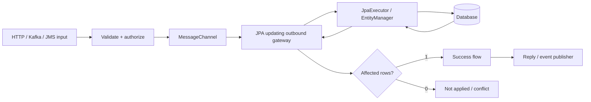
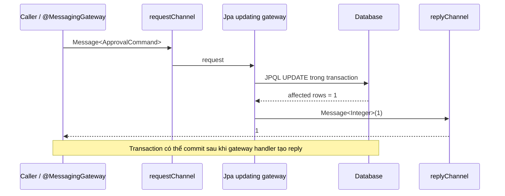
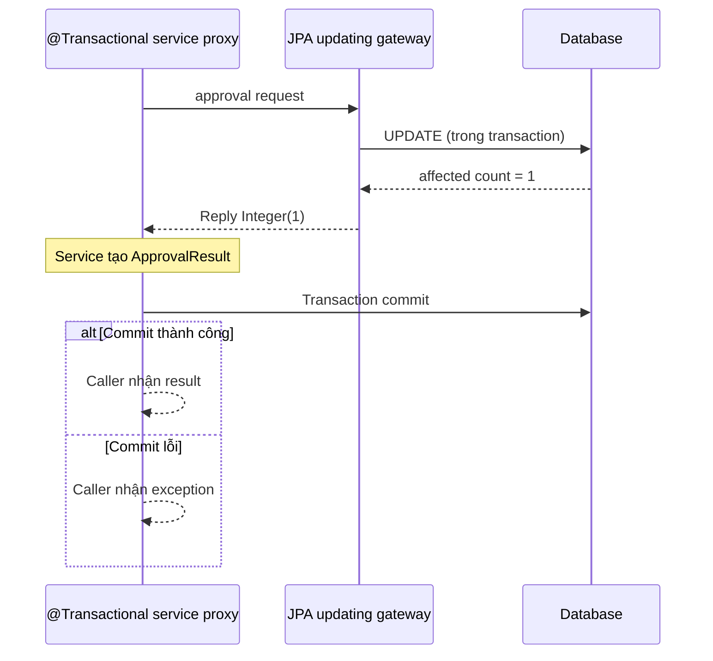
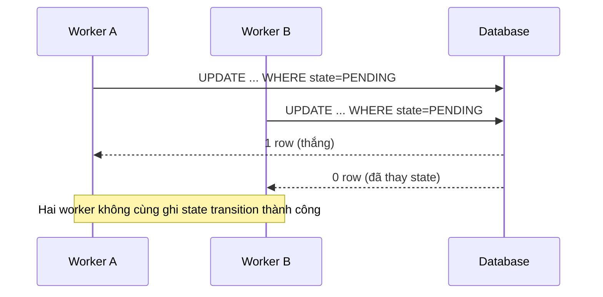
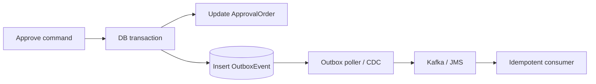
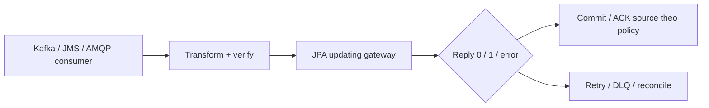

# JPA updating outbound gateway

## 1. Bối cảnh và mục tiêu

Trong module **SPRING_INTEGRATION_ADAPTERS**, Spring Integration kết nối hệ thống bên ngoài qua inbound/outbound adapter, gateway, poller và `MessageChannel`. Một sự kiện có thể đến từ HTTP, file, SFTP, JMS, AMQP hoặc Kafka; sau khi được xác thực, chuẩn hóa và định tuyến, ứng dụng cần **thay đổi dữ liệu trong cơ sở dữ liệu** rồi sử dụng **kết quả thay đổi** để quyết định bước tiếp theo của Integration Flow.

**JPA updating outbound gateway**, thuộc chương **Adapter JPA**, phục vụ đúng tình huống này: nhận một Spring Message, thực hiện thao tác JPA **persist/merge/delete** hoặc JPQL/SQL **UPDATE/DELETE**, rồi gửi **reply message** chứa kết quả. Khác với JPA outbound channel adapter một chiều, updating gateway có thể nằm **giữa** flow thay vì bắt buộc kết thúc luồng.

Sau khi học, bạn có thể:

- Phân biệt JPA updating outbound gateway với JPA outbound channel adapter, retrieving gateway và inbound polling adapter.
- Hiểu `JpaOutboundGateway`, `JpaExecutor`, `OutboundGatewayType.UPDATING` và `Jpa.updatingGateway(...)`.
- Biết khi nào reply là **entity** và khi nào là **số hàng bị cập nhật/xóa** (`Integer`).
- Viết JPQL `UPDATE/DELETE` có điều kiện, binding tham số từ payload/header mà không ghép chuỗi SQL.
- Chọn `PersistMode.PERSIST`, `MERGE` hoặc `DELETE` cho entity mode.
- Xây ví dụ Java 17+, Spring Boot 3.x, Spring Integration 6.x, Spring Data JPA và H2 dùng `@MessagingGateway`, Java DSL, transaction và affected-row count.
- Xử lý kết quả `0` an toàn, optimistic locking, cập nhật có điều kiện và kiểm tra quyền theo tenant.
- Phân biệt `flush`, `commit`, reply của gateway, ACK Kafka/JMS/HTTP và idempotency.
- Kiểm thử rollback, duplicate, nhiều worker, timeout, truy vấn sai, outbound event và backpressure.

> **Điểm cần nhớ:** updating gateway có **reply nghiệp vụ của thao tác JPA**, nhưng reply được tạo từ handler **không tự chứng minh transaction đã commit bền vững** nếu có transaction bên ngoài còn đang mở. Cũng không đồng nghĩa message đã được Kafka/JMS/HTTP client xác nhận.

## 2. Updating outbound gateway nằm ở đâu trong Integration Flow?

Hãy xét một luồng xử lý yêu cầu phê duyệt đơn hàng. Input là `orderId` và tenant đã được xác thực; ứng dụng chỉ cập nhật đơn đang `PENDING`. Kết quả `1` nghĩa một hàng khớp điều kiện, `0` nghĩa không hàng nào khớp; router sau gateway quyết định gửi ACK hay xử lý conflict.



Tùy loại thao tác, gateway có hai nhóm kết quả:

1. **Entity mode**: một entity được persist hoặc merge; gateway trả entity đã persist/merge theo hợp đồng của adapter. Với `MERGE`, có thể là một **managed instance khác** với object đầu vào.
2. **Query update/delete mode**: JPQL/native/named update hoặc delete trả về **số row bị tác động** (thường là `Integer`), để flow phân nhánh hoặc trả response.

Tài liệu Spring Integration mô tả rõ: gateway **updating** dùng khi lưu, cập nhật hoặc xóa; gateway **retrieving** dùng khi SELECT. Updating gateway tương tự outbound channel adapter nhưng **có reply**.

### Vai trò từng thành phần

| Thành phần | Trách nhiệm |
| --- | --- |
| `JpaExecutor` | Cấu hình entity/query, persist mode, parameter binding, flush và thao tác JPA |
| `JpaOutboundGateway` | Handler nhận request và tạo reply từ `JpaExecutor` |
| `OutboundGatewayType.UPDATING` | Chọn nhánh **ghi/cập nhật**, không phải retrieval |
| `Jpa.updatingGateway(...)` | Java DSL builder cho updating request–reply |
| `MessageChannel` | Chuyển request/reply giữa các bước |
| `@MessagingGateway` | Interface request–reply cho code Java gọi Integration Flow |
| `EntityManagerFactory` | Hạ tầng JPA cung cấp EntityManager đúng transaction |
| `@Transactional` / transactional advice | Thiết lập phạm vi transaction cho thay đổi DB |

**Không tồn tại yêu cầu phải tìm class `JpaUpdatingOutboundGateway`**. Implementation dùng `JpaOutboundGateway` với chế độ `UPDATING`, hoặc factory DSL `Jpa.updatingGateway(...)`.

## 3. Phân biệt bốn endpoint JPA

| Thành phần | Khi nào chạy? | Tác động lên DB | Reply |
| --- | --- | --- | --- |
| **JPA inbound channel adapter** | Poller gọi định kỳ | Thường là SELECT; có thể cấu hình cleanup | Phát message mới từ kết quả query |
| **JPA outbound channel adapter** | Có message vào channel | Persist/merge/delete/update | **Không** phát reply |
| **JPA retrieving outbound gateway** | Có request message | SELECT/find theo request | Entity, list hoặc query result |
| **JPA updating outbound gateway** | Có request message | **PERSIST/MERGE/DELETE, UPDATE/DELETE query** | **Entity hoặc affected-row count** |

Những quyết định thường gặp:

- **Kafka event → ghi một receipt → không còn bước tiếp theo:** dùng outbound channel adapter.
- **HTTP command → cập nhật trạng thái → cần biết có hàng nào thay đổi:** dùng updating outbound gateway.
- **Message chứa order ID → tìm order → trả DTO:** dùng retrieving outbound gateway.
- **Cứ mỗi 5 giây quét các hàng NEW:** dùng JPA inbound channel adapter và poller.
- **Business service đơn giản chỉ gọi `repository.save(...)`:** đôi khi Spring Data JPA trực tiếp rõ ràng hơn; Spring Integration hữu ích khi có channel, router, transformer, adapter khác và error flow.

**Gateway không cần poller** nếu request đến trên `DirectChannel` từ ứng dụng. Poller chỉ cần khi đầu vào chính là pollable channel/message source, ví dụ `QueueChannel` hoặc một inbound adapter khác cần polling.

## 4. Hợp đồng request–reply và kiểu payload trả về

### 4.1. Entity mode

```text
Request payload:
  PurchaseOrder(id="ORD-101", state="PAID")

Jpa updating gateway:
  PersistMode.MERGE

Reply payload:
  PurchaseOrder (entity đã merge)
```

Spring Integration trả entity được JPA thao tác theo mode thích hợp. Cần phân biệt entity **đầu vào** và đối tượng **managed được trả lại** từ `EntityManager.merge(...)`. Nếu cần lấy generated ID, version hoặc state mới, cần kiểm tra thời điểm flush/commit và mapping trong cùng transaction.

### 4.2. JPQL UPDATE/DELETE mode

```sql
update ApprovalOrder o
   set o.state = 'APPROVED'
 where o.id = :id
   and o.tenantId = :tenantId
   and o.state = 'PENDING'
```

Khi gateway thực thi query này, reply là số row được thay đổi.

| Reply | Có thể kết luận | Chưa thể kết luận |
| ---: | --- | --- |
| `1` | Một row đã khớp điều kiện và JPA trả affected count bằng 1 | Transaction ngoài đã commit hay message ngoài DB đã giao |
| `0` | Không row nào khớp điều kiện update | ID không tồn tại, đã APPROVED hay tenant không có quyền — **không phân biệt chỉ từ 0** |
| `>1` | Query đã tác động nhiều row | Không phải lỗi nếu đây là bulk update có chủ đích; **nguy hiểm** nếu hợp đồng chỉ cho phép 1 |
| Exception | JPA/provider/transaction từ chối một bước | Không tự suy ra đã rollback mọi side effect ngoài DB |

**Quan trọng:** `0` không đồng nghĩa “đã xử lý trước đó thành công”. Có thể đơn hàng không tồn tại, không thuộc tenant hoặc ở trạng thái không hợp lệ. Đừng dùng kết quả này để tự động trả `200 OK`/ACK nguồn nếu hợp đồng yêu cầu phân biệt.

### 4.3. Cách reply quay về caller



Khi interface `@MessagingGateway` tạo request, nó thường đặt một temporary `replyChannel` trong headers. Nếu handler không có output channel cố định, reply có thể đi về channel này để caller nhận kết quả.

Nếu cấu hình output channel riêng, cần giữ correlation/reply headers qua các bước và cuối cùng gửi reply về đúng caller. **Không tự đặt `replyChannel` rồi nghĩ một outbound channel adapter một chiều sẽ trả kết quả**; chỉ updating/retrieving gateway có trách nhiệm reply.

## 5. Chọn entity operation hay JPQL bulk update

### 5.1. PersistMode.PERSIST

Dùng khi tạo entity mới. `EntityManager.persist(...)` làm entity trở thành managed và có thể lập kế hoạch INSERT tại flush/commit.

```java
import org.springframework.integration.jpa.support.PersistMode;

executor.setEntityClass(OrderAudit.class);
executor.setPersistMode(PersistMode.PERSIST);
```

Lưu `OrderAudit` mới theo event ID ổn định có thể gặp unique constraint khi event bị redeliver. **PERSIST không tự đảm bảo idempotency**: cần phân biệt duplicate hợp lệ và dữ liệu mâu thuẫn.

### 5.2. PersistMode.MERGE

`MERGE` là mặc định của `JpaExecutor`/JPA updating gateway. Nó sao chép trạng thái của entity đưa vào sang managed entity rồi trả managed object.

```java
executor.setEntityClass(OrderAudit.class);
executor.setPersistMode(PersistMode.MERGE);
```

Cần chú ý:

- `merge` không có nghĩa “chỉ UPDATE”; tùy identity/entity state, JPA có thể INSERT.
- Nếu thiếu `@Version`, một snapshot cũ có thể ghi đè state mới.
- Entity đưa vào có thể detached; object trả về từ merge mới là managed entity.
- Nếu cần ngăn một cập nhật cũ, hãy kiểm tra version/state với locking phù hợp thay vì tin `merge` tự xử lý mọi race.

### 5.3. PersistMode.DELETE

`DELETE` được dùng để xóa entity theo quy tắc JPA. Cần phân quyền, kiểm tra cascade/foreign key và hiểu behavior với detached entity.

```java
executor.setEntityClass(OrderAudit.class);
executor.setPersistMode(PersistMode.DELETE);
```

Với bulk delete có điều kiện rõ ràng và cần affected count, JPQL `DELETE WHERE ...` thường dễ diễn giải hơn entity mode. Đừng cho client tự gửi toàn bộ entity cần xóa rồi coi identity đó đã được phép thao tác.

### 5.4. JPQL UPDATE/DELETE

Truy vấn cập nhật trực tiếp:

```sql
update ApprovalOrder o
   set o.state = 'APPROVED'
 where o.id = :id
   and o.state = 'PENDING'
```

Lợi thế:

- Có thể kiểm tra điều kiện **ngay trong WHERE** một cách atomic ở database.
- Reply là affected-row count phục vụ xử lý conflict.
- Không cần tải entity, sửa thuộc tính rồi flush khi chỉ cần đổi vài cột.
- Có thể gắn tenant/version/state constraints.

Đánh đổi: **JPQL bulk UPDATE/DELETE bỏ qua dirty checking và nhiều cơ chế vòng đời entity thông thường**, có thể khiến entity đã load trong persistence context **bị stale**. Bulk operation cũng không tự tăng `@Version` theo cách optimistic locking của entity update. Cần cập nhật version/refresh/clear theo thiết kế, không mặc nhiên xem update count là kiểm soát mọi concurrency.

## 6. Truyền tham số an toàn vào JPQL

### 6.1. Tách câu query khỏi dữ liệu

**Không làm:**

```java
String query =
        "update ApprovalOrder o set o.state='APPROVED' where o.id='"
        + clientOrderId + "'";
```

Thay bằng:

```sql
update ApprovalOrder o
   set o.state = 'APPROVED'
 where o.id = :id
   and o.tenantId = :tenantId
   and o.state = 'PENDING'
```

Với Java DSL:

```java
Jpa.updatingGateway(entityManagerFactory)
        .jpaQuery("""
            update ApprovalOrder o
               set o.state = 'APPROVED'
             where o.id = :id
               and o.tenantId = :tenantId
               and o.state = 'PENDING'
            """)
        .parameterExpression("id", "payload.orderId()")
        .parameterExpression(
                "tenantId", "payload.authorizedTenantId()");
```

`payload.orderId()` và `payload.authorizedTenantId()` được đánh giá trên object payload kiểu Java record. Nếu dùng bean thông thường, có thể dùng getter/properties như `payload.orderId` tương ứng với JavaBeans convention.

**Parameter binding chống việc dữ liệu bị ghép vào cú pháp query**, nhưng **không** tự kiểm tra quyền tenant hoặc giới hạn resource. `authorizedTenantId` trong ví dụ phải được cấp từ server-side authentication/ACL, không chỉ là một chuỗi client khai.

### 6.2. Dùng headers làm nguồn tham số

Ví dụ một header đã được trusted service gắn:

```java
.parameterExpression("tenantId", "headers['verifiedTenantId']")
```

Cách này hữu ích khi payload là `orderId` và tenant nằm ở security metadata. Tuy nhiên header trên Spring Message vẫn có thể được producer đặt tùy ý; **nguồn tạo header phải được kiểm soát**. Đừng cho HTTP/Kafka input gắn `verifiedTenantId` mà không qua xác thực/ủy quyền.

### 6.3. ParameterSourceFactory và usePayloadAsParameterSource

JPA gateway hỗ trợ `ParameterSourceFactory` để lấy values cho named/indexed query parameters. Nếu không khai các `JpaParameter` explicit, `usePayloadAsParameterSource` mặc định thường là `true` và bean properties của payload được dùng làm nguồn. Khi dùng explicit `JpaParameter`/SpEL expressions, mặc định phù hợp là đánh giá với **toàn bộ Spring Message**, nhờ đó có cả payload và headers.

Hai cách cấu hình không nên trộn tùy tiện:

- **Explicit parameter expressions**: rõ source cho từng `:id`/`:tenantId`.
- **ParameterSourceFactory**: ánh xạ hàng loạt property theo hợp đồng.

Tránh khai `parameter-source-factory` song song danh sách `<int-jpa:parameter>` trong XML; tài liệu Spring Integration nêu hai cách này loại trừ nhau.

### 6.4. Named query và native SQL

`@NamedQuery` cho phép đặt query UPDATE/DELETE trên entity; gateway chọn bằng `namedQuery("...")`. `nativeQuery("...")` dùng cú pháp database-specific, ví dụ tính năng hỗ trợ cập nhật theo điều kiện riêng của PostgreSQL.

Không chọn `jpaQuery`, `nativeQuery`, `namedQuery` cùng lúc cho một endpoint nếu chúng xung đột; dùng **một** dạng query rõ ràng. Với native query, kiểm tra parameter binding/result semantics trên persistence provider và database thực tế, đặc biệt kiểu số hàng bị tác động.

## 7. Ví dụ thực hành hoàn chỉnh: duyệt đơn hàng có điều kiện

Xây một ứng dụng demo:

1. Tạo bảng `approval_order` chứa trạng thái `PENDING`/`APPROVED`.
2. Nhận `ApprovalCommand(orderId, authorizedTenantId)` trong một `@MessagingGateway`.
3. JPQL chỉ thay `PENDING → APPROVED` **nếu order thuộc đúng tenant**.
4. Updating gateway reply `Integer` là số row được cập nhật.
5. Facade có `@Transactional` để query, xử lý kết quả và commit trong cùng lời gọi đồng bộ.
6. Với reply `1`, trả `APPLIED`; reply `0`, trả `NOT_APPLIED` (không tự phân biệt nguyên nhân).
7. Dùng Spring Data JPA repository để seed/kiểm tra kết quả, nhưng **thao tác update thực sự chạy qua Spring Integration gateway**.

Ví dụ dùng Java 17+, Spring Boot 3.x, Spring Integration 6.x và H2 in-memory, không yêu cầu Web server. Các lớp nằm trong package `com.example.jpaupdate`.

### 7.1. Maven dependencies

```xml
<dependencies>
    <dependency>
        <groupId>org.springframework.boot</groupId>
        <artifactId>spring-boot-starter</artifactId>
    </dependency>
    <dependency>
        <groupId>org.springframework.boot</groupId>
        <artifactId>spring-boot-starter-data-jpa</artifactId>
    </dependency>
    <dependency>
        <groupId>org.springframework.boot</groupId>
        <artifactId>spring-boot-starter-integration</artifactId>
    </dependency>
    <dependency>
        <groupId>org.springframework.integration</groupId>
        <artifactId>spring-integration-jpa</artifactId>
    </dependency>
    <dependency>
        <groupId>com.h2database</groupId>
        <artifactId>h2</artifactId>
        <scope>runtime</scope>
    </dependency>
    <dependency>
        <groupId>org.springframework.boot</groupId>
        <artifactId>spring-boot-starter-test</artifactId>
        <scope>test</scope>
    </dependency>
</dependencies>
```

Spring Boot BOM nên quản lý các phiên bản tương thích. Spring Boot 3.x sử dụng **`jakarta.persistence`**, không phải `javax.persistence` như các project Spring cũ. `spring-integration-jpa` cung cấp `JpaExecutor`, `JpaOutboundGateway` và DSL; Spring Data JPA/ORM provider thực hiện database operations.

### 7.2. Entity ApprovalOrder

File `ApprovalOrder.java`:

```java
package com.example.jpaupdate;

import jakarta.persistence.Column;
import jakarta.persistence.Entity;
import jakarta.persistence.Id;
import jakarta.persistence.Table;

@Entity
@Table(name = "approval_order")
public class ApprovalOrder {

    @Id
    @Column(name = "order_id", length = 80, nullable = false)
    private String id;

    @Column(name = "tenant_id", length = 80, nullable = false)
    private String tenantId;

    @Column(length = 24, nullable = false)
    private String state;

    protected ApprovalOrder() {
        // JPA requires a no-argument constructor.
    }

    public ApprovalOrder(String id, String tenantId, String state) {
        this.id = id;
        this.tenantId = tenantId;
        this.state = state;
    }

    public String getId() {
        return id;
    }

    public String getTenantId() {
        return tenantId;
    }

    public String getState() {
        return state;
    }
}
```

Đây là entity đơn giản để minh họa JPQL bulk update. Production cần schema migration, business validation, column/index/unique constraints, audit fields và chiến lược locking phù hợp.

**Vì sao không có setter `setState`?** Bài muốn thay state qua **JPQL updating gateway**, không sửa trực tiếp object JPA tại repository. Entity vẫn có constructor và getters để test.

### 7.3. DTO command và result

File `ApprovalCommand.java`:

```java
package com.example.jpaupdate;

public record ApprovalCommand(
        String orderId,
        String authorizedTenantId) {
}
```

File `ApprovalResult.java`:

```java
package com.example.jpaupdate;

public record ApprovalResult(
        String orderId,
        String outcome,
        int affectedRows) {

    public boolean applied() {
        return affectedRows == 1;
    }
}
```

`authorizedTenantId` là tên thể hiện **ý định hợp đồng**: giá trị phải được service xác thực/ủy quyền **cấp từ phía server**. Demo console dùng một tenant cố định; không có HTTP authentication trong code mẫu. Nếu client gửi tự do cả `orderId` lẫn `authorizedTenantId` rồi service dùng nguyên, đó vẫn là lỗ hổng cross-tenant.

### 7.4. Repository để tạo và kiểm tra dữ liệu

File `ApprovalOrderRepository.java`:

```java
package com.example.jpaupdate;

import org.springframework.data.jpa.repository.JpaRepository;

public interface ApprovalOrderRepository
        extends JpaRepository<ApprovalOrder, String> {
}
```

Repository chỉ dùng để seed và kiểm chứng. Lệnh đổi trạng thái trong workflow vẫn do `Jpa.updatingGateway(...)` thực hiện.

### 7.5. Interface @MessagingGateway

File `ApprovalJpaGateway.java`:

```java
package com.example.jpaupdate;

import org.springframework.integration.annotation.MessagingGateway;

@MessagingGateway(
        defaultRequestChannel = "approvalRequests",
        defaultReplyTimeout = "5000")
public interface ApprovalJpaGateway {

    Integer approve(ApprovalCommand command);
}
```

Spring Integration sẽ tạo request message từ `ApprovalCommand`, gửi vào `approvalRequests`, chờ reply và chuyển `Integer` trả về cho caller. Không có query định kỳ; phương thức `approve(...)` **kích hoạt flow**.

`defaultReplyTimeout` không đồng nghĩa DB query timeout hay transaction timeout. Trong một `DirectChannel` đồng bộ, lời gọi vào handler có thể chạy lâu hơn timeout chờ reply nếu DB bị treo; quản lý timeout ở JDBC/JPA/DB riêng.

### 7.6. Java DSL cấu hình updating gateway

File `ApprovalIntegrationConfiguration.java`:

```java
package com.example.jpaupdate;

import jakarta.persistence.EntityManagerFactory;
import org.springframework.context.annotation.Bean;
import org.springframework.context.annotation.Configuration;
import org.springframework.integration.config.EnableIntegration;
import org.springframework.integration.dsl.IntegrationFlow;
import org.springframework.integration.jpa.dsl.Jpa;

@Configuration
@EnableIntegration
public class ApprovalIntegrationConfiguration {

    @Bean
    IntegrationFlow approvalFlow(
            EntityManagerFactory entityManagerFactory) {

        return IntegrationFlow.from("approvalRequests")
                .handle(
                        Jpa.updatingGateway(entityManagerFactory)
                                .jpaQuery("""
                                        update ApprovalOrder o
                                           set o.state = 'APPROVED'
                                         where o.id = :id
                                           and o.tenantId = :tenantId
                                           and o.state = 'PENDING'
                                        """)
                                .parameterExpression(
                                        "id", "payload.orderId()")
                                .parameterExpression(
                                        "tenantId",
                                        "payload.authorizedTenantId()"))
                .get();
    }
}
```

Điểm quan trọng:

- `Jpa.updatingGateway(entityManagerFactory)` là **updating request–reply** spec.
- JPQL `update ApprovalOrder` dùng tên entity Java, không dùng tên bảng `approval_order`.
- `set ... where ...` vừa thực hiện thao tác vừa là điều kiện bảo vệ state/tenant.
- `parameterExpression(...)` dùng SpEL lấy giá trị từ record payload để **binding**, không nối SQL string.
- Query trả về `Integer affectedRows`; flow đưa reply về temporary reply channel của `@MessagingGateway`.
- Không có `@Poller`: flow được gọi theo message.
- Code này chưa tự xác thực danh tính; nó dựa vào service bên ngoài để cấp một `authorizedTenantId` đã được kiểm tra.

**Không thêm `Jpa.outboundAdapter(...)` trên cùng channel** trừ khi cố ý thiết kế nhiều consumer. Adapter một chiều không trả `Integer` cho `ApprovalJpaGateway`.

### 7.7. Facade tạo transaction và hiểu reply

File `ApprovalService.java`:

```java
package com.example.jpaupdate;

import org.springframework.stereotype.Service;
import org.springframework.transaction.annotation.Transactional;

@Service
public class ApprovalService {

    private final ApprovalJpaGateway gateway;

    public ApprovalService(ApprovalJpaGateway gateway) {
        this.gateway = gateway;
    }

    @Transactional
    public ApprovalResult approve(ApprovalCommand command) {
        if (command == null
                || command.orderId() == null
                || command.orderId().isBlank()
                || command.orderId().length() > 80
                || command.authorizedTenantId() == null
                || command.authorizedTenantId().isBlank()
                || command.authorizedTenantId().length() > 80) {
            throw new IllegalArgumentException(
                    "Invalid authorized approval request");
        }

        // @MessagingGateway -> DirectChannel -> JPA handler
        // cùng thread và cùng transaction đang mở.
        Integer affected = gateway.approve(command);

        if (affected == null) {
            throw new IllegalStateException(
                    "Updating gateway did not return affected count");
        }

        if (affected < 0 || affected > 1) {
            throw new IllegalStateException(
                    "Unexpected affected row count: " + affected);
        }

        return new ApprovalResult(
                command.orderId(),
                affected == 1 ? "APPLIED" : "NOT_APPLIED",
                affected);
        // Commit của @Transactional xảy ra khi proxy kết thúc call.
        // Commit lỗi => caller thấy exception, không nhận result thành công.
    }
}
```

Vì `ApprovalService.approve(...)` là **public method** của Spring bean và được caller khác gọi qua proxy, `@Transactional` mở transaction trước khi gateway chạy. `DirectChannel` mặc định giữ xử lý đồng bộ. Khi phương thức service kết thúc, Spring transaction interceptor commit trước khi trả quyền điều khiển thành công về caller bên ngoài.

Lưu ý về transaction:

- **Bên trong** phương thức, affected count `1` chưa phải commit.
- **Bên ngoài** proxy của service, nếu method trả thành công thì transaction service đã commit (theo manager/hạ tầng cấu hình); vẫn không nói gì về side effect của broker ngoài DB.
- Nếu gateway/DB ném exception, transaction có thể rollback; caller cần phân loại lỗi để quyết định retry.
- Nếu đổi sang `ExecutorChannel`/`QueueChannel`, transaction của service **không tự đi qua** consumer ở thread khác; phải thiết kế transaction tại handler/consumer riêng.

### 7.8. Spring Boot main và seed data

File `JpaUpdatingApplication.java`:

```java
package com.example.jpaupdate;

import java.util.List;
import org.springframework.boot.CommandLineRunner;
import org.springframework.boot.SpringApplication;
import org.springframework.boot.autoconfigure.SpringBootApplication;
import org.springframework.context.annotation.Bean;
import org.springframework.integration.annotation.IntegrationComponentScan;

@SpringBootApplication
@IntegrationComponentScan
public class JpaUpdatingApplication {

    public static void main(String[] args) {
        SpringApplication.run(JpaUpdatingApplication.class, args);
    }

    @Bean
    CommandLineRunner demo(
            ApprovalOrderRepository repository,
            ApprovalService service) {

        return args -> {
            if (repository.count() == 0) {
                repository.saveAll(List.of(
                        new ApprovalOrder(
                                "ORD-101", "TENANT-A", "PENDING"),
                        new ApprovalOrder(
                                "ORD-102", "TENANT-A", "APPROVED"),
                        new ApprovalOrder(
                                "ORD-103", "TENANT-B", "PENDING")));
            }

            ApprovalResult first = service.approve(
                    new ApprovalCommand("ORD-101", "TENANT-A"));
            ApprovalResult again = service.approve(
                    new ApprovalCommand("ORD-101", "TENANT-A"));
            ApprovalResult wrongTenant = service.approve(
                    new ApprovalCommand("ORD-103", "TENANT-A"));

            System.out.println("First: " + first);
            System.out.println("Again: " + again);
            System.out.println("Wrong tenant: " + wrongTenant);

            repository.findById("ORD-101")
                    .ifPresent(row -> System.out.println(
                            "State now: " + row.getState()));
        };
    }
}
```

File `application.properties` dành cho môi trường học:

```properties
spring.main.web-application-type=none

spring.datasource.url=jdbc:h2:mem:jpa_updating_demo;DB_CLOSE_DELAY=-1
spring.datasource.driver-class-name=org.h2.Driver
spring.datasource.username=sa
spring.datasource.password=

spring.jpa.hibernate.ddl-auto=create-drop
spring.jpa.open-in-view=false
logging.level.org.springframework.integration=INFO
```

Kỳ vọng khi chạy:

| Call | Kết quả | Giải thích |
| --- | --- | --- |
| `ORD-101`, `TENANT-A` lần đầu | `APPLIED`, affected `1` | Hàng thỏa ID + tenant + state PENDING |
| `ORD-101` lần hai | `NOT_APPLIED`, affected `0` | Hàng đã APPROVED, không thỏa state PENDING |
| `ORD-103` với `TENANT-A` | `NOT_APPLIED`, affected `0` | Hàng thuộc `TENANT-B` |
| Đọc `ORD-101` sau đó | `APPROVED` | Query đã commit thành công ở demo |

**Không viết logic “affected=0 nghĩa đã approved”** trong service thật. Ở đây hai nguyên nhân khác nhau đều cho `0` và được chuẩn hóa thành `NOT_APPLIED`. Nếu business cần biết cụ thể, phải có bước kiểm tra quyền/đọc trạng thái sau khi update với transaction/isolation phù hợp; tránh rò rỉ việc một order của tenant khác có tồn tại hay không.

### 7.9. Điểm nào là gateway và điểm nào là service?

Mỗi lớp một vai trò:

- `ApprovalJpaGateway` là **messaging facade**, không truy cập DB trực tiếp.
- `ApprovalIntegrationConfiguration` mô tả message flow và query.
- `JpaExecutor` được DSL tạo từ `EntityManagerFactory` để thực thi JPA.
- `ApprovalService` validate input, mở transaction, kiểm tra affected count và tạo business result.
- `ApprovalOrderRepository` seed/test; không thực hiện cập nhật trong flow.
- `@IntegrationComponentScan` kích hoạt phát hiện interface `@MessagingGateway`.
- H2 + `create-drop` chỉ là database demo; production cần Flyway/Liquibase và DB mục tiêu.

## 8. Viết gateway bằng Java annotation (không dùng DSL)

Nếu cần cấu hình tường minh `JpaExecutor` và `JpaOutboundGateway`, sử dụng `@ServiceActivator`. **Đây là phương án thay thế** Java DSL ở mục 7.6; không đăng ký cả hai cùng xử lý `approvalRequests`.

```java
package com.example.jpaupdate;

import java.util.List;
import jakarta.persistence.EntityManagerFactory;
import org.springframework.context.annotation.Bean;
import org.springframework.context.annotation.Configuration;
import org.springframework.integration.annotation.ServiceActivator;
import org.springframework.integration.jpa.core.JpaExecutor;
import org.springframework.integration.jpa.outbound.JpaOutboundGateway;
import org.springframework.integration.jpa.support.JpaParameter;
import org.springframework.integration.jpa.support.OutboundGatewayType;
import org.springframework.messaging.MessageHandler;

@Configuration
public class ApprovalJpaJavaConfiguration {

    @Bean
    JpaExecutor approvalJpaExecutor(
            EntityManagerFactory entityManagerFactory) {

        JpaExecutor executor =
                new JpaExecutor(entityManagerFactory);

        executor.setJpaQuery("""
                update ApprovalOrder o
                   set o.state = 'APPROVED'
                 where o.id = :id
                   and o.tenantId = :tenantId
                   and o.state = 'PENDING'
                """);

        executor.setJpaParameters(List.of(
                new JpaParameter(
                        "id", null, "payload.orderId()"),
                new JpaParameter(
                        "tenantId", null,
                        "payload.authorizedTenantId()")));
        executor.setUsePayloadAsParameterSource(false);
        return executor;
    }

    @Bean
    @ServiceActivator(inputChannel = "approvalRequests")
    MessageHandler approvalJpaHandler(
            JpaExecutor approvalJpaExecutor) {

        JpaOutboundGateway gateway =
                new JpaOutboundGateway(approvalJpaExecutor);

        gateway.setGatewayType(OutboundGatewayType.UPDATING);

        // Đừng setProducesReply(false): đó là outbound adapter.
        return gateway;
    }
}
```

Ở đây:

1. `JpaExecutor.setJpaQuery` nhận JPQL UPDATE.
2. `JpaParameter(name, null, expression)` gắn named parameter với SpEL expression.
3. `setUsePayloadAsParameterSource(false)` cho phép đánh giá trên **toàn Spring Message** (có `payload` và `headers`).
4. `setGatewayType(UPDATING)` chọn ghi/cập nhật và trả kết quả.
5. `JpaOutboundGateway` mặc định tạo reply; **`setProducesReply(false)` chỉ dùng nếu muốn outbound channel adapter**.
6. `@ServiceActivator` đặt handler vào input channel giống phương án DSL.

Nếu code thay đổi thành entity mode, hãy thay `jpaQuery/setJpaParameters` bằng `setEntityClass`/`setPersistMode` phù hợp.

## 9. Cấu hình XML namespace

Spring Integration có namespace `int-jpa` cho updating outbound gateway. Ví dụ thay thế DSL:

```xml
<int-jpa:updating-outbound-gateway
        id="approvalUpdatingGateway"
        request-channel="approvalRequests"
        entity-manager-factory="entityManagerFactory"
        jpa-query="update ApprovalOrder o
                   set o.state = 'APPROVED'
                   where o.id = :id
                   and o.tenantId = :tenantId
                   and o.state = 'PENDING'">

    <int-jpa:parameter
            name="id"
            expression="payload.orderId()"/>
    <int-jpa:parameter
            name="tenantId"
            expression="payload.authorizedTenantId()"/>

    <int-jpa:transactional
            transaction-manager="transactionManager"/>
</int-jpa:updating-outbound-gateway>
```

Đây là **đoạn XML** giả định đã khai báo namespace/schema `int-jpa`, các channel, `entityManagerFactory` và `transactionManager`. Không dùng đồng thời bean từ XML với Java DSL/Java annotation nếu chúng tiêu thụ cùng request channel mà không có thiết kế chủ đích.

Nếu không khai `reply-channel`, request message cần `replyChannel` header (ví dụ `@MessagingGateway` tạo), hoặc phải có output routing phù hợp. Khi khai `reply-channel` cố định, kết quả đi đến channel đó; flow tiếp theo phải chuyển reply về caller/đích cuối cùng và giữ metadata correlation.

### Entity mode trong XML

Ví dụ biến thể đơn giản:

```xml
<int-jpa:updating-outbound-gateway
        request-channel="orderAuditUpdates"
        reply-channel="orderAuditResults"
        entity-manager-factory="entityManagerFactory"
        entity-class="com.example.jpaupdate.OrderAudit"
        persist-mode="MERGE">

    <int-jpa:transactional
            transaction-manager="transactionManager"/>
</int-jpa:updating-outbound-gateway>
```

`OrderAudit` ở đây chỉ là tên class minh họa; cần định nghĩa entity, input/reply channel thực tế nếu chạy. Gateway trả entity đã xử lý theo entity mode; nếu muốn lấy reply vào method `@MessagingGateway`, phải thiết kế đúng mapping loại kết quả.

### Named query UPDATE

Với `@NamedQuery(name = "ApprovalOrder.approve", query = "...")`, có thể dùng:

```xml
<int-jpa:updating-outbound-gateway
        request-channel="approvalRequests"
        entity-manager-factory="entityManagerFactory"
        named-query="ApprovalOrder.approve">

    <int-jpa:parameter
            name="id"
            expression="payload.orderId()"/>
    <int-jpa:parameter
            name="tenantId"
            expression="payload.authorizedTenantId()"/>
</int-jpa:updating-outbound-gateway>
```

Cần đảm bảo named query thật sự được khai báo và những tham số tương ứng đầy đủ. Không dùng `SELECT` trong updating gateway rồi mong trả entity list; dùng **retrieving gateway** cho nhu cầu đọc.

## 10. Transaction, flush và commit

### 10.1. UPDATE/DELETE cần transaction

JPA bulk UPDATE/DELETE và entity persistence thông thường yêu cầu transaction. Những vị trí có thể đặt transaction:

- **Facade đồng bộ** `@Transactional` như `ApprovalService.approve(...)`.
- **Integration endpoint advice**: `.handle(Jpa.updatingGateway(...), endpoint -> endpoint.transactional())`.
- **XML** `<int-jpa:transactional transaction-manager="..."/>`.
- **Service/repository** được gọi sau gateway, nếu thao tác được chuyển sang một bước khác.

Một ứng dụng nên chọn ranh giới phù hợp và đo transaction duration; không trải transaction qua những thao tác network chậm nếu không cần thiết.

### 10.2. Reply của gateway chưa chắc là commit



Trong transaction bên ngoài, gateway có thể phát reply sau khi JPA `executeUpdate` trả số hàng. Lúc đó DB transaction **vẫn có thể rollback** vì constraint, lỗi commit hoặc exception downstream. Nếu reply đã ra một message channel **bất đồng bộ** đến client/broker trước commit, bạn có nguy cơ phát sự kiện “thành công” cho thay đổi không commit.

Do đó:

- Trả response **sau khi facade transactional proxy kết thúc thành công**.
- Nếu phải phát event ra Kafka/JMS sau commit đáng tin cậy, cân nhắc **transactional outbox**.
- Không coi `MessageChannel.send(...) == true` hay reply `1` là Kafka/JMS ACK.
- Nếu nhiều nguồn giao lại message, cần idempotency theo `eventId`/business key.

### 10.3. Flush không phải commit

| Thao tác | Điều thực sự xảy ra |
| --- | --- |
| `persist(entity)` | Đưa entity vào persistence context; SQL có thể phát ra lúc flush/commit |
| `merge(entity)` | Sao chép state vào entity managed; SQL có thể chạy sau |
| `flush()` | Đồng bộ các thay đổi đang chờ với DB **trong transaction** |
| `executeUpdate()` | Chạy JPQL bulk UPDATE/DELETE, trả affected count |
| `commit()` | Xác nhận transaction DB thành công |
| Gateway reply | Trả đối tượng/số row của JPA operation, **không tự commit mọi transaction ngoài** |

`JpaExecutor.setFlush(true)`/`JpaUpdatingOutboundEndpointSpec.flush(true)` điều khiển việc flush cho **entity persistence operations** theo cấu hình. Với JPQL `UPDATE`, chính `executeUpdate` chạy query; không nên suy ra flag flush là một lệnh commit.

### 10.4. DirectChannel và ranh giới bất đồng bộ

`DirectChannel` thường gọi handler trong thread sender; `@Transactional` trên facade có thể bao quanh toàn bộ lời gọi cập nhật và kiểm tra affected count.

Nếu thay bằng `ExecutorChannel` hoặc `QueueChannel`:

- Transaction context thường không tự đi qua thread/queue.
- Caller có thể nhận tín hiệu tiếp nhận message trước khi DB update chạy.
- Consumer JPA cần transaction riêng và error handling riêng.
- Một `@MessagingGateway` sync đợi reply phải có reply routing đúng và timeout hữu hạn.
- Nếu cần phản hồi HTTP sau commit, xem lại kiến trúc request–reply và thời điểm ACK.

## 11. Bulk UPDATE và optimistic locking

### 11.1. Một WHERE có điều kiện là atomic claim đơn giản

Với query:

```sql
update ApprovalOrder o
   set o.state = 'APPROVED'
 where o.id = :id
   and o.tenantId = :tenantId
   and o.state = 'PENDING'
```

Nếu hai worker cùng phê duyệt một đơn PENDING:



Sơ đồ là **logic kỳ vọng** ở database với locking/isolation phù hợp. Trong thực tế, worker thứ hai có thể phải chờ lock hoặc nhận deadlock/serialization failure rồi retry; cần kiểm chứng trên DB mục tiêu. Kết quả `0` vẫn có thể do ID/tenant sai, không nhất thiết do cạnh tranh.

### 11.2. @Version không tự tăng trên JPQL bulk update

Với entity có:

```java
@Version
private long version;
```

JPA optimistic locking của entity update thường dựa vào version. Nhưng **bulk UPDATE/DELETE query không tự động áp dụng cùng quy trình dirty checking/version increment của một entity managed**.

Nếu cần CAS theo version trong JPQL, có thể viết minh họa:

```sql
update ApprovalOrder o
   set o.state = :newState,
       o.version = o.version + 1
 where o.id = :id
   and o.tenantId = :tenantId
   and o.version = :expectedVersion
   and o.state = :expectedState
```

Truy vấn phải thực sự có field `version` phù hợp với entity và database; bản demo chính không khai trường này. Nếu count `0`, coi đó là **không khớp phiên bản/trạng thái/quyền/ID** và chọn cách reconcile rõ ràng. Tránh tự retry vô hạn cùng `expectedVersion` cũ.

### 11.3. Bulk update làm persistence context có thể stale

Ví dụ:

```java
ApprovalOrder managed = entityManager.find(
        ApprovalOrder.class, "ORD-101");

// Bulk JPQL update o.state thành APPROVED ở database
// nhưng managed.getState() có thể vẫn là PENDING.

entityManager.refresh(managed);
```

Đừng coi đây là một đoạn code chạy độc lập; nó minh họa việc entity **đã load trước bulk update** cần được refresh/clear/reload nếu bạn cần state mới. Trong transaction đọc dài, lựa chọn `clear()` có thể detach các entity khác và ảnh hưởng pending changes; chỉ dùng có chủ đích.

### 11.4. Ràng buộc business state machine

Tự động chuyển `PENDING → APPROVED` chỉ hợp lệ nếu chính sách business cho phép:

- Chặn `CANCELLED → APPROVED`.
- Chặn sửa đơn thuộc tenant khác.
- Kiểm tra vai trò/phê duyệt theo workflow.
- Giới hạn một lần phê duyệt trên một `orderId`.
- Audit người phê duyệt/approvedAt và lý do, không log PII không cần thiết.
- Nếu cần nhiều bảng cùng đổi, đặt transaction phù hợp và kiểm tra invariants trong một service.

Đừng đưa một command nguyên từ user vào `set o.state = :newState` mà không allowlist trạng thái được phép.

## 12. Khi affectedRows = 0: thiết kế error semantics

Một reply `0` có nhiều cách giải thích:

| Nguyên nhân khả dĩ | Ví dụ |
| --- | --- |
| Không tồn tại | `orderId` không có trong bảng |
| Sai tenant | Row thuộc tenant khác |
| State không hợp lệ | Đã APPROVED/CANCELLED |
| Optimistic conflict | Version cũ |
| Race condition | Worker khác đã cập nhật |
| Chính sách filter | Query chặn do điều kiện nghiệp vụ khác |

**Không phân biệt được nguyên nhân chỉ từ affected count** là một tính chất của update có điều kiện, không phải lỗi của Spring Integration.

Hướng chọn business response:

- Với command **idempotent có đủ bằng chứng** sự kiện đã xử lý, có thể trả “already applied” nếu kiểm tra được trạng thái và event ID tương ứng.
- Với tài nguyên bí mật, nên trả một kết quả không tiết lộ tài nguyên thuộc tenant khác có tồn tại hay không.
- Nếu cần quyết định chính xác, đọc dữ liệu **sau** update trong cùng transaction hoặc transaction phù hợp, có locking và authorization; chấp nhận rằng giữa các query có thể có race nếu không thiết kế isolation phù hợp.
- Nếu không xác định được, trả `CONFLICT`/`NOT_APPLIED` theo API contract, không ACK nguồn một cách tùy tiện.
- Ghi metrics cho `affected=0` tách khỏi lỗi DB; đó có thể là business outcome bình thường.

Trong ví dụ, `ApprovalService` trả `NOT_APPLIED`, không tự chuyển kết quả `0` thành exception.

## 13. Retry, idempotency và giao dịch xuyên các adapter

### 13.1. Vì sao cùng request được giao lại?

Nguồn có thể redeliver khi:

- Kafka consumer crash trước commit offset.
- JMS/AMQP consumer rollback/nack hoặc timeout acknowledgment.
- HTTP caller retry sau timeout dù server đã update thành công.
- File/SFTP poller đọc lại file nếu metadata/filter state mất.
- Một retry advice chạy lại handler do lỗi DB tạm thời.

**Updating gateway thực hiện JPA operation; nó không tự cung cấp exactly-once end-to-end.**

### 13.2. State transition có điều kiện là một lớp idempotency

Query `where state='PENDING'` giúp cùng một command phê duyệt không cập nhật row lần hai sau khi đã APPROVED. Nhưng hai request khác nhau có thể cùng đòi phê duyệt, hoặc một event ID bị lặp với payload khác nhau.

Muốn có idempotency nghiệp vụ mạnh hơn, lưu:

```text
inbox_event
-----------
event_id        PK/UNIQUE
payload_hash
business_key
processing_state
processed_at
result_code
```

Và:

1. Xác thực nguồn và kiểm tra chữ ký/ACL.
2. Ghi nhận `eventId` duy nhất trong cùng transaction DB với thay đổi nghiệp vụ (nếu mô hình phù hợp).
3. Nếu nhận lại đúng `eventId` và đúng payload hash, trả kết quả đã ghi nhận.
4. Nếu cùng ID nhưng payload khác, báo conflict thay vì nuốt lỗi.
5. Nếu transaction rollback, message cần được retry theo chính sách source.
6. Nếu sau commit cần phát event, ghi **outbox event** trong transaction rồi publish riêng.

`MessageHeaders.ID` không phải idempotency key: mỗi delivery có thể tạo một Spring Message mới với ID khác.

### 13.3. Transactional outbox

Một flow an toàn hơn cho giao dịch DB + Kafka:



Nếu crash sau broker publish nhưng trước khi đánh dấu outbox `SENT`, publisher có thể gửi lại. Consumer phải deduplicate theo `eventId`. Đây thường là **at-least-once + idempotency**, không được quảng cáo exactly-once nếu chưa có thiết kế đáp ứng đúng nghĩa.

**Tách ACK:** DB commit, Kafka producer acknowledgment, JMS consumer acknowledgment và HTTP 200 đều có hợp đồng riêng. Không tự đồng nhất chúng chỉ vì thuộc cùng Integration Flow.

## 14. Entity mode: batch, flush và hiệu năng

Ngoài JPQL bulk UPDATE, updating gateway hỗ trợ `Iterable` entity với persist/merge/delete tùy phiên bản/cấu hình. Một Spring Message có thể chứa `List<Entity>`, nhưng không mặc nhiên có một reply per item.

### 14.1. Batch entity mode

Ví dụ thay thế cấu hình JPQL:

```java
Jpa.updatingGateway(entityManagerFactory)
        .entityClass(OrderAudit.class)
        .persistMode(PersistMode.PERSIST)
        .flushSize(50)
        .clearOnFlush(true);
```

Giả định bạn đã có `@Entity OrderAudit` và input payload là entity hoặc `Iterable<OrderAudit>`. Đây là DSL fragment, không phải đoạn chạy cùng demo `ApprovalOrder` ở mục 7.

Ý nghĩa:

| Tùy chọn | Công dụng | Đánh đổi |
| --- | --- | --- |
| `persistMode(PERSIST)` | Insert entity mới | Duplicate key có thể ném lỗi |
| `persistMode(MERGE)` | Merge entity state | Có thể insert, cần kiểm tra version |
| `persistMode(DELETE)` | Delete entity | Có thể ảnh hưởng cascade/audit |
| `flush(true)` | Flush sau persistence operation | Không phải commit |
| `flushSize(50)` | Flush theo số lượng entity trong batch | Không tự bật JDBC batching |
| `clearOnFlush(true)` | Clear persistence context sau flush | Entity có thể detached, lazy access cần lưu ý |

Khi `flushSize > 0`, thuộc tính này có ưu tiên so với flag `flush`. `clearOnFlush` chỉ thực sự liên quan khi có flush. Dùng flush/clear không biến một transaction lớn thành nhiều transaction nhỏ; việc commit vẫn phụ thuộc transaction boundary.

### 14.2. Hibernate JDBC batching là một tầng khác

`flushSize(50)` là chính sách flushing persistence context của adapter. Nếu muốn provider gom nhiều INSERT/UPDATE ở JDBC layer, phải xem xét cấu hình Hibernate/driver/DB, chẳng hạn `hibernate.jdbc.batch_size`. Chiến lược ID generation như `IDENTITY` có thể ảnh hưởng batching thực tế.

Không đưa một `Iterable` vài triệu entity vào một message rồi mong `flushSize` giải quyết toàn bộ memory/transaction cost. Cần chia batch có giới hạn, quan sát lỗi từng phần và cân nhắc transaction mỗi batch.

### 14.3. Reply sau batch cần hợp đồng cụ thể

Entity mode thường trả entity được xử lý theo kết quả `JpaExecutor`, nhưng với `Iterable`, kiểu object trả về/phạm vi đối tượng managed cần được xác minh với phiên bản adapter và transaction hiện hành. Đừng tự cast reply thành `List<ManagedEntity>` nếu chưa kiểm thử. Khi cần report từng item thành công/thất bại, một service/orchestrator riêng hoặc splitter cùng transaction boundaries tường minh thường phù hợp hơn.

## 15. Error handling và timeout

| Loại lỗi | Ví dụ | Hướng xử lý |
| --- | --- | --- |
| Validation error | ID/tenant trống, state không hợp lệ | Từ chối trước gateway, không retry vô hạn |
| Permission failure | User không được approve tenant/order | Trả forbidden/không lộ dữ liệu |
| Affected count = 0 | State mismatch, not found, wrong tenant | Business `NOT_APPLIED` hoặc conflict có kiểm soát |
| DB unavailable | Network, connection pool, failover | Retry bounded, backoff/jitter, health alert |
| Deadlock / lock timeout | Nhiều worker cập nhật cùng row | Retry có hạn và idempotency |
| Optimistic lock | Version cũ | Reload/reconcile, không ghi đè mù quáng |
| Constraint violation | Unique/FK/NOT NULL | Sửa data/schema; quarantine poison event |
| JPQL syntax error | Sai entity/field hoặc query mode | Sửa code, không retry |
| Parameter mismatch | Thiếu `:tenantId`, sai type/SpEL | Kiểm tra binding, unit/integration test |
| Transaction commit failure | Query đã trả `1` nhưng commit rollback | Không phát success ACK, cho phép retry đúng policy |
| Async reply timeout | Reply không đến đúng channel/thời gian | Fix routing/correlation, đo bottleneck |
| Broker send failure sau DB commit | Kafka/JMS không sẵn | Dùng outbox và retry publisher |

### Timeout nào là timeout gì?

| Cấu hình | Giới hạn |
| --- | --- |
| `@MessagingGateway(defaultReplyTimeout=...)` | Giới hạn chờ reply qua messaging gateway theo ngữ cảnh |
| `JpaOutboundGateway reply-timeout` | Thời gian **gửi reply vào channel** nếu channel có thể block (ví dụ bounded QueueChannel đầy) |
| JDBC/JPA query timeout | Thời gian thực thi statement/query ở database/driver/provider |
| `@Transactional(timeout=...)` | Timeout transaction theo transaction manager |
| HTTP client timeout | Thời gian caller chờ server trả response |

Một timeout ở message gateway **không nhất thiết ngắt query JDBC đang chạy** trong thread đồng bộ. Cần test các giới hạn ở đúng tầng. Nếu request/response có SLA, cần cả query timeout, pool timeout, bounded concurrency và cơ chế lỗi.

### Error channel không tự là DLQ

Spring Integration hỗ trợ `errorChannel`/`ErrorMessage` và retry advice, nhưng một exception không tự biến thành retry bền vững. Với nguồn Kafka/JMS, cần quyết định khi nào ACK/NACK/seek/DLQ. Với input HTTP, cần map exception thành status hợp lý và không báo thành công khi transaction chưa commit.

## 16. Tích hợp HTTP, JMS, AMQP, Kafka, SFTP và database

### 16.1. HTTP request–reply

```text
HTTP POST /orders/ORD-101/approve
    ↓ authenticate + resolve tenant + validate
ApprovalService.approve(...)
    ↓ JPA updating gateway → Integer affectedRows
transaction commit
    ↓ API maps ApprovalResult → HTTP response
```

Đề xuất semantics:

- `APPLIED`: trả kết quả thành công **sau commit**.
- `NOT_APPLIED`: trả conflict/not found theo chính sách chống lộ thông tin.
- Unauthorized: 401/403 hoặc response đã được thiết kế bảo mật.
- Database unavailable: 5xx có xử lý retry phía client và idempotency key.
- Cùng request lặp: dựa trên inbox/idempotency record, không chỉ `affectedRows=0`.

### 16.2. Kafka/JMS/AMQP inbound



- Nếu database rollback, không ACK nguồn như một cập nhật thành công.
- Nếu affected `0` vì event trùng đã xử lý, cần **evidence idempotency** trước khi ACK.
- Nếu affected `0` vì unauthorized hoặc invalid transition, phải xử lý theo business policy; không nên retry vô hạn.
- Nếu affected `1` nhưng transaction chưa commit, đừng commit Kafka offset hoặc ACK JMS trước khi DB commit thành công.
- Nếu cần phát result event sang broker, dùng outbox hoặc quy trình điều phối rõ ràng.

### 16.3. File/SFTP import

Nếu file chứa 100.000 bản ghi cần cập nhật, không nên gọi một bulk `UPDATE` bừa bãi cho toàn bộ bảng. Hãy:

1. Validate file và nguồn.
2. Parse thành DTO, chia batch có giới hạn.
3. Với từng record, dùng query có business key và version/state/tenant criteria.
4. Thu thập affected count trong từng batch.
5. Quarantine những record `0` hoặc lỗi schema theo chính sách.
6. Dùng file checksum/row ID làm idempotency key khi poller đọc lại file.
7. Đo tốc độ update, lock waits và backlog.

Nếu cần cập nhật khối lượng rất lớn, có thể cân nhắc JDBC batch/native SQL hoặc bulk process riêng, thay vì vô hạn request–reply gateway calls.

## 17. Kiểm thử JPA updating gateway

### 17.1. Unit test kết quả nghiệp vụ

Vì `ApprovalResult` là record thuần, kiểm thử trực tiếp:

```java
package com.example.jpaupdate;

import static org.junit.jupiter.api.Assertions.*;
import org.junit.jupiter.api.Test;

class ApprovalResultTest {

    @Test
    void appliedRequiresOneAffectedRow() {
        assertTrue(new ApprovalResult(
                "ORD-101", "APPLIED", 1).applied());

        assertFalse(new ApprovalResult(
                "ORD-101", "NOT_APPLIED", 0).applied());
    }
}
```

Unit test này không chứng minh JPA gateway thực thi đúng. Phải chạy integration test với EntityManagerFactory, transaction và DB.

### 17.2. @SpringBootTest end-to-end

File `ApprovalIntegrationTest.java`:

```java
package com.example.jpaupdate;

import static org.assertj.core.api.Assertions.assertThat;

import java.util.UUID;
import org.junit.jupiter.api.Test;
import org.springframework.beans.factory.annotation.Autowired;
import org.springframework.boot.test.context.SpringBootTest;

@SpringBootTest
class ApprovalIntegrationTest {

    @Autowired
    ApprovalOrderRepository repository;

    @Autowired
    ApprovalService service;

    @Test
    void approvesOnceAndReturnsAffectedCount() {
        String id = "test-" + UUID.randomUUID();
        repository.saveAndFlush(
                new ApprovalOrder(id, "TENANT-A", "PENDING"));

        ApprovalResult first = service.approve(
                new ApprovalCommand(id, "TENANT-A"));
        ApprovalResult second = service.approve(
                new ApprovalCommand(id, "TENANT-A"));

        assertThat(first.outcome()).isEqualTo("APPLIED");
        assertThat(first.affectedRows()).isEqualTo(1);
        assertThat(second.outcome()).isEqualTo("NOT_APPLIED");
        assertThat(second.affectedRows()).isZero();

        // Đọc từ repository sau khi service transaction commit.
        assertThat(repository.findById(id))
                .isPresent()
                .get()
                .extracting(ApprovalOrder::getState)
                .isEqualTo("APPROVED");
    }

    @Test
    void doesNotUpdateAnotherTenant() {
        String id = "test-" + UUID.randomUUID();
        repository.saveAndFlush(
                new ApprovalOrder(id, "TENANT-B", "PENDING"));

        ApprovalResult result = service.approve(
                new ApprovalCommand(id, "TENANT-A"));

        assertThat(result.affectedRows()).isZero();
        assertThat(repository.findById(id))
                .isPresent()
                .get()
                .extracting(ApprovalOrder::getState)
                .isEqualTo("PENDING");
    }

    @Test
    void missingOrderReturnsZero() {
        ApprovalResult result = service.approve(
                new ApprovalCommand(
                        "missing-" + UUID.randomUUID(), "TENANT-A"));

        assertThat(result.affectedRows()).isZero();
    }
}
```

Các test không đặt `@Transactional` ở lớp test để tránh transaction test tự rollback che giấu vấn đề commit của service. `repository.saveAndFlush(...)` chuẩn bị dữ liệu trong transaction riêng, sau đó service update và commit trước khi assertion đọc lại DB.

### 17.3. Ma trận kiểm thử mở rộng

| Ca | Điều cần xác minh |
| --- | --- |
| ID tồn tại, đúng tenant, `PENDING` | affected `1`, state APPROVED sau commit |
| Gửi lại cùng approval | affected `0`, không tạo update ngoài ý muốn |
| Sai tenant | affected `0`, trạng thái không thay đổi |
| ID không tồn tại | affected `0`, không báo nhầm success |
| Đơn đã CANCELLED | affected `0`, không vượt state machine |
| Thiếu/blank tenant hoặc order ID | Reject trước query |
| Query JPQL sai tên thuộc tính | Exception được log/phân loại, không ACK thành công |
| DB lỗi giữa commit | Caller nhận exception, không phát success response |
| Hai instance cùng approve | Chỉ một update thắng hoặc có retry do conflict |
| @Version stale | Conflict đúng, không ghi đè snapshot mới |
| Entity mode PERSIST trùng PK | Constraint lỗi/đúng idempotency policy |
| MERGE entity detached | Reply entity hợp lệ, version kiểm tra đúng |
| JPQL bulk update với persistence context đã load | Biết refresh/reload để tránh stale state |
| Kafka/JMS redelivery | Dựa trên event ID để deduplicate/ACK đúng |
| Async channel | Transaction/reply/error routing được cấu hình lại |
| SQL/native query | Test trên PostgreSQL/MySQL thật, không dựa riêng H2 |
| Query timeout | Timeout at JDBC/DB và gateway được phân biệt |

### 17.4. Concurrency test dùng database thực

H2 có thể khác PostgreSQL/MySQL về lock/isolation, timeout và bulk-update semantics. Với hai worker, tạo **hai transaction/connection độc lập**, đồng thời cập nhật cùng row. Đo kết quả count, lock wait, rollback và retry; Testcontainers với database mục tiêu thường hữu ích.

Không được kết luận “exactly-once” chỉ từ unit test sequential calls; concurrent updates, source redelivery và crash sau commit mới bộc lộ các failure windows quan trọng.

## 18. Bảo mật, giám sát và vận hành

### 18.1. Kiểm soát quyền trước và trong query

Một JPQL query có `where o.tenantId=:tenantId` **chỉ an toàn nếu `tenantId` đã được xác thực/ủy quyền**. Nếu caller tự truyền tenant của người khác rồi server dùng nguyên, SQL WHERE không thể cứu ứng dụng khỏi lỗ hổng phân quyền.

Production nên:

- Lấy principal và tenant scope từ server-side authentication/ACL.
- Kiểm tra action `APPROVE`, resource ownership, business state và dữ liệu hợp lệ.
- Chỉ cho phép những status transitions đã định nghĩa, không nhận SpEL/JPQL tự do từ user.
- Thêm condition tenant/version/state trong update query.
- Đặt giới hạn rate/concurrency theo user/tenant/source.
- Phân quyền database tối thiểu, audit người phê duyệt và thời gian thay đổi.
- Không log token/PII hoặc toàn bộ command nhạy cảm khi có lỗi.
- Với bulk update, bảo vệ điều kiện WHERE: một thiếu sót nhỏ có thể sửa **toàn bộ bảng**.

### 18.2. Metrics nên theo dõi

| Metric | Ý nghĩa |
| --- | --- |
| `jpa_update_requests_total` | Tổng request vào updating gateway |
| `jpa_update_affected_rows` | Phân phối số row bị tác động |
| `jpa_update_not_applied_total` | Số lần affected=0 |
| `jpa_update_duration_seconds` | Thời gian query/handler |
| `jpa_update_commit_failures_total` | Lỗi transaction commit |
| `jpa_update_conflicts_total` | Conflict theo version/state/tenant policy |
| `db_connection_pool_active` | Độ bận của pool |
| `db_lock_wait_seconds` | Thời gian chờ lock |
| `integration_gateway_reply_timeouts_total` | Timeout reply |
| `inbox_duplicate_events_total` | Số event được giao lại |
| `outbox_pending_events` | Backlog event cần publish |

Không dùng `orderId`, `eventId`, `tenantId` làm **metric label** có cardinality cao; chúng thuộc log/trace có kiểm soát. Dashboard nên phân biệt business outcomes `0` và lỗi hạ tầng để tránh báo động sai.

### 18.3. Checklist production

- [ ] Endpoint là **updating gateway** vì cần kết quả update, không phải outbound adapter một chiều.
- [ ] Chọn đúng entity mode hoặc JPQL/native/named UPDATE/DELETE.
- [ ] Query có `WHERE` giới hạn resource/tenant/state/version.
- [ ] Dùng JPA parameter binding, không nối chuỗi từ dữ liệu client.
- [ ] Có transaction bao quanh thao tác và xử lý reply.
- [ ] Không gửi success ACK trước commit; nếu cần broker event dùng outbox.
- [ ] Có chính sách cho affected `0`, `1`, `>1`.
- [ ] Không coi MERGE là UPSERT có idempotency.
- [ ] Đã cân nhắc stale persistence context và optimistic locking khi bulk update.
- [ ] Dùng DTO/record cho command; validate input và permission server-side.
- [ ] Có timeout JDBC/query, transaction, messaging gateway ở đúng tầng.
- [ ] Multiworker có test race và retry/backoff hữu hạn.
- [ ] Lưu event ID/inbox/outbox khi dữ liệu đến từ broker có thể redeliver.
- [ ] Đo lock waits, affected count, commit failures và backlog.
- [ ] Dùng migration schema và test với database production, không dựa duy nhất H2.

## 19. Bài tập thực hành

### Bài A — update count và state transition

Chạy demo phê duyệt. Gửi liên tiếp các command: đúng tenant và PENDING, lặp lại, sai tenant, ID không tồn tại, đơn CANCELLED. Ghi affected count và state cuối; giải thích vì sao `0` không tự có nghĩa “đã được phê duyệt”.

### Bài B — Java DSL, Java annotation và XML

Chuyển cấu hình `Jpa.updatingGateway(...)` sang `JpaOutboundGateway` với `OutboundGatewayType.UPDATING`, rồi sang XML `<int-jpa:updating-outbound-gateway>`. Chỉ bật một endpoint mỗi lần. Chứng minh reply vẫn là `Integer` và route đúng về `@MessagingGateway`.

### Bài C — entity mode PERSIST/MERGE

Tạo `OrderAudit` entity có `eventId` làm khóa chính và `@Version`. Cấu hình updating gateway entity mode, thử `PERSIST` rồi `MERGE`. Kiểm tra entity reply, khóa chính trùng, optimistic-lock conflict và sự khác nhau giữa object detached với managed instance.

### Bài D — concurrency với version

Thêm `version` vào `ApprovalOrder` và dùng query CAS `where version=:expectedVersion`, `set version=version+1`. Chạy hai transaction cùng expected version. Chứng minh một worker thành công hoặc worker khác nhận conflict/retry, không ghi đè dữ liệu mới.

### Bài E — Kafka/JMS và transactional outbox

Một command `eventId=evt-901` từ Kafka/JMS được cập nhật vào database; đồng thời phải publish `order.approved`. Thiết kế inbox/outbox, transaction boundary, ACK nguồn, retry bounded, DLQ và cách xử lý crash sau DB commit nhưng trước Kafka publish.

### Bài F — bảo mật và bulk update

Viết JPQL UPDATE có điều kiện tenant/state/permission và test đảm bảo không làm thay đổi dữ liệu tenant khác. Sau đó tạo một query bulk update cố tình thiếu `WHERE` trong môi trường test có rollback; quan sát affected count rồi đề xuất guard rail, approval process và metrics ngăn lỗi tương tự trên production.

**Tiêu chí hoàn thành:** bạn cấu hình được một updating gateway **có reply**, phân biệt entity với affected-row count, giải thích ý nghĩa `0/1/>1`, đặt transaction và kiểm tra quyền đúng nơi, xử lý retry/idempotency và không nhầm reply với commit/broker ACK.

## 20. Tổng kết

- **JPA updating outbound gateway** nhận Spring Message, thực hiện JPA write/update/delete rồi trả **reply** để flow tiếp tục.
- Spring Integration dùng `JpaOutboundGateway` với `OutboundGatewayType.UPDATING`; Java DSL có `Jpa.updatingGateway(...)`.
- **Entity mode** trả entity được persist/merge; **JPQL UPDATE/DELETE mode** trả affected-row count.
- `PersistMode` có `PERSIST`, `MERGE`, `DELETE`, mặc định `MERGE`; mỗi mode có semantics/rủi ro riêng.
- `parameterExpression`/`JpaParameter` giúp binding dữ liệu từ payload/headers, nhưng **không thay authorization**.
- `UPDATE ... WHERE id/tenant/state/version` giúp kiểm soát chuyển trạng thái và concurrency.
- Affected `0` không đủ để phân biệt not-found, conflict, already-processed hoặc wrong tenant.
- JPQL bulk update có thể làm entity managed stale và không tự áp version increment như dirty checking.
- `@Transactional` hoặc transaction advice xác định commit; **gateway reply/flush không tự bảo đảm commit**.
- `DirectChannel` thường giữ cùng thread/transaction; async boundary cần transaction/reply/error handling riêng.
- Với Kafka/JMS/HTTP/SFTP, thiết kế ACK/retry theo từng hệ thống, dùng idempotency key và outbox nếu cần.
- Khi vận hành, đo affected count, commit failures, lock waits, reply timeouts và business conflicts.

## Tài liệu tham khảo

- [Spring Integration 6.5 — JPA Support](https://docs.spring.io/spring-integration/reference/6.5/jpa.html)
- [Spring Integration 6.5 — JPA Outbound Gateways](https://docs.spring.io/spring-integration/reference/6.5/jpa/outbound-gateways.html)
- [Spring Integration 6.5 — JPA Java Implementation](https://docs.spring.io/spring-integration/reference/6.5/jpa/java-implementation.html)
- [Spring Integration 6.5 — JPA Namespace Support](https://docs.spring.io/spring-integration/reference/6.5/jpa/namespace-support.html)
- [Spring Integration API — JpaOutboundGateway](https://docs.spring.io/spring-integration/docs/6.5.0/api/org/springframework/integration/jpa/outbound/JpaOutboundGateway.html)
- [Spring Integration API — JpaExecutor](https://docs.spring.io/spring-integration/docs/6.5.0/api/org/springframework/integration/jpa/core/JpaExecutor.html)
- [Spring Integration API — JpaUpdatingOutboundEndpointSpec](https://docs.spring.io/spring-integration/docs/6.5.0/api/org/springframework/integration/jpa/dsl/JpaUpdatingOutboundEndpointSpec.html)
- [Spring Integration API — JpaBaseOutboundEndpointSpec](https://docs.spring.io/spring-integration/docs/6.5.0/api/org/springframework/integration/jpa/dsl/JpaBaseOutboundEndpointSpec.html)
- [Spring Integration API — OutboundGatewayType](https://docs.spring.io/spring-integration/docs/6.5.0/api/org/springframework/integration/jpa/support/OutboundGatewayType.html)
- [Spring Integration API — PersistMode](https://docs.spring.io/spring-integration/docs/6.5.0/api/org/springframework/integration/jpa/support/PersistMode.html)
- [Spring Framework Reference — Transaction Management](https://docs.spring.io/spring-framework/reference/data-access/transaction.html)
- [Jakarta Persistence Specification](https://jakarta.ee/specifications/persistence/)
- [Spring Data JPA Reference — Entity Persistence](https://docs.spring.io/spring-data/jpa/reference/jpa/entity-persistence.html)
