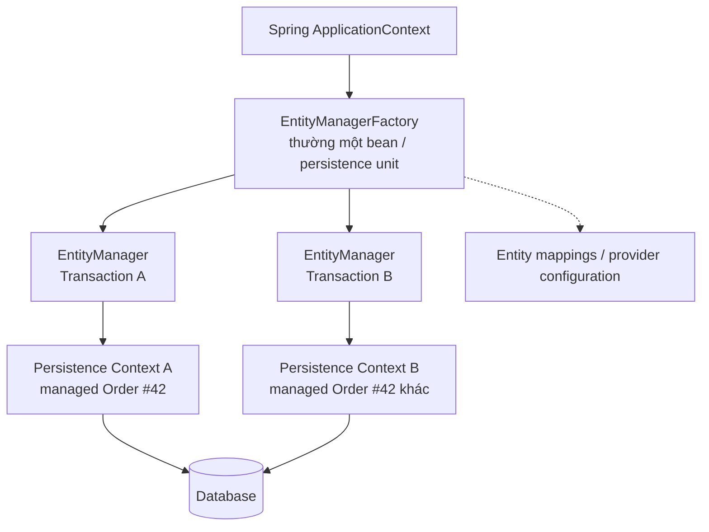
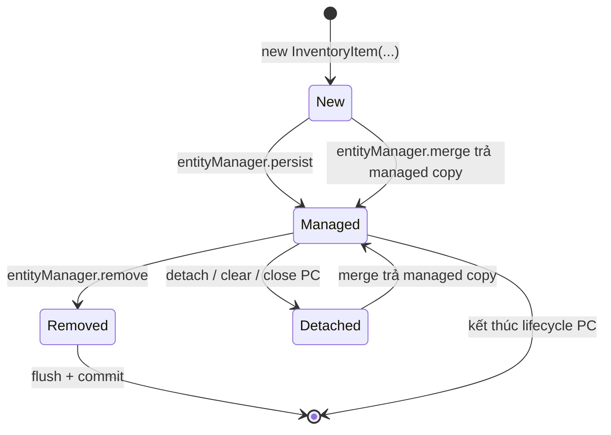
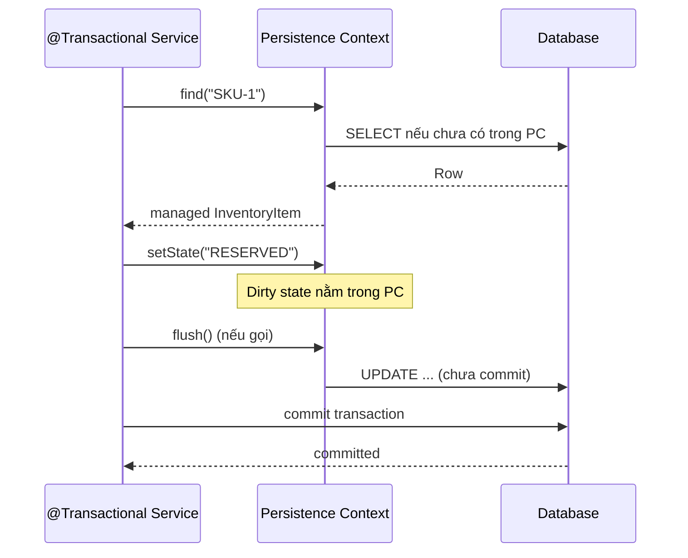
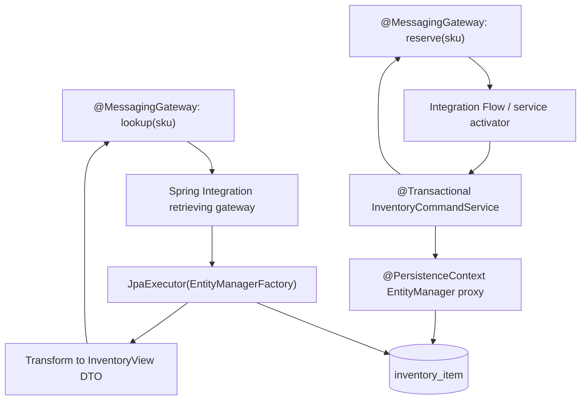
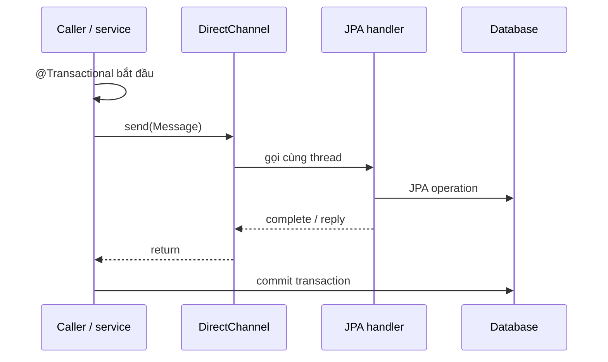
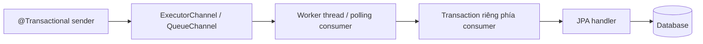
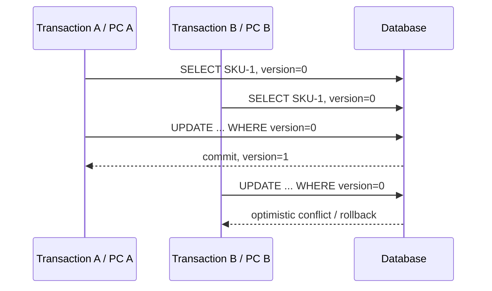
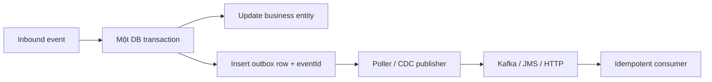

# EntityManagerFactory và persistence context

## 1. Mục tiêu và bối cảnh

Trong module **SPRING_INTEGRATION_ADAPTERS**, ứng dụng kết nối hệ thống ngoài bằng inbound/outbound adapter, gateway, poller và `MessageChannel`. Dữ liệu có thể đến từ file, SFTP, HTTP, JMS, AMQP, Kafka hoặc cơ sở dữ liệu rồi đi qua các bước xử lý nghiệp vụ trước khi lưu/truy vấn dữ liệu bằng JPA. Khi xây luồng như vậy, không chỉ cần biết **lệnh JPA nào chạy**, mà còn phải biết **entity thuộc persistence context nào, transaction kéo dài tới đâu và entity còn được quản lý không**.

Bài **EntityManagerFactory và persistence context** thuộc chương **Adapter JPA**. Đây là phần nền tảng để sử dụng các JPA adapter/gateway đúng cách và tránh lỗi khi message đi qua ranh giới đồng bộ hoặc bất đồng bộ.

Sau bài học, bạn có thể:

- Giải thích **`EntityManagerFactory`**, **`EntityManager`** và **persistence context** khác nhau thế nào.
- Hiểu vì sao `EntityManagerFactory` có thể dùng chung nhiều thread, còn một `EntityManager` thực không được sử dụng đồng thời.
- Phân biệt **transaction-scoped** và **extended persistence context**, cũng như **application-managed** và **container/Spring-managed** entity manager.
- Hiểu `@PersistenceUnit`, `@PersistenceContext`, `JpaTransactionManager`, shared `EntityManager` proxy và `EntityManagerFactory` trong Spring Boot.
- Theo dõi trạng thái **transient/new**, **managed**, **detached** và **removed** của một entity.
- Giải thích **first-level cache**, identity map, dirty checking, `persist`, `merge`, `remove`, `flush`, `clear`, `detach` và `refresh`.
- Xây ví dụ Spring Boot 3.x, Spring Integration 6.x và Jakarta Persistence với truy vấn qua JPA retrieving gateway, cập nhật qua message flow và service `@Transactional`.
- Biết cách tránh `LazyInitializationException`, stale entity sau JPQL bulk update, chi phí persistence context quá lớn và lỗi chia sẻ session giữa nhiều worker.
- Xác định ranh giới transaction giữa `DirectChannel`, `ExecutorChannel`, `QueueChannel`, Kafka/JMS/HTTP và JPA.
- Kiểm thử hành vi managed/detached, rollback, optimistic locking và DTO mapping trong một Integration Flow.

> **Trọng tâm:** `EntityManagerFactory` là hạ tầng tạo/điều phối entity manager; **persistence context không phải database, cũng không phải cache chung của toàn ứng dụng**. Một message chứa JPA entity không bảo đảm entity đó tiếp tục managed khi đi sang handler tiếp theo.

## 2. Bức tranh tổng thể: factory, manager và context

### 2.1. Ba tầng có trách nhiệm khác nhau

| Khái niệm | Bản chất | Vòng đời điển hình | Vai trò |
| --- | --- | --- | --- |
| **`EntityManagerFactory` (EMF)** | Factory gắn với một persistence unit/provider/configuration | Tạo khi ứng dụng khởi động, đóng khi application context dừng | Cung cấp entity manager; quản lý metadata, nguồn tài nguyên JPA |
| **`EntityManager` (EM)** | API thao tác JPA đối với một persistence context | Thường gắn với transaction/đơn vị công việc | `find`, `persist`, `merge`, `remove`, query, `flush` |
| **Persistence context (PC)** | Tập các entity instance đang được JPA quản lý theo identity | Thường kéo dài trong transaction với Spring | Giữ identity map, theo dõi thay đổi và đồng bộ state với DB |

Một `EntityManagerFactory` **không chứa toàn bộ entity đã đọc như một bảng Java dùng chung**. Mỗi persistence context có first-level cache riêng; một entity có thể là managed trong context A nhưng detached hoặc không tồn tại trong context B.



Hai instance Java khác nhau có thể cùng biểu diễn bản ghi `Order#42` nếu chúng được load ở hai persistence context khác nhau. Trong **cùng** một persistence context, JPA bảo đảm tính duy nhất theo entity identity (loại entity và primary key) cho managed instance.

### 2.2. So sánh ví dụ đơn giản

```java
EntityManager em = entityManagerFactory.createEntityManager();

try {
    InventoryItem first = em.find(InventoryItem.class, "SKU-1");
    InventoryItem second = em.find(InventoryItem.class, "SKU-1");

    // Cùng persistence context, cùng persistent identity.
    assert first == second;
} finally {
    em.close();
}
```

Đây là ví dụ **application-managed EntityManager** chỉ đọc, không phải cách khuyến nghị để tạo EM mới trong mỗi Spring Integration handler. Với JPA write transaction quản lý thủ công, còn phải bắt đầu/commit/rollback transaction tương ứng. Trong Spring Boot, phần lớn trường hợp nên để `JpaTransactionManager` và `@PersistenceContext` hoặc một JPA adapter/gateway quản lý đúng cách.

## 3. EntityManagerFactory: hạ tầng lâu sống và an toàn dùng chung

### 3.1. EMF gắn với persistence unit

`EntityManagerFactory` tạo hoặc cung cấp `EntityManager` thuộc một **persistence unit**. Nó được xây từ những yếu tố như:

- JPA provider (ví dụ Hibernate ORM).
- Entity mappings, annotation `@Entity` và metadata quan hệ.
- Datasource và connection pool.
- SQL dialect, batching, caching và cấu hình JPA/Hibernate.
- Transaction integration và khả năng tạo entity manager.

Một ứng dụng Spring Boot dùng một datasource/JPA unit thường có một EMF bean, nhưng hệ thống multi-database có thể có nhiều EMF cùng nhiều transaction manager. **Không được mặc định một transaction JPA có thể commit đồng thời qua nhiều EMF hoặc DB độc lập.**

`EntityManagerFactory` được thiết kế **thread-safe**. Tuy nhiên, tự tạo thêm EMF cho mỗi message là rất tốn kém và có thể làm rò connection pool/metadata resources.

### 3.2. @PersistenceUnit lấy EntityManagerFactory

Trong Spring DAO/service:

```java
import jakarta.persistence.EntityManagerFactory;
import jakarta.persistence.PersistenceUnit;
import org.springframework.stereotype.Component;

@Component
public class PersistenceInfrastructureInfo {

    @PersistenceUnit
    private EntityManagerFactory entityManagerFactory;

    public boolean isFactoryOpen() {
        return entityManagerFactory.isOpen();
    }
}
```

`@PersistenceUnit` là annotation Jakarta Persistence mà Spring nhận diện để inject EMF phù hợp. Với Spring Boot, bạn cũng có thể dùng constructor injection:

```java
@Service
public class SomeService {

    private final EntityManagerFactory emf;

    public SomeService(EntityManagerFactory emf) {
        this.emf = emf;
    }
}
```

Khi có nhiều EMF, dùng tên bean/qualifier hoặc persistence unit name có chủ đích. Không chọn một EMF tùy ý rồi truy vấn entity được quản lý bởi database khác.

### 3.3. Spring Boot thường tạo EMF như thế nào?

Với `spring-boot-starter-data-jpa`, một datasource được cấu hình đúng và entity được scan, Spring Boot thường auto-configure:

- `DataSource` / connection pool.
- `EntityManagerFactory` dựa trên Spring ORM và persistence provider.
- `JpaTransactionManager` hoặc transaction manager tương ứng.
- Hạ tầng repository của Spring Data JPA.

Trong cấu hình Spring thuần, `LocalContainerEntityManagerFactoryBean` thường được dùng để tạo EMF có hỗ trợ Spring-managed transactions. Khi dùng Spring Boot auto-configuration, **không cần tự khai EMF** nếu mô hình mặc định đáp ứng yêu cầu.

Đừng nhầm `LocalContainerEntityManagerFactoryBean` (Spring `FactoryBean` được cấu hình khi bootstrap) với giao diện `jakarta.persistence.EntityManagerFactory` mà các component ứng dụng sử dụng.

## 4. EntityManager: điểm thao tác và giới hạn thread safety

### 4.1. EntityManager thực không thread-safe

Theo Jakarta Persistence, `EntityManager` thực và persistence context của nó **không bắt buộc thread-safe**. Không lưu một instance tạo bằng `emf.createEntityManager()` trong một singleton Spring bean rồi chia sẻ cho nhiều HTTP requests, Kafka listeners hoặc pollers.

**Sai:**

```java
@Component
public class UnsafeJpaWriter {

    private final EntityManager em;

    public UnsafeJpaWriter(EntityManagerFactory emf) {
        this.em = emf.createEntityManager();
    }

    // Nếu nhiều thread gọi, cùng một EM thực bị truy cập đồng thời.
    public void write(Object entity) {
        em.persist(entity);
    }
}
```

Đoạn trên còn không xử lý transaction và close EM; **không dùng trong ứng dụng thật**.

**Đúng với Spring-managed JPA:** inject một shared transactional proxy qua `@PersistenceContext` và gọi nó bên trong service `@Transactional`.

```java
@Service
public class SafeJpaWriter {

    @PersistenceContext
    private EntityManager entityManager;

    @Transactional
    public void persist(InventoryItem item) {
        entityManager.persist(item);
    }
}
```

Ở đây field `entityManager` trong singleton là **proxy** Spring tạo/ủy quyền tới EM gắn với transaction hiện tại, **không** phải một raw `EntityManager` duy nhất đang được chia sẻ giữa tất cả thread. Vì vậy việc inject proxy vào singleton là pattern hợp lệ, nhưng **managed entity và transaction vẫn không thể tự chia sẻ qua nhiều thread**.

### 4.2. @PersistenceContext và SharedEntityManager

`@PersistenceContext` mặc định là `PersistenceContextType.TRANSACTION`. Trong Spring, injected proxy có hành vi tương tự `SharedEntityManagerCreator`:

1. Nếu thread hiện tại có transaction JPA phù hợp, ủy quyền tới transactional EntityManager được bind với transaction.
2. Khi không có transaction, một số thao tác đọc có thể sử dụng một EM tạm cho mỗi operation; entity được trả không thể được xem là managed lâu dài bên ngoài operation đó.
3. Những thao tác ghi đòi transaction có thể ném `TransactionRequiredException` nếu không có transaction hợp lệ.

**Đừng gọi `entityManager.close()` trên proxy `@PersistenceContext`.** Spring quản lý tài nguyên của EM phù hợp với transaction. Hãy để transaction manager dọn context khi kết thúc.

### 4.3. EntityManager tạo thủ công

Nếu vì một tác vụ Java SE độc lập bạn dùng:

```java
EntityManager em = emf.createEntityManager();
try {
    // Đọc dữ liệu/đơn vị công việc có vòng đời tự quản.
    InventoryItem item = em.find(InventoryItem.class, "SKU-1");
} finally {
    em.close();
}
```

bạn chịu trách nhiệm đóng. Nếu ghi dữ liệu với **resource-local transaction** trong ứng dụng Java SE, phải dùng `em.getTransaction()` begin/commit/rollback đúng cách. Trong hệ thống Spring Boot đang dùng `JpaTransactionManager`, **không trộn tùy tiện** `EntityTransaction` thủ công với Spring-managed transaction.

## 5. Persistence context và vòng đời entity

### 5.1. Bốn trạng thái phổ biến

| State | Điều kiện | Đặc điểm |
| --- | --- | --- |
| **Transient/new** | Java object chưa được JPA quản lý, chưa có persistent identity đã được JPA gắn | Đổi field không tự ghi DB |
| **Managed** | Entity nằm trong persistence context hiện hành | Dirty checking; cùng identity trả cùng managed instance |
| **Detached** | Entity từng được quản lý nhưng không còn thuộc PC hiện tại | Đổi field không tự flush/commit vào DB |
| **Removed** | Entity đã được đánh dấu xóa trong PC | DELETE thường được đồng bộ khi flush/commit |



**Điểm tinh tế:** `merge(detached)` thường **không làm instance đầu vào trở lại managed**; nó trả một instance managed có cùng persistent identity. Cần giữ **giá trị trả về** nếu tiếp tục thao tác trong persistence context.

### 5.2. contains và identity map

Trong một transaction có context sống:

```java
InventoryItem a = em.find(InventoryItem.class, "SKU-1");
InventoryItem b = em.find(InventoryItem.class, "SKU-1");

boolean sameInstance = a == b;     // thường true, cùng PC
boolean managed = em.contains(a);  // true nếu a đang managed
```

`contains` cho biết entity instance có thuộc **persistence context hiện hành** không. Nó **không** chứng minh DB còn row đúng như state trong object hoặc một transaction khác đã commit.

### 5.3. First-level cache khác second-level cache

- **First-level cache** gắn với **một persistence context**; identity map là bộ phận cốt lõi của JPA.
- **Second-level cache** (nếu provider và ứng dụng bật) có phạm vi rộng hơn, có thể chia sẻ giữa các persistence context cùng EMF.
- **Query cache** là cơ chế riêng của provider, không mặc định hoạt động chỉ vì JPA đang bật.

Đừng viết “JPA cache dữ liệu toàn bộ ứng dụng” khi đang nói về first-level cache. Hai transaction độc lập có thể có hai managed instance mang cùng primary key nhưng khác state khi dữ liệu đã thay đổi. Isolation/cache/refresh quyết định mức độ nhìn thấy thay đổi.

## 6. Dirty checking, flush, clear và commit

### 6.1. Dirty checking

Trong transaction, sửa một managed entity có thể được JPA provider theo dõi và đồng bộ xuống database khi flush:

```java
@Transactional
public void reserve(String sku) {
    InventoryItem item = entityManager.find(
            InventoryItem.class, sku);

    item.setState("RESERVED");

    // Không nhất thiết gọi repository.save(item).
    // item là managed; provider đồng bộ state lúc flush/commit.
}
```

Code minh họa giả định `InventoryItem` là entity hợp lệ, `entityManager` được inject và item khác null. **Không có lệnh “update” bắt buộc cho một managed entity**. Với Spring Data JPA, `save` vẫn có thể hữu ích cho những lý do API khác, nhưng không phải điều kiện cần để dirty checking hoạt động.

### 6.2. Khi nào SQL chạy?



Hãy phân biệt:

| Hành động | Ý nghĩa |
| --- | --- |
| `persist(entity)` | Đưa entity mới vào PC, lập kế hoạch INSERT |
| `merge(entity)` | Sao chép state vào managed instance, trả instance managed |
| `flush()` | Đồng bộ pending changes tới DB **trong transaction**, chưa commit |
| `commit()` | Hoàn tất transaction; nếu thành công thay đổi mới được commit |
| `clear()` | Detach **mọi** managed entity khỏi PC, không tự commit |
| `detach(entity)` | Detach một entity cụ thể |
| `refresh(entity)` | Reload state của managed entity từ DB, có thể bỏ local changes |
| `close()` | Kết thúc vòng đời application-managed EM; không tự biến uncommitted changes thành commit |

**Chú ý:** gọi `clear()` khi còn thay đổi **chưa flush** có thể làm những thay đổi đó **không bao giờ được persist**. Phải cân nhắc `flush()` đúng chỗ trước khi `clear()`, đồng thời nhớ flush vẫn có thể rollback.

### 6.3. FlushModeType.AUTO và COMMIT

`FlushModeType.AUTO` thường là mặc định. Provider có thể flush trước một query nếu cần để bảo đảm kết quả query phản ánh những thay đổi pending phù hợp. `COMMIT` trì hoãn flush tới commit, nhưng visibility của pending changes đối với query trước commit có những quy định/phụ thuộc provider.

Ví dụ:

```java
entityManager.setFlushMode(FlushModeType.COMMIT);
```

Đừng thay flush mode toàn hệ thống chỉ để giảm SQL mà chưa đo đạc. Vấn đề latency có thể đến từ N+1, index, row locks hoặc quá nhiều message/batch chứ không chỉ flush mode.

### 6.4. Transaction rollback

Nếu service ném runtime exception và Spring transaction rollback theo quy tắc mặc định, SQL đã flush có thể vẫn bị **rollback**. Một log “SQL UPDATE executed” không đồng nghĩa dữ liệu đã commit.

Trong Integration Flow, nếu đã gửi event tới Kafka/JMS hoặc HTTP trước khi transaction DB commit, rollback của DB **không thu hồi tự động** side effect đã phát. Với dữ liệu quan trọng, cân nhắc **transactional outbox**.

## 7. Transaction-scoped và extended persistence context

### 7.1. Transaction-scoped là lựa chọn mặc định phù hợp

Trong Spring Boot thông thường, `@PersistenceContext` lấy **transaction-scoped EntityManager proxy**. Mỗi transaction xử lý công việc có persistence context tương ứng. Khi transaction hoàn tất, managed entities thường trở thành detached đối với tầng code giữ reference bên ngoài.

```text
Transaction A
  find SKU-1 → managed item A
  update state → flush/commit
  context A kết thúc
  item A (reference còn giữ) → detached

Transaction B
  find SKU-1 → managed item B
  item A != item B là bình thường
```

Không giả định object Java giữ trong một `Message<?>` tiếp tục managed chỉ vì người gửi vừa query nó.

### 7.2. Extended persistence context

Jakarta Persistence còn có `PersistenceContextType.EXTENDED`, nghĩa context có thể sống qua nhiều transaction trong các mô hình container-managed phù hợp (ví dụ stateful bean conversations). Điều này **không phải** cấu hình thông thường cho singleton Spring Integration handler.

Nguy cơ nếu áp dụng không đúng:

- Tích lũy nhiều managed entities trong thời gian dài.
- State trở nên cũ/stale sau thay đổi từ transaction khác.
- Không an toàn khi chia sẻ cùng một context thực giữa nhiều thread.
- Khó xác định khi nào flush/rollback/reconcile.

Với ứng dụng message-driven, **mỗi message hoặc batch có transaction rõ ràng** thường dễ kiểm soát hơn một extended context kéo dài theo user/session.

### 7.3. Propagation và các context khác nhau

| Cấu hình | Hệ quả cần hiểu |
| --- | --- |
| `PROPAGATION_REQUIRED` | Tham gia transaction hiện tại nếu có; nếu không thì mở transaction mới |
| `PROPAGATION_REQUIRES_NEW` | Tạm dừng transaction hiện tại và mở transaction mới, với resources/context độc lập phù hợp |
| `PROPAGATION_SUPPORTS` | Có transaction thì tham gia; không có thì có thể chạy không transaction |
| `@Transactional(readOnly=true)` | Hint cho transaction/provider; **không phải** authorization và không đảm bảo cấm mọi update |
| Async channel / thread khác | Không tự mang thread-bound transaction/JPA context sang worker mới |

`REQUIRES_NEW` có thể cần thêm database connection trong lúc transaction ngoài vẫn giữ connection, gây áp lực lên pool. Đừng lạm dụng để “ép commit từng step” mà không tính tới consistency và tài nguyên.

## 8. Spring Integration liên quan tới persistence context thế nào?

### 8.1. Các thành phần JPA dùng JpaExecutor

Spring Integration có bốn nhóm endpoint JPA:

| Endpoint | Cách kích hoạt | Hoạt động JPA | Message output |
| --- | --- | --- | --- |
| **JPA inbound channel adapter** | Poller gọi source | Định kỳ SELECT, có tùy chọn thay đổi sau poll | Phát kết quả qua channel |
| **JPA outbound channel adapter** | Có message đầu vào | Persist/merge/delete hoặc update query | Không tạo reply |
| **JPA retrieving outbound gateway** | Request message | SELECT/find theo request | Trả entity/list/result |
| **JPA updating outbound gateway** | Request message | Persist/merge/delete hoặc UPDATE/DELETE | Trả entity/affected rows |

Các endpoint sử dụng `JpaExecutor` rồi `JpaOperations` (mặc định `DefaultJpaOperations`) để thao tác trên JPA. Spring Integration cho phép tạo `JpaExecutor` từ:

1. `EntityManagerFactory`.
2. `EntityManager`.
3. `JpaOperations`.

### 8.2. Vì sao ưu tiên truyền EntityManagerFactory?

Trong module JPA của Spring Integration, cấu hình phổ biến và thuận tiện nhất là:

```java
@Bean
JpaExecutor inventoryJpaExecutor(
        EntityManagerFactory entityManagerFactory) {

    JpaExecutor executor =
            new JpaExecutor(entityManagerFactory);

    executor.setJpaQuery("""
            select i from InventoryItem i
            where i.sku = :sku
            """);
    return executor;
}
```

`EntityManagerFactory` là bean thread-safe phù hợp để inject vào một singleton `JpaExecutor`. Adapter/gateway có thể tạo/lấy EM phù hợp với mỗi operation/transaction thông qua JPA operations. Không tự tạo **một raw `EntityManager`** rồi lưu lâu dài trong executor singleton khi nhiều message có thể chạy đồng thời.

Nếu muốn dùng constructor nhận `EntityManager` hoặc XML `entity-manager`, tài liệu Spring Integration khuyên cung cấp **shared transactional EntityManager proxy**, ví dụ `SharedEntityManagerBean`, thay vì đưa một unmanaged EM thực.

### 8.3. Java config, @PersistenceContext và SharedEntityManagerBean

Ba lựa chọn thường gặp:

**Lựa chọn A — khuyến nghị cho JPA adapter/gateway:**

```java
JpaExecutor executor =
        new JpaExecutor(entityManagerFactory);
```

**Lựa chọn B — trong application service/DAO:**

```java
@PersistenceContext
private EntityManager entityManager;
```

**Lựa chọn C — khi cần một bean EntityManager tường minh:**

```xml
<bean id="sharedEntityManager"
      class="org.springframework.orm.jpa.support.SharedEntityManagerBean">
    <property name="entityManagerFactory"
              ref="entityManagerFactory"/>
</bean>
```

Lựa chọn C cung cấp proxy tương tự `@PersistenceContext`. Không dùng bean raw `emf.createEntityManager()` làm singleton.

### 8.4. Không phải inbound adapter nào cũng có cùng transaction semantics

- JPA inbound poller có thể dùng transactional advice bao quanh lần poll nếu có thao tác write/delete hoặc yêu cầu nhất quán.
- JPA outbound adapter/gateway cần transaction cho write operations.
- JPA retrieving gateway là SELECT nhưng vẫn cần cân nhắc transaction khi lazy loading/consistency.
- Nếu message đi qua `DirectChannel` đồng bộ, transaction của sender có thể bao quanh JPA handler.
- Nếu message đi qua `ExecutorChannel`/`QueueChannel`, phải thiết kế transaction ở consumer. Không thể trông cậy JPA context của thread đã gửi.

## 9. Ví dụ hoàn chỉnh: Spring Boot + Spring Integration + JPA

### 9.1. Bài toán

Một service quản lý tồn kho. Request–reply gateway dùng JPA truy vấn một `InventoryItem` theo SKU, rồi chuyển thành DTO. Một flow khác gọi service `@Transactional` để chuyển item từ `AVAILABLE` sang `RESERVED` bằng dirty checking.

Mục đích không phải xây ứng dụng inventory thương mại hoàn chỉnh, mà là **nhìn thấy chính xác EMF/EM/persistence context hoạt động ở hai phía đọc và ghi**.



Ví dụ dùng **Java 17+, Spring Boot 3.x, Spring Integration 6.x, Spring Data JPA/Jakarta Persistence và H2 in-memory**.

### 9.2. Maven dependencies

```xml
<dependencies>
    <dependency>
        <groupId>org.springframework.boot</groupId>
        <artifactId>spring-boot-starter</artifactId>
    </dependency>
    <dependency>
        <groupId>org.springframework.boot</groupId>
        <artifactId>spring-boot-starter-data-jpa</artifactId>
    </dependency>
    <dependency>
        <groupId>org.springframework.boot</groupId>
        <artifactId>spring-boot-starter-integration</artifactId>
    </dependency>
    <dependency>
        <groupId>org.springframework.integration</groupId>
        <artifactId>spring-integration-jpa</artifactId>
    </dependency>
    <dependency>
        <groupId>com.h2database</groupId>
        <artifactId>h2</artifactId>
        <scope>runtime</scope>
    </dependency>
    <dependency>
        <groupId>org.springframework.boot</groupId>
        <artifactId>spring-boot-starter-test</artifactId>
        <scope>test</scope>
    </dependency>
</dependencies>
```

Spring Boot BOM quản lý phiên bản tương thích. `spring-integration-jpa` bổ sung `JpaExecutor` và JPA gateway; `spring-boot-starter-data-jpa` cung cấp persistence provider và transaction infrastructure. Không nên cấu hình `EntityManagerFactory`/`JpaTransactionManager` thủ công trùng với Boot nếu không có nhu cầu đặc biệt.

### 9.3. Entity InventoryItem

File `InventoryItem.java`:

```java
package com.example.jpacontext;

import jakarta.persistence.Column;
import jakarta.persistence.Entity;
import jakarta.persistence.Id;
import jakarta.persistence.Table;
import jakarta.persistence.Version;

@Entity
@Table(name = "inventory_item")
public class InventoryItem {

    @Id
    @Column(nullable = false, length = 60)
    private String sku;

    @Column(nullable = false, length = 24)
    private String state;

    @Version
    private Long version;

    protected InventoryItem() {
        // JPA cần constructor không tham số.
    }

    public InventoryItem(String sku, String state) {
        this.sku = sku;
        this.state = state;
    }

    public String getSku() {
        return sku;
    }

    public String getState() {
        return state;
    }

    public Long getVersion() {
        return version;
    }

    public void setState(String state) {
        this.state = state;
    }
}
```

`@Version` giúp provider phát hiện một số loại ghi đè khi nhiều transaction cùng thay đổi entity theo cơ chế optimistic locking. Nó **không** tự xử lý mọi trường hợp duplicate Kafka event hoặc JPQL bulk update.

### 9.4. Repository để seed và xác minh

File `InventoryRepository.java`:

```java
package com.example.jpacontext;

import org.springframework.data.jpa.repository.JpaRepository;

public interface InventoryRepository
        extends JpaRepository<InventoryItem, String> {
}
```

Repository ở đây chủ yếu để seed data/test. Request SELECT trong flow sẽ dùng `Jpa.retrievingGateway(...)`, còn update state sẽ do `@PersistenceContext` trong service thực hiện.

### 9.5. DTO tránh đưa managed entity ra ngoài

File `InventoryView.java`:

```java
package com.example.jpacontext;

public record InventoryView(
        String sku,
        String state,
        Long version) {

    public static InventoryView from(InventoryItem item) {
        return new InventoryView(
                item.getSku(), item.getState(), item.getVersion());
    }
}
```

Trả DTO có nhiều lợi ích:

- Không phụ thuộc vào persistence context đã đóng.
- Không vô tình trigger lazy association khi serialize.
- Không lộ mọi field/cascade/metadata của entity.
- Định nghĩa hợp đồng trả về ổn định khi schema JPA thay đổi.
- Dễ xác thực/giới hạn payload khi chuyển sang HTTP, JMS, Kafka hoặc WebSocket.

### 9.6. Hai @MessagingGateway interfaces

File `InventoryLookupGateway.java`:

```java
package com.example.jpacontext;

import java.util.List;
import org.springframework.integration.annotation.MessagingGateway;

@MessagingGateway(
        defaultRequestChannel = "inventoryLookupRequests",
        defaultReplyTimeout = "5000")
public interface InventoryLookupGateway {

    List<InventoryView> lookup(String sku);
}
```

File `InventoryReservationGateway.java`:

```java
package com.example.jpacontext;

import org.springframework.integration.annotation.MessagingGateway;

@MessagingGateway(
        defaultRequestChannel = "inventoryReserveRequests",
        defaultReplyTimeout = "5000")
public interface InventoryReservationGateway {

    Boolean reserve(String sku);
}
```

Hai gateway interfaces tạo message vào các request channel riêng. `defaultReplyTimeout` là giới hạn messaging reply theo ngữ cảnh; không nên nhầm với DB query timeout. Với `DirectChannel` đồng bộ, lời gọi database bị treo có thể chặn caller dù đã cấu hình reply timeout.

### 9.7. Service cập nhật trong một persistence context

File `InventoryCommandService.java`:

```java
package com.example.jpacontext;

import jakarta.persistence.EntityManager;
import jakarta.persistence.PersistenceContext;
import org.springframework.stereotype.Service;
import org.springframework.transaction.annotation.Transactional;

@Service
public class InventoryCommandService {

    @PersistenceContext
    private EntityManager entityManager;

    @Transactional
    public boolean reserve(String sku) {
        if (sku == null || sku.isBlank() || sku.length() > 60) {
            throw new IllegalArgumentException("Invalid SKU");
        }

        InventoryItem managed =
                entityManager.find(InventoryItem.class, sku);

        if (managed == null
                || !"AVAILABLE".equals(managed.getState())) {
            return false;
        }

        // Entity đang managed trong transaction hiện hành.
        if (!entityManager.contains(managed)) {
            throw new IllegalStateException(
                    "Expected managed InventoryItem");
        }

        managed.setState("RESERVED");

        // Không cần entityManager.merge(managed) vì đã managed.
        // Dirty checking đồng bộ thay đổi lúc flush/commit.
        return true;
    }
}
```

**Giải thích:**

1. `@PersistenceContext` inject shared transactional EM proxy vào singleton service.
2. `@Transactional` mở transaction khi một Spring bean khác gọi method qua proxy.
3. `find(...)` trả entity managed trong context của transaction.
4. `contains(managed)` giúp kiểm tra trực tiếp trạng thái managed.
5. Sửa `state` được provider theo dõi; không cần `merge` cho cùng instance đang managed.
6. Nếu transaction commit thành công, state được lưu. Nếu rollback, thay đổi không trở thành dữ liệu committed.
7. Với hai transaction cùng đọc `AVAILABLE`, `@Version` hỗ trợ phát hiện conflict khi cùng update; cần bắt và xử lý optimistic lock exception theo policy.

Trong sản phẩm thật, việc “reserve một SKU” có thể cần atomic update `WHERE state='AVAILABLE'` và affected count, hoặc locking phù hợp nếu số lượng tồn kho quan trọng. Ví dụ này được thiết kế để quan sát persistence context, không thay một quy trình reservation concurrency đầy đủ.

### 9.8. IntegrationFlow dùng EntityManagerFactory và service

File `InventoryIntegrationConfiguration.java`:

```java
package com.example.jpacontext;

import java.util.List;
import jakarta.persistence.EntityManagerFactory;

import org.springframework.context.annotation.Bean;
import org.springframework.context.annotation.Configuration;
import org.springframework.integration.config.EnableIntegration;
import org.springframework.integration.core.GenericTransformer;
import org.springframework.integration.dsl.IntegrationFlow;
import org.springframework.integration.jpa.dsl.Jpa;

@Configuration
@EnableIntegration
public class InventoryIntegrationConfiguration {

    @Bean
    IntegrationFlow inventoryLookupFlow(
            EntityManagerFactory entityManagerFactory) {

        return IntegrationFlow
                .from("inventoryLookupRequests")
                .handle(
                        Jpa.retrievingGateway(entityManagerFactory)
                                .jpaQuery("""
                                        select i from InventoryItem i
                                        where i.sku = :sku
                                        """)
                                .parameterExpression("sku", "payload")
                                .maxResults(1)
                                .expectSingleResult(false))
                .transform((
                        GenericTransformer<
                                List<InventoryItem>,
                                List<InventoryView>>) rows ->
                        rows.stream()
                                .map(InventoryView::from)
                                .toList())
                .get();
    }

    @Bean
    IntegrationFlow inventoryReserveFlow(
            InventoryCommandService commandService) {

        return IntegrationFlow
                .from("inventoryReserveRequests")
                .handle((payload, headers) ->
                        commandService.reserve((String) payload))
                .get();
    }
}
```

**Luồng đọc:**

- `Jpa.retrievingGateway(entityManagerFactory)` sử dụng factory được Spring Boot cấu hình.
- JPQL với parameter `:sku` nhận giá trị từ message payload.
- `maxResults(1)` giới hạn mỗi query; `expectSingleResult(false)` giữ hợp đồng list và trả empty list khi không có row theo Spring Integration 6.x.
- Transformer ánh xạ entity sang DTO ngay sau gateway, tránh chuyển entity ra bên ngoài flow.
- Với DTO chỉ đọc scalar fields trong entity như ví dụ, mapper không cần khởi tạo lazy relations.

**Luồng ghi:**

- `InventoryReservationGateway.reserve` tạo Spring Message vào `inventoryReserveRequests`.
- `handle(...)` gọi public method `InventoryCommandService.reserve(...)` của bean khác; Spring transaction proxy có cơ hội hoạt động.
- Service dùng `@PersistenceContext` thay vì tự tạo raw EM.
- Boolean trả từ handler trở thành reply về messaging gateway.
- Transaction của `InventoryCommandService` commit trước khi lời gọi qua Spring service proxy hoàn tất; nếu commit lỗi, exception được truyền theo call path đồng bộ.

**Chú ý:** Spring Integration JPA retrieving gateway không phải producer tự động theo lịch. `@MessagingGateway` gọi nó theo request; nếu muốn poll bảng định kỳ, đó là **JPA inbound channel adapter** với poller.

### 9.9. Spring Boot main và cấu hình H2

File `JpaContextApplication.java`:

```java
package com.example.jpacontext;

import java.util.List;

import org.springframework.boot.CommandLineRunner;
import org.springframework.boot.SpringApplication;
import org.springframework.boot.autoconfigure.SpringBootApplication;
import org.springframework.context.annotation.Bean;
import org.springframework.integration.annotation.IntegrationComponentScan;

@SpringBootApplication
@IntegrationComponentScan
public class JpaContextApplication {

    public static void main(String[] args) {
        SpringApplication.run(JpaContextApplication.class, args);
    }

    @Bean
    CommandLineRunner demo(
            InventoryRepository repository,
            InventoryLookupGateway lookup,
            InventoryReservationGateway reservation) {

        return args -> {
            if (repository.count() == 0) {
                repository.saveAll(List.of(
                        new InventoryItem("SKU-1", "AVAILABLE"),
                        new InventoryItem("SKU-2", "AVAILABLE")));
            }

            System.out.println("Before: " + lookup.lookup("SKU-1"));

            Boolean first = reservation.reserve("SKU-1");
            Boolean second = reservation.reserve("SKU-1");

            System.out.println("First reserve: " + first);
            System.out.println("Second reserve: " + second);
            System.out.println("After: " + lookup.lookup("SKU-1"));
            System.out.println("Missing: " + lookup.lookup("SKU-999"));
        };
    }
}
```

File `application.properties` cho môi trường demo:

```properties
spring.main.web-application-type=none

spring.datasource.url=jdbc:h2:mem:jpa_context_demo;DB_CLOSE_DELAY=-1
spring.datasource.driver-class-name=org.h2.Driver
spring.datasource.username=sa
spring.datasource.password=

spring.jpa.hibernate.ddl-auto=create-drop
spring.jpa.open-in-view=false
logging.level.org.springframework.integration=INFO
```

**Kết quả kỳ vọng:**

- Trước khi reserve: `SKU-1` có `state=AVAILABLE`.
- Lần reserve đầu: trả `true` và commit thay đổi `RESERVED`.
- Lần reserve thứ hai: trả `false` vì item không còn `AVAILABLE`.
- Gateway lookup tiếp theo trả DTO `RESERVED` với version đã cập nhật.
- Lookup `SKU-999` trả list rỗng, không crash do null entity.

H2 in-memory và `ddl-auto=create-drop` chỉ để thực hành; production dùng migration schema (Flyway/Liquibase), database/pool phù hợp và các giới hạn timeout/concurrency.

## 10. Theo dõi lifecycle bằng một diagnostic service

Để quan sát trực tiếp `contains`, identity map và `clear`, tạo service chẩn đoán nhỏ. Phải gọi các public method này **từ bean khác qua Spring proxy**; self-invocation trong cùng class có thể khiến `@Transactional` không được áp dụng.

File `InventoryPersistenceDiagnostics.java`:

```java
package com.example.jpacontext;

import jakarta.persistence.EntityManager;
import jakarta.persistence.PersistenceContext;
import org.springframework.stereotype.Service;
import org.springframework.transaction.annotation.Transactional;

@Service
public class InventoryPersistenceDiagnostics {

    @PersistenceContext
    private EntityManager em;

    @Transactional(readOnly = true)
    public boolean sameManagedInstance(String sku) {
        InventoryItem first = em.find(InventoryItem.class, sku);
        InventoryItem again = em.find(InventoryItem.class, sku);

        return first != null
                && first == again
                && em.contains(first);
    }

    @Transactional
    public boolean detachedAfterClear(String sku) {
        InventoryItem row = em.find(InventoryItem.class, sku);
        if (row == null) {
            return false;
        }

        em.clear();
        return !em.contains(row);
    }
}
```

Trong `sameManagedInstance`, hai lần `find` cùng identity trong một transaction-scoped PC trả cùng Java object. Điều đó **không có nghĩa toàn ứng dụng chỉ có một object**.

Trong `detachedAfterClear`, `clear` detach toàn bộ entity khỏi context. Vì method này không sửa state, không có pending changes cần flush. Nếu bạn sửa `row.setState(...)` trước `clear()` mà chưa flush, thay đổi có thể không được ghi xuống DB.

### Merge một entity detached

```java
@Transactional
public void renameDetached(
        InventoryItem detached, String newState) {

    detached.setState(newState);

    InventoryItem managedCopy = em.merge(detached);

    // Không giả định managedCopy == detached.
    if (!em.contains(managedCopy)) {
        throw new IllegalStateException("Merge did not manage entity");
    }
}
```

Đây là minh họa **ngữ nghĩa merge**, không phải lời khuyên nhận entity tùy ý từ client rồi merge thẳng vào DB. Trong hệ thống thật phải kiểm tra quyền, allowed fields, `@Version`, business state và idempotency. Merge một detached entity stale có thể ghi đè những trường không mong muốn.

## 11. Ranh giới MessageChannel quyết định transaction và persistence context

### 11.1. DirectChannel: thường đồng bộ



Với `DirectChannel`, handler được gọi trong thread của sender. Nếu có transaction đã mở trên thread đó và JPA dùng cùng transaction manager/EMF, handler có thể tham gia transaction. Tuy nhiên, **khi `send(...)` trả về, transaction bên ngoài có thể vẫn chưa commit**.

### 11.2. QueueChannel/ExecutorChannel: ranh giới bất đồng bộ



Một thread-local transaction/JPA persistence context **không tự di chuyển** qua `ExecutorChannel` hay một consumer lấy message từ `QueueChannel`. Nếu poller/worker thực hiện JPA write, cần transaction tại consumer (transactional advice, `@Transactional` service hoặc cơ chế tương đương).

**Không đặt một managed JPA entity vào QueueChannel với giả định consumer sẽ còn quản lý nó.** Khi transaction producer kết thúc, entity thường detached; khi consumer truy cập `LAZY` association, có thể gây lỗi. Chuyển ID/DTO immutable rồi load lại trong transaction của consumer thường an toàn hơn.

### 11.3. JPA inbound poller và transaction

Một JPA inbound channel adapter có thể:

```text
@Poller / transactional polling endpoint
      → JpaPollingChannelAdapter
      → Message<List<Entity>>
      → DirectChannel / QueueChannel
      → service
```

Nếu poller transaction bao quanh query và downstream **đồng bộ** trên DirectChannel, entity có thể còn managed trong phạm vi transaction. Nếu gửi qua queue/async thread, chúng không còn cùng context. Đặc biệt, nếu dùng `deleteAfterPoll` hoặc cập nhật state trong poll, phải xem xét rollback/ACK để tránh mất dữ liệu.

### 11.4. Outbound adapter/gateway và JpaExecutor

`JpaExecutor` có thể nhận `EntityManagerFactory`, `EntityManager` hoặc `JpaOperations`. Với `EntityManagerFactory`, thành phần JPA sử dụng quản lý EM thích hợp; đừng chia sẻ một EM thật giữa consumer threads.

Ví dụ Java configuration phần JPA outbound:

```java
@Bean
JpaExecutor inventoryPersistExecutor(
        EntityManagerFactory entityManagerFactory) {

    JpaExecutor executor =
            new JpaExecutor(entityManagerFactory);
    executor.setEntityClass(InventoryItem.class);
    executor.setPersistMode(PersistMode.MERGE);
    return executor;
}

@Bean
@ServiceActivator(inputChannel = "inventoryPersistChannel")
MessageHandler inventoryPersistHandler(
        JpaExecutor inventoryPersistExecutor) {

    JpaOutboundGateway handler =
            new JpaOutboundGateway(inventoryPersistExecutor);
    handler.setProducesReply(false);
    return handler;
}
```

Đây là **phương án minh họa khác** với flow demo; cần bean channel, imports và transaction tại consumer phù hợp để chạy. `setProducesReply(false)` tạo **outbound channel adapter một chiều**; nếu cần reply entity/affected rows hãy dùng updating outbound gateway. Không kết hợp cả hai handler trên cùng channel trừ khi muốn nhiều consumer.

## 12. Lazy loading, DTO và nỗi lo “session đã đóng”

### 12.1. LazyInitializationException xuất hiện thế nào?

Giả sử entity `Order` có:

```java
@OneToMany(mappedBy = "order", fetch = FetchType.LAZY)
private List<OrderLine> lines;
```

Nếu request–reply JPA retrieving gateway trả `Order` rồi transaction/context kết thúc, handler ở thread khác gọi `order.getLines().size()` có thể ném `LazyInitializationException` (với Hibernate) vì collection chưa được load và context không còn sẵn.

**Giải pháp:**

- Truyền **ID/DTO** qua channel bất đồng bộ.
- Trong service `@Transactional(readOnly=true)`, load những field/relations cần thiết rồi tạo DTO trước khi transaction kết thúc.
- Dùng JPQL projection hoặc constructor expression.
- Sử dụng `JOIN FETCH`/entity graph **có chọn lọc**, tránh nhân số row và tăng RAM không kiểm soát.
- Không bật Open Session in View chỉ để che lỗi flow; cần ranh giới persistence rõ ràng.

### 12.2. Open Session in View không dành cho message flow

Spring Boot web application có thể bật Open EntityManager in View theo cấu hình để kéo dài EM qua HTTP request. Nhưng:

- Nó không phải transaction nghiệp vụ kéo dài tự động.
- Nó không bảo vệ consumer Kafka/JMS/SFTP bất đồng bộ.
- Nó có thể dẫn tới truy vấn DB khi serializer đang render JSON.
- Nó có thể che giấu vấn đề N+1 và tăng thời gian giữ tài nguyên.
- Trong demo đặt `spring.jpa.open-in-view=false` để tránh phụ thuộc vào nó.

Trả DTO từ service/gateway sau khi validate authorization là hướng minh bạch hơn cho các API và outbound adapter.

### 12.3. DTO projection có thể giảm query và RAM

JPQL:

```sql
select new com.example.jpacontext.InventoryView(
    i.sku, i.state, i.version)
from InventoryItem i
where i.sku = :sku
```

cho phép JPA trả DTO ngay từ query khi constructor mapping phù hợp. Trong trường hợp đó, phải thay transformer/return type của `Jpa.retrievingGateway` từ `List<InventoryItem>` sang `List<InventoryView>`.

Không cast một kết quả projection thành entity; đó là contract khác.

## 13. Bulk JPQL UPDATE/DELETE có thể làm persistence context stale

### 13.1. Cơ chế

JPA bulk update chạy trực tiếp lên DB, thường **bỏ qua state update thông qua dirty checking của từng managed entity**. Nếu một entity đã nằm trong PC, sau bulk update đối tượng managed đó có thể còn giá trị cũ.

```java
@Transactional
public void bulkUpdateExample() {
    InventoryItem item =
            em.find(InventoryItem.class, "SKU-1");

    em.createQuery("""
            update InventoryItem i
               set i.state = 'RESERVED'
             where i.sku = :sku
            """)
        .setParameter("sku", "SKU-1")
        .executeUpdate();

    // item.getState() có thể vẫn là "AVAILABLE"
    // nếu item được load trước bulk update.

    em.refresh(item); // reload state từ DB nếu cần.
}
```

**Lưu ý:** đoạn code là minh họa trong service đã inject `EntityManager em` và có transaction hợp lệ. `refresh` có thể làm mất local changes chưa flush trên object; tránh gọi tùy tiện.

### 13.2. Bulk update và @Version

Các `@Version`/optimistic locking rules của entity lifecycle **không tự áp vào JPQL bulk update như update từng managed entity**. Nếu cần optimistic compare-and-set, hãy mã hóa điều kiện tường minh:

```sql
update InventoryItem i
   set i.state = :newState,
       i.version = i.version + 1
 where i.sku = :sku
   and i.version = :expectedVersion
   and i.state = :expectedState
```

Reply affected-row count bằng `1` hoặc `0` giúp xác định có match hay không, nhưng `0` vẫn có thể do nhiều nguyên nhân (ID sai, version cũ, state khác). Với Spring Integration, **JPA updating outbound gateway** thích hợp để lấy affected count làm reply.

### 13.3. clear, refresh và reload: dùng đúng lúc

| Thao tác | Được gì? | Rủi ro |
| --- | --- | --- |
| `em.refresh(entity)` | Reload một managed entity | Có thể bỏ local changes; cần transaction/lock phù hợp |
| `em.clear()` | Xóa tất cả managed entries trong PC | Unflushed changes có thể mất; entity đều detached |
| `em.detach(entity)` | Detach một entity | Không tự ghi thay đổi chờ |
| `em.flush(); em.clear()` | Đồng bộ trước rồi giảm PC | SQL đã chạy nhưng chưa commit; có thể rollback |
| Reload ở transaction khác | Lấy state theo isolation mới | Không loại bỏ race giữa nhiều giao dịch |

Không xem `clear()` là cách “fix mọi stale data” nếu query/transaction isolation hoặc cache provider mới là nguyên nhân.

## 14. Batch processing và kích thước persistence context

### 14.1. Vì sao batch lớn dễ tốn bộ nhớ?

Một transaction xử lý 50.000 entity có thể giữ:

- Entity instances managed.
- Snapshot dùng cho dirty checking.
- Collection/association proxies.
- SQL statements/batching state.
- Event objects, message payload và metadata khác.

Do đó, dù JDBC batching giúp giảm round-trip, một persistence context quá lớn vẫn gây GC pressure và tăng thời gian flush.

### 14.2. Flush/clear theo batch

Ví dụ thao tác JPA trong service (có transaction):

```java
@Transactional
public void saveBatch(List<InventoryItem> items) {
    int batchSize = 50;

    for (int index = 0; index < items.size(); index++) {
        em.persist(items.get(index));

        if ((index + 1) % batchSize == 0) {
            em.flush();
            em.clear();
        }
    }

    em.flush();
    em.clear();
}
```

**Chú ý:** ví dụ chỉ dành cho **entity mới** và phương pháp batch phù hợp; với entity đã tồn tại có primary key trùng, `persist` có thể ném exception. `clear` làm toàn bộ managed objects detached, không chỉ những entity trong batch hiện tại. Nếu transaction còn giữ các entity khác với pending changes, bạn cần tránh clear mù quáng.

### 14.3. Spring Integration JpaExecutor có flushSize

Trong entity-mode JPA outbound adapter/updating gateway, Spring Integration có thể cấu hình:

```java
JpaExecutor executor =
        new JpaExecutor(entityManagerFactory);

executor.setEntityClass(InventoryItem.class);
executor.setPersistMode(PersistMode.PERSIST);
executor.setFlushSize(50);
executor.setClearOnFlush(true);
```

- `flushSize` điều khiển mốc flush khi xử lý `Iterable` entity.
- `clearOnFlush` giảm managed instances sau flush.
- Chúng **không tự bật JDBC batching** của Hibernate.
- Chúng **không chia một transaction thành 50 transaction**; commit vẫn ở boundary được cấu hình.
- Khi có một entity lỗi, cần quyết định rollback cả batch hay cô lập từng item.

Nếu cần JDBC batching thật, phải kiểm tra provider settings (ví dụ Hibernate `hibernate.jdbc.batch_size`), ID generation strategy, driver, DB và đo thực tế.

### 14.4. Chunk và message boundaries

Nếu dữ liệu đến từ file/SFTP lớn, đừng giữ nguyên một file vài GB thành `List<Entity>` trong một Spring Message. Dùng parser streaming, validate, chia batch hữu hạn, bảo vệ memory và lưu checkpoint/idempotency key. Với Kafka/JMS, cân nhắc số lượng message xử lý song song và DB connection pool.

Một transaction rất dài có thể tăng lock time, dễ rollback lớn và làm giảm throughput; nhiều transaction quá nhỏ lại gây overhead. Batch size nên dựa trên benchmark, tần suất lỗi và recovery requirements.

## 15. Concurrency, optimistic locking và connection pool

### 15.1. Hai persistence context khác nhau

Giả sử node A và B cùng load `SKU-1`:



Không phải hai node đang dùng chung một `EntityManager`. Mỗi transaction có context độc lập; `@Version` là cơ chế giúp phát hiện conflict khi JPA thực hiện entity update tương ứng. Hành vi exception có thể phát sinh ở `flush` hoặc `commit`; **không giả định exception xảy ra ngay lúc `setState`**.

### 15.2. Không lưu managed entity trong static cache

**Sai:**

```java
static final Map<String, InventoryItem> cached = new HashMap<>();

// Lưu object entity managed từ transaction A để thread B dùng.
cached.put(item.getSku(), item);
```

Sau transaction A, object trở nên detached, có thể stale; không an toàn nếu nhiều thread sửa cùng object Java; và lazy proxy có thể không load được.

Nếu cần cache, hãy cache DTO/immutable snapshot kèm version/time-to-live, hoặc dùng cache provider phù hợp. Tránh biến một entity JPA sống lâu thành global mutable state.

### 15.3. Connection pool không tương đương số lượng EntityManager

Một `EntityManager` không nhất thiết giữ độc quyền một JDBC connection trong suốt lifetime ở mọi provider/config. Connection được lấy/release tùy transaction và provider. Nhưng transaction dài, query chậm và `REQUIRES_NEW` vẫn có thể làm cạn pool.

Không đặt pool size chỉ bằng số message/giây. Hãy đo:

- DB active/idle/pending connections.
- Transaction duration.
- Query latency và lock waits.
- Number of concurrent pollers/consumers.
- Number of transactions per message.
- N+1 query count.
- Pending retry và backlog.

## 16. Tính nhất quán xuyên DB và các adapter bên ngoài

### 16.1. MessageChannel không tạo distributed transaction

```text
Kafka inbound → validate → JPA update → HTTP outbound
```

không tự chia sẻ một transaction atomic qua Kafka, database và HTTP. Một database commit không có nghĩa HTTP request thành công; Kafka offset commit không đồng nghĩa DB đã commit.

**Nguyên tắc:**

- Với `DirectChannel`, các handler đồng bộ có thể nằm trong transaction của sender, nhưng external side effect vẫn không được rollback bởi DB.
- Với `QueueChannel` hoặc `ExecutorChannel`, transaction context không tự vượt qua boundary.
- Với Kafka/JMS/AMQP, xác định ACK/NACK/offset commit tương ứng với DB commit và retry semantics.
- Với file/SFTP, metadata filter không đồng nghĩa dữ liệu DB đã lưu thành công.
- Với HTTP/WebSocket, reply/gửi frame thành công không chứng minh client đã xử lý event.

### 16.2. Transactional outbox

Một thiết kế bền hơn khi cần ghi DB rồi phát event:



- Business row và outbox row được commit cùng transaction DB.
- Publisher gửi ra broker và đánh dấu `SENT` khi nhận ACK theo hợp đồng.
- Nếu crash sau publish nhưng trước mark SENT, event có thể được gửi lại.
- Consumer dùng `eventId`/idempotency key để chống xử lý lặp.
- Đây thường là **at-least-once delivery + idempotency**, không phải exactly-once end-to-end mặc định.

### 16.3. Kết quả gateway không chứng minh commit phía ngoài

JPA retrieving gateway trả entity/list; updating gateway có thể trả managed entity/affected count. Kết quả JPA là **message reply**, không phải xác nhận Kafka đã nhận hoặc một transaction phía ngoài đã commit. Nếu cần phát sự kiện “reservation completed”, hãy phát **sau khi DB commit thành công** hoặc qua outbox.

## 17. Bảo mật và multi-tenancy

Một persistence context theo transaction không tự giải quyết phân quyền. Ví dụ JPQL:

```sql
select i from InventoryItem i
where i.sku = :sku
```

Nếu SKU thuộc tenant khác, gateway vẫn có thể đọc được dữ liệu nếu service không kiểm tra tenant. Production cần:

1. Xác thực caller tại HTTP/JMS/Kafka boundary.
2. Xác định tenant/resource scope từ principal/server-side ACL đáng tin cậy.
3. Đưa tenant condition vào query/atomic update hoặc dùng cơ chế multi-tenancy provider phù hợp.
4. Không tin `tenantId`, `role` hoặc `userId` do client tự khai trong payload/header để cấp quyền.
5. Validate input, giới hạn số row/size/rate và tránh query thả nổi.
6. Chuyển entity thành DTO chỉ chứa field được phép gửi.
7. Không log token/PII hoặc dump entity graph nhạy cảm trong exception.
8. Dùng DB credentials có quyền tối thiểu; chia tách persistence units/datasources khi cần ranh giới mạnh.

**First-level cache không phải security boundary.** Một entity đã load trong context không tự được kiểm tra quyền mỗi lần truy cập field. Authorization phải diễn ra tại service/query/endpoint phù hợp.

## 18. Kiểm thử EntityManagerFactory và persistence context

### 18.1. Unit test entity state không thay JPA integration test

Một unit test có thể kiểm tra logic Java đơn giản như `InventoryView.from(...)`, nhưng **không** chứng minh dirty checking, flush, persistence context identity, transaction rollback hoặc optimistic locking.

Ví dụ:

```java
import static org.junit.jupiter.api.Assertions.*;
import org.junit.jupiter.api.Test;

class InventoryViewTest {

    @Test
    void mapsScalarFields() {
        InventoryItem item =
                new InventoryItem("SKU-T", "AVAILABLE");

        InventoryView view = InventoryView.from(item);

        assertEquals("SKU-T", view.sku());
        assertEquals("AVAILABLE", view.state());
    }
}
```

`item.getVersion()` có thể chưa được provider gán vì object chưa được persist; test chỉ kiểm tra mapping Java.

### 18.2. Integration test theo transaction thật

File `JpaContextIntegrationTest.java`:

```java
package com.example.jpacontext;

import static org.assertj.core.api.Assertions.assertThat;

import java.util.List;
import java.util.UUID;

import org.junit.jupiter.api.Test;
import org.springframework.beans.factory.annotation.Autowired;
import org.springframework.boot.test.context.SpringBootTest;

@SpringBootTest
class JpaContextIntegrationTest {

    @Autowired
    InventoryRepository repository;

    @Autowired
    InventoryLookupGateway lookup;

    @Autowired
    InventoryReservationGateway reservation;

    @Autowired
    InventoryPersistenceDiagnostics diagnostics;

    @Test
    void firstLevelCacheKeepsIdentityInsideOneTransaction() {
        String sku = "test-" + UUID.randomUUID();
        repository.saveAndFlush(
                new InventoryItem(sku, "AVAILABLE"));

        assertThat(diagnostics.sameManagedInstance(sku)).isTrue();
        assertThat(diagnostics.detachedAfterClear(sku)).isTrue();
    }

    @Test
    void integrationFlowReturnsDtoAndCommitsDirtyState() {
        String sku = "test-" + UUID.randomUUID();
        repository.saveAndFlush(
                new InventoryItem(sku, "AVAILABLE"));

        Boolean first = reservation.reserve(sku);
        Boolean second = reservation.reserve(sku);

        assertThat(first).isTrue();
        assertThat(second).isFalse();

        List<InventoryView> result = lookup.lookup(sku);

        assertThat(result).hasSize(1);
        assertThat(result.get(0).state())
                .isEqualTo("RESERVED");

        assertThat(repository.findById(sku))
                .isPresent()
                .get()
                .extracting(InventoryItem::getState)
                .isEqualTo("RESERVED");
    }

    @Test
    void unknownSkuReturnsEmptyList() {
        List<InventoryView> result =
                lookup.lookup("missing-" + UUID.randomUUID());

        assertThat(result).isEmpty();
    }
}
```

Các test không thêm `@Transactional` ở method test. Lý do: nếu toàn bộ test bị bao bởi transaction rồi rollback mặc định, một lỗi thiết kế transaction boundary của service có thể bị che khuất. `repository.saveAndFlush(...)` chuẩn bị row, sau đó command service tự mở/commit transaction riêng theo call path thực tế.

### 18.3. Những test cần làm thêm

| Ca | Điều cần chứng minh |
| --- | --- |
| Hai `find` cùng ID trong một transaction | Cùng Java instance và `contains == true` |
| `em.clear()` | Entity trước đó detached |
| Sửa managed entity trong transaction rồi commit | DB lưu state mới qua dirty checking |
| Sửa detached entity nhưng không merge | DB không tự được cập nhật |
| `merge(detached)` | Trả managed copy, version/authorization đúng |
| `flush()` rồi rollback | SQL đã chạy nhưng DB không giữ thay đổi |
| JPQL bulk update khi entity đã load | PC có thể stale; refresh/reload cần thiết |
| `@Version` với hai transaction độc lập | Conflict được phát hiện theo provider |
| Gửi entity qua `ExecutorChannel` | Không còn cùng persistence context |
| Lazy association ngoài transaction | Lỗi được xử lý bằng DTO/projection |
| Hàng nghìn entity trong một batch | Memory/flush/clear, rollback semantics |
| Kafka/JMS redelivery | Idempotency/outbox, không tạo side effect trùng |
| Nhiều EMF/datasources | Đúng entity manager và transaction manager được chọn |

H2 có thể khác PostgreSQL/MySQL về locking, isolation, SQL dialect và JDBC batching. Dùng Testcontainers hoặc môi trường DB thật cho kiểm thử concurrency/optimistic locking và bulk updates.

## 19. Sự cố thường gặp và cách chẩn đoán

| Triệu chứng | Nguyên nhân có thể | Cách xử lý |
| --- | --- | --- |
| `TransactionRequiredException` khi `persist`/`remove` | Không có transaction JPA tại consumer | Đặt `@Transactional`/transactional advice đúng boundary |
| `LazyInitializationException` trong Kafka/HTTP handler | Entity detached, lazy relation chưa được load | DTO/projection trong transaction, reload theo ID |
| JPA entity sửa field nhưng DB không đổi | Entity không managed hoặc transaction rollback | Kiểm tra `em.contains`, transaction và commit |
| Đã `flush()` nhưng row không thấy ở DB sau lỗi | Transaction rollback | Phân biệt flush và commit |
| Nhiều thread gặp lỗi JPA lạ | Chia sẻ raw `EntityManager` | Dùng EMF + Spring shared proxy/transaction |
| Query trả state cũ sau bulk update | Persistence context giữ instance stale | `refresh`/`clear`/reload có kiểm soát |
| `@Transactional` không chạy | Self-invocation, method không qua proxy | Gọi public method của bean khác, kiểm tra proxy/config |
| Gateway trả entity nhưng serializer lỗi | Lazy association hoặc vòng lặp entity graph | Trả DTO có chọn lọc |
| Retry gây thêm nhiều INSERT | Không có event ID/idempotency | Unique constraint, inbox/outbox và dedup |
| Query rất nhiều SQL dù chỉ lấy 10 entity | N+1 lazy loading | Projection, fetch plan, đo SQL |
| Batch lớn gây OutOfMemoryError | PC giữ quá nhiều managed entities | Chunk bounded + flush/clear |
| App nhiều node ghi đè cùng row | Không có version/claim/locking | `@Version`, conditional update, retry policy |
| Connection pool cạn | Transaction dài, quá nhiều consumers | Đo pool, batch, concurrency, timeout |
| JPA handler chạy ở worker thread và mất transaction | Executor/QueueChannel async boundary | Transaction riêng phía consumer |
| Một user xem được entity tenant khác | Chỉ query theo ID không kiểm tra quyền | Tenant-aware query + server-side ACL |

### Checklist chẩn đoán

1. EMF nào đang được inject? Có nhiều persistence unit/datasource không?
2. Có transaction đang hoạt động khi thao tác ghi không? Transaction manager đúng loại không?
3. `@PersistenceContext` là Spring shared proxy hay một raw EM tạo thủ công?
4. Message đang chạy qua `DirectChannel` hay ranh giới bất đồng bộ?
5. Entity thực sự managed? Kiểm tra `em.contains(entity)` **trong đúng context**.
6. Entity có bị detach vì `clear`, `close`, transaction end hoặc serialization không?
7. SQL có chạy do flush? Transaction commit thành công chưa?
8. Query đang dùng first-level cache, second-level cache hay provider query cache?
9. Có bulk UPDATE/DELETE làm entity trong PC stale không?
10. Có lazy relation bị truy cập ngoài transaction? DTO/projection có phù hợp không?
11. `@Version`, isolation/locking và retry có xử lý multiworker không?
12. Source ACK và outbound event có đi sau commit theo hợp đồng không?

## 20. Metrics và vận hành

| Metric đề xuất | Mục đích |
| --- | --- |
| `jpa_transaction_duration_seconds` | Độ dài transaction JPA |
| `jpa_transaction_rollbacks_total` | Số transaction rollback |
| `jpa_flush_duration_seconds` | Chi phí flush |
| `jpa_query_duration_seconds` | Độ trễ truy vấn |
| `jpa_query_statements_total` | Phát hiện N+1/over-query |
| `jpa_entities_loaded_total` | Số entity load/managed theo workload |
| `jpa_optimistic_lock_conflicts_total` | Conflict do version/race |
| `jpa_batch_size` | Kích thước batch thực tế |
| `db_pool_active_connections` | Số connection đang dùng |
| `db_pool_pending_threads` | Thread chờ connection |
| `integration_message_errors_total` | Lỗi theo adapter/channel |
| `outbox_pending_events` | Backlog chờ publish sau DB commit |

Không đặt `entityId`, `sessionId`, `eventId` hoặc `tenantId` làm tag có cardinality cao cho mọi metric. Với dữ liệu nhạy cảm, dùng trace/log có quyền truy cập và retention thích hợp.

### Checklist trước production

- [ ] Chỉ một hoặc số lượng ít EMF theo persistence units thiết kế; không tạo EMF cho mỗi request.
- [ ] Không chia sẻ raw EntityManager giữa thread/consumer.
- [ ] `@PersistenceContext`/transactional proxy được dùng đúng; không tự `close` proxy.
- [ ] Transaction boundary có chủ đích tại service/poller/endpoint.
- [ ] DTO/ID được dùng ở ranh giới async/Kafka/JMS/HTTP.
- [ ] Không dựa vào Open Session in View để che lazy loading.
- [ ] `flush` không bị nhầm với commit, rollback được kiểm thử.
- [ ] `clear` không xóa pending changes chưa flush.
- [ ] Bulk UPDATE/DELETE có chính sách refresh/clear và version/tenant constraints.
- [ ] Batch flush/clear có giới hạn, persistence context không phình vô hạn.
- [ ] Concurrent updates dùng `@Version`/claim/locking phù hợp.
- [ ] Error handling, retry và idempotency theo source adapter rõ ràng.
- [ ] Có outbox/reconciliation nếu DB commit và broker publish phải phối hợp.
- [ ] Có metrics cho transaction, query, flush, pool và backlog.
- [ ] Có integration tests trên database gần với production.

## 21. Bài tập thực hành

### Bài A — phân biệt EMF, EM và persistence context

Vẽ sơ đồ một EMF dùng cho hai transactions A/B. Đọc cùng `SKU-1` trong mỗi transaction, so sánh object identity và `em.contains`. Giải thích vì sao hai transaction có thể có hai managed instances khác nhau cho cùng một row.

### Bài B — lifecycle và merge

Tạo một `InventoryItem` mới, `persist`, `flush`, `detach`, sửa field, rồi `merge`. Kiểm tra object trả về của `merge` có thể khác instance đầu vào, `contains` và version sau commit. Thử `clear` trước flush để hiểu nguy cơ mất thay đổi pending.

### Bài C — transaction đồng bộ và bất đồng bộ

Dùng `DirectChannel` gọi JPA handler trong `@Transactional` facade. Thay bằng `ExecutorChannel`, quan sát sự khác nhau về transaction/thread/lazy loading. Bổ sung transaction tại consumer và kiểm tra error channel/timeout.

### Bài D — DTO và lazy association

Thêm `@OneToMany(fetch=LAZY)` vào entity. Cố serialize entity ngoài transaction, sau đó thay bằng DTO projection hoặc mapping trong `@Transactional(readOnly=true)`. Đo số SQL query và giải thích vấn đề N+1.

### Bài E — JPQL bulk UPDATE và @Version

Thêm query bulk chuyển `AVAILABLE → RESERVED`. Tải entity trước update rồi xem trạng thái stale trong PC. Sửa query thành compare-and-set với version và affected-row count; thử hai transactions đồng thời trên PostgreSQL/MySQL test database.

### Bài F — outbox và retry từ Kafka/JMS

Một Kafka/JMS event làm thay đổi `InventoryItem` và phát `inventory.reserved`. Thiết kế DB transaction ghi business entity và outbox record, publisher tách biệt, consumer idempotent, ACK nguồn sau commit và cách xử lý crash sau publish nhưng trước mark SENT.

**Tiêu chí hoàn thành:** bạn có thể giải thích ai sở hữu EMF/EM/PC, transaction kéo dài tới đâu, khi nào entity managed/detached, vì sao `flush()` không phải commit, và làm sao dùng JPA an toàn trong một Integration Flow có cả đồng bộ lẫn bất đồng bộ.

## 22. Tổng kết

- `EntityManagerFactory` là factory thread-safe gắn với persistence unit; không phải persistence context của toàn ứng dụng.
- Một raw `EntityManager`/persistence context **không thread-safe**; không chia sẻ giữa nhiều consumer threads.
- Spring `@PersistenceContext` thường inject **shared transactional EntityManager proxy**, ủy quyền tới EM của transaction hiện hành.
- Persistence context giữ identity map/first-level cache và theo dõi các managed entity trong phạm vi của nó.
- `persist`, `merge`, `remove`, `detach`, `clear` và `refresh` chuyển đổi/điều chỉnh vòng đời entity; `merge` trả managed copy.
- Dirty checking đồng bộ state lúc flush/commit; **flush không phải commit**, và rollback có thể hủy SQL đã flush.
- Transaction-scoped PC phù hợp với hầu hết message-driven workflows; extended PC cần được cân nhắc rất kỹ.
- Spring Integration JPA adapter/gateway dùng `JpaExecutor`, thường khởi tạo với `EntityManagerFactory`.
- `DirectChannel` có thể giữ transaction cùng thread, nhưng async channel tạo boundary; không gửi managed entity qua queue rồi kỳ vọng còn attached.
- Trả ID/DTO khi tích hợp HTTP/JMS/Kafka/WebSocket giúp tránh lazy loading và dữ liệu nhạy cảm.
- JPQL bulk update có thể làm persistence context stale và không tự áp version như dirty checking.
- Với nhiều worker, dùng `@Version`, atomic claim/condition, idempotency và transaction boundaries rõ ràng.
- Khi đồng bộ DB với hệ thống ngoài, cần định nghĩa ACK/retry/outbox riêng thay vì mặc định có distributed transaction.

## Tài liệu tham khảo

- [Spring Integration Reference — JPA Support](https://docs.spring.io/spring-integration/reference/jpa.html)
- [Spring Integration 6.5 — JPA Java Implementation](https://docs.spring.io/spring-integration/reference/6.5/jpa/java-implementation.html)
- [Spring Integration Reference — JPA Namespace Support and Transactions](https://docs.spring.io/spring-integration/reference/jpa/namespace-support.html)
- [Spring Integration API — JpaExecutor](https://docs.spring.io/spring-integration/docs/6.5.0/api/org/springframework/integration/jpa/core/JpaExecutor.html)
- [Spring Integration API — JpaOutboundGateway](https://docs.spring.io/spring-integration/docs/6.5.0/api/org/springframework/integration/jpa/outbound/JpaOutboundGateway.html)
- [Spring Framework Reference — JPA](https://docs.spring.io/spring-framework/reference/data-access/orm/jpa.html)
- [Spring Framework API — SharedEntityManagerCreator](https://docs.spring.io/spring-framework/docs/6.2.15/javadoc-api/org/springframework/orm/jpa/SharedEntityManagerCreator.html)
- [Spring Framework Reference — Transaction Management](https://docs.spring.io/spring-framework/reference/data-access/transaction.html)
- [Jakarta Persistence 3.1 Specification](https://jakarta.ee/specifications/persistence/3.1/jakarta-persistence-spec-3.1)
- [Jakarta Persistence API — EntityManager](https://jakarta.ee/specifications/persistence/3.1/apidocs/jakarta.persistence/jakarta/persistence/EntityManager.html)
- [Spring Data JPA Reference — Entity Persistence](https://docs.spring.io/spring-data/jpa/reference/jpa/entity-persistence.html)
