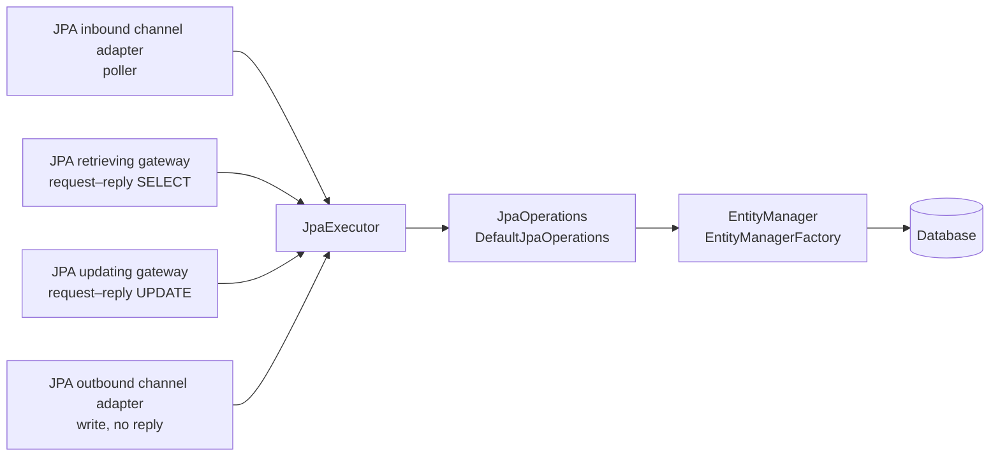
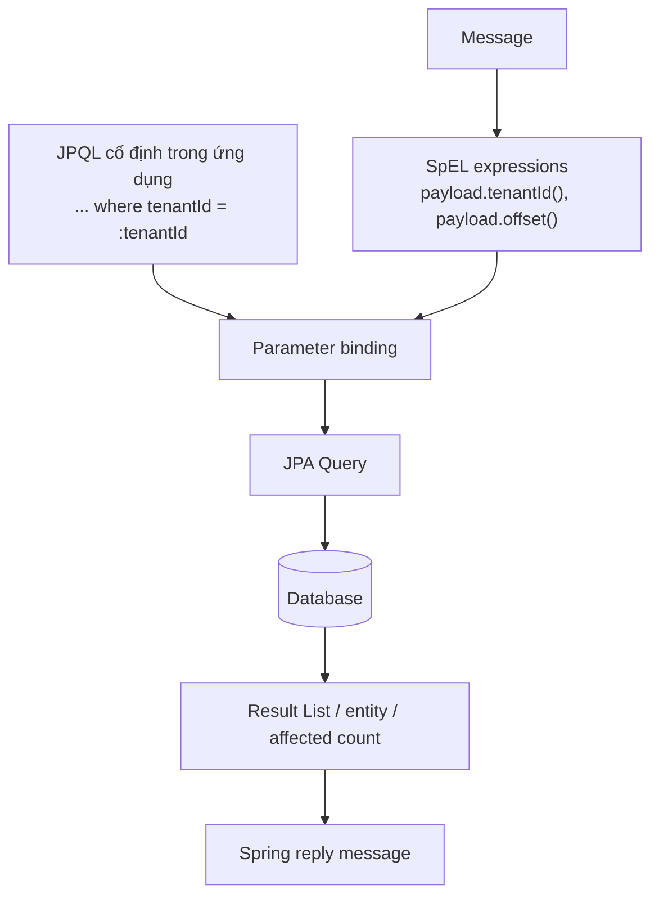
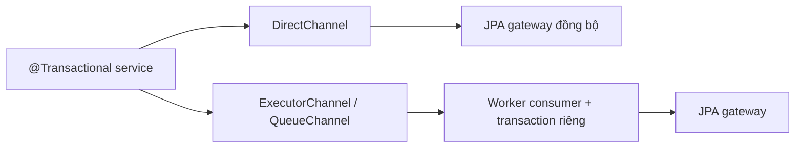

# JpaExecutor và query expression

## 1. Bối cảnh và mục tiêu

Trong module **SPRING_INTEGRATION_ADAPTERS**, ứng dụng kết nối các hệ thống ngoài bằng inbound/outbound adapter, gateway, poller và `MessageChannel`. Một sự kiện có thể đi từ file, SFTP, HTTP, JMS, AMQP, Kafka hoặc cơ sở dữ liệu vào một Integration Flow, rồi được biến đổi, xác thực và lưu hoặc tra cứu dữ liệu ở một hệ thống khác.

Với **Adapter JPA**, những endpoint như JPA inbound channel adapter, outbound channel adapter, retrieving outbound gateway và updating outbound gateway đều cần một thành phần thực thi JPA chung. Thành phần đó là **`JpaExecutor`**. Bài **JpaExecutor và query expression** tập trung vào cách `JpaExecutor` chọn thao tác, chọn câu truy vấn, lấy **giá trị tham số** từ Spring Message thông qua **SpEL**, điều chỉnh giới hạn truy vấn và trả kết quả.

Sau bài học, bạn có thể:

- Mô tả quan hệ giữa `JpaExecutor`, `JpaOperations`, `DefaultJpaOperations`, `EntityManagerFactory` và JPA adapter/gateway.
- Phân biệt cấu hình `entityClass`, `jpaQuery`, `namedQuery`, `nativeQuery` và tra cứu bằng `idExpression`.
- Tách **câu JPQL/SQL do lập trình viên định nghĩa** khỏi **giá trị parameter do message cung cấp**.
- Viết tham số tĩnh, tham số có tên, tham số theo vị trí và `JpaParameter` chứa SpEL expression.
- Giải thích vì sao `payload` và `headers` được truy cập khác nhau tùy `usePayloadAsParameterSource` và `ParameterSourceFactory`.
- Cấu hình `firstResultExpression` và `maxResultsExpression` để phân trang dựa trên request đã được kiểm tra.
- Hiểu `expectSingleResult`, kết quả rỗng, `maxNumberOfResults`, kiểu payload và cách tạo reply của retrieving/updating gateway.
- Xây ví dụ Spring Boot 3.x, Spring Integration 6.x, Jakarta Persistence với `@MessagingGateway` và Java DSL.
- Cấu hình cùng ý tưởng bằng Java `JpaExecutor` và XML namespace mà không kích hoạt nhiều handler trên cùng channel.
- Đặt transaction, xử lý lỗi, bảo mật tenant, giới hạn kết quả và kiểm thử để chạy an toàn trong môi trường nhiều request.

> **Điểm quan trọng:** “query expression” trong bài chủ yếu chỉ **biểu thức SpEL để tính giá trị parameter, ID hoặc thông số phân trang**. Nó **không có nghĩa** nhận một đoạn JPQL/SQL tùy ý từ client rồi thực thi. Query text phải được kiểm soát bởi ứng dụng.

## 2. JpaExecutor nằm ở đâu trong Spring Integration?

`JpaExecutor` là lớp thuộc package:

```java
org.springframework.integration.jpa.core.JpaExecutor
```

Nó gom phần cấu hình và thực hiện những thao tác JPA mà nhiều adapter/gateway cần dùng. Thay vì mỗi endpoint phải tự viết một bộ xử lý query, Spring Integration sử dụng `JpaExecutor` để phối hợp các thao tác với `JpaOperations`.



Các constructor chính đã được Spring Integration 6.x cung cấp:

```java
new JpaExecutor(entityManagerFactory);
new JpaExecutor(entityManager);
new JpaExecutor(jpaOperations);
```

Trong ứng dụng Spring Boot, cách phổ biến là truyền **`EntityManagerFactory`** do Spring quản lý. `EntityManagerFactory` được thiết kế để chia sẻ giữa các thread; **không** tạo một `EntityManager` thực rồi giữ chung trong singleton khi nhiều message có thể được xử lý đồng thời.

### 2.1. Các vai trò không nên nhầm

| Thành phần | Vai trò | Không làm thay |
| --- | --- | --- |
| `JpaExecutor` | Cấu hình query/mode/parameter và gọi thao tác JPA | Không tự là HTTP controller hay scheduler |
| `JpaOperations` | Abstraction của các thao tác `find`, `persist`, `executeUpdate`... | Không tự là `MessageChannel` |
| `DefaultJpaOperations` | Implementation tiêu chuẩn cho adapter/gateway | Không thay authorization nghiệp vụ |
| `JpaPollingChannelAdapter` | Dùng executor làm `MessageSource` | Không mặc định biết row nào đã xử lý |
| `JpaOutboundGateway` | Handler nhận Spring Message và chạy executor | Không tự tạo transaction xuyên Kafka/HTTP |
| `@InboundChannelAdapter`/poller | Quyết định lúc nào nhận dữ liệu | Không quyết định query có tenant filter |
| `@MessagingGateway` | Facade gửi request và đợi reply | Không tự thực thi JPA nếu chưa có flow |
| `EntityManagerFactory` | Hạ tầng cung cấp entity managers | Không phải persistence context toàn cục |

`JpaExecutor` không phải một “query builder” bất kỳ. Những field cấu hình của nó được dùng bởi Spring Integration lifecycle để thực hiện JPA operation với message và transaction tương ứng.

### 2.2. Hai lời gọi quan trọng

Javadoc phân biệt:

- `poll()`: nhận dữ liệu khi nguồn inbound không có một request message cụ thể.
- `poll(Message<?> requestMessage)`: thực hiện truy xuất có ngữ cảnh request, cho phép query dùng payload/headers.
- `executeOutboundJpaOperation(Message<?> message)`: thực hiện thao tác JPA cho message ở nhánh outbound/updating.

Đây là **các API của executor**, không có nghĩa service nghiệp vụ nên gọi chúng trực tiếp để thay Integration Flow. Bình thường bạn cấu hình một adapter/gateway và để framework gọi executor ở đúng thời điểm, trong lifecycle và transaction đã chọn.

## 3. Từ Message đến câu JPA: ba loại “expression” khác nhau

Trong một hệ thống message-driven, chữ “query” và “expression” thường bị dùng lẫn nhau.



Phải phân biệt:

1. **Query text**: ví dụ `select o from PurchaseOrder o where o.tenantId = :tenantId`. Đây là **JPQL**, không phải SpEL; cấu trúc query do ứng dụng định nghĩa.
2. **Query parameter expression**: ví dụ `payload.tenantId()` hoặc `headers['verifiedTenantId']`. Đây là **SpEL** dùng để lấy *giá trị* gắn cho parameter `:tenantId`, không được thay thế bằng đoạn SQL text.
3. **Control expression**: ví dụ `firstResultExpression("payload.offset()")` hay `maxResultsExpression("payload.limit()")`. Đây là SpEL tính vị trí bắt đầu và số row cần lấy.
4. **ID expression**: ví dụ `idExpression("payload")`, dùng để tìm entity theo primary key thông qua `EntityManager.find(...)`, không phải một câu JPQL SELECT tùy ý.

**Ví dụ request message:**

```text
payload:
  tenantId   = "TENANT-A"
  customerId = "C-101"
  status     = "PAID"
  offset     = 0
  limit      = 20

headers:
  traceId = "tr-101"
```

**Query cấu hình cố định:**

```sql
select o from PurchaseOrder o
where o.tenantId = :tenantId
  and o.customerId = :customerId
  and o.status = :status
order by o.id
```

**Biểu thức/binding:**

```text
:tenantId    ← payload.tenantId()
:customerId  ← payload.customerId()
:status      ← payload.status()

firstResult  ← payload.offset()
maxResults   ← payload.limit()
```

Mỗi message mới có thể có *giá trị* khác nhau, còn query vẫn có cùng cấu trúc. Điều này vừa làm flow dễ kiểm thử, vừa giúp tránh ghép dữ liệu không tin cậy vào câu query.

## 4. Chọn đúng nguồn truy vấn trong JpaExecutor

### 4.1. Các phương thức cấu hình

| Cấu hình Java | Ý nghĩa | Tình huống |
| --- | --- | --- |
| `setEntityClass(PurchaseOrder.class)` | Chọn entity class | Entity-mode persist/merge/delete hoặc retrieval theo entity/ID |
| `setJpaQuery("select ...")` | Cung cấp JPQL cố định | SELECT hoặc UPDATE/DELETE theo JPQL |
| `setNamedQuery("PurchaseOrder.findByCustomer")` | Sử dụng named query đã đăng ký | Dùng lại query đã khai trong entity/ORM metadata |
| `setNativeQuery("select ...")` | Cung cấp native SQL | Cần cú pháp, hàm hoặc khả năng riêng của DB |
| `setIdExpression(expression)` | Tính primary key rồi gọi `EntityManager.find` | Tìm một entity theo khóa |
| `setPersistMode(PersistMode.MERGE)` | Chọn cách thao tác entity ghi | Persist/merge/delete |
| `setExpectSingleResult(boolean)` | Xác định một entity hay danh sách | Contract truy xuất |
| `setJpaParameters(List<JpaParameter>)` | Khai static values/SpEL parameter binding | JPQL/named/native query |
| `setParameterSourceFactory(...)` | Tạo `ParameterSource` theo message | Binding tham số theo bean/map/header |
| `setMaxNumberOfResults(int)` | Giới hạn cố định số row | Tải có kiểm soát |
| `setMaxResultsExpression(Expression)` | Tính giới hạn từ message | Phân trang động đã validate |
| `setFirstResultExpression(Expression)` | Tính offset từ message | Phân trang động đã validate |

**Chỉ chọn một chiến lược truy vấn hợp lệ** cho một executor. `jpaQuery`, `namedQuery`, `nativeQuery`, `entityClass`/`idExpression` có các ràng buộc theo operation; không khai đồng thời nhiều query text không tương thích.

### 4.2. JPQL không phải SQL

JPQL làm việc với **tên entity Java và field Java**.

Giả sử entity có:

```java
@Entity
@Table(name = "purchase_order")
public class PurchaseOrder {

    @Id
    @Column(name = "order_id")
    private String id;

    @Column(name = "tenant_id")
    private String tenantId;

    // ...
}
```

JPQL đúng:

```sql
select o from PurchaseOrder o
where o.tenantId = :tenantId
order by o.id
```

Đừng viết `select * from purchase_order` ở thuộc tính `jpaQuery`; đó là SQL, không phải JPQL. Khi thật sự cần SQL, hãy dùng `nativeQuery` và kiểm tra mapping kết quả trên persistence provider.

### 4.3. Named query

Một entity có thể khai:

```java
@NamedQuery(
    name = "PurchaseOrder.findPaidByCustomer",
    query = """
        select o from PurchaseOrder o
        where o.customerId = :customerId
          and o.status = 'PAID'
        order by o.id
        """)
```

Và gateway chọn:

```java
Jpa.retrievingGateway(entityManagerFactory)
        .namedQuery("PurchaseOrder.findPaidByCustomer")
        .parameterExpression("customerId", "payload");
```

Tên query phải được đăng ký đúng, và parameter names phải khớp. Named query giúp quản lý một truy vấn được dùng lại nhưng **không** bỏ qua bước validate/authorization.

### 4.4. Native query và result mapping

Native SQL có thể:

```java
Jpa.retrievingGateway(entityManagerFactory)
        .nativeQuery("""
            select order_id, status
            from purchase_order
            where tenant_id = :tenantId
            """)
        .parameterExpression("tenantId", "payload");
```

Kết quả native query **không mặc nhiên là `PurchaseOrder`**. Tùy `entityClass`/result mapping/provider, bạn có thể nhận scalar, `Object[]`, tuple hoặc entity. Với native SQL, cách binding named/positional parameter và dialect phải được kiểm chứng bằng integration test trên database đích.

Không chuyển native SQL thành một chuỗi bằng cách nối parameter từ client; cả JPQL và native SQL đều cần binding giá trị qua JPA.

### 4.5. idExpression tìm theo primary key

`idExpression` được dùng cho lookup-by-ID:

```java
Jpa.retrievingGateway(entityManagerFactory)
        .entityClass(PurchaseOrder.class)
        .idExpression("payload");
```

Ví dụ trên giả định payload là primary key `String orderId`, không phải một request DTO. Với một DTO có `orderId()` thì expression là `payload.orderId()`.

Cần nhớ:

- `idExpression` được đánh giá trên **request message**; entity class cần được xác định tường minh hoặc theo cách framework hỗ trợ.
- Đó là đường tìm một đối tượng bằng `EntityManager.find`, không phải JPQL query.
- Đừng trộn `idExpression` với `jpaQuery`/`nativeQuery`/`namedQuery` và các thuộc tính truy vấn không tương thích.
- Nếu không có ID, phải thiết kế not-found semantics riêng; không mặc định một `null` có thể trở thành message payload hợp lệ.

## 5. JpaParameter: gắn dữ liệu vào query một cách rõ ràng

### 5.1. Named parameter

JPQL:

```sql
select o from PurchaseOrder o
where o.tenantId = :tenantId
  and o.status = :status
```

Sử dụng Java DSL:

```java
Jpa.retrievingGateway(entityManagerFactory)
        .jpaQuery("""
            select o from PurchaseOrder o
            where o.tenantId = :tenantId
              and o.status = :status
            """)
        .parameterExpression(
                "tenantId", "payload.tenantId()")
        .parameterExpression(
                "status", "payload.status()");
```

`parameterExpression("tenantId", "...")` **không đổi tên query text**; nó cung cấp một expression tính ra giá trị của parameter `:tenantId` khi request được xử lý.

### 5.2. Cấu hình trực tiếp bằng JpaParameter

`JpaParameter` nằm ở:

```java
org.springframework.integration.jpa.support.JpaParameter
```

Constructor phổ biến:

```java
new JpaParameter(
        "tenantId", null, "payload.tenantId()");

new JpaParameter(
        "status", "PAID", null);
```

Đối số lần lượt là `name`, `value` và `expression`. Với một parameter, chọn **giá trị tĩnh** hoặc **expression**, không điền cả hai theo cách mâu thuẫn.

`JpaExecutor` nhận danh sách:

```java
executor.setJpaParameters(List.of(
        new JpaParameter(
                "tenantId", null, "payload.tenantId()"),
        new JpaParameter(
                "status", null, "payload.status()")
));

executor.setUsePayloadAsParameterSource(false);
```

Đoạn này giả định `executor` được tạo từ `EntityManagerFactory` và đã cấu hình câu JPQL tương ứng. Khi explicit expressions dùng `payload`/`headers`, đặt `false` rõ ràng giúp thể hiện rằng root evaluation là toàn **Spring Message**.

### 5.3. Positional parameters

JPA còn có các tham số theo vị trí. Với JPQL dạng hỗ trợ positional binding:

```sql
select o from PurchaseOrder o
where o.tenantId = ?1
  and o.status = ?2
```

DSL hỗ trợ:

```java
Jpa.retrievingGateway(entityManagerFactory)
        .jpaQuery("""
            select o from PurchaseOrder o
            where o.tenantId = ?1
              and o.status = ?2
            """)
        .parameterExpression("payload.tenantId()")
        .parameterExpression("payload.status()");
```

Thứ tự khai báo positional parameters phải tương ứng với vị trí trong query, và JPA/provider phải hỗ trợ cú pháp/kiểu parameter tương ứng. Với nhiều tham số, **named parameters** thường dễ bảo trì hơn.

### 5.4. Parameter tĩnh

Nếu chỉ muốn query các order đã `PAID`, không để client tùy ý đổi status:

```java
Jpa.retrievingGateway(entityManagerFactory)
        .jpaQuery("""
            select o from PurchaseOrder o
            where o.tenantId = :tenantId
              and o.status = :status
            """)
        .parameterExpression(
                "tenantId", "payload.tenantId()")
        .parameter("status", "PAID");
```

Việc dùng giá trị static cho `status` giúp thiết lập một chính sách cố định, nhưng **quyền truy cập tenant** vẫn phải được kiểm tra ở service.

### 5.5. XML expression-based và value-based parameter

```xml
<int-jpa:retrieving-outbound-gateway
        request-channel="orderSearchRequests"
        entity-manager-factory="entityManagerFactory"
        jpa-query="select o from PurchaseOrder o
                   where o.tenantId = :tenantId
                     and o.status = :status"
        expect-single-result="false">

    <int-jpa:parameter
            name="tenantId"
            expression="payload.tenantId()"/>

    <int-jpa:parameter
            name="status"
            value="PAID"/>
</int-jpa:retrieving-outbound-gateway>
```

Đây là đoạn XML endpoint; XML context đầy đủ cần namespace/schema và bean Spring tương ứng. Value-based và expression-based parameters là những dạng được namespace hỗ trợ, nhưng không nên khai cùng parameter name hai lần.

## 6. SpEL root: payload hay toàn bộ Message?

Một lỗi phổ biến là viết `payload.customerId` rồi cấu hình framework sao cho SpEL root **đã là payload**. Khi đó property `payload` không tồn tại theo root như bạn nghĩ và expression fail.

### 6.1. Hai mô hình đánh giá

| `usePayloadAsParameterSource` | Root/nguồn của parameter evaluation | Expression minh họa |
| --- | --- | --- |
| `true` | Payload của Spring Message | `customerId` hoặc `#this` với payload thích hợp |
| `false` | Toàn bộ Spring Message | `payload.customerId()` hoặc `headers['verifiedTenantId']` |

Theo tài liệu Spring Integration:

- **Không khai explicit JPA parameters:** mặc định là `true`; `BeanPropertyParameterSourceFactory` lấy properties từ payload.
- **Có explicit JpaParameter với SpEL expressions:** mặc định phù hợp là `false` để truy cập được cả `payload` và `headers`.
- Nếu đặt `usePayloadAsParameterSource(true)` có chủ đích với expression `#this`, root là payload; không dùng tiền tố `payload.` như trường hợp root là Message.

**Tại sao điều này quan trọng?**

Giả sử request payload là:

```java
public record OrderSearch(
        String customerId, String status) {
}
```

Với bean-property source trên payload, tên tham số `customerId` có thể được lấy từ property tương ứng. Nhưng với explicit SpEL `payload.customerId()` thì root phải là Spring Message.

### 6.2. Đọc header

Khi cần dùng header server đã gắn:

```java
.parameterExpression(
        "tenantId", "headers['verifiedTenantId']")
```

Ví dụ message:

```java
Message<OrderSearch> message =
        MessageBuilder.withPayload(
                new OrderSearch("C-101", "PAID"))
            .setHeader("verifiedTenantId", "TENANT-A")
            .build();
```

Tuy nhiên, **tên header “verifiedTenantId” không tự khiến giá trị đáng tin cậy**. Producer message có thể đặt header. Cần bảo đảm giá trị đến từ authenticated principal/ACL/tenant resolver ở **server**, không copy thẳng từ HTTP header hoặc JSON do người dùng nhập.

### 6.3. BeanPropertyParameterSourceFactory

Spring Integration có interface `ParameterSourceFactory` và implementation `BeanPropertyParameterSourceFactory` trong package `org.springframework.integration.jpa.support.parametersource`.

Ý tưởng:

```text
Spring Message
    payload = OrderSearch(customerId="C-101", status="PAID")
        ↓
usePayloadAsParameterSource = true
        ↓
BeanPropertyParameterSourceFactory
        ↓
:customerId = "C-101"
:status     = "PAID"
```

Cách này gọn khi tên query parameters khớp properties của payload. Nhưng nếu bạn muốn lấy xen kẽ payload và headers, explicit parameter expressions dễ đọc và audit hơn.

### 6.4. ParameterSourceFactory không đồng thời với explicit parameters

Hai chiến lược cấu hình thường **loại trừ nhau**:

1. `parameter-source-factory`: tự tạo parameter values theo hợp đồng factory.
2. `<int-jpa:parameter>` hoặc `setJpaParameters`: liệt kê parameter values/expressions rõ ràng.

Không cấu hình cả hai với kỳ vọng Spring tự “merge” danh sách và xử lý ưu tiên. Nếu cần logic phức tạp, hãy viết transformer/enricher tạo **request DTO đã validate**, rồi cấu hình một cách binding nhất quán.

### 6.5. Đừng coi SpEL là dữ liệu đầu vào của client

**Không làm:**

```java
// Rủi ro: nhận nguyên SpEL expression từ HTTP/JMS payload.
String expression = untrustedRequest.getExpression();
executor.setJpaParameters(
        List.of(new JpaParameter(
                "tenantId", null, expression)));
```

Biểu thức SpEL có khả năng truy cập thuộc tính/phương thức và những khả năng đánh giá khác tùy evaluation context. Một hệ thống không được cho người dùng tự quyết định nội dung expression hay query string. **Developer cấu hình expression cố định; user chỉ cung cấp giá trị** được kiểm tra kiểu và quyền.

## 7. firstResultExpression và maxResultsExpression

### 7.1. Phân trang là vấn đề hiệu năng lẫn bảo mật

Nếu một customer có 500.000 đơn hàng, query không có giới hạn có thể tải nhiều entity vào heap, giữ DB connection lâu, làm JPA transaction chậm và tạo Spring Message rất lớn.

`JpaExecutor` hỗ trợ hai kiểu:

| Cách cấu hình | Java DSL | Java executor | Tác dụng |
| --- | --- | --- | --- |
| Limit cố định | `maxResults(50)` | `setMaxNumberOfResults(50)` | Trả tối đa 50 row |
| Limit theo message | `maxResultsExpression("payload.limit()")` | `setMaxResultsExpression(Expression)` | Tính giới hạn trên request |
| Offset cố định | `firstResult(100)` | `setFirstResultExpression(...)` với constant expression | Bắt đầu tại offset 100 |
| Offset theo message | `firstResultExpression("payload.offset()")` | `setFirstResultExpression(Expression)` | Tính offset trên request |

Ở Java DSL, `maxResults` **không được dùng cùng** `maxResultsExpression` trong một spec; `firstResult` cũng **không dùng cùng** `firstResultExpression` cho cùng endpoint.

### 7.2. SpEL động với DTO đã sanitize

```java
Jpa.retrievingGateway(entityManagerFactory)
        .jpaQuery("""
                select o from PurchaseOrder o
                where o.tenantId = :tenantId
                order by o.id
                """)
        .parameterExpression(
                "tenantId", "payload.tenantId()")
        .firstResultExpression("payload.offset()")
        .maxResultsExpression("payload.limit()");
```

Điều này **không có nghĩa** client có quyền chọn limit vô hạn. Nếu `payload.limit()` nhận thẳng một số rất lớn, ứng dụng có thể tự tạo DoS cho database.

**Cần validate ở trước gateway:**

```java
public static int safePageSize(int requestedLimit) {
    if (requestedLimit <= 0) {
        throw new IllegalArgumentException(
                "Limit must be positive");
    }
    return Math.min(requestedLimit, 50);
}

public static int safeOffset(int requestedOffset) {
    if (requestedOffset < 0
            || requestedOffset > 10_000) {
        throw new IllegalArgumentException(
                "Offset out of range");
    }
    return requestedOffset;
}
```

Ở đây `50` và `10_000` chỉ là ngưỡng **minh họa**; production cần chọn theo SLA, kích thước DTO, index và khối lượng tải. Nếu có tổng số page quá lớn, có thể chọn **keyset pagination**.

### 7.3. Giá trị và kiểu của expression

`firstResultExpression`/`maxResultsExpression` phải tính ra giá trị số nguyên hợp lệ mà framework dùng cho pagination; không gửi chuỗi tùy ý `"abc"` hoặc số âm. Với record Java dùng `offset()`/`limit()` trả `int` như ví dụ, việc kiểm tra trước gateway rất rõ ràng.

JPQL phải có `order by` ổn định (thường kết thúc bằng unique key) nếu bạn cần kết quả phân trang có thể dự đoán. Không có order, offset chỉ là “bỏ N kết quả theo thứ tự do DB quyết định”, dễ thay đổi giữa các request.

### 7.4. OFFSET vs keyset

Giả sử query:

```sql
select o from PurchaseOrder o
where o.tenantId = :tenantId
order by o.id
```

Với `offset=10_000` và `limit=50`, DB có thể phải duyệt nhiều row trước khi trả 50 bản ghi, tùy execution plan. Nếu bảng có thay đổi giữa các page, OFFSET có thể bỏ sót/đọc trùng.

Keyset query dùng cursor:

```sql
select o from PurchaseOrder o
where o.tenantId = :tenantId
  and o.id > :afterId
order by o.id
```

Giới hạn `maxResults(50)`; `afterId` vẫn được binding như một query parameter. Cursor phải được validate, ràng buộc với tenant/filter và có chiến lược cho trường hợp nhiều khóa order/timestamp trùng. Query expression ở đây chỉ lấy **giá trị cursor**, không sửa JPQL text.

## 8. expectSingleResult và kết quả rỗng

### 8.1. Một entity hay danh sách?

`setExpectSingleResult(false)` là chế độ thuận tiện cho query SELECT nhiều row.

```java
executor.setExpectSingleResult(false);
```

Hợp đồng downstream:

```java
Message<List<PurchaseOrder>>
```

Đây là kiểu **khái niệm**, vì `Message<?>` ở runtime có payload thực do executor tạo và mapping từ JPA provider.

Nếu:

```java
executor.setExpectSingleResult(true);
```

thì:

- Có đúng 1 result → payload là entity/result đó.
- Có nhiều result → framework có thể ném `MessagingException` do vi phạm hợp đồng.
- Không có result → cần kiểm thử theo đường query/lookup, version và policy; **không mặc định là `Optional.empty()`**.

### 8.2. Spring Integration 6.0+ và empty list

Với **retrieving outbound gateway dạng danh sách**, Spring Integration 6.0+ trả **empty list** khi query không trả entity. Bản cũ có thể tạo `null` và kết thúc flow hoặc ném lỗi `requiresReply`.

Ví dụ kết quả:

```json
[]
```

Nếu application cần not-found semantics khác, hãy xử lý tại facade/API contract. Lưu ý: filter bỏ empty list mà **không phát reply** có thể khiến caller `@MessagingGateway` phải chờ timeout. Đối với search API, trả list rỗng thường đơn giản và nhất quán hơn.

### 8.3. maxResults(1) không chứng minh query unique

Ví dụ:

```java
Jpa.retrievingGateway(entityManagerFactory)
        .jpaQuery("""
                select o from PurchaseOrder o
                where o.customerId = :customerId
                """)
        .parameterExpression(
                "customerId", "payload")
        .maxResults(1)
        .expectSingleResult(true);
```

Code có thể trả một order nhưng query thực tế tìm thấy hàng nghìn order của cùng customer. `maxResults(1)` **che** việc có nhiều hàng. Nếu muốn “đúng 1 row” theo nghiệp vụ, dùng khóa unique/ID hoặc query có điều kiện bảo đảm unique; nếu muốn “hàng mới nhất”, thêm order rõ ràng rồi cho phép một hàng theo contract.

### 8.4. JpaPollingChannelAdapter khác retrieving gateway

Một JPA inbound adapter được poll định kỳ có thể trả không có message khi không có row, còn retrieving gateway 6.0+ có thể trả **`List.of()`** cho request không có kết quả. Đừng suy diễn hành vi “no rows” của source polling sang request–reply facade.

## 9. Ví dụ thực hành đầy đủ: query expression cho đơn hàng

Xây một ứng dụng Spring Boot demo có:

1. `@MessagingGateway` nhận request đã được service xác nhận.
2. JPA retrieving gateway chạy JPQL theo tenant/customer/status.
3. SpEL bind các parameter từ request record.
4. `firstResultExpression` và `maxResultsExpression` đọc offset/limit **đã được kiểm soát**.
5. Transformer chuyển `List<PurchaseOrder>` thành `List<OrderView>`, không trả JPA entities ra ngoài.
6. Service `@Transactional(readOnly=true)` xác nhận input và gọi gateway đồng bộ.
7. H2 in-memory seed vài row để chứng minh filtering, pagination và empty results.

Ví dụ dùng **Java 17+, Spring Boot 3.x, Spring Integration 6.x, Spring Data JPA/Jakarta Persistence**. Các file Java cùng package `com.example.jpaexpressions`. `tenantId` và `customerId` ở service được coi là giá trị **đã xác thực ở tầng trước**; console demo dùng giá trị cố định.

### 9.1. Maven dependencies

```xml
<dependencies>
    <dependency>
        <groupId>org.springframework.boot</groupId>
        <artifactId>spring-boot-starter</artifactId>
    </dependency>
    <dependency>
        <groupId>org.springframework.boot</groupId>
        <artifactId>spring-boot-starter-data-jpa</artifactId>
    </dependency>
    <dependency>
        <groupId>org.springframework.boot</groupId>
        <artifactId>spring-boot-starter-integration</artifactId>
    </dependency>
    <dependency>
        <groupId>org.springframework.integration</groupId>
        <artifactId>spring-integration-jpa</artifactId>
    </dependency>
    <dependency>
        <groupId>com.h2database</groupId>
        <artifactId>h2</artifactId>
        <scope>runtime</scope>
    </dependency>
    <dependency>
        <groupId>org.springframework.boot</groupId>
        <artifactId>spring-boot-starter-test</artifactId>
        <scope>test</scope>
    </dependency>
</dependencies>
```

Spring Boot BOM quản lý các phiên bản tương thích. `spring-boot-starter-data-jpa` đem lại JPA provider và transaction manager, trong khi `spring-integration-jpa` có `JpaExecutor`/gateway. H2 và `ddl-auto=create-drop` chỉ dành cho thực hành.

### 9.2. Entity PurchaseOrder

File `PurchaseOrder.java`:

```java
package com.example.jpaexpressions;

import java.math.BigDecimal;

import jakarta.persistence.Column;
import jakarta.persistence.Entity;
import jakarta.persistence.Id;
import jakarta.persistence.Index;
import jakarta.persistence.Table;

@Entity
@Table(name = "purchase_order",
       indexes = @Index(
               name = "idx_order_scope",
               columnList = "tenant_id, customer_id, status"))
public class PurchaseOrder {

    @Id
    @Column(name = "order_id", length = 80)
    private String id;

    @Column(name = "tenant_id", nullable = false, length = 60)
    private String tenantId;

    @Column(name = "customer_id", nullable = false, length = 60)
    private String customerId;

    @Column(nullable = false, length = 24)
    private String status;

    @Column(name = "total_amount", nullable = false,
            precision = 12, scale = 2)
    private BigDecimal totalAmount;

    protected PurchaseOrder() {
        // Jakarta Persistence cần constructor không tham số.
    }

    public PurchaseOrder(
            String id, String tenantId, String customerId,
            String status, BigDecimal totalAmount) {

        this.id = id;
        this.tenantId = tenantId;
        this.customerId = customerId;
        this.status = status;
        this.totalAmount = totalAmount;
    }

    public String getId() {
        return id;
    }

    public String getTenantId() {
        return tenantId;
    }

    public String getCustomerId() {
        return customerId;
    }

    public String getStatus() {
        return status;
    }

    public BigDecimal getTotalAmount() {
        return totalAmount;
    }
}
```

Entity dùng `PurchaseOrder` trong JPQL, nhưng table vật lý là `purchase_order`. Index minh họa không thay việc xem execution plan và đo tải trên database thực.

### 9.3. Request record và DTO

File `AuthorizedOrderQuery.java`:

```java
package com.example.jpaexpressions;

public record AuthorizedOrderQuery(
        String tenantId,
        String customerId,
        String status,
        int offset,
        int limit) {
}
```

Record là **request đã được chuẩn hóa nội bộ**, không phải JSON input nhận thẳng từ client. Giá trị `tenantId`/`customerId` phải được tạo bởi service đã xác thực, và offset/limit phải được kiểm tra.

File `OrderView.java`:

```java
package com.example.jpaexpressions;

import java.math.BigDecimal;

public record OrderView(
        String id,
        String status,
        BigDecimal totalAmount) {

    public static OrderView from(PurchaseOrder entity) {
        return new OrderView(
                entity.getId(),
                entity.getStatus(),
                entity.getTotalAmount());
    }
}
```

DTO không công bố tenant/customer ID trong kết quả minh họa; API thực phải xác định các field được phép gửi theo authorization. Không đẩy JPA entity graph thẳng qua Kafka/JMS/HTTP/WebSocket.

### 9.4. Repository để seed/test

File `PurchaseOrderRepository.java`:

```java
package com.example.jpaexpressions;

import org.springframework.data.jpa.repository.JpaRepository;

public interface PurchaseOrderRepository
        extends JpaRepository<PurchaseOrder, String> {
}
```

Trong bài, repository **không thực thi truy vấn request–reply**. Nó dùng để tạo/đọc dữ liệu khi kiểm thử; truy vấn chính vẫn đi qua Spring Integration JpaExecutor.

### 9.5. Messaging gateway facade

File `OrderSearchGateway.java`:

```java
package com.example.jpaexpressions;

import java.util.List;
import org.springframework.integration.annotation.MessagingGateway;

@MessagingGateway(
        defaultRequestChannel = "orderSearchRequests",
        defaultReplyTimeout = "5000")
public interface OrderSearchGateway {

    List<OrderView> search(AuthorizedOrderQuery query);
}
```

Spring Integration tạo một request Spring Message và temporary reply channel phù hợp, rồi trả về `List<OrderView>` khi flow tạo reply. Thời gian `defaultReplyTimeout` **không phải JDBC statement timeout**, đặc biệt khi xử lý đồng bộ trên `DirectChannel`.

### 9.6. IntegrationFlow và query expression

File `OrderSearchIntegrationConfiguration.java`:

```java
package com.example.jpaexpressions;

import java.util.List;

import jakarta.persistence.EntityManagerFactory;

import org.springframework.context.annotation.Bean;
import org.springframework.context.annotation.Configuration;
import org.springframework.integration.config.EnableIntegration;
import org.springframework.integration.core.GenericTransformer;
import org.springframework.integration.dsl.IntegrationFlow;
import org.springframework.integration.jpa.dsl.Jpa;

@Configuration
@EnableIntegration
public class OrderSearchIntegrationConfiguration {

    @Bean
    IntegrationFlow orderSearchFlow(
            EntityManagerFactory entityManagerFactory) {

        return IntegrationFlow.from("orderSearchRequests")
                .handle(
                        Jpa.retrievingGateway(entityManagerFactory)
                                .jpaQuery("""
                                        select o from PurchaseOrder o
                                        where o.tenantId = :tenantId
                                          and o.customerId = :customerId
                                          and o.status = :status
                                        order by o.id
                                        """)
                                .parameterExpression(
                                        "tenantId",
                                        "payload.tenantId()")
                                .parameterExpression(
                                        "customerId",
                                        "payload.customerId()")
                                .parameterExpression(
                                        "status",
                                        "payload.status()")
                                .firstResultExpression(
                                        "payload.offset()")
                                .maxResultsExpression(
                                        "payload.limit()")
                                .expectSingleResult(false))
                .transform((
                        GenericTransformer<
                                List<PurchaseOrder>,
                                List<OrderView>>) rows ->
                        rows.stream()
                                .map(OrderView::from)
                                .toList())
                .get();
    }
}
```

Ở đây có bốn cấp hợp đồng:

**Thứ nhất — query:** JPQL cố định do ứng dụng viết; không nhận SQL string từ client.

**Thứ hai — parameters:** ba `parameterExpression` lấy dữ liệu đã chuẩn hóa từ payload. Không dùng string concatenation. `:tenantId`/`:customerId` là business scope bắt buộc.

**Thứ ba — pagination:** `firstResultExpression` và `maxResultsExpression` tính offset/limit từ record nội bộ **đã được service giới hạn**; chúng không tự giới hạn nếu service bỏ validation.

**Thứ tư — reply:** retrieving gateway phát `List<PurchaseOrder>`, transformer chuyển thành `List<OrderView>` và trả về temporary reply channel của `@MessagingGateway`.

Không cần `@Poller` vì đây là **retrieving outbound gateway**, có request message. Nếu thay thành JPA inbound channel adapter, sẽ phải cấu hình polling schedule và xét khác biệt về parameter source/no-message case.

### 9.7. Service kiểm tra scope và giới hạn pagination

File `OrderSearchService.java`:

```java
package com.example.jpaexpressions;

import java.util.List;
import java.util.Set;

import org.springframework.stereotype.Service;
import org.springframework.transaction.annotation.Transactional;

@Service
public class OrderSearchService {

    private static final int MAX_PAGE_SIZE = 50;
    private static final int MAX_OFFSET = 10_000;
    private static final Set<String> ALLOWED_STATUSES =
            Set.of("PAID", "SHIPPED");

    private final OrderSearchGateway gateway;

    public OrderSearchService(OrderSearchGateway gateway) {
        this.gateway = gateway;
    }

    @Transactional(readOnly = true)
    public List<OrderView> searchForAuthorizedScope(
            String verifiedTenantId,
            String authorizedCustomerId,
            String status,
            int offset,
            int requestedLimit) {

        // Trong production, tenant/customer phải đến từ
        // authenticated principal/ACL, không do client tự cấp.
        if (verifiedTenantId == null
                || verifiedTenantId.isBlank()
                || verifiedTenantId.length() > 60
                || authorizedCustomerId == null
                || authorizedCustomerId.isBlank()
                || authorizedCustomerId.length() > 60) {
            throw new IllegalArgumentException(
                    "Invalid authorized scope");
        }

        if (!ALLOWED_STATUSES.contains(status)) {
            throw new IllegalArgumentException(
                    "Unsupported order status");
        }

        if (offset < 0 || offset > MAX_OFFSET) {
            throw new IllegalArgumentException(
                    "Invalid offset");
        }

        if (requestedLimit <= 0) {
            throw new IllegalArgumentException(
                    "Limit must be positive");
        }

        int safeLimit = Math.min(
                requestedLimit, MAX_PAGE_SIZE);

        AuthorizedOrderQuery query =
                new AuthorizedOrderQuery(
                        verifiedTenantId,
                        authorizedCustomerId,
                        status,
                        offset,
                        safeLimit);

        return gateway.search(query);
    }
}
```

**Điểm an toàn quan trọng:** method `searchForAuthorizedScope` giả định các tham số `verifiedTenantId` và `authorizedCustomerId` đã được xác định từ tầng bảo mật đáng tin cậy. Trong một HTTP controller thật, **không được** nhận hai trường từ query string rồi gọi thẳng method này. Hãy lấy chúng từ security context/tenant authorization service, kiểm tra quyền truy cập trước khi query.

`@Transactional(readOnly=true)` bao quanh lời gọi gateway **đồng bộ** qua DirectChannel. Nếu đưa queue/executor vào giữa, transaction này không tự vượt thread boundary.

### 9.8. Spring Boot application và dữ liệu mẫu

File `JpaQueryExpressionApplication.java`:

```java
package com.example.jpaexpressions;

import java.math.BigDecimal;
import java.util.List;

import org.springframework.boot.CommandLineRunner;
import org.springframework.boot.SpringApplication;
import org.springframework.boot.autoconfigure.SpringBootApplication;
import org.springframework.context.annotation.Bean;
import org.springframework.integration.annotation.IntegrationComponentScan;

@SpringBootApplication
@IntegrationComponentScan
public class JpaQueryExpressionApplication {

    public static void main(String[] args) {
        SpringApplication.run(
                JpaQueryExpressionApplication.class, args);
    }

    @Bean
    CommandLineRunner demo(
            PurchaseOrderRepository repository,
            OrderSearchService service) {

        return args -> {
            if (repository.count() == 0) {
                repository.saveAll(List.of(
                        new PurchaseOrder(
                                "ORD-101", "TENANT-A", "C-101",
                                "PAID", new BigDecimal("10.00")),
                        new PurchaseOrder(
                                "ORD-102", "TENANT-A", "C-101",
                                "PAID", new BigDecimal("20.00")),
                        new PurchaseOrder(
                                "ORD-103", "TENANT-A", "C-101",
                                "SHIPPED", new BigDecimal("30.00")),
                        new PurchaseOrder(
                                "ORD-104", "TENANT-B", "C-101",
                                "PAID", new BigDecimal("40.00"))
                ));
            }

            System.out.println("Page 1: "
                    + service.searchForAuthorizedScope(
                            "TENANT-A", "C-101",
                            "PAID", 0, 1));

            System.out.println("Page 2: "
                    + service.searchForAuthorizedScope(
                            "TENANT-A", "C-101",
                            "PAID", 1, 1));

            System.out.println("No rows: "
                    + service.searchForAuthorizedScope(
                            "TENANT-A", "C-999",
                            "PAID", 0, 20));
        };
    }
}
```

File `application.properties`:

```properties
spring.main.web-application-type=none

spring.datasource.url=jdbc:h2:mem:jpa_expression_demo;DB_CLOSE_DELAY=-1
spring.datasource.driver-class-name=org.h2.Driver
spring.datasource.username=sa
spring.datasource.password=

spring.jpa.hibernate.ddl-auto=create-drop
spring.jpa.open-in-view=false
logging.level.org.springframework.integration=INFO
```

Dữ liệu H2 và `create-drop` chỉ phục vụ học tập. Production phải dùng migration schema (Flyway/Liquibase), database/pool thực tế và authorization chuẩn.

**Kết quả mong đợi:**

| Call | Reply | Giải thích |
| --- | --- | --- |
| TENANT-A/C-101/PAID, offset 0, limit 1 | `ORD-101` | Trang đầu theo `order by o.id` |
| TENANT-A/C-101/PAID, offset 1, limit 1 | `ORD-102` | Trang thứ hai |
| TENANT-A/C-999/PAID | `[]` | Không có row, list mode trả rỗng |
| TENANT-A/C-101/SHIPPED | `ORD-103` | Filter status khác |
| TENANT-A/C-101/PAID không bao giờ trả ORD-104 | Không lộ row TENANT-B | Filter tenant trong query |
| limit=1000 | Server cap thành 50 | Không phóng đại `maxResultsExpression` |

Các case trên cho thấy **query text không thay đổi**, chỉ những giá trị được binding từ mỗi Spring Message thay đổi.

## 10. Cấu hình thuần Java bằng JpaExecutor và JpaParameter

Bài demo dùng Java DSL. Nếu muốn nhìn trực tiếp `JpaExecutor`, có thể cấu hình `@ServiceActivator` và `JpaOutboundGateway`.

**Đây là phương án thay thế cho `OrderSearchIntegrationConfiguration` mục 9.6**. Không bật cả hai trên cùng request channel nếu không có thiết kế nhiều consumer, vì DirectChannel có thể phân phối message cho nhiều handler theo load-balancing thay vì phát cho cả hai.

### 10.1. Bean JpaExecutor

File minh họa `JpaExecutorJavaConfiguration.java`:

```java
package com.example.jpaexpressions;

import java.util.List;

import jakarta.persistence.EntityManagerFactory;

import org.springframework.context.annotation.Bean;
import org.springframework.context.annotation.Configuration;
import org.springframework.integration.annotation.ServiceActivator;
import org.springframework.integration.jpa.core.JpaExecutor;
import org.springframework.integration.jpa.outbound.JpaOutboundGateway;
import org.springframework.integration.jpa.support.JpaParameter;
import org.springframework.integration.jpa.support.OutboundGatewayType;
import org.springframework.messaging.MessageHandler;

@Configuration
public class JpaExecutorJavaConfiguration {

    @Bean
    JpaExecutor orderSearchJpaExecutor(
            EntityManagerFactory entityManagerFactory) {

        JpaExecutor executor =
                new JpaExecutor(entityManagerFactory);

        executor.setJpaQuery("""
                select o from PurchaseOrder o
                where o.tenantId = :tenantId
                  and o.customerId = :customerId
                  and o.status = :status
                order by o.id
                """);

        executor.setJpaParameters(List.of(
                new JpaParameter(
                        "tenantId", null,
                        "payload.tenantId()"),
                new JpaParameter(
                        "customerId", null,
                        "payload.customerId()"),
                new JpaParameter(
                        "status", null,
                        "payload.status()")));

        // Explicit SpEL dùng root là toàn Message.
        executor.setUsePayloadAsParameterSource(false);
        executor.setExpectSingleResult(false);
        executor.setMaxNumberOfResults(50);

        return executor;
    }

    @Bean
    @ServiceActivator(inputChannel = "orderSearchRequests")
    MessageHandler orderRetrievingHandler(
            JpaExecutor orderSearchJpaExecutor) {

        JpaOutboundGateway handler =
                new JpaOutboundGateway(orderSearchJpaExecutor);

        handler.setGatewayType(
                OutboundGatewayType.RETRIEVING);

        // producesReply mặc định true.
        // Đừng setProducesReply(false): sẽ mất reply.
        return handler;
    }
}
```

Khác biệt với DSL ở mục 9:

- `setMaxNumberOfResults(50)` dùng **limit cố định** thay vì dynamic `maxResultsExpression`; không có offset động ở đoạn này.
- `JpaParameter` explicit thay các method DSL `parameterExpression`.
- Handler tạo `List<PurchaseOrder>`, vì thế nếu giữ `OrderSearchGateway` có return type `List<OrderView>`, bạn phải bổ sung **DTO transformer trong reply flow**. Đừng bật Java bean ở đây rồi kỳ vọng mapper của Java DSL vẫn hoạt động.
- `@ServiceActivator` dùng `JpaOutboundGateway` kiểu `RETRIEVING` để phát reply. Đặt `setProducesReply(false)` sẽ biến handler thành outbound adapter một chiều và caller có thể phải đợi timeout.

### 10.2. Nếu cần dynamic limit/offset trên JpaExecutor

Javadoc khai nhận **Spring `Expression` object**, không nhận string trực tiếp qua `JpaExecutor`:

```java
import org.springframework.expression.ExpressionParser;
import org.springframework.expression.spel.standard.SpelExpressionParser;

ExpressionParser parser = new SpelExpressionParser();

executor.setFirstResultExpression(
        parser.parseExpression("payload.offset()"));

executor.setMaxResultsExpression(
        parser.parseExpression("payload.limit()"));
```

Đây là **đoạn bổ sung** cho bean executor trước khi Spring khởi tạo xong; nếu sử dụng dynamic limit, không cấu hình `setMaxNumberOfResults(50)` đồng thời theo ý định hai giới hạn tự kết hợp. Hãy chọn **một** nguồn giá trị limit và validate trước.

Spring Integration có thể dùng evaluation context tích hợp với bean resolver/functions phù hợp. Chính vì vậy SpEL expression phải là **định nghĩa đáng tin cậy do ứng dụng viết**, không phải chuỗi lấy từ client.

### 10.3. ApplicationContext và lifecycle

`JpaExecutor` implements Spring lifecycle initialization interfaces như `InitializingBean`. Khi được khai báo qua `@Bean`, Spring sẽ gọi các bước initialization theo bean lifecycle, bao gồm kiểm tra/thành lập parameter sources.

Nếu tự `new JpaExecutor(...)` bên ngoài Spring rồi gọi API thô, bạn có thể phải tự đảm bảo initialization/evaluation context. Trong một ứng dụng Integration, nên để Spring quản lý executor và endpoint thay vì bypass lifecycle.

## 11. Cấu hình XML namespace tương ứng

### 11.1. JPQL + parameter expressions + dynamic pagination

Một endpoint XML thay thế Java DSL:

```xml
<int-jpa:retrieving-outbound-gateway
        id="ordersJpaRetrievingGateway"
        request-channel="orderSearchRequests"
        entity-manager-factory="entityManagerFactory"
        jpa-query="select o from PurchaseOrder o
                   where o.tenantId = :tenantId
                     and o.customerId = :customerId
                     and o.status = :status
                   order by o.id"
        expect-single-result="false"
        first-result-expression="payload.offset()"
        max-results-expression="payload.limit()"
        use-payload-as-parameter-source="false">

    <int-jpa:parameter
            name="tenantId"
            expression="payload.tenantId()"/>
    <int-jpa:parameter
            name="customerId"
            expression="payload.customerId()"/>
    <int-jpa:parameter
            name="status"
            expression="payload.status()"/>
</int-jpa:retrieving-outbound-gateway>
```

Đoạn XML giả định application context có đầy đủ namespace/schema `int`/`int-jpa`, `entityManagerFactory` và request channel. Nếu cần trả về `List<OrderView>` cho `@MessagingGateway`, còn phải đặt DTO transformer đúng vị trí trong reply flow; XML chỉ minh họa retrieving endpoint.

**Các cặp thuộc tính loại trừ nhau:**

- `max-results` và `max-results-expression`.
- `first-result` và `first-result-expression`.
- `parameter-source-factory` và các phần tử `<int-jpa:parameter>`.

`use-payload-as-parameter-source="false"` được khai rõ vì expressions dùng `payload.*` trên root Spring Message.

### 11.2. Một truy vấn cố định với static parameter

```xml
<int-jpa:retrieving-outbound-gateway
        request-channel="paidOrderRequests"
        entity-manager-factory="entityManagerFactory"
        jpa-query="select o from PurchaseOrder o
                   where o.tenantId = :tenantId
                     and o.status = :status"
        max-results="50">

    <int-jpa:parameter
            name="tenantId"
            expression="payload"/>
    <int-jpa:parameter
            name="status"
            value="PAID"/>
</int-jpa:retrieving-outbound-gateway>
```

Trường hợp này request payload chỉ là tenant ID `String`. Trong production, tenant ID phải đến từ authenticated principal/ACL đáng tin cậy; một payload tự khai chưa đủ để cấp quyền. `max-results="50"` là giới hạn cố định, không kết hợp thêm dynamic expression.

### 11.3. ID expression qua XML

```xml
<int-jpa:retrieving-outbound-gateway
        request-channel="orderIdLookupRequests"
        entity-manager-factory="entityManagerFactory"
        entity-class="com.example.jpaexpressions.PurchaseOrder"
        id-expression="payload"/>
```

Đây là lookup bằng `EntityManager.find`, không phải query JPQL. Vì vậy không khai cùng `jpa-query`, `named-query`, `native-query` hoặc tham số không tương thích.

### 11.4. Request/reply channel

Khi XML gateway không có `reply-channel` cố định, caller cần `replyChannel` header phù hợp (ví dụ do `@MessagingGateway` tạo). Nếu đặt output channel cố định, cần làm rõ cách reply đi qua transformer và cuối cùng quay về caller, bảo toàn correlation.

Đừng lấy tên “outbound gateway” để suy đoán rằng mọi message luôn được gửi ngay đến một external service. Trong bài, external system là **database JPA**, còn gateway tạo **Spring reply message** nội bộ.

## 12. Query parameters trong JPA inbound polling: một tình huống khác

Một **JPA inbound channel adapter** thường không có request message mang `payload`/`headers`. Nó được gọi theo poller:

```text
Poller trigger
    ↓
JpaPollingChannelAdapter
    ↓
JpaExecutor.poll()
    ↓
List<Entity> (nếu có dữ liệu)
    ↓
MessageChannel
```

Trong khi retrieving outbound gateway nhận request:

```text
Message<AuthorizedOrderQuery>
    ↓
JpaOutboundGateway( RETRIEVING )
    ↓
JpaExecutor.poll(requestMessage)
    ↓
Message<List<Entity>>
```

Vì vậy, **không bê nguyên expression `payload.customerId()`** sang JPA inbound poller rồi giả định có một request payload. Với inbound adapter bạn có thể:

- Dùng query không cần parameter.
- Dùng static parameter values.
- Cung cấp `ParameterSource`/`ParameterSourceFactory` phù hợp với thời gian/tenant công việc do server kiểm soát.
- Nếu cần điều kiện truy vấn thay đổi theo từng request message, dùng **retrieving outbound gateway**.

### 12.1. Ví dụ inbound chỉ đọc NEW

```java
JpaExecutor executor =
        new JpaExecutor(entityManagerFactory);

executor.setJpaQuery("""
        select w from WorkItem w
        where w.state = 'NEW'
        order by w.id
        """);

executor.setMaxNumberOfResults(25);
executor.setExpectSingleResult(false);
```

Một poller có thể gọi `new JpaPollingChannelAdapter(executor)` để phát dữ liệu vào channel. Đây là ví dụ riêng, không chạy chung với entity `PurchaseOrder` của demo nếu chưa định nghĩa `WorkItem`.

### 12.2. Poller không thay database acknowledgment

Nếu query luôn chọn `state='NEW'`, row chưa được cập nhật sẽ xuất hiện lại ở lần poll sau. `maxResults(25)` không có nghĩa 25 row đã được xử lý thành công. Một workflow thực tế phải có state transition/atomic claim/lease, transaction và idempotency.

`deleteAfterPoll(true)` là lựa chọn phá hủy dữ liệu cần cân nhắc kỹ. Đừng xóa source row chỉ vì query thành công khi downstream qua Kafka/JMS/HTTP chưa được đảm bảo nhận dữ liệu.

## 13. JpaExecutor ở phía updating/outbound: query expression không chỉ dùng cho SELECT

`JpaExecutor` còn dùng để thực hiện JPQL `UPDATE`/`DELETE`, persist/merge/delete entity.

### 13.1. Updating outbound gateway trả affected count

Ví dụ cập nhật đơn từ `PAID` sang `SHIPPED`:

```java
Jpa.updatingGateway(entityManagerFactory)
        .jpaQuery("""
                update PurchaseOrder o
                   set o.status = 'SHIPPED'
                 where o.id = :orderId
                   and o.tenantId = :tenantId
                   and o.status = 'PAID'
                """)
        .parameterExpression(
                "orderId", "payload.orderId()")
        .parameterExpression(
                "tenantId", "payload.tenantId()");
```

Đoạn trên giả định payload là command DTO đã được validate và tenant là phạm vi đã xác thực. JPQL UPDATE trả **số row bị ảnh hưởng** (thường `Integer`) qua updating gateway.

Nếu `affected=0`, có thể do ID không tồn tại, sai tenant, status khác hoặc worker khác đã cập nhật. Không coi `0` tự động là success “đã xử lý trước đó”.

### 13.2. Outbound channel adapter không tạo reply

Cùng executor và query có thể được dùng bởi outbound channel adapter không có reply. Dùng `Jpa.outboundAdapter(...)` hoặc `JpaOutboundGateway` với `setProducesReply(false)` để kết thúc một nhánh xử lý. Nếu cần affected-row count cho một router tiếp theo, phải chọn **updating outbound gateway**.

### 13.3. Bulk update và persistence context

JPQL bulk update chạy trực tiếp lên database và có thể làm managed entity **stale** trong persistence context đã load trước đó. Nó cũng không tự áp quy trình dirty checking/`@Version` như khi cập nhật một entity managed.

Nếu cần compare-and-set:

```sql
update PurchaseOrder o
set o.status = :newStatus,
    o.version = o.version + 1
where o.id = :orderId
  and o.tenantId = :tenantId
  and o.version = :expectedVersion
```

Đây là ví dụ khi entity **có field `version`**; entity demo mục 9 chưa khai field đó. Query phải có đủ parameter binding, transaction, index và conflict policy. Khi `affected=0`, quyết định retry/reconcile đúng nghiệp vụ, không retry vô hạn với cùng version cũ.

## 14. Transaction, flush, commit và ranh giới MessageChannel

### 14.1. SELECT và UPDATE có yêu cầu khác nhau

- JPA SELECT có thể được gọi trong một số cấu hình không có transaction ứng dụng tường minh, nhưng cần thiết kế `@Transactional(readOnly=true)` khi muốn kiểm soát persistence context/consistency/lazy access.
- JPA `persist`/`merge`/`remove` và JPQL `UPDATE/DELETE` cần transaction hợp lệ.
- `JpaExecutor.setFlush(true)` điều khiển flush sau persistence operations; **flush không phải commit**.
- Transaction manager (thường `JpaTransactionManager` trong Boot) quyết định commit/rollback của DB transaction.

### 14.2. DirectChannel và Queue/ExecutorChannel



Với `DirectChannel`, handler thường chạy trên cùng thread nên transaction context của caller có thể được dùng trong JPA operation.

Với `ExecutorChannel` hoặc `QueueChannel`, một thread khác nhận message; transaction/persistence context ở sender **không tự được chuyển** sang consumer. Nếu consumer làm UPDATE, cấu hình transaction ở phía consumer. Nếu caller đang đợi reply, cần reply routing, error channel và timeout rõ ràng.

### 14.3. Reply chưa chứng minh commit

```text
@MessagingGateway → JPA updating gateway → reply Integer(1)
               ↘ transaction service đang mở ↗
               → service kết thúc → commit / rollback
```

Gateway tạo reply sau khi JPA operation trả kết quả, nhưng transaction của service ngoài có thể vẫn chưa commit. Đừng phát business event “đã ghi thành công” qua Kafka/HTTP ngay khi thấy `Integer(1)` nếu commit còn có thể thất bại.

Nếu cần DB commit và broker publish phối hợp an toàn hơn, cân nhắc **transactional outbox** và consumer idempotent.

## 15. Bảo mật: SpEL/query expression không thay authorization

### 15.1. Parameter binding giúp giảm injection, không cấp quyền

Giả sử HTTP client yêu cầu:

```json
{
  "tenantId": "TENANT-SECRET",
  "customerId": "C-101",
  "limit": 1000000
}
```

Nếu service nhận trực tiếp các trường đó rồi đưa vào `AuthorizedOrderQuery`, JPA parameter binding vẫn có thể chạy **đúng cú pháp** nhưng truy cập trái phép dữ liệu của tenant khác hoặc gây tải rất lớn.

Để bảo vệ:

1. Xác thực người gọi tại HTTP/JMS/Kafka boundary theo cơ chế của hệ thống.
2. Từ principal/ACL trên server xác định `verifiedTenantId` và `authorizedCustomerId`.
3. Validate status bằng allowlist, offset không âm và giới hạn page size.
4. JPQL luôn chứa tenant/resource filter cần thiết.
5. Không cho client tạo SpEL expression, JPQL string, column name hoặc ORDER BY tùy ý.
6. Dùng DTO để trả chỉ những field đã được phép công bố.
7. Áp rate limit/concurrency limit và query timeout ở tầng thích hợp.
8. Không log raw token/PII hoặc dump cả request chứa dữ liệu nhạy cảm.

### 15.2. Trường động trong ORDER BY phải dùng allowlist

JPA parameter `:sortColumn` **không thể thay một identifier SQL** theo cách bình thường: parameter binding dành cho **giá trị**, không dành cho tên column hoặc cấu trúc query.

Nếu API hỗ trợ sắp xếp, hãy:

- Dùng những query/query variants được developer định nghĩa sẵn.
- Mapping `sortKey` được validate từ enum sang JPQL đã được kiểm soát.
- Chọn query mode hoặc repository/pagination builder phù hợp.
- Không nối thẳng chuỗi `order by ` + userInput vào JPQL.

Ví dụ allowlist:

```java
enum SortKey {
    ID, TOTAL_AMOUNT
}
```

Nếu user chọn giá trị khác, từ chối. Không coi một input nằm trong dấu nháy là an toàn khi nó được dùng như identifier/query expression.

### 15.3. Expression evaluation context cần kiểm soát

`JpaExecutor.setIntegrationEvaluationContext(...)` cho phép cấu hình evaluation context khi cần. Với các ứng dụng thông thường, nên dùng biểu thức đơn giản trên DTO đã validate và headers đáng tin cậy, tránh mở rộng function/bean access không cần thiết.

**Không ghi log nguyên query parameters chứa dữ liệu nhạy cảm** chỉ vì cần debug expression. Ghi trace ID, query name, elapsed time, result count và error code thay vì payload toàn bộ.

## 16. Hiệu năng, phân trang và tối ưu query

### 16.1. maxResults khác maxMessagesPerPoll

| Thuộc tính | Giới hạn cái gì? |
| --- | --- |
| `maxResults(50)` | Số row JPA query trả lại |
| `maxResultsExpression("payload.limit()")` | Số row theo request đã sanitize |
| `maxMessagesPerPoll=1` | Số lần polling receive trong một đợt poll |
| `QueueChannel capacity=100` | Số Spring Messages có thể giữ trong queue |
| `@MessagingGateway reply timeout` | Chờ reply theo channel mechanics, không phải JDBC query timeout |

Một Spring Message có thể chứa `List` 50 entity, nên `maxMessagesPerPoll=1` **không** giới hạn query còn một row. Và một query trả về 50 entity không chứng minh downstream đã xử lý xong 50 đối tượng.

### 16.2. Index và execution plan

Với JPQL:

```sql
select o from PurchaseOrder o
where o.tenantId = :tenantId
  and o.customerId = :customerId
  and o.status = :status
order by o.id
```

cần xem execution plan trên database thật. Index hỗn hợp trên tenant/customer/status và có thể thêm order key có ích tùy cardinality. Nếu liên tục dùng OFFSET sâu, index không giải quyết hoàn toàn chi phí duyệt nhiều bản ghi; cân nhắc cursor/keyset.

### 16.3. Entity hay projection?

Đưa `List<PurchaseOrder>` qua nhiều transformer có thể làm tăng bộ nhớ và tạo N+1 khi lazy associations được load sau đó. Với read-only query, có thể dùng JPQL projection:

```sql
select new com.example.jpaexpressions.OrderView(
    o.id, o.status, o.totalAmount)
from PurchaseOrder o
where o.tenantId = :tenantId
  and o.customerId = :customerId
order by o.id
```

Khi chọn projection, **điều chỉnh flow** để reply type là `List<OrderView>`; không còn dùng transformer cast `List<PurchaseOrder>` như demo mục 9.

### 16.4. Monitoring

| Metric | Ý nghĩa |
| --- | --- |
| `jpa_query_requests_total` | Số request đến gateway |
| `jpa_query_duration_seconds` | Latency query |
| `jpa_query_rows_returned` | Distribution số row |
| `jpa_query_empty_total` | Request trả danh sách rỗng |
| `jpa_query_failures_total` | Số lỗi JPA/binding/DB |
| `jpa_query_timeout_total` | Timeout ở database/driver |
| `integration_gateway_reply_timeout_total` | Timeout reply của messaging gateway |
| `db_pool_active_connections` | Database pool pressure |
| `jpa_pagination_limit_rejections_total` | Số lần giới hạn request page bị áp |
| `jpa_query_result_size_bytes` | Kích thước payload kết quả đã serialize |
| `jpa_n_plus_one_query_count` | Dấu hiệu lazy-loading nhiều query |

Không dùng `customerId`/`tenantId`/`orderId` làm metric label mặc định do cardinality và quyền riêng tư. Dùng structured logs/traces được bảo vệ.

## 17. Error handling và chẩn đoán

| Triệu chứng | Nguyên nhân có thể | Cách xử lý |
| --- | --- | --- |
| `SpelEvaluationException` với `payload.*` | Root là payload thay vì toàn Message | Kiểm tra `usePayloadAsParameterSource` và expression |
| Query thiếu `:status` | Thiếu `JpaParameter` hoặc name sai | So khớp named parameters |
| Parameter có sai kiểu | `String` dùng cho field `Long`/enum/date | Validate và convert đúng kiểu |
| `InvalidDataAccessApiUsageException`/JPA query error | Câu JPQL dùng table name hoặc sai entity field | Sửa query, test trên provider |
| Nhiều row khi `expectSingleResult(true)` | Contract một result bị vi phạm | Sửa query/unique criteria, không chỉ dùng limit 1 để che lỗi |
| Không có reply với kết quả rỗng | Inbound source hoặc version/flow filter khác | Phân biệt inbound và retrieving 6.0+ |
| DB treo dù gateway có timeout | Messaging reply timeout không phải JDBC timeout | Cấu hình query/transaction/driver timeout |
| Page limit rất lớn | Dynamic expression đọc dữ liệu client chưa kiểm tra | Cap page size trước gateway |
| Trả nhầm dữ liệu tenant khác | Filter tenant không có hoặc tenant giả mạo | Auth/ACL + JPQL tenant condition |
| `LazyInitializationException` | Entity bị detach trước transformer | Map DTO trong transaction hoặc projection |
| `@Transactional` không hoạt động | Self-invocation hoặc async channel | Gọi qua Spring proxy/transaction ở consumer |
| JPQL bulk update trả 0 | Không row nào match WHERE | Phân loại business conflict, không tự coi là đã thành công |
| Source poll lặp cùng row | Không đánh dấu state hoặc claim | Atomic state transition/idempotency |
| Native query trả `Object[]`, cast entity lỗi | Mapping result không đúng | Result mapping/projection phù hợp |
| Executor được tự tạo ngoài Spring có lỗi init | Chưa chạy lifecycle/parameter source initialization | Để Spring quản lý `@Bean` |
| SpEL bị dùng như query text động | Nhầm query expression với query generation | Giữ query text cố định, chỉ bind values |

### 17.1. Phân loại lỗi trước khi retry

- **Lỗi cấu hình** (query sai, SpEL sai, thiếu parameter): sửa code, không retry vô hạn.
- **Lỗi input/authorization**: từ chối trước gateway; không biến thành retry DB.
- **Lỗi DB tạm thời** (connection/lock timeout): retry bounded với backoff/jitter theo hợp đồng source.
- **Kết quả rỗng**: thường là business outcome, không phải lỗi hạ tầng.
- **Kết quả quá lớn**: sửa pagination/DTO; không chỉ tăng heap.
- **Lỗi downstream**: nguồn ACK/reply phải tương thích transaction và delivery semantics.

Nếu message đến từ Kafka/JMS, cần xác định redelivery, offset/ACK và dead-letter queue một cách tường minh. `ErrorMessage`/`errorChannel` của Spring Integration không tự tạo DLQ bền vững.

### 17.2. Debug expression bằng dữ liệu không nhạy cảm

Ở môi trường test, có thể tạo message chứa `AuthorizedOrderQuery("TENANT-A", "C-101", "PAID", 0, 10)` và xác nhận query trả đúng row. Khi debug, log tên parameter, kiểu và trạng thái có/không, nhưng tránh log giá trị nhạy cảm hoặc cả Spring Message một cách mặc định.

Một request chứa `status = null` hoặc `limit = -1` nên bị từ chối tại service. Đừng để SpEL/JPA query tự đoán cách xử lý giá trị không hợp lệ.

## 18. Kiểm thử JpaExecutor và query expressions

### 18.1. Unit test policy phân trang

Tách validation khỏi gateway để test trước:

```java
import static org.junit.jupiter.api.Assertions.*;
import org.junit.jupiter.api.Test;

class QueryLimitTest {

    @Test
    void capsRequestedLimit() {
        assertEquals(50, safePageSize(500));
        assertEquals(25, safePageSize(25));
    }

    @Test
    void rejectsInvalidLimit() {
        assertThrows(IllegalArgumentException.class,
                () -> safePageSize(0));
    }

    private static int safePageSize(int requested) {
        if (requested <= 0) {
            throw new IllegalArgumentException();
        }
        return Math.min(requested, 50);
    }
}
```

Test này chỉ kiểm tra policy, không chứng minh SpEL đã được evaluate đúng tại `JpaExecutor`.

### 18.2. Integration test với SpringBootTest

File `OrderSearchIntegrationTest.java`:

```java
package com.example.jpaexpressions;

import static org.assertj.core.api.Assertions.assertThat;
import static org.assertj.core.api.Assertions.assertThatThrownBy;

import java.math.BigDecimal;
import java.util.List;
import java.util.UUID;

import org.junit.jupiter.api.Test;
import org.springframework.beans.factory.annotation.Autowired;
import org.springframework.boot.test.context.SpringBootTest;

@SpringBootTest
class OrderSearchIntegrationTest {

    @Autowired
    PurchaseOrderRepository repository;

    @Autowired
    OrderSearchService service;

    @Test
    void bindsParametersAndPaginates() {
        String customer = "t-" + UUID.randomUUID();

        repository.saveAllAndFlush(List.of(
                new PurchaseOrder(
                        "a-" + UUID.randomUUID(),
                        "TENANT-A", customer, "PAID",
                        new BigDecimal("10.00")),
                new PurchaseOrder(
                        "b-" + UUID.randomUUID(),
                        "TENANT-A", customer, "PAID",
                        new BigDecimal("20.00")),
                new PurchaseOrder(
                        "c-" + UUID.randomUUID(),
                        "TENANT-B", customer, "PAID",
                        new BigDecimal("30.00"))));

        List<OrderView> first =
                service.searchForAuthorizedScope(
                        "TENANT-A", customer, "PAID", 0, 1);

        List<OrderView> second =
                service.searchForAuthorizedScope(
                        "TENANT-A", customer, "PAID", 1, 1);

        assertThat(first).hasSize(1);
        assertThat(second).hasSize(1);
        assertThat(first.get(0).id())
                .isNotEqualTo(second.get(0).id());
    }

    @Test
    void returnsEmptyListForNoRows() {
        List<OrderView> result =
                service.searchForAuthorizedScope(
                        "TENANT-A",
                        "none-" + UUID.randomUUID(),
                        "PAID", 0, 10);

        assertThat(result).isEmpty();
    }

    @Test
    void rejectsExcessiveOffset() {
        assertThatThrownBy(() ->
                service.searchForAuthorizedScope(
                        "TENANT-A", "C-101",
                        "PAID", 10_001, 10))
                .isInstanceOf(IllegalArgumentException.class);
    }
}
```

`@SpringBootTest` khởi tạo đầy đủ flow, executor, JPA provider và H2. Dùng customer ID duy nhất để không phụ thuộc thứ tự test; test riêng tenant giúp kiểm chứng query không trả dữ liệu `TENANT-B`.

**Lưu ý:** `JpaQueryExpressionApplication` có `CommandLineRunner` seed một số row; chúng không ảnh hưởng test vì test tạo customer ID ngẫu nhiên. Production code nên có migration và seed strategy riêng.

### 18.3. Ma trận kiểm thử bổ sung

| Trường hợp | Xác minh |
| --- | --- |
| Payload hợp lệ, cùng customer/tenant | Chỉ trả row thuộc scope |
| Status khác | Binding `:status` thay đổi kết quả |
| Cùng customer ID nhưng khác tenant | Không rò row cross-tenant |
| offset=0, limit=1 | Trang đầu đúng theo order |
| offset=1, limit=1 | Trang kế tiếp không trùng trong dataset bất biến |
| requestedLimit=1000 | Server cap thành 50 |
| requestedLimit≤0 | Reject trước gateway |
| offset âm/quá sâu | Reject trước gateway |
| Không có row | Reply empty list trong retrieving 6.0+ |
| `expectSingleResult(true)` nhưng nhiều row | Nhận lỗi như contract |
| `idExpression` với ID có/không | Lookup-by-ID/absence policy rõ |
| Named query không tồn tại | Lỗi cấu hình, không retry |
| Native SQL scalar result | DTO mapping đúng kiểu |
| Header `verifiedTenantId` bị client giả | Bị server xác thực/ủy quyền từ chối |
| `usePayloadAsParameterSource` cấu hình sai | Phát hiện binding/SpEL failure |
| Query/transaction timeout | Lỗi và cleanup đúng |
| JPA update thiếu transaction | Fail rõ ràng, không báo thành công |
| `ExecutorChannel` | Transaction/error/reply routing được thiết kế |
| Nhiều request đồng thời | Không chia sẻ raw EntityManager |

H2 có thể khác PostgreSQL/MySQL về dialect, locking, SQL function và query plan. Các đặc tính provider-specific nên được kiểm thử thêm bằng Testcontainers hoặc database tương đồng production.

## 19. Bài tập thực hành

### Bài A — root payload và root Message

Tạo hai cấu hình `JpaExecutor`: một dùng `setUsePayloadAsParameterSource(true)` với expression `#this` trên payload, một dùng `false` với `payload.customerId()`. Cho cùng request message chạy qua hai flow và giải thích vì sao expression phải khớp root. Mở rộng để lấy tenant từ header đã được gắn bởi trusted service.

### Bài B — explicit JpaParameter và ParameterSourceFactory

Viết JPQL dùng `:tenantId` và `:status`. Lần lượt cấu hình bằng `JpaParameter` explicit và `BeanPropertyParameterSourceFactory` trên request DTO. So sánh tính tường minh, testability và những giới hạn khi cần đọc headers. Không trộn hai cách trên một endpoint.

### Bài C — dynamic pagination có validation

Dùng `firstResultExpression`/`maxResultsExpression` cho dataset 1.000 đơn hàng. Thử các giá trị `limit=0`, `limit=50`, `limit=100000` và offset âm. Xác minh service luôn áp giới hạn trước khi executor query. So sánh OFFSET với cursor/keyset.

### Bài D — JPQL, named và native query

Viết ba phương án truy vấn cùng tập dữ liệu. Phân biệt JPQL entity/field names với native SQL table/column names. Nếu native query trả `Object[]`, chuyển thành DTO có kiểm tra kiểu. Kiểm thử trên H2 rồi PostgreSQL/MySQL để thấy khác biệt dialect.

### Bài E — retrieving và updating query

Tạo một retrieving gateway lấy các đơn `PAID` và một updating gateway chuyển một order sang `SHIPPED` với điều kiện tenant + state. So sánh reply `List<Entity>` và `Integer affectedRows`. Gây lỗi transaction, giải thích vì sao reply/flush chưa là commit bền vững.

### Bài F — end-to-end Kafka/JMS/HTTP

Một Kafka/JMS message mang event ID, tenant, customer và yêu cầu truy vấn. Thiết kế flow kiểm tra identity, tạo `AuthorizedOrderQuery`, query bằng `JpaExecutor`, transform DTO và gửi ra HTTP/WebSocket. Định nghĩa timeout, pagination, idempotency/retry, error channel, tenant isolation và audit không lộ thông tin nhạy cảm.

**Tiêu chí hoàn thành:** bạn giải thích được cách `JpaExecutor` chọn query mode, cách Spring Message cấp giá trị cho `JpaParameter`, vì sao `usePayloadAsParameterSource` thay đổi root expression, cách phân trang an toàn và lý do transaction/authorization không tự được giải quyết chỉ bằng một JPQL query.

## 20. Tổng kết

- `JpaExecutor` là thành phần chung của nhóm Spring Integration JPA adapters/gateways và sử dụng `JpaOperations`.
- Có thể tạo executor từ `EntityManagerFactory`, `EntityManager` hoặc `JpaOperations`; với singleton/message-driven, thường ưu tiên EMF do Spring quản lý.
- Query mode gồm `entityClass`, `jpaQuery`, `namedQuery`, `nativeQuery` và `idExpression` với những ràng buộc tương ứng.
- **JPQL text cố định** khác với **SpEL parameter expression**; không thực thi JPQL/SpEL do client tự viết.
- `JpaParameter` cho phép static values, named/positional parameters và expressions trên message.
- `usePayloadAsParameterSource(true)` dùng payload làm nguồn; `false` dùng toàn Message, cho phép `payload`/`headers`.
- `ParameterSourceFactory` và explicit parameter definitions là hai phương án khác nhau, không nên ghép tùy tiện.
- `firstResultExpression`/`maxResultsExpression` hỗ trợ pagination động; phải validate offset/limit trước gateway.
- `expectSingleResult(false)` trả list; Spring Integration retrieving gateway 6.0+ trả **empty list** khi query không có kết quả.
- JPA inbound adapter có poller, thường không có request message; retrieving/updating outbound gateway có request–reply.
- Updating gateway có thể trả affected-row count, nhưng **reply không đồng nghĩa transaction ngoài đã commit**.
- Giới hạn kết quả, DTO/projection, index, tenant authorization, timeout và metrics là những phần bắt buộc của thiết kế production.
- Message flow đồng bộ có thể chia sẻ transaction; async boundaries, Kafka/JMS/HTTP cần transaction/retry/ACK riêng.

## Tài liệu tham khảo

- [Spring Integration 6.5 — JPA Support](https://docs.spring.io/spring-integration/reference/6.5/jpa.html)
- [Spring Integration 6.5 — JPA Java Implementation](https://docs.spring.io/spring-integration/reference/6.5/jpa/java-implementation.html)
- [Spring Integration 6.5 — JPA Outbound Gateways](https://docs.spring.io/spring-integration/reference/6.5/jpa/outbound-gateways.html)
- [Spring Integration 6.5 — JPA Namespace Support](https://docs.spring.io/spring-integration/reference/6.5/jpa/namespace-support.html)
- [Spring Integration 6.5 — JPA Inbound Channel Adapter](https://docs.spring.io/spring-integration/reference/6.5/jpa/inbound-channel-adapter.html)
- [Spring Integration API — JpaExecutor](https://docs.spring.io/spring-integration/docs/6.5.0/api/org/springframework/integration/jpa/core/JpaExecutor.html)
- [Spring Integration API — JpaParameter](https://docs.spring.io/spring-integration/docs/6.5.0/api/org/springframework/integration/jpa/support/JpaParameter.html)
- [Spring Integration API — JpaBaseOutboundEndpointSpec](https://docs.spring.io/spring-integration/docs/6.5.0/api/org/springframework/integration/jpa/dsl/JpaBaseOutboundEndpointSpec.html)
- [Spring Integration API — JpaRetrievingOutboundGatewaySpec](https://docs.spring.io/spring-integration/docs/6.5.0/api/org/springframework/integration/jpa/dsl/JpaRetrievingOutboundGatewaySpec.html)
- [Spring Integration Reference — Messaging Gateways](https://docs.spring.io/spring-integration/reference/gateway.html)
- [Spring Framework Reference — Spring Expression Language](https://docs.spring.io/spring-framework/reference/core/expressions.html)
- [Spring Framework Reference — Transaction Management](https://docs.spring.io/spring-framework/reference/data-access/transaction.html)
- [Jakarta Persistence Specification](https://jakarta.ee/specifications/persistence/)
