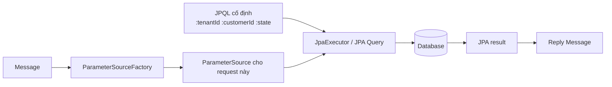
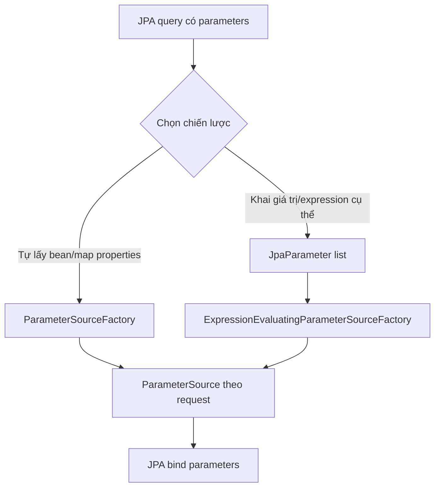
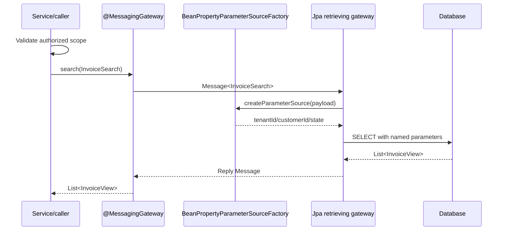
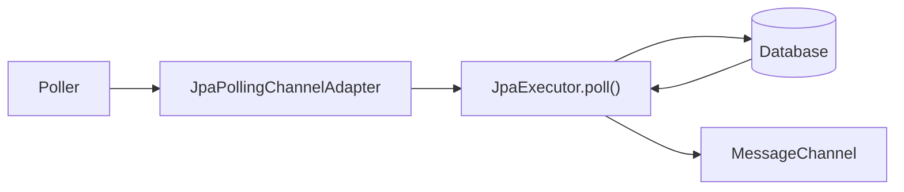
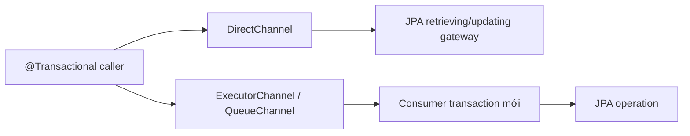

# Parameter source cho JPA query

## 1. Bối cảnh và mục tiêu

Trong module **SPRING_INTEGRATION_ADAPTERS**, Spring Integration giúp kết nối các hệ thống bên ngoài bằng inbound/outbound adapter, gateway, poller và `MessageChannel`. Một yêu cầu có thể đi vào từ HTTP, file, SFTP, JMS, AMQP hay Kafka, sau đó cần truy vấn hoặc cập nhật cơ sở dữ liệu. Để thực hiện truy vấn JPA an toàn, endpoint phải biết **giá trị nào sẽ được gắn cho từng tham số của câu truy vấn**.

Bài **Parameter source cho JPA query** thuộc chương **Adapter JPA**. Tâm điểm là cách Spring Integration biến **Spring Message** thành một **`ParameterSource`** để `JpaExecutor` có thể binding dữ liệu cho JPQL, named query hoặc native SQL.

Sau khi học, bạn có thể:

- Giải thích hợp đồng giữa `JpaExecutor`, `ParameterSourceFactory`, `ParameterSource` và các JPA query parameters.
- Phân biệt `BeanPropertyParameterSourceFactory` với `ExpressionEvaluatingParameterSourceFactory`.
- Chọn đúng cách lấy giá trị từ **payload JavaBean**, **`Map`**, **message headers** hoặc các **SpEL expressions**.
- Hiểu chính xác `usePayloadAsParameterSource(true/false)` và default thay đổi khi khai `JpaParameter` tường minh.
- Cấu hình named, positional, static và expression-based parameters bằng Java DSL, `JpaExecutor` thuần và XML namespace.
- Tự viết một `ParameterSourceFactory` chuyên biệt khi hợp đồng input không khớp trực tiếp với tên query parameters.
- Xây ví dụ chạy với Spring Boot 3.x, Spring Integration 6.x, Jakarta Persistence và `@MessagingGateway`.
- Ngăn lỗi binding sai kiểu, thiếu tham số, rò rỉ dữ liệu giữa các tenant và nhận SpEL/SQL không đáng tin cậy.
- Kiểm thử parameter source độc lập, rồi kiểm thử toàn bộ request–reply JPA flow với database.
- Thiết kế chiến lược cho JPA inbound polling không có request message, updating outbound gateway có transaction và các luồng bất đồng bộ.

**Kết luận cần nhớ từ đầu:** parameter source chỉ quyết định **lấy giá trị nào để binding**; nó **không** tự xác thực người dùng, cấp quyền truy cập, tạo transaction hay đảm bảo dữ liệu đã được xử lý đúng một lần.

## 2. Vì sao cần ParameterSource?

JPA hỗ trợ truy vấn có parameter:

```sql
select i from Invoice i
where i.tenantId = :tenantId
  and i.customerId = :customerId
  and i.state = :state
order by i.id
```

Chuỗi JPQL trên do ứng dụng định nghĩa. Nhưng mỗi request có thể mang các giá trị khác nhau:

```text
Request A:
  tenantId   = TENANT-A
  customerId = C-101
  state      = PAID

Request B:
  tenantId   = TENANT-B
  customerId = C-205
  state      = PENDING
```

`JpaExecutor` cần một đối tượng trả lời các câu hỏi: “`tenantId` có giá trị không?”, “Giá trị `customerId` là gì?” và “Nếu query dùng positional parameters, tham số vị trí 1/2 lấy từ đâu?”.

`ParameterSource` và `ParameterSourceFactory` giải quyết phần này.



### Tách ba loại trách nhiệm

| Trách nhiệm | Thành phần | Ví dụ |
| --- | --- | --- |
| Xác định **cú pháp truy vấn** | Query configuration | `where i.tenantId = :tenantId` |
| Xác định **giá trị tham số** | `ParameterSource` | `tenantId = "TENANT-A"` |
| Thực thi và lập transaction | `JpaExecutor`, JPA provider, Spring transaction | `EntityManager.createQuery` / `setParameter` / `getResultList` |

**Không** tạo câu query kiểu:

```java
// SAI: không được ghép trực tiếp dữ liệu client vào JPQL.
String jpql = "select i from Invoice i where i.tenantId = '"
        + untrustedTenantId + "'";
```

Thay vào đó, giữ câu `where i.tenantId = :tenantId` rồi binding `tenantId` bằng parameter source. Binding giúp dữ liệu không trở thành cú pháp JPQL/SQL, nhưng ứng dụng vẫn phải kiểm tra quyền trên tenant.

## 3. Các API trọng tâm

Những loại API cần nhận biết trong Spring Integration JPA 6.x:

```java
org.springframework.integration.jpa.core.JpaExecutor

org.springframework.integration.jpa.support.parametersource.ParameterSource
org.springframework.integration.jpa.support.parametersource.ParameterSourceFactory

org.springframework.integration.jpa.support.parametersource.BeanPropertyParameterSourceFactory
org.springframework.integration.jpa.support.parametersource.ExpressionEvaluatingParameterSourceFactory

org.springframework.integration.jpa.support.JpaParameter
```

### 3.1. ParameterSource là hợp đồng tra cứu giá trị

Interface `ParameterSource` cung cấp những phương thức:

```java
public interface ParameterSource {
    boolean hasValue(String paramName);
    Object getValue(String paramName);
}
```

Đoạn trên giản lược API để giải thích ý nghĩa; package/import nằm trong danh sách phía trên.

- `hasValue("tenantId")` cho biết nguồn có cung cấp tham số có tên `tenantId` không.
- `getValue("tenantId")` trả về giá trị để JPA query binding.
- `hasValue(...) == true` **không** có nghĩa giá trị khác `null`, đúng kiểu, hay caller được quyền sử dụng nó.
- Những tham số theo vị trí dùng giao diện/bản triển khai có khả năng hỗ trợ positional parameters tương ứng; đừng ép mọi query positional vào `getValue(String)` bằng cách đoán tên.

### 3.2. ParameterSourceFactory tạo nguồn cho từng input

`ParameterSourceFactory` có hợp đồng:

```java
public interface ParameterSourceFactory {
    ParameterSource createParameterSource(Object input);
}
```

`input` là đối tượng đầu vào mà `JpaExecutor` chuyển cho factory. Nó có thể là **payload** hoặc **toàn bộ Spring Message**, tùy `usePayloadAsParameterSource`.

**Một factory bean có thể được dùng cho nhiều request đồng thời**, nên implementation nên là **stateless** hoặc chỉ chứa cấu hình immutable. Đừng giữ tham số của request A vào một `Map` mutable chung rồi dùng lại cho request B. Mỗi lần `createParameterSource` nên tạo nguồn giá trị độc lập cho input tương ứng.

### 3.3. Hai factory thông dụng

| Factory | Cách lấy giá trị | Phù hợp nhất |
| --- | --- | --- |
| `BeanPropertyParameterSourceFactory` | Introspection của JavaBean properties; xử lý một số dạng `Map`/`List` | Payload đã có thuộc tính trùng tên query parameter |
| `ExpressionEvaluatingParameterSourceFactory` | Đánh giá `JpaParameter` tĩnh hoặc SpEL theo input | Tham số lấy từ nhiều vị trí, cần tính toán/đổi tên, đọc headers |
| Factory tùy chỉnh | Code Java tự chuyển input thành `ParameterSource` | Hợp đồng phức tạp, mapping legacy, kiểm soát giá trị tập trung |

**Sự khác nhau quan trọng:** `BeanPropertyParameterSourceFactory` thường không cần danh sách `JpaParameter` tường minh; `ExpressionEvaluatingParameterSourceFactory` nhận các `JpaParameter` và đánh giá expressions để tạo giá trị.

## 4. BeanPropertyParameterSourceFactory: lấy giá trị từ JavaBean

Đây là chiến lược đơn giản nhất khi request payload là một JavaBean có getters khớp tên parameter của JPQL.

### 4.1. Ví dụ JavaBean

```java
package com.example.jpaparams;

public final class InvoiceSearch {

    private final String tenantId;
    private final String customerId;
    private final String state;

    public InvoiceSearch(
            String tenantId, String customerId, String state) {
        this.tenantId = tenantId;
        this.customerId = customerId;
        this.state = state;
    }

    public String getTenantId() {
        return tenantId;
    }

    public String getCustomerId() {
        return customerId;
    }

    public String getState() {
        return state;
    }
}
```

Trong JavaBeans convention, getters trên tạo properties `tenantId`, `customerId` và `state`. Câu JPQL:

```sql
select i from Invoice i
where i.tenantId = :tenantId
  and i.customerId = :customerId
  and i.state = :state
```

có tên tham số trùng khớp với JavaBean properties.

### 4.2. Tự gọi factory để hiểu hợp đồng

```java
import org.springframework.integration.jpa.support.parametersource.BeanPropertyParameterSourceFactory;
import org.springframework.integration.jpa.support.parametersource.ParameterSource;

BeanPropertyParameterSourceFactory factory =
        new BeanPropertyParameterSourceFactory();

InvoiceSearch search = new InvoiceSearch(
        "TENANT-A", "C-101", "PAID");

ParameterSource source =
        factory.createParameterSource(search);

System.out.println(source.hasValue("tenantId")); // true
System.out.println(source.getValue("tenantId"));  // TENANT-A
System.out.println(source.getValue("state"));     // PAID
```

Đây là demo Java API, chưa thực hiện query. Cần `JpaExecutor`/gateway và JPA provider mới chạy JPQL thật.

**Không nên nhầm `Java record` với JavaBean getters:** record `record InvoiceSearch(String tenantId)` có accessor `tenantId()`, trong khi bean-property introspection có thể có hành vi khác tùy Spring/Java version. Để một ví dụ `BeanPropertyParameterSourceFactory` dễ dự đoán, bài dùng class có `getTenantId()` tường minh. Với record, có thể chọn SpEL expressions `payload.tenantId()` và kiểm thử trên version của ứng dụng.

### 4.3. Cấu hình bằng JpaExecutor

```java
JpaExecutor executor = new JpaExecutor(entityManagerFactory);

executor.setJpaQuery("""
        select i from Invoice i
        where i.tenantId = :tenantId
          and i.customerId = :customerId
          and i.state = :state
        order by i.id
        """);

executor.setParameterSourceFactory(
        new BeanPropertyParameterSourceFactory());

executor.setUsePayloadAsParameterSource(true);
executor.setExpectSingleResult(false);
executor.setMaxNumberOfResults(50);
```

Ở đây:

1. `new JpaExecutor(entityManagerFactory)` dùng JPA hạ tầng do Spring quản lý.
2. Query text cố định gồm ba parameter names.
3. `BeanPropertyParameterSourceFactory` đọc JavaBean properties từ **payload**.
4. `setUsePayloadAsParameterSource(true)` bảo đảm factory không nhận wrapper `Message` mà nhận `InvoiceSearch`.
5. `setExpectSingleResult(false)` giữ list contract.
6. `setMaxNumberOfResults(50)` tránh query trả hàng không giới hạn.

Khi đã dùng một factory để cấp tất cả parameters, **không đồng thời gắn một danh sách `JpaParameter` khác lên cùng executor** rồi giả định framework tự merge mọi nguồn tham số.

### 4.4. Map làm parameter source

`BeanPropertyParameterSourceFactory` cũng hỗ trợ dùng `Map` để cung cấp các giá trị:

```java
import java.util.Map;
import org.springframework.integration.jpa.support.parametersource.BeanPropertyParameterSourceFactory;

var factory = new BeanPropertyParameterSourceFactory();

var source = factory.createParameterSource(Map.of(
        "tenantId", "TENANT-A",
        "customerId", "C-101",
        "state", "PAID"
));

Object tenantId = source.getValue("tenantId");
Object state = source.getValue("state");
```

Map keys phải đúng tên query parameters. `Map.of(...)` không chấp nhận null, một lợi thế trong demo nhưng không có nghĩa mọi query đều nên cấm null; nullable filter cần hợp đồng riêng.

### 4.5. Static parameters của BeanProperty factory

API `setStaticParameters(Map<String,Object>)` có một điểm dễ bỏ qua: tài liệu Javadoc xác nhận static parameters được thêm trong trường hợp **input là `Map` hoặc `List`**, còn với một input JavaBean thông thường, thuộc tính này **bị bỏ qua**.

Ví dụ với Map:

```java
var factory = new BeanPropertyParameterSourceFactory();

factory.setStaticParameters(
        Map.of("state", "PAID"));

var source = factory.createParameterSource(
        Map.of(
            "tenantId", "TENANT-A",
            "customerId", "C-101"
        ));

Object state = source.getValue("state"); // PAID
```

Nếu payload là `InvoiceSearch` JavaBean và muốn `state` luôn là `PAID` bất kể client gửi gì, **đừng giả định `setStaticParameters` sẽ ghi đè bean property**. Hãy dùng JPQL constant điều kiện `i.state = 'PAID'`, một `JpaParameter` tĩnh trong expression-based strategy, hoặc tạo một request object được server chuẩn hóa.

## 5. usePayloadAsParameterSource: lựa chọn quyết định input của factory

`usePayloadAsParameterSource` là cấu hình cực kỳ quan trọng của `JpaExecutor`.

| Giá trị | Input factory nhận | Cách truy cập điển hình |
| --- | --- | --- |
| `true` | Chỉ `message.getPayload()` | JavaBean `customerId`, `state`; SpEL `#this` nếu payload là root |
| `false` | Toàn bộ Spring `Message<?>` | SpEL `payload.customerId`, `headers['verifiedTenantId']` |

**Quy tắc default theo Spring Integration Reference:**

- **Không khai `JpaParameter` tường minh:** thường mặc định `true`, vì `BeanPropertyParameterSourceFactory` đọc bean properties của payload.
- **Có `JpaParameter` tường minh:** mặc định trở thành `false`, giúp SpEL expression truy cập cả payload lẫn headers.

Để tránh phụ thuộc các thay đổi cấu hình gián tiếp, nên đặt `true`/`false` **tường minh** khi một flow có nhiều developers hoặc khi tài liệu cần diễn tả chính xác input.

### 5.1. Vì sao expression "payload.customerId" có thể lỗi?

Giả sử dùng:

```java
new JpaParameter(
        "customerId", null, "payload.customerId");
```

Nếu root là Spring Message (`usePayloadAsParameterSource(false)`), biểu thức `payload.customerId` có nghĩa.

Nếu root là chính `InvoiceSearch` (`true`), biểu thức cần chuyển thành `customerId` (property của bean), không thể mặc định tìm một property tên `payload` trên `InvoiceSearch`.

Đây là ví dụ lỗi:

```text
SpEL root = InvoiceSearch
Expression = payload.customerId
            ^^^^^^^
InvoiceSearch không có property "payload"
→ SpelEvaluationException hoặc parameter binding lỗi
```

### 5.2. Cần dùng header?

Để đọc header thì cần root là **Message**:

```java
new JpaParameter(
        "tenantId", null,
        "headers['verifiedTenantId']");
```

Và đặt:

```java
executor.setUsePayloadAsParameterSource(false);
```

Nhưng **header không tự trở thành đáng tin cậy vì tên có chữ "verified"**. Ở đầu vào HTTP/JMS/Kafka, message producer có thể tự gắn header nếu ứng dụng cho phép. Tầng authentication/authorization phải thiết lập/kiểm tra scope, sau đó mới gắn header được sử dụng trong query.

### 5.3. Khi nào chọn true, khi nào chọn false?

| Bài toán | Cấu hình nên cân nhắc |
| --- | --- |
| Payload là JavaBean có getters trùng tên parameters | `BeanPropertyParameterSourceFactory` + `true` |
| Payload là Map tên-key trùng parameter | `BeanPropertyParameterSourceFactory` + `true` |
| Parameter cần đổi tên từ field khác | Explicit `JpaParameter` expression + `false` |
| Cần kết hợp payload và header | Explicit expressions hoặc custom factory + `false` |
| Chỉ có String payload là một giá trị | Expression `#this` với `true` hoặc `payload` với `false` |
| Inbound poller không có message request | Static parameters hoặc factory nguồn phù hợp, không giả định có `payload` |
| Nhiều giá trị cần kiểm tra phức tạp | Validate/enrich thành DTO trước gateway; custom factory chỉ khi thật cần |

## 6. ExpressionEvaluatingParameterSourceFactory và JpaParameter

Khi tên parameter không trùng bean property, hoặc giá trị được lấy từ cả payload lẫn headers, ta cần biểu thức **SpEL**.

### 6.1. JpaParameter biểu diễn một parameter

`JpaParameter` có hai constructor quan trọng:

```java
new JpaParameter(String name, Object value, String expression);

new JpaParameter(Object value, String expression);
```

Constructor thứ nhất tạo **named parameter**; constructor thứ hai không có name, hữu ích cho **positional parameter**.

Các ví dụ:

```java
// :tenantId lấy từ payload field đã kiểm tra.
new JpaParameter(
        "tenantId", null, "payload.tenantId");

// :state là hằng số do server định nghĩa.
new JpaParameter(
        "state", "PAID", null);

// :customerId lấy từ header tin cậy.
new JpaParameter(
        "customerId", null,
        "headers['verifiedCustomerId']");

// Positional parameter (không có name).
new JpaParameter(
        null, "payload.customerId");
```

**Đúng một trong `value` hoặc `expression` cần được cung cấp** theo constructor contract. Nếu bạn muốn binding `null` là một giá trị hợp lệ, phải cân nhắc cách biểu diễn giá trị nullable và JPA parameter typing; không dùng constructor có cả value/expression bằng null.

### 6.2. ExpressionEvaluatingParameterSourceFactory

Factory chuyên đánh giá expression có API:

```java
ExpressionEvaluatingParameterSourceFactory factory =
        new ExpressionEvaluatingParameterSourceFactory();

factory.setParameters(List.of(
        new JpaParameter(
                "tenantId", null,
                "payload.tenantId"),
        new JpaParameter(
                "customerId", null,
                "payload.customerId"),
        new JpaParameter(
                "state", "PAID", null)
));
```

Nó tạo `ParameterSource` có khả năng trả các giá trị được định nghĩa theo `JpaParameter`. Đối với SpEL expressions đơn giản, input là message khi `usePayloadAsParameterSource(false)`.

Đây là **một cách thay thế** cho `JpaExecutor.setJpaParameters(...)`, không phải một factory cần thêm vào cùng executor **đã** đặt danh sách parameters khác.

### 6.3. Cấu hình trực tiếp trên JpaExecutor

Cách thường dùng trong Java configuration:

```java
JpaExecutor executor =
        new JpaExecutor(entityManagerFactory);

executor.setJpaQuery("""
        select i from Invoice i
        where i.tenantId = :tenantId
          and i.customerId = :customerId
          and i.state = :state
        """);

executor.setJpaParameters(List.of(
        new JpaParameter(
                "tenantId", null,
                "payload.tenantId"),
        new JpaParameter(
                "customerId", null,
                "payload.customerId"),
        new JpaParameter(
                "state", "PAID", null)
));

executor.setUsePayloadAsParameterSource(false);
executor.setExpectSingleResult(false);
executor.setMaxNumberOfResults(50);
```

`JpaExecutor` khởi tạo cơ chế đánh giá tương ứng từ danh sách `JpaParameter` khi Spring bean lifecycle chạy. Nếu bạn khai executor bằng `@Bean`, Spring sẽ gọi lifecycle methods cần thiết; không cần tự viết parser SpEL cho các ví dụ thông thường.

### 6.4. Cùng cách viết bằng Java DSL

```java
Jpa.retrievingGateway(entityManagerFactory)
        .jpaQuery("""
                select i from Invoice i
                where i.tenantId = :tenantId
                  and i.customerId = :customerId
                  and i.state = :state
                """)
        .parameterExpression(
                "tenantId", "payload.tenantId")
        .parameterExpression(
                "customerId", "payload.customerId")
        .parameter("state", "PAID")
        .usePayloadAsParameterSource(false)
        .maxResults(50);
```

Các `parameterExpression` tính giá trị khi có message đi qua gateway. `parameter("state", "PAID")` cố định state; không nhận state từ client.

Nếu chỉ dùng payload String:

```java
// Message payload = "TENANT-A", root là toàn Message:
.parameterExpression("tenantId", "payload")

// Khi đã chọn payload làm root:
.usePayloadAsParameterSource(true)
.parameterExpression("tenantId", "#this")
```

Hai cách trên chỉ minh họa SpEL root; không viết cả hai nhóm cùng lúc trong một DSL spec.

## 7. Named parameters và positional parameters

### 7.1. Named parameters

JPQL dễ đọc hơn khi dùng tên:

```sql
select i from Invoice i
where i.tenantId = :tenantId
  and i.state = :state
```

Cấu hình:

```java
.parameterExpression("tenantId", "payload.tenantId")
.parameter("state", "PAID")
```

Named parameters không phụ thuộc thứ tự khai báo, nhưng **tên phải khớp chính xác**. `tenantID` và `tenantId` là hai tên khác nhau.

### 7.2. Positional parameters

JPQL:

```sql
select i from Invoice i
where i.tenantId = ?1
  and i.state = ?2
```

DSL:

```java
Jpa.retrievingGateway(entityManagerFactory)
        .jpaQuery("""
                select i from Invoice i
                where i.tenantId = ?1
                  and i.state = ?2
                """)
        .parameterExpression("payload.tenantId")
        .parameter("PAID");
```

Đây là các overload **không có tên parameter**; thứ tự khai báo phải phù hợp vị trí mà provider/JPA query yêu cầu.

**Khuyến nghị:** ưu tiên named parameters với query từ vài điều kiện trở lên. Positional parameters vẫn hữu ích khi tích hợp named/native queries cũ hoặc provider yêu cầu cách binding cụ thể.

### 7.3. Đừng trộn cú pháp positional của nhiều chuẩn

JPA positional parameters (`?1`, `?2`) khác với dấu `?` trong một số JDBC SQL frameworks. Native SQL có thể có những giới hạn khác nhau về named parameter support giữa Hibernate/JPA provider và database.

Nếu phải dùng native SQL, kiểm tra **exact query syntax + binding mechanism** trên database mục tiêu. Đừng kết luận một cú pháp chạy trên H2 chắc chắn chạy trên PostgreSQL/Oracle/MySQL.

## 8. ParameterSourceFactory tùy chỉnh

Khi input schema không trùng tên parameter query hoặc cần chuẩn hóa một cấu trúc legacy, có thể tự viết factory.

**Quy tắc:** custom factory nên làm nhiệm vụ mapping giá trị có kiểu rõ ràng, không thay thế authentication/authorization. Nó không nên tạo câu query text từ request.

### 8.1. Ví dụ factory đổi tên field

Giả sử input là:

```java
public record LegacyInvoiceQuery(
        String organizationKey,
        String customerKey,
        String workflowState) {
}
```

Nhưng JPQL muốn `:tenantId`, `:customerId` và `:state`. Có thể viết:

```java
package com.example.jpaparams;

import java.util.Map;

import org.springframework.integration.jpa.support.parametersource.BeanPropertyParameterSourceFactory;
import org.springframework.integration.jpa.support.parametersource.ParameterSource;
import org.springframework.integration.jpa.support.parametersource.ParameterSourceFactory;

public final class LegacyInvoiceParameterSourceFactory
        implements ParameterSourceFactory {

    private final BeanPropertyParameterSourceFactory delegate =
            new BeanPropertyParameterSourceFactory();

    @Override
    public ParameterSource createParameterSource(Object input) {
        if (!(input instanceof LegacyInvoiceQuery query)) {
            throw new IllegalArgumentException(
                    "Expected LegacyInvoiceQuery");
        }

        if (query.organizationKey() == null
                || query.organizationKey().isBlank()
                || query.customerKey() == null
                || query.customerKey().isBlank()
                || query.workflowState() == null
                || query.workflowState().isBlank()) {
            throw new IllegalArgumentException(
                    "Invalid legacy query fields");
        }

        Map<String, Object> namedValues = Map.of(
                "tenantId", query.organizationKey(),
                "customerId", query.customerKey(),
                "state", query.workflowState());

        // Tạo ParameterSource riêng cho input hiện tại.
        return delegate.createParameterSource(namedValues);
    }
}
```

Trong một flow đã kiểm soát đầu vào:

```java
Jpa.retrievingGateway(entityManagerFactory)
        .jpaQuery("""
                select i from Invoice i
                where i.tenantId = :tenantId
                  and i.customerId = :customerId
                  and i.state = :state
                """)
        .parameterSourceFactory(
                new LegacyInvoiceParameterSourceFactory())
        .usePayloadAsParameterSource(true)
        .maxResults(50);
```

Factory ở trên chỉ **đổi tên** và kiểm tra không rỗng. Nó không xác minh `organizationKey` là tenant được phép của caller. Ở production, phải gắn một **authenticated tenant scope** trước khi gọi flow. Nếu không, client có thể gửi một organizationKey tùy ý rồi đọc dữ liệu tenant khác.

### 8.2. Custom factory đọc toàn Spring Message

Khi input cần cả payload và header **đã qua lớp bảo mật**, có thể chọn `usePayloadAsParameterSource(false)`:

```java
public final class MessageInvoiceParameterSourceFactory
        implements ParameterSourceFactory {

    private final BeanPropertyParameterSourceFactory delegate =
            new BeanPropertyParameterSourceFactory();

    @Override
    public ParameterSource createParameterSource(Object input) {
        if (!(input instanceof Message<?> message)) {
            throw new IllegalArgumentException(
                    "Expected Spring Message");
        }

        if (!(message.getPayload() instanceof InvoiceSearch search)) {
            throw new IllegalArgumentException(
                    "Expected InvoiceSearch payload");
        }

        Object verifiedTenant =
                message.getHeaders().get("verifiedTenantId");

        if (!(verifiedTenant instanceof String tenant)
                || tenant.isBlank()) {
            throw new IllegalArgumentException(
                    "Missing trusted tenant scope");
        }

        return delegate.createParameterSource(Map.of(
                "tenantId", tenant,
                "customerId", search.getCustomerId(),
                "state", search.getState()
        ));
    }
}
```

Đoạn code minh họa giả định imports của `Message`, `Map`, `ParameterSourceFactory`, `ParameterSource` và `BeanPropertyParameterSourceFactory` như các phần trước.

**Đặc biệt quan trọng:** kiểm tra header **có tồn tại** chưa đủ. Hệ thống phải đảm bảo header `verifiedTenantId` chỉ do một component server-side đáng tin cậy tạo và bị **ghi đè/xóa** nếu input đến từ nguồn client không tin cậy. Nếu attacker được phép đặt header này, factory trở thành một đường đọc dữ liệu trái phép.

### 8.3. Tránh mutable state trong singleton factory

**Sai:**

```java
private final Map<String, Object> current = new HashMap<>();

public ParameterSource createParameterSource(Object input) {
    // Ghi tham số của request A/B vào cùng map dùng chung.
    current.put("tenantId", ...);
    return delegate.createParameterSource(current);
}
```

Hai request đồng thời có thể làm rò dữ liệu cross-tenant nếu map bị ghi đè giữa chừng.

**Đúng:** tạo local `Map` riêng trong `createParameterSource(...)`, không giữ request-specific state ở singleton. Nếu cache, cache immutable configuration/query metadata chứ không cache parameter values gắn với user.

### 8.4. Khi nào không cần custom factory?

Nếu chỉ cần đổi tên field hoặc kết hợp hai giá trị đơn giản, `JpaParameter`/SpEL thường ngắn và dễ audit hơn. Nếu cần validate nghiệp vụ, tốt nhất là làm trong **service/transformer** trước gateway, tạo DTO đã chuẩn hóa, rồi dùng `BeanPropertyParameterSourceFactory`. Custom factory có ích khi mapping định dạng legacy phức tạp được dùng lặp lại và có unit tests rõ ràng.

## 9. Tránh trộn hai cơ chế binding

Spring Integration hỗ trợ hai nhánh cấu hình tương đối độc lập:



Trong XML namespace, **`parameter-source-factory` và những phần tử `<int-jpa:parameter>` là hai cấu hình loại trừ nhau**. Theo hướng dẫn chính thức, nếu tự cung cấp factory, những parameter definitions cần được cấu hình **trong factory đó**, không vừa ở factory lại vừa là child elements của endpoint.

Trong Java, hãy chọn:

**A — Factory:**

```java
executor.setParameterSourceFactory(
        new BeanPropertyParameterSourceFactory());
executor.setUsePayloadAsParameterSource(true);
```

**B — Explicit parameters:**

```java
executor.setJpaParameters(List.of(
        new JpaParameter(
                "tenantId", null,
                "payload.tenantId"),
        new JpaParameter(
                "state", "PAID", null)
));
executor.setUsePayloadAsParameterSource(false);
```

**C — Factory mang danh sách expressions (khi cần):**

```java
ExpressionEvaluatingParameterSourceFactory factory =
        new ExpressionEvaluatingParameterSourceFactory();

factory.setParameters(List.of(
        new JpaParameter(
                "tenantId", null,
                "payload.tenantId"),
        new JpaParameter(
                "state", "PAID", null)
));

executor.setParameterSourceFactory(factory);
executor.setUsePayloadAsParameterSource(false);
```

Trong mỗi endpoint thực tế, chọn **một** nhánh. Không gắn cấu hình A, B và C đồng thời với kỳ vọng chúng tự ghép hay tự xác định thứ tự ưu tiên.

## 10. Ví dụ hoàn chỉnh: Spring Boot + JPA + ParameterSourceFactory

### 10.1. Bài toán

Ta xây một ứng dụng quản lý hóa đơn:

1. Service nhận **tenant/customer scope đã được xác thực**.
2. Service validate filter `state` và tạo `InvoiceSearch` JavaBean.
3. `@MessagingGateway` gửi `Message<InvoiceSearch>` vào Integration Flow.
4. JPA retrieving gateway dùng **`BeanPropertyParameterSourceFactory`** để lấy ba parameters từ payload.
5. JPQL trả `InvoiceView` DTO thông qua constructor expression, không trả entity cho caller.
6. `@Transactional(readOnly=true)` bao quanh request–reply đồng bộ.
7. H2 in-memory cung cấp dữ liệu demo, có test kiểm tra không rò dữ liệu tenant khác.

Sơ đồ:



### 10.2. Maven dependencies

Mẫu dùng Java 17+, Spring Boot 3.x, Spring Integration 6.x và Jakarta Persistence:

```xml
<dependencies>
    <dependency>
        <groupId>org.springframework.boot</groupId>
        <artifactId>spring-boot-starter</artifactId>
    </dependency>
    <dependency>
        <groupId>org.springframework.boot</groupId>
        <artifactId>spring-boot-starter-data-jpa</artifactId>
    </dependency>
    <dependency>
        <groupId>org.springframework.boot</groupId>
        <artifactId>spring-boot-starter-integration</artifactId>
    </dependency>
    <dependency>
        <groupId>org.springframework.integration</groupId>
        <artifactId>spring-integration-jpa</artifactId>
    </dependency>
    <dependency>
        <groupId>com.h2database</groupId>
        <artifactId>h2</artifactId>
        <scope>runtime</scope>
    </dependency>
    <dependency>
        <groupId>org.springframework.boot</groupId>
        <artifactId>spring-boot-starter-test</artifactId>
        <scope>test</scope>
    </dependency>
</dependencies>
```

Dùng Spring Boot dependency management/BOM để bảo đảm Spring Integration, Hibernate/JPA và Spring Framework tương thích. H2 chỉ là database demo; production cần PostgreSQL/MySQL/Oracle theo môi trường và migration schema.

### 10.3. Entity Invoice

File `Invoice.java`:

```java
package com.example.jpaparams;

import java.math.BigDecimal;

import jakarta.persistence.Column;
import jakarta.persistence.Entity;
import jakarta.persistence.Id;
import jakarta.persistence.Index;
import jakarta.persistence.Table;

@Entity
@Table(
    name = "invoice",
    indexes = @Index(
            name = "idx_invoice_scope",
            columnList = "tenant_id, customer_id, state"))
public class Invoice {

    @Id
    @Column(name = "invoice_id", length = 80)
    private String id;

    @Column(name = "tenant_id", nullable = false, length = 80)
    private String tenantId;

    @Column(name = "customer_id", nullable = false, length = 80)
    private String customerId;

    @Column(nullable = false, length = 24)
    private String state;

    @Column(nullable = false, precision = 12, scale = 2)
    private BigDecimal amount;

    protected Invoice() {
        // Jakarta Persistence yêu cầu no-arg constructor.
    }

    public Invoice(
            String id, String tenantId, String customerId,
            String state, BigDecimal amount) {
        this.id = id;
        this.tenantId = tenantId;
        this.customerId = customerId;
        this.state = state;
        this.amount = amount;
    }

    public String getId() {
        return id;
    }

    public String getTenantId() {
        return tenantId;
    }

    public String getCustomerId() {
        return customerId;
    }

    public String getState() {
        return state;
    }

    public BigDecimal getAmount() {
        return amount;
    }
}
```

Trong JPQL, `Invoice` là tên entity Java; `tenantId` và `customerId` là thuộc tính Java. Trong SQL vật lý, các cột có tên `tenant_id` và `customer_id`. Đây là sự khác biệt giữa JPQL và native SQL.

### 10.4. DTO trả về và request JavaBean

File `InvoiceView.java`:

```java
package com.example.jpaparams;

import java.math.BigDecimal;

public record InvoiceView(
        String invoiceId,
        String state,
        BigDecimal amount) {
}
```

File `InvoiceSearch.java` (đã khai ở mục 4.1):

```java
package com.example.jpaparams;

public final class InvoiceSearch {

    private final String tenantId;
    private final String customerId;
    private final String state;

    public InvoiceSearch(
            String tenantId, String customerId, String state) {
        this.tenantId = tenantId;
        this.customerId = customerId;
        this.state = state;
    }

    public String getTenantId() {
        return tenantId;
    }

    public String getCustomerId() {
        return customerId;
    }

    public String getState() {
        return state;
    }
}
```

Mặc dù `InvoiceSearch` là immutable JavaBean (không setter), các getters đủ cho **read-only bean property access** của parameter source. Trong production, bạn có thể dùng builder/record nhưng phải kiểm thử cách factory lấy properties của loại object đã chọn.

### 10.5. Repository dùng để tạo dữ liệu kiểm thử

File `InvoiceRepository.java`:

```java
package com.example.jpaparams;

import org.springframework.data.jpa.repository.JpaRepository;

public interface InvoiceRepository
        extends JpaRepository<Invoice, String> {
}
```

Repository này dùng cho seed/test. Truy vấn chính vẫn được thực thi bởi **JPA retrieving outbound gateway** trong Integration Flow.

### 10.6. @MessagingGateway interface

File `InvoiceLookupGateway.java`:

```java
package com.example.jpaparams;

import java.util.List;
import org.springframework.integration.annotation.MessagingGateway;

@MessagingGateway(
        defaultRequestChannel = "invoiceSearchRequests",
        defaultReplyTimeout = "5000")
public interface InvoiceLookupGateway {

    List<InvoiceView> search(InvoiceSearch query);
}
```

`@MessagingGateway` tạo request Spring Message và chờ reply. Không có poller ở đây; query chạy khi `search(...)` được gọi. Timeout chờ reply của messaging gateway không tự thay thế JDBC query timeout, đặc biệt khi flow đồng bộ.

### 10.7. IntegrationFlow sử dụng BeanPropertyParameterSourceFactory

File `InvoiceIntegrationConfiguration.java`:

```java
package com.example.jpaparams;

import jakarta.persistence.EntityManagerFactory;

import org.springframework.context.annotation.Bean;
import org.springframework.context.annotation.Configuration;
import org.springframework.integration.config.EnableIntegration;
import org.springframework.integration.dsl.IntegrationFlow;
import org.springframework.integration.jpa.dsl.Jpa;
import org.springframework.integration.jpa.support.parametersource.BeanPropertyParameterSourceFactory;

@Configuration
@EnableIntegration
public class InvoiceIntegrationConfiguration {

    @Bean
    IntegrationFlow invoiceLookupFlow(
            EntityManagerFactory entityManagerFactory) {

        BeanPropertyParameterSourceFactory parameterFactory =
                new BeanPropertyParameterSourceFactory();

        return IntegrationFlow
                .from("invoiceSearchRequests")
                .handle(
                        Jpa.retrievingGateway(entityManagerFactory)
                                .jpaQuery("""
                                        select new com.example.jpaparams.InvoiceView(
                                            i.id, i.state, i.amount)
                                        from Invoice i
                                        where i.tenantId = :tenantId
                                          and i.customerId = :customerId
                                          and i.state = :state
                                        order by i.id
                                        """)
                                .parameterSourceFactory(parameterFactory)
                                .usePayloadAsParameterSource(true)
                                .maxResults(50)
                                .expectSingleResult(false))
                .get();
    }
}
```

**Dòng quan trọng nhất:**

```java
.parameterSourceFactory(parameterFactory)
.usePayloadAsParameterSource(true)
```

Khi request đến:

- `JpaExecutor` được Java DSL cấu hình gọi factory để tạo source cho input.
- Vì `true`, factory nhận **`InvoiceSearch` payload**, không phải wrapper message.
- Bean properties `tenantId`, `customerId` và `state` khớp named parameters trong JPQL.
- JPA provider binding giá trị; không cần nối JPQL string.
- Constructor expression trả các `InvoiceView` DTO, giúp tránh lazy loading và không đẩy nguyên entity graph ra ngoài.
- `maxResults(50)` ngăn query trả vô hạn row.
- `expectSingleResult(false)` giữ list reply; truy vấn không có row trả list rỗng trong Spring Integration 6.x.

**Vì sao dùng constructor expression?** Bài tập trung vào parameter source, nên giảm một bước transformer để ví dụ dễ theo dõi. Nếu query trả entity đầy đủ, nên chuyển sang DTO trước khi đi qua HTTP/Kafka/JMS hoặc một channel bất đồng bộ.

### 10.8. Service kiểm tra điều kiện trước gateway

File `InvoiceSearchService.java`:

```java
package com.example.jpaparams;

import java.util.List;
import java.util.Set;

import org.springframework.stereotype.Service;
import org.springframework.transaction.annotation.Transactional;

@Service
public class InvoiceSearchService {

    private static final Set<String> ALLOWED_STATES =
            Set.of("PAID", "PENDING");

    private final InvoiceLookupGateway gateway;

    public InvoiceSearchService(InvoiceLookupGateway gateway) {
        this.gateway = gateway;
    }

    @Transactional(readOnly = true)
    public List<InvoiceView> findInAuthorizedScope(
            String verifiedTenantId,
            String authorizedCustomerId,
            String requestedState) {

        if (verifiedTenantId == null
                || verifiedTenantId.isBlank()
                || verifiedTenantId.length() > 80
                || authorizedCustomerId == null
                || authorizedCustomerId.isBlank()
                || authorizedCustomerId.length() > 80) {
            throw new IllegalArgumentException(
                    "Invalid authorized scope");
        }

        if (!ALLOWED_STATES.contains(requestedState)) {
            throw new IllegalArgumentException(
                    "Unsupported invoice state");
        }

        InvoiceSearch query = new InvoiceSearch(
                verifiedTenantId,
                authorizedCustomerId,
                requestedState);

        return gateway.search(query);
    }
}
```

**Phạm vi tin cậy:** hai tham số `verifiedTenantId` và `authorizedCustomerId` trong service là giá trị do tầng bảo mật của ứng dụng **đã xác thực/ủy quyền**. Nếu một HTTP controller truyền thẳng query parameters do người dùng tự nhập vào hai biến này, tên biến không bảo vệ được gì. Production phải lấy tenant/customer scope từ authenticated principal, ACL hoặc domain authorization service.

`@Transactional(readOnly = true)` bao quanh flow đồng bộ trên `DirectChannel`. Nếu thêm `ExecutorChannel` hoặc `QueueChannel`, transaction/JPA persistence context của thread gọi không tự chuyển sang consumer khác.

### 10.9. Spring Boot main và application.properties

File `JpaParameterSourceApplication.java`:

```java
package com.example.jpaparams;

import java.math.BigDecimal;
import java.util.List;

import org.springframework.boot.CommandLineRunner;
import org.springframework.boot.SpringApplication;
import org.springframework.boot.autoconfigure.SpringBootApplication;
import org.springframework.context.annotation.Bean;
import org.springframework.integration.annotation.IntegrationComponentScan;

@SpringBootApplication
@IntegrationComponentScan
public class JpaParameterSourceApplication {

    public static void main(String[] args) {
        SpringApplication.run(
                JpaParameterSourceApplication.class, args);
    }

    @Bean
    CommandLineRunner sampleData(
            InvoiceRepository repository,
            InvoiceSearchService service) {

        return args -> {
            if (repository.count() == 0) {
                repository.saveAll(List.of(
                        new Invoice(
                                "INV-101", "TENANT-A", "C-101",
                                "PAID", new BigDecimal("35.00")),
                        new Invoice(
                                "INV-102", "TENANT-A", "C-101",
                                "PENDING", new BigDecimal("42.00")),
                        new Invoice(
                                "INV-103", "TENANT-B", "C-101",
                                "PAID", new BigDecimal("70.00")),
                        new Invoice(
                                "INV-104", "TENANT-A", "C-102",
                                "PAID", new BigDecimal("99.00"))
                ));
            }

            System.out.println("Allowed: "
                    + service.findInAuthorizedScope(
                            "TENANT-A", "C-101", "PAID"));

            System.out.println("Other state: "
                    + service.findInAuthorizedScope(
                            "TENANT-A", "C-101", "PENDING"));

            System.out.println("No rows: "
                    + service.findInAuthorizedScope(
                            "TENANT-A", "C-999", "PAID"));
        };
    }
}
```

File `application.properties`:

```properties
spring.main.web-application-type=none

spring.datasource.url=jdbc:h2:mem:jpa_param_demo;DB_CLOSE_DELAY=-1
spring.datasource.driver-class-name=org.h2.Driver
spring.datasource.username=sa
spring.datasource.password=

spring.jpa.hibernate.ddl-auto=create-drop
spring.jpa.open-in-view=false
logging.level.org.springframework.integration=INFO
```

**Chỉ dùng H2 in-memory và `create-drop` trong bài tập**, không dùng để lưu dữ liệu production.

### 10.10. Kết quả mong đợi

| Request | Reply | Vì sao |
| --- | --- | --- |
| TENANT-A, C-101, PAID | `INV-101` | Cả ba named parameters khớp |
| TENANT-A, C-101, PENDING | `INV-102` | Khác state, cùng scope |
| TENANT-A, C-999, PAID | `[]` | Không có row |
| TENANT-A, C-101, PAID | Không có `INV-103` | Hóa đơn đó thuộc TENANT-B |
| TENANT-A, C-101, PAID | Không có `INV-104` | Hóa đơn đó thuộc C-102 |

**Điểm đo:** không chỉ assert số lượng list; cần assert ID cụ thể để phát hiện query bỏ mất điều kiện tenant/customer, hoặc parameter source dùng nhầm properties.

## 11. Thay factory bằng JpaParameter expressions

Cùng ứng dụng có thể cấu hình một phiên bản khác, trong đó các tham số không lấy trực tiếp bằng bean-property lookup mà qua SpEL.

**Không bật đồng thời phiên bản này với `InvoiceIntegrationConfiguration` mục 10.7 trên cùng request channel**, vì chúng là hai handler thay thế.

```java
package com.example.jpaparams;

import jakarta.persistence.EntityManagerFactory;

import org.springframework.context.annotation.Bean;
import org.springframework.context.annotation.Configuration;
import org.springframework.integration.dsl.IntegrationFlow;
import org.springframework.integration.jpa.dsl.Jpa;

@Configuration
public class InvoiceExpressionFlowConfiguration {

    @Bean
    IntegrationFlow invoiceExpressionFlow(
            EntityManagerFactory entityManagerFactory) {

        return IntegrationFlow
                .from("invoiceSearchRequests")
                .handle(
                        Jpa.retrievingGateway(entityManagerFactory)
                                .jpaQuery("""
                                        select new com.example.jpaparams.InvoiceView(
                                            i.id, i.state, i.amount)
                                        from Invoice i
                                        where i.tenantId = :tenantId
                                          and i.customerId = :customerId
                                          and i.state = :state
                                        order by i.id
                                        """)
                                .parameterExpression(
                                        "tenantId", "payload.tenantId")
                                .parameterExpression(
                                        "customerId", "payload.customerId")
                                .parameterExpression(
                                        "state", "payload.state")
                                .usePayloadAsParameterSource(false)
                                .maxResults(50)
                                .expectSingleResult(false))
                .get();
    }
}
```

Những điểm khác:

- `BeanPropertyParameterSourceFactory` không được cấu hình trên endpoint này.
- Mỗi named parameter có một `parameterExpression`.
- Với root là `Message` (`false`), `payload.tenantId`/`payload.customerId`/`payload.state` là các biểu thức hợp lệ đối với getters của `InvoiceSearch`.
- Khi sau này cần đọc header tin cậy, có thể thêm `headers['verifiedTenantId']`, nhưng phải thiết kế nguồn tạo header bảo mật.
- Query và reply type vẫn giống nhau.

**Chọn factory khi payload trùng parameter names; chọn explicit expressions khi cần mapping/đổi tên/kết hợp headers.** Không có lý do để chuyển mọi query đơn giản thành SpEL chỉ vì framework hỗ trợ.

## 12. Cấu hình Java @ServiceActivator và JpaExecutor

Java DSL giấu chi tiết tạo executor. Nếu cần cấu hình tường minh, có thể viết:

```java
package com.example.jpaparams;

import jakarta.persistence.EntityManagerFactory;

import org.springframework.context.annotation.Bean;
import org.springframework.context.annotation.Configuration;
import org.springframework.integration.annotation.ServiceActivator;
import org.springframework.integration.jpa.core.JpaExecutor;
import org.springframework.integration.jpa.outbound.JpaOutboundGateway;
import org.springframework.integration.jpa.support.OutboundGatewayType;
import org.springframework.integration.jpa.support.parametersource.BeanPropertyParameterSourceFactory;
import org.springframework.messaging.MessageHandler;

@Configuration
public class InvoiceJpaExecutorConfiguration {

    @Bean
    JpaExecutor invoiceJpaExecutor(
            EntityManagerFactory entityManagerFactory) {

        JpaExecutor executor =
                new JpaExecutor(entityManagerFactory);

        executor.setJpaQuery("""
                select new com.example.jpaparams.InvoiceView(
                    i.id, i.state, i.amount)
                from Invoice i
                where i.tenantId = :tenantId
                  and i.customerId = :customerId
                  and i.state = :state
                order by i.id
                """);

        executor.setParameterSourceFactory(
                new BeanPropertyParameterSourceFactory());

        executor.setUsePayloadAsParameterSource(true);
        executor.setExpectSingleResult(false);
        executor.setMaxNumberOfResults(50);

        return executor;
    }

    @Bean
    @ServiceActivator(inputChannel = "invoiceSearchRequests")
    MessageHandler invoiceRetrievingHandler(
            JpaExecutor invoiceJpaExecutor) {

        JpaOutboundGateway handler =
                new JpaOutboundGateway(invoiceJpaExecutor);

        handler.setGatewayType(
                OutboundGatewayType.RETRIEVING);
        // Handler trả reply; không setProducesReply(false).
        return handler;
    }
}
```

- `JpaExecutor` được quản lý như Spring bean để các bước initialization hoạt động.
- `JpaOutboundGateway` chạy ở chế độ `RETRIEVING`, nên trả dữ liệu cho caller `@MessagingGateway`.
- Nếu muốn trả affected count sau `UPDATE`, chuyển sang `UPDATING` và thay JPQL, transaction/return type.
- Nếu dùng `setProducesReply(false)`, handler trở thành outbound channel adapter một chiều và caller có thể không nhận reply.

**Không khai thêm cùng một bean handler của Java DSL trên channel này** trừ khi có ý định rõ ràng. Với `DirectChannel`, nhiều handler có thể cạnh tranh phân phối message, dẫn đến việc request A đi qua một handler khác request B.

## 13. Cấu hình XML namespace

### 13.1. XML dùng factory trực tiếp

Đoạn XML sau có thể thay Java DSL/Java configuration của ví dụ:

```xml
<bean id="invoiceParameterSourceFactory"
      class="org.springframework.integration.jpa.support.parametersource.BeanPropertyParameterSourceFactory"/>

<int-jpa:retrieving-outbound-gateway
        id="invoiceRetrievingGateway"
        request-channel="invoiceSearchRequests"
        entity-manager-factory="entityManagerFactory"
        jpa-query="select new com.example.jpaparams.InvoiceView(
                       i.id, i.state, i.amount)
                   from Invoice i
                   where i.tenantId = :tenantId
                     and i.customerId = :customerId
                     and i.state = :state
                   order by i.id"
        parameter-source-factory="invoiceParameterSourceFactory"
        use-payload-as-parameter-source="true"
        max-results="50"
        expect-single-result="false"/>
```

Giả định XML application context có khai báo đầy đủ namespaces/schema `int` và `int-jpa`, `entityManagerFactory`, request channel và `@MessagingGateway` tương ứng. Đây chỉ là đoạn cấu hình endpoint.

**Không đặt `<int-jpa:parameter>` bên trong endpoint đang khai `parameter-source-factory`**. Đó là hai nguồn parameter không dùng chung như một cách merge không định nghĩa.

### 13.2. XML dùng expression-based parameters

Cấu hình thay thế:

```xml
<int-jpa:retrieving-outbound-gateway
        id="invoiceRetrievingGatewayExpressions"
        request-channel="invoiceSearchRequests"
        entity-manager-factory="entityManagerFactory"
        jpa-query="select new com.example.jpaparams.InvoiceView(
                       i.id, i.state, i.amount)
                   from Invoice i
                   where i.tenantId = :tenantId
                     and i.customerId = :customerId
                     and i.state = :state"
        use-payload-as-parameter-source="false"
        max-results="50"
        expect-single-result="false">

    <int-jpa:parameter
            name="tenantId"
            expression="payload.tenantId"/>
    <int-jpa:parameter
            name="customerId"
            expression="payload.customerId"/>
    <int-jpa:parameter
            name="state"
            expression="payload.state"/>
</int-jpa:retrieving-outbound-gateway>
```

Ba `<int-jpa:parameter>` dùng SpEL trên root `Message` để lấy payload properties. Nếu bạn cần giá trị tĩnh:

```xml
<int-jpa:parameter
        name="state"
        type="java.lang.String"
        value="PAID"/>
```

Đặt nó **thay thế** expression của `state`, không khai hai parameter cùng tên trên một gateway.

### 13.3. Positional XML

Với query:

```sql
select i from Invoice i
where i.tenantId = ?1
  and i.state = ?2
```

có thể cấu hình:

```xml
<int-jpa:parameter expression="payload.tenantId"/>
<int-jpa:parameter type="java.lang.String" value="PAID"/>
```

Không có `name` trên các positional parameter definitions; **thứ tự** phải khớp query. Khi nhiều điều kiện, tên tham số thường dễ debug và code review hơn.

### 13.4. Java/DSL/XML là ba cách thay thế

Không gắn ba retrieving handlers vào cùng `invoiceSearchRequests` khi bài toán muốn một request–reply gateway. Hãy chọn **một** biến thể cấu hình cho môi trường chạy. Trong tài liệu này, các biến thể còn lại chỉ để so sánh API.

## 14. Parameter source trong JPA inbound polling

JPA inbound adapter đọc database theo lịch:



Khác với retrieving gateway, inbound polling **không có request message theo nghiệp vụ** với `InvoiceSearch` payload/headers sẵn có.

Vì vậy, một expression như:

```java
new JpaParameter(
        "tenantId", null, "payload.tenantId");
```

không thể được bê nguyên sang nguồn polling và giả định có payload của request tương ứng. Trong trường hợp polling, bạn có thể:

- Dùng JPQL không có dynamic parameters.
- Dùng parameter tĩnh do server định nghĩa.
- Cấu hình một `ParameterSource` phù hợp với thời điểm poll từ cấu hình/service tin cậy.
- Nếu mỗi request message cần điều kiện khác nhau, dùng **JPA retrieving outbound gateway** thay vì inbound polling.

### 14.1. Poll với giá trị tĩnh

```java
JpaExecutor executor =
        new JpaExecutor(entityManagerFactory);

executor.setJpaQuery("""
        select i from Invoice i
        where i.state = :state
        order by i.id
        """);

executor.setJpaParameters(List.of(
        new JpaParameter("state", "PENDING", null)
));

executor.setExpectSingleResult(false);
executor.setMaxNumberOfResults(25);
```

Sau đó có thể tạo `JpaPollingChannelAdapter` và một polling endpoint:

```java
@Bean
@InboundChannelAdapter(
        channel = "pendingInvoices",
        poller = @Poller(
                fixedDelay = "5000",
                maxMessagesPerPoll = "1"))
MessageSource<?> pendingInvoiceSource(
        JpaExecutor invoicePollingExecutor) {

    return new JpaPollingChannelAdapter(
            invoicePollingExecutor);
}
```

Đây là đoạn cấu hình minh họa riêng. Để chạy, cần khai bean `invoicePollingExecutor` tương ứng, các imports và consumer channel, không trộn với source/gateway demo chính.

### 14.2. Không đồng nhất maxMessagesPerPoll và maxResults

- `maxMessagesPerPoll=1`: một lần poll lấy tối đa **một Spring Message** từ source theo cấu hình.
- `maxResults=25`: query JPA trả tối đa **25 row** cho một lần truy vấn.
- Một message có thể chứa một `List<Invoice>` gồm nhiều hàng.
- Nếu query `state='PENDING'` không cập nhật/claim row, lần poll sau có thể trả **chính những hàng đó**.

Hãy thiết kế trạng thái, atomic claim/lease, transaction, idempotency và error handling khi polling đóng vai trò xử lý công việc. Parameter source không tự theo dõi “row đã xử lý”.

## 15. Parameter source cho UPDATE/DELETE và transaction

Cùng kỹ thuật binding cũng áp dụng cho JPA updating outbound gateway.

Ví dụ JPQL:

```sql
update Invoice i
   set i.state = 'PAID'
 where i.id = :invoiceId
   and i.tenantId = :tenantId
   and i.state = 'PENDING'
```

Một DSL fragment:

```java
Jpa.updatingGateway(entityManagerFactory)
        .jpaQuery("""
                update Invoice i
                   set i.state = 'PAID'
                 where i.id = :invoiceId
                   and i.tenantId = :tenantId
                   and i.state = 'PENDING'
                """)
        .parameterExpression(
                "invoiceId", "payload.invoiceId")
        .parameterExpression(
                "tenantId", "payload.tenantId")
        .usePayloadAsParameterSource(false);
```

Ở đây payload giả định là một command DTO có `invoiceId`/`tenantId` properties được validate.

Updating gateway thường trả **affected row count** khi dùng JPQL UPDATE/DELETE; ví dụ `1` nghĩa một hàng thỏa WHERE, `0` nghĩa không có hàng thỏa. `0` không đủ để phân biệt hóa đơn không tồn tại, thuộc tenant khác, đã PAID hoặc có race condition.

### 15.1. Transaction bắt buộc cho thao tác ghi

`EntityManager.persist`, `merge`, `remove` và JPQL UPDATE/DELETE thường cần transaction. Ví dụ service gọi gateway:

```java
@Transactional
public int markPaid(AuthorizedPaymentCommand command) {
    Integer affected = paymentGateway.markPaid(command);
    if (affected == null || affected < 0 || affected > 1) {
        throw new IllegalStateException(
                "Unexpected update result: " + affected);
    }
    return affected;
}
```

Đoạn này giả định đã khai `AuthorizedPaymentCommand` và `paymentGateway`, chỉ minh họa **transaction boundary**, không phải một class chạy độc lập trong demo truy xuất hóa đơn.

Với `DirectChannel` đồng bộ, JPA handler có thể tham gia transaction của caller. Với `ExecutorChannel` hoặc `QueueChannel`, transaction không tự truyền sang thread consumer; phải tạo transaction tại endpoint/service phía nhận.

### 15.2. Reply, flush và commit khác nhau

Một `Integer(1)` từ updating gateway xác nhận JPA operation trả affected count, **không tự chứng minh transaction bên ngoài đã commit**. Tương tự, `flush()` đồng bộ SQL trong transaction nhưng không thay `commit()`.

Nếu sau update cần phát event Kafka/JMS, cân nhắc transactional outbox. Với source có retry/redelivery, dùng event ID và idempotency key thay vì dựa vào MessageHeaders.ID.

### 15.3. Entity mode không dùng parameter-source-factory theo cùng cách

Khi outbound adapter/gateway chỉ persist/merge/delete trực tiếp entity payload, cấu hình `parameter-source-factory` cho query parameters thường **không được dùng**. Đừng đặt factory rồi mong nó tự điền entity fields trước khi `persist`. Nếu cần transformer/validator làm giàu entity, hãy thực hiện **trước** JPA endpoint.

## 16. Câu hỏi về null, kiểu dữ liệu và giá trị mặc định

### 16.1. Missing khác null

Giả sử JPQL có `:state`:

- `hasValue("state") == false`: factory không định nghĩa parameter; query có thể fail do thiếu binding.
- `hasValue("state") == true` với giá trị `null`: parameter tồn tại nhưng mang null; điều kiện `i.state = null` không tương đương `IS NULL` theo SQL three-valued logic.
- `state = ""`: chuỗi rỗng là giá trị cụ thể; phải validate.
- `state = "PAID"`: một enum-like value hợp lệ theo allowlist.

Nếu muốn lọc null:

```sql
select i from Invoice i
where (:state is null or i.state = :state)
```

Đây là một pattern JPQL có điều kiện, nhưng **không** nên cho caller dùng null để bỏ qua các ranh giới bắt buộc như `tenantId`. Đối với tenant, hãy **từ chối null** trước gateway.

### 16.2. Kiểu parameter phải khớp kiểu entity field

| Field | Giá trị hợp lệ | Lỗi hay gặp |
| --- | --- | --- |
| `String tenantId` | String đã validate | Truyền toàn object principal hoặc list |
| `Long id` | Long | Truyền String không chuyển kiểu |
| `Enum status` | Enum instance tương thích mapping | Truyền String tùy ý mà JPA không tự map |
| `Instant createdAt` | Kiểu thời gian provider hỗ trợ | Truyền epoch string không rõ timezone |
| `BigDecimal amount` | BigDecimal | Truyền double thiếu precision |
| `Collection<String> ids` | Collection typed nếu query dùng `IN` | Truyền danh sách rỗng nhưng chưa định nghĩa semantics |

SpEL có thể chuyển đổi kiểu trong một số tình huống, nhưng không nên dựa vào conversion ngầm cho hợp đồng quan trọng. Tốt hơn: validate và tạo typed DTO ở service.

### 16.3. Collection parameters và IN

JPQL:

```sql
select i from Invoice i
where i.tenantId = :tenantId
  and i.id in :invoiceIds
```

Giá trị `invoiceIds` cần là collection kiểu đúng. Nhiều database/provider có khác biệt khi collection **rỗng**, quá lớn hoặc vượt giới hạn số bind parameters.

Hãy giới hạn kích thước danh sách ở service, phân batch nếu cần, và chuẩn hóa `empty collection` thành list rỗng mà không query khi business contract cho phép. Không trông cậy provider tự giải quyết mọi danh sách trống.

### 16.4. Dùng static parameter để bảo vệ chính sách

Một query chỉ đọc `PAID`:

```java
.parameter("state", "PAID")
```

giúp state cố định. Nhưng nếu tenantId lấy từ client và chưa được xác thực thì policy vẫn không an toàn. Static parameter giảm một bề mặt tự do, **không phải authorization**.

## 17. Security: tránh injection, vượt tenant và dynamic SpEL

### 17.1. Binding giá trị ngăn SQL syntax injection, không ngăn IDOR

Nếu query là:

```sql
select i from Invoice i
where i.tenantId = :tenantId
```

và user có thể chọn bất kỳ `tenantId`, SQL binding vẫn chạy đúng nhưng có thể đọc dữ liệu tenant khác. Đây là lỗi phân quyền/IDOR, không phải lỗi syntax injection.

Để bảo vệ:

1. Xác thực caller ở HTTP/JMS/Kafka boundary.
2. Xác định tenant/customer/resource scope từ security context hoặc ACL phía server.
3. Tạo request DTO nội bộ với giá trị đã được ủy quyền.
4. Chỉ lúc đó mới binding qua parameter source.
5. Kiểm tra quyền khi phát result outbound, không gửi nguyên entity graph.
6. Đặt query limit/timeout, rate limit và audit theo nguồn yêu cầu.
7. Không log token, PII hoặc payload nhạy cảm khi query lỗi.

### 17.2. Không nhận SpEL expression từ client

**Sai:**

```java
String expression = incomingPayload.getExpression();

new JpaParameter(
        "tenantId", null, expression);
```

Nếu client được tự viết SpEL, nó có thể khai thác khả năng evaluation context vượt phạm vi “chọn một giá trị”. Hãy giữ **SpEL expressions do developer định nghĩa**; request chỉ mang dữ liệu scalar/DTO đã kiểm tra.

### 17.3. Parameter không thay đổi cấu trúc JPQL

Một parameter `:sortColumn` **không thể thay thế tên thuộc tính/entity** trong JPQL `ORDER BY` như các giá trị bình thường. Nếu API cho phép sort tùy chọn, dùng enum allowlist và chọn một query/query builder đã được kiểm soát, không nối `ORDER BY ` + rawInput.

### 17.4. Không dùng Map mutable chia sẻ giữa nhiều request

Mọi mapping giá trị do factory tạo phải thuộc phạm vi request hiện tại. Nếu một singleton factory lưu `tenantId` request A vào field mutable rồi request B dùng lại, sự cố race có thể thành rò rỉ cross-tenant, ngay cả khi JPQL có `where i.tenantId = :tenantId`.

**Thiết kế tốt:** immutable request object + local Map/new ParameterSource + không ghi state người dùng vào singleton factory.

## 18. Performance, pagination và transaction boundaries

### 18.1. Query limit vẫn cần cấu hình

Parameter source **không** tự giới hạn số row trả về. Với retrieving gateway, dùng `maxResults(50)` hoặc cấu hình phân trang động đã validate. Một query SELECT không giới hạn có thể giữ nhiều managed entities trong persistence context, tốn heap, tạo N+1 và làm cạn connection pool.

### 18.2. Dynamic pagination có phải ParameterSourceFactory không?

`maxResultsExpression` và `firstResultExpression` cũng dùng SpEL trên message, nhưng chúng điều khiển **thuộc tính của query** (limit/offset), không phải giá trị `:namedParameter` trong JPQL. Đây là hai tầng cấu hình khác nhau.

Ví dụ:

```java
Jpa.retrievingGateway(entityManagerFactory)
        .jpaQuery("""
                select i from Invoice i
                where i.tenantId = :tenantId
                order by i.id
                """)
        .parameterExpression(
                "tenantId", "payload.tenantId")
        .firstResultExpression("payload.offset")
        .maxResultsExpression("payload.limit");
```

Payload giả định là DTO có các JavaBean properties `tenantId`, `offset` và `limit`. Service phải cap `limit` (ví dụ tối đa 50) và offset không âm trước khi gửi. **Không khai đồng thời `maxResults` và `maxResultsExpression` với kỳ vọng hai giá trị tự lấy min.**

### 18.3. DTO projection và lazy loading

Với Hibernate/JPA, entity được truy vấn có thể trở thành detached khi transaction kết thúc. Nếu downstream trên thread khác truy cập quan hệ LAZY, có thể gặp `LazyInitializationException`.

Ví dụ chính dùng JPQL constructor expression để trả `InvoiceView`. Đây là DTO immutable, phù hợp khi trả qua HTTP/JMS/Kafka hoặc một channel bất đồng bộ.

### 18.4. DirectChannel và async channel



- `DirectChannel` thường gọi handler trong cùng thread, có thể tham gia transaction caller.
- `QueueChannel`/`ExecutorChannel` đưa message qua ranh giới thread; transaction và persistence context từ caller **không tự truyền**.
- Các thao tác JPA write cần transaction ở đúng nơi.
- Gateway reply timeout không phải JDBC query timeout.
- Nếu nguồn Kafka/JMS redeliver, parameter source sẽ được tạo lại cho message mới; business idempotency vẫn là bài toán riêng.

### 18.5. Metric và quan sát

| Metric gợi ý | Dùng để trả lời |
| --- | --- |
| `jpa_query_requests_total` | Bao nhiêu request chạy qua gateway? |
| `jpa_query_duration_seconds` | Query tốn bao lâu? |
| `jpa_query_binding_failures_total` | Bao nhiêu lỗi parameter/SpEL? |
| `jpa_query_empty_results_total` | Bao nhiêu request không có row? |
| `jpa_query_rows_returned` | Query có trả quá nhiều dữ liệu? |
| `jpa_query_timeout_total` | Có chậm tại DB/driver/provider? |
| `jpa_query_page_limit_rejections_total` | Bao nhiêu request vượt giới hạn? |
| `db_connection_pool_active` | Pool có quá tải? |
| `jpa_update_conflicts_total` | Affected count = 0 do business conflict? |
| `integration_error_messages_total` | Có lỗi theo endpoint/channel nào? |

Không dùng `tenantId`, `customerId`, `invoiceId` làm metric labels mặc định vì cardinality cao và có thể chứa dữ liệu nhạy cảm. Dùng trace ID/log có bảo vệ thay vì ghi toàn payload.

## 19. Error handling và troubleshooting

| Triệu chứng | Nguyên nhân cần kiểm tra | Cách sửa |
| --- | --- | --- |
| JPQL báo “parameter not bound” | Tên `:parameter` không có trong source hoặc source không cung cấp value | So sánh JPQL names với `hasValue`/getters/Map keys |
| `SpelEvaluationException` tìm `payload` | Root đang là payload nhưng expression dùng `payload.xxx` | Chọn `usePayloadAsParameterSource(false)` hoặc đổi expression |
| `BeanPropertyParameterSourceFactory` không thấy property | JavaBean không có getter hoặc tên sai | Cung cấp `getXxx()` chuẩn hoặc dùng explicit SpEL |
| Static `state` không áp với bean payload | `setStaticParameters` chỉ bổ sung theo quy tắc input Map/List | Dùng static `JpaParameter` hoặc canonical DTO |
| Tham số `Long` nhận String | Binding sai type | Parse/validate thành Long trong service |
| JPQL dùng `purchase_order` | Nhầm SQL table với JPQL entity | Dùng `Invoice` và các field Java |
| Native SQL trả `Object[]` | Chưa khai mapping kết quả | Dùng projection/result mapping phù hợp |
| Record payload với getter conventions khác | Bean-property lookup khác kỳ vọng | Kiểm thử factory hoặc explicit `payload.foo()` |
| Query trả hàng tenant khác | Tenant parameter lấy từ client hoặc thiếu điều kiện | Authenticated scope + WHERE tenant |
| Query không có row nhưng caller chờ timeout | Filter bỏ reply, version/mode khác, channel route sai | Giữ empty-list reply hoặc thiết kế not-found reply rõ |
| Query trả rất nhiều row | Không đặt `maxResults`/pagination | Giới hạn ở server và tối ưu index |
| ParameterSourceFactory race | Factory giữ mutable Map chung | Tạo ParameterSource/Map mới mỗi request |
| `TransactionRequiredException` | JPA write chạy ngoài transaction | `@Transactional` hoặc endpoint advice phía consumer |
| Query chậm dù reply timeout ngắn | Messaging timeout không ngắt DB query | Đặt DB/JDBC query timeout, pool limit, index |
| Inbound adapter không lấy được payload param | Polling source không có request Message | Static parameter/nguồn server-side hoặc retrieving gateway |
| 2 consumers cùng query khác kết quả | Cùng channel có nhiều handler không chủ ý | Chỉ đăng ký một endpoint/request flow |
| Update reply count 1 nhưng DB rollback | Gateway reply không phải commit ngoài | Kiểm tra transaction boundary/commit exception |

### Checklist debug nhanh

1. Endpoint nào dùng `JpaExecutor`: inbound, outbound adapter, retrieving hay updating gateway?
2. JPQL đang chứa named parameters nào, có khớp chính tả với source không?
3. `ParameterSourceFactory` nào được chọn?
4. `usePayloadAsParameterSource` là `true` hay `false`? Giá trị default hiện tại có bị thay do explicit parameters?
5. Input factory thực tế là payload DTO/Map hay toàn `Message`?
6. `ParameterSource.hasValue(name)` có đúng không? `getValue(name)` có đúng kiểu không?
7. Có khai `JpaParameter` explicit và factory custom cùng lúc không?
8. Header tenant có được gắn từ trusted component hay copy trực tiếp từ client?
9. Query đang dùng JPQL entity/field names hay native table/column names?
10. Có transaction phù hợp với UPDATE/DELETE không?
11. List rỗng có được trả như một reply bình thường không?
12. Query size, page limit, timeout và index đã kiểm soát chưa?

## 20. Kiểm thử ParameterSourceFactory

### 20.1. Unit test BeanPropertyParameterSourceFactory

Không cần database để kiểm tra mapping tên tham số:

```java
package com.example.jpaparams;

import static org.assertj.core.api.Assertions.assertThat;

import org.junit.jupiter.api.Test;
import org.springframework.integration.jpa.support.parametersource.BeanPropertyParameterSourceFactory;
import org.springframework.integration.jpa.support.parametersource.ParameterSource;

class BeanPropertyParameterSourceFactoryTest {

    @Test
    void resolvesValuesFromJavaBean() {
        var factory = new BeanPropertyParameterSourceFactory();

        var input = new InvoiceSearch(
                "TENANT-A", "C-101", "PAID");

        ParameterSource source =
                factory.createParameterSource(input);

        assertThat(source.hasValue("tenantId")).isTrue();
        assertThat(source.getValue("tenantId"))
                .isEqualTo("TENANT-A");
        assertThat(source.getValue("customerId"))
                .isEqualTo("C-101");
        assertThat(source.getValue("state"))
                .isEqualTo("PAID");
    }

    @Test
    void doesNotInventMissingProperty() {
        var factory = new BeanPropertyParameterSourceFactory();

        var source = factory.createParameterSource(
                new InvoiceSearch(
                        "TENANT-A", "C-101", "PAID"));

        assertThat(source.hasValue("unknownField")).isFalse();
    }
}
```

Test này chứng minh factory lấy giá trị từ JavaBean đúng tên. Nó **không** chứng minh JPQL, transaction hay authorization đã đúng.

### 20.2. Unit test static parameters với Map

```java
import static org.assertj.core.api.Assertions.assertThat;

import java.util.Map;
import org.junit.jupiter.api.Test;
import org.springframework.integration.jpa.support.parametersource.BeanPropertyParameterSourceFactory;

class StaticParameterSourceFactoryTest {

    @Test
    void addsStaticParametersForMapInput() {
        var factory = new BeanPropertyParameterSourceFactory();

        factory.setStaticParameters(
                Map.of("state", "PAID"));

        var source = factory.createParameterSource(
                Map.of(
                        "tenantId", "TENANT-A",
                        "customerId", "C-101"
                ));

        assertThat(source.getValue("state"))
                .isEqualTo("PAID");
        assertThat(source.getValue("tenantId"))
                .isEqualTo("TENANT-A");
    }
}
```

Đây là một tình huống nên kiểm thử khi chuyển đổi từ JavaBean sang Map hoặc khi dùng legacy payloads. Không giả định quy tắc `setStaticParameters` áp dụng giống nhau với mọi input type.

### 20.3. Unit test custom factory

```java
import static org.assertj.core.api.Assertions.assertThat;

import org.junit.jupiter.api.Test;

class LegacyInvoiceParameterSourceFactoryTest {

    @Test
    void mapsLegacyNamesToJpaNames() {
        var factory = new LegacyInvoiceParameterSourceFactory();

        var source = factory.createParameterSource(
                new LegacyInvoiceQuery(
                        "TENANT-A", "C-101", "PAID"));

        assertThat(source.getValue("tenantId"))
                .isEqualTo("TENANT-A");
        assertThat(source.getValue("customerId"))
                .isEqualTo("C-101");
        assertThat(source.getValue("state"))
                .isEqualTo("PAID");
    }
}
```

Nên bổ sung tests cho input sai kiểu, field null/blank, concurrent calls, input có tenant giả và mapping không đủ parameter.

### 20.4. SpringBootTest kiểm thử toàn flow

File `InvoiceIntegrationTest.java`:

```java
package com.example.jpaparams;

import static org.assertj.core.api.Assertions.assertThat;

import java.math.BigDecimal;
import java.util.List;
import java.util.UUID;

import org.junit.jupiter.api.Test;
import org.springframework.beans.factory.annotation.Autowired;
import org.springframework.boot.test.context.SpringBootTest;

@SpringBootTest
class InvoiceIntegrationTest {

    @Autowired
    InvoiceRepository repository;

    @Autowired
    InvoiceSearchService service;

    @Test
    void bindsAllThreeQueryParameters() {
        String customer = "test-" + UUID.randomUUID();

        repository.saveAllAndFlush(List.of(
                new Invoice(
                        "a-" + UUID.randomUUID(),
                        "TENANT-A", customer, "PAID",
                        new BigDecimal("10.00")),
                new Invoice(
                        "b-" + UUID.randomUUID(),
                        "TENANT-A", customer, "PENDING",
                        new BigDecimal("20.00")),
                new Invoice(
                        "c-" + UUID.randomUUID(),
                        "TENANT-B", customer, "PAID",
                        new BigDecimal("30.00"))));

        List<InvoiceView> result =
                service.findInAuthorizedScope(
                        "TENANT-A", customer, "PAID");

        assertThat(result).hasSize(1);
        assertThat(result.get(0).amount())
                .isEqualByComparingTo(new BigDecimal("10.00"));
    }

    @Test
    void returnsEmptyListWhenNoRowsMatch() {
        List<InvoiceView> result =
                service.findInAuthorizedScope(
                        "TENANT-A",
                        "none-" + UUID.randomUUID(),
                        "PAID");

        assertThat(result).isEmpty();
    }
}
```

`@SpringBootTest` khởi tạo JpaExecutor, JPA provider, DataSource và message flow. `saveAllAndFlush(...)` giúp chuẩn bị dữ liệu test. Vì service trả DTO sau query, test không dựa vào entity managed được giữ ở ngoài transaction.

### 20.5. Ma trận kiểm thử mở rộng

| Kịch bản | Kết quả mong đợi |
| --- | --- |
| JavaBean getters có tên đúng | Named params được binding đúng |
| Map với tên key đúng | Query nhận giá trị tương ứng |
| Thiếu key/property | Lỗi binding hoặc validation rõ ràng |
| Static parameter ở Map | Có giá trị theo `setStaticParameters` |
| Static parameter ở JavaBean | Không giả định tự chèn; kiểm tra contract |
| SpEL root payload và expression `customerId` | Đọc đúng bean property |
| SpEL root Message và expression `payload.customerId` | Đọc đúng payload |
| Expression đọc `headers['verifiedTenantId']` | Chỉ dùng header do server tin cậy gắn |
| Named parameter sai chữ hoa/thường | Phát hiện lỗi cấu hình |
| Positional parameter đảo thứ tự | Test phát hiện kết quả sai hoặc binding error |
| Payload là record | Chọn method-call SpEL hoặc kiểm tra introspection |
| Factory có mutable state | Concurrent test phát hiện cross-request bleed |
| Hóa đơn có tenant khác cùng customer ID | Không bị trả nhầm dữ liệu |
| Query trả 0 hàng | Empty list (retrieving 6.x) |
| JPA UPDATE không có transaction | Lỗi rõ ràng; không ACK thành công |
| Native query | Mapping và positional/named binding đúng trên DB thật |
| Query lớn | Limit/index/timeout hạn chế tài nguyên |

Trong production, dùng Testcontainers hoặc môi trường database tương đồng PostgreSQL/MySQL/Oracle vì H2 có thể khác về SQL dialect, kiểu dữ liệu, transaction isolation và query behavior.

## 21. Bài tập thực hành

### Bài A — JavaBean và Map

Viết JPQL có ba named parameters `:tenantId`, `:customerId`, `:state`. Gọi `BeanPropertyParameterSourceFactory` với `InvoiceSearch` JavaBean và với `Map`. Viết unit test `hasValue`/`getValue`, giải thích sự khác nhau nếu Map thiếu key.

### Bài B — static parameters và SpEL

Chuyển query thành “chỉ lấy `PAID`”. Thử `setStaticParameters(Map.of("state","PAID"))` với Map và JavaBean; đối chiếu kết quả. Sau đó dùng `JpaParameter("state","PAID",null)` và kiểm chứng explicit strategy hoạt động với request message.

### Bài C — usePayloadAsParameterSource true/false

Tạo hai endpoint thay thế: một dùng `BeanPropertyParameterSourceFactory + true`, một dùng `JpaParameter` expressions `payload.tenantId`/`headers['verifiedTenantId']` với `false`. Chủ động cấu hình sai root rồi tìm `SpelEvaluationException`; sửa và giải thích vì sao.

### Bài D — custom ParameterSourceFactory

Viết factory cho `LegacyInvoiceQuery(organizationKey, customerKey, workflowState)`, mapping sang ba tên query parameters. Test input sai kiểu, null, blank, concurrent calls và bảo đảm factory không chia sẻ mutable request state. Giải thích vì sao factory **không** tự xác thực tenant.

### Bài E — JPA inbound so với retrieving gateway

Một JPA inbound adapter poll tất cả hóa đơn `PENDING` với static parameter. Một retrieving gateway nhận `InvoiceSearch` để tra theo tenant/customer. So sánh việc tồn tại request message, cách tạo parameter source, polling cadence, empty results và chiến lược đánh dấu đã xử lý.

### Bài F — end-to-end với HTTP/Kafka/JMS

Một HTTP request hoặc Kafka/JMS event yêu cầu tra hóa đơn trong tenant đã xác thực. Thiết kế bước xác thực, mapping DTO, `ParameterSourceFactory`, JPA query, pagination/timeout, error channel, response/outbound adapter và metrics. Gây retry/redelivery, đánh giá idempotency và giải thích vì sao read query thành công không chứng minh downstream đã nhận message.

**Tiêu chí hoàn thành:** bạn chọn được factory phù hợp, hiểu rõ input là payload hay Message, binding named/positional/static/SpEL đúng kiểu, xử lý được tenant và query limit, đồng thời kiểm thử toàn bộ đường request → JPA gateway → reply.

## 22. Tổng kết

- `ParameterSource` cung cấp `hasValue` và `getValue` cho các tham số JPA.
- `ParameterSourceFactory` tạo nguồn giá trị từ input của từng request; không giữ dữ liệu request trong shared mutable state.
- `BeanPropertyParameterSourceFactory` phù hợp khi input JavaBean/Map có tên thuộc tính trùng named parameters.
- `ExpressionEvaluatingParameterSourceFactory` sử dụng `JpaParameter` với giá trị tĩnh hoặc SpEL expressions.
- `usePayloadAsParameterSource(true)` truyền payload vào factory; `false` truyền toàn `Message` để có thể truy cập payload và headers.
- Không khai explicit parameters: thường default là `true`; có `JpaParameter`: mặc định chuyển sang `false`.
- `setStaticParameters` của BeanProperty factory có hành vi đặc thù cho input Map/List; không giả định ghi đè JavaBean properties.
- Named parameters thường dễ bảo trì hơn positional parameters; query và source phải khớp tên/kiểu.
- `parameter-source-factory` và `<int-jpa:parameter>` trong XML là hai cách cấu hình loại trừ nhau.
- Query text/SpEL expressions là cấu hình **do developer viết**, không cho client gửi code/query động.
- Binding values giúp chống syntax injection nhưng **không thay thế authentication/authorization**.
- Với JPA inbound poller không có request message, không tự dùng `payload` như retrieving outbound gateway.
- Với JPA UPDATE/DELETE, cần transaction, xử lý affected count và không nhầm reply/flush với DB commit.
- DTO, query limit, index, timeout, idempotency và metrics vẫn cần cho một Integration Flow dùng JPA trong production.

## Tài liệu tham khảo

- [Spring Integration 6.5 — JPA Outbound Gateways](https://docs.spring.io/spring-integration/reference/6.5/jpa/outbound-gateways.html)
- [Spring Integration 6.5 — JPA Namespace Support](https://docs.spring.io/spring-integration/reference/6.5/jpa/namespace-support.html)
- [Spring Integration 6.5 — JPA Java Implementation](https://docs.spring.io/spring-integration/reference/6.5/jpa/java-implementation.html)
- [Spring Integration 6.5 — JPA Inbound Adapter](https://docs.spring.io/spring-integration/reference/6.5/jpa/inbound-channel-adapter.html)
- [Spring Integration API — ParameterSource](https://docs.spring.io/spring-integration/docs/6.5.0/api/org/springframework/integration/jpa/support/parametersource/ParameterSource.html)
- [Spring Integration API — ParameterSourceFactory](https://docs.spring.io/spring-integration/docs/6.5.0/api/org/springframework/integration/jpa/support/parametersource/ParameterSourceFactory.html)
- [Spring Integration API — BeanPropertyParameterSourceFactory](https://docs.spring.io/spring-integration/docs/6.5.0/api/org/springframework/integration/jpa/support/parametersource/BeanPropertyParameterSourceFactory.html)
- [Spring Integration API — ExpressionEvaluatingParameterSourceFactory](https://docs.spring.io/spring-integration/docs/6.5.0/api/org/springframework/integration/jpa/support/parametersource/ExpressionEvaluatingParameterSourceFactory.html)
- [Spring Integration API — JpaParameter](https://docs.spring.io/spring-integration/docs/6.5.0/api/org/springframework/integration/jpa/support/JpaParameter.html)
- [Spring Integration API — JpaExecutor](https://docs.spring.io/spring-integration/docs/6.5.0/api/org/springframework/integration/jpa/core/JpaExecutor.html)
- [Spring Integration API — JpaBaseOutboundEndpointSpec](https://docs.spring.io/spring-integration/docs/6.5.0/api/org/springframework/integration/jpa/dsl/JpaBaseOutboundEndpointSpec.html)
- [Spring Framework Reference — Spring Expression Language](https://docs.spring.io/spring-framework/reference/core/expressions.html)
- [Spring Framework Reference — Transactions](https://docs.spring.io/spring-framework/reference/data-access/transaction.html)
- [Jakarta Persistence Specification](https://jakarta.ee/specifications/persistence/)
