# Flush clear và transaction boundary

## 1. Bối cảnh và mục tiêu

Trong module **SPRING_INTEGRATION_ADAPTERS**, Spring Integration kết nối hệ thống bên ngoài qua inbound/outbound adapter, gateway, poller và `MessageChannel`. Một message đến từ file, SFTP, HTTP, JMS, AMQP hoặc Kafka có thể mang entity, danh sách entity hay yêu cầu cập nhật cơ sở dữ liệu. Khi dùng **Adapter JPA** để ghi hoặc truy vấn, ba câu hỏi quyết định tính đúng đắn của luồng là:

1. **Khi nào các thay đổi của entity được đồng bộ thành SQL?** — `flush`.
2. **Khi nào entity ngừng được JPA theo dõi trong persistence context?** — `clear`, `detach` hoặc khi context kết thúc.
3. **Khi nào thay đổi thực sự được commit hoặc rollback?** — **transaction boundary**.

Bài **Flush clear và transaction boundary** giúp phân biệt ba thời điểm này, đặc biệt khi một `MessageChannel` chuyển dữ liệu qua nhiều handler hoặc giữa nhiều thread. Nội dung áp dụng cho Java 17+, Spring Boot 3.x, Spring Integration 6.x và Jakarta Persistence.

Sau bài học, bạn có thể:

- Giải thích `EntityManager.flush()`, `clear()`, `detach()`, `refresh()`, `commit()` và sự khác nhau.
- Hiểu first-level cache, dirty checking, trạng thái managed/detached và ảnh hưởng của `clear` đến những thay đổi chưa flush.
- Cấu hình `JpaExecutor.setFlush(...)`, `setFlushSize(...)` và `setClearOnFlush(...)` đúng ngữ nghĩa.
- Phân biệt `flush-size` với JDBC batch size, số Spring Messages, số lần commit và số record trong một chunk.
- Chọn transaction boundary tại service `@Transactional`, JPA endpoint advice hay poller.
- Nhận diện khác biệt giữa `DirectChannel` đồng bộ và `ExecutorChannel`/`QueueChannel` bất đồng bộ.
- Xây ứng dụng Spring Boot/H2 với JPA outbound adapter nhận `Iterable` và flush/clear theo batch.
- Kiểm thử commit, rollback khi một entity lỗi, duplicate event, detached entity và nhiều chunk.
- Hiểu tại sao `JPA gateway reply`, `MessageChannel.send(...)` và ACK Kafka/JMS không đồng nghĩa DB commit.
- Thiết kế batching, retry, outbox và monitoring an toàn trong hệ thống message-driven.

> **Nguyên tắc:** `flush` đồng bộ trạng thái persistence context với database **bên trong transaction hiện hành**; `clear` loại các entity khỏi context; **chỉ commit thành công mới xác nhận transaction DB**. Ba hành động này không thay thế nhau.

## 2. Ba lớp trạng thái cần phân biệt

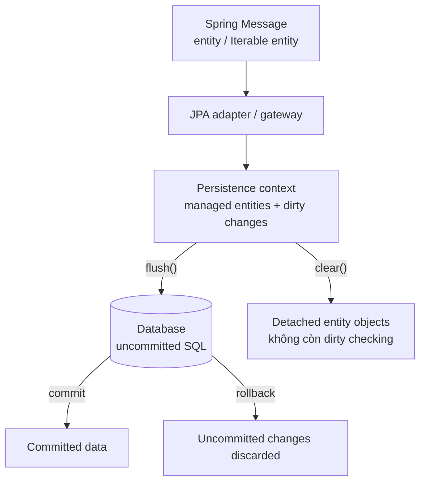

| Thao tác | Đối tượng bị tác động | Có chạy SQL ngay? | Có commit? |
| --- | --- | --- | --- |
| `persist(entity)` | Entity/persistence context | Có thể chạy ngay hoặc trì hoãn, tùy provider/ID strategy | Không tự commit |
| Sửa một managed entity | Java object trong persistence context | Thường đợi flush/commit | Không |
| `flush()` | **Các thay đổi pending** trong cùng context | Có, để đồng bộ với DB | **Không** |
| `clear()` | **Toàn bộ managed entities** của context | Không tự yêu cầu ghi | **Không** |
| `detach(entity)` | Một entity instance | Không tự yêu cầu ghi | Không |
| `refresh(entity)` | Một managed entity | Có thể SELECT lại từ DB | Không |
| `commit()` | Database transaction | Có thể kích hoạt flush, rồi commit | **Có, nếu thành công** |
| `rollback()` | Database transaction | Phủ nhận SQL chưa commit | Không |
| `MessageChannel.send()` | Channel và subscriber/handler | Tùy handler | Không tự chứng minh commit |

Một số provider có thể phát SQL trước lệnh `flush()` rõ ràng, chẳng hạn khi dùng kiểu sinh ID hoặc auto-flush trước query. Do đó, đừng suy luận “chưa gọi flush thì SQL chắc chắn chưa chạy”. Điều bất biến cần nhớ: **SQL đã chạy vẫn có thể rollback**.

### 2.1. Flush không phải “ghi file”, clear không phải “xóa bảng”

Cùng một từ có thể xuất hiện ở JDBC, Kafka, file adapter hoặc JPA, nhưng ngữ nghĩa khác nhau:

- **JPA `EntityManager.flush()`:** đồng bộ unit of work của persistence context với DB.
- **JDBC batch flush/executeBatch:** gửi một lô statement từ driver tới database.
- **Kafka producer flush:** đợi buffered records của producer hoàn tất theo semantics Kafka.
- **File flush:** đẩy buffer ra filesystem/stream tùy API.
- **JPA `EntityManager.clear()`:** detach entity khỏi persistence context, **không** thực hiện `DELETE FROM ...`.

Bài này chỉ dùng từ flush/clear theo **Jakarta Persistence và Spring Integration JPA**, trừ khi nói rõ JDBC/broker.

## 3. Persistence context và dirty checking

Persistence context là không gian quản lý các entity instance theo entity identity. Một transaction JPA thường sở hữu một transaction-scoped context tương ứng. Trong context đó, JPA provider theo dõi state, tạo SQL khi flush và quản lý first-level cache.

### 3.1. Entity lifecycle

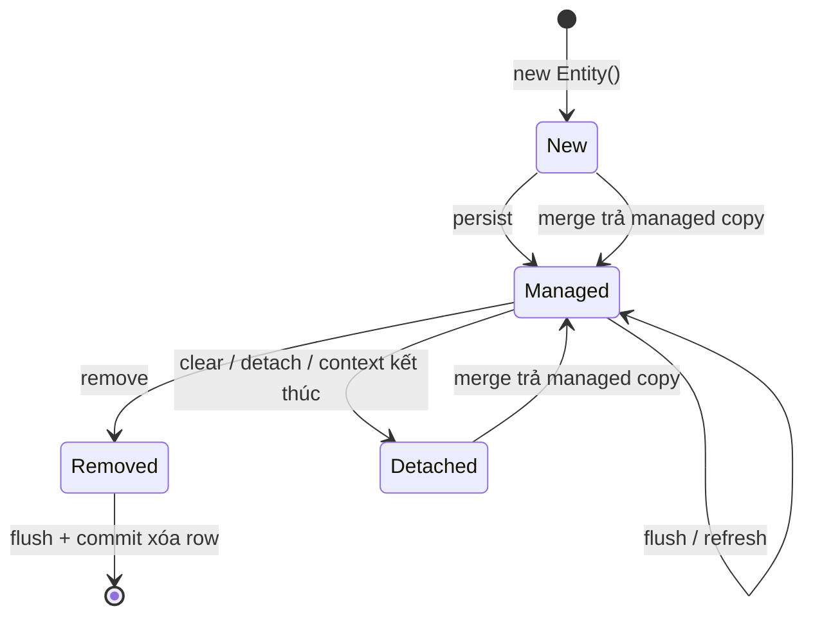

| State | `em.contains(entity)` trong context đúng | Thay field có tự flush không? |
| --- | --- | --- |
| New/transient | `false` | Không |
| Managed | `true` | Có thể, thông qua dirty checking |
| Detached | `false` | Không; cần load/merge managed object có kiểm soát |
| Removed | Theo state của context/provider | Row được lên lịch xóa, chưa chắc committed |

**Lưu ý về merge:** `EntityManager.merge(detached)` trả **managed instance**, không đảm bảo instance đầu vào trở thành managed. Khi merge, nên sử dụng kết quả trả về nếu cần tiếp tục thao tác trong transaction.

### 3.2. Dirty checking

```java
@Service
public class InventoryService {

    @PersistenceContext
    private EntityManager em;

    @Transactional
    public void reserve(String sku) {
        InventoryItem item =
                em.find(InventoryItem.class, sku);

        if (item == null) {
            throw new IllegalArgumentException("SKU not found");
        }

        item.setState("RESERVED");
        // item đang managed: không nhất thiết gọi merge/save.
        // JPA tự kiểm tra dirty state khi flush/commit.
    }
}
```

Đoạn này giả định bạn có `@Entity InventoryItem` và một Spring transaction manager phù hợp. Nếu đổi entity instance ở ngoài transaction sau khi nó đã detached, thay đổi đó **không tự được ghi**.

### 3.3. First-level cache không phải cache toàn ứng dụng

Một entity với khóa `SKU-1` có thể là cùng Java instance trong transaction A:

```java
InventoryItem a = em.find(InventoryItem.class, "SKU-1");
InventoryItem b = em.find(InventoryItem.class, "SKU-1");
boolean same = a == b; // true trong cùng persistence context
```

Transaction B có persistence context khác có thể tạo instance Java khác cho cùng row. `clear()` xóa các managed references khỏi context A, nhưng **không** xóa hàng trong DB hoặc second-level cache của provider một cách tương đương.

## 4. EntityManager.flush(): khi nào và để làm gì?

### 4.1. Đồng bộ thay đổi pending

```java
@Transactional
public void createAndValidate(Receipt receipt) {
    em.persist(receipt);
    em.flush();  // Đẩy pending INSERT/UPDATE/DELETE tới database.
    // Transaction vẫn đang mở.
}
```

`flush()` có thể làm lỗi được phát hiện sớm hơn:

- Khóa chính hoặc unique constraint bị vi phạm.
- NOT NULL/foreign key constraint không phù hợp.
- Optimistic locking conflict được phát hiện tại flush.
- SQL syntax/dialect problem hoặc constraint khác phát sinh từ provider.

Nhưng không phải mọi lỗi đều xuất hiện ở flush: constraint deferred, deadlock, lỗi kết nối hoặc kết quả của transaction khác có thể khiến **commit vẫn thất bại**.

### 4.2. Dòng thời gian

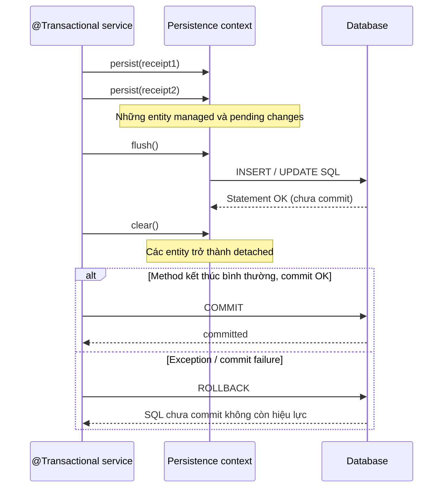

### 4.3. FlushModeType.AUTO và COMMIT

```java
em.setFlushMode(FlushModeType.AUTO);
em.setFlushMode(FlushModeType.COMMIT);
```

- `AUTO` là mặc định thường gặp. JPA provider có thể đồng bộ pending changes trước những query mà cần tính nhất quán.
- `COMMIT` dời flush về thời điểm commit; hành vi các query trước commit nhìn thấy pending changes phụ thuộc những quy tắc JPA/provider và không nên được suy đoán.
- Explicit `flush()` vẫn là yêu cầu đồng bộ ngay trong transaction.

Không chuyển sang `COMMIT` hoặc tắt auto-flush chỉ để “tăng tốc” khi chưa đo SQL, locking, query results và rủi ro inconsistency.

### 4.4. Flush không tạo transaction

Đoạn sau **không an toàn** khi chạy ngoài transaction:

```java
em.persist(receipt);
em.flush();
```

Một Spring-managed EM có thể báo `TransactionRequiredException` nếu không có transaction JPA hợp lệ. `flush()` không tự mở/commit transaction.

## 5. EntityManager.clear(): tác dụng thật và rủi ro

`clear()` **detach tất cả các entity đang managed bởi cùng persistence context**, đồng thời xóa việc theo dõi dirty state của chúng. Nó không thực hiện SQL DELETE, không rollback, và không tự flush.

### 5.1. Ví dụ dễ sai nhất: clear trước flush

```java
@Transactional
public void wrongSequence(String sku) {
    InventoryItem item =
            em.find(InventoryItem.class, sku);

    item.setState("RESERVED");
    em.clear();

    // Chưa flush: thay đổi có thể không được ghi xuống DB.
}
```

Cần hiểu `clear` làm mất pending changes chưa flush đối với những entity bị detach. Nếu phải clear, hãy xác định rõ có cần `flush()` trước đó hay không.

### 5.2. Thứ tự flush rồi clear

```java
@Transactional
public void explicitFlushThenClear(String sku) {
    InventoryItem item =
            em.find(InventoryItem.class, sku);

    item.setState("RESERVED");

    em.flush();               // SQL có thể chạy, chưa commit.
    boolean before = em.contains(item); // true

    em.clear();
    boolean after = em.contains(item);  // false

    assert before && !after;
}
```

Sau khi clear, instance `item` vẫn nằm trong heap và có thể đọc các field đã load, nhưng **không còn managed**. Nếu bạn sửa `item.setState("AVAILABLE")` sau clear, JPA không tự đưa thay đổi này vào DB.

### 5.3. Clear detach toàn bộ context, không chỉ batch

Điểm dễ gây lỗi khi dùng Spring Integration `clearOnFlush(true)`:

```java
@Transactional
public void riskyFlow(Order order) {
    Order managedOrder = em.find(Order.class, order.getId());
    managedOrder.setStatus("VALIDATED");

    // JPA adapter sử dụng cùng transactional persistence context.
    // Nếu adapter flushSize + clearOnFlush, nó có thể flush/clear
    // toàn bộ context, bao gồm managedOrder.
    importChannel.send(
            MessageBuilder.withPayload(importBatch).build());

    managedOrder.setStatus("EXPORTED"); // Có thể đã detached!
}
```

Đây là mã giả giải thích rủi ro, không phải sample file chạy độc lập. **Lệnh clear có phạm vi persistence context**, không có một API kiểu `clearOnlyTheseTwoReceipts()`. Vì vậy:

- Nếu batch adapter share cùng transaction/EM với business service, `clearOnFlush` có thể detach **entity không thuộc batch**.
- Những thay đổi trước flush có thể đã được đồng bộ SQL; những thay đổi **sau clear** không tự dirty-check.
- Nên cô lập batch persistence trong transaction riêng nếu logic service khác còn cần managed entities.
- Hoặc không bật `clearOnFlush` khi transaction cùng xử lý nhiều entity nghiệp vụ khác và bạn chưa kiểm soát lifecycle.

### 5.4. detach(entity), clear() và refresh(entity)

| API | Phạm vi | Khi nào dùng |
| --- | --- | --- |
| `em.detach(entity)` | Một entity instance | Muốn ngừng theo dõi object cụ thể |
| `em.clear()` | Mọi entity managed trong PC | Batch lớn cần giảm memory, đã flush đúng |
| `em.refresh(entity)` | Reload một managed entity từ DB | Khi object stale sau bulk update/nguồn khác |
| `em.flush()` | Pending changes của PC | Cần SQL chạy trước khi tiếp tục |
| `em.close()` | Vòng đời application-managed EM | Không gọi lên shared transactional proxy của Spring |

`refresh` có thể bỏ pending local changes của entity. `clear` không có nghĩa provider đã quên mọi second-level cache; đừng dùng nó như một thao tác invalidate cache phân tán.

## 6. JpaExecutor: flush, flushSize và clearOnFlush

Spring Integration JPA 6.x cung cấp các thuộc tính của `org.springframework.integration.jpa.core.JpaExecutor`:

```java
JpaExecutor executor =
        new JpaExecutor(entityManagerFactory);

executor.setEntityClass(ImportReceipt.class);
executor.setPersistMode(PersistMode.PERSIST);

executor.setFlush(false);
executor.setFlushSize(50);
executor.setClearOnFlush(true);
```

Với ví dụ này, `flushSize(50)` **có ưu tiên** so với `flush(false)` vì giá trị flushSize lớn hơn 0. Cách cấu hình minh bạch hơn là **không đồng thời đặt cả hai** nếu chỉ dùng batching.

### 6.1. Quy tắc được API công bố

| Thuộc tính | Mặc định | Tác dụng |
| --- | --- | --- |
| `flush` | `false` | Nếu true, yêu cầu flush sau persistence operation; tương đương `flushSize=1` với trường hợp phù hợp |
| `flushSize` | `0` | Nếu lớn hơn 0, flush trong xử lý Iterable theo từng nhóm và flush sau vòng lặp |
| `clearOnFlush` | `false` | Gọi `EntityManager.clear()` **sau lần flush thực sự** |
| `PersistMode` | `MERGE` | Chọn merge/persist/delete cho entity-mode |
| `Iterable` payload | — | Một message chứa nhiều entity, không phải nhiều message |
| Transaction boundary | **Không xác định bởi flushSize** | Do `@Transactional`, endpoint advice, poller/transaction manager quyết định |

Cụ thể theo Spring Integration JPA documentation:

- Nếu đặt `flush=true` mà không có flushSize, hành vi có thể hiểu như `flushSize=1`.
- `flushSize=3`: khi xử lý Iterable, flush sau mỗi ba entity, và có một lần flush sau toàn vòng lặp theo implementation/tài liệu; có thể có lần cuối dù nhóm cuối tròn số, đừng dùng số lần flush cố định làm business condition.
- Với **entity đơn** không phải Iterable, `flushSize>0` cũng buộc flush như `flush=true`, không đợi đủ N **message khác nhau**.
- `clearOnFlush=true` chỉ có tác dụng nếu đã flush, do `flush` hoặc `flushSize`.
- `clearOnFlush` không tự cắt transaction thành các transaction nhỏ.

### 6.2. Ví dụ 7 entity, flushSize=3

```text
Message<List<Receipt>> chứa [R1, R2, R3, R4, R5, R6, R7]

persist R1
persist R2
persist R3
  → flush
  → clear

persist R4
persist R5
persist R6
  → flush
  → clear

persist R7
  → flush cuối
  → clear

Vẫn là MỘT Spring Message.
Vẫn có thể là MỘT database transaction.
```

Nếu entity R7 bị lỗi constraint và transaction rollback, **R1–R6 cũng rollback** khi chúng cùng transaction và chưa có commit giữa các nhóm. Thông số `flushSize=3` không mang semantics “đã commit sáu row đầu”.

### 6.3. Những thứ flushSize không có nghĩa

| Thông số | Có phải flushSize? | Lý do |
| --- | --- | --- |
| JDBC driver batch size | Không | Provider/driver có cấu hình batching riêng |
| Số rows mỗi transaction | Không | Transaction boundary mới quyết định |
| Số message poller nhận trong một lần chạy | Không | Dùng `maxMessagesPerPoll` của poller |
| Kích thước Kafka consumer batch | Không | Do Kafka listener/broker configuration |
| Số rows trả về từ JPA SELECT | Không | Dùng `maxResults`/`maxNumberOfResults` |
| Number of SQL statements | Không cố định | ID strategy, cascades, provider flush ordering |
| Số lần ACK broker | Không | Theo source adapter/consumer transaction |

Đừng dùng flushSize làm cách “mỗi N row auto-commit”. Nếu cần commit theo chunk, phải thiết kế **mỗi chunk có transaction riêng**.

### 6.4. Flush/clear áp dụng với thao tác gì?

Các thuộc tính `flush`, `flushSize` và `clearOnFlush` của JPA outbound entity mode hướng tới **persist/merge/delete entity**, nhất là `Iterable`. Nếu handler đang chạy JPQL bulk `UPDATE/DELETE`, thao tác SQL được thực hiện qua `executeUpdate`; bạn vẫn cần transaction, nhưng không nên suy luận `flushSize` chia `executeUpdate` thành các chunk.

Nếu cần chia một bulk update 100.000 row, hãy dùng điều kiện phân vùng/chunking query riêng theo business keys và transaction riêng; không bật `flushSize(100)` rồi mong một câu JPQL UPDATE duy nhất được cắt thành nhiều commits.

## 7. Transaction boundary: ở đâu bắt đầu, ở đâu kết thúc?

Transaction boundary là ranh giới commit/rollback của database operation. Nó có thể được tạo bởi:

1. Public application service method `@Transactional` được gọi thông qua Spring proxy.
2. Advice của Integration endpoint (Java DSL `endpoint -> endpoint.transactional()`).
3. Transactional poller cho inbound channel adapter/source.
4. XML `<int-jpa:transactional .../>` trên outbound JPA endpoint.
5. Một `TransactionTemplate` được dùng tường minh trong service/orchestrator.

**Một flow không tự có transaction chung chỉ vì các component đều là Spring beans.**

### 7.1. Với DirectChannel đồng bộ

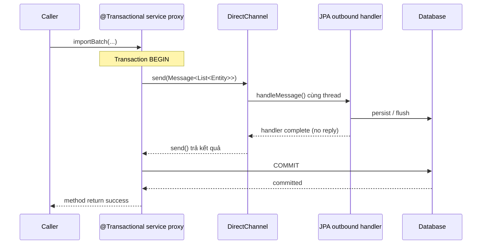

Với `DirectChannel`, transaction do caller mở thường bind với thread hiện hành. JPA handler chạy đồng bộ trên cùng thread và dùng đúng `EntityManagerFactory`/transaction manager có thể tham gia transaction đó. **Commit xảy ra khi proxy kết thúc method**, không phải khi `send(...)` trả true.

### 7.2. Với ExecutorChannel hoặc QueueChannel

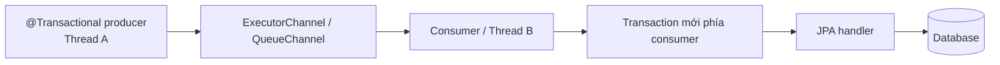

- Imperative `@Transactional` của Spring gắn transaction vào thread (thông thường).
- `ExecutorChannel` và `QueueChannel` đưa việc xử lý qua thread/queue, nên transaction của sender **không tự lan** tới consumer.
- Producer có thể nhận xác nhận “message đã được channel chấp nhận” trước khi DB bắt đầu persist.
- JPA write cần transaction ở **consumer thread**, thường bằng endpoint advice hoặc một service `@Transactional` được handler gọi.
- Lỗi/rollback phía consumer phải được nối tới error/retry/DLQ phù hợp; producer không mặc định nhận exception đồng bộ.

### 7.3. @Transactional và self-invocation

Sai lầm:

```java
@Service
class ImportService {

    public void run() {
        importChunk(); // self-invocation: proxy transaction không chạy.
    }

    @Transactional
    public void importChunk() {
        // JPA writes.
    }
}
```

Trong chế độ Spring proxy mặc định, `@Transactional` chỉ chặn lời gọi **đi qua proxy từ bên ngoài bean**. Đưa method transactional sang một bean khác và inject bean đó, hoặc dùng `TransactionTemplate`/cơ chế transaction phù hợp. Không dựa vào `@Transactional` trên private method hoặc `this.importChunk()` để mở transaction.

### 7.4. readOnly, REQUIRED và REQUIRES_NEW

| Cấu hình | Hành vi |
| --- | --- |
| `@Transactional` / `REQUIRED` | Tham gia transaction hiện tại nếu có, nếu không mở mới |
| `REQUIRES_NEW` | Tạm dừng transaction ngoài, mở transaction riêng |
| `readOnly=true` | Hint cho transaction manager/provider, **không phải ACL** và không nhất thiết cấm mọi write |
| `rollbackFor` | Điều chỉnh lỗi nào dẫn tới rollback (theo contract) |
| `timeout` | Giới hạn timeout transaction theo transaction manager, không phải mọi DB query |
| `isolation` | Điều chỉnh isolation khi mở transaction mới, phụ thuộc DB/manager |

`REQUIRES_NEW` có thể giữ connection của transaction ngoài rồi cần một connection khác cho transaction mới; với quá nhiều workers nó có thể làm cạn pool. Dùng nó có mục đích, không như biện pháp mặc định để che mọi lỗi transaction.

### 7.5. Rollback theo ngoại lệ

Spring declarative transaction mặc định rollback đối với `RuntimeException` và `Error`; checked exception thông thường cần cấu hình `rollbackFor` hoặc xử lý tương ứng. Nếu catch/nuốt lỗi DB rồi trả success, transaction có thể bị đánh dấu rollback-only và ném lỗi lúc commit, hoặc caller hiểu sai trạng thái.

**Không làm:**

```java
try {
    importChannel.send(message);
} catch (Exception ex) {
    log.warn("Ignored database failure", ex);
    // Sai: ACK Kafka/JMS như một thành công.
}
```

Tốt hơn: phân loại lỗi retryable và non-retryable, để transaction rollback đúng và ACK/NACK nguồn theo chính sách.

## 8. Ba cách đặt transaction trong Spring Integration JPA

### 8.1. Service @Transactional bên ngoài DirectChannel

```java
@Transactional
public void importBatch(List<ImportReceipt> receipts) {
    importChannel.send(
            MessageBuilder.withPayload(receipts).build());
}
```

Ưu điểm: dễ đọc, service quyết định unit of work và commit; có thể phối hợp JPA writes khác trong cùng transaction. Nhược điểm: nếu adapter dùng `clearOnFlush`, nó có thể detach cả entity khác đang nằm trong **cùng context** của service.

### 8.2. Java DSL endpoint transactional advice

```java
@Bean
IntegrationFlow transactionalImportFlow(
        EntityManagerFactory emf) {

    return IntegrationFlow.from("importChannel")
            .handle(
                    Jpa.outboundAdapter(emf)
                            .entityClass(ImportReceipt.class)
                            .persistMode(PersistMode.PERSIST)
                            .flushSize(50)
                            .clearOnFlush(true),
                    endpoint -> endpoint.transactional())
            .get();
}
```

Cấu hình này minh họa **alternative** với service transaction. Nếu caller chưa mở transaction, endpoint advice có thể mở transaction cho xử lý handler. Nếu caller đã có transaction và dùng `REQUIRED`, endpoint có thể tham gia transaction hiện có. Đừng giả định advice tách transaction riêng khi không đặt propagation phù hợp.

**Đặc biệt:** nếu muốn transaction bao quanh cả **receive → transform → JPA write** của một poller, transaction advice chỉ đặt ở JPA handler có thể chưa phủ toàn bộ poll cycle và metadata ACK của nguồn. Phải chọn đúng boundary theo yêu cầu consistency.

### 8.3. XML JPA endpoint transaction

```xml
<int-jpa:outbound-channel-adapter
        id="receiptJpaOutbound"
        channel="importChannel"
        entity-manager-factory="entityManagerFactory"
        entity-class="com.example.jpaflush.ImportReceipt"
        persist-mode="PERSIST"
        flush-size="50"
        clear-on-flush="true">

    <int-jpa:transactional
            transaction-manager="transactionManager"
            propagation="REQUIRED"/>
</int-jpa:outbound-channel-adapter>
```

XML minh họa cần namespace/schema `int-jpa`, bean EMF/transaction manager và channel. **Không bật đồng thời** Java DSL và XML trên cùng `DirectChannel` trừ khi thiết kế multiple subscribers/cạnh tranh nhận message có chủ đích.

### 8.4. Poller transaction cho JPA inbound

```xml
<int-jpa:inbound-channel-adapter
        id="pendingInbound"
        channel="pendingItems"
        entity-manager-factory="entityManagerFactory"
        jpa-query="select i from ImportJob i
                   where i.state = 'NEW'"
        max-results="20">

    <int:poller fixed-delay="2000"
                max-messages-per-poll="1">
        <int:transactional
                transaction-manager="transactionManager"
                propagation="REQUIRED"/>
    </int:poller>
</int-jpa:inbound-channel-adapter>
```

Khác biệt **quan trọng**:

- Trong **poller XML**, transaction child dùng namespace `int` (Spring Integration poller).
- Trong **outbound JPA endpoint XML**, transaction child dùng `int-jpa`.
- Poller transaction bao quanh hoạt động poll và phần downstream **đồng bộ** được gọi trong cùng call stack; nếu message đi vào async channel, downstream không còn cùng transaction.
- Nếu dùng `delete-after-poll` hoặc thay state ở inbound, transaction giúp rollback thao tác DB khi có lỗi đồng bộ, nhưng **không tự rollback việc hệ thống ngoài đã nhận message**.

Không viết một adapter kiểu “SELECT NEW” rồi nghĩ cứ có transaction poller thì row tự chuyển thành PROCESSING. Muốn tránh đọc lại cần state transition/claim/lease/idempotency.

## 9. Ví dụ hoàn chỉnh: nhập nhiều receipt bằng flushSize + clearOnFlush

### 9.1. Mục tiêu ví dụ

Xây một Spring Boot application nhỏ:

- Một `List<ImportReceipt>` tạo thành **một Spring Message**.
- `ReceiptImportService.importBatch(...)` có `@Transactional`.
- `DirectChannel` chuyển message sang JPA outbound channel adapter đồng bộ.
- `Jpa.outboundAdapter(...)` dùng `PersistMode.PERSIST`, `flushSize(2)` và `clearOnFlush(true)`.
- `ReceiptRepository` xác minh rows sau khi **service transaction đã commit**.
- Dữ liệu lỗi vi phạm NOT NULL để quan sát rollback **toàn batch**, kể cả những row đã flush trước lỗi.
- Không tạo distributed transaction hay broker bên ngoài trong demo.

Môi trường: **Java 17+, Spring Boot 3.x, Spring Integration 6.x, Jakarta Persistence, Hibernate và H2**.

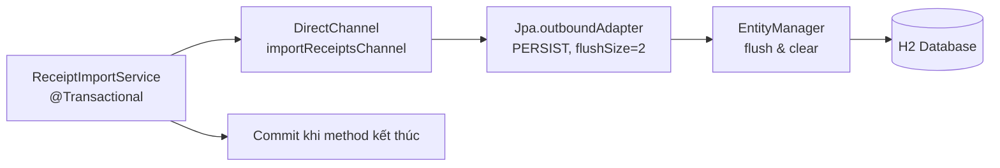

### 9.2. Maven dependencies

```xml
<dependencies>
    <dependency>
        <groupId>org.springframework.boot</groupId>
        <artifactId>spring-boot-starter</artifactId>
    </dependency>
    <dependency>
        <groupId>org.springframework.boot</groupId>
        <artifactId>spring-boot-starter-integration</artifactId>
    </dependency>
    <dependency>
        <groupId>org.springframework.integration</groupId>
        <artifactId>spring-integration-jpa</artifactId>
    </dependency>
    <dependency>
        <groupId>org.springframework.boot</groupId>
        <artifactId>spring-boot-starter-data-jpa</artifactId>
    </dependency>
    <dependency>
        <groupId>com.h2database</groupId>
        <artifactId>h2</artifactId>
        <scope>runtime</scope>
    </dependency>
    <dependency>
        <groupId>org.springframework.boot</groupId>
        <artifactId>spring-boot-starter-test</artifactId>
        <scope>test</scope>
    </dependency>
</dependencies>
```

Dùng Spring Boot BOM để giữ các phiên bản tương thích; Spring Boot 3 dùng namespace `jakarta.persistence`. Trong production, thay H2 bằng database mục tiêu và quản lý schema bằng migration.

### 9.3. Entity ImportReceipt

File `ImportReceipt.java`:

```java
package com.example.jpaflush;

import jakarta.persistence.Column;
import jakarta.persistence.Entity;
import jakarta.persistence.Id;
import jakarta.persistence.Table;

@Entity
@Table(name = "import_receipt")
public class ImportReceipt {

    @Id
    @Column(name = "event_id", length = 80,
            nullable = false)
    private String eventId;

    @Column(name = "source_name", length = 80,
            nullable = false)
    private String sourceName;

    protected ImportReceipt() {
        // JPA requires a no-argument constructor.
    }

    public ImportReceipt(
            String eventId, String sourceName) {
        this.eventId = eventId;
        this.sourceName = sourceName;
    }

    public String getEventId() {
        return eventId;
    }

    public String getSourceName() {
        return sourceName;
    }
}
```

`eventId` là primary key ổn định. `sourceName` có ràng buộc NOT NULL để test lỗi trong transaction. Constructor demo **không validate `sourceName`** nhằm minh họa vi phạm constraint ở flush/commit; ứng dụng thật phải validate đầu vào trước khi gửi JPA.

### 9.4. Repository để xác minh commit

File `ReceiptRepository.java`:

```java
package com.example.jpaflush;

import org.springframework.data.jpa.repository.JpaRepository;

public interface ReceiptRepository
        extends JpaRepository<ImportReceipt, String> {
}
```

Repository chỉ để seed/read/assert. Việc ghi trong integration flow thực sự do JPA outbound adapter thực hiện.

### 9.5. MessageChannel và JPA outbound adapter

File `ReceiptImportIntegrationConfiguration.java`:

```java
package com.example.jpaflush;

import jakarta.persistence.EntityManagerFactory;

import org.springframework.context.annotation.Bean;
import org.springframework.context.annotation.Configuration;
import org.springframework.integration.channel.DirectChannel;
import org.springframework.integration.config.EnableIntegration;
import org.springframework.integration.dsl.IntegrationFlow;
import org.springframework.integration.jpa.dsl.Jpa;
import org.springframework.integration.jpa.support.PersistMode;
import org.springframework.messaging.MessageChannel;

@Configuration
@EnableIntegration
public class ReceiptImportIntegrationConfiguration {

    @Bean
    MessageChannel importReceiptsChannel() {
        return new DirectChannel();
    }

    @Bean
    IntegrationFlow receiptImportFlow(
            EntityManagerFactory entityManagerFactory) {

        return IntegrationFlow
                .from("importReceiptsChannel")
                .handle(
                        Jpa.outboundAdapter(entityManagerFactory)
                                .entityClass(ImportReceipt.class)
                                .persistMode(PersistMode.PERSIST)
                                .flushSize(2)
                                .clearOnFlush(true))
                .get();
    }
}
```

Giải thích:

1. `DirectChannel` giúp handler xử lý đồng bộ trên thread sender.
2. `Jpa.outboundAdapter(...)` là **outbound channel adapter một chiều**, không có reply message.
3. `PersistMode.PERSIST` bảo đảm ví dụ yêu cầu tạo entity mới. Nếu gửi trùng ID, DB/JPA sẽ từ chối thay vì âm thầm merge.
4. `flushSize(2)` yêu cầu flush theo nhóm entity đối với `Iterable`.
5. `clearOnFlush(true)` detach các entity managed trong persistence context sau flush.
6. **Không đặt thêm `flush(true)`** vì `flushSize > 0` đã xác định behavior.
7. Transaction trong ví dụ được mở ở **service caller** dưới đây. Nếu flow nhận từ async channel/consumer khác, phải thêm transaction tại consumer.

### 9.6. Service gửi một List trong một transaction

File `ReceiptImportService.java`:

```java
package com.example.jpaflush;

import java.util.List;

import org.springframework.beans.factory.annotation.Qualifier;
import org.springframework.messaging.MessageChannel;
import org.springframework.messaging.support.MessageBuilder;
import org.springframework.stereotype.Service;
import org.springframework.transaction.annotation.Transactional;

@Service
public class ReceiptImportService {

    private final MessageChannel channel;

    public ReceiptImportService(
            @Qualifier("importReceiptsChannel")
            MessageChannel channel) {
        this.channel = channel;
    }

    @Transactional
    public void importBatch(List<ImportReceipt> receipts) {
        if (receipts == null || receipts.isEmpty()) {
            throw new IllegalArgumentException("Empty batch");
        }

        boolean accepted = channel.send(
                MessageBuilder
                        .withPayload(List.copyOf(receipts))
                        .build());

        if (!accepted) {
            throw new IllegalStateException(
                    "Import channel rejected message");
        }

        // Chưa được xem là committed tại dòng này.
        // Transaction interceptor commit khi method kết thúc.
    }
}
```

**Tại sao dùng `List.copyOf`?** Nó tạo danh sách không thể thêm/xóa phần tử (snapshot về membership), giảm rủi ro nguồn thay đổi `List` trong lúc handler xử lý. Nó **không** biến từng `ImportReceipt` thành immutable; không nên sửa entity instances trong thread khác khi batch đang chạy.

**Không dùng `send() == true` như ACK database.** Với DirectChannel, handler đã xử lý đồng bộ nếu trả thành công, nhưng transaction bên ngoài chưa commit tại thời điểm trong method. Khi caller nhận return bình thường từ **Spring transactional proxy**, commit của transaction service đã được xử lý thành công theo contract của transaction manager. Nếu commit ném exception, caller không nhận kết quả success như một return bình thường.

### 9.7. Spring Boot main và demo

File `JpaFlushApplication.java`:

```java
package com.example.jpaflush;

import java.util.List;

import org.springframework.boot.CommandLineRunner;
import org.springframework.boot.SpringApplication;
import org.springframework.boot.autoconfigure.SpringBootApplication;
import org.springframework.context.annotation.Bean;

@SpringBootApplication
public class JpaFlushApplication {

    public static void main(String[] args) {
        SpringApplication.run(JpaFlushApplication.class, args);
    }

    @Bean
    CommandLineRunner demo(
            ReceiptImportService service,
            ReceiptRepository repository) {

        return args -> {
            service.importBatch(List.of(
                    new ImportReceipt("evt-101", "sftp"),
                    new ImportReceipt("evt-102", "kafka"),
                    new ImportReceipt("evt-103", "http")));

            System.out.println(
                    "Committed rows: " + repository.count());
            System.out.println(
                    "evt-103 present: "
                    + repository.existsById("evt-103"));
        };
    }
}
```

File `application.properties`:

```properties
spring.main.web-application-type=none

spring.datasource.url=jdbc:h2:mem:jpa_flush_demo;DB_CLOSE_DELAY=-1
spring.datasource.driver-class-name=org.h2.Driver
spring.datasource.username=sa
spring.datasource.password=

spring.jpa.hibernate.ddl-auto=create-drop
spring.jpa.open-in-view=false
logging.level.org.springframework.integration=INFO
```

Với ba receipts đầu vào, `flushSize=2` xử lý hai entity trước rồi flush/clear, sau đó xử lý entity thứ ba và flush/clear kết thúc. **Repository có ba rows sau khi service method thành công và DB commit.** Không có nghĩa những rows đầu tiên đã commit trước row thứ ba.

H2 in-memory và `create-drop` chỉ dành cho thực hành; production dùng database thật, migration schema, connection pool và transaction timeout phù hợp.

## 10. Kiểm thử lỗi: flush trước rồi vẫn rollback toàn batch

Đây là thí nghiệm quan trọng nhất để phân biệt **flush** với **commit**.

### 10.1. Giả lập lỗi ở phần tử cuối

Gửi ba receipts với `flushSize(2)`:

```text
R1 = eventId: good-a, sourceName: sftp
R2 = eventId: good-b, sourceName: kafka
R3 = eventId: bad-c,  sourceName: null

R1,R2 → persist → flush SQL thành công → clear
R3    → persist → flush phát hiện NOT NULL violation
Transaction rollback
R1,R2,R3 đều KHÔNG committed
```

### 10.2. SpringBootTest minh họa

File `ReceiptImportIntegrationTest.java`:

```java
package com.example.jpaflush;

import static org.assertj.core.api.Assertions.assertThat;
import static org.assertj.core.api.Assertions.assertThatThrownBy;

import java.util.List;
import java.util.UUID;

import org.junit.jupiter.api.Test;
import org.springframework.beans.factory.annotation.Autowired;
import org.springframework.boot.test.context.SpringBootTest;

@SpringBootTest
class ReceiptImportIntegrationTest {

    @Autowired
    ReceiptImportService service;

    @Autowired
    ReceiptRepository repository;

    @Test
    void commitsThreeReceiptsInOneTransaction() {
        String prefix = "success-" + UUID.randomUUID();

        service.importBatch(List.of(
                new ImportReceipt(prefix + "-1", "sftp"),
                new ImportReceipt(prefix + "-2", "kafka"),
                new ImportReceipt(prefix + "-3", "http")));

        assertThat(repository.existsById(prefix + "-1")).isTrue();
        assertThat(repository.existsById(prefix + "-2")).isTrue();
        assertThat(repository.existsById(prefix + "-3")).isTrue();
    }

    @Test
    void rollsBackEarlierFlushedEntitiesWhenLastFails() {
        String prefix = "fail-" + UUID.randomUUID();

        assertThatThrownBy(() ->
                service.importBatch(List.of(
                        new ImportReceipt(prefix + "-1", "sftp"),
                        new ImportReceipt(prefix + "-2", "kafka"),
                        new ImportReceipt(prefix + "-3", null))))
                .isInstanceOf(RuntimeException.class);

        assertThat(repository.existsById(prefix + "-1")).isFalse();
        assertThat(repository.existsById(prefix + "-2")).isFalse();
        assertThat(repository.existsById(prefix + "-3")).isFalse();
    }

    @Test
    void rejectsDuplicateEventIdWithoutSilentUpsert() {
        String eventId = "dup-" + UUID.randomUUID();

        service.importBatch(List.of(
                new ImportReceipt(eventId, "sftp")));

        assertThatThrownBy(() ->
                service.importBatch(List.of(
                        new ImportReceipt(eventId, "kafka"))))
                .isInstanceOf(RuntimeException.class);

        assertThat(repository.findById(eventId))
                .isPresent()
                .get()
                .extracting(ImportReceipt::getSourceName)
                .isEqualTo("sftp");
    }
}
```

Chủ ý **không** đặt `@Transactional` trên toàn test method: nếu test framework bao transaction và tự rollback cuối test, transaction service có thể tham gia transaction test và che giấu thời điểm commit/rollback thực tế của flow.

**Giới hạn test:** H2 khác database production về thời điểm constraint checking, lock, isolation và SQL dialect. Test ở đây thể hiện transaction **atomicity** theo một lỗi thông thường; concurrency/deferred constraint cần PostgreSQL/MySQL/Oracle Testcontainers hoặc môi trường thật.

### 10.3. Không assert số SQL flush bằng suy đoán

Đừng đặt test kiểu “flushSize(2) nghĩa Hibernate chắc chắn phát đúng hai JDBC round-trips”. Một flush có thể phát 0, 1 hoặc nhiều SQL statements tùy ID strategy, cascade, driver batching, dirty state, provider ordering.

Nên assert **observable semantics**:

- DB rows sau commit.
- DB không có rows sau rollback.
- Không mất entity sau clear.
- Entity có detached state đúng nơi.
- Transaction boundary làm đúng khi async.
- Metric/performance thực đo trong môi trường test phù hợp.

Nếu cần quan sát flush count, dùng Hibernate statistics/SQL logs có kiểm soát và ghi rõ đó là **provider-specific metric**, không phải public contract của JPA adapter.

## 11. Kiểm tra managed/detached bằng một service chẩn đoán

Thí nghiệm này **tách biệt** khỏi handler JPA outbound của mục 9. Nó gọi trực tiếp `@PersistenceContext EntityManager` để thấy trạng thái entity trước/sau flush và clear.

### 11.1. @PersistenceContext là shared transactional proxy

Spring thường inject một **EntityManager proxy** tương thích transaction hiện hành vào singleton service:

```java
@PersistenceContext
private EntityManager em;
```

Điều này **không** có nghĩa cùng một raw `EntityManager` thực đang được nhiều thread sử dụng song song. `EntityManagerFactory` là hạ tầng có thể chia sẻ giữa nhiều threads; persistence context/transaction thực tế có vòng đời riêng.

### 11.2. Service probe

File `ReceiptPersistenceProbe.java`:

```java
package com.example.jpaflush;

import jakarta.persistence.EntityManager;
import jakarta.persistence.PersistenceContext;

import org.springframework.stereotype.Service;
import org.springframework.transaction.annotation.Transactional;

@Service
public class ReceiptPersistenceProbe {

    @PersistenceContext
    private EntityManager em;

    @Transactional
    public Observation persistFlushClear(String eventId) {
        ImportReceipt receipt =
                new ImportReceipt(eventId, "manual");

        em.persist(receipt);
        boolean managedBeforeFlush = em.contains(receipt);

        em.flush();
        boolean managedAfterFlush = em.contains(receipt);

        em.clear();
        boolean managedAfterClear = em.contains(receipt);

        return new Observation(
                managedBeforeFlush,
                managedAfterFlush,
                managedAfterClear);
    }

    @Transactional
    public void flushThenFail(String eventId) {
        ImportReceipt receipt =
                new ImportReceipt(eventId, "manual");

        em.persist(receipt);
        em.flush();

        // Đã chạy SQL nhưng transaction chưa commit.
        throw new IllegalStateException(
                "Simulated business failure after flush");
    }

    public record Observation(
            boolean beforeFlush,
            boolean afterFlush,
            boolean afterClear) {
    }
}
```

**Kết quả mong đợi:**

- `beforeFlush == true`.
- `afterFlush == true` vì flush không tự detach entity.
- `afterClear == false` vì clear detach entity.
- Nếu `persistFlushClear` kết thúc qua transactional proxy thành công, row tồn tại trong DB sau commit.
- Nếu `flushThenFail` được gọi từ bean khác, exception làm transaction rollback dù `em.flush()` đã chạy.

### 11.3. Kiểm thử có transaction thật

```java
@SpringBootTest
class ReceiptPersistenceProbeTest {

    @Autowired
    ReceiptPersistenceProbe probe;

    @Autowired
    ReceiptRepository repository;

    @Test
    void flushKeepsManagedButClearDetaches() {
        String id = "probe-" + UUID.randomUUID();

        var result = probe.persistFlushClear(id);

        assertThat(result.beforeFlush()).isTrue();
        assertThat(result.afterFlush()).isTrue();
        assertThat(result.afterClear()).isFalse();
        assertThat(repository.existsById(id)).isTrue();
    }

    @Test
    void rollbackCancelsPreviouslyFlushedSql() {
        String id = "rollback-" + UUID.randomUUID();

        assertThatThrownBy(() -> probe.flushThenFail(id))
                .isInstanceOf(IllegalStateException.class);

        assertThat(repository.existsById(id)).isFalse();
    }
}
```

Đoạn test giả định imports của `@SpringBootTest`, `@Autowired`, `@Test`, `UUID` và AssertJ static methods. Cố ý không bọc test trong một transaction mặc định.

### 11.4. Vì sao cần test cùng transaction manager?

Với nhiều datasource/`EntityManagerFactory`, một `@Transactional` không chỉ ra manager có thể chọn nhầm transaction manager. Khi viết nhiều persistence units, hãy chỉ rõ manager phù hợp:

```java
@Transactional("inventoryTransactionManager")
public void updateInventory() {
    // EMF inventory phải được gắn đúng transaction manager.
}
```

Tên `inventoryTransactionManager` minh họa; ứng dụng thật cần khai bean. **Không** xem hai local JPA transactions ở hai DB là một distributed atomic transaction chỉ vì cùng method.

## 12. Commit theo chunk: khác hoàn toàn flush theo batch

Câu hỏi thường gặp: “Tôi có 10.000 receipts, cần lưu 100 records rồi commit, còn flush mỗi 20 records thì làm sao?”

**Không dùng duy nhất `flushSize(20)`**. Cần hai cấp:

1. **Chunk boundary**: mỗi 100 receipts là một **transaction**.
2. **Persistence flush boundary**: trong chunk đó, flush/clear mỗi 20 receipts.

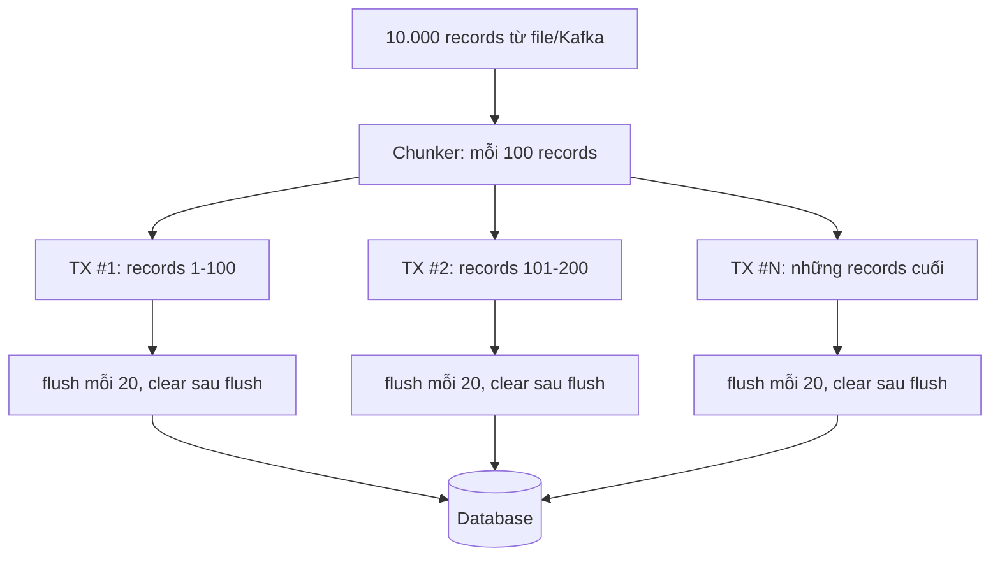

Nếu TX #2 thất bại:

- TX #1 có thể đã commit và vẫn tồn tại.
- TX #2 rollback **toàn bộ** 100 rows của nó, kể cả những rows đã flush.
- TX #3 có chạy hay không phụ thuộc coordinator/error policy.
- Nếu nguồn retry **toàn bộ file** từ đầu, TX #1 có thể gặp duplicate; cần checkpoint/idempotency.

### 12.1. Cấu hình adapter với flushSize=20

Thay cấu hình demo mục 9.5 (không bật đồng thời):

```java
@Bean
IntegrationFlow chunkReceiptFlow(EntityManagerFactory emf) {
    return IntegrationFlow.from("importReceiptsChannel")
            .handle(
                    Jpa.outboundAdapter(emf)
                            .entityClass(ImportReceipt.class)
                            .persistMode(PersistMode.PERSIST)
                            .flushSize(20)
                            .clearOnFlush(true))
            .get();
}
```

### 12.2. ChunkWriter là Spring bean có transaction

```java
@Service
public class ReceiptChunkWriter {

    private final MessageChannel importReceiptsChannel;

    public ReceiptChunkWriter(
            @Qualifier("importReceiptsChannel")
            MessageChannel channel) {
        this.importReceiptsChannel = channel;
    }

    @Transactional
    public void writeChunk(List<ImportReceipt> chunk) {
        if (chunk.isEmpty() || chunk.size() > 100) {
            throw new IllegalArgumentException(
                    "Invalid chunk size");
        }

        boolean accepted = importReceiptsChannel.send(
                MessageBuilder.withPayload(
                        List.copyOf(chunk)).build());

        if (!accepted) {
            throw new IllegalStateException(
                    "Chunk not accepted");
        }
    }
}
```

Imports tương tự `ReceiptImportService` của demo. `ReceiptChunkWriter` nên là một bean riêng để coordinator gọi nó **qua Spring proxy**, bảo đảm mỗi lời gọi `writeChunk` có transaction.

### 12.3. Coordinator không có transaction bao quanh toàn bộ file

```java
@Service
public class ReceiptImportCoordinator {

    private final ReceiptChunkWriter writer;

    public ReceiptImportCoordinator(ReceiptChunkWriter writer) {
        this.writer = writer;
    }

    // Cố ý KHÔNG @Transactional ở đây.
    public void importAll(List<ImportReceipt> all) {
        int chunkSize = 100;

        for (int start = 0; start < all.size();
                start += chunkSize) {
            int end = Math.min(
                    start + chunkSize, all.size());

            writer.writeChunk(all.subList(start, end));
            // writeChunk đã qua proxy và commit trước khi trả.
        }
    }
}
```

Nếu đặt một `@Transactional` lớn ở coordinator, `writeChunk` mặc định `REQUIRED` sẽ **tham gia transaction ngoài**, làm cho toàn bộ file lại có một commit. Vì vậy cần giữ coordinator **không transactional**, hoặc thiết kế propagation `REQUIRES_NEW` có chủ đích và đủ connection pool.

### 12.4. Có nên tự gọi TransactionTemplate?

`TransactionTemplate` phù hợp khi orchestration cần điều khiển transaction programmatically:

```java
for (List<ImportReceipt> chunk : chunks) {
    transactionTemplate.executeWithoutResult(status -> {
        writeChunkContents(chunk);
    });
}
```

Trong ví dụ này, `writeChunkContents` phải là code chạy trực tiếp trong transaction đồng bộ, hoặc gửi qua `DirectChannel` để JPA handler tham gia. `TransactionTemplate` không tự chuyển transaction qua thread khác.

**Đừng dùng cả `TransactionTemplate` và `REQUIRES_NEW` một cách ngẫu nhiên**; nhiều transaction nested/suspended làm tăng độ phức tạp và tải connection pool.

### 12.5. Per-record, per-message hay per-file?

| Boundary | Ưu điểm | Nhược điểm |
| --- | --- | --- |
| Một transaction cho toàn file | All-or-nothing đơn giản | Giữ lock/heap lâu, rollback rất lớn |
| Một transaction cho chunk 100 records | Cân bằng rollback/retry, throughput | Đã commit chunk trước cần checkpoint/idempotency |
| Một transaction cho từng record | Cô lập lỗi tốt | Nhiều commit, throughput có thể thấp |
| Một transaction cho consumer message | Hợp broker event đơn lẻ | Batch lớn trong một message vẫn có rollback lớn |
| Một transaction cho câu JPQL bulk update | Atomic query/transaction | Không tự tách thành nhiều commits bằng flushSize |

Hãy chọn theo semantics nghiệp vụ: một file ngân hàng yêu cầu atomic toàn file khác một log import cho phép quarantine record xấu.

## 13. Updating gateway, retrieving gateway và bulk query

### 13.1. JPA updating outbound gateway

Một `Jpa.updatingGateway(...)` dùng `JpaExecutor` nhưng **trả reply**. Với entity mode, reply có thể là entity được persist/merge; với JPQL `UPDATE/DELETE`, reply thường là affected-row count.

```java
@Bean
IntegrationFlow updateStatusFlow(EntityManagerFactory emf) {
    return IntegrationFlow.from("updateStatusRequests")
            .handle(
                    Jpa.updatingGateway(emf)
                            .jpaQuery("""
                                    update ImportJob j
                                    set j.state = 'DONE'
                                    where j.id = :jobId
                                      and j.state = 'RUNNING'
                                    """)
                            .parameterExpression(
                                    "jobId", "payload"))
            .get();
}
```

Đây là **ví dụ riêng** cần entity `ImportJob` và transaction tại caller/endpoint; không chạy cùng `ImportReceipt` demo nếu chưa định nghĩa đủ types/beans.

Khi reply affected count bằng `1`, JPA query đã tìm được một row để thay đổi. **Transaction ngoài vẫn có thể rollback sau reply**, do đó không phát một event “DONE committed” trước khi commit thật sự.

### 13.2. Bulk UPDATE không dirty-check entity đã load

Ví dụ:

```java
@Transactional
public void staleManagedEntity() {
    ImportJob job = em.find(ImportJob.class, "JOB-1");
    // job.state có thể là RUNNING

    em.createQuery("""
            update ImportJob j
            set j.state = 'DONE'
            where j.id = :id
            """)
        .setParameter("id", "JOB-1")
        .executeUpdate();

    // job vẫn có thể trả RUNNING từ first-level cache!
    em.refresh(job);
}
```

- JPQL bulk update trực tiếp tác động rows tại DB.
- Managed entity đã load có thể **stale** trong persistence context.
- `flushSize` **không** biến câu bulk query này thành nhiều transaction.
- `clear` hoặc `refresh` có thể giúp đồng bộ object, nhưng phải cân nhắc pending changes chưa flush.
- Bulk update có thể bỏ qua cơ chế optimistic version increment/callback thông thường của entity update; dùng conditional query + expected version nếu cần.

### 13.3. Retrieved entities và ranh giới async

`Jpa.retrievingGateway(...)` có thể trả entity/list. Nếu downstream chạy sau transaction hoặc qua `ExecutorChannel`/`QueueChannel`, entity có thể detached; truy cập quan hệ LAZY có thể gây `LazyInitializationException`.

Cách làm tốt:

```text
JPA retrieving gateway
    → DTO transformer trong transaction phù hợp
    → QueueChannel / Kafka / HTTP outbound
```

Hoặc trả **ID immutable**, rồi consumer khác mở transaction riêng để load entity. Không đẩy cả JPA managed graph qua broker và mong bên nhận vẫn share persistence context.

## 14. JPA inbound adapter, poller và delete-after-poll

### 14.1. Transaction ở poller cần bao quanh bước nào?

Một inbound source được kích hoạt theo lịch:

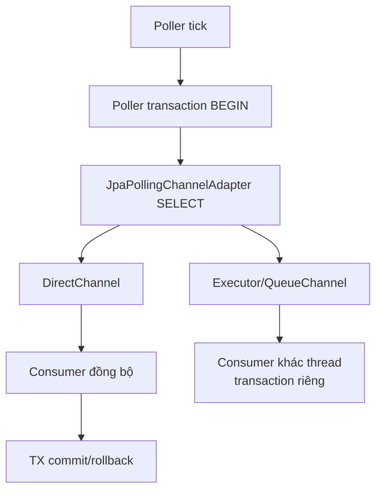

Nếu poller chạy query rồi phát qua `DirectChannel` và consumer đồng bộ cập nhật row, transaction có thể kéo dài qua cả hai trong cùng thread. Nếu phát qua `QueueChannel` hoặc `ExecutorChannel`, JPA context/transaction của poller **không tự đi theo** message.

### 14.2. deleteAfterPoll rất nhạy cảm

Nếu inbound adapter bật `deleteAfterPoll(true)`, thao tác DB xóa row sau khi đọc trong poll cycle. **Không được** coi “đã đọc row” là “đã gửi Kafka thành công/đã được downstream xử lý”.

Ví dụ lỗi:

```text
JPA inbound poller → lấy job
deleteAfterPoll() → chuẩn bị xóa job
DB commit xóa job
Kafka outbound → lỗi network
Job mất khỏi DB, event chưa được broker nhận
```

Một poller transaction bao quanh consumer **đồng bộ** có thể rollback DB nếu lỗi được propagate đúng trước commit, nhưng nếu có external side effect trước rollback hoặc consumer async, DB và broker vẫn không có distributed atomicity mặc định.

### 14.3. Atomic claim/lease thay vì xóa trước khi xử lý

Một thiết kế bền hơn:

```text
NEW → CLAIMED(workerId, leaseUntil) → PROCESSING
    → DONE
    hoặc FAILED/RETRYABLE
```

Dùng query update có điều kiện, affected-row count hoặc cơ chế locking phù hợp, transaction ngắn và idempotency. Khi worker crash, lease có thể hết hạn để worker khác nhận lại.

Đối với volume lớn hoặc yêu cầu phát event sau DB commit, có thể dùng transactional outbox hoặc CDC thay polling trực tiếp business table.

## 15. Kafka, JMS, AMQP, HTTP và file/SFTP: ai commit trước?

Một hệ thống message-driven thường có nhiều **commit/acknowledgment boundaries** độc lập.

| Hệ thống | Thế nào là xác nhận? | Có tự cùng transaction với JPA không? |
| --- | --- | --- |
| JPA / database | DB transaction commit thành công | — |
| Kafka consumer | Offset/ack theo listener policy | **Không mặc định** |
| Kafka producer | Broker xác nhận gửi record | **Không mặc định** |
| JMS/AMQP consumer | ACK/commit/NACK theo session/container | **Không mặc định** |
| HTTP | Server gửi response và client nhận theo transport | Không |
| File/SFTP poller | Metadata/filter/rename/delete theo flow | Không |
| Spring `MessageChannel.send()` | Channel tiếp nhận message theo semantics | Không |
| JPA updating gateway reply | Handler trả entity hoặc affected count | Không chứng minh outer commit |

### 15.1. Crash windows trong consumer Kafka/JMS

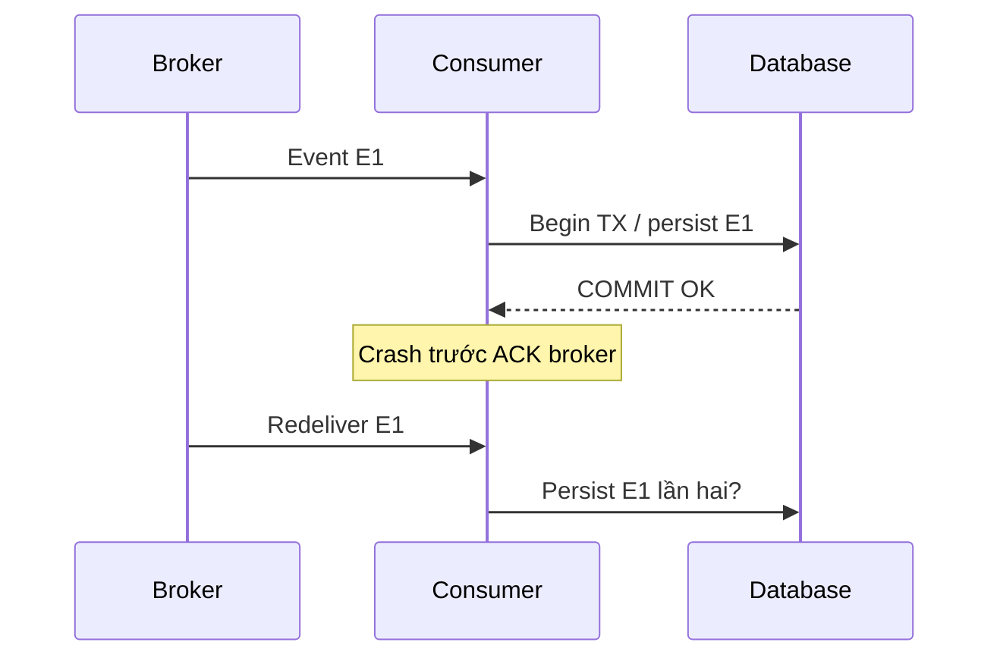

Nếu dùng `PersistMode.PERSIST` và `eventId` là unique key, lần hai có thể bị constraint violation. **Constraint giúp phát hiện trùng nhưng chưa đủ để trả ACK an toàn**: cần kiểm tra event đã xử lý thành công hay đang có dữ liệu mâu thuẫn, và có side effect nào khác chưa hoàn tất.

### 15.2. Transactional inbox/outbox

Khi cần phối hợp cập nhật business row và phát event:

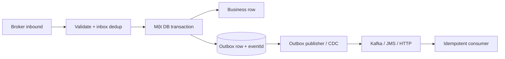

- Business data và outbox row commit **cùng DB transaction**.
- Publisher gửi outbox event sau commit và cập nhật trạng thái khi nhận ACK.
- Nếu crash sau publish nhưng trước khi mark SENT, event có thể được gửi lại.
- Consumer phải deduplicate theo event ID.
- Kết quả thường là **at-least-once delivery + idempotency**, không phải exactly-once toàn mạng theo mặc định.

### 15.3. File/SFTP import có checkpoint

Với file chứa nhiều chunks:

1. Xác định file identity/checksum và row ID.
2. Parse/validate theo stream.
3. Mỗi chunk ghi DB trong transaction rõ ràng.
4. Ghi progress/checkpoint vào DB theo chính sách.
5. Nếu crash giữa chừng, khởi động lại từ checkpoint hoặc replay với idempotency.
6. Chỉ đánh dấu file DONE/di chuyển sang archive khi điều kiện nghiệp vụ đáp ứng.
7. Chia riêng lỗi parse/validation, lỗi transient DB và lỗi dữ liệu không thể xử lý.

`flushSize` giảm persistence-context pressure, **không** tự tạo checkpoint cho file hoặc broker.

## 16. Khác nhau giữa flushSize, Hibernate JDBC batching và DB commit

Có ba tầng tối ưu dễ bị lẫn:

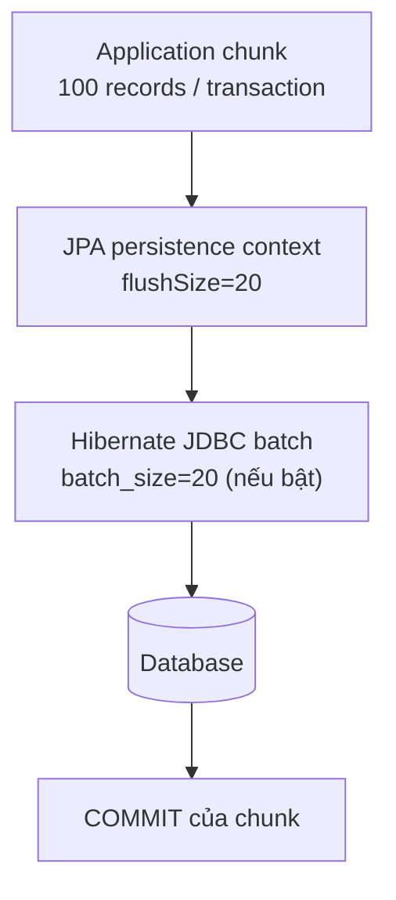

### 16.1. Ứng dụng định nghĩa chunk

Chunk size quyết định:

- Bao nhiêu record thuộc một **transaction**.
- Bao nhiêu record phải retry khi chunk lỗi.
- Bao nhiêu record ở một `List<Entity>` message.
- Mức độ cô lập lỗi và checkpoint.

### 16.2. JpaExecutor.flushSize định nghĩa thời điểm flush

Nó quyết định **khi nào gọi `EntityManager.flush()`** trong entity-mode operations. Nếu kèm `clearOnFlush`, JPA giảm số managed entities bị giữ qua nhiều nhóm.

Không có phép tương đương “flushSize=20 → JDBC executeBatch luôn đúng 20 statements”.

### 16.3. Hibernate JDBC batching là cấu hình provider

Ví dụ với Hibernate (chỉ minh họa, cần kiểm tra version):

```properties
spring.jpa.properties.hibernate.jdbc.batch_size=20
spring.jpa.properties.hibernate.order_inserts=true
spring.jpa.properties.hibernate.order_updates=true
```

Actual batching phụ thuộc:

- ID generation strategy: `GenerationType.IDENTITY` thường làm giảm khả năng batch inserts.
- SQL shape và thứ tự statement.
- Driver và database hỗ trợ batching.
- Versioned entity updates và provider settings.
- Flush/cascade/order behavior.
- Row size, index và latency.

**Benchmark trên DB thật** trước khi quyết định batch size. H2 không phản ánh đầy đủ PostgreSQL/MySQL/Oracle.

### 16.4. Tại sao không flushSize vô hạn?

Quá ít flush: persistence context phình, heap/GC lớn, phát hiện lỗi muộn. Quá nhiều flush: tăng provider work/SQL round trips, giảm throughput. `clearOnFlush` giảm first-level cache nhưng làm detached objects, dễ gây sai logic nếu downstream tiếp tục sửa entity.

Thông thường cần đo và cân bằng **chunk size**, **flush size**, **JDBC batch size**, **DB connection pool** và concurrency. Không có con số tối ưu chung.

## 17. Bảo mật, tenant và lỗi nghiệp vụ

### 17.1. Flush/clear không xác minh dữ liệu

Một event có `tenantId` hoặc `orderId` là dữ liệu đầu vào, không phải quyền truy cập. Khi query hoặc persist từ message:

- Xác thực nguồn và principal.
- Kiểm tra tenant/resource ownership tại service.
- Mapping DTO vào entity với những trường được phép, không merge trực tiếp mọi field client gửi.
- Bảo vệ ràng buộc khóa chính, unique, NOT NULL và foreign key ở DB.
- Không cho phép query update thiếu điều kiện tenant/state/version.
- Không cho client tự điều khiển `flushSize`, JPQL/SpEL expression, batch size vô hạn.
- Không log toàn payload chứa PII/token để debug flush failures.
- Với multi-tenant database, cần bảo đảm transaction/connection/persistence unit dùng đúng tenant context.

### 17.2. Validation ở trước, constraint là tuyến cuối

`ImportReceipt` demo chấp nhận `sourceName=null` để thử rollback. Production nên:

```java
if (receipt.getSourceName() == null
        || receipt.getSourceName().isBlank()) {
    throw new IllegalArgumentException(
            "sourceName is required");
}
```

Không để hệ thống tiêu tốn DB transaction rồi mới phát hiện input sai mà service đã có thể chặn. Tuy nhiên **vẫn phải giữ DB constraint** để chống data race, bug và những code path bỏ qua validation.

### 17.3. Retry phải phân loại lỗi

| Lỗi | Có nên retry? | Vì sao |
| --- | --- | --- |
| DB connection tạm thời mất | Có, **bounded** | Có thể hồi phục |
| Lock timeout / deadlock | Có thể | Dùng backoff/jitter, thử transaction mới |
| Duplicate event ID | Không retry mù quáng | Cần policy idempotency/duplicate conflict |
| NOT NULL violation | Không | Cần sửa dữ liệu |
| Wrong tenant / unauthorized | Không | Lỗi quyền |
| Query thiếu parameter | Không | Lỗi cấu hình |
| Optimistic locking conflict | Tùy business | Reconcile version/state, không ghi đè mù |
| Commit failure chưa rõ | Tùy loại | Cần xác minh outcome/idempotency trước replay |
| Outbound Kafka send fail sau DB commit | Retry publish qua outbox | Không rollback DB commit đã xong |

Đừng xây một error handler bắt mọi `Exception` rồi gọi `retry` vô hạn. Với broker nguồn, xác định ACK/NACK/seek/DLQ và thời điểm DB commit riêng.

## 18. Troubleshooting: lỗi thường gặp

| Triệu chứng | Nguyên nhân có thể | Hướng kiểm tra |
| --- | --- | --- |
| `TransactionRequiredException` | JPA write ngoài transaction | `@Transactional`/endpoint advice tại đúng consumer |
| `flush()` thành công nhưng data biến mất | Transaction rollback sau flush | Xem commit exception, rollback-only và call path |
| `clearOnFlush(true)` “không chạy” | Không có lần flush; `flush=false` và `flushSize=0` | Cấu hình flush/flushSize > 0 |
| Sửa entity sau send mà DB không đổi | Adapter clear cùng persistence context | Kiểm tra `em.contains(entity)` sau handler |
| Batch 100 row lỗi record #99 làm mất cả batch | Một transaction cho 100 row | Chia chunk transaction nếu policy cho phép |
| Chỉ có 1 row được commit dù flushSize=50 | Có thể chỉ một message/entity | flushSize không gom nhiều messages |
| Nhiều SQL dù flushSize lớn | IDENTITY/cascade/auto-flush/provider | Kiểm tra Hibernate SQL/statistics |
| `@Transactional` bị bỏ qua | Self-invocation/private/non-proxy path | Gọi từ bean khác qua Spring proxy |
| Async handler báo lỗi nhưng producer nhận true | Queue/ExecutorChannel không cùng thread | Error channel/consumer tx/retry |
| Kafka offset đã commit nhưng DB thiếu row | ACK quá sớm | Đưa ACK sau DB commit, retry/idempotency |
| JPA inbound poll lại cùng rows | Không có claim/update state | Atomic claim/lease/checkpoint |
| `LazyInitializationException` | Entity detached qua clear/transaction end | DTO projection hoặc reload trong consumer tx |
| `EntityExistsException`/duplicate PK | Redelivery hoặc cùng ID trong batch | Idempotency key/unique constraint policy |
| JDBC pool chờ lâu | Quá nhiều TX dài, REQUIRES_NEW, threads | Monitor connections/transactions |
| Entity đang managed nhưng đọc state cũ | JPQL bulk update bypass dirty checking | `refresh`/`clear`/reload thận trọng |
| Không phát hiện lỗi cho đến commit | Flush mode/deferred constraint | Rõ boundary; test commit failures |
| Khi dùng nhiều EMF update DB sai | Transaction manager/EMF không khớp | Qualifier và transactionManager rõ ràng |

### 18.1. Checklist điều tra theo thứ tự

1. Message đang đi qua `DirectChannel` hay ranh giới async?
2. Transaction được mở ở service, endpoint hay poller?
3. Bean transactional method có được gọi **qua proxy** không?
4. `JpaExecutor` đang cấu hình `flush`/`flushSize`/`clearOnFlush` ra sao?
5. Payload là **entity đơn** hay **Iterable**?
6. `flushSize` có lớn hơn 0 không? `clearOnFlush` có thực sự có lần flush để theo sau không?
7. Có managed entity khác trong cùng PC bị clear không?
8. SQL đã chạy tại flush hay trước đó? Transaction **đã commit chưa**?
9. Có lỗi deferred constraint hoặc commit error không?
10. ACK broker và outbound result đã xảy ra trước hay sau commit?
11. Nếu xử lý nhiều chunk, những chunk nào đã commit/checkpoint?
12. Duplicate event, tenant authorization và optimistic locking có được kiểm tra không?

## 19. Metrics và vận hành

| Metric gợi ý | Câu hỏi cần trả lời |
| --- | --- |
| `jpa_messages_received_total` | Có bao nhiêu Spring Messages tới handler? |
| `jpa_entities_processed_total` | Số entity nghiệp vụ đã được xử lý? |
| `jpa_flush_duration_seconds` | Flush mất bao lâu? |
| `jpa_flushes_total` | Số lần flush (phụ thuộc provider instrumentation)? |
| `jpa_transaction_commit_duration_seconds` | Commit có chậm không? |
| `jpa_transaction_rollbacks_total` | Có nhiều rollback không? |
| `jpa_constraints_failed_total` | Input/constraint lỗi tăng? |
| `jpa_batch_size` | Bao nhiêu entity trong một message/batch? |
| `jpa_chunk_size` | Bao nhiêu entity trong một transaction chunk? |
| `jpa_optimistic_conflicts_total` | Multiworker update race tăng? |
| `db_pool_active_connections` | Pool bận không? |
| `db_pool_pending_threads` | Có thread chờ connection? |
| `outbox_pending_events` | Có backlog event chưa publish? |
| `import_checkpoint_lag_seconds` | File/broker tiến độ bị chậm? |

Không dùng `eventId`, `tenantId`, `orderId` hoặc raw message payload làm metric labels vì cardinality cao và có thể chứa thông tin nhạy cảm. Khi cần điều tra, dùng trace/correlation ID trong structured logging đã kiểm soát quyền và retention.

### 19.1. Vận hành có trách nhiệm

- Chọn `chunkSize` theo thời gian rollback/recovery cho phép.
- Chọn `flushSize`/`clearOnFlush` theo heap/GC/throughput và PC ownership.
- Cấu hình timeout transaction/JDBC/query và connection pool hợp lý.
- Giới hạn số consumer/poller threads khi database quá tải.
- Đo số records committed theo DB, không suy ra từ số `flush` hoặc `send()`.
- Tách business errors (duplicate/invalid) khỏi hạ tầng errors (DB downtime).
- Ghi checkpoint/idempotency key trước khi cho phép retry/replay có kiểm soát.
- Đo throughput, p95/p99 latency, lock contention và outbox backlog.

## 20. Kế hoạch kiểm thử production

### 20.1. Ma trận test bắt buộc

| Trường hợp | Kỳ vọng |
| --- | --- |
| Persist 1 entity và commit | Row tồn tại |
| Persist Iterable 3 entities, flushSize=2 | Cả 3 rows tồn tại sau commit |
| Một record cuối vi phạm NOT NULL | Rollback toàn transaction, không có partial commits |
| Manual `em.flush()` rồi throw runtime exception | DB rollback dù SQL đã chạy |
| `em.clear()` sau flush | `em.contains(entity)==false` |
| `em.clear()` trước flush khi có pending dirty change | Thay đổi có thể mất; test nêu rõ semantics |
| Sửa detached entity mà không merge | DB không tự cập nhật |
| Chunks độc lập: chunk #2 fail | Chunk #1 vẫn committed; #2 rollback |
| Coordinator có `@Transactional` ngoài ý muốn | Chunks cùng transaction, cần phát hiện |
| Đổi DirectChannel thành ExecutorChannel | Transaction không tự đi qua thread |
| JPA endpoint advice có transaction | Handler write thành công khi caller không có tx |
| Một duplicate event ID | Constraint/idempotency policy đúng |
| Kafka redelivery sau DB commit | Không tạo side effect trùng |
| JPQL bulk update trên entity đã load | Persistence context có thể stale |
| Bật `@Version`, hai transactions cùng update | Optimistic conflict/retry đúng |
| H2 vs PostgreSQL/MySQL | Lock/isolation/provider quirks được kiểm tra |
| Nhiều datasources/EMF | Manager và database đúng |
| Giới hạn batch size từ client | Không thể DoS DB bằng payload lớn |

### 20.2. Test chỉ dựa vào H2 chưa đủ

H2 giúp kiểm tra contract ở mức cơ bản nhưng không đại diện đầy đủ cho:

- Lock waits, deadlocks và isolation levels của DB mục tiêu.
- Deferrable constraints và commit-time errors.
- JDBC batch driver behavior.
- Bulk JPQL/SQL và optimizer decisions.
- Multi-node concurrency và connection pool pressure.

Dùng Testcontainers hoặc một môi trường DB gần production để test transaction race, unique constraint timing, pessimistic/optimistic locking, rollback khi DB unavailable và crash/restart.

### 20.3. Không dùng mock repository để khẳng định flush

Mock repository test có thể chỉ xác minh method được gọi; nó **không** chứng minh `EntityManager.flush`, `clear`, SQL/rollback hoặc transaction commit. Ít nhất một tập integration tests phải chạy trên JPA provider và database thực sự.

## 21. Bài tập thực hành

### Bài A — flush và rollback

Tạo một service `@Transactional` persist entity, gọi `em.flush()` rồi ném `IllegalStateException`. Kiểm tra bên ngoài transaction row **không tồn tại**. Giải thích vì sao SQL có thể được log nhưng DB không commit.

### Bài B — clear và detached entity

Load một managed entity, sửa field, gọi `em.clear()` trước flush; xác minh thay đổi không được dirty-check. Lặp lại với `em.flush(); em.clear()`, kiểm tra state. Sau clear, sửa entity một lần nữa mà không merge, quan sát DB không đổi.

### Bài C — JpaExecutor flushSize

Gửi `List<ImportReceipt>` gồm 7 entity qua adapter với `flushSize(3)`/`clearOnFlush(true)`. Dùng Hibernate statistics hoặc log trong test để quan sát flush, nhưng **chỉ assert contract** về rows committed/rollback và detached state. Thử `flush=true` với entity đơn rồi so sánh.

### Bài D — transaction per chunk

Import 250 entities theo chunk 100/100/50, flushSize=20. Cố tình làm lỗi một entity của chunk thứ hai. Chứng minh chunk #1 đã commit, chunk #2 rollback và chunk #3 xử lý theo policy. Bổ sung checkpoint và cách replay không nhân đôi chunk #1.

### Bài E — DirectChannel vs ExecutorChannel

Thay `DirectChannel` bằng `ExecutorChannel` hoặc `QueueChannel`. Giữ `@Transactional` trên producer và cố persist ở consumer. Quan sát exception/transaction context; thêm transaction advice ở consumer, error channel và retry bounded. Giải thích tại sao producer `send()` thành công không có nghĩa DB write thành công.

### Bài F — SFTP/Kafka → JPA → outbox

Xây một flow lấy file hoặc broker events, validate, chia chunk và persist JPA. Trong cùng DB transaction với business rows, ghi outbox; publisher riêng gửi Kafka/JMS/HTTP. Giả lập crash sau DB commit nhưng trước ACK nguồn và sau publish nhưng trước mark SENT. Thiết kế event ID, inbox/outbox, dedup, checkpoint, metrics và DLQ.

**Tiêu chí đạt:** bạn có thể vẽ ranh giới `flush`, `clear` và `commit` trên cùng một message flow; giải thích tại sao flushSize không tạo nhiều transaction; không để `clearOnFlush` detach nhầm entity nghiệp vụ; và thiết kế retry/ACK dựa trên commit thật.

## 22. Tổng kết

- `EntityManager.flush()` đồng bộ pending entity changes thành SQL trong transaction; **không commit**.
- `EntityManager.clear()` detach **tất cả** managed entities của persistence context; không xóa dữ liệu DB và không tự flush.
- `clear` trước flush có thể làm mất pending dirty changes; `flush; clear` là chuỗi thường dùng để giảm bộ nhớ trong batch, nhưng vẫn có thể rollback.
- `JpaExecutor.setFlush(true)` yêu cầu flush sau persistence operation; `flushSize>0` ưu tiên hơn flush flag và thích hợp với `Iterable` payload.
- `clearOnFlush=true` chỉ hoạt động khi flush thực sự chạy; cần chú ý nó có thể detach **entity không thuộc batch** trong cùng context.
- Một `Message<List<Entity>>` là **một message**; flushSize không phải message count, JDBC batch size hay transaction chunk size.
- Muốn commit mỗi chunk, phải có transaction boundary cho **từng chunk**, không chỉ thay flushSize.
- `DirectChannel` thường cho JPA handler tham gia transaction của caller; `ExecutorChannel`/`QueueChannel` tạo ranh giới async cần transaction riêng phía consumer.
- `@Transactional` theo Spring proxy không tự áp cho self-invocation; gọi qua bean/proxy hoặc dùng `TransactionTemplate`.
- Poller transaction và JPA outbound endpoint transaction là hai vị trí cấu hình khác nhau; cần chọn boundary theo claim/update/ACK requirements.
- JPQL bulk update có thể làm managed entity stale và không tự increment version như dirty checking.
- Gateway reply, `MessageChannel.send()`, Kafka/JMS ACK và HTTP response **không tự chứng minh database transaction đã commit**.
- Với file/SFTP/Kafka/JMS và nhiều nodes, cần idempotency, bounded retry, DLQ, checkpoint hoặc transactional outbox theo consistency requirements.

## Tài liệu tham khảo

- [Spring Integration 6.5 — JPA Outbound Channel Adapter](https://docs.spring.io/spring-integration/reference/6.5/jpa/outbound-channel-adapter.html)
- [Spring Integration 6.5 — JPA Namespace Support and Transaction Handling](https://docs.spring.io/spring-integration/reference/6.5/jpa/namespace-support.html)
- [Spring Integration 6.5 — JPA Java Implementation](https://docs.spring.io/spring-integration/reference/6.5/jpa/java-implementation.html)
- [Spring Integration 6.5 — JPA Outbound Gateways](https://docs.spring.io/spring-integration/reference/6.5/jpa/outbound-gateways.html)
- [Spring Integration API — JpaExecutor](https://docs.spring.io/spring-integration/docs/6.5.0/api/org/springframework/integration/jpa/core/JpaExecutor.html)
- [Spring Integration API — DefaultJpaOperations](https://docs.spring.io/spring-integration/docs/6.5.0/api/org/springframework/integration/jpa/core/DefaultJpaOperations.html)
- [Spring Integration API — JpaUpdatingOutboundEndpointSpec](https://docs.spring.io/spring-integration/docs/6.5.0/api/org/springframework/integration/jpa/dsl/JpaUpdatingOutboundEndpointSpec.html)
- [Spring Integration API — PersistMode](https://docs.spring.io/spring-integration/docs/6.5.0/api/org/springframework/integration/jpa/support/PersistMode.html)
- [Spring Framework Reference — Declarative Transactions](https://docs.spring.io/spring-framework/reference/data-access/transaction/declarative/annotations.html)
- [Spring Framework Reference — Programmatic Transactions](https://docs.spring.io/spring-framework/reference/data-access/transaction/programmatic.html)
- [Spring Framework Reference — JPA](https://docs.spring.io/spring-framework/reference/data-access/orm/jpa.html)
- [Jakarta Persistence 3.1 Specification](https://jakarta.ee/specifications/persistence/3.1/jakarta-persistence-spec-3.1)
- [Spring Data JPA Reference — Entity Persistence](https://docs.spring.io/spring-data/jpa/reference/jpa/entity-persistence.html)

