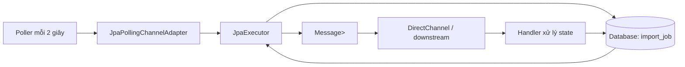
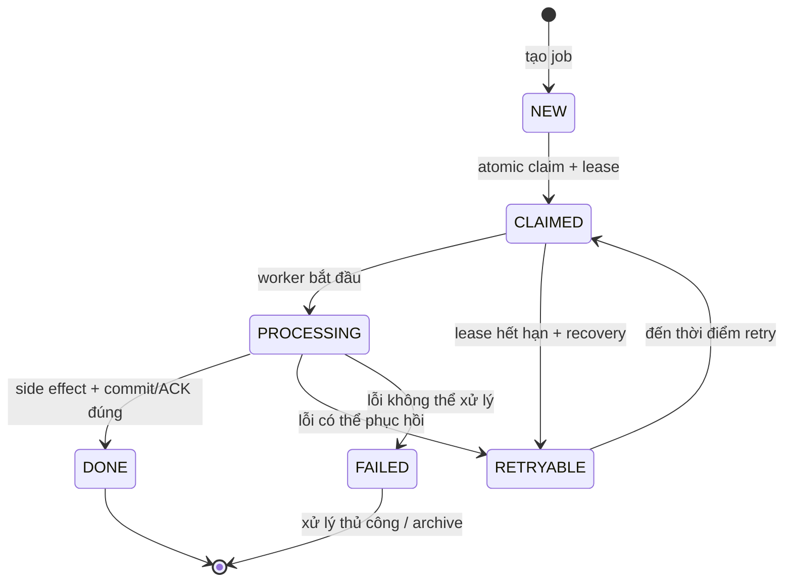
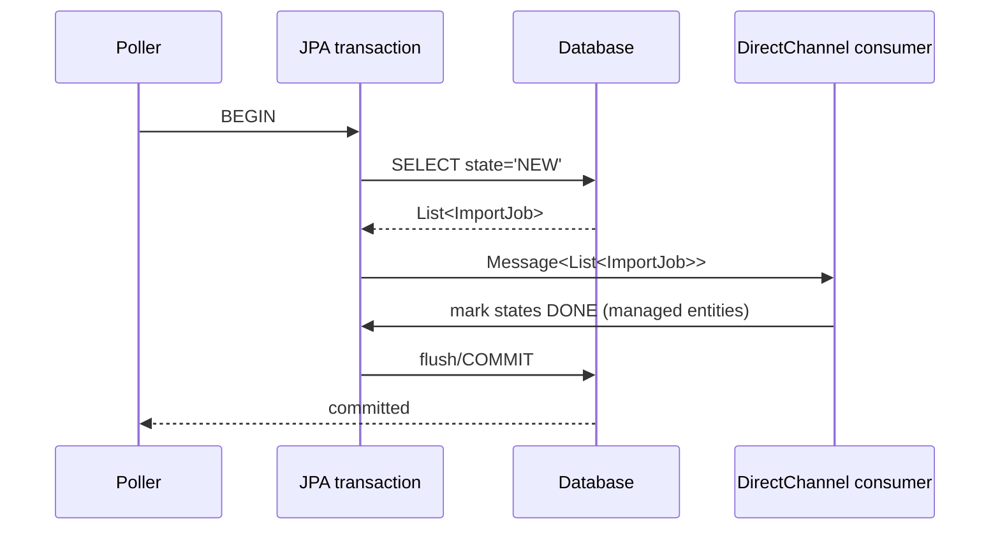
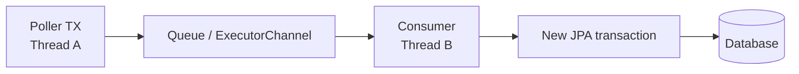
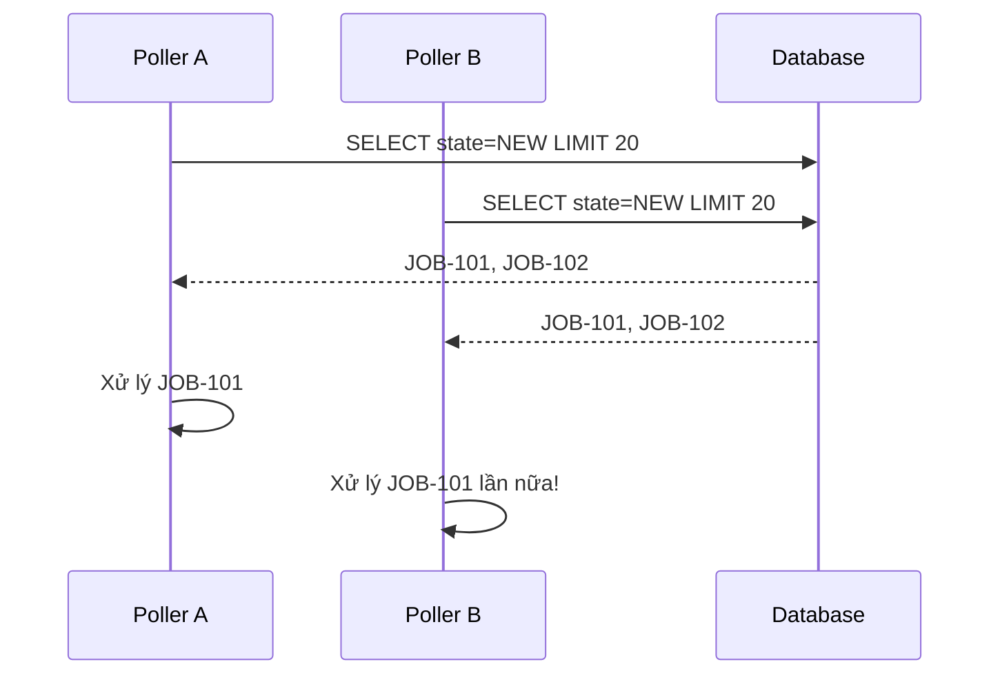
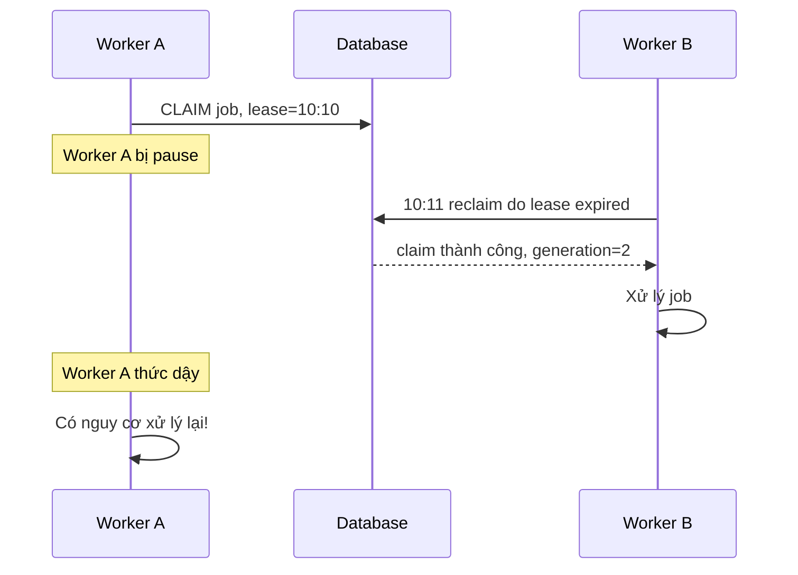
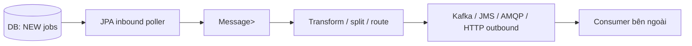

# Polling entity theo trạng thái

## 1. Bối cảnh và mục tiêu

Trong module **SPRING_INTEGRATION_ADAPTERS**, Spring Integration kết nối các hệ thống bên ngoài bằng inbound/outbound adapter, gateway, poller và `MessageChannel`. Một luồng nghiệp vụ có thể nhận file qua SFTP, gọi HTTP, gửi JMS/AMQP/Kafka hoặc đọc dữ liệu từ cơ sở dữ liệu; sau mỗi bước, hệ thống cần quản lý **bản ghi nào còn chờ xử lý**, **bản ghi nào đang xử lý** và **bản ghi nào đã hoàn thành**.

Chủ đề **Polling entity theo trạng thái** trong chương **Adapter JPA** tập trung vào cách dùng JPA inbound channel adapter đọc các entity đáp ứng điều kiện trạng thái, phát kết quả thành Spring Message, và thiết kế transaction, state transition, concurrency cùng retry để việc polling không tạo xử lý trùng hay mất dữ liệu.

Sau bài học, bạn có thể:

- Giải thích `JpaPollingChannelAdapter`, `JpaExecutor`, `Jpa.inboundAdapter(...)` và `SourcePollingChannelAdapter`.
- Phân biệt **poll theo lịch** với **retrieving outbound gateway theo request**, và phân biệt database rows với Spring Messages.
- Viết JPQL SELECT có `WHERE state = 'NEW'`, thứ tự ổn định và `maxResults`.
- Cấu hình `fixedDelay`, `fixedRate`, `maxMessagesPerPoll`, transaction advice và output `MessageChannel`.
- Hiểu `expectSingleResult(false)` trả `List<Entity>` thay vì một message cho từng row.
- Giải thích vì sao query luôn lấy `NEW` có thể trả **chính những bản ghi cũ trong lần poll kế tiếp**.
- Thực hành với Spring Boot 3.x, Spring Integration 6.x, Java 17+, Jakarta Persistence và H2.
- Chuyển trạng thái trong cùng transaction đồng bộ, rồi mở rộng sang claim có điều kiện, lease, attempt count và optimistic locking.
- Phân biệt `deleteAfterPoll` với **claim/mark processed**, kiểm soát rủi ro xóa dữ liệu khi downstream thất bại.
- Thiết kế retry, idempotency, checkpoint, outbox và giám sát backlog trong hệ thống nhiều worker.
- Viết integration tests cho NEW/DONE, không có kết quả, rollback, lịch poll và các tranh chấp đồng thời.

> **Điểm quan trọng:** JPA inbound polling về cơ bản là **SELECT theo lịch**. Một truy vấn `WHERE state='NEW'` chỉ lọc dữ liệu; nó **không tự đánh dấu row đã xử lý, không tự claim độc quyền và không tự đảm bảo exactly-once**.

## 2. Polling entity theo trạng thái là gì?

Giả sử hệ thống có bảng `import_job`:

| id | state | Ý nghĩa |
| --- | --- | --- |
| J-101 | NEW | Sẵn sàng được nhận xử lý |
| J-102 | NEW | Sẵn sàng được nhận xử lý |
| J-103 | PROCESSING | Worker khác đang làm |
| J-104 | DONE | Đã hoàn thành |
| J-105 | FAILED | Lỗi và chờ quyết định retry |

Mỗi vài giây, một inbound adapter chạy JPQL:

```sql
select j
from ImportJob j
where j.state = 'NEW'
order by j.id
```

Nếu có kết quả, adapter phát Spring Message vào channel để các bước tiếp theo xử lý.



**Phân biệt hai thời điểm:**

1. **Poll tick:** scheduler gọi source; `JpaExecutor` truy vấn database.
2. **Process:** handler nhận payload và chạy logic nghiệp vụ. Nếu thay đổi DB, transaction phải bao quanh phần thao tác phù hợp.

Nếu tất cả row đã sang DONE, query NEW không còn row để phát. Nếu handler **không cập nhật trạng thái** hoặc transaction bị rollback, lần poll sau vẫn có thể thấy NEW.

### 2.1. Các lớp/framework liên quan

| Thành phần | Vai trò |
| --- | --- |
| `JpaExecutor` | Thực thi JPA SELECT/named/native query và mapping kết quả |
| `JpaPollingChannelAdapter` | `MessageSource` dùng executor để nhận entity từ DB |
| `Jpa.inboundAdapter(entityManagerFactory)` | Factory/spec cho inbound adapter trong Java DSL |
| `SourcePollingChannelAdapter` | Endpoint do framework tạo để scheduler gọi nguồn theo lịch |
| `PollerSpec`/`Pollers` | Định nghĩa delay, trigger, transaction advice, error handling |
| `MessageChannel` | Nhận một Spring Message từ source rồi chuyển cho handler |
| `JpaTransactionManager` | Quản lý transaction/persistence context của JPA khi được cấu hình |
| `@Transactional` | Bao quanh nghiệp vụ trong một transaction qua Spring proxy |
| `@Version` | Kiểm soát optimistic conflict khi sửa managed entity |
| `Jpa.updatingGateway(...)` | Phương án riêng để atomic conditional UPDATE, lấy affected-row count |

### 2.2. Polling không phải event listener database

JPA inbound adapter không lắng nghe transaction log của database như CDC. Nó định kỳ chạy query. Do đó:

- Có **độ trễ** từ lúc INSERT NEW đến lần poll kế tiếp.
- Mỗi poll vẫn có chi phí query, kể cả lúc không có job.
- Một row có thể được nhìn thấy **nhiều lần**, đặc biệt khi state chưa thay đổi.
- Nhiều app instances có thể cùng SELECT một row.
- Tốc độ xử lý phải được kiểm soát bằng limit, concurrency và retry.

Nếu yêu cầu latency rất thấp và có nguồn thay đổi đáng tin cậy, có thể cân nhắc CDC/outbox/broker thay polling trực tiếp. Nhưng polling thường đơn giản và hữu ích cho job table, scheduled import, dữ liệu legacy và reconciliation.

## 3. So sánh các cách đưa dữ liệu JPA vào Integration Flow

| Cách làm | Trigger | Input Message trước khi query | Output |
| --- | --- | --- | --- |
| **JPA inbound channel adapter** | Poller định kỳ | Không cần request Message | Message chứa entity hoặc list |
| **JPA retrieving outbound gateway** | Một request message | Có payload/headers từ caller | Reply entity/list |
| **JPA updating outbound gateway** | Một request message | Có command | Reply entity hoặc affected-row count |
| **JPA outbound channel adapter** | Một request message | Có entity/command | Một chiều; không reply |
| **Spring Data repository từ @Scheduled** | Scheduler Java | Không có Spring Integration message source | Code Java tự xử lý |
| **CDC + broker listener** | Thay đổi transaction log | Broker event | Stream event thay đổi |
| **Transactional outbox publisher** | Poll/CDC trên bảng outbox | Event đã được commit cùng business data | Publish đến broker |

Dùng **JPA inbound channel adapter** khi muốn “mỗi 2 giây quét các row NEW và phát chúng vào Integration Flow”. Dùng **retrieving gateway** khi HTTP/JMS/Kafka request chứa ID/tiêu chí và cần SELECT ngay theo request, không phải quét toàn bảng.

### 3.1. Khi nào không nên dùng inbound polling?

Không dùng nó như một hàng đợi bền vững hoàn chỉnh khi bạn chưa giải quyết:

- Atomic claim giữa nhiều node.
- Lease/recovery khi worker chết.
- Commit/rollback và ACK downstream.
- Idempotency với redelivery.
- Backpressure và giới hạn số row.
- Poison rows, retry policy và DLQ.
- Nhất quán dữ liệu khi schema/tenant thay đổi.

Một `WHERE state='NEW'` và `fixedDelay(2000)` chưa đủ cho các yêu cầu đó.

## 4. Mô hình trạng thái: NEW, CLAIMED, PROCESSING, DONE, FAILED

Trạng thái tối thiểu có thể chỉ cần NEW/DONE. Nhưng khi xử lý thật qua HTTP/Kafka/JMS hoặc nhiều worker, nên tách các bước.



### 4.1. Hợp đồng cho từng trạng thái

| Trạng thái | Ý nghĩa nghiệp vụ | Quy tắc thường dùng |
| --- | --- | --- |
| NEW | Chưa được claim | Poller có thể SELECT |
| CLAIMED | Một worker có quyền xử lý tạm thời | Có `claimedBy`, `leaseUntil` |
| PROCESSING | Đang thực hiện tác vụ | Có heartbeat/progress nếu chạy dài |
| DONE | Hoàn thành theo tiêu chuẩn xác nhận đã chọn | Không poll lại như NEW |
| RETRYABLE | Thất bại tạm thời | Có `nextAttemptAt` và `attemptCount` |
| FAILED | Hết retry hoặc sai dữ liệu vĩnh viễn | Quarantine/DLQ/điều tra |
| CANCELLED | Dừng theo yêu cầu nghiệp vụ | Không được claim lại trừ khi có quyền |

**Trạng thái không phải bằng chứng về external delivery nếu không định nghĩa rõ:** `DONE` có thể chỉ nghĩa “đã cập nhật DB”, không đồng nghĩa Kafka producer đã được ACK hoặc HTTP consumer đã áp dụng kết quả.

### 4.2. Vì sao query theo trạng thái vẫn phải order?

```sql
select j from ImportJob j
where j.state = 'NEW'
order by j.id
```

Có `ORDER BY` ổn định để giới hạn `maxResults(20)` tạo kết quả có thể dự đoán. Nếu ưu tiên theo thời gian:

```sql
select j from ImportJob j
where j.state = 'NEW'
order by j.priority desc, j.createdAt asc, j.id asc
```

Cần thêm tie-breaker duy nhất (`id`) nếu các row có cùng priority/timestamp. Tuy nhiên, ưu tiên cao liên tục xuất hiện có thể làm các row ưu tiên thấp **bị starvation**; đó là bài toán fairness, không được giải quyết chỉ bằng `ORDER BY`.

## 5. Payload, batch và số lần poll

### 5.1. Một List không phải nhiều Spring Messages

Với:

```java
Jpa.inboundAdapter(entityManagerFactory)
        .jpaQuery("""
            select j from ImportJob j
            where j.state = 'NEW'
            order by j.id
            """)
        .maxResults(20)
        .expectSingleResult(false);
```

một lần query có thể tạo payload `List<ImportJob>` tối đa 20 entity. Khi được phát, **đó thường là một Spring Message chứa một List**, không phải 20 messages.

```text
Poll tick #1
  SELECT NEW LIMIT 20
  ↓
  Message<List<ImportJob>> [J-101, J-102, ..., J-120]
  ↓
  handler nhận một list
```

Nếu muốn handler riêng mỗi job, thêm `.split()` hoặc splitter thích hợp, nhưng phải cân nhắc transaction/partial failures: tách list thành nhiều messages không tự biến mỗi item thành một transaction.

### 5.2. Ba loại giới hạn khác nhau

| Cấu hình | Đếm cái gì? | Không đếm cái gì? |
| --- | --- | --- |
| `maxResults(20)` | Tối đa 20 row/query | Không phải 20 Spring Messages |
| `maxMessagesPerPoll(1)` | Số lần receive/poll trong một poll cycle | Không phải 1 row |
| `fixedDelay(2000)` | Khoảng nghỉ giữa các lần chạy theo trigger | Không đảm bảo query hoàn thành trong 2 giây |
| `QueueChannel.capacity` | Số Spring Messages có thể giữ | Không trực tiếp giới hạn rows/list |
| `taskExecutor concurrency` | Số task có thể song song | Không tự khóa row ở DB |
| `JDBC batch size` | Cách driver/provider gom SQL | Không phải poll size |

Một poll có `maxMessagesPerPoll(1)` vẫn có thể lấy 20 rows và tạo một List lớn. Nếu input size không được giới hạn, memory/serialization và downstream vẫn có thể bị quá tải.

### 5.3. expectSingleResult(true) để làm gì?

Nếu một query chỉ mong đúng một entity:

```java
Jpa.inboundAdapter(entityManagerFactory)
        .jpaQuery("""
            select j from ImportJob j
            where j.id = 'J-101'
            """)
        .expectSingleResult(true);
```

thì payload thành một `ImportJob` thay vì List (nếu đúng một row). Nếu query có nhiều row nhưng đặt `expectSingleResult(true)`, framework có thể ném `MessagingException`; không nên lạm dụng để biến query “nhiều NEW jobs” thành một entity.

Trong job polling, thường dùng **`expectSingleResult(false)`** và giới hạn số row tường minh.

### 5.4. Không có row thì sao?

Trong Spring Integration 6.5, `JpaPollingChannelAdapter.doReceive()` trả `null` khi `JpaExecutor.poll()` không có dữ liệu (kết quả rỗng), vì vậy **không phát một Spring Message chứa danh sách rỗng** ở tick đó. Poller tiếp tục chạy theo lịch, nhưng không nên được dùng như cơ chế “heartbeat message mỗi lần tick”. Hãy kiểm thử cả trường hợp không có job trên phiên bản thực tế của ứng dụng.

Phân biệt với **JPA retrieving outbound gateway 6.x**, nơi truy vấn dạng danh sách không có row có thể trả **`List.of()`** như reply cho một request. Đừng coi semantics request–reply đó là hợp đồng event “EMPTY” của poller.

Nếu muốn metrics “mỗi lần poll có bao nhiêu rows”, dùng Micrometer/metrics hoặc advice/observability; không tạo một business message rỗng rồi để downstream hiểu nhầm là một batch cần xử lý.

## 6. Các cách cấu hình JPA inbound polling

### 6.1. Java DSL

```java
IntegrationFlow.from(
        Jpa.inboundAdapter(entityManagerFactory)
                .jpaQuery("""
                    select j from ImportJob j
                    where j.state = 'NEW'
                    order by j.id
                    """)
                .maxResults(20)
                .expectSingleResult(false)
                .deleteAfterPoll(false),
        endpoint -> endpoint.poller(
                Pollers.fixedDelay(Duration.ofSeconds(2))
                        .maxMessagesPerPoll(1)
                        .transactional()))
        .handle(batchHandler, "markCompleted")
        .get();
```

Đây là fragment được hoàn thiện bằng source files ở mục 9. `.transactional()` ở **poller**, không phải một method của JPQL query. Poller advice bao quanh poll-and-forward đồng bộ theo cấu hình.

### 6.2. Java annotations

```java
@Bean
@InboundChannelAdapter(
        channel = "jpaJobBatches",
        poller = @Poller(
                fixedDelay = "2000",
                maxMessagesPerPoll = "1"))
MessageSource<?> jpaJobSource(JpaExecutor executor) {
    return new JpaPollingChannelAdapter(executor);
}
```

Cần khai `JpaExecutor` riêng và cấu hình transaction cho consumer hoặc poller nếu có write. Annotation trên chỉ định lịch; **nó không tự thêm transaction bao quanh mọi JPA write**.

### 6.3. XML namespace

```xml
<int-jpa:inbound-channel-adapter
        id="newJobJpaSource"
        channel="jpaJobBatches"
        entity-manager-factory="entityManagerFactory"
        jpa-query="select j from ImportJob j
                   where j.state = 'NEW'
                   order by j.id"
        max-results="20"
        expect-single-result="false"
        delete-after-poll="false">

    <int:poller fixed-delay="2000"
                max-messages-per-poll="1">
        <int:transactional
                transaction-manager="transactionManager"
                propagation="REQUIRED"/>
    </int:poller>
</int-jpa:inbound-channel-adapter>
```

Đoạn XML cần root namespaces/schema `int` và `int-jpa` cùng bean `entityManagerFactory`, `transactionManager` và consumer cho channel `jpaJobBatches`. Chỉ đăng ký **một** source trên cùng workflow nếu không chủ ý muốn nhiều poller cạnh tranh.

### 6.4. Cấu hình “entityClass” thay query

Có thể viết:

```java
Jpa.inboundAdapter(entityManagerFactory)
        .entityClass(ImportJob.class)
        .maxResults(20);
```

Điều này tiện khi muốn lấy entity class mà không định nghĩa query thủ công, nhưng **không diễn tả filter `state='NEW'`** như mong muốn. Với bài này, nên viết JPQL rõ điều kiện trạng thái, tenant/scope và thứ tự.

### 6.5. JPQL/named/native

| Chế độ | Ví dụ | Lưu ý |
| --- | --- | --- |
| `jpaQuery` | `select j from ImportJob j where j.state='NEW'` | Dùng entity/property Java |
| `namedQuery` | `ImportJob.findNew` | Named query phải tồn tại |
| `nativeQuery` | `select * from import_job where state='NEW'` | SQL dialect/result mapping phụ thuộc DB/provider |
| `entityClass` | `ImportJob.class` | Không tự lọc theo trạng thái |
| `parameterSource` | Nguồn giá trị cho `:state` | Poller không có request Message để đọc payload tùy ý |

Đừng đồng thời khai nhiều query modes không tương thích, rồi kỳ vọng framework tự chọn “query ưu tiên”.

## 7. Transaction và persistence context khi poll

### 7.1. Vì sao nên đặt transaction trên poller?



Khi poller transaction bao quanh cả **receive + send** đồng bộ trên `DirectChannel`, handler có thể tham gia cùng JPA transaction nếu dùng đúng `EntityManagerFactory`/manager và không vượt ranh giới thread. Nếu handler ném runtime exception trước commit, transaction có thể rollback, để rows NEW được thử lại theo policy.

### 7.2. @Transactional trong handler có đủ không?

Nếu không có poller transaction mà chỉ có service:

```java
@Transactional
public void markCompleted(List<ImportJob> batch) {
    // load lại entity rồi sửa state.
}
```

service có thể mở transaction **sau khi source đã SELECT**. Đây vẫn là một pattern hợp lệ cho demo đọc rồi update, nhưng không có **một transaction bao quanh cả lần poll và xử lý**, nên không thể suy ra snapshot/lock được giữ liên tục qua hai bước. Handler nên **reload/check state** và chọn optimistic/atomic update để tránh race.

### 7.3. DirectChannel không giống QueueChannel

Với `DirectChannel`, handler thường chạy ngay trên scheduler thread; transaction của poller có thể được tái sử dụng.

Nếu output chuyển sang `ExecutorChannel` hoặc `QueueChannel`:



Thread-local transaction/persistence context **không tự vượt qua** channel bất đồng bộ. Nếu source trả managed entity, consumer sau đó thường nhận một object đã detached; có thể bị `LazyInitializationException` khi truy cập LAZY relation. Truyền ID/DTO immutable hoặc load lại trong consumer transaction là lựa chọn rõ ràng hơn.

### 7.4. SELECT chưa là claim

Ngay cả khi query SELECT nằm trong một transaction, hai worker ở hai nodes vẫn có thể:

```text
Worker A SELECT NEW: J-101
Worker B SELECT NEW: J-101
Worker A xử lý J-101
Worker B cũng xử lý J-101
```

Một transaction read thông thường **không khóa độc quyền tự động** để ngăn worker khác đọc row. Muốn nhiều workers không cùng xử lý, cần atomic claim hoặc lock/lease phù hợp, không chỉ `@Transactional`.

## 8. deleteAfterPoll và phương án chuyển trạng thái

### 8.1. deleteAfterPoll là thao tác phá hủy

Spring Integration JPA inbound spec có:

```java
Jpa.inboundAdapter(entityManagerFactory)
        .jpaQuery("select j from ImportJob j where j.state = 'NEW'")
        .deleteAfterPoll(true)
        .flushAfterDelete(true);
```

Ý nghĩa:

- Sau khi truy vấn entity, adapter có thể **xóa các entity đã nhận khỏi database**.
- Việc xóa yêu cầu transaction JPA hợp lệ.
- `flushAfterDelete(true)` yêu cầu flush persistence context sau thao tác delete, **không phải commit**.
- Với native SQL/projection, `deleteAfterPoll` có giới hạn và không phải lúc nào hoạt động như mong đợi.
- Nếu dùng `deleteInBatch(true)`, cần lưu ý batch delete có thể bỏ qua cascade/callback semantics của entity delete từng object.

### 8.2. Tại sao không dùng deleteAfterPoll cho job table mặc định?

```text
Jpa inbound SELECT NEW
  → deleteAfterPoll(true)
  → DB commit xóa job
  → Kafka publish FAIL
  → job không còn, event chưa được broker nhận
```

Một transaction poller có thể rollback xóa DB nếu downstream **đồng bộ** ném lỗi đúng trước commit. Nhưng không tự bảo đảm việc gửi tới Kafka/JMS/HTTP được rollback nguyên tử cùng DB. Với async channel, thao tác gửi có thể được nhận trước khi consumer thực sự hoàn thành.

Nếu cần giữ audit và retry, nên **chuyển state NEW → CLAIMED/PROCESSING → DONE/FAILED** thay vì xóa ngay.

### 8.3. Khi nào deleteAfterPoll có thể phù hợp?

Một bảng staging ngắn hạn, bản ghi có thể được tái dựng, downstream đơn giản và failure policy rõ ràng có thể dùng delete-after-poll. Nhưng vẫn phải kiểm chứng:

- Transaction của poller.
- Loại entity/query được adapter xóa đúng.
- Cascade/foreign key constraints.
- Rollback khi consumer đồng bộ lỗi.
- Crash giữa DB commit và external delivery.
- Multi-node concurrent polling.
- Data retention/audit requirements.

**Không bật `deleteAfterPoll` chỉ để “đỡ poll lại”** mà bỏ qua khả năng mất thông tin khi hệ thống ngoài lỗi.

## 9. Ví dụ Spring Boot hoàn chỉnh: poll NEW rồi chuyển DONE

### 9.1. Phạm vi ví dụ

Ta xây một ứng dụng **một node, xử lý local trong database**:

1. Tạo vài `ImportJob` với state `NEW` hoặc `PAUSED`.
2. JPA inbound adapter SELECT tối đa 20 NEW rows mỗi 2 giây.
3. Poller mở JPA transaction.
4. Handler đồng bộ nhận `List<ImportJob>`, reload entity trong transaction và chuyển `NEW → DONE`.
5. Hibernate dirty checking đồng bộ các thay đổi tại flush/commit.
6. Lần poll tiếp không còn SELECT những jobs đã DONE.
7. Không dùng `deleteAfterPoll` để giữ dữ liệu/audit.
8. Không gọi hệ thống ngoài, vì mục tiêu là hiểu polling + transaction; thiết kế nhiều node và side effect được trình bày ở phần sau.

**Giới hạn:** ví dụ này không tự bảo đảm một job chỉ được xử lý một lần trong hệ thống nhiều app instances, nhất là khi có external effects. Nó được thiết kế như bài thực hành an toàn trên một node trước khi đi vào claim/lease.

### 9.2. Maven dependencies

Dùng Java 17+, Spring Boot 3.x, Spring Integration 6.x, Jakarta Persistence và H2:

```xml
<dependencies>
    <dependency>
        <groupId>org.springframework.boot</groupId>
        <artifactId>spring-boot-starter</artifactId>
    </dependency>
    <dependency>
        <groupId>org.springframework.boot</groupId>
        <artifactId>spring-boot-starter-data-jpa</artifactId>
    </dependency>
    <dependency>
        <groupId>org.springframework.boot</groupId>
        <artifactId>spring-boot-starter-integration</artifactId>
    </dependency>
    <dependency>
        <groupId>org.springframework.integration</groupId>
        <artifactId>spring-integration-jpa</artifactId>
    </dependency>
    <dependency>
        <groupId>com.h2database</groupId>
        <artifactId>h2</artifactId>
        <scope>runtime</scope>
    </dependency>
    <dependency>
        <groupId>org.springframework.boot</groupId>
        <artifactId>spring-boot-starter-test</artifactId>
        <scope>test</scope>
    </dependency>
</dependencies>
```

Spring Boot BOM quản lý phiên bản đồng bộ cho Spring Integration, Hibernate ORM và Spring Framework. H2 in-memory chỉ để thực hành; production dùng migration schema và database mục tiêu.

### 9.3. Entity ImportJob

File `ImportJob.java`:

```java
package com.example.jpapolling;

import jakarta.persistence.Column;
import jakarta.persistence.Entity;
import jakarta.persistence.Id;
import jakarta.persistence.Index;
import jakarta.persistence.Table;
import jakarta.persistence.Version;

@Entity
@Table(
    name = "import_job",
    indexes = @Index(
            name = "idx_job_state_id",
            columnList = "state, job_id"))
public class ImportJob {

    @Id
    @Column(name = "job_id", length = 80, nullable = false)
    private String id;

    @Column(nullable = false, length = 24)
    private String state;

    @Version
    private Long version;

    protected ImportJob() {
        // Required by Jakarta Persistence.
    }

    public ImportJob(String id, String state) {
        this.id = id;
        this.state = state;
    }

    public String getId() {
        return id;
    }

    public String getState() {
        return state;
    }

    public Long getVersion() {
        return version;
    }

    public void markDone() {
        if (!"NEW".equals(state)) {
            throw new IllegalStateException(
                    "Only NEW job can be marked DONE");
        }
        this.state = "DONE";
    }
}
```

Dùng `String state` trong demo để JPQL dễ hiểu. Production có thể dùng enum `@Enumerated(EnumType.STRING)`, state machine/domain rules và auditing fields. `@Version` giúp phát hiện một số xung đột entity updates, nhưng không thay atomic claim cho side effect ngoại hệ thống.

### 9.4. Repository để seed/test

File `ImportJobRepository.java`:

```java
package com.example.jpapolling;

import org.springframework.data.jpa.repository.JpaRepository;

public interface ImportJobRepository
        extends JpaRepository<ImportJob, String> {
}
```

Repository phục vụ seed dữ liệu và đọc trạng thái sau transaction. Truy vấn NEW chính vẫn chạy qua **Spring Integration JPA inbound adapter**, không gọi `repository.findByState(...)` trong scheduled method.

### 9.5. Handler xử lý list trong transaction poller

File `ImportJobBatchHandler.java`:

```java
package com.example.jpapolling;

import java.util.List;

import jakarta.persistence.EntityManager;
import jakarta.persistence.PersistenceContext;

import org.springframework.stereotype.Service;
import org.springframework.transaction.annotation.Propagation;
import org.springframework.transaction.annotation.Transactional;

@Service
public class ImportJobBatchHandler {

    @PersistenceContext
    private EntityManager em;

    @Transactional(propagation = Propagation.MANDATORY)
    public void markCompleted(List<ImportJob> batch) {
        for (ImportJob candidate : batch) {
            // Reload trong đúng transactional persistence context.
            // Không giả định entity qua channel luôn managed.
            ImportJob managed =
                    em.find(ImportJob.class, candidate.getId());

            if (managed != null
                    && "NEW".equals(managed.getState())) {
                managed.markDone();
            }
        }

        // Không cần em.merge(managed): đã managed.
        // Dirty checking đồng bộ khi flush/commit.
    }
}
```

**Vì sao `MANDATORY`?** Ví dụ yêu cầu transaction do poller mở. Nếu ai sửa flow làm handler chạy ngoài transaction, `MANDATORY` báo lỗi sớm thay vì âm thầm mở transaction khác và che mất boundary. Đây là kiểm tra thiết kế; nếu bạn chọn architecture khác thì `REQUIRED` có thể phù hợp.

**Vì sao reload bằng `em.find(...)`?** Trên cùng transaction source/consumer, adapter có thể trả managed entities, nhưng cách viết trên giữ ranh giới rõ ràng: handler thao tác trên instance thuộc persistence context đang hoạt động. Trong flow async, transaction `MANDATORY` sẽ lỗi nếu không tạo transaction ở consumer; bạn phải thay thiết kế như phần sau.

**Không gọi Kafka/HTTP ở đây.** Mark DONE trong cùng DB transaction là bài thực hành về state transition local; nó không chứng minh external delivery.

### 9.6. IntegrationFlow polling bằng Java DSL

File `ImportJobPollingConfiguration.java`:

```java
package com.example.jpapolling;

import java.time.Duration;

import jakarta.persistence.EntityManagerFactory;

import org.springframework.context.annotation.Bean;
import org.springframework.context.annotation.Configuration;
import org.springframework.integration.config.EnableIntegration;
import org.springframework.integration.dsl.IntegrationFlow;
import org.springframework.integration.dsl.Pollers;
import org.springframework.integration.jpa.dsl.Jpa;

@Configuration
@EnableIntegration
public class ImportJobPollingConfiguration {

    @Bean
    IntegrationFlow newJobPollingFlow(
            EntityManagerFactory entityManagerFactory,
            ImportJobBatchHandler handler) {

        return IntegrationFlow.from(
                Jpa.inboundAdapter(entityManagerFactory)
                        .jpaQuery("""
                                select j from ImportJob j
                                where j.state = 'NEW'
                                order by j.id
                                """)
                        .maxResults(20)
                        .expectSingleResult(false)
                        .deleteAfterPoll(false),
                endpoint -> endpoint
                        .id("newJobPollingEndpoint")
                        .poller(
                                Pollers.fixedDelay(
                                        Duration.ofSeconds(2))
                                        .maxMessagesPerPoll(1)
                                        .transactional()))
                .handle(handler, "markCompleted")
                .get();
    }
}
```

Giải thích:

1. `Jpa.inboundAdapter(entityManagerFactory)` tạo source đọc JPA.
2. `jpaQuery` dùng JPQL `SELECT` theo trạng thái `NEW` và sắp xếp `id`.
3. `maxResults(20)` giới hạn dữ liệu cho mỗi query.
4. `expectSingleResult(false)` giữ payload dạng `List<ImportJob>`.
5. `deleteAfterPoll(false)` bảo toàn job records; handler sẽ chuyển state.
6. `Pollers.fixedDelay(Duration.ofSeconds(2))` tạo lịch định kỳ; không phải phản hồi một request HTTP.
7. `maxMessagesPerPoll(1)` giới hạn số lần source được receive trong mỗi poll cycle, **không phải một job/row**.
8. `transactional()` áp advice bao quanh poll task bằng transaction manager mặc định. Nếu ứng dụng có nhiều transaction managers, hãy chỉ rõ manager phù hợp, tránh chọn sai database.
9. `handle(handler, "markCompleted")` gọi method đồng bộ trong flow. Vì mặc định dùng direct path và không chèn async channel, handler tham gia transaction của poller.
10. Không có `.split()`, để toàn bộ batch local cùng được xử lý theo một transaction.

**Giới hạn concurrency:** một instance có thể chạy poller theo lịch, nhưng nếu triển khai ba app instances cùng cấu hình, cả ba sẽ query chung rows NEW. Transaction ở poller không tự đảm bảo single ownership.

### 9.7. Main application và dữ liệu mẫu

File `JpaStatePollingApplication.java`:

```java
package com.example.jpapolling;

import java.util.List;

import org.springframework.boot.CommandLineRunner;
import org.springframework.boot.SpringApplication;
import org.springframework.boot.autoconfigure.SpringBootApplication;
import org.springframework.context.annotation.Bean;

@SpringBootApplication
public class JpaStatePollingApplication {

    public static void main(String[] args) {
        SpringApplication.run(
                JpaStatePollingApplication.class, args);
    }

    @Bean
    CommandLineRunner sampleJobs(ImportJobRepository repository) {
        return args -> {
            if (repository.count() == 0) {
                repository.saveAll(List.of(
                        new ImportJob("JOB-101", "NEW"),
                        new ImportJob("JOB-102", "NEW"),
                        new ImportJob("JOB-103", "PAUSED"),
                        new ImportJob("JOB-104", "DONE")
                ));
            }

            System.out.println(
                    "Seeded jobs. Poller will mark NEW as DONE.");
        };
    }
}
```

File `application.properties`:

```properties
spring.main.web-application-type=none

spring.datasource.url=jdbc:h2:mem:jpa_state_poll;DB_CLOSE_DELAY=-1
spring.datasource.driver-class-name=org.h2.Driver
spring.datasource.username=sa
spring.datasource.password=

spring.jpa.hibernate.ddl-auto=create-drop
spring.jpa.open-in-view=false

logging.level.org.springframework.integration=INFO
```

**Kết quả kỳ vọng sau ít nhất một poll đã commit:**

| Job | Trạng thái sau | Tại sao |
| --- | --- | --- |
| JOB-101 | DONE | NEW được query và handler chuyển |
| JOB-102 | DONE | NEW được query và handler chuyển |
| JOB-103 | PAUSED | Query không chọn |
| JOB-104 | DONE | Đã hoàn thành từ trước |
| Bản ghi NEW được thêm sau đó | DONE sau poll tiếp theo | Có polling theo lịch |

Không cần tự gọi `Thread.sleep` trong `CommandLineRunner` để đợi kết quả. Trong demo thực tế, có thể quan sát logs, truy vấn H2/test hoặc dùng integration test đợi theo timeout hữu hạn.

### 9.8. Tại sao flow này chỉ minh họa “một node”?

Với một instance và local DB-only state update, `SELECT → handler → dirty-checking → commit` tương đối dễ hiểu. Nhưng:

- Một node khác có thể đọc cùng row trước khi commit.
- Handler có thể bị chạy lại sau rollback.
- Side effect bên ngoài database có thể hoàn thành rồi transaction DB rollback.
- `@Version` có thể làm một transaction báo optimistic conflict, nhưng tác dụng bên ngoài đã xảy ra vẫn không thể tự rollback.
- Nếu muốn phân phối work thực sự, phải nâng cấp thành **atomic claim + worker identity/lease + idempotency**.

Không đem demo này triển khai như distributed worker queue chỉ vì nó chạy tốt trên H2.

## 10. Transaction rollback và state transition

### 10.1. Handler ném exception thì điều gì xảy ra?

Với poller transactional + DirectChannel:

```text
TX BEGIN
  → SELECT NEW: [JOB-101, JOB-102]
  → handler mark JOB-101 = DONE
  → handler mark JOB-102 = DONE
  → handler throws RuntimeException
TX ROLLBACK
  → JOB-101 và JOB-102 vẫn NEW trong DB
poll tiếp theo có thể chọn lại chúng
```

Lưu ý provider có thể flush trước exception, nhưng **flush không phải commit**. Nếu transaction rollback, SQL trước đó không được commit. Những Java entity references còn giữ sau rollback cũng không nên coi là managed state đáng tin cậy.

### 10.2. Có những lỗi cần retry, và những lỗi phải quarantine

| Lỗi | Chính sách phù hợp |
| --- | --- |
| DB connection timeout tạm thời | Retry có giới hạn và backoff |
| Deadlock/serialization failure | Retry **transaction mới**, kiểm tra idempotency |
| Input sai schema | Không retry vô hạn, đánh FAILED/DLQ |
| Missing required field | Validate trước xử lý, quarantine |
| Khóa unique trùng | Kiểm tra eventId đã xử lý hay conflict |
| Optimistic lock conflict | Reconcile lại state/lease; không ghi đè mù |
| Kafka/HTTP downstream timeout | Kiểm tra outcome và dedup trước retry |
| Poison row luôn làm toàn batch lỗi | Cô lập row hoặc giới hạn attempt để batch không bị kẹt |

Nếu một row lỗi luôn khiến toàn batch rollback, query `ORDER BY id LIMIT 20` sẽ tiếp tục lấy lại cùng row đó. Đây là dạng **poison row starvation**, cần error policy có trạng thái RETRYABLE/FAILED hoặc tách chunk và giới hạn attempt count.

### 10.3. Partial processing không tự có ở một transaction

Một handler nhận List 20 rows và chuyển 19 DONE rồi row #20 fail:

- Nếu toàn handler trong **một transaction**, 19 rows đầu **rollback** cùng row cuối.
- Nếu mỗi row có transaction riêng, 19 rows có thể commit, nhưng phải xử lý duplicate/retry của batch.
- Nếu tách `.split()` nhưng vẫn dùng cùng poller transaction đồng bộ, một số thao tác có thể vẫn thuộc chung transaction; **split không đồng nghĩa per-item commit**.
- Nếu chèn async channel sau splitter, mỗi worker cần transaction và error handling riêng.

Chọn ranh giới dựa trên độ quan trọng của all-or-nothing, throughput và khả năng phục hồi.

## 11. Kiểm thử end-to-end lịch poll

### 11.1. SpringBootTest: NEW chuyển DONE

File `ImportJobPollingIntegrationTest.java`:

```java
package com.example.jpapolling;

import static org.assertj.core.api.Assertions.assertThat;

import java.time.Duration;
import java.util.UUID;

import org.junit.jupiter.api.Test;
import org.springframework.beans.factory.annotation.Autowired;
import org.springframework.boot.test.context.SpringBootTest;

@SpringBootTest
class ImportJobPollingIntegrationTest {

    @Autowired
    ImportJobRepository repository;

    @Test
    void eventuallyProcessesNewJob() throws InterruptedException {
        String id = "test-" + UUID.randomUUID();
        repository.saveAndFlush(new ImportJob(id, "NEW"));

        long deadline = System.nanoTime()
                + Duration.ofSeconds(12).toNanos();

        String state = null;
        while (System.nanoTime() < deadline) {
            state = repository.findById(id)
                    .map(ImportJob::getState)
                    .orElse(null);

            if ("DONE".equals(state)) {
                break;
            }
            Thread.sleep(100);
        }

        assertThat(state).isEqualTo("DONE");
    }

    @Test
    void doesNotProcessPausedJob() throws InterruptedException {
        String id = "paused-" + UUID.randomUUID();
        repository.saveAndFlush(
                new ImportJob(id, "PAUSED"));

        // Đợi dài hơn một fixedDelay để poller có cơ hội chạy.
        Thread.sleep(2500);

        assertThat(repository.findById(id))
                .isPresent()
                .get()
                .extracting(ImportJob::getState)
                .isEqualTo("PAUSED");
    }
}
```

Đây là integration tests cho **scheduler thật** nên có yếu tố thời gian. Tránh assert “sau đúng 2 giây” — scheduler/DB/CI có thể chậm. Deadline hữu hạn giúp test không chờ mãi; một môi trường CI tải nặng có thể cần deadline phù hợp hơn.

**Quan trọng:** Không đặt `@Transactional` trên test method. Nếu test tự rollback insert ở cuối và poller chạy trong thread khác, poller có thể **không nhìn thấy NEW** chưa commit. `repository.saveAndFlush` tự chạy transaction repository, commit khi method trả về trong cấu hình mặc định và không có transaction test bên ngoài.

### 11.2. Thử bằng source trực tiếp, không chờ scheduler

Nếu muốn test chính xác `JpaPollingChannelAdapter` mà không chờ tick, có thể tạo một bean source/executor riêng rồi gọi `receive()` trong `TransactionTemplate`. Đây là **test khác** với SpringBootTest scheduler; cần quản lý việc tự tạo source, transaction, initialization và tránh hai nguồn đọc cùng rows gây race.

```java
JpaExecutor executor = new JpaExecutor(entityManagerFactory);
executor.setJpaQuery("""
        select j from ImportJob j
        where j.state = 'NEW'
        order by j.id
        """);
executor.setMaxNumberOfResults(20);
executor.setExpectSingleResult(false);
// Nếu tạo thủ công ngoài Spring, phải áp lifecycle
// phù hợp trước khi gọi executor.

JpaPollingChannelAdapter source =
        new JpaPollingChannelAdapter(executor);
```

Không gọi thẳng các phương thức của source với kỳ vọng có đầy đủ Spring bean lifecycle, transaction và error handling nếu bạn chưa khởi tạo chúng. Integration test với `@Bean` và `@InboundChannelAdapter` thường gần behavior production hơn.

### 11.3. Assertions phải kiểm tra state và scope

Test chỉ đếm bao nhiêu lần handler được gọi là chưa đủ. Nên assert:

- Row NEW thực sự thành DONE **sau commit**.
- Row PAUSED/DONE không bị update.
- Row mới thêm sau tick vẫn được nhận ở tick tiếp theo.
- Không vượt maxResults trong một query.
- Khi handler ném lỗi, transaction rollback; row vẫn NEW hoặc chuyển RETRYABLE theo thiết kế.
- Không xuất hiện xử lý trùng khi có nhiều worker và atomic claim.
- Không nhận entity từ tenant khác khi query có tenant scope.

## 12. Atomic claim: SELECT NEW chưa đủ để chia việc

### 12.1. Lỗi race khi hai worker cùng đọc

Đối với hai instance chạy cùng một truy vấn:



Một query SELECT có filter trạng thái giúp **chọn candidates**, nhưng không tạo quyền sở hữu độc quyền cho từng worker. `@Transactional` quanh SELECT không tự biến SELECT thành một claim atomic.

Ngay cả khi entity có `@Version`, optimistic conflict thường chỉ xuất hiện tại JPA UPDATE/flush/commit; nếu cả hai worker đã gửi HTTP/Kafka trước đó, side effect có thể **đã xảy ra hai lần** trước khi một transaction bị rollback.

### 12.2. Atomic conditional update

Một cách phổ biến là query **UPDATE có điều kiện**:

```sql
update ImportJob j
set j.state = 'CLAIMED',
    j.version = j.version + 1
where j.id = :jobId
  and j.state = 'NEW'
```

Nếu hai workers cùng try-claim một ID:

- Worker thành công nhận affected count `1`.
- Worker còn lại thường nhận `0` sau khi row đã thay state, hoặc lỗi cạnh tranh/serialization tùy DB/isolation.
- Chỉ worker có claim **đã commit thành công** mới tiếp tục bước xử lý ngoài database.
- Nếu statement thất bại/deadlock, retry cả transaction với bounded backoff; không coi `0` và exception là cùng một loại kết quả.

**Lưu ý:** JPQL bulk update không tự tăng version theo cơ chế entity dirty checking. Trong query trên, `j.version = j.version + 1` là thao tác **tường minh** để tránh thay đổi version bị bỏ qua.

### 12.3. Spring Data JPA repository claim

Bài demo `ImportJob` đã có `state` và `version` nên có thể thêm **phương thức** sau vào interface repository (đây là biến thể cho bước nâng cao):

```java
import org.springframework.data.jpa.repository.Modifying;
import org.springframework.data.jpa.repository.Query;
import org.springframework.data.repository.query.Param;

@Modifying
@Query("""
        update ImportJob j
           set j.state = 'CLAIMED',
               j.version = j.version + 1
         where j.id = :id
           and j.state = 'NEW'
        """)
int claimIfNew(@Param("id") String id);
```

Phương thức phải được gọi trong **write transaction**, ví dụ service bean:

```java
@Service
public class ImportJobClaimService {

    private final ImportJobRepository repository;

    public ImportJobClaimService(
            ImportJobRepository repository) {
        this.repository = repository;
    }

    @Transactional
    public boolean tryClaim(String jobId) {
        return repository.claimIfNew(jobId) == 1;
    }
}
```

Hai code fragment giả định imports của `@Service`/`@Transactional` tương ứng. Nếu viết full file, đặt repository method **bên trong** `ImportJobRepository`, service vào file riêng. Không đăng ký đồng thời flow demo mark NEW→DONE với claim flow này trên cùng dataset mà không thay state machine: một flow sẽ chuyển NEW→DONE, flow khác chuyển NEW→CLAIMED và có thể cạnh tranh.

### 12.4. Thành công của claim phải là sau commit

```text
SELECT candidate IDs
    ↓
tryClaim(id) trong transaction riêng
    ↓
DB COMMIT thành công
    ↓
Nếu affected == 1: xử lý side effect
Nếu affected == 0: bỏ qua, worker khác có thể đã claim
Nếu exception: retry claim theo policy
```

Một giá trị affected count `1` được trả bên trong transaction chưa tự chứng minh commit. Trong ví dụ `@Transactional` service proxy, caller bên ngoài chỉ tiếp tục nếu method hoàn tất bình thường sau commit. Nếu caller đang ở **transaction khác** với propagation REQUIRED, `tryClaim` có thể tham gia transaction đó và chưa commit khi trả về. Cần thiết kế rõ boundary.

Đối với worker có nhiệm vụ gửi HTTP/Kafka tốn thời gian, nên giữ transaction claim **ngắn**, commit, sau đó thực hiện công việc, thay vì giữ row locks/JDBC connection suốt thời gian network call.

### 12.5. JPA updating outbound gateway cũng có thể claim

Nếu muốn tất cả thao tác đi qua Spring Integration:

```java
Jpa.updatingGateway(entityManagerFactory)
        .jpaQuery("""
                update ImportJob j
                   set j.state = 'CLAIMED',
                       j.version = j.version + 1
                 where j.id = :jobId
                   and j.state = 'NEW'
                """)
        .parameterExpression("jobId", "payload");
```

Request payload là ID; reply là **affected-row count** khi thực thi JPQL UPDATE. Cần transaction tại caller hoặc endpoint, và xử lý result `0/1` trước khi chuyển sang consumer.

**Không** lấy reply `1` và phát Kafka thành công trong cùng transaction trước commit mà bỏ qua failure window. Dùng transaction boundary rõ ràng hoặc transactional outbox.

## 13. Lease và recovery khi worker chết

Atomic claim giải quyết cạnh tranh **ở thời điểm nhận việc**, nhưng nếu worker claim rồi crash, row có thể kẹt ở `CLAIMED`. Lease giúp phát hiện claim quá hạn.

### 13.1. Mở rộng schema

Trong biến thể production, thêm những cột:

```sql
-- Pseudo-schema: điều chỉnh cú pháp theo DB/migration thực tế.
claimed_by       VARCHAR(80)
lease_until      TIMESTAMP
attempt_count    INTEGER NOT NULL DEFAULT 0
next_attempt_at  TIMESTAMP
last_error_code  VARCHAR(80)
updated_at       TIMESTAMP NOT NULL
```

Một entity mở rộng cần khai mappings tương ứng; demo `ImportJob` trong mục 9 **chưa có những field này**. Chỉ copy JPQL ở dưới sau khi bổ sung schema/entity và migration.

### 13.2. Claim với thời hạn

```sql
update ImportJob j
set j.state = 'CLAIMED',
    j.claimedBy = :workerId,
    j.leaseUntil = :leaseUntil,
    j.attemptCount = j.attemptCount + 1,
    j.version = j.version + 1
where j.id = :jobId
  and (
       j.state = 'NEW'
       or (j.state = 'CLAIMED' and j.leaseUntil < :now)
  )
  and (j.nextAttemptAt is null or j.nextAttemptAt <= :now)
```

Ý nghĩa:

- Một worker chỉ có quyền khi affected-row count `1` và transaction commit thành công.
- Worker trước giữ lease đến `leaseUntil`; có thể reclaim sau khi lease hết hạn.
- `attemptCount` giúp áp retry budget.
- `nextAttemptAt` cho phép exponential backoff hoặc trì hoãn theo lịch.
- `workerId` phục vụ audit/reconcile.
- `version`/fencing token giúp chặn worker cũ cập nhật sau khi lease đã chuyển quyền.

### 13.3. Lease expiry không tự ngăn xử lý trùng

Giả sử worker A bị chậm hoặc pause GC quá lâu, lease hết hạn; B claim lại và bắt đầu xử lý. A sau đó thức dậy, có thể vẫn gửi side effect.



**Vì vậy cần fencing và idempotency**, không chỉ lease.

Một cách là mỗi claim có một `claimGeneration`/version tăng dần; thao tác hoàn tất DB đặt điều kiện:

```sql
update ImportJob j
set j.state = 'DONE',
    j.version = j.version + 1
where j.id = :id
  and j.claimedBy = :workerId
  and j.version = :claimedVersion
  and j.state = 'CLAIMED'
```

Đây là một compare-and-set tại database; nếu worker cũ đã mất quyền, update DONE trả `0`. Với external systems, cần một cơ chế idempotency/fencing tương ứng tại đích, vì DB CAS **không thể rút lại** HTTP request đã gửi trước đó.

### 13.4. Phục hồi job đang kẹt

Một scheduler/job riêng có thể phát hiện:

```sql
select j from ImportJob j
where j.state = 'CLAIMED'
  and j.leaseUntil < :now
order by j.leaseUntil, j.id
```

Sau đó retry claim hoặc chuyển về RETRYABLE theo policy. Không nên reset toàn bộ CLAIMED về NEW mù quáng nếu workers vẫn đang xử lý hoặc clock skew chưa được kiểm soát.

Trong nhiều vùng địa lý, ưu tiên đồng hồ database/server thống nhất; lưu `Instant`/UTC và có chiến lược cho clock skew. Test trường hợp pause dài, worker chết, restart, duplicate lease và stale completion.

## 14. Row locking và SKIP LOCKED

### 14.1. @Lock(PESSIMISTIC_WRITE)

JPA hỗ trợ pessimistic locking trong những trường hợp phù hợp:

```java
@Lock(LockModeType.PESSIMISTIC_WRITE)
@Query("""
        select j from ImportJob j
        where j.id = :id
        """)
Optional<ImportJob> lockById(@Param("id") String id);
```

Phương thức này cần khai trong Spring Data repository với imports tương ứng và transaction hiệu lực. Lock giữ tới khi transaction kết thúc theo DB/provider. Nếu sau đó xử lý network lâu, connection và row lock cũng bị giữ lâu; điều này làm throughput giảm và dễ deadlock.

### 14.2. SELECT ... FOR UPDATE SKIP LOCKED

Một số database như PostgreSQL/Oracle hỗ trợ lấy những rows chưa bị khóa bằng `FOR UPDATE SKIP LOCKED`. Đây là một cách chia work hiệu quả khi dùng native SQL trong transaction claim ngắn:

```sql
-- SQL mang tính minh họa, không phải JPQL portable:
select job_id
from import_job
where state = 'NEW'
order by job_id
for update skip locked
```

Cú pháp `LIMIT`/`FETCH FIRST`, thứ tự cùng với locking và Hibernate/JPA mapping **khác nhau theo database/dialect**, nên phải viết SQL đúng DB mục tiêu, không copy nguyên vào `jpaQuery(...)`.

### 14.3. Kết hợp lock và claim

Một thiết kế là:

1. Trong DB transaction ngắn, SELECT một batch rows có lock `SKIP LOCKED`.
2. Đổi state của batch thành CLAIMED, lưu owner/lease và version.
3. COMMIT để nhả locks.
4. Worker xử lý bên ngoài transaction.
5. Trong transaction khác, cập nhật DONE theo owner/generation điều kiện.
6. Nếu lỗi, cập nhật RETRYABLE/FAILED và lên lịch retry.

Không giữ transaction claim mở trong suốt việc gọi Kafka/HTTP/SFTP. `SKIP LOCKED` giúp tránh chờ row đã khóa **trong lúc claim**, không tự giải quyết idempotency sau khi commit.

## 15. Pagination, fairness và tránh starvation

### 15.1. maxResults phải có giới hạn

Nếu có một triệu rows NEW, một SELECT không giới hạn có thể giữ hàng triệu managed entities, tăng heap/GC, query duration và tạo message quá lớn.

```java
Jpa.inboundAdapter(entityManagerFactory)
        .jpaQuery("""
                select j from ImportJob j
                where j.state = 'NEW'
                order by j.id
                """)
        .maxResults(100)
        .expectSingleResult(false);
```

Con số `100` là ví dụ; chọn dựa trên row size, SLA, throughput, index và transaction duration. Không nhận `maxResults` từ request bên ngoài mà không cap server-side.

### 15.2. Vì sao OFFSET thường không cần cho trạng thái NEW?

Khi poll xong và **chuyển NEW → CLAIMED/DONE**, lần poll sau query `WHERE state='NEW'` tự loại rows đã claim. Bạn có thể luôn lấy **trang đầu** với limit N.

Nếu dùng OFFSET tăng dần trên tập kết quả **đang bị update**:

```text
Poll 1: SELECT NEW offset 0 → J1..J10 → mark DONE
Poll 2: SELECT NEW offset 10 → có thể bỏ qua J11..J20
```

Vì dataset đã co lại sau khi xóa NEW rows, offset có thể làm mất lượt xử lý. Thông thường **không dùng page number tăng tuần tự** với work queue có state changing; dùng fixed first page + atomic claim.

### 15.3. Starvation do poison row hoặc priority

Nếu query luôn ORDER BY id và chọn 20 rows đầu, một row bị lỗi mà không được chuyển trạng thái có thể đứng mãi trong batch đầu. Nếu có 20 poison rows, mọi poll sẽ lấy lại đúng 20 rows đó, làm backlog phía sau không tiến.

Giải pháp:

- Tăng `attemptCount` sau mỗi thất bại một cách bền vững, ngoài transaction xử lý đã rollback.
- Sau ngưỡng thử lại, chuyển RETRYABLE/FAILED hoặc đặt `nextAttemptAt`.
- Dùng backoff và jitter.
- Phân tách poison records khỏi pipeline chính.
- Áp scheduling fairness giữa priority/tenant/shard.
- Quan sát “oldest NEW age” thay vì chỉ count backlog.

### 15.4. Index giúp query có WHERE và ORDER BY

Với query `state='NEW' ORDER BY id`, một index `(state,id)` thường là ứng viên, như trong entity demo. Với multi-tenant và priority, index có thể thay thành `(tenant_id,state,priority,created_at,id)` hoặc biến thể theo plan.

**Không chỉ định index theo cảm tính**: index làm chậm INSERT/UPDATE và tốn dung lượng. Đo query plan/row cardinality trên DB thật, nhất là khi phần lớn rows đã DONE và ít rows NEW.

## 16. Poller và các loại nguồn tham số

### 16.1. Inbound polling thường không có request payload

Khác với `Jpa.retrievingGateway(...)`, `Jpa.inboundAdapter(...)` không được gọi bởi một `Message<Filter>` từ HTTP user. Nó được poller kích hoạt theo lịch. Vì thế cấu hình:

```java
new JpaParameter(
        "state", null, "payload.state")
```

không mặc định có một request message với `payload.state` để evaluate. Nếu query được poll định kỳ, ưu tiên **literal server-configured state** hoặc một `ParameterSource` do server kiểm soát.

### 16.2. Static parameter qua JpaExecutor

```java
JpaExecutor executor =
        new JpaExecutor(entityManagerFactory);

executor.setJpaQuery("""
        select j from ImportJob j
        where j.state = :state
        order by j.id
        """);

executor.setJpaParameters(
        List.of(new JpaParameter(
                "state", "NEW", null)));

executor.setMaxNumberOfResults(20);
executor.setExpectSingleResult(false);
```

Đây là fragment Java configuration có imports `JpaExecutor`/`JpaParameter`/`List`. Từ bean executor đó, một `JpaPollingChannelAdapter` được khai với `@InboundChannelAdapter` có thể chạy poll. Giá trị `NEW` là cấu hình đáng tin cậy, không phải header do client tùy ý gắn.

### 16.3. Named query, native query và projection

Với JPQL:

```sql
select j from ImportJob j
where j.state = 'NEW'
order by j.id
```

source có thể trả entities. Nếu chỉ cần một số field để chuyển qua async channel, dùng DTO projection:

```sql
select new com.example.jpapolling.JobDispatchView(
    j.id, j.state, j.version)
from ImportJob j
where j.state = 'NEW'
order by j.id
```

`JobDispatchView` là record/class phải tự định nghĩa với constructor đúng kiểu; nó không nằm trong demo mục 9. Projection giúp tránh gửi entity với quan hệ LAZY qua thread boundary.

**Đặc biệt:** khi source trả DTO thay vì managed entity, `deleteAfterPoll(true)` không còn nên được xem là thao tác entity delete hợp lệ mặc định. Trong work queue, nên thiết kế atomic claim dựa trên ID thay vì delete-after-poll.

## 17. Đẩy kết quả polling sang Kafka, JMS, AMQP và HTTP

### 17.1. Một message source không bảo đảm delivery tới đích



Một record đã được SELECT không có nghĩa:

- Đã được claim.
- Dữ liệu DB đã commit state DONE.
- Kafka producer nhận broker ACK.
- JMS/AMQP message đã được consumer ACK.
- HTTP client đã nhận và áp dụng response.
- External API đã thực hiện side effect đúng một lần.

Nếu handler tự đánh dấu DONE **trước khi** gửi outbound và transaction DB commit thành công nhưng external send fail, job có nguy cơ mất event. Nếu **gửi outbound trước** rồi DB rollback, job có thể được gửi lại; kết quả là duplicate event.

### 17.2. Transactional outbox: giải pháp cho DB + broker

Khi job NEW yêu cầu publish một event, có thể dùng một DB transaction:

```text
BEGIN DB transaction
  SELECT / claim job đã được xác minh
  UPDATE job → DONE hoặc OUTBOX_PENDING
  INSERT outbox_event(eventId, aggregateId, payload, status='NEW')
COMMIT
```

Một publisher riêng:

```text
Poll outbox NEW
  → claim outbox row
  → publish Kafka/JMS
  → nhận broker ACK
  → mark outbox SENT
```

Nếu crash giữa broker ACK và mark SENT, publisher có thể gửi lại; consumer phải idempotent theo `eventId`. Đây thường là **at-least-once + idempotency**, không được gọi exactly-once toàn hệ thống nếu chưa chứng minh end-to-end.

### 17.3. Transaction boundary và channel types

| Thiết kế | Kết quả cần hiểu |
| --- | --- |
| JPA poller → DirectChannel → đồng bộ DB handler | Có thể chung poller transaction |
| JPA poller → DirectChannel → HTTP/Kafka send | DB transaction không tự commit broker/HTTP cùng lúc |
| JPA poller → QueueChannel | Queue nhận Message, consumer sau này cần transaction riêng |
| JPA poller → ExecutorChannel | Worker thread khác, không tự nhận thread-bound transaction |
| JPA poller → Kafka outbound | Producer ACK và DB commit là hai giới hạn độc lập |
| JPA poller → outbox DB | Có thể giữ data + intent publish trong một DB commit |
| JPA poller → file/SFTP outbound | File rename/write không atomic cùng DB transaction |

Nếu cần gửi message sau khi commit, có thể dùng transaction synchronization/outbox. Không coi `MessageChannel.send(...) == true` là xác nhận giao hàng bên ngoài.

### 17.4. Cách xử lý error channel

Với poller:

- Cấu hình `errorChannel`/`ErrorMessage` hoặc error handler phù hợp khi lỗi poll/handler xảy ra.
- Transaction rollback cho lỗi đồng bộ phải được propagate đúng qua advice.
- Đừng nuốt exception rồi tự ACK source như success.
- Với error channel bất đồng bộ, việc publish ErrorMessage có thể làm lỗi không còn truyền ngược như bạn dự đoán; kiểm thử rollback thực tế.
- Với Kafka/JMS, phải tách DLQ của broker và error channel của Spring Integration. Một ErrorMessage không tự là DLQ bền vững.

## 18. Multi-tenant, bảo mật và audit

### 18.1. Poller thường dùng service identity

Một background poller không phải HTTP request của một người dùng cụ thể. Nó thường có **service account** với quyền truy cập các jobs thuộc phạm vi được cấp.

Không mặc định poller có quyền đọc mọi tenant chỉ vì nó chạy ở backend. Một truy vấn:

```sql
select j from ImportJob j
where j.state = 'NEW'
```

có thể trộn dữ liệu nhiều tenant. Nếu cần cách ly, thêm tenant filter:

```sql
select j from ImportJob j
where j.tenantId = :tenantId
  and j.state = 'NEW'
order by j.id
```

`tenantId` phải là một giá trị do server xác nhận/cấp, hoặc sử dụng cơ chế database row-level security/multi-tenancy phù hợp. Không tin một header tùy ý do client gửi để cấp quyền cho poller.

### 18.2. Tenant-scoped polling

Với mỗi tenant/shard, có thể:

- Một poller được cấu hình cụ thể theo tenant, với ParameterSource tĩnh.
- Một work scheduler chọn tenant theo policy rồi dùng retrieving gateway/request DTO có validation.
- Nhiều pollers có leader election/sharding để tránh trùng.
- Database claim gồm điều kiện `tenantId` và `state`.
- Rate limit và fairness trên tenant để không tenant nào chiếm hết worker pool.

Đừng mở vô hạn poller threads/một datasource connection pool cho mỗi tenant mà không đo tài nguyên.

### 18.3. Audit fields và nhật ký sự kiện

Một job production thường cần:

```text
job_id
tenant_id
business_key
state
created_at
updated_at
claimed_by
lease_until
attempt_count
next_attempt_at
last_error_code
completed_at
version
```

Audit log nên chứa state transition, worker ID, correlation ID và mã lỗi, nhưng tránh dump toàn payload chứa PII/token. Nếu có dữ liệu nhạy cảm, kiểm soát retention, truy cập và mask thông tin.

### 18.4. Poller không được nhận query tùy ý từ user

Một endpoint không nên cho client gửi JPQL/SpEL text hoặc tên table/column tùy ý để làm polling query. Cấu trúc truy vấn phải được developer kiểm soát; input động chỉ là giá trị tham số đã validate và có authorization.

## 19. Vận hành: đo backlog, throughput và starvation

| Metric gợi ý | Ý nghĩa |
| --- | --- |
| `jpa_poll_ticks_total` | Số lần scheduler kích hoạt poll |
| `jpa_poll_queries_total` | Số truy vấn JPA poll thực thi |
| `jpa_poll_duration_seconds` | Thời gian SELECT + phần handler đồng bộ |
| `jpa_poll_rows_returned` | Số rows mỗi query |
| `jpa_poll_batches_emitted_total` | Số messages chứa batch |
| `job_backlog_new` | Số jobs đang NEW |
| `job_oldest_new_age_seconds` | Thời gian chờ lâu nhất của job NEW |
| `job_claim_success_total` | Số atomic claims thành công |
| `job_claim_conflict_total` | Số claim bị từ chối/lỗi race |
| `job_lease_expired_total` | Số leases hết hạn |
| `job_retryable_total` | Số job chờ retry |
| `job_failed_total` | Số job failed/quarantine |
| `jpa_transaction_rollbacks_total` | Số transaction bị rollback |
| `db_pool_active_connections` | Tình trạng kết nối DB |
| `outbox_pending_events` | Backlog external event chưa publish |

**Không đặt `jobId`, `tenantId`, `eventId` hoặc raw payload làm metric label** mặc định vì cardinality cao và quyền riêng tư. Giữ correlation ID ở tracing/log có kiểm soát.

### 19.1. Cấu hình fixedDelay và fixedRate

- `fixedDelay`: chờ một khoảng sau lần thực thi trước, hữu ích khi không muốn poll liên tục.
- `fixedRate`: lập lịch theo nhịp; nếu worker/poller executor cấu hình song song, cần cân nhắc chồng lấn và concurrency.
- Cron phù hợp theo lịch giờ/ngày; cần tính timezone và daylight saving khi dùng lịch địa phương.
- `maxMessagesPerPoll` giới hạn số receive trong poll cycle, không giới hạn tổng số rows của source query.
- Đặt timeout query/JDBC/transaction để một lần poll không giữ DB connection mãi.

### 19.2. Backpressure

Nếu source trả 100 rows mỗi 0,5 giây, nhưng downstream chỉ xử lý 20 rows mỗi giây, backlog sẽ tăng nhanh. Giải pháp:

1. Giảm poll frequency hoặc maxResults.
2. Giới hạn worker concurrency theo DB/broker capacity.
3. Dùng queue/bounded executor với reject/retry policy rõ ràng.
4. Chia batch theo throughput thực đo.
5. Định nghĩa claims/leases để queue không chứa quá nhiều job không ai xử lý.
6. Theo dõi p95/p99 DB latency, pool wait, oldest backlog age.
7. Với khối lượng rất lớn, đánh giá broker/CDC/outbox thay polling trực tiếp.

Đừng tăng `taskExecutor` không giới hạn khi database đang quá tải; nó có thể làm lock contention và pool exhaustion nặng hơn.

### 19.3. Health và readiness

Một poller không có kết quả có thể đơn giản là “không còn NEW job”, **không phải unhealthy**. Một poller có lỗi DB liên tục, không tiến backlog hoặc lease hết hạn tăng cao mới đáng điều tra. Health check nên phân biệt “idle hợp lệ” với “stalled/failed”.

## 20. Troubleshooting và ma trận kiểm thử

### 20.1. Lỗi thường gặp

| Triệu chứng | Nguyên nhân cần kiểm tra | Hướng xử lý |
| --- | --- | --- |
| Job NEW bị poll liên tục | Handler không đổi state hoặc transaction rollback | Kiểm tra dirty checking/commit, retry state |
| Không poll được job | Poller chưa start, query sai, scheduler chưa kích hoạt | Kiểm tra lifecycle, cron/fixedDelay, filter |
| Chỉ thấy một Message nhưng 20 rows | Payload là `List<Entity>` | Hiểu `maxMessagesPerPoll` khác `maxResults` |
| Handler cast sang `ImportJob` lỗi | `expectSingleResult(false)` trả List | Handler nhận `List<ImportJob>` hoặc split |
| `expectSingleResult(true)` ném lỗi | Query trả nhiều entities | Chọn list mode cho polling |
| Query trả row DONE | JPQL thiếu `WHERE state='NEW'` | Kiểm tra query và data state |
| Hai nodes xử lý cùng job | SELECT không phải claim | Atomic update/lock/lease/fencing |
| Poison row kẹt batch đầu | Không có FAILED/nextAttemptAt | Retry budget, quarantine, fairness |
| `TransactionRequiredException` khi delete/update | Poller/consumer thiếu transaction | Advice hoặc `@Transactional` đúng boundary |
| `deleteAfterPoll` làm mất job | DB đã xóa nhưng external send fail | State machine/outbox, không delete sớm |
| JPA entity LAZY lỗi ở async handler | Entity detached qua channel/transaction | ID/DTO, reload trong transaction consumer |
| Transaction mark DONE rồi HTTP fail | Side effect không atomic cùng DB | Outbox hoặc reconcile |
| FixedDelay vẫn tạo tải DB lớn | Query tốn kém, nhiều node, thiếu index | Limit, index, metrics, distributed coordination |
| Offset pagination bỏ qua rows | Dataset NEW co lại sau update | Poll trang đầu + claim |
| Worker claim rồi crash | Không có lease/recovery | Expiry, retry schedule, fencing |
| Claim count=0 nhưng log success | Sai mapping affected count | Chỉ processing khi claim commit |
| Multi-tenant rò dữ liệu | Thiếu tenant filter, scope giả mạo | Service auth, tenant-aware claim/query |
| Test không thấy job chưa commit | Test method `@Transactional` chạy thread riêng | Commit fixture trước poll, eventual assert |
| Tests flaky về thời gian | Dùng `sleep(2000)` và assert ngay | Deadline hữu hạn, controlled poller cho test |
| Native `SKIP LOCKED` lỗi dialect | SQL DB-specific | Testcontainers đúng DB, không dùng JPQL thuần |

### 20.2. Ma trận kiểm thử nâng cao

| Test | Điều chứng minh |
| --- | --- |
| 1 row NEW, 1 row DONE | Chỉ NEW chuyển DONE |
| 20 rows NEW, maxResults=5 | Mỗi poll lấy tối đa 5; về sau xử lý hết |
| Không có row NEW | Poller idle bình thường, không có business work |
| Một row POISON ở đầu | Không chặn mãi backlog phía sau |
| Handler ném RuntimeException | Poller transaction rollback |
| JPA entity có quan hệ LAZY | Async consumer không phụ thuộc PC cũ |
| 2 JVM/nodes poll cùng database | SELECT trùng nhưng claim chỉ một thắng |
| Claim đã commit, worker chết | Lease expiry cho recovery |
| Lease A hết hạn, B claim, A thức dậy | Fencing ngăn stale completion |
| Retry sau connection reset | Không trùng side effect |
| Kafka publish ACK sau DB commit | Outbox/dedup đúng failure windows |
| Kafka publish fail trước ACK | Publisher retry có hạn |
| Bảng chứa 1 triệu DONE, vài NEW | Query index plan/latency còn chấp nhận |
| Nhiều tenants cùng backlog | Tenant isolation và fairness |
| JPQL native locking | Đúng dialect và isolation trên DB thực |
| FixedRate với scheduler concurrency | Không có chồng lấn gây duplicate |
| App restart | Không mất job, retry/checkpoint tiến triển |
| DB failover | Poller hồi phục, không ACK sai |
| Deadletter/FAILED | Poison message không retry vô hạn |

Không coi test chạy qua H2 là bằng chứng đủ cho concurrency trên PostgreSQL/MySQL/Oracle. Dùng Testcontainers hoặc database tương đồng production để thử isolation, lock, deadlock, claim generation và recovery.

### 20.3. Checklist production

- [ ] Chọn JPA inbound adapter vì **cần polling theo lịch**, không phải retrieving gateway theo request.
- [ ] JPQL có `WHERE state=...`, `ORDER BY` và giới hạn `maxResults` rõ.
- [ ] Phân biệt list payload, `maxMessagesPerPoll` và transaction unit.
- [ ] Có cách đổi trạng thái bền vững để tránh poll lại row đã xử lý.
- [ ] Mọi JPA write có transaction phù hợp.
- [ ] Nhiều worker dùng atomic claim/lease/version/owner thay SELECT đơn thuần.
- [ ] Không gọi external side effect trước khi claim commit.
- [ ] Có fencing/idempotency khi lease hết hạn/worker restart.
- [ ] Không bật `deleteAfterPoll` nếu cần retry/audit mà không có chứng minh recovery.
- [ ] DTO/ID được dùng qua async channel.
- [ ] Có retry bounded, backoff, dead-letter và poison-row isolation.
- [ ] Nếu publish event sau DB commit, cân nhắc transactional outbox.
- [ ] Có tenant authorization, audit và database least privilege.
- [ ] Query có index phù hợp; kiểm tra starvation/fairness.
- [ ] Có metrics backlog/oldestAge/claim conflicts/expired leases.
- [ ] Có integration tests cho commit, rollback, concurrency và crash windows.

## 21. Bài tập thực hành

### Bài A — polling cơ bản theo trạng thái

Chạy demo `JpaStatePollingApplication`, tạo 100 rows NEW và 3 rows DONE/PAUSED. Đổi `maxResults` thành 10, `fixedDelay` thành 500 ms. Theo dõi số batches và thời điểm mỗi row chuyển DONE. Giải thích vì sao một poll nhận một `Message<List<ImportJob>>` chứ không phải mười messages.

### Bài B — thiếu state transition

Tạm tắt logic `markDone` của handler. Quan sát những rows NEW được poll lại ở các ticks tiếp theo. Khôi phục handler, rồi ném exception ở row thứ ba. Kiểm tra rollback, re-poll và ảnh hưởng của một poison row trong batch.

### Bài C — DirectChannel và ExecutorChannel

Thêm `ExecutorChannel` giữa source và consumer. Cho handler dùng `@Transactional(propagation=MANDATORY)` và quan sát exception khi không có transaction mới tại consumer. Đặt transaction đúng nơi và chuyển message payload thành IDs/DTOs để tránh lazy loading/detached entity.

### Bài D — atomic claim hai worker

Thêm `claimIfNew(id)` vào repository hoặc dùng JPA updating gateway trả affected count. Chạy hai workers đồng thời với cùng ID. Chỉ worker có `affectedRows=1` và **commit thành công** được xử lý job; worker còn lại phải bỏ qua hoặc reconcile. Thử deadlock/optimistic conflict trên PostgreSQL/MySQL bằng Testcontainers.

### Bài E — lease, retry và fairness

Thêm `claimedBy`, `leaseUntil`, `attemptCount`, `nextAttemptAt` và `version`. Giả lập worker crash sau claim; để lease hết hạn rồi worker khác reclaim. Thử worker A thức dậy sau khi B đã claim, dùng fencing để từ chối stale completion. Thiết kế retry budget và quarantine cho poison row.

### Bài F — JPA polling → outbox → Kafka/JMS/HTTP

Một job NEW đòi cập nhật nghiệp vụ và gửi event sang Kafka/JMS hoặc gọi HTTP. Trong DB transaction, ghi business state và outbox record. Publisher riêng phát event sau commit, nhận ACK và mark SENT. Giả lập crash trước commit, sau commit trước publish, và sau publish trước mark SENT. Bổ sung `eventId`, idempotency consumer, error channel, DLQ, metrics backlog và tenant isolation.

**Tiêu chí hoàn thành:** bạn phân biệt được **query NEW**, **claim atomic**, **transaction commit** và **external ACK**; viết được JPA inbound polling flow đúng API, kiểm soát giới hạn query, tránh re-poll vô hạn, và thiết kế state machine đủ an toàn cho nhiều worker.

## 22. Tổng kết

- **JPA inbound channel adapter** dùng poller thực thi SELECT định kỳ, phát một `Message` chứa entity hoặc list vào Spring Integration Flow.
- `JpaPollingChannelAdapter` sử dụng `JpaExecutor`; Java DSL tạo bằng `Jpa.inboundAdapter(entityManagerFactory)`.
- `maxResults(20)` giới hạn rows trong query; `maxMessagesPerPoll(1)` giới hạn lượt receive, **không phải số entities**.
- `expectSingleResult(false)` phù hợp khi polling nhiều jobs; dữ liệu rỗng không phải một job hay ACK.
- `WHERE state='NEW'` cần đi kèm state transition/claim để tránh poll lại dữ liệu cũ.
- Transaction poller có thể bao quanh SELECT và handler **đồng bộ** qua DirectChannel, nhưng không tự bảo đảm độc quyền giữa nhiều nodes.
- `ExecutorChannel`/`QueueChannel` làm mất sự liên tục của thread-bound transaction; consumer cần transaction riêng.
- `deleteAfterPoll` có thể xóa row và cần transaction; không nên dùng để thay thế state machine khi còn yêu cầu retry/audit/downstream delivery.
- Với nhiều worker, dùng **atomic conditional UPDATE**, affected-row count, lease, fencing và idempotency.
- Claim cần **commit trước external side effect**; lease hết hạn không tự ngăn worker cũ tiếp tục.
- JPQL bulk update có thể làm persistence context stale và không tự áp optimistic locking như entity dirty checking.
- Đối với bảng NEW đang co lại sau mỗi lần xử lý, thường poll **first page cố định**, không tăng OFFSET mù quáng.
- Index theo filter/order, poison-row policy, retry bounds, fairness và metrics quyết định khả năng vận hành.
- DB commit không atomic mặc định với Kafka/JMS/AMQP/HTTP; **transactional outbox** và idempotent consumer giúp điều phối bền vững.

## Tài liệu tham khảo

- [Spring Integration 6.5 — JPA Inbound Channel Adapter](https://docs.spring.io/spring-integration/reference/6.5/jpa/inbound-channel-adapter.html)
- [Spring Integration 6.5 — JPA Namespace Support](https://docs.spring.io/spring-integration/reference/6.5/jpa/namespace-support.html)
- [Spring Integration 6.5 — JPA Java Implementation](https://docs.spring.io/spring-integration/reference/6.5/jpa/java-implementation.html)
- [Spring Integration 6.5 — JPA Outbound Gateways](https://docs.spring.io/spring-integration/reference/6.5/jpa/outbound-gateways.html)
- [Spring Integration API — JpaInboundChannelAdapterSpec](https://docs.spring.io/spring-integration/docs/6.5.0/api/org/springframework/integration/jpa/dsl/JpaInboundChannelAdapterSpec.html)
- [Spring Integration API — JpaPollingChannelAdapter](https://docs.spring.io/spring-integration/docs/6.5.0/api/org/springframework/integration/jpa/inbound/JpaPollingChannelAdapter.html)
- [Spring Integration API — JpaExecutor](https://docs.spring.io/spring-integration/docs/6.5.0/api/org/springframework/integration/jpa/core/JpaExecutor.html)
- [Spring Integration API — PollerSpec](https://docs.spring.io/spring-integration/docs/6.5.0/api/org/springframework/integration/dsl/PollerSpec.html)
- [Spring Integration Reference — Polling Consumer](https://docs.spring.io/spring-integration/reference/endpoint/polling-consumer.html)
- [Spring Framework Reference — Transaction Management](https://docs.spring.io/spring-framework/reference/data-access/transaction.html)
- [Spring Data JPA Reference — Entity Persistence](https://docs.spring.io/spring-data/jpa/reference/jpa/entity-persistence.html)
- [Jakarta Persistence Specification](https://jakarta.ee/specifications/persistence/)

