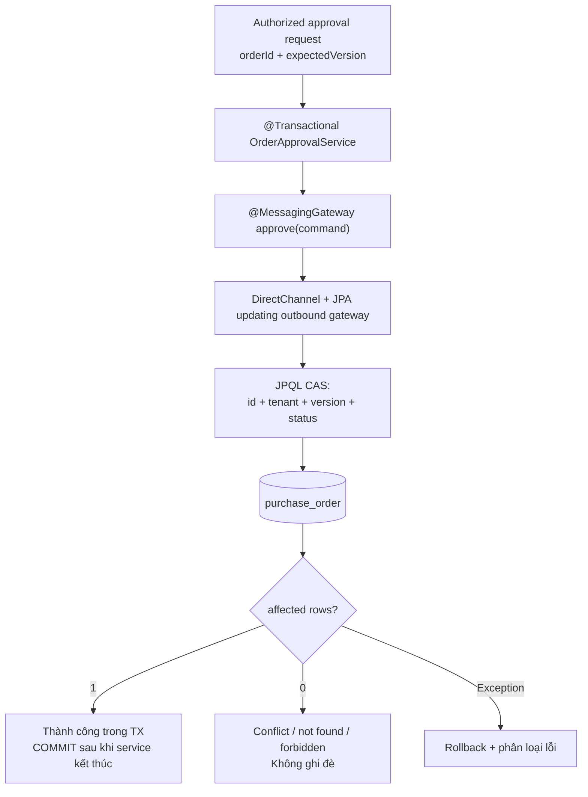
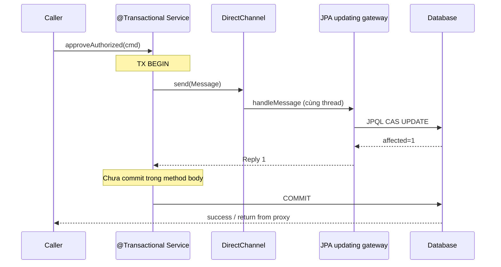
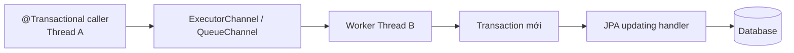
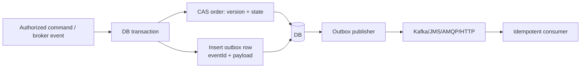

# Optimistic locking khi cập nhật

## 1. Bối cảnh và mục tiêu

Module **SPRING_INTEGRATION_ADAPTERS** kết nối các hệ thống ngoài vào Spring Integration bằng inbound/outbound adapter, gateway, poller và `MessageChannel`. Trong một hệ thống nghiệp vụ, cùng một bản ghi có thể được sửa bởi HTTP request, message Kafka/JMS/AMQP, một poller đọc file/SFTP, hay job chạy nền. Nếu hai luồng cùng đọc một trạng thái cũ rồi ghi lại, cập nhật cuối cùng có thể **ghi đè cập nhật trước** mà không ai phát hiện.

Bài **Optimistic locking khi cập nhật** thuộc chương **Adapter JPA**. Trọng tâm là cách dùng **`@Version` của Jakarta Persistence** và **điều kiện version trong JPA updating outbound gateway** để bảo vệ dữ liệu khỏi *lost update*, đồng thời xử lý xung đột theo đúng transaction, retry, idempotency và quyền truy cập.

Sau khi học, bạn có thể:

- Mô tả *lost update*, stale entity và vì sao transaction đơn lẻ chưa đủ khi nhiều request chạy đồng thời.
- Giải thích cách `@Version`, persistence context, dirty checking, `flush` và `commit` phối hợp để phát hiện optimistic conflict.
- Phân biệt `OptimisticLockException` với `OptimisticLockingFailureException` và các exception do Spring/JPA provider chuyển đổi.
- Hiểu lúc nào optimistic failure có thể xuất hiện: `merge`, `flush` hoặc `commit`, không nhất thiết ngay khi sửa field.
- Viết JPA entity có version và service `@Transactional` cập nhật managed entity đúng cách.
- Xây **JPA updating outbound gateway** với JPQL **compare-and-set (CAS)**, nhận **affected-row count** qua `@MessagingGateway`.
- Không nhầm `@Version` tự động của entity lifecycle với **JPQL bulk UPDATE** vốn bỏ qua optimistic locking nếu không thêm điều kiện.
- Xử lý `affectedRows=0` mà không lộ thông tin tenant và không nhầm với lỗi hạ tầng.
- Thiết kế retry có điều kiện: không retry mù quáng một command với `expectedVersion` cũ.
- Kiểm thử xung đột bằng hai snapshots/transactions độc lập và bằng hai commands dùng cùng version.
- Xác định transaction boundary qua `DirectChannel`, `ExecutorChannel`, `QueueChannel` và nguồn Kafka/JMS/SFTP.
- Kết hợp idempotency, transactional inbox/outbox, fencing token và monitoring cho hệ thống nhiều worker.

**Mấu chốt:** Optimistic locking không ngăn hai người **cùng đọc** một row; nó giúp phát hiện rằng **ít nhất một người đã sửa row sau lúc người còn lại đọc**. Ứng dụng phải quyết định xử lý xung đột: thông báo, tải lại để người dùng giải quyết, hoặc chạy lại một thao tác thật sự an toàn.

## 2. Lost update: vấn đề trước khi áp dụng optimistic locking

### 2.1. Hai giao dịch cùng đọc một bản ghi

Giả sử đơn `ORD-101` có trạng thái `PENDING` và số lượng cho phép sửa `quantity=5`.

```mermaid
sequenceDiagram
    participant A as Request A / Tx A
    participant B as Request B / Tx B
    participant DB as Database
    A->>DB: SELECT ORD-101 → quantity=5
    B->>DB: SELECT ORD-101 → quantity=5
    A->>A: quantity=8
    B->>B: quantity=6
    A->>DB: UPDATE quantity=8
    DB-->>A: COMMIT
    B->>DB: UPDATE quantity=6
    DB-->>B: COMMIT
    Note over DB: Kết quả cuối = 6; cập nhật A bị ghi đè
```

Nếu hệ thống không có cơ chế concurrency control phù hợp, transaction B có thể ghi từ snapshot cũ của mình và làm mất thay đổi từ transaction A.

Đây là *lost update*. Không phải mọi cơ sở dữ liệu/isolation level đều cho phép đúng trình tự này; một số mức isolation/locking có thể phát hiện hoặc chặn xung đột. Nhưng **không nên dựa vào isolation mặc định** để thay cho hợp đồng optimistic concurrency ở tầng nghiệp vụ.

### 2.2. Thêm version vào bản ghi

Bây giờ row có:

```text
id       = ORD-101
quantity = 5
version  = 7
```

Mỗi writer gửi yêu cầu dạng:

```sql
update purchase_order
set quantity = ?, version = version + 1
where id = ? and version = 7
```

Writer cập nhật trước thành công: row chuyển version `7 → 8`. Writer còn lại dùng `version=7` sẽ thấy **0 row matched** hoặc được JPA provider phát hiện là optimistic conflict.

```mermaid
sequenceDiagram
    participant A as Tx A (version 7)
    participant B as Tx B (version 7)
    participant DB as Database
    A->>DB: UPDATE ... WHERE version=7
    DB-->>A: affected=1, version=8
    A->>DB: COMMIT
    B->>DB: UPDATE ... WHERE version=7
    DB-->>B: affected=0
    Note over B: Conflict; không ghi đè dữ liệu A
```

**Không có “khóa Java toàn cục” ở đây.** Database vẫn thực thi những UPDATE chịu sự kiểm soát concurrency/isolation/row locks của DB. Optimistic locking là một hợp đồng kiểm tra **điều kiện tại thời điểm ghi**.

### 2.3. Conflict khác duplicate

Hai request có thể:

- Cùng sửa một row dựa trên cùng version → **optimistic conflict**.
- Cùng gửi lại một event vì Kafka/JMS redelivery → **duplicate delivery**.
- Cùng gọi API thanh toán với idempotency key giống nhau → **duplicate command**.
- Cùng nhận một job vì lease hết hạn → **stale worker/fencing conflict**.

`@Version` chủ yếu bảo vệ **concurrent modifications của một entity**. Nó **không tự** deduplicate event, đảm bảo HTTP side effect một lần, hay phân quyền tenant.

## 3. @Version của Jakarta Persistence

### 3.1. Mapping cơ bản

```java
import jakarta.persistence.Entity;
import jakarta.persistence.Id;
import jakarta.persistence.Version;

@Entity
public class ExampleDocument {

    @Id
    private String id;

    @Version
    private Long version;

    // Các fields và constructor/getters...
}
```

Với entity versioned, JPA provider sẽ dùng version để kiểm tra khi entity được cập nhật hoặc xóa thông qua các thao tác entity lifecycle phù hợp. Một SQL UPDATE thường có ý tưởng:

```sql
update example_document
set content = ?, version = ?
where id = ? and version = ?
```

Nếu số row cập nhật không đáp ứng kỳ vọng, JPA có thể phát hiện stale state và ném optimistic locking exception.

### 3.2. Những quy tắc cần nhớ

- Chỉ khai **một version attribute** cho một entity theo portability contract.
- Version nên map trên **primary table** của entity.
- Dùng `@Version` trên field/property nhất quán với kiểu JPA access strategy.
- `Long`/`long`, `Integer`/`int` và các loại version được Jakarta Persistence tương ứng hỗ trợ; nếu dùng timestamp phải xem version spec/provider.
- **Không tự gán/increment version trong Java business service** khi đang dùng managed entity; provider sở hữu cơ chế version lifecycle.
- `@Version` **không phải event sequence number**, không phải mã thời gian cập nhật và không phải idempotency key.
- Một lệnh cập nhật entity *không làm thay đổi persistent state* có thể không tăng version trừ khi yêu cầu optimistic force increment.
- Không dựa vào một số version cố định (`0` hay `1`) sau INSERT; hãy đọc version thực tế từ entity đã persist hoặc query DB.

### 3.3. Phân biệt @Version và ETag

| Khái niệm | Phạm vi | Công dụng |
| --- | --- | --- |
| `@Version` | JPA entity/persistence provider | Phát hiện concurrent update/delete |
| HTTP `ETag` + `If-Match` | HTTP resource contract | Client gửi điều kiện không ghi đè phiên bản đã thay |
| `eventId`/idempotency key | Command/delivery | Loại bỏ xử lý một sự kiện lặp |
| `claimGeneration`/fencing token | Distributed job ownership | Chặn worker cũ hoàn thành claim đã hết hạn |
| DB transaction isolation | Concurrent transactions | Định nghĩa mức độ nhìn thấy và bảo vệ giữa các giao dịch |

Có thể **dùng version của entity làm một phần ETag** nếu format và semantics API được thiết kế đúng. Nhưng `@Version` không tự sinh header `ETag`; HTTP controller/service phải triển khai.

### 3.4. Hai persistence context độc lập

```text
Tx A:
  find(ORD-101) → managed order A, version 7
  update fields
  flush/commit → version 8

Tx B:
  find(ORD-101) trước commit của A → managed order B, version 7
  update fields
  flush/commit → optimistic conflict
```

Trong từng persistence context, `em.contains(order)` có thể là `true`; điều đó **không** đồng nghĩa object còn cập nhật nhất với database. Một managed entity ở transaction B có thể stale so với state do A vừa commit.

## 4. @Version hoạt động ở những API JPA nào?

### 4.1. Dirty checking trên managed entity

```java
@Transactional
public void changeStatus(String orderId) {
    PurchaseOrder managed =
            em.find(PurchaseOrder.class, orderId);

    if (managed == null) {
        throw new IllegalArgumentException("Not found");
    }

    managed.approve();

    // Provider sẽ kiểm tra version khi flush/commit.
    // Không cần tự sửa managed.version.
}
```

`managed` đang được JPA quản lý, nên sửa business fields trong transaction sẽ được dirty checking phát hiện. Nếu một transaction khác ghi row trước, kiểm tra version có thể thất bại **tại flush hoặc commit**.

### 4.2. merge một detached entity

```java
PurchaseOrder managedCopy = em.merge(detachedOrder);
```

Với `@Version`, provider cần kiểm tra version của detached entity. Nếu detached snapshot cũ hơn state ở DB, `merge` có thể báo `OptimisticLockException` ngay, hoặc khi flush/commit theo provider.

**Hai điểm quan trọng:**

- Instance trả từ `merge` là **managed copy**, không nhất thiết cùng reference với `detachedOrder`.
- Không nhận nguyên entity JSON từ client rồi `merge` tất cả fields mà không validate: có thể ghi đè những thuộc tính client không được phép thay và tạo lỗ hổng mass assignment.

Với API, nên nhận **command DTO** có `expectedVersion` và chỉ những fields được phép sửa.

### 4.3. remove entity

```java
@Transactional
public void deleteOrder(String id) {
    PurchaseOrder managed = em.find(PurchaseOrder.class, id);
    if (managed != null) {
        em.remove(managed);
    }
}
```

Khi xóa một **managed versioned entity**, provider có cơ chế version check thích hợp để phát hiện stale deletion. Ngược lại, một JPQL bulk `DELETE` **không** tự tuân theo entity lifecycle/optimistic locking như `em.remove` nếu query không kiểm soát version.

### 4.4. LockModeType.OPTIMISTIC

```java
PurchaseOrder current =
        em.find(PurchaseOrder.class, orderId,
                LockModeType.OPTIMISTIC);
```

`OPTIMISTIC` dùng để yêu cầu kiểm tra optimistic consistency ngay cả khi transaction chủ yếu đọc entity cần bảo vệ. `OPTIMISTIC_FORCE_INCREMENT` có thể ép tăng version của versioned entity; việc tăng có thể xảy ra tại flush/commit.

**Không nhầm** `LockModeType.OPTIMISTIC` với `PESSIMISTIC_WRITE`: optimistic mode không có nghĩa luôn nắm giữ DB row lock kéo dài từ lúc đọc tới lúc ghi.

### 4.5. Bulk UPDATE/DELETE là ngoại lệ quan trọng

Theo Jakarta Persistence, JPQL bulk `UPDATE`/`DELETE` chạy trực tiếp trên database và **bỏ qua automatic optimistic locking checks** của entity lifecycle. Nó cũng **không tự đồng bộ state** của managed entities đã load trong persistence context.

Vì vậy, lệnh:

```sql
update PurchaseOrder o
set o.status = 'APPROVED'
where o.id = :orderId
```

**không tự động thêm điều kiện `o.version = :expectedVersion` chỉ vì entity có `@Version`**.

Để có optimistic CAS với bulk query, phải **tự viết** điều kiện và tăng version:

```sql
update PurchaseOrder o
set o.status = 'APPROVED',
    o.version = o.version + 1
where o.id = :orderId
  and o.version = :expectedVersion
  and o.status = 'PENDING'
```

Phần này là trọng tâm khi dùng **Spring Integration JPA updating outbound gateway**.

## 5. Cách Spring báo optimistic locking failure

### 5.1. Exception gốc và exception Spring

| Loại | Nơi thường gặp | Ý nghĩa |
| --- | --- | --- |
| `jakarta.persistence.OptimisticLockException` | JPA provider / EntityManager | Version check thất bại; transaction bị đánh dấu rollback |
| `org.springframework.dao.OptimisticLockingFailureException` | Spring data access abstraction | Phân loại concurrency conflict |
| `org.springframework.orm.ObjectOptimisticLockingFailureException` | Spring ORM | Optimistic conflict kèm entity/ID nếu có |
| `org.springframework.orm.jpa.JpaOptimisticLockingFailureException` | Spring JPA exception translation | JPA optimistic exception được dịch sang Spring |
| `org.springframework.integration.MessageHandlingException` | Messaging handler wrapper (tùy flow) | Có thể bao lỗi JPA làm cause |
| `DataIntegrityViolationException` | Constraint violation khác (unique/FK/NOT NULL...) | Không phải mọi constraint error đều là optimistic conflict |

Các loại exception thực tế phụ thuộc provider, Spring transaction manager, exception translation và message routing. Trong một Integration Flow, có thể phải **truy vết cause chain** để nhận diện optimistic conflict; không nên bắt mọi `RuntimeException` và trả về “version conflict”.

### 5.2. Thời điểm exception

```mermaid
sequenceDiagram
    participant C as Caller
    participant S as @Transactional Service
    participant EM as EntityManager
    participant DB as Database
    C->>S: approve(command)
    S->>EM: find(entity)
    S->>EM: entity.approve()
    Note over EM: Entity dirty nhưng có thể chưa UPDATE
    S->>EM: flush() hoặc commit
    EM->>DB: UPDATE WHERE version=old
    DB-->>EM: 0 rows updated
    EM-->>S: OptimisticLockException
    S-->>C: Exception; transaction rolled back
```

**Không giả định exception xuất hiện ngay tại `setStatus`.** Với `@Version`, `em.flush()` hoặc commit mới thường là thời điểm kiểm tra. Một provider có thể kiểm tra sớm hơn trong `merge`.

### 5.3. Không retry trong transaction đã bị lỗi

Sau `OptimisticLockException`, JPA transaction thường được đánh dấu rollback-only. Đừng:

```java
@Transactional
public void unsafeRetry(String id) {
    try {
        update(id);
    } catch (OptimisticLockException ex) {
        update(id); // Sai: cùng transaction/PC có thể đã unusable.
    }
}
```

Phải để transaction hiện tại rollback, **mở transaction mới** nếu nghiệp vụ cho phép thử lại, tải lại state mới và chạy lại business rule. Với optimistic conflict, một số trường hợp đúng nhất là trả HTTP 409/412 và yêu cầu client lấy version mới.

## 6. Hai chiến lược optimistic concurrency trong Spring Integration JPA

| Chiến lược | Thực hiện | Cách phát hiện conflict | Contract reply |
| --- | --- | --- | --- |
| **Entity-mode managed update** | Service `@Transactional`, `em.find` rồi sửa managed entity; hoặc updating adapter/gateway entity mode | `@Version` tự kiểm tra; có thể ném exception | Thành công hoặc exception; gateway entity mode có thể trả entity |
| **JPQL conditional UPDATE (CAS)** | `Jpa.updatingGateway(...)` với `WHERE version=:expected` và increment version | JPA query trả **affected row count 0 hoặc 1** | `Integer`/count; thường không ném optimistic exception khi không match |
| **JPQL bulk UPDATE không điều kiện version** | `update ... where id=:id` | **Không có automatic optimistic check** | Affected count nhưng có nguy cơ lost update |
| **Pessimistic locking** | `em.find(..., PESSIMISTIC_WRITE)`/SQL row lock | Lock/timeout/deadlock + DB isolation | Khác optimistic conflict |
| **Atomic business condition không version** | `UPDATE ... WHERE state='PENDING'` | affected count bảo vệ state transition cụ thể | 0/1 nhưng không có full version check |

**Một lưu ý tinh tế:** conditional UPDATE theo `state` có thể đủ cho một thao tác “nhận job nếu còn NEW” nhưng không bảo vệ mọi business field. Nếu một command được tạo từ bản đọc cũ và cần chống mọi thay đổi của entity, thêm `expectedVersion`.

### 6.1. Khi nào chọn managed update?

Chọn khi:

- Logic nghiệp vụ thao tác object graph phức tạp.
- Cần JPA lifecycle callbacks/cascade/validation ở entity.
- Cần dirty checking, quan hệ entity, domain methods.
- Muốn provider kiểm tra version tự động.
- Có transaction ngắn và không giữ entity qua async boundary.

### 6.2. Khi nào chọn updating gateway CAS?

Chọn khi:

- Command là một state transition đơn giản và có `id`, `tenantId`, `expectedVersion`.
- Cần result `affectedRows` để router/service quyết định.
- Muốn giảm vòng đọc `SELECT` trước khi update.
- Cần atomic update có điều kiện trước khi phát downstream event.
- Có thể chấp nhận JPQL bulk update bỏ qua lifecycle callbacks/dirty checking.
- Có kế hoạch xử lý persistence context stale sau bulk query.

Hai cách **không thay thế nhau hoàn toàn**; ưu tiên theo domain consistency và side effects.

## 7. Thiết kế ví dụ: duyệt đơn hàng theo version

Bài thực hành dùng case duyệt đơn hàng:

- Bảng `purchase_order` có `id`, `tenant_id`, `status`, `total_amount`, `version`.
- Một người dùng hoặc external event muốn chuyển `PENDING → APPROVED`.
- Request phải có `orderId`, tenant scope đã xác thực và `expectedVersion` từ lần đọc trước.
- Nếu row còn `PENDING`, tenant đúng và version khớp: cập nhật, tăng version, trả `affectedRows=1`.
- Nếu không khớp: trả `0` mà không sửa row.
- Nếu DB lỗi: ném exception, transaction rollback; không biến thành kết quả 0 giả.
- Không gửi event Kafka/HTTP ngay trong transaction nếu chưa có giải pháp cho commit/publish gap.



Đây là ví dụ **request–reply giữa application service và Spring Integration JPA updating gateway**. Nó không phải JPA inbound poller tự chạy theo lịch. Poller có thể gọi cùng service trong một workflow khác, nhưng phải định nghĩa ownership/transaction riêng.

## 8. Maven và cấu hình môi trường

Demo dùng **Java 17+**, Spring Boot 3.x, Spring Integration 6.x, Spring Data JPA, Jakarta Persistence và H2.

### 8.1. Dependencies

```xml
<dependencies>
    <dependency>
        <groupId>org.springframework.boot</groupId>
        <artifactId>spring-boot-starter</artifactId>
    </dependency>
    <dependency>
        <groupId>org.springframework.boot</groupId>
        <artifactId>spring-boot-starter-data-jpa</artifactId>
    </dependency>
    <dependency>
        <groupId>org.springframework.boot</groupId>
        <artifactId>spring-boot-starter-integration</artifactId>
    </dependency>
    <dependency>
        <groupId>org.springframework.integration</groupId>
        <artifactId>spring-integration-jpa</artifactId>
    </dependency>
    <dependency>
        <groupId>com.h2database</groupId>
        <artifactId>h2</artifactId>
        <scope>runtime</scope>
    </dependency>
    <dependency>
        <groupId>org.springframework.boot</groupId>
        <artifactId>spring-boot-starter-test</artifactId>
        <scope>test</scope>
    </dependency>
</dependencies>
```

Dùng Spring Boot BOM/dependency management để chọn các phiên bản tương thích. Không tự phối Spring Framework 6.x với Spring Integration version không được hỗ trợ. Trong môi trường dùng Spring Boot 4/Spring Integration 7, cần đối chiếu API và migration guide trước khi sao chép code.

### 8.2. application.properties

```properties
spring.main.web-application-type=none

spring.datasource.url=jdbc:h2:mem:optimistic_demo;DB_CLOSE_DELAY=-1
spring.datasource.driver-class-name=org.h2.Driver
spring.datasource.username=sa
spring.datasource.password=

spring.jpa.hibernate.ddl-auto=create-drop
spring.jpa.open-in-view=false

logging.level.org.springframework.integration=INFO
```

H2 in-memory và `ddl-auto=create-drop` **chỉ dùng để thực hành/test**. Production nên dùng database mục tiêu (PostgreSQL/MySQL/Oracle...), migrations (Flyway/Liquibase), connection pool, query/transaction timeouts, credentials tối thiểu và monitoring.

## 9. Entity, repository và command DTO

Các file Java trong demo đặt cùng package `com.example.jpaoptimistic`.

### 9.1. PurchaseOrder entity

File `PurchaseOrder.java`:

```java
package com.example.jpaoptimistic;

import java.math.BigDecimal;

import jakarta.persistence.Column;
import jakarta.persistence.Entity;
import jakarta.persistence.Id;
import jakarta.persistence.Table;
import jakarta.persistence.Version;

@Entity
@Table(name = "purchase_order")
public class PurchaseOrder {

    @Id
    @Column(name = "order_id", length = 80, nullable = false)
    private String id;

    @Column(name = "tenant_id", length = 60, nullable = false)
    private String tenantId;

    @Column(nullable = false, length = 24)
    private String status;

    @Column(name = "total_amount", precision = 12,
            scale = 2, nullable = false)
    private BigDecimal totalAmount;

    @Version
    private Long version;

    protected PurchaseOrder() {
        // Jakarta Persistence yêu cầu no-arg constructor.
    }

    public PurchaseOrder(
            String id, String tenantId,
            String status, BigDecimal totalAmount) {
        this.id = id;
        this.tenantId = tenantId;
        this.status = status;
        this.totalAmount = totalAmount;
    }

    public String getId() {
        return id;
    }

    public String getTenantId() {
        return tenantId;
    }

    public String getStatus() {
        return status;
    }

    public BigDecimal getTotalAmount() {
        return totalAmount;
    }

    public Long getVersion() {
        return version;
    }

    public void approve() {
        if (!"PENDING".equals(status)) {
            throw new IllegalStateException(
                    "Only PENDING orders can be approved");
        }
        status = "APPROVED";
    }
}
```

**Quan trọng:**

- `@Version` do JPA provider quản lý khi sử dụng entity lifecycle.
- Demo dùng `Long version` để dễ đọc version hiện tại khi tạo command.
- Domain method `approve()` bảo vệ state transition khi **entity-mode** update.
- JPQL CAS ở phần sau **bypass method `approve()`**; điều kiện `status='PENDING'` được viết lại ngay trong JPQL.
- Nếu có thêm domain invariants/callbacks/cascade, cần quyết định liệu JPQL bulk update có phù hợp hay không.
- Khi thêm entity version vào hệ thống có dữ liệu cũ, migration phải backfill và xử lý null version hợp lệ theo provider.

### 9.2. Repository cho seed và verify

File `PurchaseOrderRepository.java`:

```java
package com.example.jpaoptimistic;

import org.springframework.data.jpa.repository.JpaRepository;

public interface PurchaseOrderRepository
        extends JpaRepository<PurchaseOrder, String> {
}
```

Repository trong demo dùng để tạo row và quan sát state/version **sau commit**. Thao tác duyệt chính sẽ thực thi qua **JPA updating outbound gateway**, không gọi `repository.save(...)` để thay phần Integration Flow.

### 9.3. Command DTO

File `ApproveOrderCommand.java`:

```java
package com.example.jpaoptimistic;

public record ApproveOrderCommand(
        String orderId,
        String tenantId,
        Long expectedVersion) {
}
```

Đây là DTO **nội bộ sau khi scope đã được xác thực**. Không cho client gửi `tenantId` bất kỳ rồi coi đó là quyền truy cập. `expectedVersion` phải có giá trị từ lần đọc entity trước; với UI có thể là version trong response/ETag.

### 9.4. View DTO

File `OrderView.java`:

```java
package com.example.jpaoptimistic;

import java.math.BigDecimal;

public record OrderView(
        String id,
        String status,
        Long version,
        BigDecimal totalAmount) {

    public static OrderView from(PurchaseOrder entity) {
        return new OrderView(
                entity.getId(),
                entity.getStatus(),
                entity.getVersion(),
                entity.getTotalAmount());
    }
}
```

Đưa DTO ra HTTP/Kafka/WebSocket thường an toàn hơn đưa nguyên JPA managed entity, vì DTO tránh lazy-loading bất ngờ và giúp giới hạn các fields cần công bố. Không nhận `OrderView` của client rồi tự động merge thành `PurchaseOrder`.

## 10. Spring Integration JPA updating outbound gateway (CAS)

### 10.1. @MessagingGateway

File `OrderApprovalGateway.java`:

```java
package com.example.jpaoptimistic;

import org.springframework.integration.annotation.MessagingGateway;

@MessagingGateway(
        defaultRequestChannel = "approveOrderRequests",
        defaultReplyTimeout = "5000")
public interface OrderApprovalGateway {

    Integer approve(ApproveOrderCommand command);
}
```

`@MessagingGateway` tạo request Spring Message, gửi vào channel và chờ reply `Integer`. Đây là gateway **ứng dụng** trên Spring Integration; tên “updating outbound gateway” ở handler nghĩa nó thực hiện JPA UPDATE rồi tạo reply.

### 10.2. Java DSL flow

File `OrderApprovalIntegrationConfiguration.java`:

```java
package com.example.jpaoptimistic;

import jakarta.persistence.EntityManagerFactory;

import org.springframework.context.annotation.Bean;
import org.springframework.context.annotation.Configuration;
import org.springframework.integration.config.EnableIntegration;
import org.springframework.integration.dsl.IntegrationFlow;
import org.springframework.integration.jpa.dsl.Jpa;

@Configuration
@EnableIntegration
public class OrderApprovalIntegrationConfiguration {

    @Bean
    IntegrationFlow approveOrderFlow(
            EntityManagerFactory entityManagerFactory) {

        return IntegrationFlow.from("approveOrderRequests")
                .handle(
                        Jpa.updatingGateway(entityManagerFactory)
                                .jpaQuery("""
                                        update PurchaseOrder o
                                           set o.status = 'APPROVED',
                                               o.version = o.version + 1
                                         where o.id = :orderId
                                           and o.tenantId = :tenantId
                                           and o.status = 'PENDING'
                                           and o.version = :expectedVersion
                                        """)
                                .parameterExpression(
                                        "orderId",
                                        "payload.orderId()")
                                .parameterExpression(
                                        "tenantId",
                                        "payload.tenantId()")
                                .parameterExpression(
                                        "expectedVersion",
                                        "payload.expectedVersion()"))
                .get();
    }
}
```

**Đọc query theo thứ tự:**

1. `o.id = :orderId`: chọn đúng business aggregate.
2. `o.tenantId = :tenantId`: giới hạn tenant scope từ service được xác thực.
3. `o.status = 'PENDING'`: không duyệt lại đơn đã APPROVED/CANCELLED.
4. `o.version = :expectedVersion`: so sánh snapshot của caller với DB hiện tại.
5. `o.version = o.version + 1`: **tăng version tường minh** vì JPQL bulk update không tự làm.
6. `Jpa.updatingGateway` trả **số row bị ảnh hưởng** với JPQL UPDATE; trong case ID unique là `0` hoặc `1`.
7. `parameterExpression(...)` chỉ lấy **giá trị** từ Spring Message, không nối JPQL động từ client.

Với explicit parameter expressions, Spring Integration thường đánh giá SpEL trên **toàn bộ Message** (`payload.*`, `headers[...]`); trong DSL có thể khai `usePayloadAsParameterSource(false)` nếu muốn làm rõ root. Ví dụ sử dụng `payload.orderId()` với record accessor.

**Giới hạn:** Bulk UPDATE **không gọi** entity method `approve()`, entity listeners như `@PreUpdate` hoặc cascade theo entity dirty checking như khi thay managed object. Điều kiện JPQL phải thể hiện đầy đủ bất biến nghiệp vụ có liên quan, hoặc chọn managed entity update thay thế.

### 10.3. Affected count không phải OptimisticLockException

Với câu CAS này:

| Affected count | Có thể có nghĩa | Hành vi gợi ý |
| --- | --- | --- |
| `1` | Một row thỏa ID + tenant + status + version và được UPDATE | Tiếp tục; commit transaction trước khi báo thành công |
| `0` | Row không tồn tại, sai tenant, status khác hoặc version cũ | Trả conflict/not-found theo policy, không ghi đè |
| `>1` | Bất thường khi `id` là primary key unique | Coi là lỗi cấu hình/dữ liệu, rollback |
| Exception | DB timeout/lock, JPQL lỗi, transaction error | Rollback, phân loại retryable |
| `null` reply | Sai contract/flow hoặc lỗi mapping | Không giả thành success |

**Không tự giả định `affected=0` sẽ ném `OptimisticLockException`.** JPQL bulk CAS không thông qua cơ chế version check tự động, nên kết quả 0 là signal của điều kiện WHERE không match.

### 10.4. Transaction ở đâu?

Trong flow mẫu, `DirectChannel` đồng bộ giúp JPA handler tham gia transaction đang gắn với caller thread. Service sẽ mở transaction bao quanh lời gọi gateway.

Nếu thay channel bằng `ExecutorChannel`/`QueueChannel`, transaction của service **không tự vượt thread boundary**. Phải thêm transaction ở consumer và thiết kế reply/correlation/error handling, không chỉ giữ `@Transactional` ở service.

## 11. Service @Transactional và ứng dụng chạy thử

### 11.1. Service validate và gọi gateway

File `OrderApprovalService.java`:

```java
package com.example.jpaoptimistic;

import org.springframework.stereotype.Service;
import org.springframework.transaction.annotation.Transactional;

@Service
public class OrderApprovalService {

    private final OrderApprovalGateway gateway;

    public OrderApprovalService(OrderApprovalGateway gateway) {
        this.gateway = gateway;
    }

    @Transactional
    public boolean approveAuthorized(
            String verifiedTenantId,
            String orderId,
            Long expectedVersion) {

        // Phải lấy verifiedTenantId từ authenticated
        // principal/ACL ở phía server, không tin client tự khai.
        if (verifiedTenantId == null
                || verifiedTenantId.isBlank()
                || verifiedTenantId.length() > 60
                || orderId == null
                || orderId.isBlank()
                || orderId.length() > 80
                || expectedVersion == null
                || expectedVersion < 0) {
            throw new IllegalArgumentException(
                    "Invalid approval command");
        }

        ApproveOrderCommand command =
                new ApproveOrderCommand(
                        orderId, verifiedTenantId, expectedVersion);

        Integer affected = gateway.approve(command);

        if (affected == null || affected < 0 || affected > 1) {
            throw new IllegalStateException(
                    "Unexpected update count: " + affected);
        }

        // true khi một row match CAS, false khi không match.
        // Transaction vẫn được commit sau khi method kết thúc.
        return affected == 1;
    }
}
```

Khi caller gọi public method này **qua Spring transactional proxy**:

- Transaction được mở trước khi gọi `gateway.approve`.
- JPA handler chạy đồng bộ, thực thi JPQL UPDATE trong cùng transaction.
- `affected==1` cho biết query đã match, **nhưng commit chưa hoàn tất trong thân method**.
- Spring transaction interceptor thực hiện commit khi method kết thúc; caller nhận return bình thường khi transaction đã thành công theo transaction manager.
- Nếu commit lỗi, exception có thể được ném **sau câu `return` trong code method**, trước khi proxy trả kết quả cho caller.
- `affected==0` vẫn là một transaction hợp lệ không cập nhật row; service trả `false` như một outcome nghiệp vụ, không phải lỗi DB.

**Self-invocation:** `this.approveAuthorized(...)` gọi trong cùng Spring bean có thể bỏ qua transactional proxy. Hãy gọi từ bean khác hoặc qua API đã được proxy quản lý.

### 11.2. Khởi chạy và seed dữ liệu

File `JpaOptimisticApplication.java`:

```java
package com.example.jpaoptimistic;

import java.math.BigDecimal;
import java.util.List;

import org.springframework.boot.CommandLineRunner;
import org.springframework.boot.SpringApplication;
import org.springframework.boot.autoconfigure.SpringBootApplication;
import org.springframework.context.annotation.Bean;
import org.springframework.integration.annotation.IntegrationComponentScan;

@SpringBootApplication
@IntegrationComponentScan
public class JpaOptimisticApplication {

    public static void main(String[] args) {
        SpringApplication.run(JpaOptimisticApplication.class, args);
    }

    @Bean
    CommandLineRunner sample(
            PurchaseOrderRepository repository,
            OrderApprovalService service) {

        return args -> {
            if (repository.count() == 0) {
                repository.saveAll(List.of(
                        new PurchaseOrder(
                                "ORD-101", "TENANT-A", "PENDING",
                                new BigDecimal("120.00")),
                        new PurchaseOrder(
                                "ORD-102", "TENANT-B", "PENDING",
                                new BigDecimal("80.00"))));
            }

            PurchaseOrder before =
                    repository.findById("ORD-101").orElseThrow();

            Long oldVersion = before.getVersion();

            System.out.println(
                    "Before: " + OrderView.from(before));

            boolean first = service.approveAuthorized(
                    "TENANT-A", "ORD-101", oldVersion);

            boolean stale = service.approveAuthorized(
                    "TENANT-A", "ORD-101", oldVersion);

            PurchaseOrder after =
                    repository.findById("ORD-101").orElseThrow();

            System.out.println("First approval: " + first);
            System.out.println("Stale approval: " + stale);
            System.out.println(
                    "After: " + OrderView.from(after));
        };
    }
}
```

**Kết quả kỳ vọng** (số version khởi đầu do provider quyết định):

```text
Before: OrderView[id=ORD-101, status=PENDING, version=<v>, ...]
First approval: true
Stale approval: false
After: OrderView[id=ORD-101, status=APPROVED, version=<v+1>, ...]
```

Trong code block trên, `<v>` và `<v+1>` chỉ là ký hiệu minh họa, **không phải output chữ nguyên văn**. Test nên lấy version thực tế từ database rồi so sánh với version sau update.

### 11.3. Có cần thêm một retrieving gateway?

Không bắt buộc cho demo: repository được dùng để lấy version trước khi gửi approval command. Trong một kiến trúc hoàn toàn message-driven, có thể dùng `Jpa.retrievingGateway(entityManagerFactory)` hoặc một service `@Transactional(readOnly=true)` để tra `OrderView`, sau đó đưa version vào command.

**Đừng giả định** một JPA retrieving gateway tự động giữ persistence context cho đến khi một HTTP client phản hồi vài phút sau. Client chỉ giữ **snapshot DTO/version**; request cập nhật phải kiểm tra version tại thời điểm ghi.

## 12. Kiểm thử CAS theo version

### 12.1. SpringBootTest không bọc transaction ngoài

File `OrderApprovalIntegrationTest.java`:

```java
package com.example.jpaoptimistic;

import static org.assertj.core.api.Assertions.assertThat;

import java.math.BigDecimal;
import java.util.UUID;

import org.junit.jupiter.api.Test;
import org.springframework.beans.factory.annotation.Autowired;
import org.springframework.boot.test.context.SpringBootTest;

@SpringBootTest
class OrderApprovalIntegrationTest {

    @Autowired
    PurchaseOrderRepository repository;

    @Autowired
    OrderApprovalService service;

    @Test
    void approvesOnceAndRejectsStaleVersion() {
        String id = "approve-" + UUID.randomUUID();
        repository.saveAndFlush(
                new PurchaseOrder(
                        id, "TENANT-A", "PENDING",
                        new BigDecimal("42.00")));

        Long expected = repository.findById(id)
                .orElseThrow().getVersion();

        boolean first = service.approveAuthorized(
                "TENANT-A", id, expected);

        boolean stale = service.approveAuthorized(
                "TENANT-A", id, expected);

        PurchaseOrder after =
                repository.findById(id).orElseThrow();

        assertThat(first).isTrue();
        assertThat(stale).isFalse();
        assertThat(after.getStatus())
                .isEqualTo("APPROVED");
        assertThat(after.getVersion())
                .isEqualTo(expected + 1);
    }

    @Test
    void rejectsWrongTenantWithoutModifyingRow() {
        String id = "tenant-" + UUID.randomUUID();

        repository.saveAndFlush(
                new PurchaseOrder(
                        id, "TENANT-B", "PENDING",
                        new BigDecimal("10.00")));

        Long version = repository.findById(id)
                .orElseThrow().getVersion();

        boolean result = service.approveAuthorized(
                "TENANT-A", id, version);

        PurchaseOrder after =
                repository.findById(id).orElseThrow();

        assertThat(result).isFalse();
        assertThat(after.getStatus()).isEqualTo("PENDING");
        assertThat(after.getVersion()).isEqualTo(version);
    }

    @Test
    void rejectsUnknownOrder() {
        boolean result = service.approveAuthorized(
                "TENANT-A",
                "missing-" + UUID.randomUUID(),
                0L);

        assertThat(result).isFalse();
    }
}
```

**Vì sao không `@Transactional` trên test method?** Nếu test tự mở transaction và rollback cuối test, service `@Transactional(REQUIRED)` có thể tham gia transaction test. Điều này che giấu thời điểm commit thực tế và khiến một số assertions đọc state trong cùng persistence context cũ. Để kiểm tra optimistic CAS, nên tạo các transactions độc lập theo đúng thực tế.

### 12.2. Điều mà test chứng minh

- Query `WHERE version = :expectedVersion` khớp lần đầu.
- JPQL **tăng version tường minh** trên update.
- Một request cũ không ghi đè trạng thái mới.
- Tenant mismatch không cập nhật row.
- Not-found trả `0`/`false`, không tạo entity mới.
- Kết quả được quan sát bằng repository **sau transaction service**.

### 12.3. Điều mà test chưa chứng minh

- Hai transactions thực sự chạy đồng thời.
- Entity lifecycle automatic `@Version` ném `OptimisticLockException`.
- Provider behavior khi flush/commit bị deadlock/timeout.
- Exactly-once delivery qua Kafka/JMS/HTTP.
- Tenant authorization đã được triển khai ở controller.
- Query plan và version overflow trên database lớn.

Các khía cạnh đó cần test riêng ở các phần sau, đặc biệt với database mục tiêu hoặc Testcontainers.

## 13. Kiểm thử @Version tự động bằng stale detached entity

Ví dụ ở mục 10 dùng **JPQL CAS** và nhận `affected=0`. Để thấy **optimistic locking do JPA provider tự kiểm tra với managed/merged entity**, ta tạo một snapshot detached, thay đổi row bằng transaction thứ hai, rồi thử merge snapshot cũ.

### 13.1. Tạo ba transaction độc lập

```mermaid
sequenceDiagram
    participant T1 as Transaction 1
    participant T2 as Transaction 2
    participant T3 as Transaction 3
    participant DB as Database
    T1->>DB: SELECT ORDER-1 version=0
    DB-->>T1: detached snapshot sau commit
    T2->>DB: SELECT ORDER-1 version=0
    T2->>T2: approve()
    T2->>DB: UPDATE ... WHERE version=0
    DB-->>T2: commit → version=1
    T3->>DB: merge(detached version=0)
    DB-->>T3: optimistic failure
    Note over T3: Transaction rollback; không ghi đè version=1
```

Khác với test CAS, trường hợp này phải phát hiện exception của provider/Spring, không lấy `affectedRows` từ JPQL query.

### 13.2. @SpringBootTest dùng TransactionTemplate

File `ManagedVersionIntegrationTest.java`:

```java
package com.example.jpaoptimistic;

import static org.assertj.core.api.Assertions.assertThat;
import static org.assertj.core.api.Assertions.assertThatThrownBy;

import java.math.BigDecimal;
import java.util.UUID;

import jakarta.persistence.EntityManager;
import jakarta.persistence.OptimisticLockException;
import jakarta.persistence.PersistenceContext;

import org.junit.jupiter.api.Test;
import org.springframework.beans.factory.annotation.Autowired;
import org.springframework.boot.test.context.SpringBootTest;
import org.springframework.dao.OptimisticLockingFailureException;
import org.springframework.transaction.PlatformTransactionManager;
import org.springframework.transaction.support.TransactionTemplate;

@SpringBootTest
class ManagedVersionIntegrationTest {

    @Autowired
    PurchaseOrderRepository repository;

    @Autowired
    PlatformTransactionManager transactionManager;

    @PersistenceContext
    EntityManager em;

    @Test
    void staleDetachedMergeCannotOverwriteNewVersion() {
        String id = "merge-" + UUID.randomUUID();

        repository.saveAndFlush(
                new PurchaseOrder(
                        id, "TENANT-A", "PENDING",
                        new BigDecimal("30.00")));

        TransactionTemplate tx =
                new TransactionTemplate(transactionManager);

        // TX #1: đọc, commit → object trả về detached.
        PurchaseOrder stale = tx.execute(status ->
                em.find(PurchaseOrder.class, id));

        Long oldVersion = stale.getVersion();

        // TX #2: cập nhật qua managed entity.
        tx.executeWithoutResult(status -> {
            PurchaseOrder managed =
                    em.find(PurchaseOrder.class, id);
            managed.approve();
        });

        Long newVersion = repository.findById(id)
                .orElseThrow().getVersion();

        assertThat(newVersion).isGreaterThan(oldVersion);

        // TX #3: merge stale snapshot dựa trên oldVersion.
        assertThatThrownBy(() ->
                tx.executeWithoutResult(status -> {
                    em.merge(stale);
                    em.flush();
                }))
                .satisfies(ex ->
                        assertThat(isOptimisticFailure(ex))
                                .isTrue());

        PurchaseOrder after =
                repository.findById(id).orElseThrow();

        assertThat(after.getStatus())
                .isEqualTo("APPROVED");
        assertThat(after.getVersion())
                .isEqualTo(newVersion);
    }

    private static boolean isOptimisticFailure(
            Throwable failure) {

        Throwable current = failure;

        while (current != null) {
            if (current instanceof OptimisticLockException
                    || current
                    instanceof OptimisticLockingFailureException) {
                return true;
            }
            current = current.getCause();
        }
        return false;
    }
}
```

**Giải thích:**

- `TransactionTemplate` tạo các transactions độc lập; không có `@Transactional` bao quanh test method.
- `@PersistenceContext` inject Spring shared transactional `EntityManager` proxy; trong mỗi `tx.execute`, proxy liên kết với persistence context của transaction đó.
- Snapshot `stale` ra khỏi TX #1 trở thành detached.
- TX #2 sửa row qua managed entity; JPA provider tăng `version`.
- TX #3 không thể dùng stale entity có version cũ để ghi đè row mới.
- Exception có thể được chuyển đổi bởi Spring, bọc bởi transaction/messaging infrastructure hoặc xuất hiện tại `merge`/`flush`/`commit`. Vì thế test kiểm tra cause chain.
- Nếu bạn đổi provider hoặc version spec, cần kiểm tra exception chain thực tế và các timing khác nhau.

**Giới hạn:** Đây là test **stale detached snapshot theo trình tự**, không phải một race đồng thời đang chạy trên hai threads. Nó đủ để minh họa automatic `@Version` với merge. Một test concurrency thực sự được nêu tiếp theo.

### 13.3. Test đồng thời có barrier

Một test nâng cao có thể dùng hai tasks:

```text
Thread A:
  TX BEGIN → find order (version V)
  await barrier
  approve() → flush/commit

Thread B:
  TX BEGIN → find order (version V)
  await barrier
  approve() → flush/commit

Kỳ vọng (trên DB/provider hỗ trợ optimistic version check):
  Không được có 2 commits ghi đè nhau từ version V.
  Một transaction thành công;
  transaction còn lại phải conflict hoặc fail dưới
  concurrency/serialization policy của DB.
```

Phải dùng **hai transactions và hai persistence contexts độc lập**. Cần giới hạn thời gian chờ barrier, timeout transaction, connection pool size và bảo đảm các task không rò threads. Với H2, một conflict có thể biểu hiện thành lock/timeout khác PostgreSQL/MySQL; dùng Testcontainers theo database production để xác minh phân loại lỗi.

**Không dùng** một `EntityManager` thực tạo bằng `emf.createEntityManager()` chia sẻ cho hai threads vì JPA EntityManager không thread-safe. Nếu dùng Spring `@PersistenceContext` proxy, transactional context của mỗi thread phải được mở riêng đúng cách.

## 14. Retry optimistic conflict: khi nào đúng, khi nào sai?

### 14.1. Không tự retry mọi version conflict

Xét một người dùng mở trang đơn hàng với `version=7`, đổi tổng tiền từ 100 lên 120, rồi submit. Trong lúc đó một người khác đã đổi thành 150 (version=8). Nếu server tự tải version=8 và áp thẳng giá trị 120, server đã **vô hiệu hóa mục đích của optimistic locking**, vì người dùng đầu không hề thấy giá trị 150.

Đối với thao tác chỉnh sửa từ UI:

1. Trả lỗi conflict rõ ràng.
2. Trả snapshot mới **sau authorization** hoặc đề nghị client GET lại.
3. Cho người dùng xem diff và quyết định.
4. Gửi command mới với `expectedVersion` mới.

Không tự động “retry cho đến khi thắng” mà bỏ qua quyền quyết định nghiệp vụ.

### 14.2. Retry có thể hợp lệ cho phép tính có tính chất tái áp dụng

Ví dụ một event hợp lệ yêu cầu **cộng thêm 1 vào counter**. Nếu transaction stale, có thể:

1. Rollback transaction lỗi.
2. Mở transaction mới.
3. Load state mới.
4. Kiểm tra event ID đã xử lý chưa.
5. Tính lại state/counter theo business rule.
6. Commit.
7. Retry bounded nếu còn conflict và chưa vượt ngưỡng.

Nhưng nếu event đến **at-least-once**, tự retry mà không dedup có thể **cộng 1 hai lần** sau redelivery. Optimistic locking và idempotency phải được thiết kế cùng nhau.

### 14.3. Retry phải bắt đầu transaction mới

Một cấu trúc an toàn về mặt ranh giới (pseudo-code minh họa):

```java
public ApprovalResult approveWithPolicy(
        ApprovedScope scope,
        String orderId,
        Long expectedVersion) {

    // Đây là ví dụ cho API "compare and reject".
    // KHÔNG auto-retry khi expectedVersion stale.
    boolean changed = approvalService.approveAuthorized(
            scope.tenantId(), orderId, expectedVersion);

    if (!changed) {
        return ApprovalResult.CONFLICT;
    }
    return ApprovalResult.APPROVED;
}
```

Nếu thật sự cần retry operation mang tính commutative, dùng một **orchestrator không transactional** gọi một **transactional worker bean** qua Spring proxy cho mỗi attempt:

```text
Orchestrator (không @Transactional)
    ↓ attempt 1
Transaction worker bean @Transactional → conflict → rollback
    ↓ backoff/jitter
Orchestrator
    ↓ attempt 2
Transaction worker bean @Transactional → reread + recompute → commit
```

Không bắt exception rồi chạy lại business logic trong **cùng transaction đã bị rollback-only**. Đừng chỉ thêm `@Retryable` mà không kiểm tra thứ tự AOP advice, propagation, idempotency, exception taxonomy và cách tạo transaction mới.

### 14.4. Backoff, budget và dead letter

| Thuộc tính | Ví dụ chính sách |
| --- | --- |
| `maxAttempts` | 3–5 lần cho lỗi transient được phép retry |
| Backoff | Exponential + jitter |
| Retryable exception | Optimistic conflict ở command commutative, deadlock/serialization/connection transient tùy domain |
| Non-retryable | Invalid version của UI, unauthorized, invariant violation |
| Idempotency key | Event/command ID từ nguồn đáng tin cậy |
| Sau khi hết retry | Trả conflict, chuyển RETRYABLE/FAILED hoặc DLQ theo loại nguồn |
| Metrics | Conflict rate, attempts, abandon count, latency |
| Error channel | Định nghĩa xử lý messaging errors, không thay DLQ bền vững |

Lưu ý optimistic conflict có thể là tín hiệu **cạnh tranh cao bất thường**; tăng attempts vô hạn sẽ làm tình trạng quá tải DB trầm trọng hơn.

## 15. JPQL bulk UPDATE và persistence context stale

### 15.1. Vì sao bulk query khác managed update?

Với JPQL:

```java
int changed = em.createQuery("""
        update PurchaseOrder o
        set o.status = 'APPROVED',
            o.version = o.version + 1
        where o.id = :id
          and o.version = :version
        """)
        .setParameter("id", id)
        .setParameter("version", expectedVersion)
        .executeUpdate();
```

Database được cập nhật trực tiếp. Một `PurchaseOrder` **đã được load trước đó** trong cùng persistence context có thể vẫn hiển thị `status='PENDING'`, `version=old`, vì JPQL bulk update không tự đồng bộ Java managed instances.

### 15.2. Ví dụ stale object ngay trong cùng transaction

```java
@Transactional
public void demonstrateStaleContext(
        String orderId, Long expectedVersion) {

    PurchaseOrder old =
            em.find(PurchaseOrder.class, orderId);

    int updated = em.createQuery("""
            update PurchaseOrder o
            set o.status = 'APPROVED',
                o.version = o.version + 1
            where o.id = :orderId
              and o.version = :expected
              and o.status = 'PENDING'
            """)
            .setParameter("orderId", orderId)
            .setParameter("expected", expectedVersion)
            .executeUpdate();

    if (updated != 1) {
        return;
    }

    // old.getStatus() có thể vẫn là PENDING;
    // old.getVersion() có thể vẫn là version cũ.
    em.refresh(old);
    // Sau refresh, state phản ánh DB theo isolation thích hợp.
}
```

Đây là đoạn demo thuộc một service đã có `@PersistenceContext EntityManager em`, không phải code chạy độc lập. `em.refresh(old)` có thể bỏ những thay đổi local chưa flush trên object, nên **không gọi tùy tiện trong business service thật**.

### 15.3. Vì sao có thể làm hỏng transaction tiếp theo?

Sau bulk UPDATE, persistence context vẫn quản lý stale entity. Nếu bạn sửa `old` và để dirty checking flush:

- Update có thể vấp optimistic conflict do version cũ.
- Hoặc kết quả phụ thuộc provider/flush order và câu UPDATE trước đó.
- Những thay đổi pending trước bulk query có thể đã được auto-flush trước query.
- `clear()` detach **toàn bộ** context, kể cả những entity khác không thuộc row vừa update.

**Khuyến nghị:** với gateway CAS, giữ transaction **ngắn, cô lập** (update rồi commit, không giữ managed entities đã load trước đó). Nếu bắt buộc dùng chung context, phải có chiến lược refresh/clear/reload và xác định flush order chính xác.

### 15.4. Bulk UPDATE bỏ qua một số hành vi entity lifecycle

| Hành vi | Managed entity update | JPQL bulk UPDATE |
| --- | --- | --- |
| Dirty checking | Có | Không theo từng entity |
| `@Version` automatic check | Có | Không; viết điều kiện thủ công |
| Version increment | Provider quản lý | Viết `version = version + 1` nếu cần |
| `@PreUpdate`/entity callbacks | Theo entity lifecycle | Không như từng entity được update |
| Cascade theo entity graph | Theo mappings/lifecycle phù hợp | Không thực thi entity graph traversal tương tự |
| Persistence context state | Managed instance được theo dõi | Có thể stale |
| Affected-row count | Thường không phải API service-level | `executeUpdate` trả `int` |
| Business guard | Domain method/service | WHERE conditions/service |

Không chọn bulk update chỉ vì nó có ít round-trips nếu domain yêu cầu callbacks, aggregate invariants hoặc đối tượng con cần thay đổi đồng bộ.

## 16. Spring Integration: các adapter/gateway và optimistic locking

### 16.1. JPA updating outbound gateway

```text
Message<ApproveOrderCommand>
   → JPA updating gateway
   → JPQL UPDATE ... WHERE id + tenant + version + state
   → Reply<Integer affectedRows>
```

Đây là lựa chọn rất phù hợp cho một **CAS command**. Nếu muốn chuyển kết quả thành message `Conflict/Approved`, có thể dùng transformer/router sau gateway với hợp đồng rõ ràng.

### 16.2. JPA outbound channel adapter

```text
Message<PurchaseOrder>
   → Jpa.outboundAdapter(...)
   → persist/merge/delete
   → không có reply
```

Với entity mode và `PersistMode.MERGE`, provider có thể kiểm tra `@Version` khi merge một detached entity. Nhưng outbound adapter **không phát reply result**; nếu cần phục hồi từ conflict, phải cấu hình error channel/exception handling đúng và có đủ context (entity ID, eventId, source).

**Không tự trộn** raw detached entity từ Kafka payload vào `merge` mà không validate quyền, expectedVersion và các field được phép sửa.

### 16.3. JPA retrieving outbound gateway

```text
Message<String orderId>
   → Jpa.retrievingGateway(...)
   → OrderView/PurchaseOrder
   → Reply
```

Retrieving gateway hữu ích để lấy state/version hiện tại. Nhưng sau khi trả snapshot cho UI hoặc một worker, row có thể thay đổi; khi nhận update phải dùng CAS/@Version ở **lệnh ghi**, không suy ra dữ liệu mới chỉ từ một lần SELECT.

### 16.4. JPA inbound adapter và optimistic locking

JPA inbound poller thường SELECT các rows `NEW` để xử lý. Hai nodes có thể đọc cùng row.

```text
Poller A SELECT job NEW, version 5
Poller B SELECT job NEW, version 5
A cập nhật job PROCESSING, version 6
B cập nhật job PROCESSING với version 5 → conflict / affected=0
```

**Cảnh báo:** Nếu A và B đã gọi HTTP/Kafka trước khi xác nhận claim commit, optimistic conflict đến **quá muộn để rút lại external effect**. Hãy dùng conditional CAS/claim ngắn, commit xong mới xử lý, cùng idempotency/fencing khi cần.

### 16.5. SFTP, file, Kafka, JMS, AMQP và HTTP

Trong hệ thống nhiều adapter:

- File/SFTP import: gửi `eventId` hoặc file-row identity, tránh xử lý lại không kiểm soát khi file scan lặp.
- Kafka/JMS/AMQP consumer: message có thể redeliver; optimistic locking không tự dedup.
- HTTP PUT/PATCH: truyền `If-Match` hoặc `expectedVersion` để ngăn overwrite.
- WebSocket: client có thể gửi command theo version đã cũ; server phải validate/authorize khi nhận.
- DB polling: SELECT không phải claim độc quyền; nếu nhiều workers cần conditional UPDATE.

Tất cả đều cần xác định **ai mở transaction**, **ai giữ quyền sở hữu job**, **khi nào ACK**, và **khi nào external side effect được công nhận là hoàn tất**.

## 17. Transaction boundary và MessageChannel

### 17.1. DirectChannel đồng bộ



Gateway reply `1` không chứng minh transaction của service ngoài đã commit. Nếu commit thất bại, JPA update bị rollback và caller nhận lỗi dù handler trước đó đã tính affected count `1`.

### 17.2. ExecutorChannel/QueueChannel bất đồng bộ



- Transaction gắn với thread sender không tự truyền sang consumer.
- Nếu JPA write chạy ở worker B, phải có transaction ở B.
- Caller có thể nhận “message accepted” trước khi DB được cập nhật.
- Nếu cần request–reply, phải thiết kế reply routing, correlation, error channel và timeout thực.
- Một `@MessagingGateway reply timeout` không thay thế DB query/transaction timeout.
- Đừng trả `APPROVED` cho HTTP client trước khi kết quả commit được quan sát theo thiết kế.

### 17.3. Transaction rollback sau lỗi optimistic

Khi `OptimisticLockException` phát sinh:

- Transaction JPA thường được đánh dấu rollback.
- Mọi thay đổi DB khác trong **cùng transaction** sẽ rollback.
- Các external side effects đã gửi trước đó **không tự rollback**.
- Exception có thể xuất hiện tại flush hoặc commit, ngoài thân method handler.
- Bắt exception trong một handler để gửi success reply có thể che mất rollback-only state và dẫn tới `UnexpectedRollbackException`.

Thiết kế rõ ràng: command request có outcome **APPLIED / CONFLICT / INVALID / ERROR**, và chỉ công bố `APPLIED` sau commit hoặc bằng outbox.

## 18. Idempotency, transactional inbox/outbox và optimistic locking

### 18.1. Version không tự giải quyết redelivery

Kafka/JMS/AMQP hoặc các nguồn polling có thể gửi lại message sau failure:

```text
Event E123: approve ORD-101 expectedVersion=7

Lần 1: UPDATE ... WHERE version=7 → affected=1, commit, version=8
Crash trước ACK broker
Lần 2: Event E123 redeliver → affected=0
```

Lần hai `affected=0` có thể là:

- Event đã xử lý thành công ở lần trước.
- Một event khác đã thay đổi row.
- Entity không tồn tại.
- Sai tenant/state.
- Một worker khác xử lý concurrently.

Không thể dựa vào `0` để kết luận **“duplicate đã xử lý”**. Cần **event ID/idempotency record** và business reconciliation.

### 18.2. Transactional inbox

Thêm bảng `processed_event` với unique key `event_id`:

```text
BEGIN DB transaction
  INSERT processed_event(event_id, source, processed_at)
  UPDATE purchase_order WHERE version + tenant + state
  -- Nếu UPDATE=0, áp domain policy rollback hoặc ghi outcome rõ ràng.
COMMIT
```

Khi event E123 redeliver, kiểm tra/insert unique ID một cách atomic để phân biệt event đã được xử lý. Tránh flow kiểu `if (!exists(eventId)) insert` ngoài transaction vì có race; dùng unique constraint và transaction/CAS thích hợp.

**Quan trọng:** Đừng commit `processed_event` thành “đã xử lý thành công” nếu order update fail rồi handler nuốt lỗi. Inbox record phải phản ánh outcome được định nghĩa.

### 18.3. Transactional outbox

Nếu APPROVED cần phát event `order.approved`:



- **Order update + outbox insert** trong cùng DB transaction.
- Publisher chỉ gửi khi outbox đã committed.
- Sau publish broker ACK, mark outbox SENT.
- Crash sau publish nhưng trước mark SENT có thể tạo duplicate delivery.
- Consumer deduplicate theo `eventId`.
- Không hứa “exactly-once end-to-end” khi không có chứng minh transaction qua mọi hệ thống.

### 18.4. Version và fencing trong distributed worker

Với job có lease:

```text
CLAIMED(worker=A, generation=12)
Lease hết hạn
CLAIMED(worker=B, generation=13)
Worker A thức dậy và cố hoàn thành
```

Nếu câu cập nhật DONE chỉ kiểm tra `state='CLAIMED'` mà không kiểm tra owner/generation, A có thể hoàn thành job do B đang sở hữu. Hãy thêm điều kiện:

```sql
update ImportJob j
set j.state = 'DONE',
    j.version = j.version + 1
where j.id = :id
  and j.claimedBy = :workerId
  and j.claimGeneration = :generation
  and j.state = 'CLAIMED'
```

Đây là một biến thể **mô hình job khác** (ImportJob có các fields riêng), không phải câu query chạy với entity PurchaseOrder của demo. Version có thể là thành phần của fencing, nhưng external service cũng phải hỗ trợ idempotency/fencing nếu cần chống stale side effects.

## 19. HTTP API: ETag/If-Match và xung đột

### 19.1. Từ version tới HTTP contract

Giả sử GET một đơn trả:

```http
HTTP/1.1 200 OK
ETag: "order-v7"
Content-Type: application/json

{"id":"ORD-101","status":"PENDING","version":7}
```

Client submit:

```http
PATCH /orders/ORD-101/approve HTTP/1.1
If-Match: "order-v7"
```

Server cần:

1. Xác thực người gọi.
2. Kiểm tra quyền approve trên order/tenant.
3. Giải mã `If-Match` thành expectedVersion theo format được định nghĩa.
4. Gọi `approveAuthorized(verifiedTenantId, orderId, expectedVersion)`.
5. Nếu CAS update và transaction commit OK: trả 200/204 theo API contract, cung cấp ETag mới nếu phù hợp.
6. Nếu version không khớp precondition: thường trả **412 Precondition Failed**.
7. Nếu business status không cho phép approve: thường **409 Conflict**.
8. Nếu không tồn tại/không được phép: dùng 404/403 theo security policy để tránh resource enumeration.
9. Nếu thiếu precondition bắt buộc, có thể dùng **428 Precondition Required**.

Đây là hướng dẫn contract, **không phải phần code chạy trong demo** vì Maven ở mục 8 không thêm `spring-boot-starter-web`. Khi xây HTTP controller thật, phải thêm dependency và implement ETag parser/serializer đúng RFC.

### 19.2. Không lộ nguyên nhân affected=0 nếu chưa kiểm tra quyền

Một query CAS trả `0` có thể do sai tenant, ID sai, state khác hoặc version stale. Nếu HTTP response trả thông tin “đơn tồn tại nhưng version=8” cho mọi client, attacker có thể dò order ID của tenant khác.

Hãy xác thực/ủy quyền trước khi quyết định có thể đọc row hiện tại và công bố trạng thái/version nào. Đối với các resource cần bảo vệ sự tồn tại, có thể trả 404 thống nhất khi không được phép.

### 19.3. Không dùng ETag version làm authorization token

ETag/version không phải secret; client có thể biết hoặc đoán được. Version chỉ là **precondition để ngăn cập nhật từ snapshot cũ**. Nó không xác minh user được quyền chỉnh đơn.

## 20. Java @ServiceActivator và XML thay Java DSL

### 20.1. JpaExecutor tường minh

Thay cho `OrderApprovalIntegrationConfiguration` ở mục 10, một cấu hình Java khác:

```java
package com.example.jpaoptimistic;

import java.util.List;

import jakarta.persistence.EntityManagerFactory;

import org.springframework.context.annotation.Bean;
import org.springframework.context.annotation.Configuration;
import org.springframework.integration.annotation.ServiceActivator;
import org.springframework.integration.jpa.core.JpaExecutor;
import org.springframework.integration.jpa.outbound.JpaOutboundGateway;
import org.springframework.integration.jpa.support.JpaParameter;
import org.springframework.integration.jpa.support.OutboundGatewayType;
import org.springframework.messaging.MessageHandler;

@Configuration
public class OrderApprovalJpaExecutorConfiguration {

    @Bean
    JpaExecutor approvalJpaExecutor(
            EntityManagerFactory entityManagerFactory) {

        JpaExecutor executor =
                new JpaExecutor(entityManagerFactory);

        executor.setJpaQuery("""
                update PurchaseOrder o
                   set o.status = 'APPROVED',
                       o.version = o.version + 1
                 where o.id = :orderId
                   and o.tenantId = :tenantId
                   and o.status = 'PENDING'
                   and o.version = :expectedVersion
                """);

        executor.setJpaParameters(List.of(
                new JpaParameter(
                        "orderId", null,
                        "payload.orderId()"),
                new JpaParameter(
                        "tenantId", null,
                        "payload.tenantId()"),
                new JpaParameter(
                        "expectedVersion", null,
                        "payload.expectedVersion()")));

        executor.setUsePayloadAsParameterSource(false);

        return executor;
    }

    @Bean
    @ServiceActivator(inputChannel = "approveOrderRequests")
    MessageHandler approvalJpaHandler(
            JpaExecutor approvalJpaExecutor) {

        JpaOutboundGateway handler =
                new JpaOutboundGateway(approvalJpaExecutor);

        handler.setGatewayType(
                OutboundGatewayType.UPDATING);

        // Updating gateway phải phát reply Integer.
        // Không gọi handler.setProducesReply(false).
        return handler;
    }
}
```

- `JpaExecutor` là Spring bean nên lifecycle/parameter initialization được Spring gọi.
- `JpaParameter` lấy các named parameters bằng SpEL từ message payload.
- `OutboundGatewayType.UPDATING` chọn execution path update.
- `JpaOutboundGateway` phát reply chứa affected-row count.
- **Không bật đồng thời** cấu hình này và flow Java DSL ở mục 10 trên cùng `DirectChannel`, nếu không các handlers có thể cạnh tranh nhận message.

### 20.2. XML updating outbound gateway

Một cấu hình XML tương đương:

```xml
<int-jpa:updating-outbound-gateway
        id="approvalJpaGateway"
        request-channel="approveOrderRequests"
        entity-manager-factory="entityManagerFactory"
        jpa-query="update PurchaseOrder o
                   set o.status = 'APPROVED',
                       o.version = o.version + 1
                   where o.id = :orderId
                     and o.tenantId = :tenantId
                     and o.status = 'PENDING'
                     and o.version = :expectedVersion"
        use-payload-as-parameter-source="false">

    <int-jpa:parameter
            name="orderId"
            expression="payload.orderId()"/>
    <int-jpa:parameter
            name="tenantId"
            expression="payload.tenantId()"/>
    <int-jpa:parameter
            name="expectedVersion"
            expression="payload.expectedVersion()"/>

    <int-jpa:transactional
            transaction-manager="transactionManager"
            propagation="REQUIRED"/>
</int-jpa:updating-outbound-gateway>
```

Đây là fragment XML: ứng dụng cần các namespace/schema `int`/`int-jpa` và các bean/channels tương ứng. `<int-jpa:transactional>` có thể thêm transaction tại endpoint nếu caller không mở; với `REQUIRED` nó **tham gia transaction hiện hữu** nếu cùng manager. Không giả định endpoint sẽ luôn commit độc lập khi có transaction caller đang mở.

### 20.3. Chọn đúng một cấu hình

| Cách cấu hình | Ưu điểm | Lưu ý |
| --- | --- | --- |
| Java DSL | Gom channel, handler, query trong một flow | Hợp codebase Java config |
| Java `JpaExecutor` + `@ServiceActivator` | Điều khiển executor/bean rõ ràng | Phải đảm bảo lifecycle và gateway type |
| XML namespace | Phù hợp legacy/đội dùng XML | Cần namespace/schema, transaction child đúng |
| Spring Data repository `@Modifying` | Tập trung query trong repository | Không tự là Spring Integration gateway |
| Service `EntityManager` + `@Transactional` | Phù hợp domain logic phong phú | Không thay message flow nếu cần adapters/gateways |

Không đăng ký nhiều handlers nhận cùng request channel như thể tất cả đều sẽ cập nhật row. `DirectChannel` không phải broadcast channel; nhiều subscribers có thể được load-balanced.

## 21. Hiệu năng, isolation và optimistic vs pessimistic

### 21.1. Optimistic không có nghĩa không dùng lock ở database

JPA optimistic locking thường không giữ long-lived **read locks** như pessimistic mode, nhưng khi UPDATE/commit, DB vẫn có row locks, index contention và isolation behavior riêng. Nếu hàng nghìn workers đua sửa một “hot row”, nhiều optimistic conflicts/retries có thể tạo **retry storm**.

### 21.2. Khi nào cân nhắc pessimistic?

```java
PurchaseOrder order = em.find(
        PurchaseOrder.class,
        id,
        LockModeType.PESSIMISTIC_WRITE);
```

Có thể phù hợp nếu:

- Cạnh tranh rất cao.
- Giao dịch phải độc quyền sửa một row trong thời gian ngắn.
- Retry optimistic liên tục quá tốn kém.
- Sản phẩm chấp nhận blocking/deadlock risk và có timeout.

Nhưng không giữ pessimistic lock trong lúc gọi HTTP/Kafka/SFTP dài; transaction dài làm cạn pool, khóa row và tăng latency.

### 21.3. So sánh

| Tiêu chí | Optimistic @Version | Conditional CAS JPQL | Pessimistic lock |
| --- | --- | --- | --- |
| Check concurrency | Provider tự check | WHERE do ứng dụng viết | DB locking + isolation |
| Kiểu API | Managed entity, merge, remove | Bulk UPDATE/DELETE | EntityManager lock/find |
| Khi fail | Exception | Affected=0 hoặc DB exception | Timeout/deadlock/exception |
| Có bắt buộc SELECT trước? | Thường có để sửa managed entity | Không | Thường có find/lock |
| Entity callbacks | Có theo lifecycle | Bị bypass bởi bulk query | Có nếu sửa managed |
| Persistence context stale | Provider đồng bộ managed entity | Có thể stale | Vẫn cần quản lý PC đúng |
| Khi contention thấp | Thường tốt | Thường tốt cho state transition | Có thể thừa lock |
| Khi contention cao | Nhiều conflict/retries | Nhiều affected=0/DB locks | Dễ blocking/lock contention |
| Có bảo đảm Kafka exactly-once? | Không | Không | Không |

### 21.4. Isolation level không thay version

`READ_COMMITTED`, `REPEATABLE_READ` hay `SERIALIZABLE` ảnh hưởng DB concurrency và isolation. Đừng lấy một isolation level “cao hơn” làm lý do bỏ mọi version/idempotency check mà chưa chứng minh invariant. Với hot rows, cần load test trên database thực và xem deadlock/serialization errors.

### 21.5. Version overflow

Với `Long` version, overflow gần như không phải vấn đề trong đa số workload thông thường. Nhưng khi dữ liệu sống rất lâu và update cực nhiều, vẫn cần kiểm tra cách provider/database xử lý numeric bounds và schema types. Đừng dùng kiểu quá nhỏ hoặc tự reset version về 0 để “khắc phục” — sẽ phá vỡ tính đơn điệu và optimistic semantics.

## 22. Security và multi-tenancy

### 22.1. @Version không kiểm tra quyền

Một attacker có thể biết `orderId` và đoán `expectedVersion`. Nếu query chỉ:

```sql
update PurchaseOrder o
set o.status = 'APPROVED',
    o.version = o.version + 1
where o.id = :id
  and o.version = :version
```

thì version check có thể thành công **ngay cả với đơn thuộc tenant khác**. Vì vậy query mẫu **bắt buộc** có `o.tenantId = :tenantId`, trong đó tenant được lấy từ authenticated principal hoặc server-side ACL.

### 22.2. Đừng tin headers tùy ý từ client

`headers['tenantId']` trong Spring Message không tự đáng tin cậy: HTTP/Kafka/JMS producers có thể tạo headers. Nếu một component đọc tenant từ header, phải kiểm tra nguồn header, ghi đè bằng authenticated scope và không dùng giá trị client tự khai để cấp quyền.

### 22.3. Không nhận JPQL/SpEL từ client

Query text và parameter expressions phải là **cấu hình do lập trình viên định nghĩa**. Chỉ binding các giá trị đã validate. Không ghép chuỗi `WHERE`, `ORDER BY` hay SpEL code từ input không tin cậy.

### 22.4. Tránh mass assignment

Với update từ HTTP:

```json
{
  "id": "ORD-101",
  "tenantId": "TENANT-B",
  "status": "APPROVED",
  "version": 7,
  "adminApproved": true
}
```

**Không** deserialize toàn JSON thành JPA entity rồi merge. Chỉ nhận DTO chứa trường cần thiết, kiểm tra quyền, rồi gọi service/JPQL CAS. Giữ `@Version` là concurrency precondition, không phải field client có quyền chỉnh tùy ý ngoài việc gửi `expectedVersion`.

### 22.5. Không lộ thông tin sau conflict

Một API có thể cần thông báo “version không khớp” nhưng trước đó phải xác minh caller **được phép đọc** resource. Đối với cross-tenant mismatch, đừng trả status/version thực tế để attacker dò dữ liệu. Các errors ghi log có trace ID, ID đã mask, error type và tenant scope đã kiểm tra.

## 23. Metrics, logs và operational checks

| Metric gợi ý | Mục đích |
| --- | --- |
| `jpa_optimistic_conflicts_total` | Tần suất provider-detected conflicts |
| `jpa_cas_zero_updates_total` | Số CAS trả 0 |
| `jpa_cas_success_total` | Số CAS matched 1 |
| `jpa_transaction_rollbacks_total` | Các transaction rollback |
| `jpa_commit_failures_total` | Lỗi xuất hiện lúc commit |
| `jpa_update_duration_seconds` | Latency update/CAS |
| `jpa_conflict_retry_attempts_total` | Số lần thử lại |
| `jpa_conflict_retry_abandoned_total` | Bỏ retry sau budget |
| `db_lock_wait_duration_seconds` | Mức contention ở DB |
| `db_pool_active_connections` | Kết nối đang bận |
| `outbox_pending_events` | Backlog publish sau commit |
| `message_redeliveries_total` | Duplicate delivery từ broker |
| `http_precondition_failures_total` | HTTP 412/428 theo API contract |
| `job_stale_owner_rejections_total` | Fencing token cũ bị từ chối |

**Lưu ý đo metrics:**

- `affected=0` không tự đồng nghĩa optimistic conflict. Một tỷ lệ lớn có thể đến từ sai tenant/ID/state. Nên phân loại sau authorization và đọc thêm state khi cần.
- Không dùng `orderId`, `eventId` hoặc `tenantId` làm metric labels có cardinality cao.
- Tracing nên có correlation ID/source adapter/message type nhưng không log toàn DTO chứa PII/token.
- Nếu conflict rate tăng, đo thêm transaction duration, hot rows, lock waits, consumer concurrency và retry rate trước khi tăng thread pool.

### 23.1. Alert có ý nghĩa hơn việc chỉ đếm exception

Một optimistic conflict đôi khi là hành vi **bình thường** của API cạnh tranh. Alert nên dựa trên xu hướng, ví dụ conflict rate tăng bất thường, retry storm, throughput giảm, queue backlog tăng, DB pool chờ lâu hoặc cùng order bị cập nhật liên tiếp rất nhiều lần.

### 23.2. Audit

Với thao tác duyệt đơn, nên lưu:

```text
event_id
order_id
tenant_scope
actor_id
action = APPROVE
expected_version
result = APPLIED | CONFLICT | INVALID | ERROR
completed_at
correlation_id
```

Audit result `APPLIED` nên gắn với commit thành công, không ghi vào hệ thống ngoài trước commit mà không có outbox. Không lưu token/secret; tuân thủ retention và quyền truy cập.

## 24. Troubleshooting và ma trận kiểm thử

### 24.1. Lỗi thường gặp

| Triệu chứng | Nguyên nhân có thể | Hướng xử lý |
| --- | --- | --- |
| Hai requests cập nhật ghi đè nhau | Entity chưa `@Version` hoặc bulk UPDATE thiếu điều kiện | Thêm version CAS hoặc managed update đúng |
| `affectedRows=0` | ID, tenant, status hoặc version không match | Phân loại outcome sau authorization |
| `OptimisticLockException` chỉ xuất hiện khi commit | Provider trì hoãn version check | Đặt transaction boundary rõ; test commit |
| Catch conflict rồi thử tiếp vẫn lỗi | Transaction đã rollback-only | Retry trong transaction mới |
| `merge` detached entity stale | Detached version cũ hơn DB | Conflict/reload, không ghi đè mù |
| `@Version` không tăng với JPQL UPDATE | Bulk update bypass automatic versioning | Tăng version và check WHERE tường minh |
| JPQL UPDATE đã chạy nhưng entity.getVersion() cũ | Persistence context stale | Reload/refresh có kiểm soát |
| HTTP client luôn ghi đè dù ETag đổi | Server bỏ qua `If-Match`/expectedVersion | Enforce precondition tại lệnh UPDATE |
| Retry tạo duplicate Kafka event | Không có idempotency/outbox | Unique event ID, inbox/outbox |
| Request sai tenant trả thông tin version | Resource enumeration | Auth check, error masking |
| `@Transactional` không mở | Self-invocation/async boundary | Gọi qua Spring proxy, tx phía consumer |
| Updating gateway không reply | Dùng outbound adapter hoặc `producesReply=false` | Chọn updating outbound gateway đúng |
| `Integer` reply nhưng caller báo success trước commit | Outer transaction vẫn chưa commit | Công bố success sau transaction proxy/outbox |
| SQL lock timeout thay vì OptimisticLockException | DB contention/isolation/locking | Phân loại lỗi, test DB thật |
| Version token bị reset | Schema migration sai, code tự set version | Để provider quản lý; migrations an toàn |
| Many workers thay cùng một row | Hot aggregate/contended state | Shard/serialize work, giảm contention, retry bounded |
| UPDATE thay nhiều rows dù dự kiến 1 | Query thiếu PK/tenant filter | Rollback, sửa query và thêm invariant |

### 24.2. Checklist chẩn đoán

1. Entity có đúng **một** `@Version` không? Version được map/khởi tạo đúng?
2. Update đang đi qua **managed JPA entity** hay **JPQL bulk UPDATE**?
3. Nếu bulk UPDATE, query có `WHERE version=:expected` và tự tăng version không?
4. Có `WHERE tenant=:authorizedTenant` và business state guard không?
5. `expectedVersion` đến từ đâu, có đúng kiểu và được validate không?
6. Transaction mở ở service, handler, poller hay worker consumer?
7. Flow có `DirectChannel` đồng bộ hay đã qua async boundary?
8. Exception xảy ra tại `merge`, `flush`, `commit` hay bị message handler wrap?
9. Retry đang trong transaction cũ hay transaction mới?
10. Khi CAS trả 0, có phải retry/duplicate, wrong tenant, state khác hay stale version?
11. Có entity managed khác bị stale sau JPQL bulk query không?
12. Có external side effect trước commit không? Có outbox/inbox không?
13. HTTP `If-Match` đã được enforce? Server có cấp ETag mới?
14. DB isolation, lock timeout, pool size và concurrency đã được kiểm thử trên DB thật chưa?
15. Metrics có phân biệt conflicts với invalid/unauthorized và transient DB errors không?

### 24.3. Ma trận kiểm thử cần có

| Test | Điều chứng minh |
| --- | --- |
| Managed entity cập nhật khi version chưa đổi | Commit + version increment |
| Hai detached snapshots cùng version, một bản được cập nhật trước | Stale merge bị optimistic exception |
| CAS lần đầu với expected version chính xác | affected=1, status mới, version +1 |
| CAS lần thứ hai với expected version cũ | affected=0, không ghi đè |
| CAS sai tenant | affected=0 và không lộ dữ liệu |
| CAS sai state | affected=0, không đổi version |
| CAS không có entity | affected=0, không INSERT |
| JPQL bulk update và entity đã load | Persistence context có thể stale |
| Lỗi xảy ra tại commit | Caller nhận exception, không báo success |
| H2 concurrency đơn giản | Conflict/rollback semantics cơ bản |
| PostgreSQL/MySQL 2 threads cùng ghi | Không có lost update, xác định lock/timeout policy |
| Kafka/JMS redelivery | Inbox/event ID chống duplicate |
| Crash sau DB commit trước broker ACK | Redelivery được xử lý idempotent |
| Crash sau outbox publish trước mark SENT | Consumer dedup |
| Worker lease expiry | Fencing ngăn stale completion |
| HTTP If-Match version sai | 412 theo API policy |
| HTTP không có required precondition | 428 hoặc policy định nghĩa |
| Multi-tenant 2 clients cùng order ID | Authorization độc lập version |
| @Transactional self-invocation | Không mở transaction; test phát hiện |
| Error channel async | Không biến DB failure thành success reply |

H2 không mô phỏng đầy đủ lock wait, deadlock, isolation và transaction scheduling của PostgreSQL/MySQL/Oracle. Dùng Testcontainers hoặc môi trường DB gần production để xác nhận behavior thực tế của optimistic conflict, update count và retry.

## 25. Bài tập thực hành

### Bài A — lost update và @Version

Tạo entity không có `@Version` trong **môi trường test** và minh họa hai snapshots cùng được ghi. Bổ sung `@Version Long version`, chạy lại scenario với hai transactions. Giải thích vì sao conflict thường phát sinh tại flush/commit chứ không phải ở setter.

### Bài B — JPA updating gateway compare-and-set

Chạy `JpaOptimisticApplication`, đọc version của `ORD-101` rồi duyệt với expected version đó. Gửi lại command cũ, xác minh `affectedRows=0`. Bổ sung test cho sai tenant, sai state, thiếu ID và version không hợp lệ.

### Bài C — JpaExecutor/Java DSL/XML

Thay `Jpa.updatingGateway(...)` bằng `JpaExecutor` và `JpaOutboundGateway` hoặc cấu hình XML tương đương. Bảo đảm cùng JPQL, các `JpaParameter`/SpEL expressions, transaction và reply `Integer`. Không bật nhiều variants trên cùng request channel khi kiểm thử.

### Bài D — stale persistence context sau bulk UPDATE

Trong một transaction, load entity trước khi chạy JPQL conditional UPDATE. Kiểm tra object cũ còn version/status gì; sau đó thử `em.refresh` hoặc `em.clear()` và reload. Chỉ ra rủi ro mất pending changes khi clear/refresh, phân biệt entity-mode với bulk mode.

### Bài E — optimistic retry có chính sách

Một UI request thay số tiền có expected version cũ: trả conflict, không tự retry. Một event tăng counter mang eventId: thiết kế transaction riêng mỗi retry, đọc state mới và dedup eventId. Kiểm thử nhiều concurrent writers trên PostgreSQL/MySQL Testcontainers và quan sát retry budget.

### Bài F — Kafka/JMS/SFTP → JPA → outbox

Tạo flow nhận event từ Kafka/JMS hoặc file/SFTP, validate tenant và eventId, cập nhật order bằng optimistic CAS, ghi outbox trong cùng database transaction, rồi publisher riêng gửi event sau commit. Giả lập crash trước commit, sau commit trước ACK nguồn, và sau publish trước mark SENT. Định nghĩa DLQ/retry, idempotency, fencing và metrics.

**Tiêu chí đạt:** người học giải thích được lúc nào `@Version` tự kiểm tra, lúc nào JPQL bulk update cần CAS thủ công, xử lý chính xác `affectedRows=0`/optimistic exception, và biết transaction/ACK/retry phải nằm ở đâu trong Spring Integration Flow.

## 26. Tổng kết

- Optimistic locking phát hiện **stale writer**, không ngăn mọi người cùng đọc một row.
- `@Version` trên entity cho phép JPA provider kiểm tra version khi cập nhật/xóa qua entity lifecycle; đừng tự sửa field version trong managed entity.
- Provider có thể ném `OptimisticLockException` tại `merge`, `flush` hoặc `commit`; Spring có thể chuyển thành `OptimisticLockingFailureException` hoặc bọc qua messaging.
- **JPQL bulk UPDATE/DELETE bỏ qua optimistic version check tự động** và có thể làm persistence context stale.
- Với Spring Integration **JPA updating outbound gateway**, dùng `WHERE id + tenant + state + expectedVersion` và `SET version=version+1` để tạo atomic compare-and-set.
- CAS `affected=1` là query matched; `affected=0` có nhiều nguyên nhân, không tự đồng nghĩa đã xử lý lặp.
- Đừng báo business success hoặc publish event ra hệ thống ngoài trước khi transaction DB commit theo policy.
- `DirectChannel` thường dùng chung transaction thread; `QueueChannel`/`ExecutorChannel` cần transaction riêng phía consumer.
- Không retry optimistic exception bên trong transaction đã rollback-only; chỉ retry operation thật sự safe trong transaction mới.
- `@Version` không thay event ID, inbox/outbox, tenant authorization, ETag/If-Match, lease hay fencing token.
- Khi workload contention cao, cân nhắc CAS, serialize/shard work hoặc pessimistic locking có giới hạn thay retry vô hạn.
- Kiểm thử phiên bản Spring Integration/JPA/provider thực tế và database production; H2 chỉ phù hợp bước học cơ bản.

## Tài liệu tham khảo

- [Spring Integration — JPA Outbound Gateways](https://docs.spring.io/spring-integration/reference/jpa/outbound-gateways.html)
- [Spring Integration — JPA Java Implementation](https://docs.spring.io/spring-integration/reference/jpa/java-implementation.html)
- [Spring Integration — JPA Namespace Support](https://docs.spring.io/spring-integration/reference/jpa/namespace-support.html)
- [Spring Integration API — JpaExecutor 6.5](https://docs.spring.io/spring-integration/docs/6.5.0/api/org/springframework/integration/jpa/core/JpaExecutor.html)
- [Spring Integration API — JpaOutboundGateway 6.5](https://docs.spring.io/spring-integration/docs/6.5.0/api/org/springframework/integration/jpa/outbound/JpaOutboundGateway.html)
- [Spring Integration API — Jpa DSL](https://docs.spring.io/spring-integration/docs/6.5.0/api/org/springframework/integration/jpa/dsl/Jpa.html)
- [Spring Framework API — ObjectOptimisticLockingFailureException](https://docs.spring.io/spring-framework/docs/6.2.14/javadoc-api/org/springframework/orm/ObjectOptimisticLockingFailureException.html)
- [Spring Framework Reference — Declarative Transaction Management](https://docs.spring.io/spring-framework/reference/data-access/transaction/declarative/annotations.html)
- [Spring Framework Reference — JPA](https://docs.spring.io/spring-framework/reference/data-access/orm/jpa.html)
- [Spring Data JPA Reference — Locking](https://docs.spring.io/spring-data/jpa/reference/jpa/locking.html)
- [Jakarta Persistence 3.1 Specification — Optimistic Locking và Bulk Update](https://jakarta.ee/specifications/persistence/3.1/jakarta-persistence-spec-3.1)
- [Jakarta Persistence API — @Version](https://jakarta.ee/specifications/persistence/3.1/apidocs/jakarta.persistence/jakarta/persistence/version)
