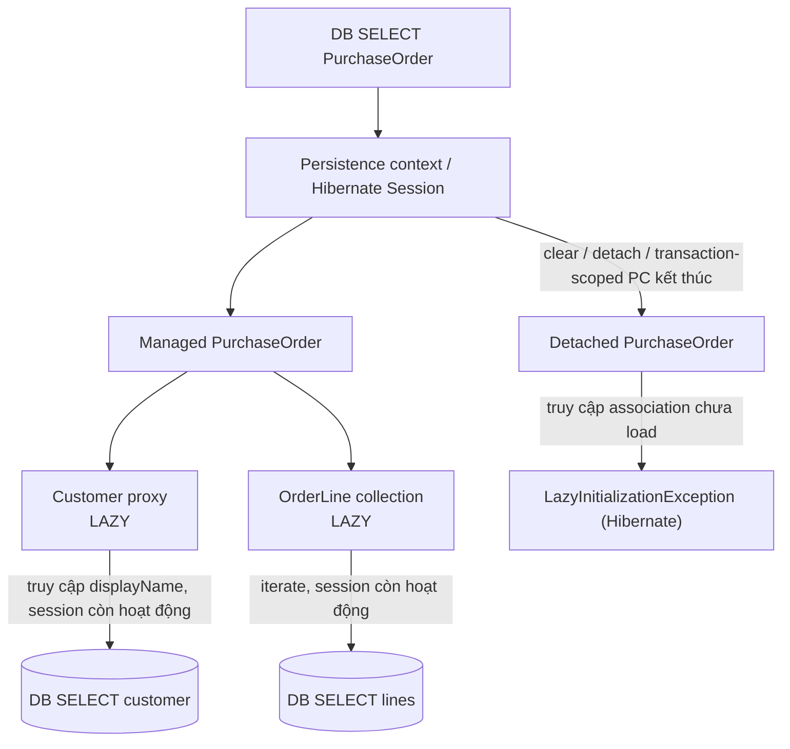
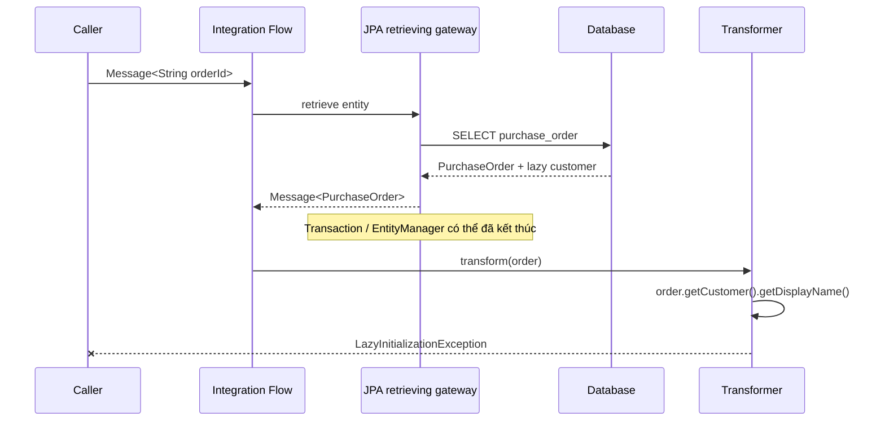
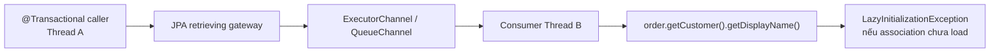
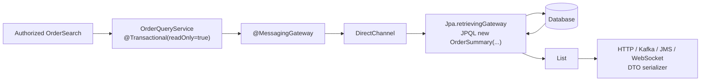
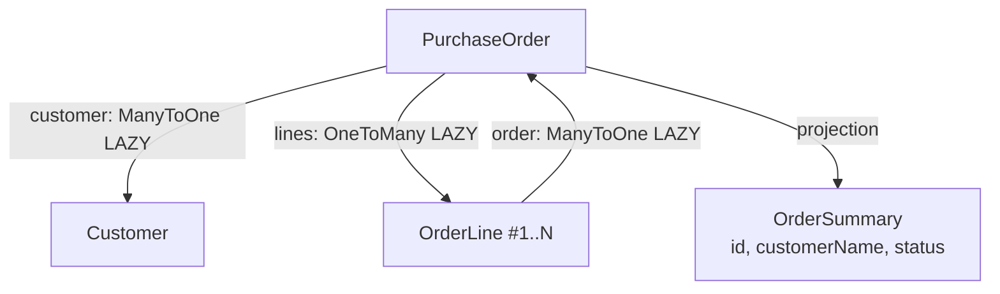
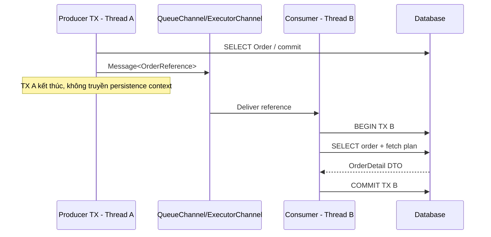

# Lazy loading trong message flow

## 1. Bối cảnh và mục tiêu

Trong module **SPRING_INTEGRATION_ADAPTERS**, ứng dụng kết nối hệ thống bên ngoài bằng inbound/outbound adapter, gateway, poller và `MessageChannel`. Message có thể đến từ file, SFTP, HTTP, JMS, AMQP, Kafka hoặc database; dữ liệu được truy vấn, biến đổi, định tuyến rồi gửi tiếp tới những hệ thống khác.

Với **Adapter JPA**, một JPA retrieving outbound gateway hay inbound channel adapter có thể đặt `PurchaseOrder`, `Customer` hoặc `List<PurchaseOrder>` vào payload. Nếu entity có quan hệ `@ManyToOne(fetch = LAZY)`, `@OneToMany(fetch = LAZY)` hoặc collection proxy do Hibernate quản lý, việc gọi getter sau khi transaction/persistence context kết thúc rất dễ gặp `LazyInitializationException`. Nếu giữ persistence context mở để tránh lỗi, luồng lại có thể mắc **N+1 queries**, kết nối DB bị giữ lâu hoặc query được phát sinh ở nơi không mong đợi.

Bài **Lazy loading trong message flow** giúp người học giải thích nguyên nhân, chọn **fetch plan phù hợp** và thiết kế **message contract độc lập với JPA persistence context**.

Sau khi hoàn thành, bạn có thể:

- Hiểu `FetchType.LAZY`/`FetchType.EAGER`, Hibernate proxy, collection wrapper và trạng thái managed/detached.
- Phân biệt lazy loading hợp lệ trong transaction với truy cập quan hệ sau khi context đã đóng.
- Giải thích `LazyInitializationException` trong `DirectChannel`, `ExecutorChannel`, `QueueChannel`, `PublishSubscribeChannel` và qua Kafka/JMS/HTTP/WebSocket.
- Biết **`@Transactional` bao quanh phần nào** của Integration Flow, không đồng nhất method invocation với persistence context sống mãi.
- Chọn **DTO constructor projection** trong JPQL, `JOIN FETCH`, `@EntityGraph` hoặc ánh xạ DTO trong transactional service.
- Đo/giảm **N+1 SELECT**, tránh cartesian product và tránh `JOIN FETCH` collection kết hợp phân trang.
- Xây ứng dụng Spring Boot 3.x, Spring Integration 6.x, Jakarta Persistence/Hibernate và H2 có JPA retrieving gateway trả `List<DTO>`.
- Kiểm thử failure path với detached entity, happy path với DTO, và kiểm soát ranh giới asynchronous.
- Thiết kế contract khi JPA inbound poller tạo entity/list, hoặc khi outbound adapter nhận data từ broker.
- Tách quyền truy cập tenant, giới hạn query và serialization khỏi persistence entity graph.
- Tránh dùng Open Session in View hoặc `hibernate.enable_lazy_load_no_trans` như cách sửa mặc định.

> **Quy tắc trọng tâm:** JPA entity là **đối tượng gắn với vòng đời persistence context**, không phải một payload lý tưởng để gửi tùy ý qua message flow. Khi vượt transaction, thread, process hoặc network boundary, ưu tiên **DTO/ID/event immutable** đã chứa đúng thông tin cần thiết.

## 2. Lazy loading và persistence context

### 2.1. Lazy loading là gì?

Lazy loading trì hoãn việc đọc một quan hệ cho đến khi ứng dụng thật sự truy cập nó. Ví dụ:

```java
@Entity
class PurchaseOrder {
    @ManyToOne(fetch = FetchType.LAZY)
    private Customer customer;

    @OneToMany(mappedBy = "order", fetch = FetchType.LAZY)
    private List<OrderLine> lines = new ArrayList<>();
}
```

Khi query đơn hàng:

```java
PurchaseOrder order =
        entityManager.find(PurchaseOrder.class, "ORD-101");
```

JPA provider có thể chỉ load cột của `PurchaseOrder` và những foreign keys cần thiết. `order.getCustomer()` có thể là proxy; `order.getLines()` có thể là Hibernate persistent collection chưa được khởi tạo. Khi thật sự đọc `order.getCustomer().getDisplayName()` hoặc duyệt `order.getLines()`, provider có thể phát thêm SQL **nếu entity/collection còn gắn với session hợp lệ**.

**Không** được giả định chỉ vì getter trả về một object thì toàn bộ object đó đã được load.

### 2.2. LAZY không luôn là mặc định

| Mapping JPA | Fetch default theo Jakarta Persistence | Lưu ý |
| --- | --- | --- |
| `@ManyToOne` | **EAGER** | Nên khai `fetch=LAZY` nếu chỉ cần parent/reference ở một số use case |
| `@OneToOne` | **EAGER** | LAZY có thể cần provider-specific enhancement cho một số trường hợp |
| `@OneToMany` | **LAZY** | Thường là collection proxy/wrapper |
| `@ManyToMany` | **LAZY** | Collection có thể rất lớn |
| `@Basic` | **EAGER** | `@Basic(fetch=LAZY)` có giới hạn/provider requirements, đôi khi cần bytecode enhancement |

Theo JPA, `EAGER` là yêu cầu provider phải eager fetch, còn `LAZY` có thể được coi là hint trong một số hoàn cảnh/provider. Trên Hibernate, lazy to-one proxies và persistent collections là những cơ chế phổ biến; những chi tiết cụ thể nên được kiểm thử ở version thực tế.

**Không đổi toàn bộ mappings sang EAGER chỉ để loại bỏ exception.** EAGER không có nghĩa “luôn một SQL query”: provider có thể phát thêm selects, và tải association không cần thiết thường làm chậm hệ thống.

### 2.3. Persistence context quản lý entity như thế nào?



Một **transaction-scoped persistence context** thường kết thúc khi transaction hoàn tất. Sau đó, entity Java instance có thể vẫn tồn tại trong Spring Message hoặc field của một service, nhưng không còn được JPA theo dõi.

- **Managed:** `EntityManager.contains(entity)` là `true` trong context tương ứng.
- **Detached:** Java object còn trong heap nhưng không có context quản lý.
- **Initialized lazy association:** dữ liệu đã được fetch; có thể đọc những field đã load sau khi detach, miễn không kích hoạt thêm các association chưa load.
- **Uninitialized lazy association:** khi truy cập phần cần DB mà session đã đóng, Hibernate thường ném `LazyInitializationException`.

### 2.4. Một vài getter có thể không kích hoạt SQL

Tùy provider/enhancement, đọc ID của một proxy có thể không cần truy cập DB:

```java
String customerId = order.getCustomer().getId();
```

Nhưng `order.getCustomer().getDisplayName()` thường cần initialize proxy. **Không dùng quy tắc “đọc ID luôn an toàn” như một bảo đảm portable cho mọi mapping/provider**, nhất là composite keys, bytecode enhancement hoặc customized entity methods.

## 3. LazyInitializationException trong Spring Integration Flow

Một flow đồng bộ cơ bản:

```text
@MessagingGateway
  → DirectChannel
  → Jpa.retrievingGateway(...)
  → Transformer
  → Reply
```

Nếu transformer chạy **ngoài transaction/persistence context** đã dùng để retrieve, một lần gọi nested getter cũng có thể thất bại.

### 3.1. Mô hình lỗi điển hình



**Điểm quan trọng:** việc dùng **`DirectChannel`** chỉ có nghĩa handler thường thực thi trên thread sender. Nó **không tự tạo một transaction** bao quanh mọi handler. Nếu không có một `@Transactional` ở caller hoặc poller/endpoint advice phù hợp, JPA query và transformer có thể ở những persistence-context scopes khác nhau.

### 3.2. Khi nào DirectChannel có thể đọc lazy relation?

Khi một public service method có `@Transactional(readOnly=true)`, gọi `@MessagingGateway` đồng bộ, và flow đi qua `DirectChannel`, các handler JPA thường có thể tham gia transaction đang gắn với thread:

```java
@Transactional(readOnly = true)
public OrderDetail loadOrder(String tenantId, String orderId) {
    return orderGateway.findDetail(...); // Flow đồng bộ
}
```

Nếu transformer đọc association **trong cùng transaction** và tạo DTO trước khi method trả về, lazy loading có thể hoạt động. Tuy nhiên, đây không phải tối ưu mặc định: transformer có thể gây **N+1**; thay flow sang async sau này sẽ thay transaction scope.

**Khuyến nghị:** ngay cả khi dùng transaction đồng bộ, vẫn nên **thiết kế fetch plan và DTO projection rõ ràng**.

### 3.3. Ranh giới bất đồng bộ



- Spring imperative transactions thông thường gắn với **thread**.
- `ExecutorChannel` chuyển handler sang executor thread.
- `QueueChannel` giữ message để một poller/consumer khác nhận về sau.
- `PublishSubscribeChannel` có thể đồng bộ hoặc bất đồng bộ tùy executor.
- `@Async`/`CompletableFuture`/manual threads cũng tạo ranh giới riêng.
- Entity Java object có thể qua channel, nhưng persistence context **không được truyền** sang thread khác chỉ vì message vẫn chứa cùng object reference.

Nếu consumer cần truy vấn JPA mới, nó phải có **transaction của chính nó**, hoặc chỉ nhận DTO/ID và load lại khi cần.

### 3.4. Ranh giới serialization

Một Kafka/JMS/AMQP/HTTP/WebSocket outbound adapter có thể serialize payload:

```text
Message<PurchaseOrder>
  → Jackson/serializer
  → gọi getCustomer(), getLines(), ...
  → lazy SQL ngoài ý muốn hoặc LazyInitializationException
```

Serialization có thể gọi getters theo thứ tự khó dự đoán, đi sâu vào các mối quan hệ hai chiều (`PurchaseOrder.lines[*].order`), tạo vòng tham chiếu, lộ trường không nên trả hoặc làm payload phình rất lớn.

**Không để serializer quyết định fetch plan của database.** Chỉ serialize DTO/event có schema được ứng dụng kiểm soát.

## 4. Các biểu hiện cần phân biệt

| Triệu chứng | Nguyên nhân có thể | Không nên kết luận vội |
| --- | --- | --- |
| `org.hibernate.LazyInitializationException` | Proxy/collection chưa initialize khi session đã đóng | Không mặc định do SQL sai |
| `LazyInitializationException: could not initialize proxy - no Session` | Truy cập lazy to-one sau detach | Không giải quyết bằng tăng JDBC pool |
| `failed to lazily initialize a collection` | Duyệt collection ngoài session | Không phải mọi list thiếu dữ liệu |
| `N+1 SELECT` | Mỗi entity kéo theo query cho association khi iterate | Không phải cứ dùng @Transactional là tối ưu |
| Timeout sau khi tăng EAGER | Load entity graph quá lớn | Không cần thiết tăng page size |
| Hàng nghìn SQL khi serialize JSON | Jackson đi qua lazy getters | Không nên chỉ tắt logging |
| `LazyInitializationException` sau `clearOnFlush` | Adapter flush/clear làm entity detached | `clear()` không chỉ clear batch hiện tại |
| `LazyInitializationException` trong Kafka consumer | DTO/entity gửi qua broker mang thông tin thiếu | Broker không truyền Hibernate session |
| Invalid JSON/circular reference | Quan hệ hai chiều không được thiết kế serialization | Không phải optimistic locking |
| SQL phát sau khi controller trả dữ liệu | Open Session in View còn bật | Không có nghĩa transaction nghiệp vụ còn mở |

**Điểm phân biệt:** `LazyInitializationException` thường là lỗi vòng đời/session của Hibernate. Ngay cả khi không có exception, **N+1 vẫn có thể tồn tại** và tạo chi phí nghiêm trọng.

## 5. Chọn chiến lược đúng cho message contract

| Chiến lược | Dùng khi | Ưu điểm | Rủi ro/cần lưu ý |
| --- | --- | --- | --- |
| **JPQL constructor DTO projection** | List/read model biết rõ fields | Không mang entity proxies; ít columns | Query constructor phải khớp package và type |
| **DTO mapping trong @Transactional service** | Cần business method/aggregate | Chủ động dựng DTO, tận dụng domain logic | Nếu không fetch trước có thể N+1 |
| **JOIN FETCH to-one** | Cần entity và `customer` ngay | Lấy association trong một query | Không phải mọi to-many đều nên join |
| **JOIN FETCH một collection** | Detail theo ID, list nhỏ | Hạn chế thêm SQL | Duplicates/cartesian product; không phối pagination tùy tiện |
| **@EntityGraph** | Reuse repository method/nhu cầu fetch theo use case | Fetch plan declarative | Query plan vẫn phải đo; nhiều collections nguy hiểm |
| **Batch fetching / @BatchSize** | Truy cập lazy associations của nhiều entities | Giảm N+1 thành ít round trips hơn | Không loại nhu cầu transaction; vẫn tải data thêm |
| **Truyền ID rồi reload ở consumer** | Queue/ExecutorChannel/broker boundary | Không phụ thuộc old persistence context | Có thêm DB query và cần consistency policy |
| **EAGER mapping mọi quan hệ** | Hiếm, association luôn bắt buộc/nhỏ | Có dữ liệu ngay theo fetch contract | Dễ quá tải; không phải mặc định tốt |
| **Open Session in View** | Legacy web compatibility có chủ đích | Trì hoãn lỗi ngoài service | N+1 ở view, query ngoài transaction, không giải quyết async |
| **hibernate.enable_lazy_load_no_trans** | Tránh dùng mặc định | Có thể tạo thêm sessions khi detached | N+1, khó theo dõi consistency, tăng DB load |

**Khuyến nghị chủ đạo:** thông điệp **qua ranh giới hệ thống** nên chứa DTO/ID/event; truy vấn cần fields nào thì lấy chính xác fields đó **trước ranh giới**.

## 6. Thiết kế ví dụ: đọc đơn hàng và gửi OrderSummary

Ta xây một ứng dụng có:

- `Customer`: dữ liệu khách hàng.
- `PurchaseOrder`: đơn hàng, có quan hệ LAZY tới customer và các lines.
- `OrderLine`: danh sách chi tiết đơn, LAZY từ phía order.
- `OrderSummary`: **record DTO** gồm order ID, customer name và status.
- `OrderDetail` và `OrderLineView`: DTO chi tiết.
- JPA retrieving outbound gateway query **constructor projection** trả `List<OrderSummary>`.
- `@MessagingGateway` tạo request/reply dựa trên `OrderSearch` chứa tenant scope đã được xác thực và status filter.
- Transactional service xác thực/chuẩn hóa input và gọi flow.
- Repository có `@EntityGraph` để đọc chi tiết trong transaction riêng khi thật sự cần lines.
- Một method **cố ý không an toàn** trong demo để tái hiện lazy failure khi trả entity detached.



**Không gửi entity ra ngoài.** Ngay cả khi ngay hôm nay flow chỉ đồng bộ, sự tách biệt này giúp dễ thay `DirectChannel` bằng async channel sau này.

## 7. Maven và cấu hình Spring Boot

Ví dụ dùng **Java 17+, Spring Boot 3.x, Spring Integration 6.x, Hibernate ORM 6.x, Jakarta Persistence và H2**. Với các version lớn mới hơn, đối chiếu migration notes trước khi sao chép code.

### 7.1. Maven dependencies

```xml
<dependencies>
    <dependency>
        <groupId>org.springframework.boot</groupId>
        <artifactId>spring-boot-starter</artifactId>
    </dependency>
    <dependency>
        <groupId>org.springframework.boot</groupId>
        <artifactId>spring-boot-starter-integration</artifactId>
    </dependency>
    <dependency>
        <groupId>org.springframework.integration</groupId>
        <artifactId>spring-integration-jpa</artifactId>
    </dependency>
    <dependency>
        <groupId>org.springframework.boot</groupId>
        <artifactId>spring-boot-starter-data-jpa</artifactId>
    </dependency>
    <dependency>
        <groupId>com.h2database</groupId>
        <artifactId>h2</artifactId>
        <scope>runtime</scope>
    </dependency>
    <dependency>
        <groupId>org.springframework.boot</groupId>
        <artifactId>spring-boot-starter-test</artifactId>
        <scope>test</scope>
    </dependency>
</dependencies>
```

Dùng Spring Boot dependency management/BOM để giữ Spring, Hibernate và Integration tương thích. `spring-integration-jpa` cần thiết cho `Jpa.retrievingGateway(...)` và `JpaExecutor`. H2 và `ddl-auto=create-drop` chỉ dùng trong demo.

### 7.2. application.properties

```properties
spring.main.web-application-type=none

spring.datasource.url=jdbc:h2:mem:jpa_lazy_demo;DB_CLOSE_DELAY=-1
spring.datasource.driver-class-name=org.h2.Driver
spring.datasource.username=sa
spring.datasource.password=

spring.jpa.hibernate.ddl-auto=create-drop
spring.jpa.open-in-view=false

# Dùng trong test/quan sát, không bật SQL trace chứa dữ liệu
# nhạy cảm ở production một cách mặc định.
spring.jpa.properties.hibernate.generate_statistics=true
logging.level.org.springframework.integration=INFO

# Tùy Hibernate version, setting này giúp biến lỗi
# pagination + collection fetch join thành fail-fast.
spring.jpa.properties.hibernate.query.fail_on_pagination_over_collection_fetch=true
```

`spring.jpa.open-in-view=false` làm rõ rằng application không dựa vào một web request-scoped EntityManager để giữ session sau service. Với `spring.main.web-application-type=none`, demo không có servlet controller; property vẫn diễn tả ý đồ kiến trúc khi đưa code sang app web.

### 7.3. Package

Mọi class Java trong ví dụ nằm trong:

```text
com.example.jpalazy
    Customer.java
    PurchaseOrder.java
    OrderLine.java
    OrderSummary.java
    OrderSearch.java
    OrderLineView.java
    OrderDetail.java
    CustomerRepository.java
    PurchaseOrderRepository.java
    OrderSummaryGateway.java
    OrderSummaryIntegrationConfiguration.java
    OrderQueryService.java
    JpaLazyApplication.java
```

Không cần tạo thêm thư mục/file theo danh sách này trong bài Markdown: các code blocks mô tả source layout của ứng dụng thực hành.

## 8. JPA entities với LAZY associations

### 8.1. Customer

File `Customer.java`:

```java
package com.example.jpalazy;

import jakarta.persistence.Column;
import jakarta.persistence.Entity;
import jakarta.persistence.Id;
import jakarta.persistence.Table;

@Entity
@Table(name = "customer")
public class Customer {

    @Id
    @Column(name = "customer_id", length = 80)
    private String id;

    @Column(name = "display_name", nullable = false, length = 120)
    private String displayName;

    protected Customer() {
        // Jakarta Persistence yêu cầu constructor không tham số.
    }

    public Customer(String id, String displayName) {
        this.id = id;
        this.displayName = displayName;
    }

    public String getId() {
        return id;
    }

    public String getDisplayName() {
        return displayName;
    }
}
```

Trong demo, customer được lưu trước purchase orders. Production cần unique constraints, tenant isolation của customer và data access control theo chính sách ứng dụng.

### 8.2. PurchaseOrder

File `PurchaseOrder.java`:

```java
package com.example.jpalazy;

import java.util.ArrayList;
import java.util.List;

import jakarta.persistence.CascadeType;
import jakarta.persistence.Column;
import jakarta.persistence.Entity;
import jakarta.persistence.FetchType;
import jakarta.persistence.Id;
import jakarta.persistence.JoinColumn;
import jakarta.persistence.ManyToOne;
import jakarta.persistence.OneToMany;
import jakarta.persistence.Table;
import jakarta.persistence.Version;

@Entity
@Table(name = "purchase_order")
public class PurchaseOrder {

    @Id
    @Column(name = "order_id", length = 80)
    private String id;

    @Column(name = "tenant_id", nullable = false, length = 60)
    private String tenantId;

    @Column(nullable = false, length = 24)
    private String status;

    @ManyToOne(fetch = FetchType.LAZY, optional = false)
    @JoinColumn(name = "customer_id", nullable = false)
    private Customer customer;

    @OneToMany(
            mappedBy = "order",
            fetch = FetchType.LAZY,
            cascade = CascadeType.ALL,
            orphanRemoval = true)
    private List<OrderLine> lines = new ArrayList<>();

    @Version
    private Long version;

    protected PurchaseOrder() {
    }

    public PurchaseOrder(
            String id, String tenantId, String status,
            Customer customer) {
        this.id = id;
        this.tenantId = tenantId;
        this.status = status;
        this.customer = customer;
    }

    public void addLine(
            String lineId, String sku, int quantity) {
        lines.add(new OrderLine(
                lineId, this, sku, quantity));
    }

    public String getId() {
        return id;
    }

    public String getTenantId() {
        return tenantId;
    }

    public String getStatus() {
        return status;
    }

    public Customer getCustomer() {
        return customer;
    }

    public List<OrderLine> getLines() {
        return lines;
    }

    public Long getVersion() {
        return version;
    }
}
```

Quan hệ `customer` và `lines` đều LAZY **tường minh**. `@Version` minh họa entity quản lý concurrency; bài này không sửa trạng thái nhưng nếu có command UPDATE, version vẫn cần cho optimistic locking.

### 8.3. OrderLine

File `OrderLine.java`:

```java
package com.example.jpalazy;

import jakarta.persistence.Column;
import jakarta.persistence.Entity;
import jakarta.persistence.FetchType;
import jakarta.persistence.Id;
import jakarta.persistence.JoinColumn;
import jakarta.persistence.ManyToOne;
import jakarta.persistence.Table;

@Entity
@Table(name = "order_line")
public class OrderLine {

    @Id
    @Column(name = "line_id", length = 80)
    private String id;

    @ManyToOne(fetch = FetchType.LAZY, optional = false)
    @JoinColumn(name = "order_id", nullable = false)
    private PurchaseOrder order;

    @Column(nullable = false, length = 80)
    private String sku;

    @Column(nullable = false)
    private int quantity;

    protected OrderLine() {
    }

    public OrderLine(
            String id, PurchaseOrder order,
            String sku, int quantity) {
        this.id = id;
        this.order = order;
        this.sku = sku;
        this.quantity = quantity;
    }

    public String getId() {
        return id;
    }

    public String getSku() {
        return sku;
    }

    public int getQuantity() {
        return quantity;
    }
}
```

Ở hai chiều `PurchaseOrder.lines` và `OrderLine.order`, serializer có thể rơi vào vòng tham chiếu nếu serialize entity graph. Bài này **không** serialize entities nên không cần dựa vào `@JsonIgnore`, `@JsonManagedReference` hoặc Hibernate serializer modules để lách vấn đề.

### 8.4. Liên hệ với entity graph



DTO chỉ chọn các fields cần thiết và **không chứa Customer proxy hoặc OrderLine collection**.

## 9. DTOs, repositories và request contract

### 9.1. DTO summary

File `OrderSummary.java`:

```java
package com.example.jpalazy;

public record OrderSummary(
        String orderId,
        String customerName,
        String status) {
}
```

Đây là payload an toàn để trả qua REST/JMS/Kafka. Không có method `getCustomer().getDisplayName()` có thể kích hoạt SQL khi serialize.

### 9.2. DTO detail

File `OrderLineView.java`:

```java
package com.example.jpalazy;

public record OrderLineView(
        String sku, int quantity) {
}
```

File `OrderDetail.java`:

```java
package com.example.jpalazy;

import java.util.List;

public record OrderDetail(
        String orderId,
        String customerName,
        String status,
        List<OrderLineView> lines) {
}
```

`List<OrderLineView>` chỉ chứa immutable values; bản thân `List` nên tạo bằng `Stream.toList()` hoặc `List.copyOf(...)` để giảm khả năng chỉnh sửa ngoài ý muốn.

### 9.3. Request đã chuẩn hóa

File `OrderSearch.java`:

```java
package com.example.jpalazy;

public record OrderSearch(
        String verifiedTenantId,
        String status) {
}
```

**Không lấy `verifiedTenantId` trực tiếp từ một JSON field do client tự khai.** Trong ứng dụng thật, tenant phải được xác nhận bởi authenticated principal/ACL hoặc tenant resolver đáng tin cậy trước khi tạo `OrderSearch`.

### 9.4. Repositories

File `CustomerRepository.java`:

```java
package com.example.jpalazy;

import org.springframework.data.jpa.repository.JpaRepository;

public interface CustomerRepository
        extends JpaRepository<Customer, String> {
}
```

File `PurchaseOrderRepository.java`:

```java
package com.example.jpalazy;

import java.util.Optional;

import org.springframework.data.jpa.repository.EntityGraph;
import org.springframework.data.jpa.repository.JpaRepository;
import org.springframework.data.jpa.repository.Query;
import org.springframework.data.repository.query.Param;

public interface PurchaseOrderRepository
        extends JpaRepository<PurchaseOrder, String> {

    @EntityGraph(attributePaths = {"customer", "lines"})
    @Query("""
            select o from PurchaseOrder o
            where o.id = :id
              and o.tenantId = :tenantId
            """)
    Optional<PurchaseOrder> findAuthorizedDetail(
            @Param("id") String id,
            @Param("tenantId") String tenantId);
}
```

`@EntityGraph` này áp dụng cho **detail của một order theo ID**. Không lấy nó làm phương án mặc định cho phân trang danh sách lớn, vì nó có một collection `lines`.

Repository dùng để seed và đọc **detail** trong service. Query **summary** chính vẫn đi qua Spring Integration JPA retrieving outbound gateway.

## 10. Jpa.retrievingGateway trả DTO ngay trong query

### 10.1. @MessagingGateway

File `OrderSummaryGateway.java`:

```java
package com.example.jpalazy;

import java.util.List;

import org.springframework.integration.annotation.MessagingGateway;

@MessagingGateway(
        defaultRequestChannel = "orderSummaryRequests",
        defaultReplyTimeout = "5000")
public interface OrderSummaryGateway {

    List<OrderSummary> search(OrderSearch query);
}
```

Phương thức `search` tạo một Spring Message chứa `OrderSearch` và chờ reply. Đây là một **request-driven JPA retrieving outbound gateway**, không phải inbound poller định kỳ.

### 10.2. IntegrationFlow

File `OrderSummaryIntegrationConfiguration.java`:

```java
package com.example.jpalazy;

import jakarta.persistence.EntityManagerFactory;

import org.springframework.context.annotation.Bean;
import org.springframework.context.annotation.Configuration;
import org.springframework.integration.config.EnableIntegration;
import org.springframework.integration.dsl.IntegrationFlow;
import org.springframework.integration.jpa.dsl.Jpa;

@Configuration
@EnableIntegration
public class OrderSummaryIntegrationConfiguration {

    @Bean
    IntegrationFlow orderSummaryFlow(
            EntityManagerFactory entityManagerFactory) {

        return IntegrationFlow.from("orderSummaryRequests")
                .handle(
                        Jpa.retrievingGateway(entityManagerFactory)
                                .jpaQuery("""
                                        select new com.example.jpalazy.OrderSummary(
                                            o.id,
                                            c.displayName,
                                            o.status)
                                        from PurchaseOrder o
                                        join o.customer c
                                        where o.tenantId = :tenantId
                                          and o.status = :status
                                        order by o.id
                                        """)
                                .parameterExpression(
                                        "tenantId",
                                        "payload.verifiedTenantId()")
                                .parameterExpression(
                                        "status",
                                        "payload.status()")
                                .maxResults(25)
                                .expectSingleResult(false))
                .get();
    }
}
```

**Tại sao đây là giải pháp phù hợp?**

1. Query dùng **JPQL constructor expression** tạo `OrderSummary` trực tiếp.
2. `join o.customer c` để đọc `c.displayName` trong query, nhưng **không** trả `Customer` entity/proxy.
3. `PurchaseOrder.lines` **không được load** vì summary không cần chi tiết.
4. Payload reply là `List<OrderSummary>`: độc lập với persistence context, có thể serialize sau transaction.
5. `maxResults(25)` giới hạn lượng dữ liệu trên một request; cần index/thêm pagination khi tải thực lớn.
6. `expectSingleResult(false)` giữ contract danh sách; retrieving gateway Spring Integration 6.x trả **empty list** khi query không có row.
7. `parameterExpression` lấy **giá trị** từ Spring Message, không nối JPQL text từ user.
8. `tenantId`/`status` được tạo và validate ở service; query không cho client chọn tenant bất kỳ.

Đây là **JPQL projection**, không phải `JOIN FETCH`. `JOIN FETCH` dùng để load association của một **entity root**; constructor query chỉ chọn fields để dựng DTO.

### 10.3. Query không cần fetch graph lớn

Ví dụ **không nên** dùng trong summary list:

```sql
select o from PurchaseOrder o
left join fetch o.customer
left join fetch o.lines
where o.tenantId = :tenantId
order by o.id
```

Nếu mỗi order có hàng trăm lines, query có thể nhân bản rows và load nhiều dữ liệu vô ích. Đừng thêm `fetch` theo thói quen; thiết kế query theo **fields của message contract**.

## 11. Service transaction và mapping detail

### 11.1. Service query

File `OrderQueryService.java`:

```java
package com.example.jpalazy;

import java.util.List;
import java.util.Set;

import org.springframework.stereotype.Service;
import org.springframework.transaction.annotation.Transactional;

@Service
public class OrderQueryService {

    private static final Set<String> ALLOWED_STATUSES =
            Set.of("PENDING", "PAID");

    private final OrderSummaryGateway gateway;
    private final PurchaseOrderRepository orders;

    public OrderQueryService(
            OrderSummaryGateway gateway,
            PurchaseOrderRepository orders) {
        this.gateway = gateway;
        this.orders = orders;
    }

    @Transactional(readOnly = true)
    public List<OrderSummary> summaries(
            String verifiedTenantId,
            String status) {

        requireTenant(verifiedTenantId);
        if (!ALLOWED_STATUSES.contains(status)) {
            throw new IllegalArgumentException(
                    "Invalid status");
        }

        return gateway.search(
                new OrderSearch(verifiedTenantId, status));
    }

    @Transactional(readOnly = true)
    public OrderDetail detail(
            String verifiedTenantId,
            String orderId) {

        requireTenant(verifiedTenantId);

        PurchaseOrder order = orders
                .findAuthorizedDetail(orderId, verifiedTenantId)
                .orElseThrow(() ->
                        new IllegalArgumentException(
                                "Order not found"));

        // Mapping xảy ra KHI transaction còn mở.
        List<OrderLineView> lineViews =
                order.getLines().stream()
                        .map(line -> new OrderLineView(
                                line.getSku(),
                                line.getQuantity()))
                        .toList();

        return new OrderDetail(
                order.getId(),
                order.getCustomer().getDisplayName(),
                order.getStatus(),
                lineViews);
    }

    // Chỉ phục vụ minh họa LAZY failure trong unit/integration test.
    // Không trả JPA entity trực tiếp từ public API thực tế.
    @Transactional(readOnly = true)
    public PurchaseOrder unsafeEntityForDemonstration(
            String verifiedTenantId,
            String orderId) {

        requireTenant(verifiedTenantId);
        PurchaseOrder order =
                orders.findById(orderId).orElseThrow();

        if (!verifiedTenantId.equals(order.getTenantId())) {
            throw new IllegalArgumentException(
                    "Order not found");
        }

        // Không initialize customer / lines tại đây.
        return order;
    }

    private static void requireTenant(String verifiedTenantId) {
        if (verifiedTenantId == null
                || verifiedTenantId.isBlank()
                || verifiedTenantId.length() > 60) {
            throw new IllegalArgumentException(
                    "Invalid tenant scope");
        }
    }
}
```

Trong `summaries`, JPQL đã trả DTO nên transaction chỉ định read-only scope rõ ràng, không dùng lazy getters sau query.

Trong `detail`, repository dùng `@EntityGraph(attributePaths={"customer","lines"})` để fetch những associations cần thiết; mapping DTO được thực hiện **trước khi transaction kết thúc**. Không trả `PurchaseOrder` cho web/broker caller.

Trong `unsafeEntityForDemonstration`, tên method cố ý cho biết đây **không phải một API nên sử dụng trong production**; nó chỉ giúp integration test tái hiện lỗi.

### 11.2. @Transactional(readOnly=true) không phải authorization

- `readOnly=true` thường là hint cho transaction manager/provider và có thể giúp Hibernate tối ưu một số hành vi.
- Nó **không cấm** application code đọc những rows tenant khác.
- Nó **không mở transaction tự động** qua `ExecutorChannel`/`QueueChannel`.
- Nó **không cấp quyền** cho `verifiedTenantId` do client tự khai.
- Nó **không tự giải quyết N+1** nếu code loop qua lazy associations.
- Nó **không giữ session mở mãi** sau khi method trả về.

Validation/authorization phải xảy ra **trước** JPA query; nếu số lượng tenant lớn, cần policy về row-level security và index phù hợp.

## 12. Main application và dữ liệu demo

File `JpaLazyApplication.java`:

```java
package com.example.jpalazy;

import java.util.List;

import org.springframework.boot.CommandLineRunner;
import org.springframework.boot.SpringApplication;
import org.springframework.boot.autoconfigure.SpringBootApplication;
import org.springframework.context.annotation.Bean;
import org.springframework.integration.annotation.IntegrationComponentScan;

@SpringBootApplication
@IntegrationComponentScan
public class JpaLazyApplication {

    public static void main(String[] args) {
        SpringApplication.run(JpaLazyApplication.class, args);
    }

    @Bean
    CommandLineRunner sample(
            CustomerRepository customers,
            PurchaseOrderRepository orders,
            OrderQueryService queries) {

        return args -> {
            if (orders.count() == 0) {
                Customer alice = customers.save(
                        new Customer("CUS-101", "Alice Example"));

                PurchaseOrder first = new PurchaseOrder(
                        "ORD-101", "TENANT-A", "PAID", alice);
                first.addLine("LINE-101", "SKU-1", 2);
                first.addLine("LINE-102", "SKU-2", 1);

                PurchaseOrder second = new PurchaseOrder(
                        "ORD-102", "TENANT-A", "PENDING", alice);
                second.addLine("LINE-103", "SKU-3", 3);

                PurchaseOrder third = new PurchaseOrder(
                        "ORD-201", "TENANT-B", "PAID", alice);
                third.addLine("LINE-201", "SKU-4", 1);

                orders.saveAll(List.of(
                        first, second, third));
            }

            System.out.println("Summary list: "
                    + queries.summaries("TENANT-A", "PAID"));

            System.out.println("Detail: "
                    + queries.detail("TENANT-A", "ORD-101"));

            System.out.println("No rows: "
                    + queries.summaries("TENANT-C", "PAID"));
        };
    }
}
```

**Lưu ý thực hành:** `TENANT-C` trong demo được giả định là tenant đã qua authorization nhưng chưa có đơn, nên truy vấn trạng thái `PAID` trả `[]`. Trong hệ thống thật, caller không được tự chọn tenant chưa được xác thực để dò database. Nếu thử trạng thái không thuộc allowlist, service sẽ ném `IllegalArgumentException` trước khi gửi yêu cầu đến JPA gateway.

**Kết quả minh họa:**

| Lời gọi | Kết quả |
| --- | --- |
| `summaries("TENANT-A", "PAID")` | `[OrderSummary("ORD-101","Alice Example","PAID")]` |
| `detail("TENANT-A","ORD-101")` | `OrderDetail` chứa 2 line DTOs |
| `summaries("TENANT-C","PAID")` | `[]` |
| `summaries("TENANT-A","INVALID")` | Lỗi validation, không query |
| `detail("TENANT-B","ORD-101")` | Không tìm thấy theo scope tenant |
| Unsafe entity ra khỏi transaction rồi đọc `customer.displayName` | Có thể `LazyInitializationException` nếu chưa initialize |

H2 in-memory và `create-drop` không dành cho production. Thời điểm fetch LAZY phụ thuộc provider, nên có integration test kiểm tra trạng thái loaded để tránh khẳng định nhầm trên mọi mapping/version.

## 13. Integration tests: lỗi LAZY và hai cách sửa

Các tests dưới đây chạy trên Spring Boot 3.x + Hibernate ORM 6.x + H2, với `spring.jpa.open-in-view=false`. Chúng không gắn `@Transactional` lên test method để tránh test framework mở một transaction quá rộng che lấp lỗi detach.

### 13.1. Test fixture

File `OrderLazyLoadingIntegrationTest.java`:

```java
package com.example.jpalazy;

import static org.assertj.core.api.Assertions.assertThat;
import static org.assertj.core.api.Assertions.assertThatThrownBy;

import java.util.List;
import java.util.UUID;

import jakarta.persistence.EntityManagerFactory;

import org.hibernate.LazyInitializationException;
import org.junit.jupiter.api.Test;
import org.springframework.beans.factory.annotation.Autowired;
import org.springframework.boot.test.context.SpringBootTest;

@SpringBootTest
class OrderLazyLoadingIntegrationTest {

    @Autowired
    CustomerRepository customers;

    @Autowired
    PurchaseOrderRepository orders;

    @Autowired
    OrderQueryService queries;

    @Autowired
    EntityManagerFactory entityManagerFactory;

    private String createOrder(
            String tenant, String status, int lineCount) {

        String suffix = UUID.randomUUID().toString();
        Customer customer = customers.save(
                new Customer("cust-" + suffix, "Name " + suffix));

        String id = "order-" + suffix;
        PurchaseOrder order = new PurchaseOrder(
                id, tenant, status, customer);

        for (int index = 0; index < lineCount; index++) {
            order.addLine(
                    "line-" + suffix + "-" + index,
                    "SKU-" + index,
                    index + 1);
        }

        orders.saveAndFlush(order);
        return id;
    }

    @Test
    void summaryGatewayReturnsDtosWithoutLazyProxy() {
        String tenant = "tenant-" + UUID.randomUUID();
        String id = createOrder(tenant, "PAID", 2);

        List<OrderSummary> result =
                queries.summaries(tenant, "PAID");

        assertThat(result).extracting(OrderSummary::orderId)
                .containsExactly(id);

        assertThat(result.get(0).customerName())
                .startsWith("Name ");

        // DTO vẫn an toàn sau khi service/transaction trả về.
        assertThat(result.get(0).status()).isEqualTo("PAID");
    }

    @Test
    void detailMapperLoadsAssociationsInsideTransaction() {
        String tenant = "tenant-" + UUID.randomUUID();
        String id = createOrder(tenant, "PAID", 3);

        OrderDetail detail = queries.detail(tenant, id);

        assertThat(detail.orderId()).isEqualTo(id);
        assertThat(detail.customerName()).startsWith("Name ");
        assertThat(detail.lines()).hasSize(3);
        assertThat(detail.lines().get(0).sku()).startsWith("SKU-");
    }

    @Test
    void detachedUninitializedAssociationFailsWithHibernate() {
        String tenant = "tenant-" + UUID.randomUUID();
        String id = createOrder(tenant, "PAID", 1);

        PurchaseOrder detached =
                queries.unsafeEntityForDemonstration(
                        tenant, id);

        // Test này mô tả hành vi Hibernate 6.x của mapping LAZY.
        assertThat(
                entityManagerFactory.getPersistenceUnitUtil()
                        .isLoaded(detached, "customer"))
                .isFalse();

        assertThatThrownBy(() ->
                detached.getCustomer().getDisplayName())
                .isInstanceOf(LazyInitializationException.class);
    }

    @Test
    void summaryListIsEmptyForTenantWithoutOrders() {
        String emptyTenant = "empty-" + UUID.randomUUID();

        assertThat(
                queries.summaries(emptyTenant, "PAID"))
                .isEmpty();
    }
}
```

**Những điểm test kiểm chứng:**

- `OrderSummary` không phải JPA entity/proxy; có thể truy cập sau transaction mà không đụng DB.
- `OrderDetail` chứa list các `OrderLineView` đã map bên trong transaction có EntityGraph.
- `unsafeEntityForDemonstration` trả một entity với `customer` chưa được khởi tạo; sau transaction, truy cập field không-ID gây lỗi theo Hibernate.
- Truy vấn `expectSingleResult(false)` không có rows trả empty list trong Spring Integration 6.x.
- Mỗi test dùng ID/tenant ngẫu nhiên để không phụ thuộc vào dữ liệu của `CommandLineRunner` hoặc thứ tự tests.

**Không phải mọi JPA provider đều ném `org.hibernate.LazyInitializationException`.** Với provider khác, exception type và lazy fetch policy có thể khác. Bài này thực hành trên Hibernate ORM 6.x, còn JPA standard không định nghĩa class exception Hibernate đó.

### 13.2. Vì sao không đặt @Transactional trên test method?

Nếu cả test method có `@Transactional`:

```java
@Test
@Transactional
void misleadingTest() {
    PurchaseOrder order = orders.findById(id).orElseThrow();
    assertThat(order.getCustomer().getDisplayName())
            .isNotBlank();
}
```

Association được load vì **test vẫn còn persistence context**, nên test PASS nhưng HTTP controller/Kafka consumer production có thể FAIL sau khi service đã trả entity detached.

Để kiểm tra boundary, phải đảm bảo entity thực sự rời transaction:

- Test method không `@Transactional`.
- Service load entity trong một transaction kết thúc trước assertion.
- `spring.jpa.open-in-view=false`.
- Không vô tình truy cập association trong seed/service trước khi assertion.
- Dùng `PersistenceUnitUtil.isLoaded` hoặc Hibernate `isInitialized` để kiểm tra trạng thái trước khi kích hoạt getter.

### 13.3. Cách kiểm tra Hibernate proxy

```java
import org.hibernate.Hibernate;

boolean initialized =
        Hibernate.isInitialized(order.getCustomer());

boolean linesInitialized =
        Hibernate.isInitialized(order.getLines());
```

`Hibernate.isInitialized(...)` kiểm tra Hibernate-specific proxy/collection. Jakarta Persistence còn có:

```java
boolean loaded =
        entityManagerFactory.getPersistenceUnitUtil()
                .isLoaded(order, "customer");
```

Đừng dùng `toString()`, debugger watch expression hay JSON serialization làm “cách kiểm tra” vì chúng có thể tự kích hoạt lazy loading.

### 13.4. Kiểm thử SQL count

Bài `OrderLazyLoadingIntegrationTest` xác minh semantics; để xác minh hiệu năng, cần test số SQL statements/query latency:

- Bật Hibernate statistics trên môi trường test.
- Xóa/clear statistics trước mỗi kịch bản.
- Test list có nhiều orders thuộc **nhiều customers khác nhau**.
- So sánh count giữa query entity và loop lazy getter với DTO projection/join fetch.
- Nếu có caches, warmup hoặc tắt cache trong bài benchmark.
- Không assert “chắc chắn đúng N+1” khi cùng association có thể được first-level cache hoặc batch fetching tái sử dụng.
- Kiểm chứng query plan/p95 latency trên database tương đồng production.

Một test chạy một order duy nhất **không đủ** chứng minh không có N+1.

## 14. JOIN FETCH: khi cần entity với association đã load

### 14.1. JOIN thông thường khác JOIN FETCH

JPQL:

```sql
select o
from PurchaseOrder o
join o.customer c
where c.displayName = :name
```

`join` ở đây dùng để lọc theo customer, nhưng **không phải yêu cầu luôn initialize `o.customer`** trong returned entity.

Nếu muốn trả entity mà customer được fetch trong query:

```sql
select o
from PurchaseOrder o
join fetch o.customer
where o.tenantId = :tenantId
order by o.id
```

**`join fetch` thay fetch plan** của association tương ứng. Đối với to-one relationship, đây là cách thường hiệu quả để tránh các SELECT riêng khi mapping customer name cho nhiều orders.

### 14.2. Java DSL retrieving gateway với fetch join

Một flow **thay thế cho projection** ở mục 10:

```java
@Bean
IntegrationFlow orderEntityReadFlow(
        EntityManagerFactory entityManagerFactory) {

    return IntegrationFlow.from("orderEntityReadRequests")
            .handle(
                    Jpa.retrievingGateway(entityManagerFactory)
                            .jpaQuery("""
                                    select o from PurchaseOrder o
                                    join fetch o.customer
                                    where o.tenantId = :tenantId
                                    order by o.id
                                    """)
                            .parameterExpression(
                                    "tenantId",
                                    "payload")
                            .maxResults(25)
                            .expectSingleResult(false))
            .get();
}
```

Request payload giả định là một `String verifiedTenantId` do server cấp quyền, không phải user input tùy ý. Query trả `List<PurchaseOrder>` trong đó `customer` đã được load.

**Không trả entity list này ra Kafka/HTTP mà không map DTO.** `lines` vẫn LAZY, và có thể còn những quan hệ khác trong model tương lai. Cách tốt hơn là đặt transformer/mapper trong transaction đồng bộ hoặc dùng constructor projection ngay trong query.

### 14.3. FETCH JOIN một collection cho detail

Khi chỉ tải **một order theo ID**, có thể:

```sql
select distinct o
from PurchaseOrder o
join fetch o.customer
left join fetch o.lines
where o.id = :orderId
  and o.tenantId = :tenantId
```

- `join fetch o.customer` yêu cầu customer.
- `left join fetch o.lines` giữ cả order không có lines.
- `distinct` thể hiện ý định kết quả order root không bị nhân lặp; Hibernate 6 cũng có cơ chế loại duplicate entity results từ fetch join.
- Query không có phân trang trên to-many collection.
- Mapping thành `OrderDetail` **trong transaction** để chỉ lấy fields cần trả.

Đối với order có hàng chục nghìn lines, fetch cả collection vẫn có thể quá lớn. Cần phân trang lines riêng hoặc projection/detail riêng theo giới hạn.

### 14.4. Không fetch nhiều collections song song một cách vô hạn

```sql
select distinct o
from PurchaseOrder o
left join fetch o.lines
left join fetch o.discountRules
left join fetch o.shipments
where o.id = :orderId
```

Đây là **ví dụ giả định** có thêm collections `discountRules` và `shipments` ngoài model demo. Nếu mỗi collection có 10 phần tử, SQL JOIN có thể tạo hàng nghìn tổ hợp rows từ một order. Hibernate còn có những giới hạn như `MultipleBagFetchException` khi fetch nhiều bag collections đồng thời.

**Giải pháp:** chỉ fetch association cần thiết; split queries, batch/subselect fetching hoặc projection theo từng phần. Quan sát SQL row counts thực tế thay vì chỉ đo số câu SQL.

## 15. @EntityGraph theo use case

### 15.1. EntityGraph không thay đổi mapping global

Trong repository demo:

```java
@EntityGraph(attributePaths = {"customer", "lines"})
@Query("""
        select o from PurchaseOrder o
        where o.id = :id
          and o.tenantId = :tenantId
        """)
Optional<PurchaseOrder> findAuthorizedDetail(
        @Param("id") String id,
        @Param("tenantId") String tenantId);
```

`@EntityGraph` chỉ yêu cầu những associations cụ thể cho method này. Nó không biến mọi query `PurchaseOrder` thành EAGER và không yêu cầu sửa entity annotations trên toàn ứng dụng.

**Dùng khi:**

- Có một repository method đọc detail với tập associations đã biết.
- Bạn muốn reuse method trong một transactional service.
- Fetch plan ổn định theo nghiệp vụ.
- Query không phân trang to-many collection một cách không kiểm soát.

### 15.2. Đồ thị FETCH và LOAD

Spring Data JPA cung cấp `EntityGraph.EntityGraphType.FETCH` và `LOAD` tương ứng JPA fetch/load graph semantics:

- **FETCH graph:** các attributes được chỉ định thuộc fetch graph; những attributes không chỉ định có thể được xử lý LAZY theo quy tắc của JPA/provider.
- **LOAD graph:** các attributes được chỉ định được yêu cầu fetch; các attributes không chỉ định vẫn theo mapping fetch strategy của chúng.

Ví dụ:

```java
@EntityGraph(
        attributePaths = {"customer"},
        type = EntityGraph.EntityGraphType.LOAD)
@Query("""
        select o from PurchaseOrder o
        where o.tenantId = :tenantId
        """)
List<PurchaseOrder> findByTenantWithCustomer(
        @Param("tenantId") String tenantId);
```

Đoạn này là **method bổ sung** trong `PurchaseOrderRepository` nếu muốn thử graph `LOAD`. Trên một model nhiều EAGER mappings, `LOAD` có thể vẫn kéo những quan hệ EAGER khác; vì thế không được suy luận nó tương đương “chỉ load customer”.

### 15.3. Nested EntityGraph

Khi cần fetch lồng `customer.address`:

```java
@EntityGraph(
        attributePaths = {"customer", "customer.address"})
```

Đây là ví dụ **giả định** model `Customer` có property `address`; demo `Customer` hiện tại chưa khai. Deep graph làm tăng số joins/SQL/rows và nên được kiểm soát theo use case. Không mở rộng EntityGraph chỉ vì một serializer gọi thêm getter.

### 15.4. EntityGraph không ngăn N+1 nếu dùng sai

Một graph fetch `customer` không load `lines`. Nếu code sau đó iterate `order.getLines()` cho 100 orders trong cùng transaction, vẫn có thể sinh 100 additional selects. Cần đảm bảo graph/projection bao phủ **tất cả fields của DTO** và không thêm field trong mapper mà bỏ qua query plan.

## 16. N+1 SELECT: đúng transaction vẫn có thể rất chậm

### 16.1. Ví dụ phát sinh N+1

```java
@Transactional(readOnly = true)
public List<String> listCustomerNames() {
    return orders.findAll().stream()
            .map(order ->
                    order.getCustomer().getDisplayName())
            .toList();
}
```

Nếu `findAll()` trả N orders và mỗi order có customer khác nhau, provider có thể phát:

```text
1 SQL: SELECT purchase_order
N SQL: SELECT customer WHERE customer_id = ?
------------------------------------------
≈ N + 1 SQL statements
```

Thực tế số truy vấn còn tùy first-level/second-level cache, batch fetching, duplicate customer IDs và provider. Nhưng khi load lớn, pattern “lặp qua list + lazy getter” là dấu hiệu cần kiểm tra.

**Không dùng `@Transactional` như giải pháp hiệu năng:** nó chỉ cho phép lazy getter phát SQL hợp lệ; đôi khi làm vấn đề tệ hơn vì toàn bộ request giữ transaction/connection lâu.

### 16.2. Cách sửa 1: JPQL DTO projection

```sql
select new com.example.jpalazy.OrderSummary(
    o.id, c.displayName, o.status)
from PurchaseOrder o
join o.customer c
where o.tenantId = :tenantId
order by o.id
```

Đây là lựa chọn trong demo chính. Không cần load toàn `PurchaseOrder` và `Customer` thành managed entities rồi loop qua getters; mỗi row query tạo trực tiếp DTO.

### 16.3. Cách sửa 2: fetch join to-one

```sql
select o
from PurchaseOrder o
join fetch o.customer
where o.tenantId = :tenantId
order by o.id
```

Hữu ích nếu downstream thực sự cần entity/domain methods. Nhưng vẫn nên map DTO trong transaction trước khi trả qua message boundary.

### 16.4. Cách sửa 3: EntityGraph

```java
@EntityGraph(attributePaths = {"customer"})
@Query("""
        select o from PurchaseOrder o
        where o.tenantId = :tenantId
        order by o.id
        """)
List<PurchaseOrder> findTenantOrdersWithCustomer(
        @Param("tenantId") String tenantId);
```

Đây là một method thêm cho repository demo; cần đo số SQL và memory vì fetch plan/provider khác nhau.

### 16.5. Cách sửa 4: Hibernate batch fetching

Hibernate hỗ trợ batch fetching các lazy associations:

```properties
spring.jpa.properties.hibernate.default_batch_fetch_size=32
```

hoặc annotate những collections nhất định:

```java
@BatchSize(size = 32)
@OneToMany(mappedBy = "order", fetch = FetchType.LAZY)
private List<OrderLine> lines = new ArrayList<>();
```

`@BatchSize` là **Hibernate-specific**, không phải Jakarta Persistence standard. Nó có thể giảm số SELECT khi initialize nhiều associations ở cùng session, nhưng:

- Không biến collection thành initialized khi entity detached.
- Không loại bỏ nhu cầu transaction/session.
- Không luôn hiệu quả bằng DTO projection khi chỉ cần vài fields.
- Dữ liệu bị load thêm vẫn chiếm bộ nhớ; hãy benchmark.
- Nếu cần chi tiết một order nhỏ, join fetch có thể đơn giản hơn.

## 17. Pagination và fetch collection: bẫy hiệu năng

### 17.1. Vì sao kết hợp LIMIT/OFFSET và to-many fetch nguy hiểm?

Giả sử muốn 20 orders/trang:

```sql
select distinct o from PurchaseOrder o
left join fetch o.lines
where o.tenantId = :tenantId
order by o.id
```

Nếu mỗi order có 100 lines, SQL JOIN tạo nhiều rows cho cùng order. Áp `LIMIT 20` trực tiếp trên joined rows sẽ không tương đương **20 distinct orders đầy đủ lines**. Hibernate có thể phải áp pagination **trong memory**, tức query tải nhiều rows hơn dự kiến.

Đây là lý do setting fail-fast của Hibernate:

```properties
spring.jpa.properties.hibernate.query.fail_on_pagination_over_collection_fetch=true
```

Với Hibernate 6.x, setting này khiến query pagination kết hợp collection fetch join không hợp lệ/performance nguy hiểm bị từ chối thay vì silently paginating in memory. Kiểm tra property theo version provider.

**Không chỉ tăng heap hoặc maxResults.** Hãy thay query strategy.

### 17.2. Phân trang theo root IDs trước

Một pattern hai pha:

**Pha 1 — lấy page của order IDs:**

```sql
select o.id
from PurchaseOrder o
where o.tenantId = :tenantId
order by o.id
```

Áp `setFirstResult(offset)` và `setMaxResults(pageSize)` lên **query chỉ đọc root IDs**, không fetch collection.

**Pha 2 — lấy chi tiết cho IDs của page:**

```sql
select distinct o from PurchaseOrder o
join fetch o.customer
left join fetch o.lines
where o.tenantId = :tenantId
  and o.id in :ids
```

Sau đó:

- Khôi phục thứ tự theo list IDs từ pha 1 (SQL `IN` không đảm bảo giữ thứ tự input).
- Map DTO trong transaction.
- Giới hạn kích thước `ids` và collection size theo API contract.
- Đánh giá snapshot consistency khi dữ liệu thay đổi giữa hai queries.
- Với tập dữ liệu đổi nhanh, cân nhắc cursor/keyset pagination và isolation policy.

### 17.3. Đừng fetch cả collection nếu chỉ cần count

Nếu DTO list chỉ cần số dòng trên mỗi order, có thể query aggregate:

```sql
select o.id, count(l.id)
from PurchaseOrder o
left join o.lines l
where o.tenantId = :tenantId
group by o.id
order by o.id
```

Query này trả scalar tuples/projection, không cần load list `OrderLine` đầy đủ. Điều chỉnh DTO type/mapping theo `Long` result của `count` và JPQL provider.

### 17.4. Cảnh báo khi dùng nhiều collection fetch joins

Hai collections 1:N/N:M join song song có thể tạo Cartesian product gây rất nhiều database rows và duplicate root/entity references. Hibernate 6 có cơ chế deduplicate root results ở một số tình huống, nhưng việc dedup **sau khi DB trả dữ liệu** không xóa được chi phí network/DB. Với nhiều bag collections, có thể gặp `MultipleBagFetchException`.

**Thiết kế tốt:** không cố tải “toàn aggregate tree” chỉ vì một consumer muốn serialize JSON. Tách read models rõ theo endpoint/message schema.

## 18. Async messaging: gửi ID/DTO thay entity

### 18.1. Một message contract nên là dữ liệu, không là session

**Không nên:**

```java
Message<PurchaseOrder> message =
        MessageBuilder.withPayload(managedEntity).build();

asyncOrderChannel.send(message);
```

`managedEntity` có thể chứa lazy proxies, dirty state, provider-specific wrappers và reference tới context cũ. Khi consumer chạy ở thread khác, những relationships chưa load không thể tự đi theo.

**Nên:**

```java
public record OrderReference(
        String verifiedTenantId,
        String orderId,
        String correlationId) {
}
```

Chỉ gửi **ID + scope đã xác thực + correlation ID** (hoặc một DTO snapshot đầy đủ nếu dữ liệu không cần load lại). Nếu scope đến từ broker headers, consumer vẫn phải xác minh quyền tin cậy của nguồn; tên record không tự bảo đảm authorization.

### 18.2. Consumer mở transaction riêng để đọc lại

Một consumer giả định nhận `OrderReference`:

```java
@Service
public class OrderReferenceConsumer {

    private final PurchaseOrderRepository orders;

    public OrderReferenceConsumer(PurchaseOrderRepository orders) {
        this.orders = orders;
    }

    @Transactional(readOnly = true)
    public OrderDetail loadForConsumer(OrderReference ref) {
        PurchaseOrder order = orders
                .findAuthorizedDetail(
                        ref.orderId(),
                        ref.verifiedTenantId())
                .orElseThrow(() ->
                        new IllegalArgumentException(
                                "Order unavailable"));

        return new OrderDetail(
                order.getId(),
                order.getCustomer().getDisplayName(),
                order.getStatus(),
                order.getLines().stream()
                        .map(line -> new OrderLineView(
                                line.getSku(),
                                line.getQuantity()))
                        .toList());
    }
}
```

Đây là **biến thể nâng cao**, không nằm trong core demo; cần file/import Spring annotations và `OrderReference` record tương ứng. Nó trả **DTO** từ một **transaction mới** phía consumer, không yêu cầu old persistence context của producer.

### 18.3. Transaction của sender không vượt thread boundary



Nếu consumer cần snapshot nhất quán chính xác với lúc producer tạo event, **reload từ DB có thể thấy state mới hơn**. Trong trường hợp cần event history chính xác, hãy gửi immutable event DTO đã được tạo trong transaction tương ứng hoặc lưu payload trong **transactional outbox**.

### 18.4. Các channel khác nhau

| Channel/boundary | Thread/transaction | An toàn cho JPA entity? |
| --- | --- | --- |
| `DirectChannel` | Handler đồng bộ; có thể dùng transaction caller | Chỉ khi fetch/mapping trong đúng PC; vẫn nên DTO |
| `PublishSubscribeChannel` không executor | Thường gọi subscribers đồng bộ | Phụ thuộc transaction/lifecycle |
| `PublishSubscribeChannel` với executor | Có thể song song | Không share entity/PC; dùng DTO/ID |
| `ExecutorChannel` | Consumer khác thread | Không truyền JPA transaction |
| `QueueChannel` | Consumer có thể nhận sau | Không giữ PC sống trong queue |
| Kafka/JMS/AMQP | Process/network khác | Chỉ dùng schema dữ liệu; không entity proxies |
| HTTP/WebSocket | JSON/bytes serialization boundary | DTO/projection với fields đã cho phép |
| File/SFTP | File bytes/metadata | Mapping dữ liệu rõ ràng, không entity graph |

### 18.5. Không chia sẻ entity object mutable giữa subscribers

Nếu một `PublishSubscribeChannel` có nhiều consumers cùng nhận **một object reference** entity, những consumers có thể đọc/sửa đồng thời Java state. JPA entity không phải immutable event. Ngoài lazy issue, nó còn tạo race trên object/cascade collection. Hãy gửi immutable DTO/record với defensive copies cho collections.

## 19. JPA inbound polling với lazy entities

### 19.1. Poller có thể phát List<Entity>

Một JPA inbound adapter:

```java
IntegrationFlow.from(
        Jpa.inboundAdapter(entityManagerFactory)
                .jpaQuery("""
                        select o from PurchaseOrder o
                        where o.status = 'PENDING'
                        order by o.id
                        """)
                .maxResults(20)
                .expectSingleResult(false),
        endpoint -> endpoint.poller(
                Pollers.fixedDelay(Duration.ofSeconds(5))
                        .maxMessagesPerPoll(1)
                        .transactional()))
        .get();
```

Đây là **fragment** về source configuration (cần imports/consumer channel); query có thể tạo **một Spring Message chứa `List<PurchaseOrder>`**. `maxMessagesPerPoll(1)` không có nghĩa chỉ một row. Khi không có dữ liệu, source không nên được coi là một business “empty batch” heartbeat.

### 19.2. Nếu muốn truy cập LAZY trong poller transaction

Khi poller transactional và consumer đồng bộ qua DirectChannel, bạn có thể:

1. SELECT entities trong poller transaction.
2. Map DTO ở handler đồng bộ **trước** async boundary.
3. Chỉ sau đó đưa DTO sang Queue/Kafka/HTTP.
4. Commit/rollback theo policy đã xác định.

Nhưng mapping lazy fields từng entity có thể sinh N+1. Nên dùng JPQL projection hoặc fetch plan từ **source query** và quan sát SQL.

### 19.3. Không đẩy entity vào queue rồi hy vọng poller transaction còn sống

```text
Jpa.inboundAdapter SELECT List<PurchaseOrder>
    ↓
QueueChannel đặt List<Entity> vào queue
    ↓ poller transaction commit/kết thúc
Queue consumer gọi order.getLines().size()
    ↓ LazyInitializationException
```

Đây là một ví dụ điển hình của lỗi “chạy ổn với DirectChannel, đổi sang QueueChannel thì fail”.

Giải pháp:

- Map DTO trước queue.
- Hoặc gửi danh sách IDs và consumer tự load trong transaction riêng.
- Nếu dữ liệu cần giữ snapshot tại đúng lúc poll, ghi outbox/snapshot payload.
- Đừng để Hibernate proxies nằm trong persistent message store như một hình thức lazy serialization.

### 19.4. Lặp polling và trạng thái

Nếu source query luôn lấy `status='PENDING'` nhưng handler chỉ biến entity thành DTO mà **không đổi trạng thái/claim**, lần poll sau có thể đọc lại cùng row. LAZY issue và delivery semantics là **hai vấn đề độc lập**:

- Lazy issue: dữ liệu chưa load khi vượt transaction.
- Re-poll issue: row chưa được claim/đánh dấu đã xử lý.

Với distributed job processing, dùng atomic claim/lease/idempotency, không coi việc serialize thành công DTO là một ACK database.

## 20. Kafka/JMS/HTTP serialization: không để Jackson kích hoạt SQL

### 20.1. Vòng tham chiếu và lazy proxies

Một JSON serializer có thể đi theo:

```text
PurchaseOrder
  → customer
  → otherOrders
  → customer
  → ...
```

Nếu entity có bidirectional relationships, serializer có thể phát sinh vòng đệ quy, lỗi stack, hoặc tải quá nhiều association. Các Hibernate proxy types còn có thể không được JSON serializer mặc định hiểu đúng.

**Cách tốt nhất:** thiết kế event DTO với schema xác định:

```java
public record OrderApprovedEvent(
        String eventId,
        String tenantId,
        String orderId,
        long version,
        String status) {
}
```

Ví dụ một event chỉ cần ID/state/version, không cần entire Customer/OrderLines graph.

### 20.2. Hibernate-specific Jackson modules có giới hạn

Một số ứng dụng dùng Hibernate-specific Jackson module, `@JsonIgnore`, `@JsonIdentityInfo` hoặc custom serializer để tránh recursive relations/uninitialized proxies. Chúng có thể là công cụ tương thích cho legacy APIs, nhưng **không thay thế fetch plan/DTO contract**:

- Có thể bỏ field chưa initialize, khiến JSON thay đổi theo session state.
- Có thể kích hoạt SQL khi serialize (phụ thuộc module flags).
- Không tự giải quyết N+1 hoặc tenant authorization.
- Không bảo đảm payload ổn định khi chuyển từ sync sang async channel.
- Có thể làm event schema phụ thuộc Hibernate version.

Với Kafka/JMS/HTTP, dùng event DTO rõ fields và version của **message schema**, độc lập với JPA `@Version`.

### 20.3. DTO snapshot vs ID-only reference

| Lựa chọn | Khi phù hợp | Vấn đề cần xử lý |
| --- | --- | --- |
| DTO snapshot | Event mang trạng thái tại thời điểm business commit | Outbox + schema evolution + PII policy |
| ID-only reference | Consumer cần load state mới nhất | DB extra read + authorization + eventual consistency |
| Full JPA entity | Hầu như không phù hợp qua network | Proxies, lazy, graph, mutable state, version |
| Event + ID + minimal fields | Tích hợp microservices điển hình | Idempotency, schema compatibility, contracts |

### 20.4. External ACK không atomic với DB read/write

Giả sử consumer nhận event, load OrderDetail rồi gửi HTTP:

```text
DB transaction read → DTO snapshot → DB commit
HTTP send → remote ACK (hoặc timeout)
```

Nếu HTTP timeout, không thể dựa vào persistence context để quyết định remote đã xử lý hay chưa. Cần retries/idempotency/outbox phù hợp. LAZY exception là vấn đề *truy cập dữ liệu*; việc gửi thành công là vấn đề *delivery semantics*.

## 21. Những "cách chữa" thường tạo lỗi mới

### 21.1. Đổi tất cả quan hệ sang EAGER

```java
@ManyToOne(fetch = FetchType.EAGER)
private Customer customer;

@OneToMany(fetch = FetchType.EAGER)
private List<OrderLine> lines;
```

Việc này có thể loại một số lazy failures nhưng gây:

- Query tải associations không cần cho nhiều use cases.
- N+1 queries qua secondary selects.
- Memory/network tăng; đặc biệt với deep collections.
- Recursive graph nhiều relationships.
- Khó kiểm soát pagination.
- Ảnh hưởng mọi query của entity, thay vì chỉ use case cần detail.

Chọn fetch plan **theo từng query/service**, không theo nhu cầu của serializer.

### 21.2. Open Session in View (OSIV)

Trong web app truyền thống, OSIV có thể giữ EntityManager mở xuyên qua view rendering. Nếu controller trả entity, serializer đôi khi vẫn truy cập LAZY được sau service transaction.

**Vấn đề:**

- SQL chạy trong view/serialization phase, xa boundary nghiệp vụ.
- Có thể gây N+1 mà service tests không phát hiện.
- Consistency giữa queries có thể khác transaction gốc.
- EntityManager mở lâu hơn, tăng rủi ro connection/resource pressure tùy cách provider/pool quản lý.
- Không giúp consumer trong Kafka/JMS/ExecutorChannel thread khác.
- Không phải cơ chế authorization.

**Khuyến nghị:** `spring.jpa.open-in-view=false` và map DTO trong transactional service hoặc JPQL projection, trừ khi một ứng dụng legacy có lý do có kiểm soát.

### 21.3. hibernate.enable_lazy_load_no_trans

```properties
# KHÔNG khuyến nghị bật mặc định để sửa LazyInitializationException
spring.jpa.properties.hibernate.enable_lazy_load_no_trans=true
```

Đây là Hibernate-specific setting cho phép một số lazy loads ngoài transaction/session ban đầu bằng cách tạo session tạm trong những hoàn cảnh được hỗ trợ. Nó có thể:

- Che lỗi kiến trúc message boundary.
- Phát sinh SQL không dự kiến (N+1).
- Tăng database load và khiến consistency của object graph không rõ.
- Không mang transaction/correlation/business security context gốc.
- Không bảo đảm xử lý được mọi tình huống detached/serialization.

Không dùng nó như một thay thế cho **DTO projection + transaction boundary**.

### 21.4. Hibernate.initialize() ở mọi nơi

```java
Hibernate.initialize(order.getCustomer());
Hibernate.initialize(order.getLines());
```

Khi entity còn trong một Hibernate session hợp lệ, `Hibernate.initialize` có thể chủ động fetch association. Nhưng:

- Mỗi lần initialize có thể thêm SQL.
- Nếu iterate nhiều orders, dễ tạo N+1.
- Một collection có thể rất lớn.
- Nếu session đã đóng, `initialize` không “phục hồi” old session.
- Không tự giải quyết nested associations của line/customer.

Dùng nó có chủ đích trong transaction, sau khi đo hiệu năng; thường `JOIN FETCH`/EntityGraph/projection rõ ràng hơn.

### 21.5. @Transactional quanh serializer/network send

Giữ DB transaction mở trong lúc serialize hàng nghìn entity hoặc gọi HTTP/Kafka sẽ kéo dài locks/resources, tăng latency và rủi ro deadlock. Transaction chỉ nên bao quanh phần database work cần atomic; tạo DTO/outbox trong transaction, rồi publish sau commit qua pipeline phù hợp.

### 21.6. clear/flush không chữa lazy loading

`EntityManager.flush()` đồng bộ pending writes nhưng **không initialize tất cả LAZY associations**. `EntityManager.clear()` detach mọi entities và có thể khiến lazy issue xuất hiện **sớm hơn**. Bật `JpaExecutor.clearOnFlush(true)` trên outbound batch để giảm heap không đồng nghĩa bảo đảm payload entities có đủ dữ liệu để serialize.

## 22. Thiết kế transaction boundary cho message flow

Khi thiết kế một Integration Flow, câu hỏi quan trọng không phải “đã bật `@Transactional` chưa?” mà là **entity nào cần initialize trước ranh giới nào**.

### 22.1. Ba mô hình kiến trúc

**A — DTO projection trong JPA gateway:**

```text
Request Message<OrderSearch>
  → Jpa.retrievingGateway
  → select new OrderSummary(...)
  → Message<List<OrderSummary>>
  → HTTP / Kafka / JMS / WebSocket
```

Đây là mô hình của ví dụ chính. Payload không có entity/proxy, nên có thể chuyển qua network hoặc thread khác sau khi database transaction đã hoàn tất.

**B — Đọc entity và map DTO trong transaction đồng bộ:**

```text
@Transactional service
  → JPA retrieving gateway with JOIN FETCH
  → DTO mapper trong cùng DirectChannel call stack
  → List<OrderDetail>
Transaction kết thúc
  → Outbound adapters
```

Mọi lazy association cần dùng phải được fetch/mapping trước khi transaction kết thúc; không đặt async channel trước mapper. Dù không lỗi LAZY, vẫn phải kiểm tra N+1.

**C — Truyền ID, consumer đọc lại:**

```text
Producer transaction
  → Message<OrderReference>
  → QueueChannel / ExecutorChannel / Kafka / JMS
Consumer transaction mới
  → SELECT with fetch plan
  → DTO
```

Phù hợp với worker bất đồng bộ, nhưng **dữ liệu có thể thay đổi** giữa lúc producer gửi ID và lúc consumer truy vấn. Nếu cần một snapshot đúng tại thời điểm event, hãy tạo immutable event DTO/outbox trong transaction nghiệp vụ.

### 22.2. @Transactional self-invocation

```java
@Service
class WrongBoundary {

    public OrderDetail handle(String id) {
        // Lời gọi this.* không đi qua transactional proxy mặc định.
        return loadInTransaction(id);
    }

    @Transactional(readOnly = true)
    public OrderDetail loadInTransaction(String id) {
        // ... các thao tác JPA
        throw new UnsupportedOperationException("illustration");
    }
}
```

Đây là code minh họa lỗi self-invocation, **không phải file chạy trong demo**. Khi Spring dùng proxy-based transaction management, lời gọi từ cùng object có thể bỏ qua interceptor. Đặt transactional method ở bean khác và gọi qua Spring proxy, hoặc dùng `TransactionTemplate` khi thật sự cần lập trình transaction.

### 22.3. Không mang EntityManager qua Message headers

**Không làm:**

```java
MessageBuilder.withPayload(orderId)
        .setHeader("entityManager", entityManager)
        .build();
```

Một raw JPA `EntityManager` không thread-safe, không được thiết kế để serialize qua broker và không phải business message contract. Consumer phải tự mở transaction/session của nó. Cũng không gửi Hibernate `Session` hoặc transaction object cho consumer để “giữ LAZY sống”.

### 22.4. Read-only không có nghĩa không SQL

`@Transactional(readOnly=true)` không chứng minh query chỉ chạy một SELECT. Một mapper duyệt 100 lazy associations có thể chạy 100 SELECT bổ sung. Nó cũng không thay authorization và không mở transaction ở worker thread khác.

### 22.5. DB commit khác broker ACK

Nếu load DTO trong transaction rồi gửi Kafka/HTTP cùng một Java method, điều đó không làm database và network thành một distributed atomic transaction. Khi có write + publish, cân nhắc transactional outbox; khi chỉ đọc + publish, xác định snapshot/time consistency và retry behavior. Lazy loading, database commit và delivery acknowledgment là **những hợp đồng khác nhau**.

## 23. Multi-tenancy, bảo mật và quyền riêng tư

### 23.1. DTO không thay authorization

Query demo có:

```sql
where o.tenantId = :tenantId
  and o.status = :status
```

`tenantId` **phải** được xác định từ authenticated principal/ACL/tenant resolver server-side. Nếu client tự gửi `{"verifiedTenantId":"TENANT-SECRET"}` và service tin ngay, query binding vẫn đúng cú pháp nhưng có thể đọc dữ liệu tenant khác. Tên biến “verified” không xác minh gì.

Cần:

1. Xác thực nguồn tại HTTP/JMS/Kafka/file adapter boundary.
2. Tạo authorized scope phía server, không tin mọi headers/payload fields.
3. Áp tenant/resource filter tại JPQL và repository queries.
4. Kiểm tra quyền đọc customer/lines nếu các associations thuộc scope khác.
5. Chỉ đưa các field được phép vào DTO/event.
6. Giới hạn `maxResults`, page size và line count.
7. Không cho client tự gửi JPQL, native SQL hoặc SpEL expression.
8. Dùng DB least-privilege roles/row-level security khi có chính sách.
9. Không dump JPA entity graph chứa PII vào logs.

### 23.2. Lazy traversal có thể lộ dữ liệu

Nếu `Customer` có `orders` collection, mapper/serializer tự đi theo `customer.orders` có thể kéo các orders không thuộc phạm vi request. Quan hệ JPA **không phải** sự cho phép công bố toàn bộ object graph. Fetch plan phải được review như một phần của API/message contract, không phải theo nhu cầu của serializer.

### 23.3. Ngăn IDOR ở detail query

Repository demo dùng `where o.id=:id and o.tenantId=:tenantId`. Điều đó giới hạn dữ liệu theo tenant, nhưng tùy domain còn cần kiểm tra actor có quyền đọc order cụ thể. API có thể chọn trả 404 cho tài nguyên không được phép để tránh resource enumeration.

### 23.4. Logging an toàn

**Không nên:**

```java
log.error("Failed to map {}", entity, ex);
```

Nếu `entity.toString()` duyệt association, logger có thể kích hoạt thêm SQL hoặc lazy exception; ngoài ra có thể lộ PII.

**Nên:**

```java
log.error(
        "Failed to map order; orderId={}, traceId={}",
        orderId, traceId, ex);
```

Các IDs/logs vẫn cần masking, access control và retention policy thích hợp.

## 24. Quan sát N+1 và vận hành

### 24.1. Metrics gợi ý

| Metric | Ý nghĩa |
| --- | --- |
| `jpa_gateway_requests_total` | Số request đi qua JPA retrieving gateway |
| `jpa_query_duration_seconds` | Thời gian JPA query |
| `jpa_query_rows_returned` | Số rows trả về |
| `jpa_sql_statements_per_request` | Dấu hiệu N+1 |
| `hibernate_entity_load_count` | Entity loads trên một phiên xử lý |
| `jpa_lazy_init_failures_total` | Lỗi LAZY chưa initialize |
| `jpa_dto_mapping_duration_seconds` | Thời gian map DTO |
| `jpa_dto_payload_bytes` | Kích thước payload |
| `db_pool_active_connections` | Pool connections đang bận |
| `db_pool_pending_threads` | Threads đang chờ DB |
| `integration_queue_depth` | Backlog async channel |
| `integration_handler_errors_total` | Lỗi theo endpoint |
| `outbox_pending_events` | Backlog publish sau DB commit |

Đây là **tên metrics đề xuất**, không phải tất cả đều tồn tại sẵn khi bật Micrometer/Actuator. Cần instrumentation theo version Spring Boot/Spring Integration/Hibernate thực tế.

### 24.2. Đo SQL thay vì đoán

Trong môi trường test:

```properties
spring.jpa.properties.hibernate.generate_statistics=true
logging.level.org.hibernate.SQL=DEBUG
```

Để so sánh N+1, tạo nhiều orders thuộc **những customers khác nhau**, rồi chạy:

- `findAll` + loop `getCustomer().getDisplayName()`.
- JPQL `JOIN FETCH o.customer`.
- Repository `@EntityGraph(attributePaths={"customer"})`.
- JPQL constructor projection `OrderSummary`.
- Hibernate batch fetching size được kiểm soát.

Đo số SQL, số rows, latency p95, allocations và heap. Kết quả chịu ảnh hưởng cache/driver/database. Đừng khẳng định cố định “N+1” khi nhiều orders chia sẻ cùng một customer hoặc provider đã batch-fetch.

### 24.3. Alerts hữu ích

- Lazy initialization failures xuất hiện sau khi thêm `ExecutorChannel`.
- SQL statements/request tăng sau khi thêm field cho DTO mapper.
- p95 query latency tăng khi bật EAGER hoặc fetch nhiều collections.
- Cảnh báo Hibernate về collection fetch pagination.
- DB pool wait/GC tăng khi serializer giữ transaction quá lâu.
- Payload size/queue depth tăng bất thường.
- Error rate tăng ở một outbound adapter sau schema evolution.

Không dùng `tenantId`/`customerId`/`orderId` làm metric label có cardinality cao; dùng trace IDs/logs đã kiểm soát thay thế.

## 25. Troubleshooting

| Triệu chứng | Nguyên nhân có thể | Hướng sửa |
| --- | --- | --- |
| `LazyInitializationException` tại transformer | Entity detached trước khi mapper dùng getter | Projection DTO hoặc map trong transaction |
| LAZY lỗi ở Queue/Executor consumer | Transaction/session sender không đi qua thread | Gửi ID/DTO, consumer load trong transaction riêng |
| LAZY lỗi khi serialize HTTP JSON | Controller trả JPA entity, OSIV off | Trả DTO từ service |
| LAZY lỗi khi serialize Kafka/JMS | Message chứa Hibernate proxy | Immutable event DTO |
| N+1 SQL dù dùng `@Transactional` | Lazy getter trong loop | JPQL projection/fetch join/EntityGraph |
| `@ManyToOne(EAGER)` nhưng vẫn nhiều SQL | Provider dùng secondary fetches | Fetch plan query theo use case |
| EntityGraph customer nhưng lines fail | Graph chưa fetch lines | Graph đúng cho detail, map DTO trước detach |
| `clearOnFlush` làm entity lỗi | Toàn PC bị detach | Không dùng entity sau clear; reload/mapping phù hợp |
| Collection fetch join + pagination cảnh báo | In-memory pagination hoặc fail-fast | Page IDs rồi fetch associations |
| Fetch nhiều collections rất chậm | Cartesian product/multiple bags | Split queries, projection |
| Query DTO constructor exception | Sai package/constructor types | Khớp JPQL new với record/class |
| Spring gateway trả entity thay list | `expectSingleResult` không phù hợp | Chọn list contract rõ |
| Empty result rồi caller timeout | Filter bỏ empty list/reply route sai | Giữ empty-list reply retrieval 6.x |
| Native query trả `Object[]` | Không mapping typed DTO | Explicit projection/transform |
| Serializer vào vòng recursion | Bidirectional JPA graph | Không serialize entities |
| Service @Transactional nhưng thất bại | Self-invocation hoặc async boundary | Proxy đúng, transaction tại consumer |
| Test không tái hiện LAZY | Test method còn transaction/OSIV | Đọc entity trong tx khác, assert sau detach |
| DTO vẫn gọi JPA khi serialize | DTO chứa entity/proxy lồng | Flatten DTO chỉ scalar/DTO |
| Tenant leak qua nested relationships | Fetch không xét quyền | Tenant-aware query và field-level contract |
| Query quá lớn | Không cap result/collection size | Page size, chunking, index, DTO |

### Checklist chẩn đoán

1. Payload hiện tại là **entity**, **List<entity>** hay **DTO**?
2. Quan hệ nào LAZY và đã được initialize chưa?
3. Entity đang managed hay detached trong persistence context đúng?
4. Handler truy cập getter chạy trong transaction nào?
5. Có `DirectChannel` đồng bộ hay ranh giới async/queue?
6. `@Transactional` được gọi qua Spring proxy không?
7. `EntityManager.clear()`/`clearOnFlush` có xảy ra trước mapper?
8. Có dùng JPQL projection, `JOIN FETCH` hoặc EntityGraph đúng fields?
9. Có N+1 hoặc fetch nhiều collections/cartesian product?
10. Query có pagination với collection fetch join không?
11. Serializer có đang tự động duyệt entity graph không?
12. Tenant/resource đã được authorization trước khi fetch chưa?
13. Dữ liệu cần snapshot hay trạng thái mới nhất khi consumer load?
14. Metrics SQL count, payload size, queue backlog cho biết gì?
15. Integration test đã đóng transaction/OSIV trước assertion LAZY chưa?

## 26. Ma trận kiểm thử mở rộng

| Kịch bản | Kết quả mong đợi |
| --- | --- |
| JPQL constructor projection | Trả typed DTO không chứa Hibernate proxy |
| Đọc summary theo status/tenant | Chỉ các rows thuộc scope |
| Không có row | Retrieving gateway 6.x trả `List.of()` |
| Detail có 3 lines | DTO đầy đủ sau transaction |
| Trả entity chưa initialize | Hibernate `LazyInitializationException` sau detach |
| `PersistenceUnitUtil.isLoaded` | Phát hiện trạng thái association |
| Mapper trong transaction | Đọc được association, nhưng cần đo SQL |
| Mapper ngoài transaction | Fail nếu chưa initialize |
| To-one JOIN FETCH | Customer đã được fetch |
| EntityGraph to-one | Không N+1 trong dataset được thiết kế |
| EntityGraph collection detail | Lines được map trong transaction |
| Collection fetch join + page | Fail-fast/warning theo Hibernate config |
| Hai collections fetch song song | Phát hiện duplicate/Cartesian product |
| 100 orders thuộc 100 customers | So sánh SQL count lazy vs projection |
| ExecutorChannel sau JPA read | DTO an toàn, entity LAZY có thể fail |
| QueueChannel delayed consumer | Không phụ thuộc old session |
| Kafka/JMS JSON | Không serialize entity graph/proxy |
| `@Transactional` self-call | Test phát hiện boundary không hiệu lực |
| Cross-tenant lookup | Không rò đơn hàng |
| DTO lồng entity/proxy | Static review/serialization test phát hiện |
| `clearOnFlush` rồi truy cập association | Lỗi/behavior được kiểm soát |
| Query trả dữ liệu quá lớn | Server cap result/page/collection |
| Database khác H2 | Fetch plan và SQL behavior được kiểm chứng |

Dùng Testcontainers/database tương đồng production khi đánh giá plan, lock/isolation, dialect, query latency và native SQL. Mock repository không chứng minh được lazy/session/N+1 behavior.

## 27. Bài tập thực hành

### Bài A — tái hiện lỗi LAZY

Tạo `PurchaseOrder` với `@ManyToOne(fetch=LAZY) Customer`. Service load entity trong transaction rồi trả ra ngoài. Kiểm tra `PersistenceUnitUtil.isLoaded` và gọi `getCustomer().getDisplayName()` sau transaction để quan sát exception. Sửa bằng DTO projection.

### Bài B — DirectChannel vs ExecutorChannel

Cho JPA retrieving gateway trả entity, đặt một mapper sau `DirectChannel`, sau đó chuyển mapper sang `ExecutorChannel`. Giải thích vì sao transaction không đi theo thread. Sửa bằng map DTO trước async boundary hoặc gửi `OrderReference` rồi consumer tự load.

### Bài C — N+1 và fetch plan

Tạo 100 orders với 100 customers, đo SQL count/latency với lazy loop, `JOIN FETCH`, `@EntityGraph` và JPQL constructor DTO. Chỉ ra vì sao một transaction hợp lệ chưa đủ để đạt hiệu năng tốt.

### Bài D — Collection pagination

Thử `left join fetch o.lines` với `maxResults(10)` và bật `hibernate.query.fail_on_pagination_over_collection_fetch=true`. Sau đó phân trang root IDs trước, fetch lines theo IDs và khôi phục order. Giải thích hiệu năng và consistency trade-offs.

### Bài E — JPA inbound polling → JMS/Kafka

Thiết kế inbound adapter poll `List<PurchaseOrder>`, map thành immutable DTO/IDs trong transaction phù hợp, rồi gửi qua JMS/Kafka. Consumer phải xử lý dữ liệu mà không cần Hibernate session của producer. Định nghĩa state claim, idempotency và retry độc lập vấn đề LAZY.

### Bài F — SFTP/HTTP/WebSocket production readiness

Một request/file SFTP yêu cầu đọc đơn từ database rồi xuất HTTP/WebSocket. Xác định authorization tenant, fetch plan, transaction, DTO serialization, giới hạn số lines/page, metrics, error channel và tests. Viết ít nhất một integration test chứng minh không có SQL lazy sau khi message rời persistence boundary.

**Tiêu chí đạt:** bạn biết đúng lúc entity trở thành detached, chọn được DTO projection/fetch join/EntityGraph và giải thích được N+1, collection fetch pagination, transaction async, serialization và security.

## 28. Tổng kết

- LAZY trì hoãn load association; Hibernate thường dùng proxies/persistent collections.
- `@ManyToOne` và `@OneToOne` mặc định EAGER theo JPA; `@OneToMany` và `@ManyToMany` mặc định LAZY.
- Truy cập association chưa initialize của detached entity có thể ném `LazyInitializationException` trên Hibernate.
- `DirectChannel` đồng bộ **không tự tạo transaction**; caller/poller/endpoint boundary quyết định session có còn hợp lệ.
- `ExecutorChannel`, `QueueChannel` và broker **không truyền thread-bound persistence context**.
- JPQL **constructor projection** giúp tạo DTO ngay tại database query, phù hợp message contracts.
- `JOIN FETCH`/`@EntityGraph` dùng khi cần entity và association rõ ràng; map DTO trước khi rời transaction.
- N+1 có thể xảy ra ngay khi không có exception; đo SQL count/latency thay vì chỉ tăng EAGER.
- Collection `JOIN FETCH` kèm pagination có thể gây in-memory pagination và nhiều DB rows; nên page IDs trước.
- `@BatchSize`/batch fetching giảm số query nhưng không chữa detached session.
- OSIV/`enable_lazy_load_no_trans`/EAGER toàn cục không phải giải pháp mặc định.
- Không serialize JPA entities trực tiếp qua Kafka/JMS/HTTP/WebSocket; dùng DTO/event/ID.
- JPA inbound poller có thể trả `List<Entity>`; map DTO hoặc gửi IDs trước async boundary.
- Authorization, query limits, idempotency/outbox và observability vẫn cần ngoài việc giải quyết LAZY.
- Integration tests phải bao gồm **sau transaction**, Hibernate provider thật và các ranh giới asynchronous.

## Tài liệu tham khảo

- [Spring Integration 6.5 — JPA Outbound Gateways](https://docs.spring.io/spring-integration/reference/6.5/jpa/outbound-gateways.html)
- [Spring Integration 6.5 — JPA Java Implementation](https://docs.spring.io/spring-integration/reference/6.5/jpa/java-implementation.html)
- [Spring Integration 6.5 — JPA Inbound Channel Adapter](https://docs.spring.io/spring-integration/reference/6.5/jpa/inbound-channel-adapter.html)
- [Spring Integration API 6.5 — JpaRetrievingOutboundGatewaySpec](https://docs.spring.io/spring-integration/docs/6.5.0/api/org/springframework/integration/jpa/dsl/JpaRetrievingOutboundGatewaySpec.html)
- [Spring Framework — Declarative Transaction Management](https://docs.spring.io/spring-framework/reference/data-access/transaction/declarative/annotations.html)
- [Spring Framework — JPA](https://docs.spring.io/spring-framework/reference/data-access/orm/jpa.html)
- [Spring Data JPA — Query Methods và EntityGraph](https://docs.spring.io/spring-data/jpa/reference/jpa/query-methods.html)
- [Hibernate ORM 6.6 — Introduction to Lazy Associations and Fetching](https://docs.hibernate.org/orm/6.6/introduction/html_single/)
- [Hibernate ORM 6.6 — HQL Join Fetching](https://docs.hibernate.org/orm/6.6/querylanguage/html_single/)
- [Hibernate ORM 6.6 — User Guide](https://docs.hibernate.org/orm/6.6/userguide/html_single/)
- [Hibernate ORM 6.6 API — Collection Fetch Pagination Settings](https://docs.hibernate.org/orm/6.6/javadocs/org/hibernate/cfg/QuerySettings.html)
- [Jakarta Persistence 3.1 Specification](https://jakarta.ee/specifications/persistence/3.1/jakarta-persistence-spec-3.1)

