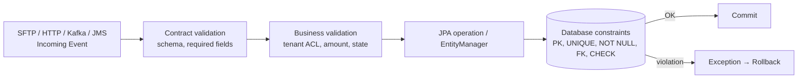
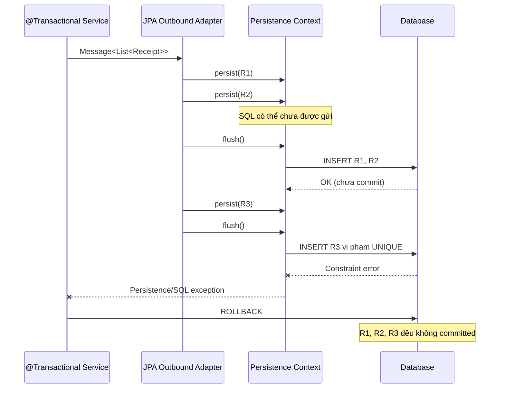
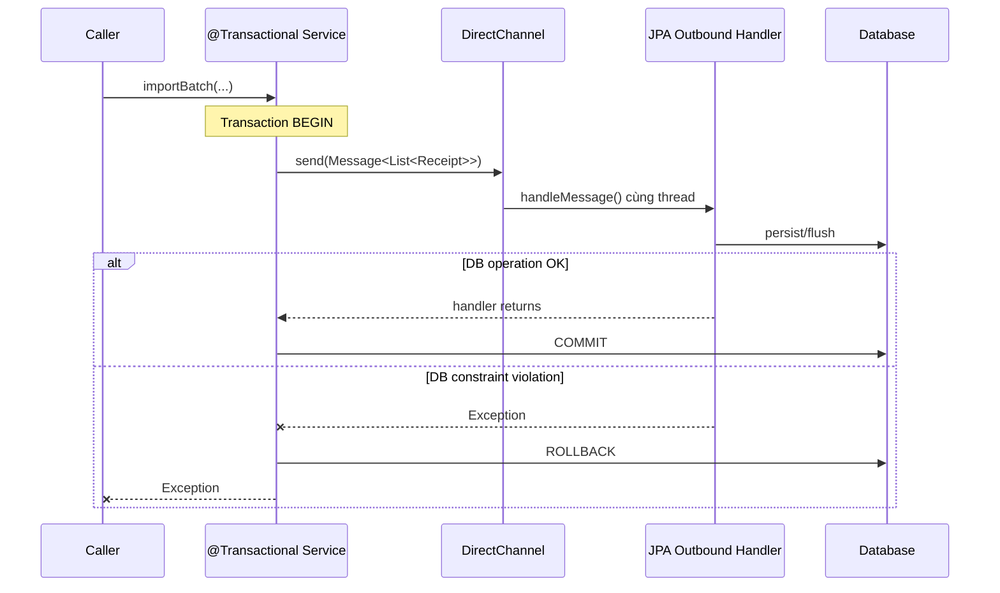
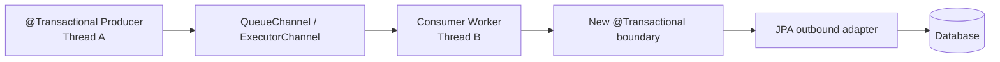
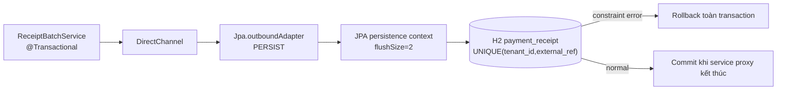
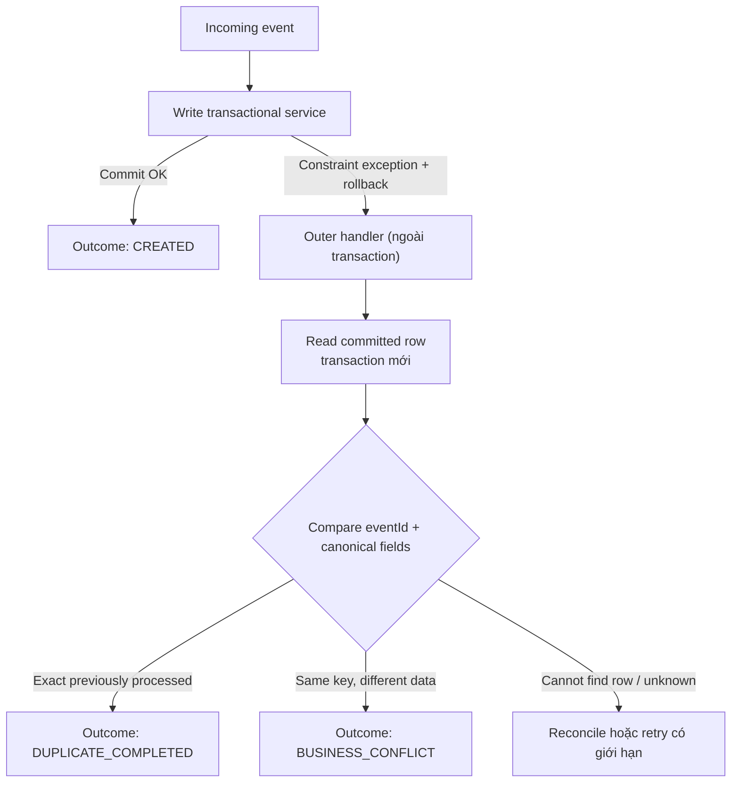
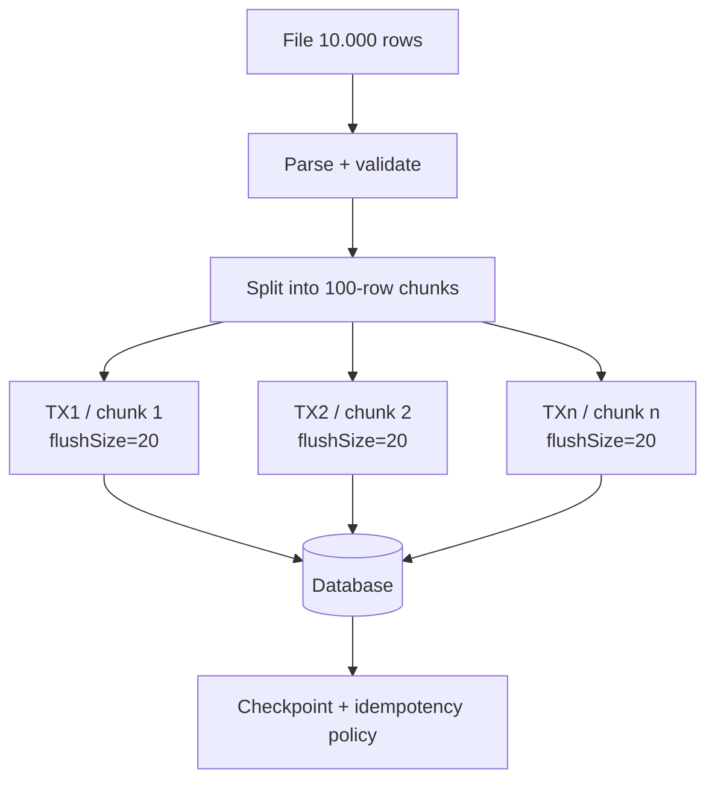
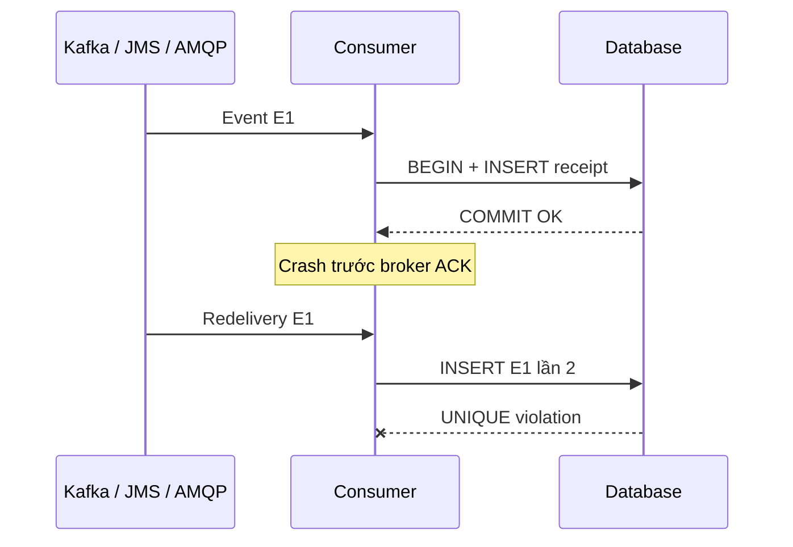
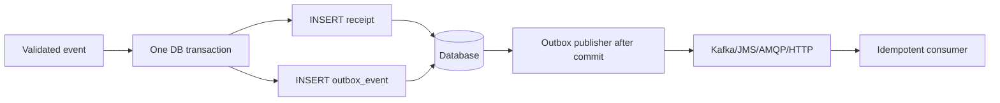
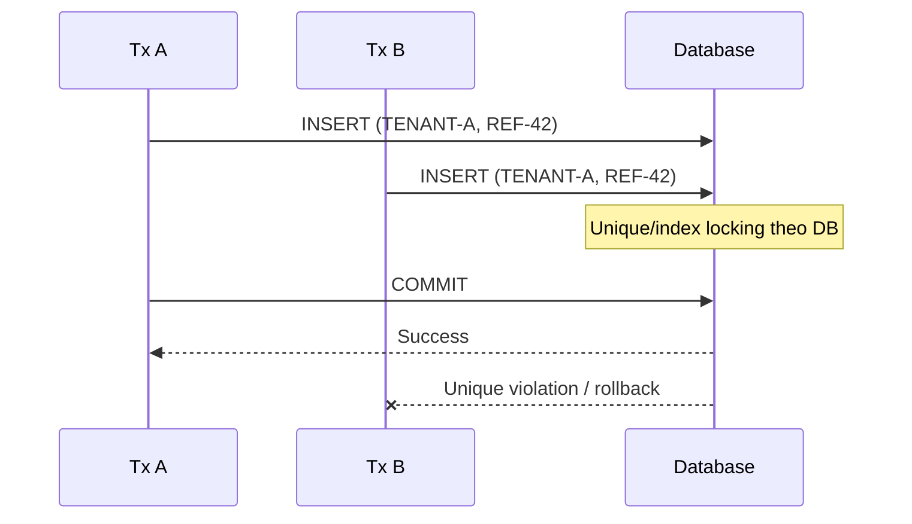

# Xử lý lỗi constraint và rollback

## 1. Bối cảnh và mục tiêu

Trong module **SPRING_INTEGRATION_ADAPTERS**, Spring Integration nối hệ thống bên ngoài vào ứng dụng thông qua inbound/outbound adapter, gateway, poller và `MessageChannel`. Một luồng xử lý thường nhận file qua SFTP, message từ Kafka/JMS/AMQP, HTTP request hoặc entity từ cơ sở dữ liệu, sau đó persist/merge/update/delete bằng **Adapter JPA**.

Khi ghi database, không phải message nào cũng hợp lệ. Dữ liệu có thể trùng khóa nghiệp vụ, thiếu trường bắt buộc, tham chiếu tới một entity không tồn tại, vi phạm CHECK constraint hoặc xung đột version. Một lỗi có thể xảy ra **ngay tại `persist`, trong `flush`, hoặc tận lúc `commit`**. Nếu xử lý sai, ứng dụng có thể:

- Thông báo “thành công” khi transaction thực ra rollback.
- Gửi ACK cho Kafka/JMS rồi mất message chưa lưu.
- Cố tiếp tục dùng Hibernate `Session` đang ở trạng thái lỗi.
- Giữ lại một phần batch dù nghiệp vụ yêu cầu all-or-nothing.
- Retry vô hạn một lỗi dữ liệu vĩnh viễn và làm tắc hàng đợi.
- Nhân đôi tác động khi database đã commit nhưng ACK của broker thất bại.
- Để lộ thông tin nhạy cảm thông qua constraint name hoặc message SQL.

Bài **Xử lý lỗi constraint và rollback** (chương **Adapter JPA**) giải thích từ bản chất database constraint tới cách tổ chức transaction và error handling trong Spring Integration.

Sau bài học, bạn có thể:

1. Phân biệt `PRIMARY KEY`, `UNIQUE`, `NOT NULL`, `FOREIGN KEY` và `CHECK`.
2. Hiểu sự khác nhau giữa **Bean Validation**, validation nghiệp vụ và **ràng buộc tại database**.
3. Nhận biết `jakarta.validation.ConstraintViolationException`, `org.hibernate.exception.ConstraintViolationException`, `DataIntegrityViolationException`, `PersistenceException` và `MessageHandlingException`.
4. Xác định thời điểm lỗi: gọi JPA API, `flush` hoặc `commit`.
5. Hiểu `EntityManager.flush()` **không đồng nghĩa** transaction đã commit.
6. Cấu hình `Jpa.outboundAdapter(...)`, `PersistMode.PERSIST`, `flushSize` và transaction tại đúng boundary.
7. Thiết kế `@Transactional` qua `DirectChannel`, poller và consumer bất đồng bộ.
8. Thử nghiệm một `List<Entity>` có phần tử cuối trùng unique key để chứng minh **rollback toàn transaction**, kể cả các phần tử đã flush.
9. Không nuốt lỗi database rồi tiếp tục trong cùng persistence context.
10. Phân loại **permanent invalid data**, duplicate/idempotent event, optimistic conflict và transient infrastructure failures.
11. Thiết kế checkpoint/chunk transaction, retry/backoff, poison message, error channel và DLQ.
12. Phân biệt DB commit với ACK của Kafka/JMS, HTTP response và `MessageChannel.send(...)`.
13. Kiểm thử trên Spring Boot 3.x, Spring Integration 6.x, Jakarta Persistence và H2; biết giới hạn của H2 so với database production.

> **Nguyên tắc:** database constraint là **tuyến phòng thủ cuối** đảm bảo tính toàn vẹn dữ liệu. Khi một thao tác JPA thất bại vì constraint/persistence error, hãy để transaction rollback, kết thúc persistence context đó và chỉ thực hiện kiểm tra/khôi phục trong **transaction mới** theo chính sách nghiệp vụ.

## 2. Các lớp validation và constraint

### 2.1. Một ví dụ thực tế

Ứng dụng nhận sự kiện thanh toán:

```json
{
  "eventId": "evt-1041",
  "tenantId": "TENANT-A",
  "externalRef": "PAY-2026-042",
  "amount": 125000.00
}
```

Cơ sở dữ liệu lưu bảng `payment_receipt`. Business rules:

- `eventId` là primary key, không được trùng.
- `tenantId`, `externalRef` và `amount` không được null.
- Cặp `(tenantId, externalRef)` là một **business unique key**.
- `amount > 0`.
- Nếu có `accountId`, nó phải tham chiếu một account tồn tại và được phép sử dụng.
- Khi cùng event được gửi lại, hệ thống phải phân biệt **duplicate đã xử lý** với **cùng externalRef nhưng dữ liệu mâu thuẫn**.

Có ba tầng kiểm tra:



**Đừng chọn một tầng rồi bỏ hết các tầng còn lại:**

- API/Bean Validation trả lỗi rõ ràng, sớm, không tốn transaction vô ích.
- Business validation kiểm tra quyền, trạng thái và chính sách domain.
- DB constraints chống race conditions và code paths bỏ qua service validation.

### 2.2. Các loại constraint thường gặp

| Loại | Ví dụ | Hành vi khi vi phạm |
| --- | --- | --- |
| `PRIMARY KEY` | Hai rows cùng `event_id` | Reject INSERT/UPDATE trùng khóa |
| `UNIQUE` | Hai receipts cùng `(tenant_id, external_ref)` | Reject record trùng theo uniqueness semantics của DB |
| `NOT NULL` | `amount = null` | Reject null; JPA provider cũng có thể kiểm tra trước DB |
| `FOREIGN KEY` | `account_id` không tồn tại | Reject thao tác phá vỡ tham chiếu |
| `CHECK` | `amount > 0` | Reject giá trị không thỏa biểu thức (theo DB) |
| Column length/precision | `VARCHAR(80)`, `DECIMAL(12,2)` | Có thể reject/truncate tùy DB/schema/settings; không mặc nhiên an toàn |
| `@Version` | Concurrent stale entity | Optimistic locking conflict; **không phải** SQL unique constraint |
| Application allowlist | `status ∈ {NEW,DONE}` | Service validation, có thể bổ sung DB CHECK |

**Cảnh báo:** `UNIQUE` trên cột nullable có semantics khác nhau giữa các database về số giá trị null cho phép. Nếu uniqueness phải áp trên một business key bắt buộc, khai **NOT NULL + UNIQUE** tường minh.

### 2.3. Chỉ SELECT xem tồn tại chưa là chưa đủ

Cách làm dễ race:

```java
if (!repository.existsByTenantIdAndExternalRef(
        tenantId, externalRef)) {
    repository.save(receipt);
}
```

Hai workers có thể cùng nhận `exists=false` rồi cùng INSERT. Một transaction/SELECT thông thường không tạo “quyền insert duy nhất”. **Unique constraint trong DB mới đảm bảo chỉ một record hợp lệ** theo key đó.

Có thể dùng atomic insert/upsert của database hoặc inbox/idempotency table, nhưng mọi nhánh phải xử lý conflict outcome trong transaction đúng.

### 2.4. Validation không phải authorization

Một payload có `tenantId="TENANT-A"` là dữ liệu, **không chứng minh caller thuộc tenant A**. Kiểm tra tenant từ authenticated principal hoặc server-side ACL trước JPA. Nếu client tự quyết định tenant, ràng buộc UNIQUE và NOT NULL vẫn có thể hợp lệ mà ứng dụng **đang ghi dữ liệu sai quyền**.

## 3. Bean Validation khác database constraint

### 3.1. Bean Validation ở Java

Jakarta Validation hỗ trợ:

```java
import jakarta.validation.constraints.NotBlank;
import jakarta.validation.constraints.NotNull;
import jakarta.validation.constraints.Positive;

public record ReceiptCommand(
        @NotBlank String eventId,
        @NotBlank String tenantId,
        @NotBlank String externalRef,
        @NotNull @Positive BigDecimal amount) {
}
```

Để dùng validation trực tiếp trong Spring Boot 3.x, có thể thêm dependency `spring-boot-starter-validation` và gọi `Validator` hoặc dùng `@Valid` tại boundary phù hợp.

- `@NotBlank` kiểm tra string khác null/blank.
- `@NotNull` kiểm tra khác null.
- `@Positive` kiểm tra số dương.
- `@Valid` trên HTTP controller/messaging handler không tự áp ở mọi message flow nếu không cấu hình validation phù hợp.

### 3.2. JPA mappings và DB constraints

```java
@Column(name = "external_ref", nullable = false, length = 80)
private String externalRef;
```

`@Column(nullable=false)` thể hiện metadata mapping và có thể ảnh hưởng schema generation/provider validation. Nó **không nên là cơ chế duy nhất** để đảm bảo production DB thực có NOT NULL: hãy quản lý DDL bằng migrations và xác minh schema.

`@Table(uniqueConstraints=...)` có thể tạo unique constraint trong demo `hibernate.ddl-auto=create-drop`, nhưng production nên quản lý constraint bằng Flyway/Liquibase và không tự ý auto-update schema.

### 3.3. Hai ConstraintViolationException là hai lỗi khác nhau

Rất dễ nhầm hai class trùng tên:

| Exception | Package | Thường đến từ |
| --- | --- | --- |
| `ConstraintViolationException` | `jakarta.validation.ConstraintViolationException` | Bean Validation: `@NotNull`, `@Positive`, `@Size` |
| `ConstraintViolationException` | `org.hibernate.exception.ConstraintViolationException` | Hibernate ORM wrap JDBC/SQL integrity constraint violation |
| `DataIntegrityViolationException` | `org.springframework.dao.DataIntegrityViolationException` | Spring DAO/ORM exception translation; có thể wrap violation từ DB |

Ví dụ `@NotBlank` bị lỗi có thể tạo danh sách `ConstraintViolation<?>` mô tả field. Trong khi một database unique constraint có thể tạo `SQLException`, Hibernate ORM `ConstraintViolationException` và lớp bao ngoài của Spring/Integration.

**Không viết:**

```java
catch (ConstraintViolationException ex) {
    // Không rõ bạn đang bắt Bean Validation hay Hibernate ORM!
}
```

Hãy dùng import chính xác hoặc fully qualified name, rồi phân loại theo nguồn và ý nghĩa nghiệp vụ.

### 3.4. CHECK tại database

Một ví dụ DDL (tùy DB dialect):

```sql
alter table payment_receipt
add constraint ck_receipt_amount_positive
check (amount > 0);
```

Đây là **ví dụ migration bổ sung** chứ không phải file cần tạo trong bài học. `@Positive` ở DTO giúp trả lỗi sớm, nhưng CHECK bảo vệ DB nếu một producer hoặc batch import khác bỏ qua validation.

### 3.5. FK và orphan/deletion

Nếu receipt tham chiếu account:

```sql
alter table payment_receipt
add constraint fk_receipt_account
foreign key (account_id)
references account(account_id);
```

Trước khi bật FK trong production, xác minh dữ liệu legacy, index, cascade/delete policy và tenant scope. `accountId` tồn tại không đồng nghĩa user được phép ghi vào account đó.

## 4. Từ JPA API tới database: lỗi xuất hiện khi nào?

### 4.1. Không có một thời điểm cố định cho mọi constraint

Một transaction có thể đi qua:



Tùy provider/ID generation/flush mode/database:

- `persist(...)` có thể phát SQL ngay (ví dụ IDENTITY) hoặc chỉ đưa entity vào persistence context.
- `flush()` thường làm provider thực thi pending INSERT/UPDATE/DELETE, nên lỗi NOT NULL/UNIQUE/FK có thể xuất hiện ở đây.
- `commit()` thường buộc flush nếu cần, rồi DB commit; **deferred constraints** hoặc concurrency errors có thể chỉ xuất hiện ở commit.
- `merge(...)` có thể kiểm tra entity state/version sớm nhưng vẫn phải flush/commit để biết transaction thành công.

Không khẳng định “sẽ lỗi chính xác tại persist” hay “mọi lỗi xuất hiện tại flush” nếu chưa kiểm thử provider/database cụ thể.

### 4.2. flush không phải commit

```java
@Transactional
public void saveAndFail(PaymentReceipt receipt) {
    entityManager.persist(receipt);
    entityManager.flush();  // INSERT có thể đã chạy.
    throw new IllegalStateException("fail after flush");
}
```

Transaction rollback khi runtime exception thoát qua Spring transactional proxy. DB **không còn row mới** dù SQL INSERT đã xuất hiện trong log. `flush` đồng bộ thay đổi với database **bên trong transaction**, không có nghĩa dữ liệu durable.

### 4.3. Commit cũng có thể thất bại

Giả sử service hoàn thành body rồi trả `true`:

```java
@Transactional
public boolean importReceipt(PaymentReceipt receipt) {
    channel.send(MessageBuilder.withPayload(receipt).build());
    return true;
}
```

Transaction interceptor có thể gọi commit **sau khi body method đã return**, rồi ném exception nếu flush/commit thất bại. Caller bên ngoài proxy **không nhận success bình thường** trong trường hợp commit ném lỗi. Tuy nhiên, nếu application đã gửi network event ra hệ thống ngoài **bên trong method trước commit**, external side effect có thể đã xảy ra và không tự rollback.

### 4.4. clear() không phục hồi transaction lỗi

`EntityManager.clear()` detach mọi entity trong persistence context; nó không rollback hoặc sửa transaction đã bị DB/provider đánh dấu thất bại. Không dùng:

```java
try {
    entityManager.flush();
} catch (PersistenceException ex) {
    entityManager.clear();
    // Sai: tiếp tục persist trong cùng transaction sau lỗi DB.
}
```

Với Hibernate, sau exception persistence/JDBC nghiêm trọng, nên **rollback, kết thúc Session/EntityManager hiện hành**, và bắt đầu unit of work mới. Spring-managed transaction/EntityManager sẽ được framework dọn dẹp theo lifecycle; không tự `close()` injected transactional proxy dùng chung.

### 4.5. Rollback không “undo” Java object state

Khi transaction rollback:

- SQL chưa commit bị database rollback.
- Java object `receipt` có thể vẫn giữ field đã được set.
- `@GeneratedValue`/version/identifier trong object có thể đã bị thay trước rollback.
- Entity bị detach sau transaction; không nên tự reuse object đó như managed entity mới.
- Kafka/HTTP side effects đã xảy ra không được database rollback.
- DB sequences/identity counters thường không rollback giống row data; gaps trong IDs có thể bình thường.

Nếu cần retry, hãy tạo **command/snapshot mới** và dùng transaction mới, không phụ thuộc vào trạng thái persistence context đã lỗi.

## 5. Exception taxonomy và cách quan sát cause chain

### 5.1. Các lớp lỗi thường gặp

| Exception | Thường mang ý nghĩa | Hành vi gợi ý |
| --- | --- | --- |
| `jakarta.validation.ConstraintViolationException` | Bean validation của field/record/entity | Trả lỗi input, không retry mù quáng |
| `org.hibernate.PropertyValueException` | Nullability/association property bất hợp lệ theo Hibernate | Lỗi dữ liệu/mapping, kiểm tra contract |
| `org.hibernate.exception.ConstraintViolationException` | SQL/DB integrity constraint | Xác định unique/FK/NOT NULL/CHECK theo DB metadata |
| `org.springframework.dao.DataIntegrityViolationException` | Spring đã dịch lỗi integrity violation | Phân loại business conflict, dừng transaction |
| `org.springframework.dao.DuplicateKeyException` | Một phân loại cụ thể của duplicate key (khi translation nhận ra) | Không giả định JPA luôn dịch ra class này |
| `jakarta.persistence.PersistenceException` | JPA provider-level failure | Rollback, tra cause |
| `jakarta.persistence.OptimisticLockException` | Version check thất bại | Conflict/retry theo domain |
| `org.springframework.orm.ObjectOptimisticLockingFailureException` | Spring optimistic failure | Không phải UNIQUE violation |
| `org.springframework.transaction.UnexpectedRollbackException` | Transaction đã bị mark rollback-only nhưng outer cố commit | Tìm lỗi gốc đã bị catch/che |
| `org.springframework.transaction.TransactionSystemException` | Lỗi hệ thống transaction/commit | Tra root causes và trạng thái commit |
| `org.springframework.messaging.MessageHandlingException` | Handler trong message flow thất bại, có thể wrap JPA exception | Tra cause chain, không chỉ top-level |
| `org.springframework.messaging.MessagingException` | Messaging infrastructure error | Có thể không liên quan database |

**Exception translation không có một shape cố định:** loại top-level phụ thuộc provider, translator, JPA transaction manager, transaction advice và message endpoint. Một `DataIntegrityViolationException` có thể xuất hiện trực tiếp, hoặc là cause của `MessageHandlingException`.

### 5.2. Phân loại bằng cause chain, không parse SQL text cho business rule

Một utility phục vụ logging/diagnostics:

```java
public final class FailureClassifier {

    private FailureClassifier() {
    }

    public static boolean isIntegrityViolation(Throwable failure) {
        for (Throwable cursor = failure;
                cursor != null;
                cursor = cursor.getCause()) {

            if (cursor instanceof
                    org.springframework.dao.DataIntegrityViolationException
                    || cursor instanceof
                    org.hibernate.exception.ConstraintViolationException
                    || cursor instanceof
                    org.hibernate.PropertyValueException
                    || cursor instanceof
                    jakarta.validation.ConstraintViolationException) {
                return true;
            }
        }
        return false;
    }

    public static boolean isOptimisticConflict(Throwable failure) {
        for (Throwable cursor = failure;
                cursor != null;
                cursor = cursor.getCause()) {

            if (cursor instanceof
                    jakarta.persistence.OptimisticLockException
                    || cursor instanceof
                    org.springframework.dao.OptimisticLockingFailureException) {
                return true;
            }
        }
        return false;
    }
}
```

Đây là **utility phân loại tổng quát**, không đủ để kết luận một duplicate là đã xử lý đúng. Để xác định UNIQUE key nào vi phạm, cần constraint name/SQLState/vendor error code và **hợp đồng DB schema**. Với SQLState, ví dụ PostgreSQL `23505` thường là unique violation, nhưng không nên phụ thuộc code này trên mọi DB mà không có abstraction/test.

### 5.3. Không cho client thấy SQL/constraint details

**Không nên:**

```json
{
  "error": "uk_receipt_scope_ref duplicate key ... TENANT-A PAY-123"
}
```

Thông tin này có thể lộ tenant IDs, internal table/constraint names hoặc dữ liệu cá nhân. Public API nên trả mã lỗi có nghĩa, ví dụ `DUPLICATE_REFERENCE` hoặc `INVALID_ACCOUNT`, sau khi authorization và reconciliation phù hợp. Logs nội bộ phải mask PII/SQL bind values.

### 5.4. Constraint name có ích nhưng không phải business authority

Trong Hibernate ORM, `ConstraintViolationException#getConstraintName()` đôi khi cho biết tên constraint; có database/driver trả null hoặc tên khác kỳ vọng. Dùng mapping đã được kiểm thử giữa tên constraint và error code, **không** mở quyền truy cập hoặc kết luận event đã xử lý chỉ từ một chuỗi tên constraint.

## 6. Spring transaction rollback rules

### 6.1. @Transactional mặc định

Với Spring Framework 6.x, `@Transactional` thông thường:

- Propagation: `REQUIRED`.
- Isolation: default của hệ thống.
- Rollback khi `RuntimeException` hoặc `Error` thoát ra.
- Checked `Exception` không tự rollback theo **mặc định truyền thống**, trừ khi khai `rollbackFor` hoặc cấu hình default rollback rules khác.

Một số phiên bản Spring Framework mới cho phép thay default rollback policy toàn ứng dụng; nếu dùng cơ chế đó, cần kiểm tra cấu hình thực tế. Ở mức codebase dễ đọc, các use case có checked business exception nên ghi quy tắc rõ:

```java
@Transactional(rollbackFor = Exception.class)
public void importBatch(...) throws ImportRejectedException {
    // ...
}
```

Nếu `ImportRejectedException` là checked exception, `rollbackFor` giúp rollback theo contract. Nhưng nếu muốn lỗi validation nghiệp vụ **không mở transaction**, nên validate trước khi gọi transactional service.

### 6.2. Một exception bị catch có thể khiến outer commit thất bại

```java
@Service
class InnerWriter {

    @Transactional
    public void write() {
        throw new IllegalStateException("write failed");
    }
}

@Service
class OuterOrchestrator {

    private final InnerWriter inner;

    OuterOrchestrator(InnerWriter inner) {
        this.inner = inner;
    }

    @Transactional
    public void run() {
        try {
            inner.write();
        } catch (IllegalStateException ex) {
            // Sai: nuốt lỗi inner và trả như thành công.
        }
    }
}
```

Vì `InnerWriter.write` đi qua transactional proxy với propagation `REQUIRED`, inner advice có thể đánh dấu transaction chung **rollback-only**. Outer cố commit sẽ nhận `UnexpectedRollbackException`. Nếu code nuốt lỗi SQL và provider đã mark rollback-only, kết quả có thể tương tự.

**Cách đúng:** phân loại lỗi **ngoài transaction đã thất bại**, để rollback hoàn tất rồi mới retry/reconcile trong transaction mới. Đừng dùng `noRollbackFor=DataIntegrityViolationException.class` để cố “lưu các rows còn lại” sau lỗi provider/DB, vì persistence context/transaction có thể không còn sử dụng được.

### 6.3. Self-invocation không mở transaction mới

```java
@Service
class BrokenService {

    public void run() {
        importChunk();   // this.importChunk(): bỏ qua proxy trong mode mặc định.
    }

    @Transactional
    public void importChunk() {
        // JPA write...
    }
}
```

Trong Spring proxy mode thông thường, lời gọi từ cùng instance không đi qua interceptor. Đưa method `@Transactional` sang bean khác rồi gọi qua proxy, hoặc dùng `TransactionTemplate` đúng lúc.

### 6.4. REQUIRES_NEW và partial commit

`REQUIRES_NEW` mở transaction độc lập, tạm dừng transaction ngoài. Nếu mỗi chunk gọi worker với `REQUIRES_NEW` và commit thành công, chunk trước **không rollback** khi chunk sau lỗi. Đây có thể là yêu cầu nghiệp vụ, nhưng không tương đương all-or-nothing cho một file. Ngoài ra, `REQUIRES_NEW` có thể cần thêm DB connection trong lúc outer transaction đang giữ connection, nên phải kiểm soát pool size/concurrency.

### 6.5. RollbackOnly dùng khi thật sự cần

```java
TransactionAspectSupport.currentTransactionStatus()
        .setRollbackOnly();
```

Đây là cơ chế Spring để yêu cầu rollback thủ công trong transaction hiện tại; thường kém rõ hơn việc ném exception có nghĩa. Không gọi nó ở một chỗ rồi trả `success=true` cho caller. Cần contract outcome thống nhất cho HTTP/broker.

## 7. Boundary của MessageChannel quyết định rollback lan đến đâu

### 7.1. DirectChannel đồng bộ



Khi `DirectChannel` dispatch đồng bộ trên caller thread, JPA handler có thể tham gia transaction do caller `@Transactional` mở, nếu dùng cùng `EntityManagerFactory`/transaction manager. Một constraint exception được propagate qua handler làm proxy rollback.

**`MessageChannel.send() == true`** không chứng minh database đã commit; nó xác nhận message được channel tiếp nhận/xử lý theo semantics tương ứng. Với transaction ngoài, commit còn ở phía sau.

### 7.2. ExecutorChannel/QueueChannel



- Transaction gắn thread producer **không tự truyền** sang consumer khác thread.
- Producer có thể nhận `send()==true` trước khi consumer chạy.
- JPA write cần transaction **ở consumer**; dùng endpoint advice hoặc một service transactional được gọi trong thread B.
- Lỗi consumer cần error channel/retry/DLQ; không mặc định throw về producer.
- Không để producer ACK source message trước khi xác định outcome mà contract yêu cầu.

### 7.3. Poller transaction

JPA inbound poller/file poller có thể cấu hình transaction quanh receive-and-forward đồng bộ:

```java
Pollers.fixedDelay(Duration.ofSeconds(2))
        .maxMessagesPerPoll(1)
        .transactional();
```

Nếu downstream là `DirectChannel` và consumer lỗi, transaction poller có thể rollback; nếu gửi sang `QueueChannel`, phần xử lý phía consumer sẽ nằm ở transaction khác.

**Đặc biệt:** transaction poller làm rollback **database state** trong phạm vi transaction đó; không tự undo file đã rename, HTTP request đã gửi, Kafka record đã được broker nhận.

### 7.4. Error channel không thay transaction manager

Spring Integration dùng `ErrorMessage` và `errorChannel` để đưa lỗi tới error-handling flow, đặc biệt trong các ranh giới asynchronous. Nhưng **gửi một ErrorMessage không tự rollback transaction**:

- Trong synchronous call, exception có thể được throw lên caller; nếu catch/nuốt sai, rollback policy đổi.
- Trong async task, exception được đưa tới error handler; transaction phía consumer phải được đánh dấu rollback theo cấu hình.
- Một error handler ném/không ném lại exception có thể ảnh hưởng ACK/retry semantics của inbound adapter.
- Error channel của Spring Integration khác với DLQ bền vững của Kafka/JMS/AMQP.

Luôn viết integration test kiểm chứng **DB state sau lỗi**, không chỉ assert một ErrorMessage đã được gửi.

## 8. JpaExecutor và các JPA endpoint khi gặp constraint

| Endpoint | Input | Reply | Ghi DB/constraint xử lý |
| --- | --- | --- | --- |
| JPA outbound channel adapter | Entity hoặc `Iterable<Entity>`, hoặc JPQL command | Không trả reply | `persist/merge/delete`, JPQL UPDATE; exception khi lỗi |
| JPA updating outbound gateway | Entity/command | Entity hoặc affected count tùy mode | Có result; lỗi vẫn có thể xuất hiện ở outer commit |
| JPA retrieving outbound gateway | Request query | Entity/DTO/list | SELECT không sửa dữ liệu thông thường, nhưng auto-flush có thể phát hiện pending constraint |
| JPA inbound channel adapter | Poller tick | Message từ source | SELECT, tùy deleteAfterPoll có thể DELETE và gặp FK constraint |
| `JpaExecutor` | Core execution | Phụ thuộc operation | `flush`, `flushSize`, `clearOnFlush` được cấu hình theo mode |

### 8.1. Entity mode và PersistMode

```java
Jpa.outboundAdapter(entityManagerFactory)
        .entityClass(PaymentReceipt.class)
        .persistMode(PersistMode.PERSIST);
```

`PersistMode.PERSIST` tạo entity mới; nếu PK/UNIQUE trùng có thể bị từ chối. `PersistMode.MERGE` là default của một số JPA endpoint entity mode, có semantics khác: merge một detached entity có thể cập nhật row đã tồn tại thay vì reject duplicate theo id. **Đừng xem MERGE là xử lý idempotency an toàn** nếu command có thể sửa các fields không mong muốn.

### 8.2. flushSize, flush và clearOnFlush

```java
Jpa.outboundAdapter(entityManagerFactory)
        .entityClass(PaymentReceipt.class)
        .persistMode(PersistMode.PERSIST)
        .flushSize(2)
        .clearOnFlush(true);
```

- `flushSize(2)` flush persistence context trong xử lý `Iterable` sau các nhóm entity và sau vòng lặp theo implementation.
- `flushSize > 0` có ưu tiên so với `flush` flag.
- `clearOnFlush(true)` clear persistence context **sau lần flush thực tế**, detach mọi managed entities trong context, không chỉ phần batch.
- Với entity đơn không phải Iterable, `flushSize > 0` cũng có thể buộc flush.
- **Không một thuộc tính nào ở đây tự tạo transaction, commit mỗi N entities hay ACK broker.**

Nếu item thứ ba vi phạm UNIQUE khi các item 1–2 đã flush, toàn transaction vẫn rollback nếu chúng cùng transaction.

### 8.3. JPQL UPDATE và affected-row count

JPQL bulk UPDATE có thể được dùng trong updating outbound gateway:

```java
Jpa.updatingGateway(entityManagerFactory)
        .jpaQuery("""
                update PaymentReceipt r
                   set r.status = 'DONE'
                 where r.id = :id
                   and r.status = 'NEW'
                """)
        .parameterExpression("id", "payload");
```

Đây là fragment cho mô hình entity có `status` (không có trong entity demo cơ bản ở mục 10). Với JPQL UPDATE, gateway trả affected-row count, **không tự ném UNIQUE violation khi row không match**. `0` thường là business no-match/conflict, không phải lỗi constraint.

### 8.4. JPA query có thể auto-flush trước SELECT

Nếu một transaction đã persist entity không hợp lệ rồi gọi JPA retrieving query, provider có thể auto-flush pending INSERT trước SELECT theo flush mode. Khi đó lỗi unique/NOT NULL có thể xuất hiện **trong lúc chạy retrieving gateway**, dù đoạn code gây lỗi nằm ở JPA write trước đó. Đừng chẩn đoán chỉ dựa vào tên endpoint nơi stack trace dừng lại.

## 9. Ví dụ hoàn chỉnh: batch persist với UNIQUE constraint và rollback

### 9.1. Yêu cầu thực hành

Xây một Spring Boot application:

1. Mỗi `PaymentReceipt` có `eventId` làm primary key.
2. `(tenantId, externalRef)` là unique key.
3. Spring Integration `DirectChannel` nhận **một `List<PaymentReceipt>`** trong một message.
4. JPA outbound channel adapter dùng `PERSIST`, `flushSize(2)`, `clearOnFlush(true)`.
5. Service `@Transactional` gọi channel, transaction bao quanh cả batch.
6. Ba receipts hợp lệ được persist và commit.
7. Batch khác gồm hai receipts hợp lệ rồi một receipt trùng unique key, khiến transaction rollback toàn bộ.
8. Không gửi network event hay ACK broker trong demo, để quan sát đúng DB atomicity.
9. Unit/integration tests xác minh DB sau commit/rollback.

Luồng:



### 9.2. Maven dependencies

Ví dụ dùng Java 17+, Spring Boot 3.x và Spring Integration 6.x:

```xml
<dependencies>
    <dependency>
        <groupId>org.springframework.boot</groupId>
        <artifactId>spring-boot-starter</artifactId>
    </dependency>
    <dependency>
        <groupId>org.springframework.boot</groupId>
        <artifactId>spring-boot-starter-integration</artifactId>
    </dependency>
    <dependency>
        <groupId>org.springframework.integration</groupId>
        <artifactId>spring-integration-jpa</artifactId>
    </dependency>
    <dependency>
        <groupId>org.springframework.boot</groupId>
        <artifactId>spring-boot-starter-data-jpa</artifactId>
    </dependency>
    <dependency>
        <groupId>org.springframework.boot</groupId>
        <artifactId>spring-boot-starter-validation</artifactId>
    </dependency>
    <dependency>
        <groupId>com.h2database</groupId>
        <artifactId>h2</artifactId>
        <scope>runtime</scope>
    </dependency>
    <dependency>
        <groupId>org.springframework.boot</groupId>
        <artifactId>spring-boot-starter-test</artifactId>
        <scope>test</scope>
    </dependency>
</dependencies>
```

Để bảo đảm các versions tương thích, dùng Spring Boot BOM. Jakarta Persistence dùng `jakarta.persistence`, không dùng `javax.persistence` cho ứng dụng Spring Boot 3.

### 9.3. PaymentReceipt entity

File `PaymentReceipt.java`:

```java
package com.example.jpaerrors;

import java.math.BigDecimal;

import jakarta.persistence.Column;
import jakarta.persistence.Entity;
import jakarta.persistence.Id;
import jakarta.persistence.Table;
import jakarta.persistence.UniqueConstraint;

@Entity
@Table(
        name = "payment_receipt",
        uniqueConstraints = @UniqueConstraint(
                name = "uk_receipt_tenant_ref",
                columnNames = {"tenant_id", "external_ref"}))
public class PaymentReceipt {

    @Id
    @Column(name = "receipt_id", nullable = false, length = 80)
    private String id;

    @Column(name = "tenant_id", nullable = false, length = 80)
    private String tenantId;

    @Column(name = "external_ref", nullable = false, length = 80)
    private String externalRef;

    @Column(name = "amount", nullable = false,
            precision = 15, scale = 2)
    private BigDecimal amount;

    protected PaymentReceipt() {
        // Required by Jakarta Persistence.
    }

    public PaymentReceipt(
            String id, String tenantId, String externalRef,
            BigDecimal amount) {
        this.id = id;
        this.tenantId = tenantId;
        this.externalRef = externalRef;
        this.amount = amount;
    }

    public String getId() {
        return id;
    }

    public String getTenantId() {
        return tenantId;
    }

    public String getExternalRef() {
        return externalRef;
    }

    public BigDecimal getAmount() {
        return amount;
    }
}
```

Trong demo, constraint này được H2 tạo khi Hibernate chạy DDL. Trên production, migration phải định nghĩa unique key thật; không tin `@Table(uniqueConstraints)` đã cập nhật DB lâu năm mà không có migration.

**Quan hệ với idempotency:** `eventId` là khóa kỹ thuật duy nhất, `(tenantId, externalRef)` là khóa nghiệp vụ. Nếu cùng externalRef được gửi hai lần với **khác amount**, không tự ghi đè row bằng `MERGE`; cần phát hiện conflict để điều tra.

### 9.4. Repository

File `PaymentReceiptRepository.java`:

```java
package com.example.jpaerrors;

import java.util.Optional;

import org.springframework.data.jpa.repository.JpaRepository;

public interface PaymentReceiptRepository
        extends JpaRepository<PaymentReceipt, String> {

    Optional<PaymentReceipt> findByTenantIdAndExternalRef(
            String tenantId, String externalRef);
}
```

Repository dùng cho queries/verification và reconciliation **trong transaction mới sau lỗi**. Nó không đảm bảo tránh race nếu ứng dụng gọi `findByTenantIdAndExternalRef` rồi INSERT ở transaction khác; database unique constraint vẫn là nguồn quyết định cuối.

### 9.5. IntegrationFlow với DirectChannel và JPA outbound adapter

File `ReceiptIntegrationConfiguration.java`:

```java
package com.example.jpaerrors;

import jakarta.persistence.EntityManagerFactory;

import org.springframework.context.annotation.Bean;
import org.springframework.context.annotation.Configuration;
import org.springframework.integration.channel.DirectChannel;
import org.springframework.integration.config.EnableIntegration;
import org.springframework.integration.dsl.IntegrationFlow;
import org.springframework.integration.jpa.dsl.Jpa;
import org.springframework.integration.jpa.support.PersistMode;
import org.springframework.messaging.MessageChannel;

@Configuration
@EnableIntegration
public class ReceiptIntegrationConfiguration {

    @Bean
    MessageChannel receiptImportRequests() {
        return new DirectChannel();
    }

    @Bean
    IntegrationFlow receiptImportFlow(
            EntityManagerFactory entityManagerFactory) {

        return IntegrationFlow
                .from("receiptImportRequests")
                .handle(
                        Jpa.outboundAdapter(entityManagerFactory)
                                .entityClass(PaymentReceipt.class)
                                .persistMode(PersistMode.PERSIST)
                                .flushSize(2)
                                .clearOnFlush(true))
                .get();
    }
}
```

- `DirectChannel` dispatch message đồng bộ.
- JPA outbound adapter **một chiều**, không trả reply.
- `PERSIST` dùng cho rows mới; không upsert ngầm.
- `flushSize(2)` kích hoạt flush giữa batch, giúp thấy lỗi trước commit trong nhiều trường hợp; không tự commit hai rows.
- `clearOnFlush(true)` detach các entities đã managed, giảm first-level cache; **nó clear toàn bộ persistence context**, không riêng batch. Không bật bừa nếu service cần tiếp tục sửa managed entities khác.
- Transaction do service mở, vì adapter này **không tự định nghĩa transaction boundary** chỉ nhờ `flushSize`.

### 9.6. Service @Transactional

File `ReceiptBatchService.java`:

```java
package com.example.jpaerrors;

import java.math.BigDecimal;
import java.util.List;

import org.springframework.beans.factory.annotation.Qualifier;
import org.springframework.messaging.MessageChannel;
import org.springframework.messaging.support.MessageBuilder;
import org.springframework.stereotype.Service;
import org.springframework.transaction.annotation.Transactional;

@Service
public class ReceiptBatchService {

    private final MessageChannel channel;

    public ReceiptBatchService(
            @Qualifier("receiptImportRequests")
            MessageChannel channel) {
        this.channel = channel;
    }

    @Transactional
    public void importBatch(List<PaymentReceipt> receipts) {
        if (receipts == null || receipts.isEmpty()) {
            throw new IllegalArgumentException("Empty batch");
        }

        if (receipts.size() > 100) {
            throw new IllegalArgumentException("Batch too large");
        }

        for (PaymentReceipt receipt : receipts) {
            if (receipt == null
                    || receipt.getId() == null
                    || receipt.getId().isBlank()
                    || receipt.getTenantId() == null
                    || receipt.getTenantId().isBlank()
                    || receipt.getExternalRef() == null
                    || receipt.getExternalRef().isBlank()
                    || receipt.getAmount() == null
                    || receipt.getAmount()
                              .compareTo(BigDecimal.ZERO) <= 0) {
                throw new IllegalArgumentException(
                        "Invalid receipt fields");
            }
        }

        boolean accepted = channel.send(
                MessageBuilder
                        .withPayload(List.copyOf(receipts))
                        .build());

        if (!accepted) {
            throw new IllegalStateException(
                    "Import channel rejected message");
        }

        // Transaction chưa commit tại đây.
        // Spring interceptor commit khi public method kết thúc.
    }
}
```

Service kiểm tra các điều kiện cơ bản trước DB; **không kiểm tra trùng externalRef bằng SELECT** để thay thế constraint. Đó là điểm chủ ý của bài: hai receipts cùng externalRef vẫn vượt qua shape validation, nhưng DB unique constraint sẽ từ chối batch.

`List.copyOf` tạo snapshot phần tử của list (membership), không biến `PaymentReceipt` thành immutable object. Không sửa entity instances từ thread khác khi handler đang chạy.

### 9.7. Application main và H2 properties

File `JpaConstraintApplication.java`:

```java
package com.example.jpaerrors;

import java.math.BigDecimal;
import java.util.List;

import org.springframework.boot.CommandLineRunner;
import org.springframework.boot.SpringApplication;
import org.springframework.boot.autoconfigure.SpringBootApplication;
import org.springframework.context.annotation.Bean;

@SpringBootApplication
public class JpaConstraintApplication {

    public static void main(String[] args) {
        SpringApplication.run(
                JpaConstraintApplication.class, args);
    }

    @Bean
    CommandLineRunner demo(
            ReceiptBatchService service,
            PaymentReceiptRepository repository) {

        return args -> {
            service.importBatch(List.of(
                    new PaymentReceipt(
                            "evt-101", "TENANT-A", "REF-A",
                            new BigDecimal("50.00")),
                    new PaymentReceipt(
                            "evt-102", "TENANT-A", "REF-B",
                            new BigDecimal("75.00")),
                    new PaymentReceipt(
                            "evt-103", "TENANT-A", "REF-C",
                            new BigDecimal("25.00"))));

            System.out.println(
                    "Committed rows: " + repository.count());

            try {
                service.importBatch(List.of(
                        new PaymentReceipt(
                                "evt-201", "TENANT-A", "REF-X",
                                new BigDecimal("10.00")),
                        new PaymentReceipt(
                                "evt-202", "TENANT-A", "REF-Y",
                                new BigDecimal("20.00")),
                        new PaymentReceipt(
                                "evt-203", "TENANT-A", "REF-X",
                                new BigDecimal("30.00"))));
            } catch (RuntimeException ex) {
                System.out.println(
                        "Second batch rejected; transaction rolled back.");
            }

            System.out.println(
                    "Rows after rejected batch: "
                    + repository.count());
        };
    }
}
```

`try/catch` ở đây nằm **ngoài transactional service method**: Spring proxy đã rollback transaction thất bại trước khi trả exception tới `CommandLineRunner`. Không tái sử dụng injected `EntityManager` đang ở trạng thái lỗi; `repository.count()` chạy trong một read operation/transaction mới theo Spring Data default.

File `application.properties`:

```properties
spring.main.web-application-type=none

spring.datasource.url=jdbc:h2:mem:jpa_constraint_demo;DB_CLOSE_DELAY=-1
spring.datasource.driver-class-name=org.h2.Driver
spring.datasource.username=sa
spring.datasource.password=

spring.jpa.hibernate.ddl-auto=create-drop
spring.jpa.open-in-view=false

logging.level.org.springframework.integration=INFO
```

**Chỉ sử dụng H2 in-memory và `create-drop` trong bài tập.** Database production cần migrations, backups, monitoring, query timeouts và permissions.

### 9.8. Kết quả mong đợi

| Giai đoạn | Rows trong database | Giải thích |
| --- | --- | --- |
| Ban đầu | 0 | H2 in-memory mới tạo |
| Batch 1 hợp lệ | 3 | Một transaction commit thành công |
| Batch 2: evt-201, evt-202 flush | Vẫn chỉ 3 **committed** | Hai rows mới chưa commit |
| Batch 2: evt-203 trùng REF-X | Constraint error | Row thứ ba vi phạm unique key |
| Batch 2 rollback | 3 | Không có evt-201/202/203 committed |
| `repository.count()` sau catch ngoài tx | 3 | Không có partial commit |

**Không** xem SQL log `INSERT evt-201` và `INSERT evt-202` là bằng chứng đã commit. Tất cả nằm trong cùng transaction và sẽ rollback nếu phần tử cuối thất bại.

## 10. Integration tests: commit và rollback toàn batch

### 10.1. SpringBootTest dùng database thực

File `ReceiptImportIntegrationTest.java`:

```java
package com.example.jpaerrors;

import static org.assertj.core.api.Assertions.assertThat;
import static org.assertj.core.api.Assertions.assertThatThrownBy;

import java.math.BigDecimal;
import java.util.List;
import java.util.UUID;

import org.junit.jupiter.api.Test;
import org.springframework.beans.factory.annotation.Autowired;
import org.springframework.boot.test.context.SpringBootTest;

@SpringBootTest
class ReceiptImportIntegrationTest {

    @Autowired
    ReceiptBatchService service;

    @Autowired
    PaymentReceiptRepository repository;

    @Test
    void commitsValidBatch() {
        String prefix = "valid-" + UUID.randomUUID();

        service.importBatch(List.of(
                receipt(prefix + "-1", "A-" + prefix),
                receipt(prefix + "-2", "B-" + prefix),
                receipt(prefix + "-3", "C-" + prefix)));

        assertThat(repository.existsById(prefix + "-1")).isTrue();
        assertThat(repository.existsById(prefix + "-2")).isTrue();
        assertThat(repository.existsById(prefix + "-3")).isTrue();
    }

    @Test
    void rollsBackEarlierFlushedRowsWhenLastIsDuplicate() {
        String prefix = "dup-" + UUID.randomUUID();

        assertThatThrownBy(() ->
                service.importBatch(List.of(
                        receipt(prefix + "-1", "REF-A-" + prefix),
                        receipt(prefix + "-2", "REF-B-" + prefix),
                        receipt(prefix + "-3", "REF-A-" + prefix))))
                .isInstanceOf(RuntimeException.class);

        assertThat(repository.existsById(prefix + "-1")).isFalse();
        assertThat(repository.existsById(prefix + "-2")).isFalse();
        assertThat(repository.existsById(prefix + "-3")).isFalse();
    }

    @Test
    void uniqueConstraintIsScopedByTenant() {
        String prefix = "tenant-" + UUID.randomUUID();
        String ref = "REF-" + prefix;

        service.importBatch(List.of(
                new PaymentReceipt(
                        prefix + "-a", "TENANT-A", ref,
                        new BigDecimal("10.00")),
                new PaymentReceipt(
                        prefix + "-b", "TENANT-B", ref,
                        new BigDecimal("20.00"))));

        assertThat(repository.existsById(prefix + "-a")).isTrue();
        assertThat(repository.existsById(prefix + "-b")).isTrue();
    }

    @Test
    void rejectsInvalidInputBeforeDatabaseWrite() {
        assertThatThrownBy(() ->
                service.importBatch(List.of(
                        new PaymentReceipt(
                                "invalid-" + UUID.randomUUID(),
                                "TENANT-A", " ",
                                new BigDecimal("1.00")))))
                .isInstanceOf(IllegalArgumentException.class);
    }

    private static PaymentReceipt receipt(
            String id, String externalRef) {
        return new PaymentReceipt(
                id, "TENANT-A", externalRef,
                new BigDecimal("10.00"));
    }
}
```

**Không đặt `@Transactional` trên test method.** Nếu test tự mở transaction và Spring test framework rollback cuối test, service có thể tham gia transaction test, che giấu commit thực và khiến assertions sai về transaction boundaries.

Các tests dùng IDs/refs ngẫu nhiên để không đụng nhau hoặc dữ liệu từ `CommandLineRunner`.

### 10.2. Điều test chứng minh

1. Batch hợp lệ được commit.
2. `flushSize(2)` không biến batch 3 rows thành nhiều commits.
3. UNIQUE vi phạm ở row cuối làm rollback cả các rows trước.
4. Unique key có **phạm vi tenant**, không phải global externalRef.
5. Input shape validation xảy ra trước DB insert khi không hợp lệ.

### 10.3. Điều test chưa chứng minh

- Exactly-once delivery với Kafka/JMS/AMQP.
- Lock/isolation behavior của PostgreSQL/MySQL/Oracle.
- Thời điểm chính xác constraint được kiểm tra trên mọi DB/provider.
- Foreign key deferred constraint tại commit.
- Concurrency của hai threads cùng INSERT cùng key.
- Tính đúng đắn của business policy khi một event duplicate nhưng amount khác.

Các trường hợp đó cần Testcontainers/database thật và kịch bản fault injection riêng.

## 11. Thí nghiệm flush rồi chủ động rollback

Để phân biệt độc lập với UNIQUE, ta viết một service chẩn đoán (sử dụng cùng `PaymentReceipt` và `@PersistenceContext`):

```java
package com.example.jpaerrors;

import jakarta.persistence.EntityManager;
import jakarta.persistence.PersistenceContext;

import org.springframework.stereotype.Service;
import org.springframework.transaction.annotation.Transactional;

@Service
public class FlushRollbackProbe {

    @PersistenceContext
    private EntityManager entityManager;

    @Transactional
    public void flushThenThrow(PaymentReceipt receipt) {
        entityManager.persist(receipt);
        entityManager.flush();

        throw new IllegalStateException(
                "Simulated failure after flush");
    }
}
```

Integration test:

```java
@Test
void flushDoesNotCommit() {
    String id = "probe-" + UUID.randomUUID();

    assertThatThrownBy(() ->
            probe.flushThenThrow(
                    new PaymentReceipt(
                            id, "TENANT-A",
                            "ref-" + id,
                            new BigDecimal("10.00"))))
            .isInstanceOf(IllegalStateException.class);

    assertThat(repository.existsById(id)).isFalse();
}
```

Test fragment giả định `@Autowired FlushRollbackProbe probe` trong class và imports đã có. Exception thoát khỏi transactional method, nên Spring rollback; row không tồn tại **sau khi transaction kết thúc**.

**Cần nhớ:** `flush`/`clear` là thao tác trong persistence context; **commit/rollback** là quyết định của transaction manager/database. Lỗi có thể xảy ra tận lúc commit, ngoài vị trí thử/catch bên trong method body.

## 12. Xử lý duplicate event khác với bỏ qua unique violation

### 12.1. UNIQUE key giúp phát hiện, không tự tạo idempotency

Giả sử hai lần nhận:

```text
Event #1:
  eventId=evt-101
  tenantId=TENANT-A
  externalRef=PAY-10
  amount=100.00

Event #2:
  eventId=evt-202
  tenantId=TENANT-A
  externalRef=PAY-10
  amount=999.00
```

Event #2 vi phạm `UNIQUE(tenant_id,external_ref)`. Nếu ứng dụng catch exception rồi trả `ALREADY_PROCESSED` cho mọi duplicate, nó có thể che một **conflict dữ liệu thực sự** vì amount khác 100.00.

Một duplicate cần được phân loại theo **idempotency/business contract**:

| Trường hợp | Cách xử lý gợi ý |
| --- | --- |
| Cùng `eventId`, cùng payload canonical và đã được commit | Có thể trả outcome cũ, tránh side effect trùng |
| Cùng `eventId` nhưng nội dung khác | Reject conflict, audit |
| Khác `eventId` nhưng cùng business reference và cùng semantic effect | Cần policy reconciliation, không mặc nhiên ACK |
| Khác `eventId`, cùng business reference nhưng khác amount | Conflict vĩnh viễn, quarantine/điều tra |
| Unique conflict do hai workers race insert lần đầu | Một worker commit; worker kia rollback rồi kiểm tra outcome |
| Không xác định transaction trước đã commit hay chưa | Query idempotency record trong transaction mới và reconcile |

**Không** dựa vào exception message `"duplicate"` để trả ngay success cho broker hoặc HTTP client.

### 12.2. Reconcile sau rollback trong transaction mới

Một cấu trúc an toàn:



Lưu ý một transaction thất bại có thể đã bị DB rollback nhưng row cạnh tranh **chưa commit** hoặc đang ở một transaction khác. Nếu không tìm thấy row, đừng kết luận violation “không tồn tại”; áp retry bounded/transaction isolation policy theo database.

### 12.3. Read-only inspector dùng trong transaction mới

Ví dụ bổ sung (sử dụng `PaymentReceiptRepository` ở mục 9):

```java
package com.example.jpaerrors;

import java.math.BigDecimal;
import java.util.Optional;

import org.springframework.stereotype.Service;
import org.springframework.transaction.annotation.Transactional;

@Service
public class ReceiptReconciliationService {

    private final PaymentReceiptRepository repository;

    public ReceiptReconciliationService(
            PaymentReceiptRepository repository) {
        this.repository = repository;
    }

    @Transactional(readOnly = true)
    public DuplicateOutcome compareCommitted(
            String verifiedTenantId,
            String eventId,
            String externalRef,
            BigDecimal amount) {

        Optional<PaymentReceipt> existing =
                repository.findByTenantIdAndExternalRef(
                        verifiedTenantId, externalRef);

        if (existing.isEmpty()) {
            return DuplicateOutcome.UNKNOWN;
        }

        PaymentReceipt stored = existing.orElseThrow();

        if (stored.getId().equals(eventId)
                && stored.getAmount().compareTo(amount) == 0) {
            return DuplicateOutcome.EXACT_REPLAY;
        }

        return DuplicateOutcome.CONFLICT;
    }

    public enum DuplicateOutcome {
        EXACT_REPLAY,
        CONFLICT,
        UNKNOWN
    }
}
```

Phương thức `compareCommitted` phải được gọi **sau khi failed write transaction đã hoàn tất rollback**, từ orchestrator/controller/consumer ngoài transaction đó. Đây chỉ là một ví dụ so sánh hai fields; production thường cần canonical request hash, event source, schema version, status/outcome, authorization và idempotency record **cùng transaction với business mutation**.

### 12.4. Tại sao không gọi inspector trong catch của @Transactional method?

**Sai:**

```java
@Transactional
public void unsafe() {
    try {
        repository.saveAndFlush(incoming);
    } catch (DataIntegrityViolationException ex) {
        // Transaction hiện tại đã lỗi / có thể rollback-only.
        repository.findById(incoming.getId());
        // Cố đọc/ghi tiếp trong cùng persistence context!
    }
}
```

Với Hibernate, persistence context sau JDBC/ORM exception không được coi là có thể phục hồi. Hãy để exception đi ra khỏi transactional service, để framework rollback, rồi dùng một **transaction mới** để đọc/reconcile.

## 13. Chunking: rollback toàn file hay chỉ một nhóm?

### 13.1. flushSize không phải transaction size

Một batch chứa 100 entity với `flushSize(20)`:

```text
Một Spring Message<List<Receipt>> gồm 100 records
    ├─ persist R1..R20 → flush
    ├─ persist R21..R40 → flush
    ├─ persist R41..R60 → flush
    ├─ persist R61..R80 → flush
    └─ persist R81..R100 → flush
                     ↓
           ONE transaction COMMIT
```

Nếu R96 vi phạm UNIQUE và tất cả nằm trong cùng transaction, R1..R95 đều rollback dù nhiều lần flush đã thành công.

### 13.2. Commit theo chunk phải có transaction riêng

Nếu file/SFTP có 10.000 rows và nghiệp vụ cho phép commit mỗi 100:



Khi chunk #3 lỗi, chunk #1 và #2 có thể đã **commit**. Đây là **partial progress có chủ đích**, không phải rollback toàn file. Hãy document semantics của từng import job.

### 13.3. ChunkWriter là Spring bean transactional

```java
@Service
public class ReceiptChunkWriter {

    private final ReceiptBatchService batchService;

    public ReceiptChunkWriter(ReceiptBatchService batchService) {
        this.batchService = batchService;
    }

    @Transactional
    public void writeChunk(List<PaymentReceipt> chunk) {
        batchService.importBatch(chunk);
        // REQUIRED: batchService tham gia TX của writeChunk.
        // Commit khi proxy writeChunk trở về.
    }
}
```

Và coordinator **không @Transactional** trên toàn bộ file:

```java
@Service
public class ReceiptImportCoordinator {

    private final ReceiptChunkWriter writer;

    public ReceiptImportCoordinator(ReceiptChunkWriter writer) {
        this.writer = writer;
    }

    public void importAll(List<PaymentReceipt> receipts) {
        int chunkSize = 100;

        for (int start = 0;
                start < receipts.size();
                start += chunkSize) {

            int end = Math.min(
                    start + chunkSize, receipts.size());

            writer.writeChunk(receipts.subList(start, end));
            // Mỗi lời gọi đi qua proxy, commit hoặc throw lỗi.
        }
    }
}
```

Đây là **biến thể nâng cao**, cần imports và files riêng nếu thử. `ReceiptBatchService` của demo đã `@Transactional(REQUIRED)`, nên nó tham gia transaction hiện tại của `ReceiptChunkWriter`. Khi caller coordinator không có transaction ngoài, mỗi chunk tạo một transaction mới.

Nếu đặt `@Transactional` lên coordinator và giữ `REQUIRED` mặc định ở writer, toàn bộ chunks có thể bị gộp vào một transaction; đó không còn là per-chunk commit.

### 13.4. Error policy cho chunk

| Policy | Ưu điểm | Nhược điểm |
| --- | --- | --- |
| All-or-nothing toàn file | Dễ hiểu tính nguyên tử | Transaction rất dài, memory/locks cao |
| Per-chunk atomic | Retry granularity hợp lý | Chunk trước đã commit khi chunk sau lỗi |
| Per-record transaction | Cô lập row lỗi tốt | Nhiều commits, throughput thấp |
| Quarantine poison row | Tiến backlog tiếp | Cần state/trace/audit |
| Skip invalid row khi parse | Rẻ, nhanh | Phải có business permission cho partial import |
| Ignore mọi DataIntegrityViolation | **Không nên** | Che mất dữ liệu sai/không chắc outcome |

### 13.5. Checkpoint và replay

Với per-chunk commit, ghi checkpoint theo file identity, chunk number, last processed key và batch outcome. Khi app crash giữa chunk #2:

- Chunk #1 có thể đã commit.
- Chunk #2 có thể commit hoặc rollback tùy crash timing.
- Nếu không có checkpoint/idempotency, replay có thể đụng UNIQUE.
- Chỉ ACK/mark file processed theo contract đã định nghĩa.

Cần cơ chế **dedup event ID + expected business key** thay vì đánh dấu “đã đọc xong file” khi `MessageChannel.send` vừa trả.

## 14. Sửa một row lỗi không có nghĩa tiếp tục cùng transaction

### 14.1. Savepoints và NESTED không tự cứu Hibernate Session

Một số DB/JDBC cho phép savepoints và Spring có propagation `NESTED` trong những transaction managers phù hợp. Nhưng:

- `JpaTransactionManager`/JPA persistence context không cung cấp semantics nested JPA transactions portable như JDBC savepoint trên mọi provider.
- Sau một Hibernate persistence exception, Session có thể không đồng bộ với DB rollback-to-savepoint.
- Không thiết kế “bắt lỗi R3, rollback savepoint, tiếp tục persist R4 trên cùng EntityManager” như một pattern mặc định.

Nếu nghiệp vụ cho phép bỏ qua từng row, **chọn transaction per row hoặc per chunk**, validate trước và retry/quarantine ngoài transaction lỗi.

### 14.2. TransactionTemplate để cô lập từng phần

Ví dụ thay thế khai báo @Transactional:

```java
@Service
public class ProgrammaticChunkProcessor {

    private final TransactionTemplate transactionTemplate;
    private final MessageChannel channel;

    public ProgrammaticChunkProcessor(
            PlatformTransactionManager transactionManager,
            @Qualifier("receiptImportRequests") MessageChannel channel) {
        this.transactionTemplate =
                new TransactionTemplate(transactionManager);
        this.channel = channel;
    }

    public void processChunks(List<List<PaymentReceipt>> chunks) {
        for (List<PaymentReceipt> chunk : chunks) {
            transactionTemplate.executeWithoutResult(status -> {
                channel.send(
                        MessageBuilder.withPayload(chunk).build());
            });
        }
    }
}
```

Đoạn này giả định imports tương ứng và validation ở trước/handler. Mỗi lần `executeWithoutResult` chạy với propagation REQUIRED mặc định sẽ mở transaction mới nếu không có transaction ngoài. Nếu caller đã mở transaction, REQUIRED có thể **tham gia** — do đó phải kiểm tra boundary hoặc chọn thiết kế orchestrator không transactional.

### 14.3. Vì sao cần giới hạn số lần retry?

Một NOT NULL violation sẽ không tự hết chỉ vì thử lại. Retry vô hạn tạo thêm database load và ngăn messages hợp lệ phía sau được xử lý.

Phân loại:

- **Permanent:** dữ liệu/constraint sai, invalid mapping, unsupported state → quarantine/repair.
- **Business conflict:** duplicate reference/version mismatch → reconcile hoặc trả conflict.
- **Transient:** deadlock, lock timeout, connection unavailable → retry bounded sau rollback, backoff/jitter.
- **Unknown outcome:** commit/ACK bị mất → query idempotency/outbox before replay.

Không chỉ dựa vào top-level exception type để phán đoán vì messaging wrapping/provider translation có thể khác.

## 15. Kafka, JMS, AMQP: rollback database khác broker ACK

### 15.1. Hai hệ thống có hai ranh giới bền vững



Nếu xử lý duplicate bằng cách “nuốt exception” mà không kiểm tra E1 đã commit, có thể ACK một event chưa hoàn thành hoặc che conflict dữ liệu.

### 15.2. ACK sau commit vẫn không tự exactly-once

Nếu DB commit thành công nhưng app crash trước ACK broker, broker có thể redeliver. Đây là một cửa sổ không thể xóa bằng `@Transactional` trên JPA service nếu không có coordination/reconciliation thích hợp. Cần:

- Event ID ổn định từ source.
- Unique index/idempotency record.
- Xác định duplicate outcome sau rollback trong transaction mới.
- Trạng thái processing/completed/deadletter.
- Retry/backoff/DLQ theo loại lỗi.
- Outbox nếu DB mutation cần phát event tới broker khác.

**Cách diễn đạt chính xác:** hệ thống thường cung cấp **at-least-once delivery + idempotent processing** thay vì đảm bảo exactly-once end-to-end mặc định.

### 15.3. DB lỗi khi consumer đã ACK sớm

```text
Broker receive E1
  → ACK source
  → JPA INSERT
  → UNIQUE/DB outage exception
  → ROLLBACK
Result: broker có thể không redeliver E1
```

Đây là lỗi mất message nếu hệ thống ACK trước khi xác nhận DB commit. Phải chọn mode ACK/transaction/broker listener container sao cho failure path có thể retry/recover, không dựa vào `send()==true` của một asynchronous channel.

### 15.4. Gắn broker session transaction vào JPA transaction không mặc nhiên atomic

Một JMS listener có local session transaction và JPA có local DB transaction là **hai transactions** nếu không có XA/JTA/transaction coordination. Dù cùng call stack, không tự đảm bảo commit cả hai như một atomic unit. Với Kafka cũng có các tính năng transaction riêng của Kafka, nhưng cần hiểu hạn chế của DB + Kafka dual-write.

Nếu yêu cầu atomic **database update + intent publish**, cân nhắc transactional outbox/CDC. XA/JTA có thể phù hợp trong một số môi trường, nhưng làm vận hành phức tạp và không được xem là default.

### 15.5. Error channel, retry advice và DLQ

Một thiết kế có phân loại:

```text
Kafka/JMS inbound
    → deserialize + validate
    → service @Transactional
        → JPA outbound adapter / repository
    → commit success
        → ACK source
    └─ RuntimeException
        → rollback
        → classify outside failed TX
        ├─ transient: bounded retry/backoff
        ├─ invalid: DLQ/quarantine
        └─ duplicate: reconcile exact outcome
```

Không dùng error channel như một cách tự động biến mọi exception thành success. Khi handler async gửi `ErrorMessage`, rollback transaction consumer phải được thiết kế/thử riêng.

## 16. File/SFTP/HTTP và những thay đổi bên ngoài transaction

### 16.1. File/SFTP ingest

Ví dụ một file SFTP có 1.000 rows:

```text
SFTP inbound adapter
    → download/stage
    → parse/validate
    → split chunks
    → JPA persist
    → mark file processed/archive
```

Một DB rollback **không tự** đổi file đã rename về tên cũ, xóa file đã xuất bản, hoặc undo kết nối SFTP. Nếu file được move vào archive **trước** khi DB commit và DB sau đó lỗi, nguồn có thể không còn được poll để retry.

Thiết kế:

1. Download/stage file ổn định, có file identity/checksum.
2. Parse/validate và lưu progress/idempotency key.
3. Commit các chunks theo policy.
4. Nếu một chunk lỗi vĩnh viễn, chuyển quarantine file/row với audit.
5. Chỉ mark DONE/archive sau khi các điều kiện được xác minh.
6. Crash recovery dựa trên checkpoint và dedup.

### 16.2. HTTP request và public error codes

| Outcome | HTTP response gợi ý (phụ thuộc API policy) |
| --- | --- |
| Dữ liệu sai schema/validation | `400 Bad Request` hoặc `422 Unprocessable Content` |
| Business UNIQUE conflict khi client tạo tài nguyên mới | `409 Conflict` |
| Optimistic `If-Match` không khớp | `412 Precondition Failed` |
| Thiếu required precondition | `428 Precondition Required` nếu API yêu cầu |
| DB tạm thời unavailable | `503 Service Unavailable` với retry policy thích hợp |
| Constraint/JPQL mapping lỗi do bug server | `500 Internal Server Error`, không leak SQL |
| Request duplicate nhưng outcome đã lưu | Trả previous successful outcome theo idempotency contract |

Không ánh xạ mọi `DataIntegrityViolationException` thành HTTP 409: lỗi có thể là NOT NULL do bug server hoặc FK vi phạm vì dữ liệu bị giả mạo. Authorization và error mapping phải dựa trên business policy, không chỉ exception class.

### 16.3. Không gửi response success trước commit

Nếu HTTP controller gọi một `@Transactional` service qua proxy, chỉ trả 201/200 khi lời gọi thành công. Nếu service publish event HTTP/WebSocket/Kafka **trong thân method trước commit**, có thể remote nhận event trong khi commit sau đó thất bại. Với event phải được phát sau commit, dùng outbox hoặc transaction synchronization phù hợp.

### 16.4. WebSocket callback/streaming

WebSocket session có thể tiếp tục sống qua nhiều database transactions; không giữ một JPA persistence context mở trong suốt session. Nếu write từ WebSocket command lỗi, trả một error response có correlation ID, không phát “payment confirmed” trước DB commit.

## 17. Transactional inbox/outbox và idempotent business processing

### 17.1. Transactional inbox

Một bảng `processed_event` có:

```sql
-- Pseudo DDL: điều chỉnh theo DB mục tiêu.
create table processed_event (
    event_id varchar(80) primary key,
    tenant_id varchar(80) not null,
    payload_hash varchar(128) not null,
    result_code varchar(40) not null,
    processed_at timestamp not null
);
```

Trong **một DB transaction**:

```text
BEGIN
  INSERT processed_event(event_id, payload_hash, result_code=PROCESSING)
  INSERT payment_receipt(...)
  UPDATE processed_event SET result_code=COMPLETED
COMMIT
```

Unique `event_id` ngăn hai transactions cùng ghi nhận một event thành công hai lần. Nhưng:

- Nếu transaction rollback, cả inbox và receipt rollback.
- Nếu duplicate xảy ra, phải rollback/hoàn tất transaction trước khi đọc outcome đã commit trong transaction mới.
- Một event ID trùng nhưng payload hash khác phải được đánh dấu **conflict**, không coi là exact replay.
- Một bảng inbox hoàn chỉnh có thể cần state processing, tenant, source, expiry/retention và job recovery theo domain.

### 17.2. Transactional outbox

Khi business receipt đã ghi cần gửi Kafka/JMS:



Order of operations:

1. Validate/authorize event.
2. DB transaction ghi receipt và một outbox row với stable `eventId`.
3. Commit hai changes cùng nhau.
4. Publisher gửi outbox row **sau commit**.
5. Khi broker ACK, publisher mark SENT.
6. Nếu crash sau send nhưng trước mark SENT, publisher có thể gửi lại.
7. Downstream consumer deduplicate theo event ID.

Outbox không tự tạo exactly-once toàn mạng; nó ngăn mất **intent publish** khi DB commit nhưng process crash trước broker send.

### 17.3. Xử lý unique violation trong outbox

Nếu outbox row trùng event ID:

- Có thể là sự kiện được tạo lại sau retry.
- Có thể là một bug tái sử dụng event ID cho data khác.
- Có thể là race của hai workers.

Không catch duplicate rồi bỏ qua toàn bộ mà không so sánh payload/outcome. Dùng idempotency invariant và unique keys phù hợp cho outbox/inbox.

## 18. Database isolation, concurrency và optimistic locking

### 18.1. Hai workers cùng INSERT unique key



Không được đảm bảo chính xác thứ tự bị block/exception ở mọi DB; ở một số isolation level, worker B có thể chờ commit của A, hoặc có deadlock/serialization error. Nhưng **UNIQUE constraint đảm bảo không có hai committed rows vi phạm cùng unique key** theo schema/semantics đó.

### 18.2. SELECT EXISTS không làm atomic INSERT

Một pre-check giúp trả lỗi sớm khi đã có row, nhưng không khép được race. DB constraint phải là tuyến cuối, còn application giải quyết outcome/retry/reconciliation sau commit.

### 18.3. @Version và optimistic lock khác integrity constraint

`@Version` bảo vệ stale update/delete theo entity lifecycle. Một JPQL bulk `UPDATE` không tự check `@Version`, phải dùng `WHERE version=:expectedVersion` và tăng version tường minh nếu muốn CAS.

Không nhầm:

- `OptimisticLockException` → stale writer; có thể retry sau transaction mới nếu business cho phép.
- `ConstraintViolationException` từ DB UNIQUE → duplicate/business conflict.
- `SQLTransientConnectionException`, deadlock/serialization → hạ tầng/concurrency transient.
- `affectedRows=0` của CAS → no match theo `WHERE`, **không tự** là SQL constraint violation.

### 18.4. Deferred constraints

Một số DB hỗ trợ **deferrable unique/foreign key constraints**, được kiểm tra ở commit thay vì ngay khi INSERT/flush. Ví dụ PostgreSQL hỗ trợ constraint deferral với một số loại ràng buộc và DDL cụ thể. H2 có thể không phản ánh đầy đủ.

Do đó, ngay cả khi adapter `.flush(true)` thành công, **commit vẫn có thể thất bại**. Business logic không được phát external success chỉ vì flush không throw.

### 18.5. JDBC batch error và chi tiết phần tử lỗi

Với Hibernate JDBC batch mode, một `BatchUpdateException` có thể bao nhiều statements và vendor-specific update counts. Không dựa vào thứ tự exception/SQL log để xác định chính xác item lỗi trong mọi driver. Muốn cô lập poison row, có thể kiểm tra từng chunk nhỏ trong **transaction riêng**, hoặc validate trước và đối chiếu candidate keys. Đừng cố giữ batch transaction đã lỗi để “bỏ một row” rồi tiếp tục.

## 19. Database migration, constraint naming và vận hành

### 19.1. Tên constraint ổn định có ích

Ví dụ trong entity:

```java
@Table(
    name = "payment_receipt",
    uniqueConstraints = @UniqueConstraint(
        name = "uk_receipt_tenant_ref",
        columnNames = {"tenant_id", "external_ref"}))
```

Một tên ổn định giúp:

- DBA/debug logs tìm đúng constraint.
- Error classification ít phụ thuộc auto-generated names.
- Migration/schema review rõ invariant.
- Incident tooling group errors theo loại constraint.

Nhưng driver/provider có thể trả tên bị đổi case/truncated/quoted; phải kiểm tra trên DB production, không viết business contract phụ thuộc exact vendor message string.

### 19.2. Khi thêm UNIQUE vào bảng đã có dữ liệu

Trước migration:

```sql
select tenant_id, external_ref, count(*)
from payment_receipt
group by tenant_id, external_ref
having count(*) > 1;
```

Phải có kế hoạch cleanup/merge duplicates hiện có trước khi tạo UNIQUE. Migration có thể lock bảng hoặc chạy lâu tùy DB và lượng data. Test rollback/forward migration, downtime/concurrency và ứng dụng cũ vẫn đang ghi.

### 19.3. Migration NOT NULL và FK

Nếu thêm `NOT NULL` trên cột có null cũ, DDL sẽ fail hoặc dữ liệu phải được backfill trước. Nếu thêm FK trên bảng lớn, cần xác minh orphan records và delete/update policies. Không chỉ sửa `@Column(nullable=false)` trong entity và tin DB production đã thay đổi.

### 19.4. Không dùng ddl-auto=create-drop trong production

`hibernate.ddl-auto=create-drop` trong demo khiến constraint/schema được tạo lại từ mappings mỗi lần chạy, phù hợp dạy học nhưng nguy hiểm với dữ liệu thật. Production dùng Flyway/Liquibase, review DDL và sao lưu.

## 20. XML và Java DSL transaction alternatives

### 20.1. Transaction tại JPA outbound endpoint

Nếu nguồn là một consumer message mà caller **không mở transaction**, có thể đặt transaction advice trên endpoint:

```java
@Bean
IntegrationFlow receiptImportFlowWithEndpointTx(
        EntityManagerFactory entityManagerFactory) {

    return IntegrationFlow.from("receiptImportRequests")
            .handle(
                    Jpa.outboundAdapter(entityManagerFactory)
                            .entityClass(PaymentReceipt.class)
                            .persistMode(PersistMode.PERSIST)
                            .flushSize(2)
                            .clearOnFlush(true),
                    endpoint -> endpoint.transactional())
            .get();
}
```

**Không bật đồng thời** biến thể này với `receiptImportFlow` mục 9 trên cùng `DirectChannel`, vì nhiều handlers có thể cạnh tranh nhận messages. Đây là configuration **thay thế**.

`endpoint.transactional()` tạo advice, có thể mở transaction nếu caller không có; với propagation REQUIRED mặc định, nó có thể tham gia transaction caller đang mở. Không suy ra mỗi endpoint sẽ có commit độc lập.

### 20.2. XML JPA outbound channel adapter

```xml
<int-jpa:outbound-channel-adapter
        id="receiptJpaWriter"
        channel="receiptImportRequests"
        entity-manager-factory="entityManagerFactory"
        entity-class="com.example.jpaerrors.PaymentReceipt"
        persist-mode="PERSIST"
        flush-size="2"
        clear-on-flush="true">

    <int-jpa:transactional
            transaction-manager="transactionManager"
            propagation="REQUIRED"/>
</int-jpa:outbound-channel-adapter>
```

Đây là XML fragment, cần root namespaces/schema `int`/`int-jpa` cùng các beans/channels. Transaction child của **outbound JPA endpoint** là `<int-jpa:transactional>`.

### 20.3. Poller XML transaction khác outbound endpoint

Đối với JPA inbound poller:

```xml
<int-jpa:inbound-channel-adapter
        id="newPaymentPoller"
        channel="pendingPayments"
        entity-manager-factory="entityManagerFactory"
        jpa-query="select p from PaymentJob p
                   where p.state = 'NEW'">

    <int:poller fixed-delay="2000"
                max-messages-per-poll="1">
        <int:transactional
                transaction-manager="transactionManager"
                propagation="REQUIRED"/>
    </int:poller>
</int-jpa:inbound-channel-adapter>
```

`PaymentJob` là **entity minh họa riêng** cần định nghĩa nếu chạy ví dụ poller; không nằm trong demo `PaymentReceipt`. Transaction child của **poller** dùng namespace `int`, không phải `int-jpa`.

### 20.4. Khi nào dùng @ServiceActivator/JpaExecutor?

Nếu muốn điều khiển bean lifecycle, có thể khai `JpaExecutor` và JPA outbound handler riêng, hoặc dùng annotation `@ServiceActivator`. Tuy nhiên, Java DSL thường gọn và bảo đảm kết nối channel/handler nhất quán. Dù cấu hình bằng Java, XML hay annotations, **đảm bảo transaction boundary được test bằng DB state sau commit/rollback**; đổi cú pháp không đổi nguyên tắc.

## 21. Error channel và exception routing chi tiết

### 21.1. Exception synchronous vs asynchronous

| Cấu hình | Lỗi constraint thường được quan sát ở đâu? |
| --- | --- |
| `DirectChannel`, caller @Transactional | Exception propagate tới caller/transaction proxy |
| JPA outbound handler có transaction advice riêng | Handler/advice rollback và ném exception |
| `ExecutorChannel` | Worker thread; ErrorMessage/error handler tùy config |
| `QueueChannel` + poller consumer | Poller worker/error channel; transaction phía consumer |
| Kafka inbound → DirectChannel → JPA | Listener call stack có thể nhận exception nếu còn đồng bộ |
| Kafka inbound → QueueChannel → JPA | Inbound có thể tiếp nhận message trước DB write, cần ACK/retry riêng |
| JPA inbound poller → DirectChannel → DB consumer | Poller transaction có thể bao cả nhận và xử lý đồng bộ |
| HTTP controller → async queue | HTTP response không chờ DB commit nếu không thiết kế reply/correlation |

### 21.2. ErrorMessage chứa gì?

Spring Integration có thể xuất `ErrorMessage` trên error channel, thường với payload là một `Throwable` và thông tin original/failed message tùy handler/strategy:

```text
errorChannel
    └─ ErrorMessage
        ├─ payload: Throwable
        │   └─ cause: MessageHandlingException
        │       └─ cause: Hibernate / SQL constraint
        └─ headers: correlation context
```

Không giả định payload lúc nào cũng chứa đúng một loại exception cụ thể. Phải tra cause chain và dùng metadata an toàn, tránh log nguyên message chứa PII.

### 21.3. Error channel không phải business success path

Nếu handler lỗi nhưng error flow chỉ ghi log rồi hoàn tất, framework có thể xem lỗi đã xử lý theo một số cấu hình; điều này ảnh hưởng ACK/retry. **Không** dùng error channel để mặc nhiên swallow mọi `DataIntegrityViolationException`. Thay vào đó:

- Retry transient errors có giới hạn.
- Permanent validation errors → DLQ/quarantine.
- Duplicate events → reconcile exact outcome.
- Unknown commit outcome → tham chiếu idempotency record.
- Security violations → reject/audit; không phản hồi dữ liệu bị che.

### 21.4. Phân loại trong ErrorMessage flow

Một handler exception phía consumer có thể:

```java
@Service
public class ErrorReportService {

    public void report(Throwable failure) {
        if (FailureClassifier.isIntegrityViolation(failure)) {
            // Metric + sanitize + route to durable quarantine.
            // Không xử lý tiếp trong failed JPA transaction.
            return;
        }

        // Retryable classification hoặc alert tùy policy.
    }
}
```

Đoạn này chỉ là **reporting side effect** (không auto ACK source). Durable DLQ/quarantine là một handler khác có transaction/error policy riêng; không nên ghi DLQ ngay bằng cùng EntityManager/transaction đã lỗi.

## 22. Test concurrency và lỗi commit-time

### 22.1. Hai threads insert cùng unique key

Một integration test nâng cao:

1. Tạo hai `ReceiptBatchService` invocations trên **hai threads** với IDs khác nhưng `tenantId/externalRef` giống nhau.
2. Đồng bộ hai threads bằng `CountDownLatch`/barrier ở điểm trước INSERT nếu muốn tạo race.
3. Mỗi invocation có transaction riêng, không gọi chung một raw EntityManager.
4. Chờ cả hai outcomes hoàn tất (timeout hữu hạn).
5. Assert chỉ **một** row với unique key tồn tại trong DB sau commits.
6. Failure của invocation còn lại có thể là unique violation, lock timeout/serialization error theo DB/isolation; classify đúng.
7. Không dựa vào chính xác bên nào thắng.

**Không chỉ dùng `repository.existsBy...` pre-check trong cả hai threads.** Phải tạo thực sự các concurrent INSERTs và kiểm tra unique key ở DB.

### 22.2. Commit-time failure

Để kiểm thử deferred constraints hoặc commit-time failure, dùng database hỗ trợ (ví dụ PostgreSQL với DDL deferrable phù hợp) trong Testcontainers. H2 không mô phỏng mọi hành vi.

Một test quan trọng: **handler trả bình thường trước commit** nhưng commit ném lỗi; caller ngoài transactional proxy phải nhận exception, và outbound event không được coi là published thành công.

### 22.3. Test exception taxonomy, không ràng buộc quá chặt provider

```java
assertThatThrownBy(() -> service.importBatch(duplicateBatch))
        .isInstanceOf(RuntimeException.class);
```

Đây là assertion portable ở mức contract. Sau đó có thể test cause chain trong H2/Hibernate môi trường xác định, ví dụ nhận ra `org.hibernate.exception.ConstraintViolationException` hoặc Spring `DataIntegrityViolationException`. Không ép mọi provider/endpoint tạo cùng một exception wrapper ở tất cả các versions.

### 22.4. Độc lập giữa tests

- Dùng UUID cho `eventId`/`externalRef`.
- Đọc DB **sau** service transaction, không trong cùng test transaction vô tình còn mở.
- Tránh `@DirtiesContext` nếu không thực sự cần.
- Không dựa vào thứ tự chạy các tests.
- Tắt hoặc cô lập `CommandLineRunner` seed trong tests nếu nó xung đột với assertions; ví dụ các IDs tests có UUID nên không xung đột.
- Dùng database production-like cho concurrency/isolation/constraint checks.
- Cân nhắc teardown/in-memory database reset, nhưng không sửa workspace/files ngoài bài được giao.

## 23. Observability: metrics và logs

| Metric gợi ý | Ý nghĩa |
| --- | --- |
| `jpa_write_attempts_total` | Số lần thử ghi JPA |
| `jpa_write_commits_total` | Số commits thành công, không tính chỉ flush |
| `jpa_write_rollbacks_total` | Số transactions rollback |
| `jpa_integrity_violations_total` | Số lỗi DB integrity |
| `jpa_duplicate_reconciliations_total` | Số exact replay vs conflict |
| `jpa_unique_conflicts_total` | UNIQUE violations theo nhóm constraint |
| `jpa_not_null_failures_total` | NOT NULL violations |
| `jpa_fk_failures_total` | Foreign key failures |
| `jpa_transaction_commit_failures_total` | Lỗi tại commit |
| `jpa_flush_duration_seconds` | Thời gian flush |
| `jpa_transaction_duration_seconds` | Transaction dài bao lâu |
| `db_pool_active_connections` | Pool đang bận |
| `db_lock_wait_duration_seconds` | Cạnh tranh khóa |
| `broker_redeliveries_total` | Events đến lại |
| `quarantine_backlog` | Poison messages đang chờ xử lý |
| `outbox_pending_events` | Intent publish chưa gửi |

Các tên metrics này là **gợi ý instrument**, không phải mặc định Spring Boot/Micrometer tự expose toàn bộ. Để tránh cardinality và lộ PII, không dùng `eventId`/`externalRef`/`tenantId` trực tiếp làm metric labels. Nếu group theo `constraintName`, dùng allowlist những tên constraint đã công bố, không lấy tùy ý từ database error.

### 23.1. Structured logging có kiểm soát

Một log hữu ích có:

```text
traceId=...
component=jpaReceiptWriter
operation=INSERT
eventType=PaymentReceived
errorCategory=INTEGRITY_UNIQUE
transactionOutcome=ROLLED_BACK
retryable=false
```

Không log toàn SQL bind parameters/record thanh toán chứa PII hoặc secrets; masking và retention policy phải áp dụng.

### 23.2. Phân biệt “đã flush” và “đã commit” trong dashboards

Metric `jpa_entities_flushed_total` có thể tăng ngay cả khi transaction cuối rollback. Chỉ số business “đã xử lý” nên dựa trên **committed outcome**/idempotency status được ghi trong DB hoặc publisher ACK theo hợp đồng rõ ràng.

### 23.3. Alert theo triệu chứng

- Duplicate violations đột ngột tăng sau một release → kiểm tra producer replay/ID generation.
- FK failures tăng → kiểm tra source data/ordering/asynchronous references.
- Rollback/commit failures tăng → DB outage/schema change/constraint migration.
- Retry backlog và broker lag tăng → có poison messages hoặc DB quá tải.
- Transaction duration tăng → chunk quá lớn, slow queries/locks.
- `UnexpectedRollbackException` tăng → có code catch/suppress exception bên trong transaction.

## 24. Troubleshooting checklist

| Triệu chứng | Nguyên nhân thường gặp | Hướng điều tra |
| --- | --- | --- |
| INSERT duplicate dù đã check exists | Race condition | UNIQUE constraint + reconcile |
| UNIQUE lỗi chỉ tại commit | Deferred constraint hoặc flush timing | Commit error path, DB dialect |
| Flush OK nhưng row biến mất | Outer transaction rollback | Trace transaction boundaries |
| `DataIntegrityViolationException` bị wrap | Messaging/transaction infrastructure | Tra cause chain |
| `UnexpectedRollbackException` | Inner REQUIRED mark rollback-only, outer nuốt lỗi | Không suppress, boundary rõ |
| `TransactionRequiredException` | JPA write thiếu transaction | @Transactional/advice ở đúng thread |
| `ConstraintViolationException` ambiguous | Nhầm Bean Validation và Hibernate SQL exception | Fully qualified package |
| Một row lỗi rollback cả batch | One transaction cho List | Thiết kế chunk/per-row tx nếu cần |
| flushSize=20 nhưng không có 20 commits | Flush không phải commit | Transaction boundary quyết định |
| Async producer send true nhưng DB lỗi | Worker thread khác | Transaction/error channel consumer |
| Broker ACK nhưng DB thiếu receipt | ACK trước commit | ACK policy/redo/idempotency |
| DB commit rồi Kafka send fail | Dual-write gap | Transactional outbox |
| SFTP file archived rồi DB rollback | External side effect trước commit | Checkpoint/rename policy |
| Retry duplicate vô hạn | Vi phạm constraint vĩnh viễn | Reconcile/quarantine |
| Duplicate báo đã xử lý nhưng amount khác | Bắt lỗi quá rộng | Canonical payload comparison |
| H2 test PASS, production FK lỗi | Dialect/deferred constraint khác | Testcontainers DB đích |
| Response lộ tên constraint và data | Serialize raw DB error | Sanitized business error |
| JPQL UPDATE trả 0 | No match, không tự là constraint | Domain branch, affected count |
| EntityManager tiếp tục lỗi sau catch | Persistence context không recoverable | Rollback, new transaction |
| Nhiều EMF update sai DB | Transaction manager không khớp | Qualifier/manager rõ |
| Query SELECT cũng làm flush fail | AUTO flush pending changes | Tìm write trước đó trong transaction |

### 24.1. Checklist chẩn đoán theo thứ tự

1. Constraint nào thực sự tồn tại **trên production DB schema**?
2. Payload đã qua schema/domain validation và authorization chưa?
3. Đây là Bean Validation exception hay DB integrity exception?
4. JPA operation là `PERSIST`, `MERGE`, JPQL UPDATE hay DELETE?
5. Exception phát sinh tại `persist`, `flush`, auto-flush trước query hay `commit`?
6. Transaction mở ở caller, endpoint, poller hay async consumer?
7. Có `DirectChannel` đồng bộ hay `QueueChannel`/`ExecutorChannel`?
8. `@Transactional` có được gọi qua Spring proxy không?
9. Có catch/nuốt lỗi khiến outer `UnexpectedRollbackException` không?
10. `flushSize` bị hiểu nhầm thành commit theo chunk không?
11. Có đang tiếp tục dùng EntityManager sau SQL exception không?
12. Nếu duplicate, đã reconcile event ID/business key/payload chưa?
13. Broker/file/HTTP side effect đã xảy ra trước commit chưa?
14. Retry có bounded, backoff, DLQ/quarantine không?
15. Logs/metrics có làm lộ tenant/PII/SQL bind values không?

## 25. Ma trận kiểm thử production

| Test | Điều chứng minh |
| --- | --- |
| Batch 3 receipts hợp lệ | Commit cả batch |
| Batch 2 flush thành công, row 3 duplicate | Rollback mọi rows |
| Unique key cùng tenant | DB reject duplicate |
| Cùng externalRef khác tenant | Hợp lệ theo composite unique |
| NOT NULL/Bean Validation | Lỗi được phân loại đúng |
| CHECK amount>0 | DB schema bảo vệ sai số |
| FK account không tồn tại | Database rollback |
| `em.flush()` rồi ném RuntimeException | Flush không commit |
| SQL exception rồi cố reuse Session | Bị chặn bởi kiến trúc/transaction mới |
| Inner REQUIRED fail, outer suppress | UnexpectedRollbackException |
| Checked business exception | `rollbackFor` hoạt động |
| Self-invocation @Transactional | Phát hiện transaction không mở |
| DirectChannel synchronous exception | Caller/tx rollback |
| ExecutorChannel JPA consumer | Transaction/error path phía worker |
| QueueChannel + redelivery | Idempotency/ACK semantics |
| SFTP file re-poll | Checkpoint/dedup không nhân đôi |
| Kafka duplicate event exact payload | Reconcile exact replay |
| Kafka same eventId khác payload | Quarantine/business conflict |
| Commit DB, crash trước ACK | Broker redelivery an toàn |
| Commit DB, crash trước publish outbox | Publisher phục hồi |
| Publish event, crash trước mark SENT | Consumer dedup |
| Two concurrent inserts cùng unique key | Chỉ một row committed |
| Deferred constraint tại commit | Caller không báo false success |
| DB outage/lock timeout | Bounded retry/new transaction |
| Chunk #2 fail sau chunk #1 commit | Checkpoint/partial semantics |
| Tenant unauthorized | Không cho ghi/không lộ dữ liệu |
| Production DB dialect | Constraint/locking/isolation đúng |

H2 đủ cho ví dụ cơ bản, nhưng không thay PostgreSQL/MySQL/Oracle khi thử native SQL, deferred constraints, locking và concurrency. Dùng Testcontainers hoặc môi trường test gần production.

## 26. Bài tập thực hành

### Bài A — UNIQUE và all-or-nothing

Chạy demo ở mục 9, tạo batch 3 receipts với hai records đầu có externalRef khác nhau và record cuối trùng externalRef của record đầu. Bật SQL log ở test, xác minh các INSERT đầu có thể được gửi trong `flushSize=2` nhưng **không committed** sau rollback. Không dựa vào số lần SQL thực thi để khẳng định commit.

### Bài B — phân biệt ba lớp validation

Thêm DTO `@NotBlank`/`@Positive`, entity `@Column(nullable=false)` và DB `CHECK(amount>0)`. Gửi missing/negative/null values và so sánh `jakarta.validation.ConstraintViolationException`, Hibernate `PropertyValueException` và Spring `DataIntegrityViolationException`. Nêu điểm nào phải validate ở service và điểm nào là DB tuyến cuối.

### Bài C — transaction boundary

Đổi `DirectChannel` thành `ExecutorChannel` hoặc `QueueChannel`, giữ `@Transactional` chỉ ở producer rồi quan sát JPA write thất bại/transaction context. Thêm transaction advice ở consumer và error channel phù hợp. Chứng minh producer `send()==true` không đồng nghĩa DB commit.

### Bài D — chunk và quarantine

Import 250 receipts theo chunks 100/100/50, `flushSize=20`. Làm lỗi một row ở chunk thứ hai. Xác minh chunk đầu vẫn committed nếu mỗi chunk có transaction riêng, chunk hai rollback, chunk ba chỉ được xử lý theo policy đã chọn. Thêm checkpoint, retry budget và quarantine.

### Bài E — duplicate/idempotency reconciliation

Gửi event E1 hai lần với cùng payload, rồi E1 với amount khác. Thiết kế `processed_event` với stable event ID/canonical payload hash và unique key. Phân biệt `EXACT_REPLAY`, `BUSINESS_CONFLICT`, `TRANSIENT_ERROR` và `UNKNOWN_OUTCOME`; làm reconciliation **sau rollback** trong transaction mới.

### Bài F — Kafka/JMS/SFTP → JPA → transactional outbox

Xây flow nhận message hoặc file, validate + authorize, persist receipt và outbox row trong cùng transaction, publish sau commit, xử lý ACK/retry/DLQ. Giả lập crash sau DB commit trước broker ACK, sau publish trước mark SENT, và failed constraint ở một chunk. Bổ sung metrics rollback/duplicate/lag và Testcontainers cho database production.

**Tiêu chí đạt:** người học phân biệt validation với DB constraint, `flush` với `commit`, đồng bộ với bất đồng bộ, permanent với transient failures, và giải thích được **vì sao lỗi một entity có thể rollback cả batch** dù đã có SQL INSERT trong logs.

## 27. Tổng kết

- Database `PRIMARY KEY`/`UNIQUE`/`NOT NULL`/`FOREIGN KEY`/`CHECK` bảo vệ toàn vẹn dữ liệu ngay cả khi các callers chạy đồng thời.
- Bean Validation giúp báo lỗi sớm, nhưng **không thay database constraint** và không thay authorization.
- `jakarta.validation.ConstraintViolationException` và `org.hibernate.exception.ConstraintViolationException` là hai exception khác nhau.
- Spring có thể dịch database errors thành `DataIntegrityViolationException`; Integration handlers có thể wrap trong `MessageHandlingException`; phải kiểm tra cause chain.
- Lỗi có thể xảy ra tại `persist`, `flush` hoặc `commit`; không hứa chính xác timing trên mọi DB/provider.
- **Flush không phải commit.** Rows đã flush vẫn rollback nếu cùng transaction thất bại.
- Sau persistence/JDBC exception nghiêm trọng, **rollback và kết thúc persistence context lỗi**, không thử tiếp trong cùng transaction.
- `Jpa.outboundAdapter` với `PersistMode.PERSIST` và `Iterable` hỗ trợ batch write; `flushSize` không tạo commit mỗi N entities.
- `@Transactional` mặc định rollback với RuntimeException/Error; checked exception cần `rollbackFor`/policy đúng theo version/config.
- `DirectChannel` có thể dùng transaction caller; `QueueChannel`/`ExecutorChannel` cần transaction riêng phía consumer.
- Catch và nuốt lỗi trong outer transaction có thể dẫn tới `UnexpectedRollbackException`.
- Không gộp duplicate, optimistic conflict, invalid data và transient DB outage vào cùng một retry policy.
- UNIQUE constraint phát hiện duplicate nhưng **không tự chứng minh exact replay**; phải so event ID/payload/business outcome.
- Broker ACK, HTTP response, SFTP rename và JPA transaction commit là các giới hạn độc lập.
- Chunk commit, checkpoint, idempotency, bounded retry, quarantine/DLQ và transactional outbox là những công cụ quản lý failure windows.
- Integration tests cần xác minh DB **sau commit/rollback thật**, thêm concurrency/DB-specific tests khi đưa production.

## Tài liệu tham khảo

- [Spring Integration — JPA Outbound Channel Adapter](https://docs.spring.io/spring-integration/reference/jpa/outbound-channel-adapter.html)
- [Spring Integration — JPA Outbound Gateways](https://docs.spring.io/spring-integration/reference/jpa/outbound-gateways.html)
- [Spring Integration — JPA Java Implementation](https://docs.spring.io/spring-integration/reference/jpa/java-implementation.html)
- [Spring Integration — JPA Namespace Support](https://docs.spring.io/spring-integration/reference/jpa/namespace-support.html)
- [Spring Integration — Error Handling](https://docs.spring.io/spring-integration/reference/error-handling.html)
- [Spring Integration — Transactions](https://docs.spring.io/spring-integration/reference/transactions.html)
- [Spring Integration API 6.5 — JpaUpdatingOutboundEndpointSpec](https://docs.spring.io/spring-integration/docs/6.5.0/api/org/springframework/integration/jpa/dsl/JpaUpdatingOutboundEndpointSpec.html)
- [Spring Framework — Using @Transactional](https://docs.spring.io/spring-framework/reference/data-access/transaction/declarative/annotations.html)
- [Spring Framework — Rolling Back a Declarative Transaction](https://docs.spring.io/spring-framework/reference/data-access/transaction/declarative/rolling-back.html)
- [Spring Framework — JPA](https://docs.spring.io/spring-framework/reference/data-access/orm/jpa.html)
- [Spring Framework API — DataIntegrityViolationException](https://docs.spring.io/spring-framework/docs/current/javadoc-api/org/springframework/dao/DataIntegrityViolationException.html)
- [Hibernate ORM — User Guide: Exception Handling](https://docs.hibernate.org/stable/orm/userguide/html_single/)
- [Spring Data JPA — Entity Persistence](https://docs.spring.io/spring-data/jpa/reference/jpa/entity-persistence.html)
- [Jakarta Persistence Specification](https://jakarta.ee/specifications/persistence/)
- [Jakarta Bean Validation Specification](https://jakarta.ee/specifications/bean-validation/)
