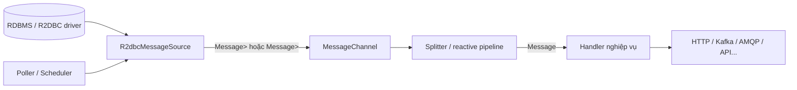
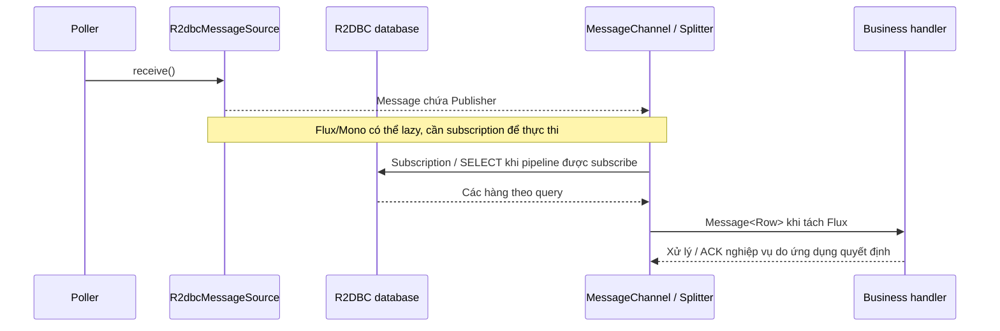

# R2DBC inbound channel adapter

> **Chương:** Adapter R2DBC  
> **Module:** SPRING_INTEGRATION_ADAPTERS  
> **Phạm vi module:** Kết nối các hệ thống ngoài vào Spring Integration bằng inbound/outbound adapter, gateway, poller và MessageChannel. Thực hành luồng trao đổi qua file, SFTP, HTTP, JMS, AMQP, Kafka và cơ sở dữ liệu; xử lý hợp đồng message, lỗi và vòng đời kết nối.

## 1. Mục tiêu học tập

Sau bài này, bạn có thể:

- Giải thích vì sao cần **R2DBC inbound channel adapter** để đọc dữ liệu từ cơ sở dữ liệu theo lịch và đưa vào luồng Spring Integration.
- Phân biệt `R2dbcMessageSource`, `R2dbcEntityOperations`, `SourcePollingChannelAdapter`, `MessageChannel` và thành phần xử lý phía sau.
- Cấu hình truy vấn `SELECT` tĩnh hoặc động, ánh xạ hàng dữ liệu qua `payloadType`, và hiểu tùy chọn `expectSingleResult`.
- Giải thích chính xác **payload mặc định là `Flux`/`Mono`**, không phải mỗi hàng dữ liệu tự động trở thành một message riêng.
- Cấu hình Java DSL với `R2dbc.inboundChannelAdapter(...)`, poller và splitter để xử lý các dòng được đọc.
- Dùng `updateSql` và `bindFunction` để đánh dấu bản ghi đã được chọn, đồng thời hiểu các nguy cơ **đánh dấu sớm**, đọc trùng và lỗi giữa các bước.
- Thiết kế polling interval, giới hạn lô, backpressure, timeout, retry, idempotency và kiểm tra nhiều instance chạy đồng thời.
- Đề xuất cách test adapter trên PostgreSQL R2DBC và cách quan sát sự cố khi đưa vào vận hành.

## 2. R2DBC inbound channel adapter giải quyết bài toán gì?

Giả sử một ứng dụng có bảng `integration_events`. Các service khác ghi sự kiện mới vào bảng; hệ thống tích hợp cần định kỳ tìm các hàng chưa xử lý rồi chuyển chúng thành Spring Message để tiếp tục gửi tới HTTP, Kafka, AMQP hoặc một service nghiệp vụ.

Nếu dùng JDBC theo mô hình truyền thống, thread thực hiện `SELECT` thường chờ I/O đồng bộ. **R2DBC** (Reactive Relational Database Connectivity) cung cấp API truy cập cơ sở dữ liệu theo Reactive Streams với driver tương thích; thao tác đọc có thể tạo `Flux` hoặc `Mono`, cho phép composition và demand/backpressure trong pipeline reactive.

Spring Integration cung cấp **`R2dbcMessageSource`** và inbound adapter gắn với poller:



**Điểm quan trọng:** R2DBC giúp truy cập DB theo API reactive, **không** có nghĩa mọi thành phần trong flow đều tự động non-blocking. Poller vẫn có nhiệm vụ kích hoạt `receive()` theo lịch; việc truy vấn, subscribe, mapping và xử lý hàng dữ liệu cần được cấu hình đúng để pipeline thực sự vận hành.

### 2.1. R2DBC inbound khác JDBC inbound ở đâu?

| Tiêu chí | JDBC inbound channel adapter | R2DBC inbound channel adapter |
| --- | --- | --- |
| Công nghệ DB | JDBC/`DataSource`. | R2DBC/`ConnectionFactory` và `R2dbcEntityOperations`. |
| API truy cập | Chủ yếu blocking. | Reactive Streams, thường dùng Reactor. |
| Thành phần đọc | `JdbcPollingChannelAdapter`. | `R2dbcMessageSource`. |
| Payload kết quả | Thường một `List`/collection các hàng đã đọc. | **Publisher**: mặc định `Flux`, hoặc `Mono` nếu chọn một kết quả. |
| Lịch kích hoạt | Poller. | **Vẫn là poller**, không tự phát hiện thay đổi DB theo push. |
| Đánh dấu đã đọc | Tùy cách cấu hình SELECT/UPDATE. | Có `updateSql` và `bindFunction` tùy chọn. |
| Lưu bền/ACK | Phải thiết kế ở ứng dụng. | **Cũng phải thiết kế**; Reactive không tự tạo exactly-once. |

**R2DBC inbound không phải CDC (Change Data Capture).** Nó không đọc transaction log hay phát event ngay khi transaction commit. Poller chạy truy vấn theo chu kỳ; độ trễ tối thiểu phụ thuộc lịch polling, tải DB và downstream. Nếu phải truyền mọi thay đổi với độ tin cậy cao, cân nhắc **transactional outbox + broker** hoặc CDC chuyên dụng tùy yêu cầu.

## 3. Các thành phần Spring Integration liên quan

| Thành phần | Chức năng |
| --- | --- |
| `R2dbcEntityOperations` / `R2dbcEntityTemplate` | Cung cấp thao tác truy vấn và mapping hàng dữ liệu qua R2DBC. |
| `R2dbcMessageSource` | `MessageSource<Publisher<?>>` thực hiện SELECT theo cấu hình, tạo message chứa một Publisher. |
| `R2dbc.inboundChannelAdapter(...)` | Java DSL factory để tạo spec của R2DBC inbound source. |
| `SourcePollingChannelAdapter` | Endpoint kích hoạt `MessageSource.receive()` theo lịch. |
| `PollerMetadata` | Chỉ định fixed delay/rate, số lần poll/source receive mỗi đợt và chính sách lỗi. |
| `MessageChannel` | Chuyển Spring Message tới splitter, transformer, router hoặc handler. |
| `DefaultMessageSplitter` | Có thể tách `Flux`/`Publisher` thành nhiều item, mỗi item thành một Spring Message. |
| `FluxMessageChannel` | Kênh reactive giúp duy trì mô hình demand/backpressure khi flow được thiết kế phù hợp. |
| `updateSql` / `bindFunction` | Thao tác UPDATE tùy chọn sau bước đọc theo cơ chế của source để không đọc lặp cùng hàng ở lần poll sau. |

Phân biệt inbound với outbound:

- **R2DBC inbound adapter**: định kỳ **đọc** DB rồi phát Spring Message vào flow.
- **R2DBC outbound adapter**: nhận message từ flow rồi **ghi** DB (`INSERT`/`UPDATE`/`DELETE`) bằng `R2dbcMessageHandler`.
- **R2DBC gateway** không phải tên gọi mặc định cho inbound source; đừng coi source polling này là API đồng bộ request-reply như một `@MessagingGateway`.

### 3.1. Vòng đời một lần poll



Sơ đồ thể hiện luồng khái niệm. Với `updateSql`, các thao tác cập nhật trạng thái hàng được tích hợp vào đường reactive của source theo cấu hình; **đừng kết luận UPDATE là ACK sau khi handler nghiệp vụ thành công**. Thứ tự chính xác và transaction boundary phải được kiểm thử theo phiên bản, flow và database.

## 4. Điều kiện chuẩn bị dự án

Ví dụ dưới đây hướng đến **Spring Boot 3.x, Spring Integration 6.x và Java 17+**; để tương thích, để Spring Boot quản lý phiên bản qua BOM. Khi dùng nhánh framework khác, đối chiếu API tương ứng thay vì sao chép version từ tài liệu dành cho bản phát hành khác.

### 4.1. Maven dependencies

```xml
<dependencies>
    <dependency>
        <groupId>org.springframework.boot</groupId>
        <artifactId>spring-boot-starter-integration</artifactId>
    </dependency>
    <dependency>
        <groupId>org.springframework.integration</groupId>
        <artifactId>spring-integration-r2dbc</artifactId>
    </dependency>
    <dependency>
        <groupId>org.springframework.boot</groupId>
        <artifactId>spring-boot-starter-data-r2dbc</artifactId>
    </dependency>
    <dependency>
        <groupId>org.postgresql</groupId>
        <artifactId>r2dbc-postgresql</artifactId>
        <scope>runtime</scope>
    </dependency>
</dependencies>
```

Các thư viện này thực hiện những nhiệm vụ khác nhau: Spring Integration DSL, adapter R2DBC, Spring Data R2DBC và **driver R2DBC cho PostgreSQL**. Không thể thay thế driver `r2dbc-postgresql` bằng JDBC driver nếu đang dùng `R2dbcEntityTemplate`.

Nếu cần expose HTTP endpoint bằng WebFlux, hãy thêm dependency tương ứng; **WebFlux không phải yêu cầu bắt buộc** để chạy một R2DBC poller.

### 4.2. Cấu hình kết nối

Ví dụ `application.yml`:

```yaml
spring:
  r2dbc:
    url: r2dbc:postgresql://localhost:5432/integration_demo
```

Không lưu mật khẩu vào Git; trong môi trường triển khai, cấu hình thông qua các biến như `SPRING_R2DBC_USERNAME` và `SPRING_R2DBC_PASSWORD` hoặc hệ thống quản lý secret.

Cần PostgreSQL đang chạy, database `integration_demo` tồn tại và user có quyền `SELECT` cùng `UPDATE` trên bảng ví dụ. Spring Boot có thể cung cấp `R2dbcEntityTemplate` khi cấu hình Spring Data R2DBC phù hợp; không khởi tạo JDBC `DataSource` rồi mong adapter R2DBC sử dụng được nó.

## 5. Mô hình dữ liệu ví dụ: bảng sự kiện cần xử lý

Chúng ta dùng bảng PostgreSQL:

```sql
CREATE TABLE integration_events (
    id           BIGSERIAL PRIMARY KEY,
    event_type   VARCHAR(80) NOT NULL,
    body         TEXT NOT NULL,
    status       VARCHAR(20) NOT NULL DEFAULT 'NEW',
    created_at   TIMESTAMPTZ NOT NULL DEFAULT NOW(),
    processed_at TIMESTAMPTZ
);

CREATE INDEX idx_integration_events_status_id
    ON integration_events (status, id);

INSERT INTO integration_events (event_type, body)
VALUES
    ('DEVICE_UPDATED', '{"deviceId":"sensor-01"}'),
    ('DEVICE_UPDATED', '{"deviceId":"sensor-02"}');
```

Ý nghĩa các trạng thái:

| Trạng thái | Ý nghĩa trong bài học | Lưu ý vận hành |
| --- | --- | --- |
| `NEW` | Chưa được một flow xử lý/nhận. | Poller chọn các hàng này. |
| `CLAIMED` | Đã được đánh dấu để tránh đọc lại ở lần poll sau. | **Không phải** đã hoàn tất nghiệp vụ. |
| `DONE` | Service nghiệp vụ xác nhận thành công. | Cần một bước ACK/cập nhật riêng sau handler nếu dùng thật. |
| `FAILED` | Đã ghi nhận lỗi cần xử lý hoặc đối soát. | Phải định nghĩa liệu có retry, lúc nào và bao nhiêu lần. |

Trạng thái `CLAIMED` cho mục đích học tập chỉ biểu diễn cách `updateSql` đánh dấu hàng đã chọn. **Mẫu này chưa đủ cho production**: nếu ứng dụng dừng sau khi đánh dấu nhưng trước khi xử lý, hàng có thể kẹt mãi ở `CLAIMED`. Mục 11 đề xuất lease, timeout và claim an toàn khi nhiều instance cùng đọc.

### 5.1. Java entity được ánh xạ từ kết quả SELECT

File `InboundEvent.java`:

```java
import org.springframework.data.annotation.Id;
import org.springframework.data.relational.core.mapping.Column;
import org.springframework.data.relational.core.mapping.Table;

@Table("integration_events")
public class InboundEvent {

    @Id
    private Long id;

    @Column("event_type")
    private String eventType;

    private String body;

    public InboundEvent() {
    }

    public Long getId() {
        return id;
    }

    public void setId(Long id) {
        this.id = id;
    }

    public String getEventType() {
        return eventType;
    }

    public void setEventType(String eventType) {
        this.eventType = eventType;
    }

    public String getBody() {
        return body;
    }

    public void setBody(String body) {
        this.body = body;
    }
}
```

`payloadType(InboundEvent.class)` yêu cầu Spring Data R2DBC map các hàng từ SELECT thành đối tượng `InboundEvent`. Đừng nhầm `payloadType` với Java generics của `Message`; source vẫn có thể trả về `Message<Flux<InboundEvent>>` thay vì trực tiếp `Message<InboundEvent>`.

## 6. Cấu hình Java DSL: R2DBC inbound channel adapter

### 6.1. Flow chính

File `R2dbcInboundConfiguration.java`:

```java
import org.springframework.context.annotation.Bean;
import org.springframework.context.annotation.Configuration;
import org.springframework.integration.config.EnableIntegration;
import org.springframework.integration.dsl.IntegrationFlow;
import org.springframework.integration.dsl.MessageChannels;
import org.springframework.integration.r2dbc.dsl.R2dbc;
import org.springframework.data.r2dbc.core.R2dbcEntityTemplate;
import org.springframework.r2dbc.core.DatabaseClient;

@Configuration
@EnableIntegration
public class R2dbcInboundConfiguration {

    @Bean
    IntegrationFlow inboundDatabaseEvents(
            R2dbcEntityTemplate template) {

        return IntegrationFlow
                .from(
                        R2dbc.inboundChannelAdapter(
                                template,
                                "SELECT id, event_type, body " +
                                "FROM integration_events " +
                                "WHERE status = 'NEW' " +
                                "ORDER BY id LIMIT 25")
                                .payloadType(InboundEvent.class)
                                .updateSql(
                                        "UPDATE integration_events " +
                                        "SET status = 'CLAIMED' " +
                                        "WHERE id = :id AND status = 'NEW'")
                                .bindFunction(
                                        (DatabaseClient.GenericExecuteSpec spec,
                                         InboundEvent row) ->
                                                spec.bind("id", row.getId())),
                        e -> e.poller(p ->
                                p.fixedDelay(2_000)
                                 .maxMessagesPerPoll(1))
                )
                .channel(MessageChannels.flux())
                .split()
                .channel(MessageChannels.flux())
                .handle(InboundEvent.class, (row, headers) -> {
                    System.out.printf(
                            "R2DBC inbound: id=%d, type=%s, body=%s%n",
                            row.getId(), row.getEventType(), row.getBody()
                    );

                    // Trả null: kết thúc nhánh minh họa tại handler này.
                    return null;
                })
                .get();
    }
}
```

**Đây là ví dụ minh họa nhận và log dữ liệu, không phải consumer production bảo đảm giao hàng.** Để giữ đủ ngữ nghĩa retry, hãy thay handler log bằng xử lý nghiệp vụ idempotent có ACK riêng. Đặc biệt, `updateSql` đánh dấu `CLAIMED` **không đồng nghĩa** dòng log hay downstream đã thành công.

### 6.2. Giải thích từng bước

1. `R2dbc.inboundChannelAdapter(template, query)` tạo spec của một R2DBC `MessageSource` chạy query theo lịch poll.
2. `payloadType(InboundEvent.class)` chỉ định kiểu đối tượng mà `EntityRowMapper` tạo ra cho mỗi hàng.
3. `updateSql(...)` khai báo câu UPDATE đánh dấu hàng đã đọc, để vòng poll tiếp theo không tiếp tục chọn hàng còn status `NEW`.
4. `bindFunction(...)` bind giá trị `:id` từ row tương ứng bằng parameter binding; tránh ghép chuỗi ID vào SQL.
5. `e.poller(...fixedDelay(2_000).maxMessagesPerPoll(1))` lập lịch nhận message từ source. **`maxMessagesPerPoll(1)` là số lượt gọi receive trong một chu kỳ, không phải giới hạn số hàng SELECT**.
6. `MessageChannels.flux()` tạo channel theo Reactive Streams; dùng phù hợp với splitter và các bước xử lý reactive.
7. `.split()` tách `Publisher` chứa nhiều `InboundEvent` thành nhiều Spring Message để handler thấy **từng** event.
8. Handler chỉ log rồi kết thúc nhánh. Đây chưa phải bước `ACK` đáng tin cậy trong môi trường thực.

Trong flow này `LIMIT 25` là giới hạn số hàng của **một SELECT**, còn `maxMessagesPerPoll(1)` giới hạn số message do source tạo tại một lượt poll. Nếu bỏ `LIMIT`, một lần poll có thể kích hoạt quá nhiều hàng, dù chỉ gọi `receive()` một lần.

### 6.3. Vì sao phải dùng splitter?

`R2dbcMessageSource` mặc định `expectSingleResult=false`, nên `receive()` trả một **Spring Message có payload là `Flux<InboundEvent>`**. Nếu thay ngay `.split()` bằng một handler nhận `InboundEvent`, handler có thể gặp **payload type mismatch** vì nó đang nhận một `Flux`.

```text
KHÔNG có split:
Poll #1 -> Message<Flux<InboundEvent>>

CÓ split:
Poll #1 -> Message<Flux<InboundEvent>>
                  |
                  v
               Splitter
                  |
                  +--> Message<InboundEvent> (id=1)
                  +--> Message<InboundEvent> (id=2)
                  +--> ...
```

`DefaultMessageSplitter` hỗ trợ `Publisher`; với `ReactiveStreamsSubscribableChannel` phù hợp, splitter có thể dùng subscription/demand để phát các item. Nếu đặt một channel đồng bộ/handler blocking vào giữa, flow có thể mất lợi ích reactive; **đừng chỉ nhìn việc dùng R2DBC để khẳng định toàn tuyến non-blocking**.

### 6.4. Bản đơn giản chỉ đọc, không UPDATE

Để quan sát SELECT và mapping mà không thay trạng thái bảng, có thể bỏ hai cấu hình sau:

```java
.updateSql("UPDATE integration_events SET status='CLAIMED' " +
           "WHERE id = :id AND status = 'NEW'")
.bindFunction((spec, row) -> spec.bind("id", row.getId()))
```

Khi đó **mọi poll vẫn đọc lại các hàng còn `NEW`**. Đây là chủ đích của thí nghiệm, không phải một cơ chế delivery bền vững. Không chạy cấu hình chỉ đọc với side effect không idempotent trong production, vì nó có thể phát cùng một event rất nhiều lần.

## 7. expectSingleResult: Mono khác Flux

Theo API của `R2dbcMessageSource`:

- `expectSingleResult(false)` là mặc định: truy vấn đọc nhiều hàng, payload là **`Flux<?>`**.
- `expectSingleResult(true)`: truy vấn được thực hiện theo chế độ một kết quả, payload là **`Mono<?>`**.
- **`Mono<?>` vẫn là một Publisher**. Nó không có nghĩa payload đã biến thành một POJO trước khi downstream subscribe.
- Nếu câu SELECT không có dòng hoặc trả nhiều dòng so với kỳ vọng, chính sách empty/result phải được kiểm thử trong flow của phiên bản đang dùng.

Ví dụ đọc một hàng theo `id`:

```java
@Bean
IntegrationFlow oneRowFlow(R2dbcEntityTemplate template) {
    return IntegrationFlow
            .from(
                    R2dbc.inboundChannelAdapter(
                            template,
                            "SELECT id, event_type, body " +
                            "FROM integration_events " +
                            "WHERE status = 'NEW' ORDER BY id LIMIT 1")
                            .payloadType(InboundEvent.class)
                            .expectSingleResult(true),
                    e -> e.poller(p ->
                            p.fixedDelay(5_000).maxMessagesPerPoll(1))
            )
            .channel(MessageChannels.flux())
            .split()
            .channel(MessageChannels.flux())
            .handle(InboundEvent.class, (event, headers) -> {
                System.out.println("Single row id=" + event.getId());
                return null;
            })
            .get();
}
```

**Không bật đồng thời** hai flow ví dụ `inboundDatabaseEvents` và `oneRowFlow` trên cùng bảng khi đang đánh giá delivery, vì chúng có thể cạnh tranh SELECT và cho kết quả không dự đoán được. Đoạn này là **biến thể thay thế** để học `expectSingleResult`.

Với kết quả `Mono.empty()`, không có hàng để splitter phát; không nên gửi một message chứa null để tượng trưng cho "không có dòng" nếu handler chưa định nghĩa cách xử lý.

## 8. Dùng @InboundChannelAdapter thay Java DSL

Có thể khai báo `R2dbcMessageSource` trực tiếp thành bean, rồi dùng annotation `@InboundChannelAdapter`:

```java
import org.springframework.context.annotation.Bean;
import org.springframework.context.annotation.Configuration;
import org.springframework.integration.annotation.InboundChannelAdapter;
import org.springframework.integration.annotation.Poller;
import org.springframework.integration.r2dbc.inbound.R2dbcMessageSource;
import org.springframework.data.r2dbc.core.R2dbcEntityTemplate;

@Configuration
public class R2dbcAnnotationExample {

    @Bean
    @InboundChannelAdapter(
            channel = "r2dbcPublishers",
            poller = @Poller(fixedDelay = "2000"))
    R2dbcMessageSource pollDatabase(
            R2dbcEntityTemplate template) {

        var source = new R2dbcMessageSource(
                template,
                "SELECT id, event_type, body " +
                "FROM integration_events " +
                "WHERE status = 'NEW' ORDER BY id LIMIT 25");

        source.setPayloadType(InboundEvent.class);
        source.setExpectSingleResult(false);
        return source;
    }
}
```

Cấu hình này **còn cần** một `MessageChannel` bean tên `r2dbcPublishers` và consumer tách/subscribe `Flux` để thực thi truy vấn rồi xử lý hàng. Nếu chỉ tạo `R2dbcMessageSource` mà không có downstream phù hợp, có thể chưa nhận được các row như kỳ vọng.

Đây là **lựa chọn thay thế** cho Java DSL ở mục 6, không nên bật song song hai inbound source trên cùng bảng trong thí nghiệm.

## 9. Query động, SelectCreator và ánh xạ dữ liệu

### 9.1. SQL tĩnh và câu query động

R2DBC inbound hỗ trợ:

- `SELECT` tĩnh được truyền dưới dạng chuỗi SQL.
- Biểu thức **SpEL** được đánh giá theo từng lần `receive()` để tạo SQL động.
- `R2dbcMessageSource.SelectCreator` làm root context cho kiểu biểu thức chọn dữ liệu theo `StatementMapper.SelectSpec`.

Ví dụ Java DSL dựa trên Fluent API thay vì nối chuỗi SQL:

```java
import org.springframework.data.relational.core.query.Criteria;
import org.springframework.integration.r2dbc.dsl.R2dbc;

// Đoạn trích nằm trong IntegrationFlow.from(...):
R2dbc.inboundChannelAdapter(
        template,
        selectCreator ->
                selectCreator.createSelect("integration_events")
                        .withProjection("id", "event_type", "body")
                        .withCriteria(Criteria.where("status").is("NEW")))
        .payloadType(InboundEvent.class)
```

Đoạn trên minh họa việc tạo `SelectSpec`. Khi thêm vào flow thật, vẫn phải có poller và consumer Publisher. Nếu muốn giới hạn số hàng theo batch, cần chọn query builder/cách diễn đạt `LIMIT` phù hợp với dialect và API; không giả định mọi DB đều dùng cùng SQL syntax.

### 9.2. Tại sao nên dùng bind parameters?

`bindFunction` có nhiệm vụ gắn giá trị vào `UPDATE` dựa trên record đã SELECT. Không được tạo SQL bằng việc nối các giá trị input không tin cậy:

```java
// KHÔNG NÊN: đưa raw ID hoặc chuỗi nghiệp vụ thẳng vào SQL.
String sql = "UPDATE integration_events SET status='CLAIMED' "
           + "WHERE id = " + externalId;
```

Thay vào đó:

```java
String sql =
        "UPDATE integration_events SET status='CLAIMED' WHERE id = :id";

DatabaseClient.GenericExecuteSpec spec = client.sql(sql);
spec = spec.bind("id", event.getId());
```

Hãy phân biệt **bind parameter giá trị** và **tên bảng/cột**. Không thể bind một tên bảng tùy ý như một value; nếu query thật cần chọn bảng động, phải whitelist identifier được phép, tránh SQL injection và lỗi quyền truy cập.

### 9.3. Default payloadType

Nếu không đặt `payloadType`, adapter mặc định ánh xạ record thành kiểu Map case-insensitive (ví dụ `LinkedCaseInsensitiveMap`), phù hợp khi không có entity model. Còn với `payloadType(InboundEvent.class)`, `EntityRowMapper` và converter của `R2dbcEntityOperations` ánh xạ cột thành field Java.

| Cách mapping | Payload item | Nên dùng khi |
| --- | --- | --- |
| Không cấu hình `payloadType` | Map theo tên cột. | Query linh hoạt, prototype, dữ liệu schema đơn giản. |
| Đặt `payloadType` tới entity/DTO | POJO/record được Spring Data hỗ trợ. | Muốn hợp đồng kiểu rõ, validation và code type-safe. |

Dù dùng Map hay POJO, cần kiểm tra nullability, kiểu số, timezone, cột thiếu/đổi tên và nội dung text JSON theo schema nghiệp vụ.

## 10. Poller, reactive streams và backpressure

### 10.1. Poller là điểm kích hoạt, không phải subscription vô hạn

Một poller gọi `R2dbcMessageSource.receive()` theo lịch. Trong mô hình reactive, `receive()` có thể trả message chứa publisher **lười (lazy)**: câu truy vấn và mapping thực sự phát ra khi publisher được subscribe bởi downstream.

Do đó, cần hiểu cả hai mức:

```text
Polling rate:
  bao lâu một lần SourcePollingChannelAdapter gọi receive()?

Reactive demand:
  downstream đã subscribe chưa?
  đang cần bao nhiêu item? xử lý được tốc độ nào?
```

`maxMessagesPerPoll(1)` **không** tương đương "mỗi hai giây chỉ đọc một row". Một `receive()` có thể trả `Flux` với hàng chục record; row count phụ thuộc `SELECT`/`LIMIT` và flow xử lý Publisher.

### 10.2. fixedDelay hay fixedRate?

| Cách lập lịch | Ý nghĩa khái quát | Cẩn trọng |
| --- | --- | --- |
| `fixedDelay(2000)` | Khoảng trễ giữa các lượt scheduling sau khi một task poll kết thúc. | Task poll có thể chỉ đẩy một Publisher vào flow, không nhất thiết chờ mọi xử lý reactive hoàn tất. |
| `fixedRate(2000)` | Cố duy trì tần suất lịch định kỳ. | Nếu task/flow chậm, dễ sinh áp lực lặp nếu không giới hạn concurrency. |
| `maxMessagesPerPoll(1)` | Giới hạn số lần nhận message từ source mỗi chu kỳ. | Không giới hạn số hàng trong `Flux`. |
| `SELECT ... LIMIT 25` | Giới hạn số row mỗi truy vấn SQL. | Không tự bảo vệ khỏi hai poll overlap hoặc hai instance cùng chọn hàng. |

**Lưu ý quan trọng:** `fixedDelay` không tự chứng minh rằng toàn bộ publisher/handler của lần poll trước đã hoàn tất trước lần poll sau. Với pipeline bất đồng bộ, phải kiểm tra overlap bằng thực nghiệm, giới hạn concurrency hoặc thiết kế claim tại DB.

### 10.3. Backpressure không thay thế giới hạn tài nguyên

Một `FluxMessageChannel` có thể hỗ trợ subscription/demand trong flow reactive. Nhưng:

- Poller vẫn có thể tiếp tục khởi tạo publisher mới theo lịch.
- SQL không giới hạn số hàng có thể đọc lượng dữ liệu rất lớn.
- Handler chuyển sang JDBC/blocking API sẽ chiếm thread và phá lợi thế reactive.
- Mọi thành phần không Reactive Streams-aware nằm giữa pipeline có thể thay đổi cách demand hoạt động.
- Truy vấn đồng thời quá nhiều có thể làm cạn connection pool R2DBC.

Hãy phối hợp `LIMIT`, tần suất poll, giới hạn active subscriptions/concurrency, kích thước R2DBC pool, timeout, backpressure và giám sát độ sâu hàng đợi. Khi cần isolation theo thứ tự, xử lý từng event bằng `concatMap` hoặc giới hạn `flatMap` ở pipeline Reactor phù hợp.

## 11. updateSql, ACK và tính tin cậy

### 11.1. updateSql đánh dấu "đã đọc", không phải "đã xử lý xong"

Spring Integration hỗ trợ `updateSql` để đánh dấu các record đã được SELECT và bỏ chúng khỏi những lượt poll sau. Ví dụ:

```sql
SELECT id, event_type, body
FROM integration_events
WHERE status = 'NEW'
ORDER BY id
LIMIT 25;

UPDATE integration_events
SET status = 'CLAIMED'
WHERE id = :id AND status = 'NEW';
```

Điều này giúp giảm việc **đọc đi đọc lại** giữa các lần poll, nhưng không đồng nghĩa downstream đã hoàn thành. Nếu handler lỗi sau khi UPDATE thành công, row có thể bị kẹt ở `CLAIMED` và không được SELECT lại.

Vì vậy, không nên trình bày `updateSql` như một ACK "exactly once". Nó là một công cụ quản lý trạng thái đọc/claim, cần thêm chính sách phục hồi.

### 11.2. Nguy cơ khi hai instance cùng poll

```mermaid
sequenceDiagram
    participant A as Instance A
    participant B as Instance B
    participant DB as Database

    A->>DB: SELECT WHERE status=NEW (id=10)
    B->>DB: SELECT WHERE status=NEW (id=10)
    DB-->>A: id=10
    DB-->>B: id=10
    A->>DB: UPDATE id=10 SET CLAIMED WHERE NEW
    B->>DB: UPDATE id=10 SET CLAIMED WHERE NEW
    Note over A,B: Cả hai đã đọc cùng row; cần thiết kế claim atomic
```

Điều kiện `WHERE status='NEW'` làm cho **một UPDATE có thể không ảnh hưởng row** sau khi instance kia đã claim. Nhưng không được mặc định rằng source đã loại bỏ message ở instance không claim thành công. Muốn bảo đảm một worker sở hữu row, cần **kiểm tra số hàng UPDATE thành công** và thiết kế transaction/claim protocol phù hợp.

### 11.3. Thiết kế production: claim bằng lease + ACK sau handler

Một phương án đáng cân nhắc là trạng thái:

```text
NEW -> PROCESSING(lease_owner, lease_until, attempt_count)
    -> DONE
    -> RETRY / DEAD
```

Các bước lý tưởng:

1. **Claim atomically**: chọn batch chưa xử lý/đã hết lease và cập nhật owner + lease trong một thao tác/transaction DB phù hợp (ví dụ PostgreSQL `FOR UPDATE SKIP LOCKED` trong transaction hoặc `UPDATE ... RETURNING` đúng điều kiện).
2. Chỉ phát row mà instance **thật sự đã claim** thành công.
3. Dùng **event ID** làm khóa idempotency cho handler và downstream.
4. Sau khi downstream hoàn tất, cập nhật `DONE` trong bước ACK được quản lý riêng.
5. Khi worker chết hoặc timeout, lease hết hạn; row được trả lại cho lần xử lý tiếp theo.
6. Giới hạn attempts, backoff và đưa row không xử lý được tới trạng thái `DEAD`/DLQ.
7. Giám sát số row `PROCESSING` quá hạn, số lần retry và mất kết nối DB.

**Không thể gộp DB commit và gửi tới hệ thống ngoài thành một transaction atomic chỉ bằng `R2dbcMessageSource`.** Nếu mục tiêu là phát sự kiện tích hợp tin cậy tới Kafka/AMQP, cân nhắc transactional outbox và consumer idempotent.

### 11.4. At-most-once, at-least-once và exactly-once effects

| Chiến lược | Khi lỗi giữa chừng | Rủi ro |
| --- | --- | --- |
| Đánh dấu `CLAIMED` trước handler, không phục hồi | Row có thể không được xử lý lại. | **Mất sự kiện** nếu handler thất bại. |
| Đọc lại khi chưa ACK, có lease/retry | Row có thể được xử lý lần nữa. | **Trùng lặp** nếu side effect lần trước đã thành công. |
| Outbox + broker + idempotent consumer | Có thể phát lại event, consumer khử trùng. | Cần thiết kế transaction, retention và monitoring. |

R2DBC cung cấp cách truy cập dữ liệu **reactive**, không tự đưa ra bảo đảm exactly-once về tác dụng phụ qua mạng.

## 12. Xử lý lỗi và retry

### 12.1. Những lỗi khác nhau cần nhánh xử lý khác nhau

| Lỗi | Ví dụ | Cách xử lý |
| --- | --- | --- |
| DB connect/query | Connection timeout, DB restart. | Retry có giới hạn/backoff, theo dõi DB health và connection pool. |
| SQL/mapping | Sai cột, conversion lỗi. | Sửa schema/query/mapping; không retry vô hạn. |
| Reactive subscription | Publisher không được subscribe, cancel, lỗi sau subscription. | Kiểm tra flow, error handling và Reactor instrumentation. |
| Duplicate row | Hai poll/instance đọc cùng hàng. | Claim atomic, kiểm tra affected rows, idempotency. |
| Downstream nghiệp vụ | API trả lỗi hoặc timeout. | Giữ trạng thái retry được, ACK sau xử lý thành công. |
| Đánh dấu `CLAIMED` thành công nhưng handler chết | Row không còn trong `SELECT status=NEW`. | Lease timeout/compensation, không coi là DONE. |
| Poller chậm/overlap | Query đắt, downstream tắc. | Batch size, concurrency limit, index, rate và backpressure. |

### 12.2. Đừng lạm dụng errorChannel

Vì payload có thể là `Flux`/`Mono`, exception **có thể xuất hiện sau khi poller đã phát Spring Message**, trong quá trình subscription thực tế. Không được giả định `errorChannel` của poller chắc chắn bắt mọi lỗi phát ra từ publisher.

- Lỗi **đồng bộ** trong việc tạo/gửi message có thể đi theo đường error handling của endpoint.
- Lỗi **bất đồng bộ** của Publisher cần được xử lý trong chuỗi reactive, có logging/retry/dlq theo nhu cầu.
- Nếu downstream dùng handler blocking và ném exception, cách lỗi lan truyền phụ thuộc loại channel và consumer.

Cần test cụ thể ba tình huống: DB tạm dừng, Publisher phát lỗi giữa batch và handler nghiệp vụ lỗi sau khi một phần batch đã xử lý.

### 12.3. Retry an toàn

Đối với query đọc thuần, retry thường đơn giản hơn, nhưng với `updateSql` và downstream có side effects, phải hỏi:

1. Lỗi xảy ra **trước hay sau** UPDATE claim?
2. Số hàng đã được handler xử lý thành công là bao nhiêu?
3. Các event ID nào đã được ACK?
4. Khi retry, nên dùng **cùng event ID** hay tạo ID mới?
5. Có giới hạn số lần retry, deadline, jitter và DLQ không?
6. Event có thể bị gửi hai lần tới hệ thống bên ngoài không?

Nguyên tắc: **event ID không đổi qua retry**, consumer idempotent, trạng thái DB đủ để phục hồi và kết quả cuối có thể đối soát.

## 13. Giám sát, tối ưu truy vấn và tài nguyên

### 13.1. SQL nên có index và batch rõ ràng

Với bảng hàng triệu row:

```sql
SELECT id, event_type, body
FROM integration_events
WHERE status = 'NEW'
ORDER BY id
LIMIT 25;
```

Một index như `(status, id)` giúp truy vấn đọc batch hiệu quả hơn. Tuy nhiên, vẫn phải đo query plan thực tế, thống kê DB, tỉ lệ dữ liệu `NEW` và write amplification do UPDATE.

Không đặt `LIMIT` quá lớn chỉ để giảm số lần poll nếu downstream xử lý chậm; nó có thể tạo Publisher quá nhiều items và giữ connection DB lâu.

### 13.2. Metrics gợi ý

| Metric | Ý nghĩa |
| --- | --- |
| `poll_attempt_total` / `poll_errors_total` | Số lượt poll, lỗi query/scheduler. |
| `rows_selected_total` | Số row DB trả về. |
| `rows_claimed_total` / `rows_claim_conflict_total` | Claim thành công và cạnh tranh giữa instance. |
| `events_processed_total` / `events_failed_total` | Thành công/thất bại của handler. |
| `oldest_new_event_age` | Độ trễ backlog lớn nhất. |
| `processing_lease_expired_total` | Worker lỗi hoặc handler quá chậm. |
| `r2dbc_pool_active` / `r2dbc_pool_pending` | Sức khỏe connection pool. |
| `poll_to_done_p95` | Latency thực từ poll đến hoàn tất nghiệp vụ. |
| `duplicate_event_ids_total` | Mức độ retry/trùng trong luồng. |

Đây là **gợi ý tên metric**, không phải danh sách Micrometer tự có của adapter. Khi đo thật, kết hợp metrics DB/pool, Spring Integration management và business counters.

### 13.3. Health và shutdown

- **Liveness** của ứng dụng không đồng nghĩa DB đang sẵn sàng.
- **Readiness** nên xem xét khả năng kết nối DB, lượng backlog và khả năng xử lý downstream.
- Khi shutdown, dừng poll mới, cho subscription/handler đang xử lý hoàn thành theo deadline và bảo toàn các row chưa ACK bằng lease.
- Khi pool R2DBC bị cạn, giảm concurrency/poll rate thay vì tăng vô hạn connection count.
- Không log toàn bộ `body` nếu chứa dữ liệu cá nhân hoặc secret; log event ID, loại event, thời điểm và mã lỗi đã lọc.

## 14. Kiểm thử end-to-end

### 14.1. Chuẩn bị

Trong môi trường local:

1. Tạo PostgreSQL database và bảng `integration_events` như mục 5.
2. Cấu hình `spring.r2dbc.url` cùng credentials cho ứng dụng.
3. Bảo đảm Spring Boot component scan chứa `InboundEvent` và `R2dbcInboundConfiguration`.
4. Khởi động một instance ứng dụng; quan sát các event `NEW` được đọc.
5. Với demo có `updateSql`, query bảng để quan sát trạng thái `CLAIMED` sau lượt đọc.

Kết quả **kỳ vọng**, không phải kết quả đã chạy thực tế trong tài liệu:

```text
R2DBC inbound: id=1, type=DEVICE_UPDATED, body={"deviceId":"sensor-01"}
R2DBC inbound: id=2, type=DEVICE_UPDATED, body={"deviceId":"sensor-02"}
```

ID thực tế do database sinh; không nên khẳng định luôn là 1 và 2 nếu đã có dữ liệu cũ.

### 14.2. Ma trận test

| Trường hợp | Kết quả cần kiểm chứng |
| --- | --- |
| Bảng rỗng | Không có business row được phát; poller tiếp tục hoạt động. |
| Hai row `NEW` | Được mapping thành `InboundEvent`, splitter phát từng item. |
| Không có `payloadType` | Mỗi row được map sang Map, không phải POJO. |
| `expectSingleResult=true` | Source tạo `Mono`, không phải `Flux` nhiều row. |
| `LIMIT 25` với 100 row | Một SELECT không vượt batch 25 row; các poll sau tiếp tục theo trạng thái. |
| `maxMessagesPerPoll(1)` | Giới hạn số lượt gọi source, **không** phải row count. |
| Không cấu hình `updateSql` | Row `NEW` bị đọc lại ở những poll tiếp theo. |
| Cấu hình `updateSql` | Row đã cập nhật status không còn được SELECT bằng `status=NEW`. |
| Lỗi DB trước SELECT | Có retry/log theo policy; không báo đã xử lý. |
| Mapping sai schema | Quan sát lỗi conversion, không bỏ qua âm thầm. |
| Handler lỗi sau khi claim | Row không được coi là DONE; cần recovery/lease. |
| Hai app instance poll cùng lúc | Không được dựa vào SELECT rồi UPDATE thông thường để khẳng định claim duy nhất. |
| Downstream chậm | Backlog tăng; không để pool/queue tăng vô hạn. |
| App restart khi còn row `CLAIMED` | Phải có cơ chế recovery hoặc operator đối soát. |
| Dữ liệu body chứa Unicode/JSON | Đọc đúng UTF-8 và validation JSON/schema riêng. |
| Dừng poller | Không nhận batch mới; các subscription đang chạy được xử lý theo shutdown policy. |

### 14.3. Unit test với fake data và integration test DB thật

**Unit test:** kiểm tra parser/handler, retry policy và mapping business ID bằng POJO giả lập; không cần DB để kiểm tra điều kiện nghiệp vụ.

**Integration test:** nên dùng PostgreSQL thật qua Testcontainers (hoặc môi trường test tương đương) để kiểm tra dialect, SQL binding, transaction, update count, concurrency và rollback/lease. H2 R2DBC có thể hữu ích để thử cú pháp cơ bản nhưng **không** đại diện đầy đủ cho PostgreSQL, đặc biệt với locking/`SKIP LOCKED`.

Không coi một test "đã lấy được hai row" là chứng minh đầy đủ delivery semantics. Phải fault-inject tại khoảng **giữa SELECT, UPDATE claim và ACK**.

## 15. Những lỗi thiết kế thường gặp

| Sai lầm | Hậu quả | Sửa thế nào |
| --- | --- | --- |
| Cho rằng mỗi poll phát một row | Một poll có thể tạo `Flux` nhiều row. | Phân biệt `receive()` với item; dùng splitter, `LIMIT`. |
| Handler ép payload trực tiếp thành `InboundEvent` khi chưa split | `ClassCastException` hoặc type mismatch. | Dùng splitter hoặc xử lý Publisher tường minh. |
| Không subscribe `Flux` | Query có thể không được thực thi. | Thiết kế reactive downstream có subscriber. |
| Dùng JDBC `DataSource` cho R2DBC source | Không đúng connection API. | Dùng driver R2DBC và `R2dbcEntityTemplate`. |
| Cấu hình `fixedDelay` rồi tin batch cũ luôn xử lý xong | Reactive processing có thể vẫn đang chạy. | Giới hạn concurrency và đo overlap. |
| Coi `updateSql` là ACK của handler | Row có thể bị đánh dấu trước khi xử lý thành công. | ACK riêng, lease/recovery và idempotency. |
| Hai instance cùng SELECT status `NEW` | Có thể đọc trùng row. | Atomic claim/locking, kiểm tra update count. |
| Chỉ dùng `maxMessagesPerPoll(1)` để giới hạn row count | Một `Flux` vẫn có rất nhiều item. | SQL `LIMIT`, pool/concurrency limits. |
| Retry vô hạn khi SQL sai schema | Lặp lỗi cố định, làm tăng tải DB. | Phân loại lỗi, cảnh báo và dừng/recover. |
| Viết SQL nối input thô | SQL injection hoặc query sai. | Bind values và whitelist identifiers. |
| Xử lý blocking bên trong reactive channel | Chặn thread và giảm throughput. | Chọn handler/reactive scheduling phù hợp. |
| Không giám sát `CLAIMED` tồn đọng | Mất sự kiện sau crash. | Lease timeout, alert, recovery job. |

## 16. Bài tập thực hành

**Bài 1 — Khám phá payload.** Bỏ splitter, đặt handler log `payload.getClass()`. Xác nhận một poll phát `Flux` chứ không phải một `InboundEvent`; sau đó khôi phục splitter.

**Bài 2 — So sánh single và multi.** Bật `expectSingleResult(true)` với `LIMIT 1`, rồi trả về mặc định `false` với `LIMIT 25`. So sánh `Mono`/`Flux` và ý nghĩa `maxMessagesPerPoll(1)`.

**Bài 3 — Đọc lại row.** Xóa `updateSql` nhưng giữ query `status='NEW'`. Quan sát cùng event ID xuất hiện ở nhiều poll; giải thích vì sao downstream cần idempotent.

**Bài 4 — Claim và crash.** Giữ `updateSql`, chủ động làm handler ném exception sau khi row được cập nhật `CLAIMED`. Kiểm tra row có được đọc lại không; đề xuất recovery lease thay vì đánh dấu DONE sớm.

**Bài 5 — Hai instance cạnh tranh.** Chạy hai instance ứng dụng đọc cùng bảng, thêm delay trong quá trình xử lý. Ghi lại event ID trùng, thiết kế transaction claim atomic dựa trên PostgreSQL rồi so sánh.

**Bài 6 — Query động.** Dùng `SelectCreator` và `Criteria` để chọn sự kiện theo `event_type`, giải thích vì sao điều kiện input cần được bind thay vì nối chuỗi SQL.

**Bài 7 — Backpressure.** Cho mỗi event mất 300 ms để xử lý, tăng tốc poll. Đo backlog, pool utilization và số subscription đang chạy; đưa ra batch size/interval hợp lý.

**Bài 8 — End-to-end delivery.** Sau khi xử lý xong một event, gửi nó qua Kafka/AMQP. Thiết kế request/event ID, transactional outbox, ACK và retry để chống mất/trùng khi một bên lỗi.

## 17. Câu hỏi tự kiểm tra

1. R2DBC inbound channel adapter khác JDBC inbound adapter ở loại API DB nào?
2. `R2dbcMessageSource` có phải một scheduler tự chạy query liên tục không?
3. Poller của adapter gọi phương thức nào để lấy một message?
4. Với `expectSingleResult=false`, payload thường thuộc kiểu nào?
5. Khi `expectSingleResult=true`, payload là entity trực tiếp hay một `Mono`?
6. Vì sao cần splitter khi muốn xử lý một row thành một Spring Message?
7. `maxMessagesPerPoll(1)` có giới hạn một row mỗi lần SELECT không?
8. `payloadType(InboundEvent.class)` có ý nghĩa gì?
9. `updateSql` được thiết kế để làm gì và vì sao không nên coi nó là ACK thành công của handler?
10. Vai trò của `bindFunction` khi UPDATE có tham số `:id` là gì?
11. Vì sao hai instance có thể đọc cùng row nếu chỉ SELECT rồi UPDATE không atomic?
12. Vì sao `fixedDelay` không chắc đã đợi mọi async subscriber xử lý xong?
13. Không subscribe một `Flux` có thể gây ra điều gì?
14. Nếu row đã `CLAIMED` nhưng app crash, có cơ chế nào để xử lý lại?
15. R2DBC inbound adapter có thay CDC hoặc transactional outbox để giao sự kiện exactly-once không?
16. Những metric nào giúp biết poller đang tụt lại trước backlog?

**Gợi ý trả lời:** (1) JDBC blocking, R2DBC reactive. (2) Không; poller kích hoạt source. (3) `receive()`. (4) `Flux`. (5) `Mono` theo API. (6) Một Publisher có nhiều row, splitter tách item. (7) Không, giới hạn lượt receive; row count do SQL quyết định. (8) Chọn kiểu ánh xạ row. (9) Đánh dấu đã đọc; downstream có thể lỗi sau đó. (10) Bind parameter an toàn theo record. (11) SELECT không khóa/claim độc quyền. (12) Reactive work có thể chạy sau khi poll task trả về. (13) Query có thể chưa được thực thi. (14) Lease, timeout và recovery job. (15) Không, cần delivery contract/ACK/dedup riêng. (16) Tuổi row NEW cũ nhất, tốc độ poll, row/s, errors, p95 latency, R2DBC pool và retry.

## 18. Tài liệu tham khảo

- [Spring Integration Reference — R2DBC Support](https://docs.spring.io/spring-integration/reference/r2dbc.html).
- [Spring Integration API — R2dbcMessageSource](https://docs.spring.io/spring-integration/api/org/springframework/integration/r2dbc/inbound/R2dbcMessageSource.html).
- [Spring Integration API — R2dbc Java DSL](https://docs.spring.io/spring-integration/api/org/springframework/integration/r2dbc/dsl/R2dbc.html).
- [Spring Integration Reference — Inbound Channel Adapters và Pollers](https://docs.spring.io/spring-integration/reference/dsl/java-inbound-adapters.html).
- [Spring Integration Reference — Splitter và Publisher](https://docs.spring.io/spring-integration/reference/splitter.html).
- [Spring Data R2DBC Reference](https://docs.spring.io/spring-data/relational/reference/r2dbc.html).
- [R2DBC Specification](https://r2dbc.io/spec/1.0.0.RELEASE/spec/html/).

**Điểm cần nhớ:** **R2DBC inbound channel adapter là một pollable MessageSource trên cơ sở dữ liệu reactive**. Nó kết hợp `R2dbcEntityOperations`, `SourcePollingChannelAdapter`, query `SELECT` và `MessageChannel` để đưa dữ liệu vào Spring Integration. Payload của source là `Flux` hoặc `Mono`; phải thiết kế subscription/splitter rõ ràng. `updateSql` giúp đánh dấu record đã được đọc, nhưng **không bảo đảm downstream xử lý thành công hoặc exactly-once**. Với production, cần batch size, backpressure, claim/lease atomic, ACK sau xử lý, idempotency, retry và quan sát đầy đủ.
