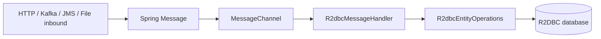
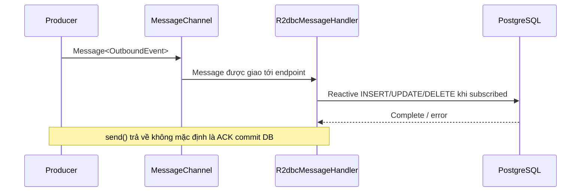
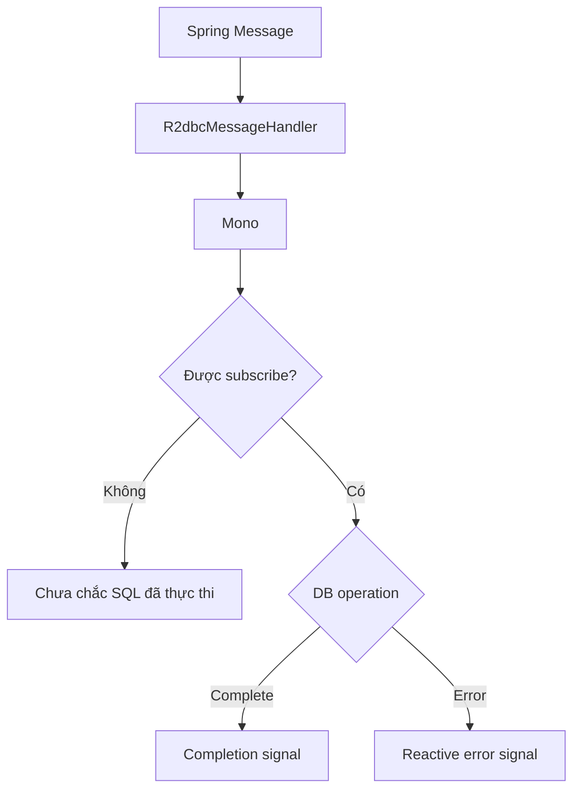

# R2DBC outbound channel adapter

> **Chương:** Adapter R2DBC  
> **Module:** SPRING_INTEGRATION_ADAPTERS  
> **Phạm vi:** Kết nối các hệ thống ngoài vào Spring Integration bằng inbound/outbound adapter, gateway, poller và MessageChannel. Thực hành trao đổi qua file, SFTP, HTTP, JMS, AMQP, Kafka và cơ sở dữ liệu; chú trọng hợp đồng message, lỗi và vòng đời kết nối.

## 1. Mục tiêu học tập

Sau bài học, bạn có thể:

- Giải thích **R2DBC outbound channel adapter** đưa Spring Message từ ứng dụng **ra cơ sở dữ liệu** qua R2DBC như thế nào.
- Phân biệt `R2dbcMessageHandler`, `R2dbcEntityOperations`, `R2dbcEntityTemplate`, `ConnectionFactory` và `MessageChannel`.
- Cấu hình `INSERT` (mặc định), `UPDATE` và `DELETE` bằng `R2dbcMessageHandler.Type`, `tableName`, `values`, `criteria`.
- Dùng `R2dbc.outboundChannelAdapter(...)` và `handleReactive(...)` trong Java DSL của Spring Integration 6.1+.
- Hiểu `Mono<Void>`, subscription, tín hiệu lỗi và sự khác nhau giữa **gửi message thành công** với **database commit thành công**.
- Xây dựng ví dụ Spring Boot/PostgreSQL ghi một event, cập nhật trạng thái và xóa có điều kiện.
- Chọn cách dùng entity mapping, map giá trị cột, custom `DatabaseClient` và reactive transaction.
- Phân tích duplicate event, optimistic locking, retry, idempotency, backpressure và transaction không xuyên được broker.
- Kiểm thử database outage, constraint violation, concurrency và điều kiện chỉ cập nhật đúng hàng mong muốn.

## 2. Vì sao cần R2DBC outbound channel adapter?

Một luồng tích hợp nhận event từ HTTP, Kafka, AMQP, JMS hoặc file rồi cần lưu chúng vào bảng `integration_events`. Tầng giao tiếp với database nên tách khỏi producer: producer gửi Spring Message tới một `MessageChannel`; outbound adapter nhận message rồi thực hiện thao tác ghi.

R2DBC (Reactive Relational Database Connectivity) là API truy cập SQL database theo Reactive Streams. Spring Data R2DBC cung cấp `R2dbcEntityOperations` và `R2dbcEntityTemplate` để thao tác với database theo kiểu reactive. Spring Integration có `R2dbcMessageHandler`, một **`ReactiveMessageHandler`** thực hiện `INSERT`, `UPDATE` hoặc `DELETE` khi nhận message.



Ở đây **outbound** chỉ hướng Spring Message **đi ra hệ thống database**. Nó không chỉ việc chủ động gọi TCP socket, cũng không phải nguồn phát bản ghi từ DB. Để **đọc** các hàng mới từ database theo lịch, dùng **R2DBC inbound channel adapter**, `R2dbcMessageSource` và poller.

### 2.1. Có gì khác JDBC outbound adapter?

| Tiêu chí | JDBC outbound | R2DBC outbound |
| --- | --- | --- |
| API DB | JDBC / `DataSource` | R2DBC / `R2dbcEntityOperations` |
| I/O phổ biến | Blocking | Reactive API, không nhất thiết toàn flow đều non-blocking |
| Handler | Handler JDBC tương ứng | `R2dbcMessageHandler` |
| Operation | SQL ghi theo cấu hình | `INSERT`, `UPDATE`, `DELETE` qua entity hoặc table/values/criteria |
| Điểm kích hoạt | Khi có Spring Message | Khi có Spring Message |
| Cần poller riêng? | Không mặc định | **Không**; poller thuộc inbound source nếu có |
| Đảm bảo exactly-once? | Không tự có | **Không tự có** |
| Transaction với broker/HTTP | Cần thiết kế riêng | **Cũng cần thiết kế riêng** |

**Reactive** không đồng nghĩa tự có transaction phân tán, retry, ACK hay idempotency. Các yếu tố đó thuộc hợp đồng giữa producer, database và downstream.

## 3. Kiến trúc và vòng đời message

| Thành phần | Nhiệm vụ |
| --- | --- |
| `MessageChannel` | Đưa request message từ nguồn tới endpoint ghi DB. |
| `R2dbcMessageHandler` | Biến message thành lệnh ghi SQL phù hợp và trả tín hiệu reactive. |
| `R2dbc.outboundChannelAdapter(template)` | Java DSL factory tạo/spec cấu hình handler. |
| `R2dbcMessageHandler.Type` | Chọn `INSERT`, `UPDATE` hoặc `DELETE`. |
| `R2dbcEntityOperations` | Interface Spring Data thao tác entity/SQL theo R2DBC. |
| `R2dbcEntityTemplate` | Triển khai thông dụng của `R2dbcEntityOperations`. |
| `ConnectionFactory` R2DBC | Cấp connection tới database; **khác** TCP ConnectionFactory của Spring Integration IP. |
| `handleReactive(...)` | Terminal operator subscribe `Mono<Void>` của reactive handler. |
| `TransactionalOperator` | Khai báo transaction trong một reactive chain khi cần nhiều thao tác DB atomically. |



Điểm quan trọng là **subscription** và **tín hiệu hoàn tất**. Một Spring Message được channel tiếp nhận không bảo đảm SQL đã chạy. Một outbound channel adapter cũng không tự trả Spring reply message chứa `rowsUpdated`.

### 3.1. Vì sao không coi adapter là gateway có response?

Gateway theo mô hình request-reply trả một kết quả cho caller. `R2dbcMessageHandler` là **outbound channel adapter** phục vụ ghi dữ liệu và triển khai `ReactiveMessageHandler`; contract xử lý chủ yếu thể hiện bằng `Mono<Void>` complete/error. Nếu nghiệp vụ cần biết **đúng một row được cập nhật** hay cần ID do database sinh, nên dùng custom reactive service có kiểu trả về rõ ràng.

## 4. Cách handler tạo câu SQL

### 4.1. INSERT mặc định

Nếu không cấu hình `queryType`, thao tác mặc định là **`INSERT`**. Hai cách cung cấp dữ liệu:

1. Không đặt `tableName`: payload phải là entity có metadata Spring Data `@Table` phù hợp để ghi.
2. Đặt `tableName` và `values`: Map cột–giá trị được tạo từ payload/header qua function hoặc SpEL.

Ví dụ:

```text
Payload:
  eventId = evt-101
  eventType = DEVICE_UPDATED
  payloadJson = {"deviceId":"sensor-01"}

tableName = integration_events
values = {event_id: evt-101, event_type: DEVICE_UPDATED, payload_json: ...}
```

Cấu trúc này cho phép tách DTO gửi qua MessageChannel khỏi entity persistence. **Đừng** cho input tự chọn tên table/column không có whitelist.

### 4.2. UPDATE cần values và criteria

Với `UPDATE`:

- `queryType(Type.UPDATE)`: chọn loại thao tác.
- `tableName("integration_events")`: tên bảng cố định.
- `values(...)`: Map cột và giá trị mới.
- `criteria(...)`: điều kiện xác định hàng nào được sửa.

```sql
UPDATE integration_events
SET status = 'DONE'
WHERE event_id = 'evt-101' AND status = 'NEW';
```

**Lưu ý:** UPDATE hoàn tất thành công ở tầng SQL nhưng có thể cập nhật **0 row** nếu điều kiện không khớp. Nếu nghiệp vụ đòi "phải đúng một row", cần kiểm tra số hàng cập nhật bằng một reactive service có `rowsUpdated()`, không coi `Mono<Void>` của adapter là row count.

### 4.3. DELETE cần điều kiện rõ

```sql
DELETE FROM integration_events
WHERE event_id = 'evt-101' AND status = 'DONE';
```

`Type.DELETE` cùng `criteria(...)` giúp chỉ chọn hàng phù hợp. DELETE là thao tác phá hủy dữ liệu; với dữ liệu có nghĩa vụ lưu trữ, cân nhắc **soft delete** thay vì xóa vật lý.

### 4.4. Type tĩnh và Type động

`R2dbcMessageHandler.Type` có thể được cố định hoặc tính từ message qua SpEL/function. Một endpoint có thể chọn INSERT/UPDATE/DELETE theo command. Tuy nhiên, nếu thao tác có quyền truy cập và yêu cầu kiểm thử khác nhau, **tách các flow** thường dễ quản lý hơn.

SpEL có thể đọc `payload` và `headers` nhưng không được biến thành nơi thực thi raw SQL do caller gửi lên. `R2dbcMessageHandler` là adapter tạo DML từ thông tin cấu hình, **không phải** giao diện chạy SQL tùy ý cho mọi use case.

## 5. Chuẩn bị ứng dụng Spring Boot và PostgreSQL

Ví dụ dùng **Java 17+, Spring Boot 3.x và Spring Integration 6.1+**. `handleReactive(...)` có từ Spring Integration 6.1. Với branch cũ hơn, phải chọn API đúng phiên bản thay vì sao chép nguyên cú pháp.

### 5.1. Maven dependencies

```xml
<dependencies>
    <dependency>
        <groupId>org.springframework.boot</groupId>
        <artifactId>spring-boot-starter-integration</artifactId>
    </dependency>
    <dependency>
        <groupId>org.springframework.integration</groupId>
        <artifactId>spring-integration-r2dbc</artifactId>
    </dependency>
    <dependency>
        <groupId>org.springframework.boot</groupId>
        <artifactId>spring-boot-starter-data-r2dbc</artifactId>
    </dependency>
    <dependency>
        <groupId>org.postgresql</groupId>
        <artifactId>r2dbc-postgresql</artifactId>
        <scope>runtime</scope>
    </dependency>
</dependencies>
```

Spring Boot BOM nên quản lý phiên bản. Driver PostgreSQL **R2DBC** là thành phần khác JDBC driver; chỉ cài JDBC sẽ không đáp ứng `R2dbcEntityTemplate`.

### 5.2. Kết nối database

Ví dụ `application.yml`:

```yaml
spring:
  r2dbc:
    url: r2dbc:postgresql://127.0.0.1:5432/integration_demo
```

Sử dụng environment variables `SPRING_R2DBC_USERNAME` và `SPRING_R2DBC_PASSWORD` hoặc secret manager để cung cấp credential, không ghi password thật trong repository. Tạo database `integration_demo` trước khi chạy.

### 5.3. Tạo bảng

```sql
CREATE TABLE integration_events (
    event_id     VARCHAR(64) PRIMARY KEY,
    event_type   VARCHAR(64) NOT NULL,
    payload_json TEXT NOT NULL,
    status       VARCHAR(16) NOT NULL DEFAULT 'NEW',
    created_at   TIMESTAMPTZ NOT NULL DEFAULT CURRENT_TIMESTAMP
);

CREATE INDEX idx_integration_events_status
    ON integration_events (status, created_at);
```

- `event_id` dùng làm **business idempotency key**.
- `status` mặc định `NEW`, chuyển sang `DONE` khi một consumer hoàn thành theo contract.
- `created_at` được database sinh.
- Constraint `PRIMARY KEY` chặn trùng hàng nhưng không tự biến một INSERT trùng thành success của caller.

## 6. Ví dụ Java DSL: INSERT event vào database

### 6.1. DTO payload

Tạo `OutboundEvent.java`:

```java
public record OutboundEvent(
        String eventId,
        String eventType,
        String payloadJson
) {
}
```

DTO này không nhất thiết có `@Table` vì flow sẽ chỉ định rõ `tableName` và `values`.

### 6.2. R2DBC outbound flow

Tạo `R2dbcOutboundConfiguration.java`:

```java
import java.util.Map;

import org.springframework.context.annotation.Bean;
import org.springframework.context.annotation.Configuration;
import org.springframework.data.r2dbc.core.R2dbcEntityTemplate;
import org.springframework.integration.annotation.IntegrationComponentScan;
import org.springframework.integration.config.EnableIntegration;
import org.springframework.integration.dsl.IntegrationFlow;
import org.springframework.integration.r2dbc.dsl.R2dbc;
import org.springframework.messaging.Message;

@Configuration
@EnableIntegration
@IntegrationComponentScan
public class R2dbcOutboundConfiguration {

    @Bean
    IntegrationFlow insertEventFlow(R2dbcEntityTemplate template) {
        return IntegrationFlow
                .from("r2dbcInsertRequests")
                .handleReactive(
                        R2dbc.outboundChannelAdapter(template)
                                .tableName("integration_events")
                                // INSERT là query type mặc định.
                                .values((Message<OutboundEvent> message) -> {
                                    OutboundEvent event = message.getPayload();
                                    return Map.of(
                                            "event_id", event.eventId(),
                                            "event_type", event.eventType(),
                                            "payload_json", event.payloadJson()
                                    );
                                })
                )
                .get();
    }
}
```

**Giải thích:**

1. `from("r2dbcInsertRequests")` tạo đầu vào của flow qua Spring MessageChannel.
2. `R2dbc.outboundChannelAdapter(template)` cấu hình `R2dbcMessageHandler` trên `R2dbcEntityOperations`.
3. `tableName("integration_events")` cố định bảng đích.
4. `values(...)` ánh xạ DTO thành các cột của bảng. `status` và `created_at` được để DB áp dụng default.
5. `handleReactive(...)` là terminal operator xử lý reactive handler và subscribe publisher của việc ghi.
6. Đây là flow outbound **một chiều**; không có Spring reply message chứa số hàng bị ảnh hưởng.

`Map.of(...)` từ chối giá trị `null`; validation phải bảo đảm các field cần thiết không null trước khi gửi. Với phần mềm dùng Spring Data converter, cần kiểm tra naming strategy và dữ liệu kiểu thời gian tương thích database.

### 6.3. Messaging Gateway nội bộ

Tạo `EventWritePort.java`:

```java
import org.springframework.integration.annotation.MessagingGateway;

@MessagingGateway(defaultRequestChannel = "r2dbcInsertRequests")
public interface EventWritePort {

    void publish(OutboundEvent event);
}
```

Đây là **Spring Messaging Gateway** để code Java đưa một message vào channel, **không** phải database outbound gateway có reply. Phương thức `void` không thể cho caller biết số hàng đã được INSERT.

### 6.4. Service kiểm tra đầu vào

```java
import org.springframework.stereotype.Service;

@Service
public class EventPublishingService {

    private final EventWritePort port;

    public EventPublishingService(EventWritePort port) {
        this.port = port;
    }

    public void accept(OutboundEvent event) {
        if (event == null
                || event.eventId() == null
                || !event.eventId().matches("[A-Za-z0-9_-]{1,64}")
                || event.eventType() == null
                || !event.eventType().matches("[A-Z_]{1,64}")
                || event.payloadJson() == null
                || event.payloadJson().length() > 100_000) {
            throw new IllegalArgumentException("Invalid event");
        }

        // Gửi tới flow; KHÔNG phải ACK database commit.
        port.publish(event);
    }
}
```

`payloadJson.length()` là giới hạn **đơn vị ký tự** để minh họa; production nên định nghĩa giới hạn theo số byte UTF-8 và validate JSON schema. Không đưa JSON nhạy cảm hoặc token vào log.

### 6.5. Chạy thử

Đặt một `ApplicationRunner` trong ứng dụng:

```java
import org.springframework.boot.ApplicationRunner;
import org.springframework.context.annotation.Bean;
import org.springframework.context.annotation.Configuration;

@Configuration
public class DemoEventRunner {

    @Bean
    ApplicationRunner seedEvent(EventPublishingService service) {
        return args -> service.accept(new OutboundEvent(
                "evt-101",
                "DEVICE_UPDATED",
                "{\"deviceId\":\"sensor-01\"}"
        ));
    }
}
```

Sau khi PostgreSQL và ứng dụng chạy, **đợi thao tác DB hoàn tất** bằng cách quan sát kết quả SELECT với deadline, không coi việc `publish()` trả về là xác nhận commit:

```sql
SELECT event_id, event_type, payload_json, status, created_at
FROM integration_events
WHERE event_id = 'evt-101';
```

Kết quả **kỳ vọng** (ví dụ chưa được chạy trong bài):

```text
event_id     : evt-101
event_type   : DEVICE_UPDATED
payload_json : {"deviceId":"sensor-01"}
status       : NEW
created_at   : (timestamp do DB sinh)
```

Nếu chạy lần hai mà hàng `evt-101` đã tồn tại, database sẽ từ chối INSERT theo unique/primary key. Đó là hành vi đúng của constraint; caller cần quyết định chính sách duplicate.

## 7. UPDATE qua R2DBC outbound channel adapter

Tạo payload:

```java
public record EventStateChange(
        String eventId,
        String newStatus
) {
}
```

Thêm một flow trong một class `@Configuration`:

```java
import java.util.Map;
import org.springframework.context.annotation.Bean;
import org.springframework.data.r2dbc.core.R2dbcEntityTemplate;
import org.springframework.data.relational.core.query.Criteria;
import org.springframework.integration.dsl.IntegrationFlow;
import org.springframework.integration.r2dbc.dsl.R2dbc;
import org.springframework.integration.r2dbc.outbound.R2dbcMessageHandler;
import org.springframework.messaging.Message;

@Bean
IntegrationFlow updateEventFlow(R2dbcEntityTemplate template) {
    return IntegrationFlow
            .from("r2dbcStatusUpdates")
            .handleReactive(
                    R2dbc.outboundChannelAdapter(template)
                            .queryType(R2dbcMessageHandler.Type.UPDATE)
                            .tableName("integration_events")
                            .criteria((Message<EventStateChange> message) -> {
                                var change = message.getPayload();
                                return Criteria.where("event_id")
                                        .is(change.eventId())
                                        .and("status").is("NEW");
                            })
                            .values((Message<EventStateChange> message) -> {
                                String status =
                                        message.getPayload().newStatus();
                                if (!"DONE".equals(status)
                                        && !"FAILED".equals(status)) {
                                    throw new IllegalArgumentException(
                                            "Unsupported status");
                                }
                                return Map.of("status", status);
                            })
            )
            .get();
}
```

`queryType(Type.UPDATE)` chọn UPDATE; `criteria` chọn một event cụ thể **vẫn còn NEW**; `values` giới hạn status được ghi. Khi chuyển `NEW → DONE`, SQL tương đương về ý nghĩa là:

```sql
UPDATE integration_events
SET status = 'DONE'
WHERE event_id = 'evt-101' AND status = 'NEW';
```

Một SQL UPDATE có thể hoàn thành mà **0 row** khớp điều kiện, ví dụ event không tồn tại hoặc đã `DONE`. Nếu nghiệp vụ phải chắc chắn **đúng 1 row** được thay đổi, không nên dựa vào `Mono<Void>` completion của adapter; dùng một custom reactive service với `rowsUpdated()` và trả `UPDATED/CONFLICT/NOT_FOUND` đúng contract.

### 7.1. Optimistic concurrency

Đối với dữ liệu nhiều writer, bổ sung `version` và cập nhật có điều kiện:

```sql
UPDATE integration_events
SET status = 'DONE', version = version + 1
WHERE event_id = 'evt-101' AND version = 3;
```

Lệnh tác động 0 row khi version đã thay đổi. Đây không hẳn lỗi kết nối; là dấu hiệu conflict cần xử lý ở nghiệp vụ.

## 8. DELETE qua R2DBC outbound channel adapter

Payload:

```java
public record EventDeleteRequest(String eventId) {
}
```

Flow DELETE:

```java
import org.springframework.context.annotation.Bean;
import org.springframework.data.r2dbc.core.R2dbcEntityTemplate;
import org.springframework.data.relational.core.query.Criteria;
import org.springframework.integration.dsl.IntegrationFlow;
import org.springframework.integration.r2dbc.dsl.R2dbc;
import org.springframework.integration.r2dbc.outbound.R2dbcMessageHandler;
import org.springframework.messaging.Message;

// Đoạn này đặt trong @Configuration, không bật ở production khi
// chưa có retention, quyền xóa và audit rõ ràng.
@Bean
IntegrationFlow deleteCompletedEventFlow(R2dbcEntityTemplate template) {
    return IntegrationFlow
            .from("r2dbcDeleteRequests")
            .handleReactive(
                    R2dbc.outboundChannelAdapter(template)
                            .queryType(R2dbcMessageHandler.Type.DELETE)
                            .tableName("integration_events")
                            .criteria((Message<EventDeleteRequest> message) ->
                                    Criteria.where("event_id")
                                            .is(message.getPayload().eventId())
                                            .and("status").is("DONE"))
            )
            .get();
}
```

Ở ví dụ, chỉ row có ID được chỉ định **và** `status=DONE` mới đủ điều kiện xóa. Khi triển khai thật, caller phải được xác thực, phân quyền và kiểm tra dữ liệu trước khi gửi command. Cân nhắc **soft delete** hoặc lưu audit nếu có nghĩa vụ lưu giữ.

## 9. Entity mapping, biểu thức và function

### 9.1. Khi không khai báo tableName

Handler có thể xử lý payload dưới dạng entity được Spring Data R2DBC mapping qua `@Table`:

```java
import org.springframework.data.annotation.Id;
import org.springframework.data.relational.core.mapping.Column;
import org.springframework.data.relational.core.mapping.Table;

@Table("integration_events")
public class EventRow {
    @Id
    @Column("event_id")
    private String eventId;

    @Column("event_type")
    private String eventType;

    @Column("payload_json")
    private String payloadJson;

    // Constructor và getter/setter tương ứng.
}
```

Với kiểu entity, mapping ID và cách Spring Data thực hiện INSERT/UPDATE cần được kiểm thử trên database thật. **Không** mặc định rằng một ID đã tồn tại là UPSERT; unique constraint vẫn có thể ném lỗi.

### 9.2. Các tùy chọn cấu hình

| Tùy chọn | Ý nghĩa |
| --- | --- |
| `queryType(Type.INSERT/UPDATE/DELETE)` | Cố định loại thao tác SQL. |
| `queryTypeFunction` hoặc expression | Chọn Type từ một Spring Message nếu đã whitelist. |
| `tableName("...")` | Tên bảng cố định. |
| `tableNameExpression` / function | Tính bảng từ message; cần whitelist và bảo vệ quyền truy cập. |
| `values(Map/function/SpEL)` | Tạo Map cột–giá trị cho INSERT hoặc UPDATE. |
| `criteria(Criteria/function/SpEL)` | Tạo điều kiện cho UPDATE hoặc DELETE. |

SpEL có thể dùng `payload`/`headers`; function Java được type-check và thường dễ unit test hơn. Trong hai trường hợp, **không** nối raw input vào tên table/column hay câu lệnh SQL.

### 9.3. Khi nào nên dùng custom DatabaseClient?

Adapter phù hợp DML thông dụng. Khi cần:

- UPSERT với `ON CONFLICT` của PostgreSQL.
- Cập nhật **nhiều bảng trong một transaction**.
- Trả `rowsUpdated()` cho nghiệp vụ.
- Trả ID do DB sinh.
- Batch operation có chính sách riêng.
- Conditional update có optimistic locking và retry conflict.
- Thực thi SQL phức tạp ngoài mô hình table/values/criteria.

Hãy viết custom reactive service dùng `DatabaseClient`/`R2dbcEntityOperations` và có thể đưa service đó vào IntegrationFlow. Không phải mọi câu SQL đều cần được ép vào `R2dbcMessageHandler`.

## 10. Subscription, completion và error signal

### 10.1. Mono<Void> có nghĩa gì?

`R2dbcMessageHandler` triển khai `ReactiveMessageHandler`; kết quả xử lý biểu diễn bằng `Mono<Void>`: publisher phát **complete** khi thao tác hoàn tất hoặc **error** nếu gặp lỗi.



Với Spring Integration 6.1+, `handleReactive(...)` giúp framework subscribe publisher của handler. Nếu tự tạo một Publisher ở custom service nhưng không subscribe, SQL **có thể không chạy**:

```java
Mono<Void> write = customReactiveService.saveEvent(event);
// Đoạn này mới tạo publisher; cần subscriber phù hợp để thực thi.
```

Không dùng `block()` bừa bãi trên Reactor event-loop để chờ kết quả; điều này làm mất lợi ích reactive và có thể gây deadlock/suy giảm throughput.

### 10.2. send() không phải DB commit acknowledgement

Một flow có thể nhận message xong trước khi DB trả complete/error. Đặc biệt với interface:

```java
@MessagingGateway(defaultRequestChannel = "r2dbcInsertRequests")
public interface EventWritePort {
    void publish(OutboundEvent event);
}
```

Phương thức `void` có ý nghĩa **gửi message tới flow**, không đồng nghĩa transaction đã commit. Một outbound channel adapter cũng không tự tạo reply message chứa row count cho caller.

Nếu HTTP API cần trả `201 Created` **sau khi ghi DB chắc chắn**, nên xây reactive service trả `Mono<SaveResult>` hoặc một gateway/business flow có kết quả rõ, được subscribe và chờ completion theo contract. Chỉ trả `202 Accepted` khi hệ thống thực sự đã **nhận bền vững** request hoặc định nghĩa rõ khả năng mất dữ liệu của hàng đợi tạm.

### 10.3. Lỗi DB có thể đến sau lời gọi publish()

Ví dụ:

- Mất kết nối R2DBC sau khi message vào channel.
- Unique violation khi SQL chạy.
- Foreign key hoặc CHECK constraint sai.
- Pool hết connection.
- Transaction rollback.
- Query timeout.

Vì lỗi xuất hiện sau subscription, `try/catch` quanh `port.publish(...)` **không đủ** để bảo đảm bắt mọi lỗi DB. Cần thiết kế error handling và quan sát completion/error của reactive chain.

## 11. Transaction trong R2DBC và ranh giới ngoài database

### 11.1. Transaction không tự mở rộng sang Kafka/HTTP

Giả sử ứng dụng làm:

```text
[Receive event from Kafka]
          |
          v
[INSERT PostgreSQL via R2DBC]
          |
          v
[HTTP call]
          |
          v
[Commit Kafka offset]
```

Nếu PostgreSQL commit rồi HTTP thất bại, local DB transaction **không rollback** HTTP. Tương tự, Kafka offset không tự được commit đồng bộ với PostgreSQL chỉ vì dùng R2DBC.

Nếu cần bảo đảm truyền event bền vững, thường dùng **transactional outbox**, cơ chế phát lại và consumer idempotent, thay vì tuyên bố exactly-once từ adapter.

### 11.2. Reactive TransactionalOperator

Khi ứng dụng phải ghi hai bảng atomically, dùng `TransactionalOperator` trên reactive chain:

```java
import org.springframework.r2dbc.core.DatabaseClient;
import org.springframework.transaction.reactive.TransactionalOperator;
import reactor.core.publisher.Mono;

public final class AtomicEventWriter {

    private final DatabaseClient db;
    private final TransactionalOperator tx;

    public AtomicEventWriter(
            DatabaseClient db,
            TransactionalOperator tx) {
        this.db = db;
        this.tx = tx;
    }

    public Mono<Void> saveWithAudit(
            String eventId,
            String eventType,
            String json) {

        return db.sql(
                        "INSERT INTO integration_events " +
                        "(event_id, event_type, payload_json) " +
                        "VALUES (:id, :type, :body)")
                .bind("id", eventId)
                .bind("type", eventType)
                .bind("body", json)
                .fetch()
                .rowsUpdated()
                .flatMap(count -> {
                    if (count != 1L) {
                        return Mono.error(new IllegalStateException(
                                "Expected 1 inserted row"));
                    }

                    // Bảng event_audit phải được tạo trước.
                    return db.sql(
                                    "INSERT INTO event_audit " +
                                    "(event_id, action) " +
                                    "VALUES (:id, :action)")
                            .bind("id", eventId)
                            .bind("action", "CREATED")
                            .fetch()
                            .rowsUpdated();
                })
                .then()
                .as(tx::transactional);
    }
}
```

Đây là **custom reactive service**, không phải cấu hình adapter chính. Nó giả định bảng `event_audit` có schema phù hợp và cả hai thao tác dùng cùng transaction manager/connection factory. `TransactionalOperator` đưa transaction context vào Reactor chain.

Có thể tạo operator trong class `@Configuration`:

```java
import org.springframework.context.annotation.Bean;
import org.springframework.transaction.ReactiveTransactionManager;
import org.springframework.transaction.reactive.TransactionalOperator;

@Bean
TransactionalOperator r2dbcTx(ReactiveTransactionManager manager) {
    return TransactionalOperator.create(manager);
}
```

Một câu `INSERT` tự nó thường đã là thao tác atomic ở DB; `TransactionalOperator` ở đây cần thiết khi **nhiều thao tác DB** phải nhất quán. Không dùng transaction kiểu JDBC thread-local để giả định nó bao trùm các publisher reactive chạy trên scheduler khác.

## 12. Idempotency, duplicate và optimistic locking

### 12.1. Unique key bảo vệ dữ liệu, không tự ACK retry

Cùng event ID có thể đến lại do producer retry hoặc broker redelivery:

```text
INSERT evt-101 lần 1 -> commit thành công.
INSERT evt-101 lần 2 -> unique violation.
```

Ràng buộc `PRIMARY KEY(event_id)` ngăn tạo thêm row trùng, nhưng **lần thử thứ hai vẫn là lỗi** nếu ứng dụng chưa định nghĩa quy tắc xử lý duplicate.

Lựa chọn:

1. Đọc row hiện có và xác nhận payload tương đương; đánh dấu event đã được xử lý theo contract.
2. Trả conflict khi một ID được dùng với dữ liệu khác nhau.
3. Dùng `ON CONFLICT DO NOTHING/UPDATE` nếu chính sách phù hợp, được triển khai bằng custom `DatabaseClient`.
4. Ghi event ID và source để đối soát.

**Không retry vô hạn lỗi unique constraint**, vì đây không phải lỗi transient network.

### 12.2. UPDATE tác động 0 row

Lệnh:

```sql
UPDATE integration_events
SET status = 'DONE'
WHERE event_id = 'evt-101' AND status = 'NEW';
```

Có thể update 0 row khi ID không tồn tại hoặc trạng thái đã đổi. **Completion** của outbound handler không được coi là xác minh trạng thái nghiệp vụ đã chuyển. Nếu cần điều kiện "chính xác một row thay đổi", dùng API trả `rowsUpdated()`/row count và phát response theo kết quả.

### 12.3. Lost reply và kết quả chưa rõ

Caller có thể timeout sau khi database đã commit. Nếu retry bằng event ID mới, hệ thống có thể lưu **hai tác vụ tương đương**. Hãy giữ nguyên event ID qua các lần thử, phân loại trạng thái `UNKNOWN` và có đường query DB để đối soát.

Reactive I/O không thay thế tính đúng của business transaction.

## 13. Backpressure và giới hạn tài nguyên

R2DBC dùng reactive API nhưng PostgreSQL vẫn bị giới hạn bởi số connection, CPU, disk I/O, row locks và write throughput.

```text
Upstream producer
       |
       v
MessageChannel / giới hạn queue và demand
       |
       v
Reactive R2DBC handler
       |
       v
R2DBC connection pool (giới hạn)
       |
       v
PostgreSQL throughput (giới hạn)
```

### 13.1. Cần kiểm soát những gì?

| Giới hạn | Vì sao cần? |
| --- | --- |
| Pool size | Không vượt số DB connections server chịu được. |
| Pending acquire timeout | Producer không chờ pool mãi. |
| Số reactive subscriptions đồng thời | Tránh tạo quá nhiều SQL operations đang chờ. |
| Buffer/channel capacity | Tránh tăng bộ nhớ vô hạn. |
| Message size | JSON lớn không được chiếm memory/DB quá mức. |
| Retry budget | Tránh retry storm khi database đang lỗi. |
| Total deadline | Bảo vệ SLA của caller. |
| Shutdown policy | Không báo commit cho request đang chưa complete. |

`FluxMessageChannel` có thể hỗ trợ demand trong reactive flow, nhưng không có nghĩa mọi nguồn HTTP/JMS/Kafka tự động hiểu hoặc tuân thủ backpressure nếu connector không có cơ chế tương ứng.

### 13.2. Poller thuộc inbound source, không thuộc outbound handler

R2DBC outbound adapter **không tự thăm dò DB**. Nếu upstream là file inbound adapter hoặc R2DBC inbound source, poller nằm ở **endpoint nguồn**. Lịch `fixedDelay` hay `maxMessagesPerPoll` của poller không phải là thuộc tính cốt lõi của `R2dbcMessageHandler`.

Muốn bảo vệ DB khi viết liên tục, giới hạn producer rate, concurrency, pool và retry; không chỉ giảm lịch poll mà bỏ qua số publisher đang chạy.

## 14. Xử lý lỗi và bảo mật

### 14.1. Phân loại exception theo hành động

| Lỗi | Ví dụ | Cách xử lý |
| --- | --- | --- |
| DB connection timeout | DB restart hoặc mạng lỗi. | Retry có giới hạn và backoff/jitter. |
| Unique constraint | `event_id` đã tồn tại. | Dedup/conflict policy, không retry mù. |
| Foreign key / CHECK constraint | Payload sai dữ liệu. | Validation hoặc nhánh reject. |
| Schema mismatch | Thiếu bảng/cột. | Dừng/cảnh báo migration; không retry vô hạn. |
| Pool exhausted | Hết database connections. | Backpressure, giới hạn requests và deadline. |
| UPDATE 0 row | State/version không khớp. | Dùng affected-row check trong custom service. |
| Reactive error sau publish | Lỗi khi subscription chạy. | Quan sát error signal, error channel và event ID. |
| Timeout sau INSERT | Không rõ commit đã xảy ra chưa. | Đối soát bằng event ID trước khi phát lại. |

### 14.2. Error channel không phải phép màu

Một số lỗi có thể xảy ra **sau khi producer gửi message**, trong subscription của reactive handler. Tùy topology và cách Spring Integration xử lý endpoint, lỗi có thể đi qua error handling thích hợp hoặc surfaced qua Reactor error signal. Không nên cho rằng `try/catch` xung quanh `publish()` bắt được tất cả.

Một chiến lược lỗi cần lưu:

- Event/request ID và mã nguồn.
- SQL operation type, table và error class/SQLState đã lọc.
- Attempt count, thời gian và tổng deadline.
- Trạng thái `RETRY`, `DEAD`, `REJECTED` hoặc `UNKNOWN`.
- Kết quả cuối cùng từ database authoritative nếu cần đối soát.

Không ghi credential, dữ liệu cá nhân hoặc raw JSON nhạy cảm vào log.

### 14.3. Bảo mật

- Tài khoản DB có **least privilege** theo bảng và thao tác.
- Không đưa raw table/column names từ message vào dynamic configuration.
- Validate event ID, event type, JSON schema, giá trị null và giới hạn byte.
- Dùng parameter binding của Spring Data R2DBC, không nối input chưa tin cậy vào raw SQL.
- Bảo vệ R2DBC connection bằng cấu hình TLS nếu yêu cầu.
- Giới hạn quyền DELETE và đặt retention/audit policy.
- Cập nhật migrations có kiểm soát; schema và ứng dụng phải tương thích.

## 15. Quan sát và kiểm thử

### 15.1. Metrics đề xuất

| Metric | Mục tiêu |
| --- | --- |
| `r2dbc_write_attempt_total` | Số lần thử tạo lệnh ghi. |
| `r2dbc_write_complete_total` | Số lần hoàn tất. |
| `r2dbc_write_error_total` | Lỗi theo loại operation/SQLState. |
| `r2dbc_write_latency_p95` | Độ trễ DB write. |
| `r2dbc_pool_active` / `r2dbc_pool_pending` | Sức khỏe connection pool. |
| `duplicate_event_id_total` | Redelivery/retry và khử trùng. |
| `state_conflict_total` | UPDATE version/state mismatch. |
| `retry_attempt_total` | Retry storm. |
| `pending_event_age` | Backlog lâu chưa ACK. |
| `dead_letter_total` | Event thất bại cần xử lý đặc biệt. |

Đây là **gợi ý tên metric** chứ không phải các metric Spring Integration mặc định tự cung cấp. Cần instrument tại chỗ nhận message, subscription completion/error và business service nếu cần biết row count.

### 15.2. Ma trận test

| Kịch bản | Điều cần chứng minh |
| --- | --- |
| Một event hợp lệ | Đúng một row trong bảng, status default `NEW`. |
| Thiếu event ID | Validation từ chối trước khi gửi. |
| JSON quá lớn | Bị từ chối theo giới hạn đã định nghĩa. |
| Duplicate ID tuần tự | Unique constraint và chính sách dedup đúng. |
| Hai duplicate gửi đồng thời | Không có hai row cùng primary key. |
| UPDATE từ `NEW` sang `DONE` | Chỉ thay đúng event. |
| UPDATE khi đã `DONE` | Không tự báo success nếu nghiệp vụ yêu cầu 1 row. |
| DELETE event `NEW` | Không xóa khi criteria chỉ cho `DONE`. |
| Database down | Nhận error/timeout và trạng thái retry thích hợp. |
| Sai tên column/migration | Lỗi schema không bị retry vô hạn. |
| Pool cạn | Có giới hạn wait/concurrency/buffer. |
| Publisher không subscribe | Phát hiện SQL không thực thi ở custom handler. |
| Event retry sau timeout | Giữ nguyên ID và không tạo side effect trùng. |
| Multi-table transaction | Khi audit INSERT lỗi, event INSERT rollback. |
| DB commit rồi Kafka publish thất bại | Outbox/replay và idempotent consumer được áp dụng. |
| Shutdown giữa operation | Không khẳng định đã ghi khi chưa completion. |

### 15.3. Từng bước test end-to-end

1. Chạy PostgreSQL local/test và tạo bảng `integration_events`.
2. Cấu hình Spring R2DBC credentials, khởi động app.
3. Gửi một `OutboundEvent("evt-101",...)`.
4. Đợi có điều kiện với deadline rồi query DB; không kiểm tra thành công bằng `send()` đơn thuần.
5. Gửi lại cùng ID để quan sát unique violation.
6. Gửi `EventStateChange` qua channel UPDATE và xác minh state.
7. Gửi DELETE theo event ID trong môi trường test, xác minh chỉ row `DONE` được xóa.
8. Thử ngắt PostgreSQL giữa thao tác và quan sát failure/retry.
9. Tạo tải song song có giới hạn, đo pool/latency/duplicate.
10. Dùng PostgreSQL Testcontainers hoặc môi trường test tương đương để kiểm tra transaction, constraint, concurrency và SQL dialect.

H2 R2DBC có thể hữu ích cho thử nghiệm đơn giản, nhưng không thay thế hoàn toàn PostgreSQL khi dùng `ON CONFLICT`, isolation/locking và các chi tiết dialect khác.

## 16. Lỗi thiết kế thường gặp

| Sai lầm | Hậu quả | Hướng sửa |
| --- | --- | --- |
| Nhầm outbound với inbound polling | Chờ adapter tự SELECT định kỳ. | Inbound dùng `R2dbcMessageSource`; outbound ghi khi có message. |
| Dùng JDBC `DataSource` cho R2DBC handler | Không tương thích API. | Dùng R2DBC driver và `R2dbcEntityTemplate`. |
| Quên subscription trong custom Publisher | SQL không chạy. | Dùng `handleReactive` hoặc subscriber đúng contract. |
| Coi `void publish()` là DB ACK | Báo thành công trước commit. | API có completion/status riêng. |
| UPDATE không có criteria | Ghi hàng loạt ngoài ý muốn. | Kiểm soát điều kiện và row count. |
| DELETE theo input không kiểm tra quyền | Xóa dữ liệu không được phép. | Whitelist, authentication, authorization. |
| Retry vô hạn constraint violation | Lặp lỗi cố định, tăng tải. | Phân loại lỗi, dedup/conflict. |
| Retry bằng event ID mới | Duplicate side effect. | Giữ event ID ổn định. |
| Cho rằng R2DBC transaction bao trùm Kafka/HTTP | Mất event hoặc lệch trạng thái. | Outbox và idempotent consumer. |
| Dùng `block()` trong Reactor event-loop | Chặn thread, có thể deadlock. | Composition reactive đúng cách. |
| Không giới hạn pool/concurrency | DB quá tải, memory/latency tăng. | Rate, queue/pool, timeout có giới hạn. |
| Không xem reactive error signal | Event lỗi âm thầm. | Error handling và metrics theo event ID. |

## 17. Bài tập thực hành

**Bài 1 — INSERT:** Chạy `insertEventFlow`, gửi hai event khác ID. Quan sát rằng không cần `queryType(Type.INSERT)` vì INSERT mặc định. Kiểm tra row trong database.

**Bài 2 — Duplicate:** Gửi lại một event ID. So sánh unique violation với một policy cho phép retry trùng, nêu cách xác minh payload có tương đương hay không.

**Bài 3 — UPDATE:** Tạo message `EventStateChange("evt-101","DONE")`, kiểm tra chuyển `NEW → DONE`. Thực hiện update lần hai và giải thích vì sao cần affected-row count khi trả status cho caller.

**Bài 4 — DELETE:** Chỉ xóa event `DONE` theo ID. Bổ sung validation và audit, so sánh với soft delete cho yêu cầu retention.

**Bài 5 — Lỗi sau publish:** Dừng PostgreSQL rồi gửi event. Quan sát vì sao `try/catch` đồng bộ có thể không nhận được exception phát sinh từ publisher sau đó.

**Bài 6 — Ghi hai bảng:** Thêm bảng `event_audit` và dùng `TransactionalOperator`. Tạo lỗi trong audit INSERT để xác nhận event INSERT rollback.

**Bài 7 — Tải đồng thời:** Gửi 1.000 message với concurrency giới hạn, đo p95 latency, pending pool và số error. Đề xuất tuning không làm database quá tải.

**Bài 8 — Outbox:** Thiết kế cập nhật business record + ghi outbox cùng transaction, sau đó publish Kafka/AMQP với replay và consumer idempotent.

**Bài 9 — Optimistic lock:** Thêm cột `version`, hai worker cùng update một row. Dùng conditional update và kiểm tra affected-row count để nhận ra conflict.

## 18. Câu hỏi tự kiểm tra

1. R2DBC outbound adapter nhận dữ liệu từ đâu và ghi về đâu?
2. Thành phần nào trực tiếp triển khai `ReactiveMessageHandler`?
3. `R2dbcMessageHandler` mặc định thực hiện loại SQL nào?
4. `tableName + values` khác chế độ entity `@Table` ở đâu?
5. `values` function phải trả kiểu dữ liệu gì?
6. Vì sao UPDATE/DELETE cần `criteria`?
7. `handleReactive(...)` có vai trò gì?
8. `Mono<Void>` có chứa số hàng đã cập nhật không?
9. `MessagingGateway.publish(...)` trả về bình thường có chứng minh DB commit chưa?
10. Một UPDATE tác động 0 row có thể được xem là business success mặc định không?
11. Unique constraint bảo vệ khỏi duplicate row nhưng vì sao còn cần idempotency policy?
12. Transaction R2DBC có tự rollback HTTP/Kafka không?
13. `TransactionalOperator` phù hợp cho loại boundary nào?
14. Khi database bị lỗi mạng, retry nên có những giới hạn gì?
15. Vì sao không nên retry lỗi unique constraint như transient connection failure?
16. Backpressure và pool size ảnh hưởng throughput outbound thế nào?
17. Khi cần PostgreSQL `ON CONFLICT` hoặc `rowsUpdated()`, dùng công cụ nào?
18. Metrics và test nào là quan trọng nhất trước production?

**Gợi ý:** (1) Từ MessageChannel ra SQL database. (2) `R2dbcMessageHandler`. (3) INSERT. (4) Chỉ định cột thủ công hoặc dựa metadata entity. (5) `Map<String, ?>`. (6) Chọn đúng row. (7) Subscribe publisher xử lý reactive. (8) Không, chỉ completion/error. (9) Không. (10) Không nếu contract yêu cầu phải sửa row. (11) Constraint có thể phát lỗi; cần xác định duplicate hợp lệ hay conflict. (12) Không. (13) Một reactive chain cùng database/transaction manager. (14) Attempts, total deadline, backoff, jitter, error classification. (15) Là lỗi dữ liệu/constraint thường cố định. (16) Giới hạn concurrency và tài nguyên DB. (17) `DatabaseClient`/`R2dbcEntityOperations` trong custom service. (18) Completion/error, latency, pool, duplicate, rollback, DB outage, concurrency, outbox.

## 19. Tài liệu tham khảo

- [Spring Integration Reference — R2DBC Support](https://docs.spring.io/spring-integration/reference/r2dbc.html).
- [Spring Integration API — R2dbcMessageHandler](https://docs.spring.io/spring-integration/docs/6.2.4/api/org/springframework/integration/r2dbc/outbound/R2dbcMessageHandler.html).
- [Spring Integration API — R2dbcMessageHandlerSpec](https://docs.spring.io/spring-integration/docs/6.5.1/api/org/springframework/integration/r2dbc/dsl/R2dbcMessageHandlerSpec.html).
- [Spring Integration Reference — Reactive Streams Support](https://docs.spring.io/spring-integration/reference/reactive-streams.html).
- [Spring Data R2DBC Reference](https://docs.spring.io/spring-data/relational/reference/r2dbc.html).
- [Spring Framework Reference — Data Access with R2DBC](https://docs.spring.io/spring-framework/reference/data-access/r2dbc.html).

**Điểm cần nhớ:** **R2DBC outbound channel adapter nhận Spring Message và thực hiện ghi SQL reactive** qua `R2dbcMessageHandler` và `R2dbcEntityOperations`. Có thể chọn `INSERT`, `UPDATE`, `DELETE` bằng `Type`; mô tả dữ liệu qua entity hoặc `tableName`, `values`, `criteria`. `handleReactive(...)` giúp subscribe trên Spring Integration 6.1+, nhưng **message được gửi không đồng nghĩa database đã commit**. Muốn tích hợp tin cậy cần validation, unique key, affected-row check khi thích hợp, reactive transactions, retry có giới hạn, backpressure, idempotency và outbox cho giao tiếp xuyên hệ thống.
