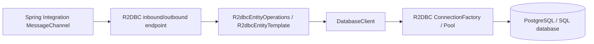
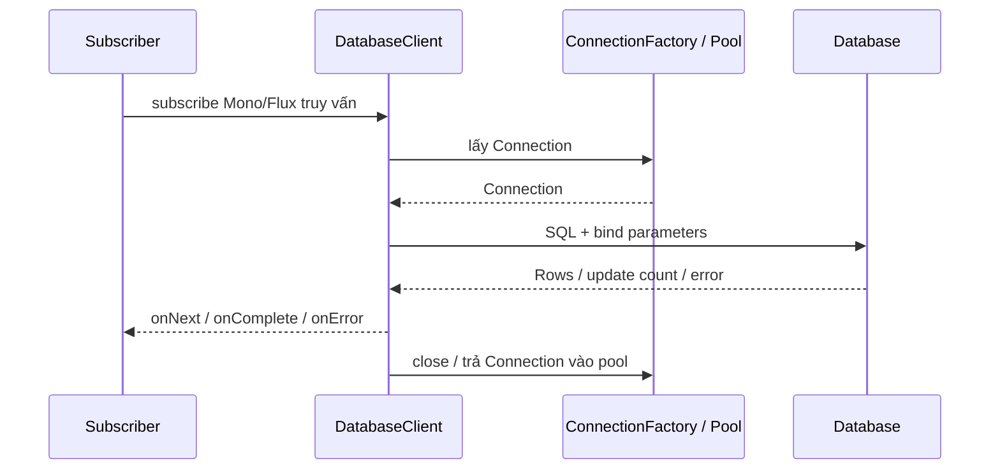
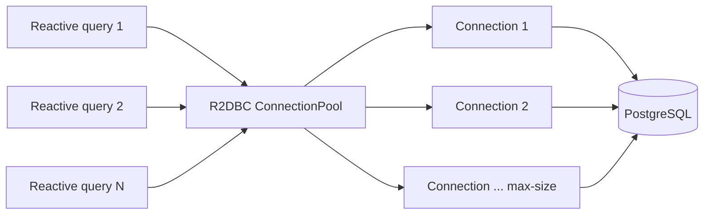
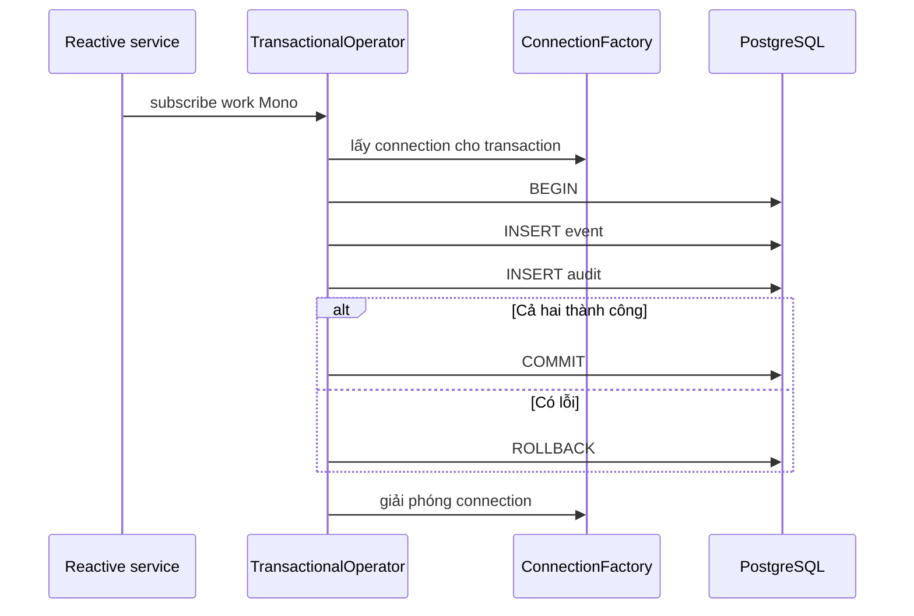

# DatabaseClient và ConnectionFactory

> **Chương:** Adapter R2DBC  
> **Module:** SPRING_INTEGRATION_ADAPTERS  
> **Bối cảnh:** Kết nối các hệ thống ngoài vào Spring Integration bằng inbound/outbound adapter, gateway, poller và MessageChannel. Thực hành với file, SFTP, HTTP, JMS, AMQP, Kafka và cơ sở dữ liệu; chú trọng hợp đồng message, lỗi và vòng đời kết nối.

## 1. Mục tiêu học tập

Sau bài học này, bạn có thể:

- Phân biệt rõ `io.r2dbc.spi.ConnectionFactory`, `org.springframework.r2dbc.core.DatabaseClient`, `R2dbcEntityOperations` và `R2dbcEntityTemplate`.
- Giải thích cách một `ConnectionFactory` tạo **database connection** theo Reactive Streams và vì sao nó khác `ConnectionFactory` của Spring Integration TCP.
- Cấu hình Spring Boot với PostgreSQL R2DBC, URL, credentials, driver, pool và giới hạn tài nguyên.
- Thực hiện `SELECT`, `INSERT`, `UPDATE` bằng `DatabaseClient`; dùng `bind(...)`, `bindNull(...)`, `map(...)`, `all()`, `one()` và `rowsUpdated()`.
- Phân biệt **khởi tạo Publisher** với **thao tác SQL đã chạy/commit**, hiểu subscription, Reactor `Mono`/`Flux` và backpressure.
- Kết nối `DatabaseClient`/`R2dbcEntityTemplate` vào Spring Integration **R2DBC inbound/outbound channel adapter**.
- Thiết kế reactive transaction với `R2dbcTransactionManager` và `TransactionalOperator`; xác định phạm vi transaction trong flow tích hợp.
- Phân loại lỗi connection, pool, SQL, mapping, timeout và rollback; xây chính sách retry/idempotency không gây ghi trùng.
- Thiết kế bộ test, metrics, health checks và nguyên tắc bảo mật cho ứng dụng R2DBC thực tế.

## 2. Bức tranh tổng thể: bốn lớp khác nhau



Sơ đồ thể hiện **mối quan hệ kiến trúc**, không bắt buộc mọi lệnh của `R2dbcEntityTemplate` đều đi qua một bean `DatabaseClient` do ứng dụng khai báo. Điểm cốt lõi là cả adapter Spring Integration và các service truy vấn tùy chỉnh có thể dùng **cùng hạ tầng kết nối R2DBC**, nhưng ở các mức trừu tượng khác nhau.

| Thành phần | Thuộc framework | Trách nhiệm chính |
| --- | --- | --- |
| **`ConnectionFactory`** | R2DBC SPI (`io.r2dbc.spi`) | Tạo một `Connection` tới database khi được subscribe; có thể được bọc bởi pool. |
| **`DatabaseClient`** | Spring Framework R2DBC | Fluent API cho SQL, binding parameters, mapping `Row`, connection lifecycle, exception translation. |
| **`R2dbcEntityOperations`** | Spring Data R2DBC | API thao tác entity, query, insert/update/delete thông qua metadata và converter. |
| **`R2dbcEntityTemplate`** | Spring Data R2DBC | Triển khai phổ biến của `R2dbcEntityOperations`. |
| **`R2dbcMessageSource`** | Spring Integration R2DBC | Nguồn **inbound** được poller kích hoạt để phát Publisher dữ liệu vào flow. |
| **`R2dbcMessageHandler`** | Spring Integration R2DBC | Handler **outbound** chuyển Spring Message thành SQL `INSERT`/`UPDATE`/`DELETE`. |
| **`MessageChannel`** | Spring Integration | Chuyển Spring Message giữa endpoint và logic ứng dụng. |

**Hai cách hiểu sai thường gặp:**

1. `ConnectionFactory` trong bài này là **R2DBC database connection factory**, **không** phải `TcpNetClientConnectionFactory`/`TcpNetServerConnectionFactory` của Spring Integration IP.
2. `DatabaseClient` là **client truy vấn SQL trong Spring Framework**, không phải TCP/HTTP client và cũng **không** tự tạo một Spring Integration adapter.

## 3. ConnectionFactory trong R2DBC: hợp đồng và vòng đời

### 3.1. Khái niệm SPI

`io.r2dbc.spi.ConnectionFactory` là entry point để lấy connection với database theo hợp đồng reactive:

```java
import io.r2dbc.spi.Connection;
import io.r2dbc.spi.ConnectionFactory;
import org.reactivestreams.Publisher;

void describe(ConnectionFactory factory) {
    Publisher<? extends Connection> connectionPublisher =
            factory.create();

    System.out.println(factory.getMetadata().getName());
    // Chưa nhất thiết mở socket database chỉ vì có Publisher.
}
```

`ConnectionFactory.create()` trả một **Publisher**, không phải một `Connection` có sẵn theo kiểu JDBC `DataSource.getConnection()`. Khi publisher được subscribe, driver/pool mới thực hiện công việc cần thiết để lấy kết nối.

Một kết nối DB có thể tham gia transaction, thực hiện nhiều SQL statements và cần được **đóng/trả lại pool** theo hợp đồng. Trong ứng dụng Spring bình thường, nên để `DatabaseClient`/`R2dbcEntityTemplate` quản lý việc lấy/trả connection thay vì tự gọi `create()` khắp nơi.

### 3.2. ConnectionFactory không phải một connection duy nhất

`ConnectionFactory` là đối tượng có thể dùng chung để **tạo hoặc cung cấp** connection. Nó không đồng nghĩa với một socket duy nhất được chia cho mọi request.

- Driver factory có thể tạo connection mới theo mỗi yêu cầu.
- Pooled factory có thể mượn một connection rảnh trong pool hoặc tạo connection mới tới giới hạn.
- Hai request đồng thời có thể dùng **hai database connections** khác nhau.
- Trong **reactive transaction**, Spring gắn connection với transaction context để các thao tác cùng transaction dùng đúng connection.

**Đừng giữ trực tiếp một `io.r2dbc.spi.Connection` làm field singleton** và tự chia sẻ cho nhiều luồng request không có điều phối. Việc dùng chung không được phép tùy ý vì transaction, cursor và statement state.

### 3.3. ConnectionFactory khác DataSource JDBC

| JDBC | R2DBC |
| --- | --- |
| `javax.sql.DataSource` | `io.r2dbc.spi.ConnectionFactory` |
| `java.sql.Connection` | `io.r2dbc.spi.Connection` |
| Truy vấn thường chặn thread gọi. | Publisher được xử lý qua Reactive Streams. |
| `getConnection()` lấy connection theo API blocking. | `create()` trả Publisher của connection. |
| Transaction đồng bộ thường dựa vào thread-bound context. | Reactive transaction dựa vào Reactor context/subscription. |

Một ứng dụng có thể có cả JDBC và R2DBC, nhưng **không được dùng JDBC DataSource để cấu hình R2DBC adapter**. JDBC driver cũng không thay thế driver R2DBC.

### 3.4. Vòng đời connection trong một query



Sơ đồ giản lược: trình tự chính xác khi có streaming row, transaction, cancel hoặc driver pooling có thể khác. Điểm cần bảo đảm là **connection luôn được giải phóng khi hoàn thành, lỗi hoặc hủy**, kể cả khi subscriber không đọc hết kết quả.

## 4. DatabaseClient: SQL reactive ở mức thấp vừa đủ

`org.springframework.r2dbc.core.DatabaseClient` cung cấp fluent API:

```java
import org.springframework.r2dbc.core.DatabaseClient;

DatabaseClient client = DatabaseClient.create(connectionFactory);
```

Đối với Spring Boot đã auto-configure R2DBC, thường **chỉ inject bean `DatabaseClient`** thay vì tự tạo lại:

```java
import org.springframework.r2dbc.core.DatabaseClient;
import org.springframework.stereotype.Repository;

@Repository
public class DemoRepository {

    private final DatabaseClient db;

    public DemoRepository(DatabaseClient db) {
        this.db = db;
    }
}
```

`DatabaseClient` thích hợp khi muốn **chủ động viết SQL**, bind value và đọc `rowsUpdated`. Với CRUD theo entity mapping, `R2dbcEntityTemplate` có thể giảm boilerplate.

### 4.1. Pipeline một câu SQL

```text
DatabaseClient.sql("SELECT ... WHERE id = :id")
              .bind("id", someId)
              .map((row, metadata) -> ...)
              .one()
              |
              v
           Mono<T>
              |
              v
          subscribe()
              |
              v
        SQL chạy / rows phát ra / complete hoặc error
```

Một `Mono` hoặc `Flux` là **mô tả công việc bất đồng bộ**. Chỉ gọi `db.sql(...)` và nhận một publisher chưa chắc đã thực hiện SQL. Subscription đến từ WebFlux, Spring Integration reactive endpoint, một reactive test hoặc caller có trách nhiệm subscribe.

### 4.2. Những method thường dùng

| Method | Ý nghĩa |
| --- | --- |
| `sql(String)` | Tạo SQL statement. |
| `bind("name", value)` | Bind tham số có tên. |
| `bind(index, value)` | Bind theo vị trí khi phù hợp driver/query. |
| `bindNull("name", Type.class)` | Bind SQL NULL với type rõ ràng. |
| `map((row, metadata) -> ...)` | Chuyển từng row thành DTO/entity. |
| `all()` | Đọc nhiều row thành `Flux<T>`. |
| `one()` | Mong đợi tối đa một row, trả `Mono<T>`. |
| `first()` | Lấy hàng đầu khi chỉ cần một kết quả trong nhiều hàng. |
| `fetch().rowsUpdated()` | Nhận số row bị tác động từ DML dưới dạng `Mono<Long>`. |
| `then()` | Quan tâm completion của câu SQL, bỏ qua dữ liệu/row count. |

**Không tùy tiện dùng `one()` khi query có thể trả nhiều row**: hãy xác định rõ SQL và lựa chọn `first()` hay `all()` theo yêu cầu. Tránh coi `Mono.empty()` là SQL failure khi không có row; đây có thể là kết quả hợp lệ.

## 5. Tạo ứng dụng Spring Boot với R2DBC

Bài thực hành dùng **Java 17+, Spring Boot 3.x và Spring Integration 6.x**. Khi lựa chọn các bản mới hơn, cần dùng một BOM tương thích và đối chiếu API theo phiên bản đang triển khai.

### 5.1. Maven dependencies

```xml
<dependencies>
    <dependency>
        <groupId>org.springframework.boot</groupId>
        <artifactId>spring-boot-starter-integration</artifactId>
    </dependency>
    <dependency>
        <groupId>org.springframework.integration</groupId>
        <artifactId>spring-integration-r2dbc</artifactId>
    </dependency>
    <dependency>
        <groupId>org.springframework.boot</groupId>
        <artifactId>spring-boot-starter-data-r2dbc</artifactId>
    </dependency>
    <dependency>
        <groupId>org.postgresql</groupId>
        <artifactId>r2dbc-postgresql</artifactId>
        <scope>runtime</scope>
    </dependency>
    <!-- Thêm khi muốn dùng R2DBC connection pool. -->
    <dependency>
        <groupId>io.r2dbc</groupId>
        <artifactId>r2dbc-pool</artifactId>
    </dependency>
</dependencies>
```

Spring Boot BOM quản lý các phiên bản. R2DBC PostgreSQL driver **khác** `org.postgresql:postgresql` (JDBC). Khi dùng MySQL/MariaDB/SQL Server, thay driver và rà soát URL, SQL dialect, mapping kiểu thời gian và tính năng transaction tương ứng.

### 5.2. application.yml

```yaml
spring:
  r2dbc:
    url: r2dbc:postgresql://127.0.0.1:5432/integration_demo
    username: ${DB_USER}
    password: ${DB_PASSWORD}
    pool:
      enabled: true
      initial-size: 2
      max-size: 10
      max-idle-time: 10m
      max-acquire-time: 3s
```

`${DB_USER}` và `${DB_PASSWORD}` là các placeholder được Spring Boot lấy từ biến môi trường khi chạy; **không hardcode mật khẩu**. Tạo database `integration_demo` và cấp quyền tối thiểu trên bảng.

Nếu dùng Spring Boot với auto-configuration, Spring có thể cung cấp bean:

- `io.r2dbc.spi.ConnectionFactory`.
- `org.springframework.r2dbc.core.DatabaseClient`.
- `R2dbcEntityTemplate`/`R2dbcEntityOperations` khi Spring Data R2DBC auto-configuration được bật.
- Reactive transaction manager phù hợp nếu các điều kiện cấu hình được thỏa mãn.

**Không tự khai báo bean thứ hai cùng loại chỉ để "chắc chắn có"**; hãy chọn auto-configuration hoặc manual configuration và xác nhận connection factory mà tất cả thành phần thực sự sử dụng.

### 5.3. Tạo factory bằng SPI khi không dùng Spring Boot auto-configuration

Một lựa chọn **thay thế**, không chạy song song với auto-config đang cung cấp cùng bean:

```java
import io.r2dbc.spi.ConnectionFactories;
import io.r2dbc.spi.ConnectionFactory;
import io.r2dbc.spi.ConnectionFactoryOptions;

import static io.r2dbc.spi.ConnectionFactoryOptions.DATABASE;
import static io.r2dbc.spi.ConnectionFactoryOptions.DRIVER;
import static io.r2dbc.spi.ConnectionFactoryOptions.HOST;
import static io.r2dbc.spi.ConnectionFactoryOptions.PASSWORD;
import static io.r2dbc.spi.ConnectionFactoryOptions.PORT;
import static io.r2dbc.spi.ConnectionFactoryOptions.USER;

ConnectionFactoryOptions options = ConnectionFactoryOptions.builder()
        .option(DRIVER, "postgresql")
        .option(HOST, "127.0.0.1")
        .option(PORT, 5432)
        .option(DATABASE, "integration_demo")
        .option(USER, "integration_app")
        .option(PASSWORD, System.getenv("DB_PASSWORD"))
        .build();

ConnectionFactory connectionFactory = ConnectionFactories.get(options);
```

Đoạn trên giả định biến môi trường `DB_PASSWORD` tồn tại. `ConnectionFactories.get(options)` cần một R2DBC driver hỗ trợ `postgresql` trên classpath. Nếu muốn pool tự quản lý, phải bọc factory này bằng `ConnectionPool` (mục 10) hoặc để Spring Boot làm.

### 5.4. Tạo DatabaseClient và R2dbcEntityTemplate

Với một `ConnectionFactory` đã được cấu hình đúng:

```java
import io.r2dbc.spi.ConnectionFactory;
import org.springframework.data.r2dbc.core.R2dbcEntityTemplate;
import org.springframework.r2dbc.core.DatabaseClient;

// Chỉ minh họa khi tự quản lý beans.
DatabaseClient databaseClient = DatabaseClient.create(connectionFactory);
R2dbcEntityTemplate entityTemplate =
        new R2dbcEntityTemplate(connectionFactory);
```

**Chú ý:** `DatabaseClient` có API SQL tổng quát, còn `R2dbcEntityTemplate` biết metadata/converter Spring Data và dùng kết nối từ factory. Hai object này là **hai mức trừu tượng khác nhau**, không phải hai database.

## 6. Database schema và entity của bài thực hành

Tạo bảng trên PostgreSQL:

```sql
CREATE TABLE integration_events (
    event_id       VARCHAR(64) PRIMARY KEY,
    event_type     VARCHAR(64) NOT NULL,
    payload_json   TEXT NOT NULL,
    status         VARCHAR(16) NOT NULL DEFAULT 'NEW',
    created_at     TIMESTAMPTZ NOT NULL DEFAULT CURRENT_TIMESTAMP,
    processed_at   TIMESTAMPTZ
);

CREATE INDEX idx_integration_events_status_created
    ON integration_events (status, created_at, event_id);
```

Chúng ta dùng:

- `event_id` làm khóa nghiệp vụ/idempotency, không phụ thuộc ID của Spring Message.
- `status=NEW` cho sự kiện chưa hoàn tất, `DONE` sau khi consumer xử lý thành công.
- `created_at` giúp sắp xếp batch/đo backlog.
- `processed_at` ghi thời điểm hoàn thành nếu có.

Tạo DTO/entity dùng trong query:

```java
import org.springframework.data.annotation.Id;
import org.springframework.data.relational.core.mapping.Column;
import org.springframework.data.relational.core.mapping.Table;

@Table("integration_events")
public record IntegrationEvent(
        @Id @Column("event_id") String eventId,
        @Column("event_type") String eventType,
        @Column("payload_json") String payloadJson,
        String status
) {
}
```

`@Table`/`@Column` hữu ích cho `R2dbcEntityTemplate` và inbound adapter dùng `payloadType`. Khi dùng `DatabaseClient.map((row, metadata) -> ...)`, code tự ánh xạ từng cột và không bắt buộc dùng annotation.

## 7. DatabaseClient SELECT: từ Row thành Flux/Mono

### 7.1. Một row theo business key

```java
import org.springframework.r2dbc.core.DatabaseClient;
import org.springframework.stereotype.Repository;
import reactor.core.publisher.Mono;

@Repository
public class EventReadRepository {

    private final DatabaseClient db;

    public EventReadRepository(DatabaseClient db) {
        this.db = db;
    }

    public Mono<IntegrationEvent> findById(String eventId) {
        return db.sql(
                        "SELECT event_id, event_type, payload_json, status " +
                        "FROM integration_events WHERE event_id = :id")
                .bind("id", eventId)
                .map((row, metadata) -> new IntegrationEvent(
                        row.get("event_id", String.class),
                        row.get("event_type", String.class),
                        row.get("payload_json", String.class),
                        row.get("status", String.class)
                ))
                .one();
    }
}
```

Đọc code:

1. `sql(...)` mô tả câu SELECT, có named parameter `:id`.
2. `bind("id", eventId)` bind **giá trị** thay vì nối thẳng input vào SQL.
3. `map(...)` chuyển từng `Row` thành `IntegrationEvent`.
4. `one()` tạo `Mono<IntegrationEvent>`; nếu không có row, publisher hoàn tất rỗng.
5. Caller hoặc framework phải subscribe; chỉ gọi `findById(...)` chưa chắc đã truy vấn database.

`Row` và `RowMetadata` thuộc R2DBC SPI, nhưng API fluent/mapping đang được Spring Framework `DatabaseClient` cung cấp.

### 7.2. Nhiều row với giới hạn batch

Thêm method:

```java
import reactor.core.publisher.Flux;

public Flux<IntegrationEvent> findNew(int limit) {
    if (limit < 1 || limit > 100) {
        return Flux.error(new IllegalArgumentException(
                "Limit must be 1..100"));
    }

    return db.sql(
                    "SELECT event_id, event_type, payload_json, status " +
                    "FROM integration_events " +
                    "WHERE status = :status " +
                    "ORDER BY created_at, event_id LIMIT :limit")
            .bind("status", "NEW")
            .bind("limit", limit)
            .map((row, metadata) -> new IntegrationEvent(
                    row.get("event_id", String.class),
                    row.get("event_type", String.class),
                    row.get("payload_json", String.class),
                    row.get("status", String.class)
            ))
            .all();
}
```

Đây là **đoạn method bổ sung bên trong repository** ở trên; nó dùng field `db` đã khai báo. PostgreSQL cho phép bind giá trị `LIMIT`. Với SQL dialect khác, kiểm tra cú pháp và kiểu parameter.

**`Flux` không tự bảo đảm query trả ít dữ liệu**; cần `LIMIT`/pagination/streaming policy. Nếu đọc không giới hạn hàng triệu rows, client hoặc DB vẫn có thể dùng nhiều connection, memory và thời gian.

### 7.3. Phân biệt one, first và all

| Kết quả mong muốn | API | Điểm cần nhớ |
| --- | --- | --- |
| 0 hoặc 1 row | `one()` | Tránh dùng nếu query được phép trả nhiều row. |
| Chỉ lấy row đầu | `first()` | Nên có `ORDER BY` và `LIMIT 1` cho ngữ nghĩa rõ ràng. |
| Nhiều row | `all()` | `Flux` phát từng item, có error và completion signal. |

Không dùng `.collectList()` vô tội vạ: nó giữ **tất cả** row vào bộ nhớ. Với batch có giới hạn rõ, `collectList()` có thể chấp nhận; còn các bảng lớn nên dùng streaming/pagination và giới hạn consumer.

## 8. DatabaseClient INSERT, UPDATE, DELETE và row count

### 8.1. INSERT event

```java
import org.springframework.r2dbc.core.DatabaseClient;
import reactor.core.publisher.Mono;

public record NewEvent(
        String eventId,
        String eventType,
        String payloadJson
) {
}

public Mono<Long> insert(DatabaseClient db, NewEvent event) {
    if (event.eventId() == null
            || !event.eventId().matches("[A-Za-z0-9_-]{1,64}")
            || event.eventType() == null
            || event.payloadJson() == null) {
        return Mono.error(new IllegalArgumentException(
                "Invalid event"));
    }

    return db.sql(
                    "INSERT INTO integration_events " +
                    "(event_id, event_type, payload_json) " +
                    "VALUES (:id, :type, :body)")
            .bind("id", event.eventId())
            .bind("type", event.eventType())
            .bind("body", event.payloadJson())
            .fetch()
            .rowsUpdated();
}
```

**Chú ý về snippet:** Method `insert(...)` phải nằm trong một Java class, chẳng hạn service hoặc repository; `NewEvent` được đặt trong file riêng theo quy tắc Java. Kết quả `Mono<Long>` phản ánh **số row do SQL báo đã tác động** khi publisher được subscribe và hoàn tất thành công.

Giả sử request được gửi hai lần với cùng `event_id`, lần INSERT thứ hai sẽ gặp **unique constraint** thay vì tự biến thành "đã lưu thành công". Application cần policy idempotency/duplicate.

### 8.2. UPDATE có điều kiện

```java
public Mono<Long> markDone(DatabaseClient db, String eventId) {
    return db.sql(
                    "UPDATE integration_events " +
                    "SET status = 'DONE', " +
                    "    processed_at = CURRENT_TIMESTAMP " +
                    "WHERE event_id = :id AND status = 'NEW'")
            .bind("id", eventId)
            .fetch()
            .rowsUpdated();
}
```

Diễn giải:

- `1` row: chuyển từ `NEW` sang `DONE` thành công.
- `0` row: event không tồn tại **hoặc** đã có trạng thái khác `NEW`.
- Lỗi SQL/connection: publisher phát `onError`, không phải trả `0` để giả vờ không có dữ liệu.

Nếu nghiệp vụ cần phân biệt `NOT_FOUND` và `ALREADY_DONE`, có thể truy vấn thêm trong transaction/đường kiểm soát riêng. **Không** quy 0 row luôn là "đã xử lý thành công".

### 8.3. DELETE có điều kiện

```java
public Mono<Long> deleteDone(DatabaseClient db, String eventId) {
    return db.sql(
                    "DELETE FROM integration_events " +
                    "WHERE event_id = :id AND status = 'DONE'")
            .bind("id", eventId)
            .fetch()
            .rowsUpdated();
}
```

Khi xóa, phải có quyền đúng và retention/audit policy. Đối với hệ thống cần đối soát, **soft delete** hoặc chuyển `status=ARCHIVED` có thể phù hợp hơn xóa vật lý.

### 8.4. bindNull và các kiểu dữ liệu tùy chọn

`DatabaseClient.bind(...)` không dành cho giá trị `null`. Khi cần SQL NULL, dùng `bindNull(...)` cùng type:

```java
return db.sql(
                "UPDATE integration_events " +
                "SET processed_at = :processedAt " +
                "WHERE event_id = :id")
        .bindNull("processedAt", java.time.OffsetDateTime.class)
        .bind("id", eventId)
        .fetch()
        .rowsUpdated();
```

Đoạn này nằm trong một method có `db` và `eventId`. Kiểu Java phải phù hợp loại cột và driver. Với timestamp có timezone, cần thống nhất cách lưu, đọc và hiển thị UTC/offset theo yêu cầu hệ thống.

### 8.5. Binding chống injection như thế nào?

Đúng:

```java
db.sql("SELECT * FROM integration_events WHERE event_id = :id")
  .bind("id", suppliedId);
```

Sai:

```java
// KHÔNG LÀM: ghép raw input vào SQL.
String sql = "SELECT * FROM integration_events WHERE event_id = '"
           + suppliedId + "'";
```

Parameter binding áp dụng cho **giá trị**, không phải tên bảng/cột hoặc `ORDER BY` identifier. Nếu cần dynamic table/sort, dùng whitelist giá trị được phép rồi xây SQL từ **identifier đã kiểm soát**, không cố bind identifier như một literal value.

## 9. R2dbcEntityTemplate so với DatabaseClient

`R2dbcEntityTemplate` là lớp tiện lợi để thao tác với entity theo metadata:

```java
import org.springframework.data.r2dbc.core.R2dbcEntityTemplate;
import reactor.core.publisher.Mono;

public Mono<IntegrationEvent> findEntity(
        R2dbcEntityTemplate template,
        String eventId) {

    return template.selectOne(
            org.springframework.data.relational.core.query.Query.query(
                    org.springframework.data.relational.core.query.Criteria
                            .where("event_id").is(eventId)),
            IntegrationEvent.class
    );
}
```

**Khác biệt tư duy:**

| Tình huống | DatabaseClient | R2dbcEntityTemplate |
| --- | --- | --- |
| SQL có `JOIN`/CTE/driver-specific syntax | Trực tiếp, linh hoạt. | Có thể cần raw SQL hoặc chuyển sang DatabaseClient. |
| Mapping dữ liệu theo entity | Tự map row hoặc converter tùy chọn. | Dùng metadata/entity converter. |
| Query từ `Criteria`/`Query` | Thường tự viết SQL. | Có API tương ứng. |
| Cần `rowsUpdated()` cho conditional DML | Truy cập thẳng. | Một số phương thức DML cũng trả count/result phù hợp. |
| Dùng trong R2DBC inbound/outbound adapter | Gián tiếp qua hạ tầng. | Thường truyền `R2dbcEntityOperations` cho adapter. |

Đừng xem `R2dbcEntityTemplate` là "ORM đầy đủ giống JPA": Spring Data R2DBC có mô hình mapping và quan hệ khác, **không** mặc định lazy-loading hay quản lý entity lifecycle theo Hibernate/JPA.

## 10. Connection pool: giới hạn và quan sát

### 10.1. Vì sao cần pool?

Mở/đóng database connection mỗi query có chi phí handshake/authentication và tài nguyên database. Pool có thể **tái sử dụng connection còn sống** cho nhiều query.



**Đừng đồng nhất pooled factory với một shared connection**: một `ConnectionPool` quản lý **nhiều** connection, có giới hạn; các request được mượn/trả theo trạng thái.

### 10.2. Spring Boot pool properties

Với dependency `io.r2dbc:r2dbc-pool` và Boot auto-configuration:

```yaml
spring:
  r2dbc:
    pool:
      enabled: true
      initial-size: 2
      max-size: 10
      max-idle-time: 10m
      max-acquire-time: 3s
```

Các giá trị phải phù hợp PostgreSQL `max_connections`, số instance ứng dụng và workload. Ví dụ 10 ứng dụng, mỗi ứng dụng pool tối đa 10, có thể mở tới khoảng **100 database connections**, chưa tính các service khác.

### 10.3. Tạo pool bằng Java (khi chủ động quản lý)

```java
import java.time.Duration;

import io.r2dbc.pool.ConnectionPool;
import io.r2dbc.pool.ConnectionPoolConfiguration;
import io.r2dbc.spi.ConnectionFactories;
import io.r2dbc.spi.ConnectionFactory;
import io.r2dbc.spi.ConnectionFactoryOptions;

import static io.r2dbc.spi.ConnectionFactoryOptions.*;

// Kết nối driver thuần; giả định DB_PASSWORD đã tồn tại.
ConnectionFactory rawFactory = ConnectionFactories.get(
        ConnectionFactoryOptions.builder()
                .option(DRIVER, "postgresql")
                .option(HOST, "127.0.0.1")
                .option(PORT, 5432)
                .option(DATABASE, "integration_demo")
                .option(USER, "integration_app")
                .option(PASSWORD, System.getenv("DB_PASSWORD"))
                .build());

ConnectionPoolConfiguration configuration =
        ConnectionPoolConfiguration.builder(rawFactory)
                .initialSize(2)
                .maxSize(10)
                .maxIdleTime(Duration.ofMinutes(10))
                .maxAcquireTime(Duration.ofSeconds(3))
                .build();

ConnectionPool pool = new ConnectionPool(configuration);
```

Đây là **minh họa cấu hình thủ công**; cần PostgreSQL chạy, driver phù hợp và biến môi trường `DB_PASSWORD` đã được đặt. Khi tự quản lý, hãy **dispose pool khi shutdown**. Không đồng thời bật Boot pool và bọc thêm một pool thủ công không có lý do.

### 10.4. Pool không bảo đảm query không bị chậm

Các tình huống khiến connection bị giữ lâu:

- Query trả lượng dữ liệu lớn nhưng subscriber đọc chậm.
- Lock contention hoặc long-running transaction.
- Subscriber không được subscribe/không consume đúng cách.
- Database network chập chờn hoặc statement timeout quá dài.
- Quá nhiều active subscriptions.

Giới hạn pool giúp bảo vệ DB nhưng có thể tạo **hàng đợi đợi mượn connection**; cần đo active, idle, pending acquire và latency. Tăng `max-size` vô hạn thường chỉ chuyển nghẽn từ ứng dụng sang PostgreSQL.

## 11. Transaction reactive và ConnectionFactory

### 11.1. Một transaction cần cùng connection

SQL trong cùng database transaction cần chạy trên connection phù hợp. Spring R2DBC transaction manager giữ context của transaction trong reactive chain:



Khi code gọi một chuỗi `Mono`/`Flux` trong `TransactionalOperator`, context của transaction được gắn với **subscription**. Nó không hoạt động giống transaction JDBC dùng thread-local đơn giản.

### 11.2. R2dbcTransactionManager và TransactionalOperator

Nếu Spring Boot đã tạo `ReactiveTransactionManager`, inject bean đó để tạo operator:

```java
import org.springframework.context.annotation.Bean;
import org.springframework.transaction.ReactiveTransactionManager;
import org.springframework.transaction.reactive.TransactionalOperator;

@Bean
TransactionalOperator transactionalOperator(
        ReactiveTransactionManager manager) {
    return TransactionalOperator.create(manager);
}
```

Đây là method `@Bean` nằm trong `@Configuration`. Khi tự quản lý, có thể tạo `org.springframework.r2dbc.connection.R2dbcTransactionManager` từ đúng `ConnectionFactory` mà `DatabaseClient` dùng.

### 11.3. Hai câu SQL trong một transaction

Tạo bảng audit cho phần này:

```sql
CREATE TABLE integration_event_audit (
    audit_id   BIGSERIAL PRIMARY KEY,
    event_id   VARCHAR(64) NOT NULL,
    action     VARCHAR(32) NOT NULL,
    created_at TIMESTAMPTZ NOT NULL DEFAULT CURRENT_TIMESTAMP
);
```

Ví dụ service:

```java
import org.springframework.r2dbc.core.DatabaseClient;
import org.springframework.transaction.reactive.TransactionalOperator;
import reactor.core.publisher.Mono;

public class AtomicEventService {

    private final DatabaseClient db;
    private final TransactionalOperator tx;

    public AtomicEventService(
            DatabaseClient db,
            TransactionalOperator tx) {
        this.db = db;
        this.tx = tx;
    }

    public Mono<Void> insertAndAudit(NewEvent event) {
        return db.sql(
                        "INSERT INTO integration_events " +
                        "(event_id, event_type, payload_json) " +
                        "VALUES (:id, :type, :body)")
                .bind("id", event.eventId())
                .bind("type", event.eventType())
                .bind("body", event.payloadJson())
                .fetch().rowsUpdated()
                .flatMap(count -> {
                    if (count != 1L) {
                        return Mono.error(
                                new IllegalStateException(
                                        "Expected exactly one event INSERT"));
                    }
                    return db.sql(
                                    "INSERT INTO integration_event_audit " +
                                    "(event_id, action) " +
                                    "VALUES (:id, :action)")
                            .bind("id", event.eventId())
                            .bind("action", "CREATED")
                            .fetch().rowsUpdated();
                })
                .then()
                .as(tx::transactional);
    }
}
```

Nếu INSERT audit lỗi, cả chuỗi reactive được subscribe trong transaction sẽ rollback theo policy đã cấu hình. **Không gọi `subscribe()` thủ công ở giữa hai thao tác**, vì điều đó có thể tạo một subscription khác nằm ngoài transaction context.

### 11.4. DB transaction không bao phủ Kafka, HTTP, JMS

Ví dụ:

```text
[INSERT event + audit trong PostgreSQL]
                  |
                  v
           [Kafka publish]
                  |
                  v
          [ACK Kafka offset]
```

Một transaction R2DBC không tự rollback event đã gửi qua Kafka/HTTP hoặc offset đã commit. Nếu ứng dụng crash sau DB commit nhưng trước khi publish, có nguy cơ **mất event**. Cân nhắc **transactional outbox**, replay và idempotent consumer khi cần bảo đảm delivery xuyên hệ thống.

## 12. Kết hợp với Spring Integration R2DBC adapters

### 12.1. Outbound: đưa Spring Message vào database

Java DSL có thể dùng `R2dbcEntityTemplate`/`R2dbcEntityOperations` thay vì tự viết SQL trong flow:

```java
import java.util.Map;
import org.springframework.context.annotation.Bean;
import org.springframework.context.annotation.Configuration;
import org.springframework.data.r2dbc.core.R2dbcEntityTemplate;
import org.springframework.integration.config.EnableIntegration;
import org.springframework.integration.dsl.IntegrationFlow;
import org.springframework.integration.r2dbc.dsl.R2dbc;
import org.springframework.messaging.Message;

@Configuration
@EnableIntegration
public class IntegrationR2dbcOutboundConfiguration {

    @Bean
    IntegrationFlow eventInsertFlow(R2dbcEntityTemplate template) {
        return IntegrationFlow
                .from("eventsToDatabase")
                .handleReactive(
                        R2dbc.outboundChannelAdapter(template)
                                .tableName("integration_events")
                                .values((Message<NewEvent> message) -> {
                                    NewEvent event = message.getPayload();
                                    return Map.of(
                                            "event_id", event.eventId(),
                                            "event_type", event.eventType(),
                                            "payload_json", event.payloadJson()
                                    );
                                })
                )
                .get();
    }
}
```

**Đọc đúng vai trò:**

- `MessageChannel` nhận message từ producer.
- `R2dbcMessageHandler` xử lý outbound DML reactive.
- `R2dbcEntityTemplate` cung cấp thao tác entity/database qua R2DBC.
- `ConnectionFactory`/pool cấp kết nối khi publisher được thực thi.
- `handleReactive(...)` hỗ trợ subscribe `ReactiveMessageHandler` ở Spring Integration 6.1+.

**Cảnh báo về ACK:** Gửi được message vào channel không chứng minh INSERT đã commit. Một outbound channel adapter cũng không mặc định phát Spring reply chứa `rowsUpdated()`. Nếu caller cần xác nhận row count/commit, dùng `DatabaseClient` trong một reactive service/gateway có kết quả rõ ràng.

### 12.2. Inbound: đọc database rồi phát message

Ví dụ minh họa phía **inbound** (là cấu hình **thay thế** để học, không bật chung vô điều kiện với flow khác trên cùng bảng):

```java
import org.springframework.context.annotation.Bean;
import org.springframework.context.annotation.Configuration;
import org.springframework.data.r2dbc.core.R2dbcEntityTemplate;
import org.springframework.integration.config.EnableIntegration;
import org.springframework.integration.dsl.IntegrationFlow;
import org.springframework.integration.dsl.MessageChannels;
import org.springframework.integration.r2dbc.dsl.R2dbc;

@Configuration
@EnableIntegration
public class IntegrationR2dbcInboundConfiguration {

    @Bean
    IntegrationFlow newEventsFlow(R2dbcEntityTemplate template) {
        return IntegrationFlow
                .from(
                        R2dbc.inboundChannelAdapter(
                                template,
                                "SELECT event_id, event_type, " +
                                "payload_json, status " +
                                "FROM integration_events " +
                                "WHERE status = 'NEW' " +
                                "ORDER BY created_at, event_id LIMIT 20")
                                .payloadType(IntegrationEvent.class),
                        e -> e.poller(p ->
                                p.fixedDelay(2_000)
                                 .maxMessagesPerPoll(1))
                )
                .channel(MessageChannels.flux())
                .split()
                .handle(IntegrationEvent.class, (event, headers) -> {
                    System.out.println(
                            "Received from DB: " + event.eventId()
                    );
                    return null;
                })
                .get();
    }
}
```

`R2dbcMessageSource` mặc định phát một message có payload là **`Flux`** chứa các row được SELECT; `.split()` tách Publisher thành từng message. `maxMessagesPerPoll(1)` giới hạn số lượt gọi source trong chu kỳ, **không** giới hạn một row. Giới hạn batch là `LIMIT 20` trong SQL.

**Không bật đoạn demo inbound đọc `status='NEW'` rồi có side effect bên ngoài mà không có cơ chế claim/ACK.** Nếu không đánh dấu/trạng thái không thay đổi, cùng row sẽ được đọc lại ở các lần poll tiếp theo; hai instance còn có thể cạnh tranh nhận cùng row.

### 12.3. Có cần tự tạo DatabaseClient cho adapter?

Thông thường **không**. Khi đã inject `R2dbcEntityTemplate` vào adapter, template dùng hạ tầng `ConnectionFactory` phù hợp. `DatabaseClient` trực tiếp hữu ích cho các phần **SQL tùy chỉnh** như atomic claim, UPDATE kiểm tra row count, CTE, UPSERT và transaction nhiều bảng.

## 13. Xử lý lỗi theo đúng lớp

| Lỗi/triệu chứng | Lớp | Hướng xử lý |
| --- | --- | --- |
| Sai `r2dbc:postgresql://...` hoặc thiếu driver | Cấu hình/connection factory | Xác nhận URL, driver, classpath và quyền. |
| DNS/connection refused/DB down | Transport/driver | Retry có giới hạn, kiểm tra readiness/network. |
| Pool acquire timeout | Pool | Giới hạn concurrency, điều chỉnh pool theo tải, metrics. |
| SQL sai bảng/cột | Query/schema | Sửa migration/query, không retry vô hạn. |
| `bindNull` thiếu type hoặc bind thiếu parameter | Query binding | Kiểm tra tên/thứ tự và kiểu dữ liệu. |
| Duplicate primary key | Integrity constraint | Dedup/conflict policy, không retry mù. |
| `rowsUpdated() == 0` | Kết quả DML | Phân biệt không có row và state/version conflict. |
| Mapping row bị lỗi kiểu | Conversion | Kiểm tra column, nullable, timezone, enum/schema. |
| Publisher không được subscribe | Reactive lifecycle | Đảm bảo có subscriber do framework/caller quản lý. |
| Transaction rollback | Business/DB transaction | Log ID và nguyên nhân, giữ nguyên event ID khi retry an toàn. |
| Downstream lỗi sau DB commit | Workflow liên hệ nhiều hệ thống | Outbox, retry và idempotent consumer. |

### 13.1. Lỗi reactive có thể phát sinh sau khi phương thức trả về

Với code:

```java
Mono<Long> write = db.sql("UPDATE integration_events " +
        "SET status = 'DONE' WHERE event_id = :id")
        .bind("id", "evt-101")
        .fetch().rowsUpdated();

// Tại đây có Publisher; SQL chưa chắc đã chạy.
```

SQL có thể chỉ bắt đầu khi publisher được subscribe. Vì vậy `try/catch` bao quanh **việc tạo `Mono`** sẽ không bắt các lỗi DB phát sinh **sau subscription**. Xử lý lỗi bằng các operator thích hợp (`onErrorResume`, `doOnError`, `retryWhen` được giới hạn) hoặc cơ chế error handling của endpoint thực tế.

**Không auto retry toàn bộ `RuntimeException`**: duplicate key, syntax error và lỗi validation thường không thể được khắc phục bằng gửi lại cùng câu lệnh.

### 13.2. Timeout không chứng minh transaction chưa commit

Nếu caller timeout khi SQL đã gửi, database có thể đã commit và response bị mất. Với `INSERT` có `event_id` duy nhất, nên kiểm tra trạng thái theo ID trước khi retry. Đối với command có side effect như tăng số dư, cần idempotency nghiêm ngặt hơn.

### 13.3. Cancellation và cleanup

Một subscriber có thể hủy `Flux` trước khi đọc hết. Ứng dụng cần:

- Không giữ connection bằng cách tự subscribe mà quên dispose.
- Không dùng `block()` trên event-loop hoặc trong reactive handler một cách tùy tiện.
- Đặt giới hạn query result/batch size.
- Theo dõi connection leak và pool metrics.
- Dùng `DatabaseClient`/`R2dbcEntityTemplate` để framework chịu trách nhiệm vòng đời connection; khi thao tác thủ công, dùng `usingWhen`/cleanup tương ứng.

## 14. Dùng ConnectionFactory trực tiếp: chỉ khi cần thật

Với giao thức đặc biệt hoặc một số driver-specific statement, có thể dùng raw R2DBC SPI. Khi đó bạn phải đảm bảo **đóng/trả connection** kể cả khi lỗi.

```java
import io.r2dbc.spi.ConnectionFactory;
import reactor.core.publisher.Mono;

public Mono<Integer> pingDatabase(ConnectionFactory factory) {
    return Mono.usingWhen(
            Mono.from(factory.create()),
            connection ->
                    Mono.from(
                            connection.createStatement("SELECT 1").execute())
                    .flatMap(result -> Mono.from(
                            result.map((row, metadata) ->
                                    row.get(0, Integer.class)))),
            connection -> Mono.from(connection.close())
    );
}
```

Đây là một **method trong class Java**, không phải code top-level có thể chạy độc lập. `Mono.usingWhen(...)` giúp cleanup resource khi flow complete/error/cancel theo contract. Trong phần lớn trường hợp, **`DatabaseClient.sql("SELECT 1")` đơn giản và an toàn hơn** vì nó đã quản lý connection.

Khi tự dùng `ConnectionFactory.create()` và gọi `subscribe()` nhiều nơi, bạn có thể vô tình tạo **nhiều database connections** ngoài dự tính, mất transaction context hoặc quên đóng connection.

## 15. Bảo mật, timeout và vận hành

### 15.1. Bảo mật

- Dùng **least-privilege DB role**; SELECT/INSERT/UPDATE/DELETE chỉ trên bảng cần thiết.
- Không lưu mật khẩu, URL có credential, secret/token vào source control.
- Kích hoạt TLS và xác thực server database khi đi qua mạng không tin cậy.
- Bind value; whitelist tên bảng/cột nếu query phải động.
- Validate event ID, enum/status, JSON schema, kích thước payload tính theo byte khi cần.
- Không log toàn bộ payload nhạy cảm và không coi `event_id` là dữ liệu để cấp quyền.
- Kiểm soát quyền thực hiện DELETE hoặc bulk UPDATE; có policy audit/retention.

### 15.2. Những loại timeout khác nhau

| Timeout | Bảo vệ khâu nào |
| --- | --- |
| Connect timeout | Bắt đầu kết nối tới database. |
| Pool acquire timeout | Chờ một connection rảnh từ pool. |
| SQL statement timeout | Một câu SQL chạy quá lâu hoặc chờ lock. |
| Reactive chain deadline | Tổng thời gian pipeline cần hoàn tất. |
| HTTP/API timeout | Caller bên ngoài chờ response. |
| Message/broker ACK deadline | Một nguồn yêu cầu ACK sau xử lý. |

Timeout **phải cùng phục vụ SLA** nhưng không thay thế lẫn nhau. `pool.max-acquire-time=3s` không có nghĩa một lệnh SQL chắc chắn hoàn tất trong 3 giây. Nếu có nhiều retry, cần tổng deadline và backoff/jitter để không tạo **retry storm**.

### 15.3. Observability

| Metric/log gợi ý | Ý nghĩa |
| --- | --- |
| Connection pool active/idle/pending | Có nghẽn khi lấy database connection không? |
| Query latency p50/p95/p99 | SQL chậm do DB/lock/network? |
| Rows read / rows updated | Query đúng hợp đồng dữ liệu không? |
| SQL exception type/SQLState | Transient failure hay lỗi schema/constraint? |
| Transaction commit/rollback | Bao nhiêu thao tác rollback, vì sao? |
| R2DBC inbound poll count/batch size | Poller đang tạo bao nhiêu row/message? |
| R2DBC outbound write complete/error | Reactive handler có thực sự ghi xong không? |
| Event ID / correlation ID | Tìm cùng thao tác qua các lần retry/đổi connection. |
| Oldest NEW event age | Phát hiện backlog trong bảng nguồn. |
| Duplicate event IDs | Dấu hiệu redelivery/retry, cần idempotency. |

Đây là tên metric **gợi ý**, không phải toàn bộ metric mặc định sẵn có của Spring Boot/Micrometer. Chọn counters và traces dựa trên điểm bắt đầu, completion, error, timeout và DB commit thực tế.

## 16. Kiểm thử DatabaseClient và ConnectionFactory

### 16.1. Thiết lập test

1. Khởi động PostgreSQL trong môi trường test hoặc qua Testcontainers.
2. Tạo schema `integration_events` và `integration_event_audit`.
3. Cấu hình R2DBC URL/user/password dành riêng cho test.
4. Kiểm tra bean `ConnectionFactory`, `DatabaseClient` và `R2dbcEntityTemplate` có cùng database mục tiêu.
5. Gửi `NewEvent("evt-101", ...)` bằng repository hoặc outbound flow.
6. Kiểm tra row bằng `findById("evt-101")` **sau reactive completion**.
7. Thử conditional UPDATE, duplicate INSERT và DB down.
8. Với transaction, cố ý làm INSERT audit lỗi rồi kiểm tra rollback.

### 16.2. Test reactive bằng StepVerifier

Dependency test theo Spring Boot thông thường cộng `reactor-test` nếu cần:

```xml
<dependency>
    <groupId>io.projectreactor</groupId>
    <artifactId>reactor-test</artifactId>
    <scope>test</scope>
</dependency>
```

Một test khái niệm:

```java
import org.junit.jupiter.api.Test;
import reactor.test.StepVerifier;

import static org.junit.jupiter.api.Assertions.assertEquals;

@Test
void insertThenFind() {
    NewEvent event = new NewEvent(
            "evt-test-101",
            "DEVICE_UPDATED",
            "{\"deviceId\":\"sensor-01\"}");

    StepVerifier.create(
            eventWriter.insert(db, event)
                    .then(eventReader.findById(event.eventId())))
            .assertNext(row -> {
                assertEquals(event.eventId(), row.eventId());
                assertEquals("NEW", row.status());
            })
            .verifyComplete();
}
```

Đây là **method trong test class** đã có `eventWriter`, `eventReader` và `db` được inject/khởi tạo; không phải một test file đầy đủ. Dọn dữ liệu test hoặc dùng ID riêng để không vấp unique key giữa các lượt chạy.

**Không dùng `Thread.sleep()` như cách xác nhận một INSERT đã commit**. Với reactive test, đợi completion hoặc kiểm tra điều kiện DB trong timeout có chủ đích.

### 16.3. Ma trận test cần có

| Kịch bản | Điều cần xác minh |
| --- | --- |
| URL/driver đúng | ConnectionFactory được tạo và truy vấn đơn giản hoạt động. |
| URL sai/DB chưa mở | Connect failure rõ, không báo business success. |
| Pool size nhỏ và nhiều caller | Có pending acquire/timeout, không mở connection vô hạn. |
| SELECT không có row | `Mono.empty()` hợp lệ theo contract. |
| SELECT nhiều row nhưng dùng `one()` | Phát hiện query không phù hợp kỳ vọng. |
| SELECT batch `LIMIT 20` | Không trả quá batch, không tải toàn bảng. |
| Mapping đổi tên cột | Có error hoặc thay đổi DTO được test rõ. |
| `bindNull` | Ghi SQL NULL hợp lệ cho cột nullable. |
| INSERT hợp lệ | `rowsUpdated() == 1` và row tồn tại. |
| INSERT duplicate `event_id` | Constraint chặn, application xử lý dedup/conflict. |
| UPDATE đúng state | Chuyển `NEW → DONE`, count = 1. |
| UPDATE không khớp | Count = 0, không giả định thành công nghiệp vụ. |
| Audit INSERT lỗi | Transaction rollback cả event nếu dùng cùng operator. |
| R2DBC inbound poll lặp | Event vẫn `NEW` sẽ được đọc lại nếu không có claim/ACK. |
| Outbound message đã send nhưng DB down | Không nhầm message accepted với DB committed. |
| Query bị cancel giữa chừng | Connection được cleanup/trả pool theo contract. |
| Hai instance cùng claim một row | Cần atomic claim hoặc lease để không phát trùng. |
| Downstream lỗi sau DB commit | Có outbox/replay/đối soát riêng. |

### 16.4. Test nhiều instance và atomic claim

Với các worker cùng lấy `status='NEW'`, cách "SELECT rồi UPDATE" không được bảo đảm độc quyền. PostgreSQL có thể hỗ trợ mẫu:

```sql
WITH selected AS (
    SELECT event_id
    FROM integration_events
    WHERE status = 'NEW'
    ORDER BY created_at, event_id
    LIMIT :batchSize
    FOR UPDATE SKIP LOCKED
)
UPDATE integration_events AS e
SET status = 'PROCESSING'
FROM selected
WHERE e.event_id = selected.event_id
RETURNING e.event_id, e.event_type, e.payload_json, e.status;
```

Đây là **PostgreSQL-specific SQL** để minh họa claim atomic; cần bổ sung lease owner/expiry/retry attempts nếu worker có thể crash. `DatabaseClient.sql(...)` giúp thực thi SQL tùy biến này và map `RETURNING`; adapter inbound polling thông thường không tự tạo protocol claim/ACK bền vững.

## 17. Lỗi thiết kế phổ biến

| Sai lầm | Hậu quả | Cách khắc phục |
| --- | --- | --- |
| Nhầm R2DBC `ConnectionFactory` với TCP factory | Chọn nhầm API và lifecycle. | Phân biệt package `io.r2dbc.spi` với Spring Integration IP. |
| Chỉ cài JDBC driver | Không có R2DBC provider đúng. | Thêm driver R2DBC tương ứng SQL database. |
| Tạo thêm connection factory không cần thiết | Hai endpoint truy cập hai DB/pool khác nhau. | Ưu tiên Boot auto-config và inject nhất quán. |
| Gọi `ConnectionFactory.create()` nhưng quên close | Leak connection/pool exhausted. | Dùng DatabaseClient hoặc `usingWhen`. |
| Tạo Publisher mà không subscribe | SQL chưa thực hiện. | Dùng reactive chain/endpoint có subscriber. |
| Dùng `block()` trên event loop | Blocking, giảm throughput hoặc deadlock. | Composition reactive và scheduling phù hợp. |
| Nối input vào SQL | SQL injection. | Bind value, whitelist identifiers. |
| Coi UPDATE complete là 1 row | 0 row có thể là kết quả hợp lệ của SQL. | Kiểm tra `rowsUpdated()` khi business yêu cầu. |
| Coi MessageChannel send thành DB ACK | Gửi message chưa chắc đã commit. | Reactive completion và status/ACK rõ. |
| Dùng pool vô hạn | Quá tải DB và cạn memory. | Giới hạn pool, concurrency, deadline. |
| Retry duplicate key như lỗi mạng | Retry không bao giờ thành công. | Dedup/conflict policy. |
| Sử dụng transaction DB để "bao" Kafka/HTTP | Lệch trạng thái giữa hệ thống. | Outbox và idempotent consumers. |
| Hai poller SELECT cùng row | Đọc trùng/giao trùng. | Atomic claim, lease, idempotency. |
| Không test rollback/migration | Lỗi dữ liệu xuất hiện lúc production. | Testcontainers và fault injection có kiểm soát. |

## 18. Bài tập thực hành

**Bài 1 — Phân biệt lớp.** Vẽ luồng `MessageChannel → R2dbcMessageHandler → R2dbcEntityTemplate → ConnectionFactory → PostgreSQL`. Chỉ ra nơi tạo connection, nơi mapping entity và nơi xử lý message.

**Bài 2 — Boot versus manual config.** Cấu hình bằng `spring.r2dbc.url` rồi inject `DatabaseClient`. Viết cách tạo factory bằng SPI và giải thích vì sao không bật cả hai kiểu cùng lúc khi chưa kiểm soát beans.

**Bài 3 — SQL binding.** Viết query `SELECT ... WHERE event_id = :id` dùng `bind`. Cho một `eventId` chứa ký tự lạ và xác minh input được xem là giá trị, không phải một phần SQL.

**Bài 4 — Row mapping.** Dùng `DatabaseClient` đọc một `IntegrationEvent` với `one()`, rồi đọc nhiều event `NEW` với `all()` và `LIMIT`; so sánh `Mono` và `Flux`.

**Bài 5 — Conditional UPDATE.** Viết method `markDone`, trả số row. Thử event chưa có, event `NEW` và event đã `DONE`; thiết kế trạng thái `UPDATED`, `NOT_FOUND` hoặc `CONFLICT` phù hợp.

**Bài 6 — Pool under load.** Giới hạn pool tối đa 3, chạy 20 query đồng thời, đo pending acquire và latency. Xác định giới hạn rate và queue để không làm DB quá tải.

**Bài 7 — Reactive transaction.** Tạo hai INSERT event + audit, cố tình vi phạm constraint ở audit. Kiểm chứng rollback bằng `TransactionalOperator` và giải thích vì sao không được gọi `subscribe()` ở giữa transaction.

**Bài 8 — Inbound adapter.** Dùng `R2dbcMessageSource` và poller đọc `status='NEW'`. Giải thích vì sao một `receive()` có thể phát `Flux` nhiều row và vì sao cần splitter hoặc consumer Publisher.

**Bài 9 — Outbound adapter.** Dùng `R2dbc.outboundChannelAdapter(template)` và `handleReactive` để INSERT event. So sánh với custom `DatabaseClient` cần biết `rowsUpdated()`.

**Bài 10 — Reliability review.** Thiết kế PostgreSQL transactional outbox có worker đọc batch, claim atomic, lease expiry, ACK sau publish và idempotent consumer Kafka/AMQP.

**Bài 11 — Security.** Tách DB role chỉ đọc cho inbound và role ghi cho outbound, kiểm tra TLS, secret rotation, query parameter và quyền thực thi DELETE.

**Bài 12 — Quan sát và lỗi.** Mô phỏng DB mất kết nối, pool acquire timeout, duplicate key, transaction rollback và downstream failure sau commit; thiết kế log/metrics riêng cho từng trường hợp.

## 19. Câu hỏi tự kiểm tra

1. `io.r2dbc.spi.ConnectionFactory` trả gì khi gọi `create()`?
2. Tại sao không nên giữ một raw `Connection` làm singleton dùng chung mọi request?
3. Khác nhau cơ bản giữa `ConnectionFactory` R2DBC và `DataSource` JDBC là gì?
4. `DatabaseClient` nằm trong package nào?
5. `DatabaseClient.sql(...).bind(...).one()` thường trả loại Publisher gì?
6. `all()` khác `one()` ở đâu?
7. Muốn lấy số hàng UPDATE, dùng method nào?
8. Vì sao `bindNull` cần một `Class<?>`?
9. DatabaseClient và R2dbcEntityTemplate khác nhau ở mức abstraction nào?
10. `ConnectionPool` có nghĩa tất cả query dùng chung một connection duy nhất không?
11. Vì sao cần giới hạn pool acquire timeout?
12. `@Transactional`/`TransactionalOperator` trong reactive flow dựa trên context nào?
13. Dùng một transaction PostgreSQL có đảm bảo Kafka publish thành công cùng transaction không?
14. Vì sao tạo `Mono` từ SQL chưa chắc đã chạy SQL?
15. Một outbound R2DBC adapter gửi message thành công có tự trả số hàng đã cập nhật không?
16. R2DBC inbound adapter có cần poller không?
17. `maxMessagesPerPoll(1)` có giới hạn mỗi SELECT một row không?
18. Hai instance cùng SELECT status `NEW` có thể lấy cùng row không?
19. Vì sao primary key ngăn duplicate row nhưng chưa tự cung cấp exactly-once processing?
20. Với dữ liệu SQL phức tạp/`ON CONFLICT`/`UPDATE RETURNING`, khi nào dùng `DatabaseClient` trực tiếp?

**Gợi ý trả lời:** (1) Publisher của `Connection`. (2) Connection/transaction có trạng thái và không được chia sẻ tùy ý. (3) R2DBC reactive, JDBC thường blocking. (4) `org.springframework.r2dbc.core`. (5) `Mono<T>`. (6) `Flux<T>` nhiều row so với một kết quả. (7) `fetch().rowsUpdated()`. (8) Driver cần biết kiểu SQL NULL. (9) DatabaseClient SQL-first, template entity/mapping-first. (10) Không, pool quản lý nhiều connection giới hạn. (11) Tránh chờ cạn tài nguyên vô hạn. (12) Reactor context/subscription. (13) Không. (14) Publisher lazy; cần subscribe. (15) Không. (16) Có, source được poller kích hoạt. (17) Không, là lượt `receive()`. (18) Có nếu không claim atomic. (19) Duplicate vẫn cần policy ACK/dedup. (20) Khi cần SQL tùy biến và row count/result rõ.

## 20. Tài liệu tham khảo

- [Spring Integration Reference — R2DBC Support](https://docs.spring.io/spring-integration/reference/r2dbc.html).
- [Spring Integration API — R2dbcMessageSource](https://docs.spring.io/spring-integration/api/org/springframework/integration/r2dbc/inbound/R2dbcMessageSource.html).
- [Spring Integration API — R2dbcMessageHandler](https://docs.spring.io/spring-integration/api/org/springframework/integration/r2dbc/outbound/R2dbcMessageHandler.html).
- [Spring Framework Reference — Data Access with R2DBC](https://docs.spring.io/spring-framework/reference/data-access/r2dbc.html).
- [Spring Data R2DBC Reference](https://docs.spring.io/spring-data/relational/reference/r2dbc.html).
- [R2DBC SPI Specification](https://r2dbc.io/spec/1.0.0.RELEASE/spec/html/).
- [Spring Boot Reference — Data Access / R2DBC](https://docs.spring.io/spring-boot/reference/data/sql.html).

**Điểm cần nhớ:** **`ConnectionFactory` tạo/cung cấp database connections**, còn **`DatabaseClient` thực hiện SQL reactive và quản lý connection lifecycle**, `R2dbcEntityTemplate` nâng mức trừu tượng lên entity mapping, và Spring Integration dùng chúng qua các inbound/outbound R2DBC adapters. Đừng nhầm Publisher được tạo với SQL đã chạy, gửi Spring Message với DB commit, hoặc transaction R2DBC với transaction phân tán. Một hệ thống tích hợp đáng tin cậy cần binding an toàn, pool giới hạn, reactive transaction đúng subscription, row count/ACK theo hợp đồng, idempotency, retry và kiểm thử lỗi thực tế.
