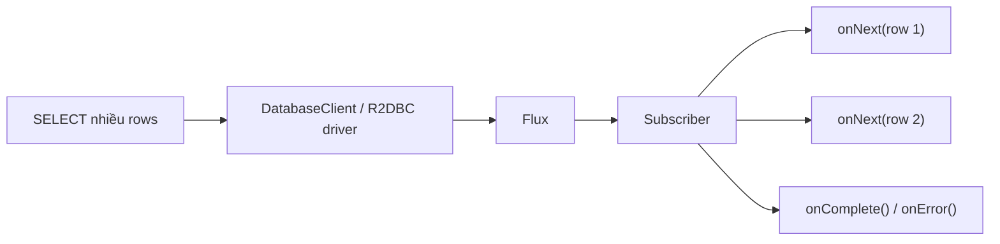
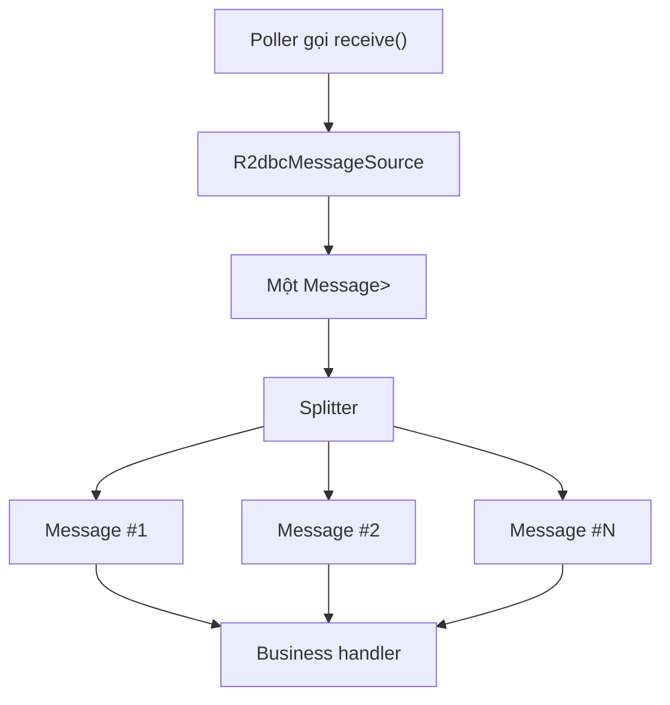
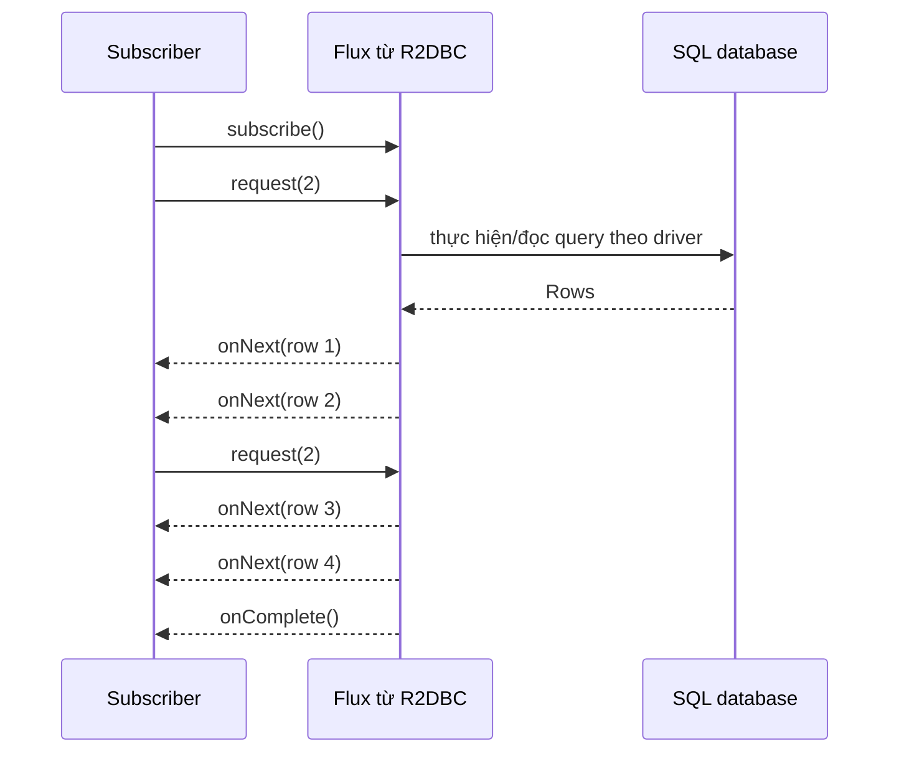
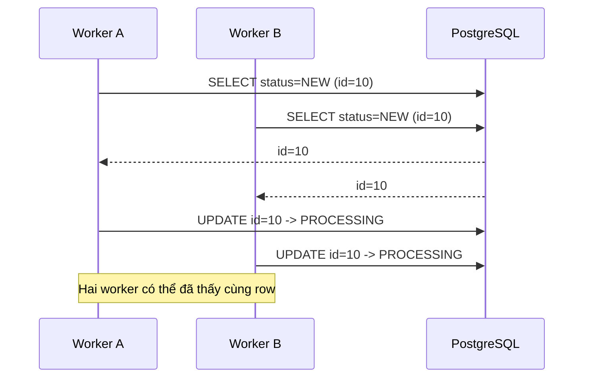

# Reactive query trả Flux

> **Chương:** Adapter R2DBC  
> **Module:** SPRING_INTEGRATION_ADAPTERS  
> **Bối cảnh:** Kết nối các hệ thống ngoài vào Spring Integration bằng inbound/outbound adapter, gateway, poller và MessageChannel. Thực hành trao đổi qua file, SFTP, HTTP, JMS, AMQP, Kafka và cơ sở dữ liệu; chú trọng hợp đồng message, lỗi và vòng đời kết nối.

## 1. Mục tiêu học tập

Hoàn thành bài học, bạn có thể:

- Mô tả `Flux<T>` là Publisher của **0..N phần tử** và phân biệt với `Mono<T>`, `List<T>`, `Stream<T>`.
- Viết truy vấn R2DBC `DatabaseClient.sql(...).map(...).all()` trả `Flux`, hoặc truy vấn entity qua `R2dbcEntityTemplate.select(...).all()`.
- Hiểu **lazy/cold Publisher**, subscription, `onNext`, `onComplete`, `onError`, cancellation và việc subscribe lại có thể thực hiện lại SQL.
- Ánh xạ `Row` sang POJO/record an toàn, bind parameters và xử lý SQL NULL đúng với Reactive Streams.
- Vận dụng `filter`, `map`, `concatMap`, `flatMap`, `buffer`, `collectList` với điều kiện về thứ tự, concurrency, tài nguyên.
- Giải thích `R2dbcMessageSource` mặc định trả **`Message<Flux<T>>`**, cần splitter/reactive consumer nếu muốn từng bản ghi trở thành Spring Message riêng.
- Phân biệt poller `maxMessagesPerPoll`, SQL `LIMIT`, `Flux` demand và giới hạn concurrency.
- Thiết kế đọc theo lô, keyset pagination, claim/ACK, retry, idempotency và transaction khi có nhiều instance đọc cùng bảng.
- Kiểm thử reactive query bằng Reactor `StepVerifier` và PostgreSQL thực; theo dõi metrics, error handling và DB connection pool.

## 2. Tại sao truy vấn R2DBC trả Flux?

Một ứng dụng tích hợp cần lấy các sự kiện mới từ một SQL database rồi chuyển sang HTTP, Kafka, AMQP hoặc một bộ xử lý nội bộ. Một câu `SELECT` có thể trả không có hàng nào, một hàng hoặc hàng nghìn hàng.

R2DBC (Reactive Relational Database Connectivity) truy cập database qua Reactive Streams. **`Flux<T>`** của Project Reactor biểu diễn một luồng gồm **0..N giá trị kiểu `T`** cộng tín hiệu kết thúc hoặc lỗi. Trong Spring Framework R2DBC, `DatabaseClient` có thể biến từng `Row` thành một phần tử của `Flux`:

```java
Flux<ReadingRow> readings = databaseClient
        .sql("SELECT id, device_id, reading_value FROM device_readings")
        .map((row, metadata) -> new ReadingRow(
                row.get("id", Long.class),
                row.get("device_id", String.class),
                row.get("reading_value", BigDecimal.class)
        ))
        .all();
```

Đoạn này là **minh họa**: cần import `Flux`, `BigDecimal` và khai báo kiểu `ReadingRow`. Nó không tạo ngay một `List` các hàng. Nó trả **Publisher**; khi được subscribe, query mới được kích hoạt và các hàng lần lượt được phát.



**Cần phân biệt:** Reactive không có nghĩa một query được database phát tức thời tới mọi nơi, không đồng nghĩa toàn bộ pipeline tự động backpressure và không bảo đảm mọi driver luôn truyền từng hàng qua mạng theo đúng `request(n)` một cách một-một.

### 2.1. Flux so với Mono, List và Java Stream

| Kiểu | Số phần tử | Đặc trưng quan trọng |
| --- | --- | --- |
| `Mono<T>` | 0 hoặc 1 | Thường dùng `one()`, `first()` hay một tác vụ ghi có kết quả. |
| `Flux<T>` | 0..N | Có onNext/onComplete/onError, subscription và demand. |
| `List<T>` | Số phần tử đã materialize | Dữ liệu đã nằm trong bộ nhớ. |
| `Stream<T>` Java | Duyệt pull/synchronous theo API Java | Không tự là Reactive Streams Publisher. |
| `Message<Flux<T>>` | **Một Spring Message** chứa Publisher | Không phải `N` Spring Messages. |
| `Flux<Message<T>>` | Publisher phát nhiều Spring Messages | Mỗi phần tử là một message riêng. |

Hai hàng cuối là điểm mấu chốt trong **Spring Integration R2DBC**.

### 2.2. Ba tín hiệu của một reactive query

Một `Flux<ReadingRow>` có thể:

1. Gửi `onNext(reading)` nhiều lần khi có dữ liệu.
2. Kết thúc bình thường bằng `onComplete()`.
3. Kết thúc bất thường bằng `onError(exception)`.

Sau `onComplete()` hoặc `onError()`, không có thêm `onNext` hợp lệ. **Không có hàng** thường nghĩa là **complete rỗng**, không phải lỗi `404` hay lỗi SQL.

`Flux` **không được phát `null` như item**. Một cột nullable có thể được đọc thành `null` trong lúc mapping, nhưng mapper cần đặt nó trong DTO có field nullable hoặc chọn cơ chế biểu diễn phù hợp; không trả `null` trực tiếp từ hàm `map(...)`.

## 3. Publisher lạnh, subscription và execution

### 3.1. Cold Publisher là gì?

Với hầu hết query R2DBC tạo từ `DatabaseClient`, `Flux` là **cold**: một subscription mới có thể làm SQL được thực hiện lại và dữ liệu được đọc lại từ database tại thời điểm đó.

```java
Flux<ReadingRow> query = repository.findRecent("sensor-01", 20);

// Trả về Publisher; SQL chưa chắc đã được chạy.
Mono<Long> count = query.count();
Mono<List<ReadingRow>> list = query.collectList();

// Hai nhánh tạo hai subscriptions độc lập khi được subscribe.
// Trạng thái DB có thể khác nhau giữa hai lần.
```

Điều này khác việc một `List` đã chứa sẵn dữ liệu. Không được suy luận rằng dùng cùng biến `query` nghĩa là đã có kết quả query được cache trong bộ nhớ.

### 3.2. Ví dụ Reactor không cần database

```java
import reactor.core.publisher.Flux;

Flux<Integer> cold = Flux.defer(() -> {
    System.out.println("Creating new subscription");
    return Flux.just(1, 2, 3);
});

cold.subscribe(value -> System.out.println("A=" + value));
cold.subscribe(value -> System.out.println("B=" + value));
```

Khi chạy demo, dòng "Creating new subscription" xuất hiện cho **mỗi subscription**. Với một R2DBC cold query, nguyên tắc tương tự: mỗi subscription có thể truy vấn lại, nhận dữ liệu khác nếu database thay đổi.

**Không gọi `subscribe()` thủ công tràn lan** trong service đang trả `Flux`, vì nó làm mất quyền điều phối cancellation, retry, transaction và completion của caller.

### 3.3. Những điều làm SQL thực sự được thực thi

Các thành phần có thể subscribe:

- Spring WebFlux khi endpoint trả `Flux<T>` hoặc `Mono<T>`.
- Reactor `StepVerifier` trong unit/integration test.
- Spring Integration reactive endpoint/channel khi flow được cấu hình đúng.
- Một service ở đầu luồng tổng hợp Publisher vào một reactive workflow.

Một lời gọi:

```java
Flux<ReadingRow> query = repository.findRecent("sensor-01", 20);
```

tự nó **không khẳng định query đã chạy**. Cũng không dùng `Thread.sleep()` để chứng minh completion; hãy quan sát terminal signal hoặc trạng thái DB theo hợp đồng.

### 3.4. subscribe lần hai có thể đọc trùng

```text
T0: Flux được tạo từ SELECT WHERE status='NEW'
T1: Subscriber A chạy SELECT -> id=100, 101
T2: Subscriber B chạy cùng SELECT -> id=100, 101
T3: Cả A và B gửi sang hệ thống ngoài
```

Nếu A/B đều có side effect, bản ghi có thể được xử lý **hai lần**. `Flux` không tự có claim/ACK/idempotency. Với công việc đáng tin cậy, cần thiết kế khóa nghiệp vụ, claim atomic, retry và consistency thay vì tin rằng một biến Flux chỉ được tiêu thụ một lần.

## 4. Chuẩn bị PostgreSQL và Spring Boot

Ví dụ định hướng **Java 17+, Spring Boot 3.x, Spring Integration 6.x**; dùng dependency management của Spring Boot để chọn các phiên bản tương thích. Một số API giữa các version thay đổi, nên đối chiếu Javadoc của bộ thư viện thực sự triển khai.

### 4.1. Maven dependencies

```xml
<dependencies>
    <dependency>
        <groupId>org.springframework.boot</groupId>
        <artifactId>spring-boot-starter-integration</artifactId>
    </dependency>
    <dependency>
        <groupId>org.springframework.boot</groupId>
        <artifactId>spring-boot-starter-data-r2dbc</artifactId>
    </dependency>
    <dependency>
        <groupId>org.springframework.integration</groupId>
        <artifactId>spring-integration-r2dbc</artifactId>
    </dependency>
    <dependency>
        <groupId>org.postgresql</groupId>
        <artifactId>r2dbc-postgresql</artifactId>
        <scope>runtime</scope>
    </dependency>
    <dependency>
        <groupId>io.projectreactor</groupId>
        <artifactId>reactor-test</artifactId>
        <scope>test</scope>
    </dependency>
</dependencies>
```

Dùng **R2DBC PostgreSQL driver**, không thay thế bằng `org.postgresql:postgresql` của JDBC. Khi muốn dùng connection pool, cấu hình dependency `r2dbc-pool` phù hợp hoặc dùng starter/BOM hỗ trợ và xác minh pool được tạo thật.

### 4.2. application.yml

```yaml
spring:
  r2dbc:
    url: r2dbc:postgresql://127.0.0.1:5432/integration_demo
    username: ${DB_USER}
    password: ${DB_PASSWORD}
    pool:
      enabled: true
      initial-size: 2
      max-size: 10
```

`${DB_USER}` và `${DB_PASSWORD}` đại diện placeholder lấy từ environment khi chạy, không phải mật khẩu lưu trong Git. Spring Boot có thể auto-configure `io.r2dbc.spi.ConnectionFactory`, `DatabaseClient`, `R2dbcEntityTemplate` và reactive transaction manager nếu dependency/bean conditions phù hợp.

### 4.3. Bảng ví dụ

```sql
CREATE TABLE device_readings (
    id            BIGSERIAL PRIMARY KEY,
    device_id     VARCHAR(64) NOT NULL,
    reading_value NUMERIC(12, 3) NOT NULL,
    status        VARCHAR(16) NOT NULL DEFAULT 'NEW',
    created_at    TIMESTAMPTZ NOT NULL DEFAULT CURRENT_TIMESTAMP,
    processed_at  TIMESTAMPTZ
);

CREATE INDEX idx_readings_device_id_id
    ON device_readings (device_id, id DESC);

CREATE INDEX idx_readings_status_id
    ON device_readings (status, id);

INSERT INTO device_readings(device_id, reading_value)
VALUES
  ('sensor-01', 20.5),
  ('sensor-01', 21.0),
  ('sensor-02', 18.75);
```

`id` dùng định danh hàng. `status` phục vụ ví dụ polling và ACK; `created_at` có thể dùng đo trễ. Đây là schema học tập, chưa có `claim_owner`, `lease_until` hoặc bảng outbox cho delivery production.

### 4.4. Kiểu Java dùng chung

Tạo `ReadingRow.java`:

```java
import java.math.BigDecimal;
import java.time.OffsetDateTime;

public record ReadingRow(
        Long id,
        String deviceId,
        BigDecimal value,
        String status,
        OffsetDateTime createdAt
) {
}
```

Khi mapping bằng `DatabaseClient.map(...)`, không bắt buộc có `@Table`. Khi muốn `R2dbcEntityTemplate` map tự động, có thể khai báo `@Table("device_readings")` và `@Column(...)` trên entity/record tương ứng.

## 5. DatabaseClient: truy vấn SELECT trả Flux

### 5.1. Repository end-to-end

Tạo `ReadingRepository.java`:

```java
import java.math.BigDecimal;
import java.time.OffsetDateTime;

import org.springframework.r2dbc.core.DatabaseClient;
import org.springframework.stereotype.Repository;
import reactor.core.publisher.Flux;

@Repository
public class ReadingRepository {

    private final DatabaseClient db;

    public ReadingRepository(DatabaseClient db) {
        this.db = db;
    }

    public Flux<ReadingRow> findRecent(String deviceId, int limit) {
        if (deviceId == null
                || !deviceId.matches("[A-Za-z0-9_-]{1,64}")) {
            return Flux.error(
                    new IllegalArgumentException("Invalid device ID"));
        }

        if (limit < 1 || limit > 100) {
            return Flux.error(
                    new IllegalArgumentException("Limit must be 1..100"));
        }

        return db.sql(
                        "SELECT id, device_id, reading_value, " +
                        "status, created_at " +
                        "FROM device_readings " +
                        "WHERE device_id = :deviceId " +
                        "ORDER BY id DESC LIMIT :maxRows")
                .bind("deviceId", deviceId)
                .bind("maxRows", limit)
                .map((row, metadata) -> new ReadingRow(
                        row.get("id", Long.class),
                        row.get("device_id", String.class),
                        row.get("reading_value", BigDecimal.class),
                        row.get("status", String.class),
                        row.get("created_at", OffsetDateTime.class)
                ))
                .all();
    }

    public Flux<ReadingRow> findReady(int batchSize) {
        if (batchSize < 1 || batchSize > 100) {
            return Flux.error(new IllegalArgumentException(
                    "Batch size must be 1..100"));
        }

        return db.sql(
                        "SELECT id, device_id, reading_value, " +
                        "status, created_at " +
                        "FROM device_readings WHERE status = 'NEW' " +
                        "ORDER BY id ASC LIMIT :batchSize")
                .bind("batchSize", batchSize)
                .map((row, metadata) -> new ReadingRow(
                        row.get("id", Long.class),
                        row.get("device_id", String.class),
                        row.get("reading_value", BigDecimal.class),
                        row.get("status", String.class),
                        row.get("created_at", OffsetDateTime.class)
                ))
                .all();
    }
}
```

**Phân tích:**

1. `DatabaseClient.sql(...)` tạo một SQL execution spec.
2. `bind(...)` liên kết **giá trị** với named parameter, không nối raw input vào SQL.
3. `map(...)` biến từng SQL `Row` thành `ReadingRow`.
4. `all()` trả `Flux<ReadingRow>`, không phải `List` đã materialize.
5. `ORDER BY` tạo thứ tự có ý nghĩa cho một lần query; nhiều lần query ở thời điểm khác nhau vẫn có thể nhìn thấy dữ liệu khác nhau.
6. `LIMIT` giới hạn số hàng của **một SELECT**; nó khác với Reactor demand và poller options.

**Quan trọng:** `status='NEW'` không tự khóa hàng. Hai caller hoặc hai instance query cùng lúc có thể nhận cùng row. Phần claim atomic được bàn ở mục 14.

### 5.2. Một hàng, nhiều hàng và query result

| API | Kiểu trả về | Khi dùng |
| --- | --- | --- |
| `.map(...).all()` | `Flux<T>` | Query có 0..N hàng. |
| `.map(...).one()` | `Mono<T>` | Mong đợi tối đa một hàng; nhiều hàng là lỗi theo contract. |
| `.map(...).first()` | `Mono<T>` | Chỉ lấy hàng đầu; nên dùng `ORDER BY`/`LIMIT 1`. |
| `.fetch().all()` | `Flux<Map<String,Object>>` | Muốn map tên cột–giá trị mặc định. |
| `.fetch().rowsUpdated()` | `Mono<Long>` | INSERT/UPDATE/DELETE cần số hàng tác động. |

`Flux` phát row **không phải SQL ResultSet JDBC đã nằm trọn trong RAM**. Tuy nhiên một driver, SQL server hoặc operator downstream vẫn có thể đệm dữ liệu. Không được dựa vào chữ "Flux" để khẳng định memory luôn hằng số.

### 5.3. Bảo toàn kiểu dữ liệu

- PostgreSQL `NUMERIC` thường map tốt tới `java.math.BigDecimal`.
- `TIMESTAMPTZ` thường được driver PostgreSQL R2DBC ánh xạ vào kiểu liên quan offset/timestamp; cần test driver và schema của ứng dụng.
- Nếu một cột có thể NULL, hàm mapping phải biểu diễn được null bằng một **field trong record/DTO**, không phát null trực tiếp làm item.
- Không chuyển `BigDecimal` thành `double` nếu tính chính xác số thập phân ảnh hưởng nghiệp vụ.
- Khi schema đổi tên cột, kiểm tra mapping bằng test thay vì để runtime lỗi muộn.

## 6. Flux và các operator quan trọng

### 6.1. map: biến đổi từng phần tử

```java
Flux<String> summaries = repository.findReady(20)
        .map(reading ->
                reading.deviceId() + "=" + reading.value());
```

`map` giữ thứ tự item trong luồng; nó không có nghĩa thực thi bất đồng bộ mỗi item.

### 6.2. filter: bỏ các item không đáp ứng điều kiện

```java
Flux<ReadingRow> hot = repository.findReady(20)
        .filter(reading ->
                reading.value().compareTo(
                        new java.math.BigDecimal("30.0")) > 0);
```

`filter` xảy ra **sau** khi DB trả item cho client. Với tập dữ liệu lớn, điều kiện có thể đẩy xuống SQL `WHERE reading_value > :threshold` để giảm byte và tải mapping. Đừng dùng `filter` thay cho SQL index khi database có thể lọc hiệu quả hơn.

### 6.3. concatMap: xử lý bất đồng bộ theo thứ tự

Một service muốn gửi từng reading tới remote API và chỉ chuyển sang item kế tiếp khi item trước hoàn thành:

```java
import reactor.core.publisher.Flux;
import reactor.core.publisher.Mono;

public final class ReadingBatchProcessor {

    private final ReadingRepository repository;
    private final RemoteReadingSender sender;

    public ReadingBatchProcessor(
            ReadingRepository repository,
            RemoteReadingSender sender) {
        this.repository = repository;
        this.sender = sender;
    }

    public Mono<Void> processOrdered() {
        return repository.findReady(25)
                .concatMap(sender::send)
                .then();
    }
}
```

Giả sử `RemoteReadingSender.send(ReadingRow)` trả `Mono<Void>`, không block và hoàn thành sau khi remote xác nhận theo contract của nó. `concatMap` duy trì **thứ tự và xử lý từng item theo chuỗi**; `then()` trả `Mono<Void>` khi toàn bộ batch hoàn tất.

**Đây là khung xử lý minh họa**, không phải delivery production: thiếu atomic claim, ACK, retry và idempotency, nên hai tiến trình có thể cùng gửi một row.

### 6.4. flatMap: giới hạn số tác vụ đồng thời

Khi độc lập theo item và không cần thứ tự side effect:

```java
Mono<Void> task = repository.findReady(25)
        .flatMap(sender::send, 4)
        .then();
```

`flatMap(..., 4)` cho phép tối đa khoảng **4 publisher con** được xử lý đồng thời theo cơ chế operator. Item hoàn thành có thể **khác thứ tự SQL**.

| Operator | Thứ tự đầu ra | Đồng thời |
| --- | --- | --- |
| `map` | Giữ thứ tự input | Biến đổi đồng bộ, không tự tạo async tasks. |
| `concatMap` | Giữ thứ tự | Mỗi inner Publisher được xử lý tuần tự. |
| `flatMap` | Có thể đảo thứ tự | Có, cần giới hạn concurrency. |
| `flatMapSequential` | Giữ thứ tự phát kết quả | Inner tasks vẫn có thể chạy đồng thời. |

Giữ thứ tự kết quả **không đồng nghĩa** các tác dụng phụ từ inner tasks đều xảy ra đúng thứ tự. Nếu nghiệp vụ yêu cầu một event phải commit trước event kế tiếp, dùng điều phối tuần tự và transaction hợp đồng phù hợp.

### 6.5. buffer và collectList

```java
Flux<java.util.List<ReadingRow>> groups =
        repository.findReady(100).buffer(10);

Mono<java.util.List<ReadingRow>> completeList =
        repository.findReady(100).collectList();
```

- `buffer(10)` nhóm tối đa 10 item thành một list, hữu ích khi downstream hỗ trợ batch.
- `collectList()` chỉ trả về sau khi Flux complete, giữ tất cả item trong **RAM**.
- Dùng `collectList()` khi query đã có `LIMIT` hợp lý; đừng collect không giới hạn bảng có hàng triệu bản ghi.

`buffer` của Reactor là grouping trong bộ nhớ ứng dụng; **không tự tương đương batch INSERT/SQL cursor**.

### 6.6. take, limitRate và query LIMIT

```java
Flux<ReadingRow> partial = repository.findReady(100)
        .take(10);

Flux<ReadingRow> demandTuned = repository.findReady(100)
        .limitRate(16);
```

`take(10)` hủy subscription sau 10 item, nhưng query SQL vẫn có thể đã được thực thi và driver/database đã xử lý thêm dữ liệu. `limitRate(16)` điều chỉnh demand gửi lên nguồn; nó **không** đặt SQL `LIMIT 16` và không bảo đảm server DB dùng tối đa 16 rows trong RAM.

**Ưu tiên giới hạn dữ liệu ở database bằng SQL**, rồi mới điều phối demand và concurrency của Reactor.

## 7. R2dbcEntityTemplate cũng có thể trả Flux

Với một entity được map bằng Spring Data R2DBC:

```java
import java.math.BigDecimal;
import java.time.OffsetDateTime;

import org.springframework.data.annotation.Id;
import org.springframework.data.relational.core.mapping.Column;
import org.springframework.data.relational.core.mapping.Table;

@Table("device_readings")
public record ReadingEntity(
        @Id Long id,
        @Column("device_id") String deviceId,
        @Column("reading_value") BigDecimal value,
        String status,
        @Column("created_at") OffsetDateTime createdAt
) {
}
```

Truy vấn entity qua `R2dbcEntityTemplate`:

```java
import org.springframework.data.r2dbc.core.R2dbcEntityTemplate;
import org.springframework.data.relational.core.query.Criteria;
import org.springframework.data.relational.core.query.Query;
import org.springframework.data.domain.Sort;
import reactor.core.publisher.Flux;

public Flux<ReadingEntity> findNewEntities(
        R2dbcEntityTemplate template, int limit) {

    Query query = Query.query(
                    Criteria.where("status").is("NEW"))
            .sort(Sort.by(Sort.Direction.ASC, "id"))
            .limit(limit);

    return template.select(ReadingEntity.class)
            .matching(query)
            .all();
}
```

**Cách chọn:**

| Trường hợp | Gợi ý |
| --- | --- |
| Cần SQL JOIN, CTE, `RETURNING` hoặc dialect-specific query | `DatabaseClient`. |
| Muốn mapping entity và `Criteria`/`Query` | `R2dbcEntityTemplate`. |
| Muốn dùng Repository API của Spring Data R2DBC | `ReactiveCrudRepository` và query methods. |
| Cần Spring Integration inbound adapter | `R2dbcEntityOperations` được truyền vào `R2dbcMessageSource`. |

Cả `DatabaseClient` lẫn `R2dbcEntityTemplate` dùng hạ tầng R2DBC connection. Tên "template" không đồng nghĩa query có kết quả eager; các query trả reactive Publisher vẫn cần subscription.

## 8. R2DBC inbound channel adapter: một Message chứa Flux

Đây là điểm liên quan trực tiếp đến module **SPRING_INTEGRATION_ADAPTERS**.

`R2dbcMessageSource` là một `MessageSource<Publisher<?>>` được poller kích hoạt. **Mặc định `expectSingleResult=false`**, nên `receive()` trả một Spring Message có **payload là một `Flux`** của các hàng được truy vấn.



### 8.1. So sánh hai cách nhìn

```text
DatabaseClient trực tiếp:
  SELECT -> Flux<ReadingRow>
    subscriber nhận từng ReadingRow

Spring Integration R2DBC inbound:
  một poll -> Message<Flux<ReadingEntity>>
    splitter -> Message<ReadingEntity> cho từng row
```

**Một lần poll có thể phát nhiều hàng**, nhưng chưa có splitter/reactive consumer thì chưa có N Spring Messages. Không được viết handler `handle(ReadingEntity.class, ...)` ngay sau source mà mặc định payload đã là một `ReadingEntity`.

### 8.2. Java DSL inbound flow có splitter

Tạo `ReadingR2dbcInboundConfiguration.java` **thay thế cho các source khác cùng bảng khi làm bài thực hành**:

```java
import org.springframework.context.annotation.Bean;
import org.springframework.context.annotation.Configuration;
import org.springframework.data.r2dbc.core.R2dbcEntityTemplate;
import org.springframework.integration.config.EnableIntegration;
import org.springframework.integration.dsl.IntegrationFlow;
import org.springframework.integration.dsl.MessageChannels;
import org.springframework.integration.r2dbc.dsl.R2dbc;

@Configuration
@EnableIntegration
public class ReadingR2dbcInboundConfiguration {

    @Bean
    IntegrationFlow readingInboundFlow(
            R2dbcEntityTemplate template) {

        return IntegrationFlow
                .from(
                        R2dbc.inboundChannelAdapter(
                                template,
                                "SELECT id, device_id, reading_value, " +
                                "status, created_at " +
                                "FROM device_readings " +
                                "WHERE status = 'NEW' " +
                                "ORDER BY id LIMIT 20")
                                .payloadType(ReadingEntity.class)
                                .expectSingleResult(false),
                        e -> e.poller(p ->
                                p.fixedDelay(2_000)
                                 .maxMessagesPerPoll(1))
                )
                .channel(MessageChannels.flux())
                .split()
                .channel(MessageChannels.flux())
                .handle(ReadingEntity.class, (reading, headers) -> {
                    System.out.printf(
                            "R2DBC reading id=%s device=%s value=%s%n",
                            reading.id(),
                            reading.deviceId(),
                            reading.value()
                    );
                    // Demo chỉ log; không chứng minh đã ACK downstream.
                    return null;
                })
                .get();
    }
}
```

**Giải thích:**

1. Poller định kỳ gọi `R2dbcMessageSource.receive()`.
2. `payloadType(ReadingEntity.class)` chọn cách map mỗi row.
3. `expectSingleResult(false)` giữ hành vi tạo `Flux<ReadingEntity>`.
4. `MessageChannels.flux()` chọn channel reactive phù hợp với publisher/splitter.
5. `.split()` tách các phần tử của `Flux` thành message có payload là một `ReadingEntity`.
6. Handler log mỗi hàng; không tự tạo ACK/delivery guarantee.
7. SQL `LIMIT 20` giới hạn **row count mỗi lần SELECT**, khác `maxMessagesPerPoll(1)` giới hạn số lần source `receive()` trong một poll task.

**Cảnh báo:** Flow chỉ SELECT `status='NEW'`, không UPDATE/claim. Những lần poll tiếp theo có thể đọc lại **cùng bản ghi** và gửi log nhiều lần. Đây là demo làm rõ cấu trúc Publisher; production phải thiết kế ownership/ACK như mục 14.

### 8.3. Splitter hiểu Publisher ra sao?

Spring Integration splitter hỗ trợ `Publisher`. Khi output channel là một `ReactiveStreamsSubscribableChannel` phù hợp (ví dụ `FluxMessageChannel`), splitter có thể tạo reactive Flux cho việc tách và áp dụng cơ chế demand downstream.

Nếu thay output bằng một channel/handler không hỗ trợ reactive thích hợp, quá trình tách có thể đi theo cách xử lý khác. Vì vậy cần **xem loại channel, subscriber, concurrency và lỗi thực tế**, không chỉ biết Spring Integration có `.split()`.

### 8.4. expectSingleResult=true có biến Flux thành row trực tiếp không?

Khi chuyển sang `expectSingleResult(true)`, R2DBC source dùng chế độ **một kết quả**, payload theo API là **`Mono`**; không nên mặc định nó đã thành POJO ngay khi poller phát Spring Message.

```text
expectSingleResult = false (mặc định):
  receive() -> Message<Flux<ReadingEntity>>

expectSingleResult = true:
  receive() -> Message<Mono<ReadingEntity>>
```

Để handler nhận object, downstream vẫn cần consume/unpack Publisher theo mô hình flow. Khi dùng `true`, câu SQL nên bảo đảm tối đa một hàng hoặc xử lý rõ quy tắc nhiều hàng; `LIMIT 1` thường giúp diễn đạt ý định.

### 8.5. updateSql không phải ACK sau handler

`R2dbcMessageSource` hỗ trợ `updateSql` cùng `bindFunction` để **đánh dấu các record đã đọc** nhằm tránh poll lại. Nhưng việc UPDATE/claim ở tầng source **không chứng minh downstream đã xử lý xong**.

Ví dụ một flow:

```text
SELECT status=NEW
      |
      v
UPDATE status=CLAIMED
      |
      v
Flux rows -> splitter -> HTTP/Kafka
                           |
                           +--> lỗi sau khi đã CLAIMED
```

Nếu worker chết sau khi claim nhưng trước khi gửi xong, hàng có thể bị kẹt ở `CLAIMED`. Cần lease, retry/compensation, ACK sau xử lý và idempotency. Đừng gọi `updateSql` là "exactly-once" chỉ vì query không còn đọc lại hàng đó.

## 9. Phân biệt polling rate, batch size và backpressure

| Giới hạn | Quy định cái gì? | Không quy định |
| --- | --- | --- |
| `fixedDelay(2_000)` | Thời gian lập lịch giữa các lần poll task theo cấu hình. | Không chứng minh mọi reactive subscription trước đã xong. |
| `maxMessagesPerPoll(1)` | Số lần poller gọi `receive()` mỗi lượt task. | Không giới hạn một row SELECT. |
| SQL `LIMIT 20` | Số rows trả về mỗi query. | Không tự chặn nhiều query/poll overlap. |
| `Flux.request(n)` | Demand của subscriber với upstream Publisher. | Không bắt DB trả đúng n rows qua network/transaction. |
| `flatMap(..., 4)` | Concurrency inner publishers trong Reactor chain. | Không giới hạn mọi producer khác hay pool DB toàn ứng dụng. |
| R2DBC pool max-size=10 | Connection tối đa theo pool. | Không giới hạn số request pending nếu queue chưa giới hạn. |
| Broker/topic/queue capacity | Buffer/delivery của tầng transport. | Không thay thế DB ownership/ACK. |

### 9.1. Ví dụ một poll nhưng 20 rows

```text
Poller fixedDelay=2000ms, maxMessagesPerPoll=1
   |
   +-- receive() duy nhất
         |
         +-- SQL LIMIT 20
               |
               +-- Message<Flux<ReadingEntity>>
                     |
                     +-- 20 item / 20 Spring Messages sau splitter
```

Nếu thay SQL thành SELECT không giới hạn, một lần poll vẫn có thể trả hàng nghìn item. Đặt `maxMessagesPerPoll=1` không bảo vệ DB/memory trong tình huống đó.

### 9.2. Poller có thể overlap với reactive workload

Một poll task có thể chỉ đưa Publisher tới downstream rồi kết thúc trước khi subscription xử lý xong các rows. Vì thế các lần poll kế tiếp có thể bắt đầu khi batch trước đang xử lý.

Nếu xử lý cần **không overlap**:

- Giới hạn số pipeline active.
- Cân nhắc dùng một orchestration `Flux`/`Mono` tuần tự với completion rõ, hoặc custom polling có kết quả reactive được chờ đúng contract.
- Thiết kế claim atomic trong DB để hai poll/instance không đọc trùng khi overlap vẫn xảy ra.
- Đo metrics thực tế về active subscriptions và processing latency.

`fixedDelay` đơn thuần không cung cấp distributed lock hay database lease.

## 10. Backpressure: làm chậm nguồn, không thay thế thiết kế DB

Reactive Streams cung cấp cơ chế `Subscriber.request(n)` cho **demand**. Một `Flux` có thể chờ consumer yêu cầu thêm item trước khi phát.



Sơ đồ mô tả **contract demand**; nó không cam kết database network chỉ gửi đúng hai rows mỗi lần request. Driver, protocol, server và operator buffering có thể prefetch/buffer.

### 10.1. Backpressure end-to-end yêu cầu mọi mắt xích phù hợp

Một pipeline có:

```text
R2DBC query
   -> Reactor Flux
   -> Spring Integration FluxMessageChannel
   -> Splitter
   -> Reactive handler
   -> downstream API/broker
```

mới có cơ hội giữ reactive demand hiệu quả khi các đoạn thực sự hỗ trợ và được nối đúng. Nếu một handler gọi `block()` trên event-loop, gom vô hạn rows hoặc tạo hàng nghìn `subscribe()` độc lập, hiệu quả backpressure có thể mất.

### 10.2. SQL LIMIT, pool và concurrency quan trọng hơn nhãn reactive

Để bảo vệ database:

1. Giới hạn **row count** bằng SQL `LIMIT`/pagination.
2. Bảo đảm index phục vụ `WHERE`/`ORDER BY`.
3. Cấu hình max database connections, pending acquire timeout và statement timeout.
4. Giới hạn concurrency khi gọi external API hoặc ghi DB.
5. Có capacity/retention rõ cho queue và số event đang xử lý.
6. Đo query latency, pool utilization, backlog và end-to-end time.
7. Khi cần exactly-once effects, thiết kế idempotency độc lập với backpressure.

**Flux** giải quyết cách biểu diễn/điều phối stream, không tự giải quyết quyền sở hữu một record hoặc tính đúng của transaction.

## 11. Phân trang và query lớn

### 11.1. Tại sao không SELECT toàn bảng?

Nếu bảng có 10 triệu rows, câu:

```sql
SELECT * FROM device_readings;
```

có thể tốn nhiều tài nguyên: DB phải đọc nhiều pages, network truyền dữ liệu lớn, connection/cursor giữ lâu, client mapping chậm và queue downstream có thể quá tải.

Cần phân lô theo business ordering, ví dụ `id` tăng:

```sql
SELECT id, device_id, reading_value, status, created_at
FROM device_readings
WHERE id > :lastId
ORDER BY id
LIMIT :batchSize;
```

Mô hình **keyset pagination** thường hiệu quả hơn OFFSET lớn cho bảng nhiều dữ liệu thay đổi. Nhưng nó cần một quy tắc nhất quán về cursor/ordering, snapshot và dữ liệu được thêm mới trong lúc quét.

### 11.2. Repository cho keyset pagination

Đoạn method đặt trong `ReadingRepository`:

```java
public Flux<ReadingRow> findAfter(
        long lastId, int batchSize) {

    if (lastId < 0 || batchSize < 1 || batchSize > 500) {
        return Flux.error(new IllegalArgumentException(
                "Invalid cursor or batch size"));
    }

    return db.sql(
                    "SELECT id, device_id, reading_value, " +
                    "status, created_at " +
                    "FROM device_readings WHERE id > :lastId " +
                    "ORDER BY id LIMIT :batchSize")
            .bind("lastId", lastId)
            .bind("batchSize", batchSize)
            .map((row, metadata) -> new ReadingRow(
                    row.get("id", Long.class),
                    row.get("device_id", String.class),
                    row.get("reading_value", BigDecimal.class),
                    row.get("status", String.class),
                    row.get("created_at", OffsetDateTime.class)
            ))
            .all();
}
```

**Cẩn trọng:** `lastId` là **cursor quét dữ liệu**, không phải ACK event đã xử lý. Nếu cập nhật cursor trước khi xử lý xong batch, crash có thể khiến những rows chưa xử lý bị bỏ qua trong lần chạy sau.

### 11.3. Phân trang không đồng nghĩa delivery semantics

- `OFFSET/LIMIT` có thể **bỏ sót hoặc lặp** rows khi dữ liệu được thêm/xóa giữa các page.
- Keyset dựa trên ID ổn định giúp tránh một số vấn đề OFFSET, nhưng cần xử lý transaction/snapshot và thứ tự commit.
- Nếu ứng dụng chỉ cần scan báo cáo, cursor có thể là đủ.
- Nếu ứng dụng cần **xử lý mỗi sự kiện**, cần claim/ACK/lease và retry; không dùng `lastId` như bằng chứng tất cả side effects đã hoàn tất.

## 12. Flux, transaction và connection lifecycle

### 12.1. Transaction gắn với reactive subscription

Spring R2DBC hỗ trợ reactive transaction qua `R2dbcTransactionManager` và `TransactionalOperator`. Transaction context được truyền trong **Reactor Context** của reactive chain.

```java
import org.springframework.transaction.reactive.TransactionalOperator;
import reactor.core.publisher.Flux;

public Flux<ReadingRow> findInTransaction(
        ReadingRepository repository,
        TransactionalOperator tx) {

    return repository.findReady(20)
            .as(tx::transactional);
}
```

Đây là method minh họa nằm trong class Java. Khi Publisher được subscribe, operator thiết lập transaction context. Không nên gọi `subscribe()` mới ở giữa một chuỗi transaction để thực hiện side effect rồi mong nó tự tham gia đúng transaction bên ngoài.

### 12.2. Giữ Flux mở lâu có thể giữ connection lâu

Nếu query trả `Flux` và downstream xử lý mỗi row rất chậm, connection/result resources có thể được giữ lâu cho tới khi nguồn hoàn tất hoặc bị cancel, tùy driver/cursor/transaction.

Cách hạn chế:

- Query theo batch nhỏ thay vì stream nhiều triệu rows trên một transaction.
- Tách **đọc/claim DB** khỏi **gọi remote API chậm** khi cần.
- Không để transaction DB mở qua các thao tác mạng không chắc chắn thời gian.
- Đặt statement timeout/transaction timeout và giới hạn lifecycle subscription.
- Bảo đảm cleanup khi `cancel` hoặc error, theo dõi pool acquire time.

### 12.3. Transaction SQL không bao trùm hệ thống ngoài

```text
SELECT/CLAIM rows trong PostgreSQL
                |
                v
Publish rows sang Kafka
                |
                v
ACK/cập nhật DONE
```

PostgreSQL transaction không tự rollback được Kafka publish hoặc HTTP call. Nếu process chết sau publish nhưng trước ACK, downstream có thể nhận trùng trong lần retry.

Đối với delivery đáng tin cậy, dùng **idempotent consumer**, transactional outbox, ACK sau xử lý, lease và retry có giới hạn theo hợp đồng.

## 13. Lỗi trong Flux, retry và cancellation

### 13.1. Error signal kết thúc một subscription

Một query có thể phát vài row rồi lỗi connection/mapping:

```text
onNext(row 1)
onNext(row 2)
onError(R2dbcException)
```

Không nên báo rằng "tất cả rows của query đã xử lý" khi chưa có `onComplete()`. Nếu subscriber đã gửi row 1, row 2 đến downstream, retry cả query có thể **phát lại hai row đó**.

### 13.2. retryWhen tạo subscription mới

```java
import java.time.Duration;
import reactor.util.retry.Retry;

Flux<ReadingRow> retriedRead = repository.findReady(20)
        .retryWhen(Retry.backoff(2, Duration.ofMillis(200))
                .maxBackoff(Duration.ofSeconds(2)));
```

Đây chỉ là **mẫu minh họa retry query đọc thuần**; production phải lọc exception transient và có total deadline. **Retry một cold Flux thường re-subscribe và thực hiện lại query**, không nhất thiết tiếp tục từ row cuối đã phát. Nếu subscriber thực hiện side effect, điều đó có thể tạo duplicate.

Không retry vô hạn SQL syntax error, permission denied, mapping exception hoặc invalid query schema.

### 13.3. Timeout theo item khác total batch deadline

```java
import java.time.Duration;

Flux<ReadingRow> withGapTimeout = repository.findReady(20)
        .timeout(Duration.ofSeconds(3));
```

`Flux.timeout(Duration)` có thể đặt **giới hạn khoảng chờ tín hiệu kế tiếp**, không phải tổng thời gian hoàn tất mọi item. Nếu mỗi row cứ đến trước 3 giây, toàn batch vẫn có thể chạy lâu hơn nhiều.

Khi cần **total batch deadline** cho một batch nhỏ đã giới hạn:

```java
Mono<java.util.List<ReadingRow>> batch =
        repository.findReady(20)
                .collectList()
                .timeout(Duration.ofSeconds(8));
```

`collectList()` dùng bộ nhớ theo số phần tử, vì vậy ở đây có `LIMIT 20` từ repository. Tổng deadline cần được phối hợp với connect timeout, pool acquire timeout, SQL statement timeout và downstream SLA.

### 13.4. Cancellation cần cleanup

Một subscriber có thể hủy `Flux` giữa query. Spring `DatabaseClient` và driver/pool chịu trách nhiệm quản lý connection theo contract, nhưng ứng dụng vẫn phải:

- Tránh tự tạo raw `Connection` rồi quên close.
- Không giữ Publisher không bao giờ complete trong một transaction vô thời hạn.
- Theo dõi timeout, cancel và pool active connections.
- Không tuyên bố row đã ACK nếu subscriber cancel trước khi xử lý.
- Cẩn trọng với `take(n)`: cancellation không tự là rollback mọi side effect đã commit.

### 13.5. Xử lý lỗi per-item thay vì làm mất cả batch

Giả sử remote API có thể thất bại với một reading. Nếu muốn ghi lại lỗi và xử lý tiếp các reading khác, đặt error handling **bên trong Publisher của từng item**, không đơn thuần bắt lỗi bên ngoài toàn Flux:

```java
Mono<Void> process = repository.findReady(20)
        .concatMap(reading ->
                sender.send(reading)
                        .onErrorResume(error ->
                                failureRecorder.record(reading, error)))
        .then();
```

Giả định `sender.send(...)` và `failureRecorder.record(...)` đều trả `Mono<Void>`. Nếu `failureRecorder` cũng thất bại, lỗi vẫn lan truyền để dừng chain. Đoạn này **không** phải cơ chế ACK đã hoàn thiện: vẫn cần quyết định khi nào trạng thái đọc/claim được commit và event nào được retry.

Tránh dùng `onErrorContinue` như giải pháp tổng quát để "bỏ qua item lỗi"; nó có thể tạo hành vi khó dự đoán với operator/stateful resources.

## 14. Tránh đọc trùng: claim atomic, ACK và idempotency

### 14.1. Vấn đề SELECT rồi UPDATE rời nhau



Một query trả `Flux` **không khóa độc quyền** các hàng được SELECT. Nếu adapter inbound dùng `updateSql` sau khi chọn hàng mà không có protocol claim bảo đảm sở hữu, nhiều worker có thể vẫn nhận cùng record.

### 14.2. PostgreSQL atomic claim với UPDATE RETURNING

Với PostgreSQL, có thể dùng một câu SQL để **claim và lấy chính các hàng đã claim**:

```sql
WITH candidates AS (
    SELECT id
    FROM device_readings
    WHERE status = 'NEW'
    ORDER BY id
    LIMIT :batchSize
    FOR UPDATE SKIP LOCKED
)
UPDATE device_readings AS r
SET status = 'PROCESSING'
FROM candidates
WHERE r.id = candidates.id
RETURNING r.id, r.device_id, r.reading_value,
          r.status, r.created_at;
```

Thao tác SQL này **phụ thuộc dialect PostgreSQL**; cần test transaction/isolation và cách xử lý khi nhiều worker chạy đồng thời. Nó chỉ giải quyết bước claim, chưa tự có recovery nếu worker chết sau claim.

### 14.3. Thực hiện query RETURNING bằng DatabaseClient

```java
public Flux<ReadingRow> claimNew(int batchSize) {
    if (batchSize < 1 || batchSize > 100) {
        return Flux.error(new IllegalArgumentException("Invalid batchSize"));
    }

    return db.sql(
                    "WITH candidates AS (" +
                    " SELECT id FROM device_readings " +
                    " WHERE status = 'NEW' ORDER BY id " +
                    " LIMIT :size FOR UPDATE SKIP LOCKED" +
                    ") UPDATE device_readings AS r " +
                    "SET status = 'PROCESSING' " +
                    "FROM candidates WHERE r.id = candidates.id " +
                    "RETURNING r.id, r.device_id, r.reading_value, " +
                    "r.status, r.created_at")
            .bind("size", batchSize)
            .map((row, metadata) -> new ReadingRow(
                    row.get("id", Long.class),
                    row.get("device_id", String.class),
                    row.get("reading_value", BigDecimal.class),
                    row.get("status", String.class),
                    row.get("created_at", OffsetDateTime.class)
            ))
            .all();
}
```

Đây là một method **bổ sung vào `ReadingRepository`**. Lúc này Publisher vẫn là `Flux<ReadingRow>`, nhưng **các phần tử được trả là những hàng đã được câu UPDATE claim** thay vì một SELECT thuần.

**Đặc biệt quan trọng:** Đây là thao tác **có tác dụng phụ**. Nếu subscribe hai lần cùng một Flux query, lệnh UPDATE claim có thể được chạy hai lần, mỗi lần claim **batch khác**. Không dùng `retryWhen` mù trên claim publisher và nghĩ nó chỉ "đọc tiếp" batch cũ.

### 14.4. Lease và ACK sau downstream

Mẫu production nên bổ sung:

```text
NEW
  |
  v
PROCESSING (owner, lease_until, attempt_count)
  |                       |
  | xử lý thành công       | timeout/crash
  v                       v
DONE                 READY_TO_RETRY
                          |
                          v
                         NEW / DEAD
```

- **Claim**: xác định rõ owner và hạn thuê, chỉ phát hàng đã claim.
- **Process**: dùng item/business ID làm idempotency key khi gọi hệ thống ngoài.
- **ACK**: đổi trạng thái `DONE` **sau** khi downstream hoàn tất theo contract.
- **Recovery**: nếu worker chết, lease quá hạn cho phép retry có giới hạn.
- **DLQ**: chuyển record không thể xử lý sau nhiều lần thử sang trạng thái `DEAD`/quy trình can thiệp.
- **Multi-instance**: dùng optimistic version/unique constraints/atomic DB statement để ngăn claim cạnh tranh.

Nếu Kafka/AMQP/HTTP đã xử lý nhưng ACK về DB mất, row có thể được phát lại. Vì vậy **idempotent consumer** vẫn cần thiết; R2DBC và Reactor không tự cung cấp exactly-once effects.

## 15. Reactor Flux và Spring Integration MessageChannel

### 15.1. Mô hình truyền thẳng Publisher

Một flow có thể chuyển `Message<Flux<T>>` qua channel để một handler reactive hiểu Publisher tự subscribe và xử lý từng item. Nhưng một handler chỉ nhận `T` sẽ **không** tự unwrap Flux.

Nếu dùng POJO handler:

```java
.handle(ReadingEntity.class, (reading, headers) -> {
    System.out.println(reading.id());
    return null;
})
```

thì phải bảo đảm trước đó đã có splitter hoặc một bước chuyển đổi khiến **payload là `ReadingEntity`**, không còn `Flux<ReadingEntity>`.

### 15.2. Mô hình splitter

```text
Source poller
    |
    v
Message<Flux<ReadingEntity>>
    |
    v
Splitter
    |
    +--> Message<ReadingEntity>(id=1)
    +--> Message<ReadingEntity>(id=2)
    +--> Message<ReadingEntity>(id=3)
    |
    v
Downstream endpoint(s)
```

Splitter còn có thể bổ sung sequence/correlation headers cho message đã tách. Đây là metadata trong Spring Integration, **không phải** idempotency key được database lưu bền.

### 15.3. Chọn kênh và điểm chuyển giao

- `DirectChannel` thường chuyển message đồng bộ theo cách dispatch của nó; không tự có reactive backpressure end-to-end.
- `FluxMessageChannel` hỗ trợ subscriber/demand của Reactive Streams, phù hợp với đường xử lý publisher khi cấu hình đúng.
- `QueueChannel` đệm message theo queue nhưng không làm Flux payload tự hoàn thành; phải xác định ai subscribe.
- Bridge từ Reactor sang broker/HTTP có thể có ACK riêng, retry semantics và các giới hạn concurrency khác.

**Không chọn channel chỉ vì tên "reactive" nghe nhanh hơn.** Kiểm tra đúng contract, error propagation, thứ tự, throughput, khả năng replay và backpressure giữa các endpoint.

## 16. Quan sát và tối ưu hiệu năng

### 16.1. Metrics cần thiết

| Metric | Ý nghĩa |
| --- | --- |
| Query subscriptions total | Một cold query đã bị subscribe bao nhiêu lần? |
| Query completed/error/cancelled | Có bao nhiêu batch hoàn tất, thất bại hoặc bị hủy? |
| SELECT latency p50/p95/p99 | DB query có chậm không? |
| Rows emitted per query | Mỗi query thực sự trả bao nhiêu item? |
| Processing latency per row | Handler/HTTP/Kafka có làm chậm pipeline không? |
| R2DBC pool active/idle/pending | Connection pool có nghẽn không? |
| Poll attempts / overlap | Các poll có chạy chồng nhau không? |
| Oldest NEW age / backlog | Hàng chưa xử lý có tồn đọng không? |
| Claimed / DONE / expired leases | Claim/ACK có bị kẹt không? |
| Duplicate IDs / retry attempts | Có redelivery/claim retry ngoài dự kiến không? |
| Error class/SQLState | Lỗi DB tạm thời, constraint hay mapping? |

Tên metric ở trên là **gợi ý**, không phải mọi tên đều được Micrometer/Spring Integration tự phát sinh. Instrument tại điểm subscribe/complete/error, SQL query, claim, ACK và downstream side effects.

### 16.2. Debug một Flux

```java
import reactor.core.publisher.Flux;
import reactor.core.publisher.SignalType;

Flux<ReadingRow> traced = repository.findReady(20)
        .doOnSubscribe(subscription ->
                System.out.println("R2DBC query subscribed"))
        .doOnNext(row ->
                System.out.println("Read id=" + row.id()))
        .doOnError(error ->
                System.err.println("Read error=" + error.getClass()))
        .doFinally(signal ->
                System.out.println("Final signal=" + signal));
```

Đoạn trên không tự execute; cần một subscriber. Khi logging trong production, không đưa bí mật/PII hoặc toàn bộ payload vào log. `doFinally` có thể quan sát `ON_COMPLETE`, `ON_ERROR` hoặc `CANCEL`; phân loại chúng rõ để không báo sai số lượng batch thành công.

### 16.3. Tối ưu query ở đâu?

Ưu tiên tối ưu **database và data volume** trước:

1. Index phù hợp `WHERE`/`ORDER BY`.
2. `EXPLAIN ANALYZE` trong môi trường an toàn để kiểm tra query plan.
3. Giảm cột với projection thay vì `SELECT *` khi không cần.
4. Batch size vừa đủ và keyset pagination nếu quét nhiều rows.
5. Giới hạn connection pool, active subscriptions, query timeout.
6. Tránh giữ transaction/cursor mở qua HTTP call chậm.
7. Chỉ dùng `flatMap` concurrency khi downstream cho phép và đã đo hiệu năng.

Một pipeline reactive vẫn có thể chậm vì database lock, thiếu index, payload lớn hoặc downstream quá tải.

## 17. Kiểm thử Flux bằng StepVerifier

### 17.1. Test một query có 0 hoặc nhiều hàng

Giả sử `ReadingRepository` được inject vào một JUnit test có PostgreSQL test database đã seed dữ liệu:

```java
import org.junit.jupiter.api.Test;
import reactor.test.StepVerifier;

import static org.junit.jupiter.api.Assertions.assertEquals;

@Test
void findRecentReturnsRows() {
    StepVerifier.create(repository.findRecent("sensor-01", 10))
            .assertNext(row -> {
                assertEquals("sensor-01", row.deviceId());
                // ORDER BY id DESC trong repository.
            })
            .expectNextCount(1)
            .verifyComplete();
}
```

Đây là **method trong test class**, không phải tệp test hoàn chỉnh. Giả định database test có **chính xác hai hàng `sensor-01`**; nếu dữ liệu seed khác, điều chỉnh expectations hoặc tạo schema/fixture riêng.

### 17.2. Test không có hàng

```java
@Test
void findRecentEmptyCompletes() {
    StepVerifier.create(repository.findRecent("unknown-sensor", 10))
            .verifyComplete();
}
```

Không có hàng thường nghĩa là **Flux empty + onComplete**, không phải exception `NOT_FOUND`. Nếu nghiệp vụ cần báo không có dữ liệu, có thể dùng `switchIfEmpty` để tạo kết quả riêng.

### 17.3. Test demand bằng StepVerifier

```java
import reactor.core.publisher.Flux;
import reactor.test.StepVerifier;

@Test
void honorsDemandAtReactorLevel() {
    Flux<Integer> source = Flux.just(1, 2, 3);

    StepVerifier.create(source, 0)
            .thenRequest(1)
            .expectNext(1)
            .thenRequest(2)
            .expectNext(2, 3)
            .verifyComplete();
}
```

Test này minh họa **Reactive Streams request(n)**. Nó **không** chứng minh driver PostgreSQL chỉ fetch đúng số row được yêu cầu qua network. Muốn đo R2DBC backpressure thực, cần integration test và metrics của driver/pool/database.

### 17.4. Test retry và side effects

Thử làm repository phát hai rows rồi lỗi, quan sát `retryWhen` có thể phát lại item đã thấy:

```java
import reactor.core.publisher.Flux;
import reactor.util.retry.Retry;

import java.time.Duration;

Flux<Integer> source = Flux.defer(() ->
        Flux.concat(
                Flux.just(1, 2),
                Flux.error(new RuntimeException("temporary"))));

Flux<Integer> retried = source.retryWhen(
        Retry.fixedDelay(1, Duration.ofMillis(10)));
```

`retried` có thể phát chuỗi item 1,2 rồi 1,2 và cuối cùng error. Đây là ví dụ vì sao **retry sau partial emission** cần idempotent downstream; không phải cứ query read-only là toàn bộ pipeline phát event ra ngoài an toàn để lặp lại.

### 17.5. Integration test dùng PostgreSQL Testcontainers

Nên kiểm tra với **PostgreSQL thật** qua Testcontainers hoặc test DB tương đương:

- R2DBC driver, dialect và binding.
- Mapping `NUMERIC`/`TIMESTAMPTZ`/NULL.
- Thực sự không chạy query trước subscription.
- Multiple subscriptions/cold Flux.
- Cancellation và connection cleanup.
- Concurrent polling/atomic claim/transaction.
- Lỗi DB restart, pool exhausted, timeout.
- Duplicate events và ACK after downstream completion.

Không coi H2 R2DBC là bằng chứng đầy đủ cho PostgreSQL SQL như `FOR UPDATE SKIP LOCKED` và `UPDATE ... RETURNING`.

## 18. Ma trận kiểm thử end-to-end

| Kịch bản | Kết quả mong muốn |
| --- | --- |
| SELECT không có row | Flux complete rỗng; không tạo business event giả. |
| SELECT một row | Một `onNext` rồi `onComplete`. |
| SELECT nhiều rows | `onNext` cho từng row, thứ tự theo SQL. |
| Không subscribe | Không dựa vào việc tạo Flux để khẳng định SQL đã chạy. |
| Hai subscriptions vào cùng cold Flux | Có khả năng thực hiện lại SQL; không coi kết quả được cache. |
| Đổi dữ liệu giữa hai lần subscribe | Hai query có thể thấy snapshots khác nhau. |
| Row mapping nullable | Không phát null item; DTO xử lý null field đúng. |
| SQL `LIMIT 20` | Một truy vấn không lấy quá 20 rows theo contract SQL. |
| Poller `maxMessagesPerPoll(1)` | Một lần receive, nhưng Flux có thể nhiều rows. |
| Inbound source không splitter | Handler có thể nhận Publisher, không tự nhận một Row. |
| Inbound source có splitter | Mỗi item thành một Spring Message với channel phù hợp. |
| Nhiều poll overlap | Không dùng fixedDelay như distributed lock. |
| Một row gây lỗi downstream | Error handling per-item hoặc dừng batch theo policy rõ. |
| Flux phát vài rows rồi lỗi | Không ACK toàn batch; retry có thể phát lại rows cũ. |
| `timeout(Duration)` | Phân biệt gap timeout với total batch deadline. |
| Subscriber cancel giữa stream | Cleanup connection/transaction và không báo hoàn tất. |
| `flatMap(..., 4)` | Concurrency được giới hạn và thứ tự xử lý có thể khác. |
| DB pool max-size nhỏ | Chờ acquire có giới hạn, không mở socket vô hạn. |
| Hai instance đọc `status=NEW` | Cần claim atomic hoặc idempotency để tránh xử lý trùng. |
| Worker crash sau claim | Có lease recovery/ACK riêng, không mất row vĩnh viễn. |
| DB commit rồi publish broker lỗi | Outbox/retry và consumer idempotent. |

## 19. Lỗi thiết kế thường gặp

| Sai lầm | Hậu quả | Khắc phục |
| --- | --- | --- |
| Coi Flux là List đã đọc | Hiểu sai thời điểm SQL chạy và memory. | Tư duy Publisher và subscription. |
| Coi một poll là một row | Nhiều rows có thể nằm trong một `Message<Flux<T>>`. | SQL LIMIT, splitter, rõ batch semantics. |
| Quên subscribe Publisher | Query có thể chưa thực hiện. | Consumer/framework reactive có subscription. |
| Gọi `subscribe()` nhiều nơi | Nhiều SQL subscriptions, side effects lặp. | Compose pipeline, chỉ subscribe ở boundary. |
| `collectList()` không giới hạn | Memory tăng khi query lớn. | SQL LIMIT/keyset paging. |
| `flatMap` không giới hạn | Remote API/DB connection pool quá tải. | Giới hạn concurrency, rate và buffer. |
| Dùng `limitRate` thay SQL LIMIT | Database vẫn có thể xử lý query rất lớn. | Filter và limit ở DB. |
| Nhầm `expectSingleResult=true` trả entity trực tiếp | Handler type mismatch với Mono payload. | Unwrap/consume Publisher đúng flow. |
| Ghi DB/HTTP bên trong `map` | Side effects khó retry/cancel và không rõ completion. | `concatMap/flatMap` với Publisher có completion. |
| Retry Flux sau khi đã phát một phần rows | Phát trùng item/side effect. | Idempotency và quyết định retry theo trạng thái. |
| UPDATE `CLAIMED` coi là DONE | Worker crash gây mất event. | Lease, ACK sau xử lý, recovery. |
| SELECT rồi UPDATE không atomic | Hai instance lấy cùng row. | Atomic claim, kiểm tra ownership. |
| Dùng transaction DB bao trùm HTTP/Kafka | Lệch trạng thái giữa hệ thống. | Outbox/consumer idempotency. |
| Không phân biệt error và empty result | Báo "không có dữ liệu" khi DB down. | Xử lý empty và onError riêng. |
| Không test cancellation | Có thể giữ connection hoặc ACK sai. | StepVerifier + integration test pool. |

## 20. Bài tập thực hành

**Bài 1 — Query trả Flux.** Tạo PostgreSQL và bảng `device_readings`; dùng `DatabaseClient.sql(...).map(...).all()` để phát các rows có `device_id='sensor-01'`. So sánh với `.one()` khi chỉ query một row.

**Bài 2 — Cold subscriptions.** Khai báo một biến `Flux<ReadingRow>`, subscribe hai lần và quan sát số lần SQL được chạy (qua log/test instrument), sau đó thay đổi dữ liệu giữa hai subscriptions.

**Bài 3 — SQL filter và Reactor filter.** So sánh `WHERE reading_value > 30` với `Flux.filter`. Đo bytes/rows trả về, query plan và memory khi dữ liệu lớn.

**Bài 4 — Operator ordering.** Giả lập remote handler mất thời gian khác nhau cho từng row; so sánh `concatMap`, `flatMap(...,4)` và `flatMapSequential` về concurrency và thứ tự side effects.

**Bài 5 — Buffer/collectList.** Tách 100 rows thành lô `buffer(10)`. Giải thích tại sao `collectList()` có thể gây OOM nếu SELECT không giới hạn.

**Bài 6 — Spring Integration inbound.** Dùng `R2dbcMessageSource` với `expectSingleResult=false`, `MessageChannels.flux()` và `split()` để mỗi reading đi vào một handler; quan sát behavior khi bỏ splitter.

**Bài 7 — Poller semantics.** Giữ `maxMessagesPerPoll(1)`, thay SQL `LIMIT 20` thành `LIMIT 50`. Đo xem một poll có thể phát bao nhiêu Spring Messages.

**Bài 8 — Batch deadline.** So sánh `Flux.timeout(Duration.ofSeconds(3))` và `collectList().timeout(Duration.ofSeconds(8))` trong case một row đến đều nhưng query kéo dài.

**Bài 9 — Atomic claim.** Dùng PostgreSQL `UPDATE ... RETURNING` cùng `FOR UPDATE SKIP LOCKED` để hai instance claim các rows khác nhau. Bổ sung lease owner/expiry và recovery.

**Bài 10 — Partial error.** Cho Flux phát hai item rồi lỗi; bật retry và xem item có bị lặp không. Thiết kế idempotency/ACK riêng cho downstream.

**Bài 11 — Cancellation.** Dùng `StepVerifier` giới hạn demand/cancel; kiểm tra connection pool không rò rỉ khi Flux bị hủy.

**Bài 12 — Outbox.** Thiết kế flow claim events, gửi sang AMQP/Kafka, ACK `DONE`. Mô tả cách chống mất/trùng khi crash ở từng ranh giới.

## 21. Câu hỏi tự kiểm tra

1. `Flux<T>` khác `Mono<T>` ở số lượng item như thế nào?
2. `DatabaseClient.sql(...).map(...).all()` trả dữ liệu kiểu gì?
3. Một biến Flux từ DatabaseClient có luôn chứa sẵn dữ liệu trong RAM không?
4. Cold Flux sẽ xảy ra điều gì khi được subscribe hai lần?
5. `onComplete` khác `onError` ra sao?
6. Vì sao Reactive Streams không cho phép phát `null` làm item?
7. `.one()` khác `.first()` và `.all()`?
8. `concatMap` và `flatMap` khác nhau về concurrency/thứ tự?
9. Vì sao `collectList()` nguy hiểm khi SELECT hàng triệu rows?
10. `limitRate(16)` có tương đương SQL `LIMIT 16` không?
11. Với Spring Integration R2DBC inbound, `expectSingleResult=false` cho payload gì?
12. Một `Message<Flux<Row>>` có tương đương N `Message<Row>` không?
13. Trong inbound flow, splitter có nhiệm vụ gì?
14. `maxMessagesPerPoll(1)` có giới hạn số SQL rows bằng 1 không?
15. Vì sao fixedDelay không chắc chờ một batch reactive xử lý xong?
16. `Flux.timeout(Duration)` có luôn đặt total deadline cho cả batch không?
17. Vì sao retry một Flux sau partial emission có thể tạo duplicate?
18. Tại sao `updateSql`/`CLAIMED` chưa phải ACK thành công của downstream?
19. Làm sao tránh hai instance xử lý cùng một database row?
20. Reactive transaction có tự bao trùm Kafka/HTTP không?
21. Khi cần scan bảng lớn, keyset pagination giúp tránh hạn chế nào của OFFSET?
22. Những metrics nào chứng minh Flux pipeline hoạt động ổn định dưới tải?

**Gợi ý trả lời:** (1) Mono 0..1, Flux 0..N. (2) `Flux<T>` với `T` do mapper tạo. (3) Không, cần subscription để đọc. (4) Có thể thực hiện lại SQL. (5) Một bên kết thúc bình thường, bên kia có lỗi. (6) Đây là contract của Reactive Streams. (7) Một row kỳ vọng/row đầu/nhiều rows. (8) concatMap tuần tự, flatMap có concurrency và reorder. (9) Gom mọi item vào RAM. (10) Không, SQL limit khác demand. (11) `Message<Flux<T>>`. (12) Không. (13) Tách Publisher thành từng message item. (14) Không, giới hạn lượt receive. (15) Publisher có thể được xử lý async sau poll task. (16) Không, thường là timeout chờ item kế tiếp. (17) Resubscribe chạy lại query/items. (18) Claim có thể xảy ra trước khi side effect hoàn tất. (19) Atomic claim/lease và idempotency. (20) Không, cần outbox. (21) OFFSET lớn/biến động có thể chậm, thiếu/đúp. (22) Query completion/error, pool, row count, backlog, active subscriptions, claim/ACK và latency.

## 22. Tài liệu tham khảo

- [Spring Framework Reference — Data Access with R2DBC](https://docs.spring.io/spring-framework/reference/data-access/r2dbc.html).
- [Spring Integration Reference — R2DBC Support](https://docs.spring.io/spring-integration/reference/r2dbc.html).
- [Spring Integration API — R2dbcMessageSource](https://docs.spring.io/spring-integration/api/org/springframework/integration/r2dbc/inbound/R2dbcMessageSource.html).
- [Spring Integration Reference — Splitter và Publisher](https://docs.spring.io/spring-integration/reference/splitter.html).
- [Spring Integration Reference — Reactive Streams Support](https://docs.spring.io/spring-integration/reference/reactive-streams.html).
- [Project Reactor Reference Guide](https://projectreactor.io/docs/core/release/reference/).
- [Spring Data R2DBC Reference](https://docs.spring.io/spring-data/relational/reference/r2dbc.html).

**Điểm cần nhớ:** **Reactive query trả `Flux<T>`** nghĩa là truy vấn tạo một Publisher có thể phát **0..N bản ghi** khi có subscriber, thay vì tự materialize một `List`. `DatabaseClient` và `R2dbcEntityTemplate` đưa hàng SQL thành reactive items; Spring Integration `R2dbcMessageSource` lại mặc định đặt `Flux` trong **một Spring Message**, vì vậy cần splitter hoặc consumer Publisher đúng contract. SQL `LIMIT`, lịch poll, demand, concurrency và pool giới hạn những khía cạnh khác nhau. Để chạy tin cậy, phải có subscription rõ, mapping an toàn, error/cancel handling, atomic claim, ACK sau downstream, idempotency và kiểm thử fault scenarios.
